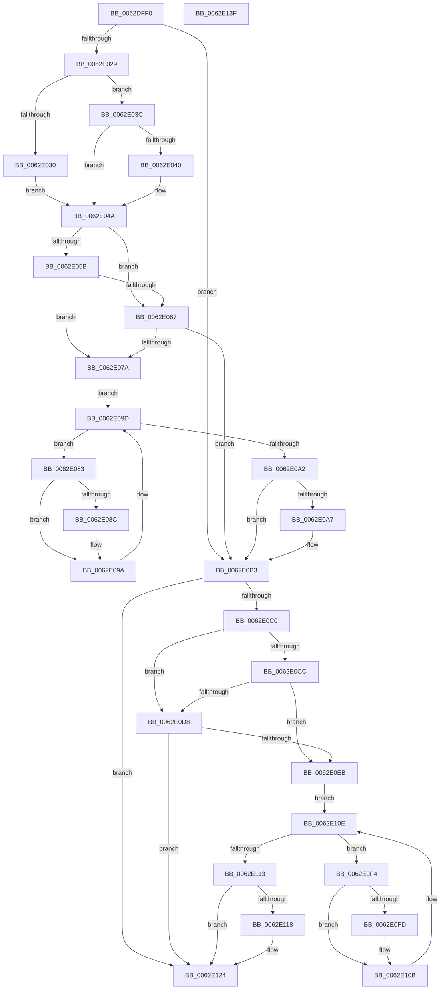

# DifKeAcquireGuardedMutexUnsafeWrapper

- RVA: `0x0062DFF0`–`0x0062E140` (길이 `336` bytes)
- VA: `0x000000014062DFF0`
- 실행 섹션: `.text`
- PDB 이름 있음: `예`; PDB Function 태그: `아니요`
- unwind 정보 RVA: `0x0005D7BC`
- 디코드: `90`개 명령, `336/336` bytes 표시
- 미해석 바이트: `0` (있으면 어셈블리에 `.byte`로 보존)

> 이 문서는 커널 이미지의 기계어와 PDB 기호를 분석해 생성했습니다. 4번과 5번은 함수 원형과 자료형을 바이너리 사용 방식에서 추정한 C 해석이며 원본 소스 복구 결과는 아닙니다.

## 1. Dependencies

- 직접 호출 지점: **9**; 고유 호출 대상: **6**
- 직접 호출자로 확인된 함수: **0**
- RIP 상대 이미지 참조: **3**

### Outgoing calls
- `0x0062E018` → [DifGetAPIThunkContextById](../49/DifGetAPIThunkContextById_function_00495A34.md) (function, `0x00495A34`)
- `0x0062E040` → [DifGetReturnAddressForWrappers](../4D/DifGetReturnAddressForWrappers_function_004D3C08.md) (function, `0x004D3C08`)
- `0x0062E06E` → [ExAcquireRundownProtection](../21/ExAcquireRundownProtection_function_00216620.md) (function, `0x00216620`)
- `0x0062E095` → [guard_dispatch_icall](../6B/guard_dispatch_icall_function_006BAAD0.md) (function, `0x006BAAD0`)
- `0x0062E0AE` → [ExReleaseRundownProtection](../34/ExReleaseRundownProtection_function_00349E80.md) (function, `0x00349E80`)
- `0x0062E0B6` → [ExAcquireFastMutexUnsafe](../3F/ExAcquireFastMutexUnsafe_function_003F3720.md) (function, `0x003F3720`)
- `0x0062E0DF` → [ExAcquireRundownProtection](../21/ExAcquireRundownProtection_function_00216620.md) (function, `0x00216620`)
- `0x0062E106` → [guard_dispatch_icall](../6B/guard_dispatch_icall_function_006BAAD0.md) (function, `0x006BAAD0`)
- `0x0062E11F` → [ExReleaseRundownProtection](../34/ExReleaseRundownProtection_function_00349E80.md) (function, `0x00349E80`)

### Direct callers
- 이 함수 시작 RVA로 연결되는 직접 call은 확인되지 않았습니다. 간접 호출은 완전히 역산할 수 없습니다.

### Static image references
- `0x0062E052` → RVA `0x00F048B8` (`.data`; read)
- `0x0062E05B` → RVA `0x00F04980` (`.data`; read)
- `0x0062E067` → RVA `0x00F03E80` (`.data`; read)

## 2. Other-region calls and transfers

- 다른 실행 섹션으로 향하는 call: **0**
- 별도 외부 분기/꼬리 이동을 확인하지 못했습니다.

## 3. Assembly (complete function range)

```asm
0062DFF0  48 8B C4                        mov rax, rsp
0062DFF3  48 89 58 08                     mov qword ptr [rax + 8], rbx
0062DFF7  48 89 68 10                     mov qword ptr [rax + 0x10], rbp
0062DFFB  48 89 70 18                     mov qword ptr [rax + 0x18], rsi
0062DFFF  48 89 78 20                     mov qword ptr [rax + 0x20], rdi
0062E003  41 56                           push r14
0062E005  48 83 EC 30                     sub rsp, 0x30
0062E009  48 8B E9                        mov rbp, rcx
0062E00C  0F 57 C0                        xorps xmm0, xmm0
0062E00F  B9 2B 01 00 00                  mov ecx, 0x12b
0062E014  0F 11 40 E8                     movups xmmword ptr [rax - 0x18], xmm0
0062E018  E8 17 7A E6 FF                  call 0x140495a34
0062E01D  48 8B F8                        mov rdi, rax
0062E020  48 85 C0                        test rax, rax
0062E023  0F 84 8A 00 00 00               je 0x14062e0b3
0062E029  8B 40 0C                        mov eax, dword ptr [rax + 0xc]
0062E02C  A8 18                           test al, 0x18
0062E02E  74 0C                           je 0x14062e03c
0062E030  48 8B 4C 24 38                  mov rcx, qword ptr [rsp + 0x38]
0062E035  48 89 4C 24 20                  mov qword ptr [rsp + 0x20], rcx
0062E03A  EB 0E                           jmp 0x14062e04a
0062E03C  A8 04                           test al, 4
0062E03E  74 0A                           je 0x14062e04a
0062E040  E8 C3 5B EA FF                  call 0x1404d3c08
0062E045  48 89 44 24 20                  mov qword ptr [rsp + 0x20], rax
0062E04A  40 32 F6                        xor sil, sil
0062E04D  48 89 6C 24 28                  mov qword ptr [rsp + 0x28], rbp
0062E052  40 38 35 5F 68 8D 00            cmp byte ptr [rip + 0x8d685f], sil
0062E059  75 0C                           jne 0x14062e067
0062E05B  F7 05 1B 69 8D 00 00 08 00 00   test dword ptr [rip + 0x8d691b], 0x800
0062E065  74 13                           je 0x14062e07a
0062E067  48 8D 0D 12 5E 8D 00            lea rcx, [rip + 0x8d5e12]
0062E06E  E8 AD 85 BE FF                  call 0x140216620
0062E073  40 8A F0                        mov sil, al
0062E076  84 C0                           test al, al
0062E078  74 39                           je 0x14062e0b3
0062E07A  4C 8D 77 20                     lea r14, [rdi + 0x20]
0062E07E  49 8B 1E                        mov rbx, qword ptr [r14]
0062E081  EB 1A                           jmp 0x14062e09d
0062E083  48 8D 43 F0                     lea rax, [rbx - 0x10]
0062E087  48 85 C0                        test rax, rax
0062E08A  74 0E                           je 0x14062e09a
0062E08C  48 8B 40 08                     mov rax, qword ptr [rax + 8]
0062E090  48 8D 4C 24 20                  lea rcx, [rsp + 0x20]
0062E095  E8 36 CA 08 00                  call 0x1406baad0
0062E09A  48 8B 1B                        mov rbx, qword ptr [rbx]
0062E09D  49 3B DE                        cmp rbx, r14
0062E0A0  75 E1                           jne 0x14062e083
0062E0A2  40 84 F6                        test sil, sil
0062E0A5  74 0C                           je 0x14062e0b3
0062E0A7  48 8D 0D D2 5D 8D 00            lea rcx, [rip + 0x8d5dd2]
0062E0AE  E8 CD BD D1 FF                  call 0x140349e80
0062E0B3  48 8B CD                        mov rcx, rbp
0062E0B6  E8 65 56 DC FF                  call 0x1403f3720
0062E0BB  48 85 FF                        test rdi, rdi
0062E0BE  74 64                           je 0x14062e124
0062E0C0  40 32 F6                        xor sil, sil
0062E0C3  40 38 35 EE 67 8D 00            cmp byte ptr [rip + 0x8d67ee], sil
0062E0CA  75 0C                           jne 0x14062e0d8
0062E0CC  F7 05 AA 68 8D 00 00 08 00 00   test dword ptr [rip + 0x8d68aa], 0x800
0062E0D6  74 13                           je 0x14062e0eb
0062E0D8  48 8D 0D A1 5D 8D 00            lea rcx, [rip + 0x8d5da1]
0062E0DF  E8 3C 85 BE FF                  call 0x140216620
0062E0E4  40 8A F0                        mov sil, al
0062E0E7  84 C0                           test al, al
0062E0E9  74 39                           je 0x14062e124
0062E0EB  48 83 C7 30                     add rdi, 0x30
0062E0EF  48 8B 1F                        mov rbx, qword ptr [rdi]
0062E0F2  EB 1A                           jmp 0x14062e10e
0062E0F4  48 8D 43 F0                     lea rax, [rbx - 0x10]
0062E0F8  48 85 C0                        test rax, rax
0062E0FB  74 0E                           je 0x14062e10b
0062E0FD  48 8B 40 08                     mov rax, qword ptr [rax + 8]
0062E101  48 8D 4C 24 20                  lea rcx, [rsp + 0x20]
0062E106  E8 C5 C9 08 00                  call 0x1406baad0
0062E10B  48 8B 1B                        mov rbx, qword ptr [rbx]
0062E10E  48 3B DF                        cmp rbx, rdi
0062E111  75 E1                           jne 0x14062e0f4
0062E113  40 84 F6                        test sil, sil
0062E116  74 0C                           je 0x14062e124
0062E118  48 8D 0D 61 5D 8D 00            lea rcx, [rip + 0x8d5d61]
0062E11F  E8 5C BD D1 FF                  call 0x140349e80
0062E124  48 8B 5C 24 40                  mov rbx, qword ptr [rsp + 0x40]
0062E129  48 8B 6C 24 48                  mov rbp, qword ptr [rsp + 0x48]
0062E12E  48 8B 74 24 50                  mov rsi, qword ptr [rsp + 0x50]
0062E133  48 8B 7C 24 58                  mov rdi, qword ptr [rsp + 0x58]
0062E138  48 83 C4 30                     add rsp, 0x30
0062E13C  41 5E                           pop r14
0062E13E  C3                              ret
0062E13F  CC                              int3
```

## 4. C-style interpretation (structured pseudocode)

```c
__int64 __fastcall DifKeAcquireGuardedMutexUnsafeWrapper(__int64 a1)
{
    __int64 result;
    __int64 v_rdi;
    __int64 v_rsi;
    __int64 v_rsp;
    unsigned __int64 v_stack_m10;
    unsigned __int64 v_stack_m18;
    unsigned __int64 v_stack_p0;
    unsigned __int64 v_stack_p10;
    unsigned __int64 v_stack_p18;
    unsigned __int64 v_stack_p20;
    unsigned __int64 v_stack_p8;

    *(unsigned __int64 *)(v_rsp + 8) = v_rbx;
    *(unsigned __int64 *)(v_rsp + 16) = v_rbp;
    *(unsigned __int64 *)(v_rsp + 24) = v_rsi;
    *(unsigned __int64 *)(v_rsp + 32) = v_rdi;
    v_rsp = (v_rsp) - (48);
    *(unsigned __int64 *)(v_rsp - 24) = v_xmm0;
    result = DifGetAPIThunkContextById(299, a2, a3, a4);
    if (result == 0) goto loc_0062E0B3;
    if ((((unsigned __int8)((unsigned int)(*(unsigned int *)(result + 12)))) & (24)) == 0) goto loc_0062E03C;
    v_stack_m18 = v_stack_p0;
    goto loc_0062E04A;
loc_0062E03C:
    result = (unsigned int)(*(unsigned int *)(result + 12));
    if ((((unsigned __int8)((unsigned int)(*(unsigned int *)(result + 12)))) & (4)) != 0) {
        result = DifGetReturnAddressForWrappers(v_stack_p0, a2, a3, a4);
        v_stack_m18 = result;
    }
    v_rsi = 0;
    v_stack_m10 = a1;
    if ((*(unsigned __int8 *)(v_rip + 9267295)) != 0) goto loc_0062E067;
    if (((*(unsigned int *)(v_rip + 9267483)) & (0x800ULL)) == 0) goto loc_0062E07A;
loc_0062E067:
    result = ExAcquireRundownProtection(v_rip + 9264658, a2, a3, a4);
    if ((unsigned __int8)(result) == 0) goto loc_0062E0B3;
loc_0062E07A:
    goto loc_0062E09D;
loc_0062E083:
    result = *(unsigned __int64 *)(result + 32) - 16;
    if (*(unsigned __int64 *)(result + 32) - 16 != 0) {
        result = *(unsigned __int64 *)(*(unsigned __int64 *)(result + 32) - 16 + 8);
        a1 = v_stack_m18;
        result = guard_dispatch_icall(a1, a2, a3, a4);
    }
loc_0062E09D:
    if ((*(unsigned __int64 *)(*(unsigned __int64 *)(result + 32))) != (result + 32)) goto loc_0062E083;
    if ((unsigned __int8)((unsigned __int8)(result)) != 0) {
        a1 = v_rip + 9264594;
        result = ExReleaseRundownProtection(a1, a2, a3, a4);
    }
    result = ExAcquireFastMutexUnsafe(a1, a2, a3, a4);
    if (result == 0) goto loc_0062E124;
    v_rsi = 0;
    if ((*(unsigned __int8 *)(v_rip + 9267182)) != 0) goto loc_0062E0D8;
    if (((*(unsigned int *)(v_rip + 9267370)) & (0x800ULL)) == 0) goto loc_0062E0EB;
loc_0062E0D8:
    result = ExAcquireRundownProtection(v_rip + 9264545, a2, a3, a4);
    if ((unsigned __int8)(result) == 0) goto loc_0062E124;
loc_0062E0EB:
    v_rdi = (result) + (48);
    goto loc_0062E10E;
loc_0062E0F4:
    result = *(unsigned __int64 *)(v_rdi) - 16;
    if (*(unsigned __int64 *)(v_rdi) - 16 != 0) {
        result = *(unsigned __int64 *)(*(unsigned __int64 *)(v_rdi) - 16 + 8);
        a1 = v_stack_m18;
        result = guard_dispatch_icall(a1, a2, a3, a4);
    }
loc_0062E10E:
    if ((*(unsigned __int64 *)(*(unsigned __int64 *)(v_rdi))) != v_rdi) goto loc_0062E0F4;
    if ((unsigned __int8)((unsigned __int8)(result)) != 0) {
        a1 = v_rip + 9264481;
        result = ExReleaseRundownProtection(a1, a2, a3, a4);
    }
    v_rsp = (v_rsp) + (48);
    return result;
}
```

## 5. (Beta) C Style

```c
int64_t DifKeAcquireGuardedMutexUnsafeWrapper(int64_t Arg1)
{
    int64_t result;
    int64_t local_rdi;
    int64_t local_rsi;
    int64_t local_rsp;
    uint64_t v_stack_m10;
    uint64_t v_stack_m18;
    uint64_t v_stack_p0;
    uint64_t v_stack_p10;
    uint64_t v_stack_p18;
    uint64_t v_stack_p20;
    uint64_t v_stack_p8;

    *(uint64_t *)(local_rsp + 0x8) = local_rbx;
    *(uint64_t *)(local_rsp + 0x10) = local_rbp;
    *(uint64_t *)(local_rsp + 0x18) = local_rsi;
    *(uint64_t *)(local_rsp + 0x20) = local_rdi;
    local_rsp = (local_rsp) - (48);
    *(uint64_t *)(local_rsp - 0x18) = v_xmm0;
    result = DifGetAPIThunkContextById(299, a2, a3, a4);
    if (result == 0) goto loc_0062E0B3;
    if ((((uint8_t)((uint32_t)(*(uint32_t *)(result + 0xC)))) & (24)) == 0) goto loc_0062E03C;
    v_stack_m18 = v_stack_p0;
    goto loc_0062E04A;
loc_0062E03C:
    result = (uint32_t)(*(uint32_t *)(result + 0xC));
    if ((((uint8_t)((uint32_t)(*(uint32_t *)(result + 0xC)))) & (4)) != 0) {
        result = DifGetReturnAddressForWrappers(v_stack_p0, a2, a3, a4);
        v_stack_m18 = result;
    }
    local_rsi = 0;
    v_stack_m10 = Arg1;
    if ((*(uint8_t *)(v_rip + 0x8D685F)) != 0) goto loc_0062E067;
    if (((*(uint32_t *)(v_rip + 0x8D691B)) & (0x800ULL)) == 0) goto loc_0062E07A;
loc_0062E067:
    result = ExAcquireRundownProtection(v_rip + 9264658, a2, a3, a4);
    if ((uint8_t)(result) == 0) goto loc_0062E0B3;
loc_0062E07A:
    goto loc_0062E09D;
loc_0062E083:
    result = *(uint64_t *)(result + 0x20) - 16;
    if (*(uint64_t *)(result + 0x20) - 16 != 0) {
        result = *(uint64_t *)(*(uint64_t *)(result + 0x20) - 0x10 + 0x8);
        Arg1 = v_stack_m18;
        result = guard_dispatch_icall(Arg1, a2, a3, a4);
    }
loc_0062E09D:
    if ((*(uint64_t *)(*(uint64_t *)(result + 0x20))) != (result + 32)) goto loc_0062E083;
    if ((uint8_t)((uint8_t)(result)) != 0) {
        Arg1 = v_rip + 9264594;
        result = ExReleaseRundownProtection(Arg1, a2, a3, a4);
    }
    result = ExAcquireFastMutexUnsafe(Arg1, a2, a3, a4);
    if (result == 0) goto loc_0062E124;
    local_rsi = 0;
    if ((*(uint8_t *)(v_rip + 0x8D67EE)) != 0) goto loc_0062E0D8;
    if (((*(uint32_t *)(v_rip + 0x8D68AA)) & (0x800ULL)) == 0) goto loc_0062E0EB;
loc_0062E0D8:
    result = ExAcquireRundownProtection(v_rip + 9264545, a2, a3, a4);
    if ((uint8_t)(result) == 0) goto loc_0062E124;
loc_0062E0EB:
    local_rdi = (result) + (48);
    goto loc_0062E10E;
loc_0062E0F4:
    result = *(uint64_t *)(local_rdi) - 16;
    if (*(uint64_t *)(local_rdi) - 16 != 0) {
        result = *(uint64_t *)(*(uint64_t *)(local_rdi) - 0x10 + 0x8);
        Arg1 = v_stack_m18;
        result = guard_dispatch_icall(Arg1, a2, a3, a4);
    }
loc_0062E10E:
    if ((*(uint64_t *)(*(uint64_t *)(local_rdi))) != local_rdi) goto loc_0062E0F4;
    if ((uint8_t)((uint8_t)(result)) != 0) {
        Arg1 = v_rip + 9264481;
        result = ExReleaseRundownProtection(Arg1, a2, a3, a4);
    }
    local_rsp = (local_rsp) + (48);
    return result;
}
```

## 6. Execution-region graph

[열기: 2D/3D 그래프와 함수 탐색 컨트롤 패널](../../../control-panel.html?section=text&rva=0x0062DFF0&view=graph)

- 2D 그래프는 위에서 아래로 흐르고, 3D 그래프는 빈 공간을 드래그해 회전합니다. Shift+드래그는 이동, 휠은 확대·축소, 함수 노드 선택은 대상 보고서 이동입니다.

### Static fallback


