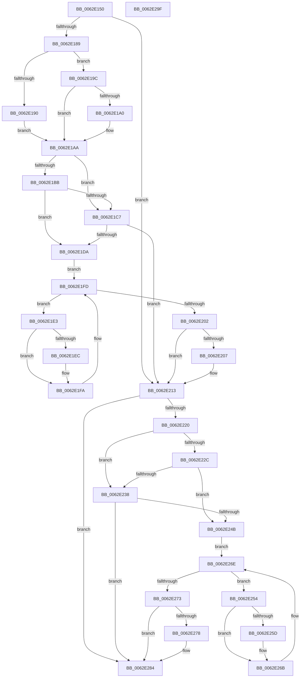

# DifKeAcquireGuardedMutexWrapper

- RVA: `0x0062E150`–`0x0062E2A0` (길이 `336` bytes)
- VA: `0x000000014062E150`
- 실행 섹션: `.text`
- PDB 이름 있음: `예`; PDB Function 태그: `아니요`
- unwind 정보 RVA: `0x0005D7BC`
- 디코드: `90`개 명령, `336/336` bytes 표시
- 미해석 바이트: `0` (있으면 어셈블리에 `.byte`로 보존)

> 이 문서는 커널 이미지의 기계어와 PDB 기호를 분석해 생성했습니다. 4번과 5번은 함수 원형과 자료형을 바이너리 사용 방식에서 추정한 C 해석이며 원본 소스 복구 결과는 아닙니다.

## 1. Dependencies

- 직접 호출 지점: **9**; 고유 호출 대상: **6**
- 직접 호출자로 확인된 함수: **0**
- RIP 상대 이미지 참조: **3**

### Outgoing calls
- `0x0062E178` → [DifGetAPIThunkContextById](../49/DifGetAPIThunkContextById_function_00495A34.md) (function, `0x00495A34`)
- `0x0062E1A0` → [DifGetReturnAddressForWrappers](../4D/DifGetReturnAddressForWrappers_function_004D3C08.md) (function, `0x004D3C08`)
- `0x0062E1CE` → [ExAcquireRundownProtection](../21/ExAcquireRundownProtection_function_00216620.md) (function, `0x00216620`)
- `0x0062E1F5` → [guard_dispatch_icall](../6B/guard_dispatch_icall_function_006BAAD0.md) (function, `0x006BAAD0`)
- `0x0062E20E` → [ExReleaseRundownProtection](../34/ExReleaseRundownProtection_function_00349E80.md) (function, `0x00349E80`)
- `0x0062E216` → [ExAcquireFastMutex](../20/ExAcquireFastMutex_function_0020E5A0.md) (function, `0x0020E5A0`)
- `0x0062E23F` → [ExAcquireRundownProtection](../21/ExAcquireRundownProtection_function_00216620.md) (function, `0x00216620`)
- `0x0062E266` → [guard_dispatch_icall](../6B/guard_dispatch_icall_function_006BAAD0.md) (function, `0x006BAAD0`)
- `0x0062E27F` → [ExReleaseRundownProtection](../34/ExReleaseRundownProtection_function_00349E80.md) (function, `0x00349E80`)

### Direct callers
- 이 함수 시작 RVA로 연결되는 직접 call은 확인되지 않았습니다. 간접 호출은 완전히 역산할 수 없습니다.

### Static image references
- `0x0062E1B2` → RVA `0x00F048B8` (`.data`; read)
- `0x0062E1BB` → RVA `0x00F04980` (`.data`; read)
- `0x0062E1C7` → RVA `0x00F03E80` (`.data`; read)

## 2. Other-region calls and transfers

- 다른 실행 섹션으로 향하는 call: **0**
- 별도 외부 분기/꼬리 이동을 확인하지 못했습니다.

## 3. Assembly (complete function range)

```asm
0062E150  48 8B C4                        mov rax, rsp
0062E153  48 89 58 08                     mov qword ptr [rax + 8], rbx
0062E157  48 89 68 10                     mov qword ptr [rax + 0x10], rbp
0062E15B  48 89 70 18                     mov qword ptr [rax + 0x18], rsi
0062E15F  48 89 78 20                     mov qword ptr [rax + 0x20], rdi
0062E163  41 56                           push r14
0062E165  48 83 EC 30                     sub rsp, 0x30
0062E169  48 8B E9                        mov rbp, rcx
0062E16C  0F 57 C0                        xorps xmm0, xmm0
0062E16F  B9 2C 01 00 00                  mov ecx, 0x12c
0062E174  0F 11 40 E8                     movups xmmword ptr [rax - 0x18], xmm0
0062E178  E8 B7 78 E6 FF                  call 0x140495a34
0062E17D  48 8B F8                        mov rdi, rax
0062E180  48 85 C0                        test rax, rax
0062E183  0F 84 8A 00 00 00               je 0x14062e213
0062E189  8B 40 0C                        mov eax, dword ptr [rax + 0xc]
0062E18C  A8 18                           test al, 0x18
0062E18E  74 0C                           je 0x14062e19c
0062E190  48 8B 4C 24 38                  mov rcx, qword ptr [rsp + 0x38]
0062E195  48 89 4C 24 20                  mov qword ptr [rsp + 0x20], rcx
0062E19A  EB 0E                           jmp 0x14062e1aa
0062E19C  A8 04                           test al, 4
0062E19E  74 0A                           je 0x14062e1aa
0062E1A0  E8 63 5A EA FF                  call 0x1404d3c08
0062E1A5  48 89 44 24 20                  mov qword ptr [rsp + 0x20], rax
0062E1AA  40 32 F6                        xor sil, sil
0062E1AD  48 89 6C 24 28                  mov qword ptr [rsp + 0x28], rbp
0062E1B2  40 38 35 FF 66 8D 00            cmp byte ptr [rip + 0x8d66ff], sil
0062E1B9  75 0C                           jne 0x14062e1c7
0062E1BB  F7 05 BB 67 8D 00 00 08 00 00   test dword ptr [rip + 0x8d67bb], 0x800
0062E1C5  74 13                           je 0x14062e1da
0062E1C7  48 8D 0D B2 5C 8D 00            lea rcx, [rip + 0x8d5cb2]
0062E1CE  E8 4D 84 BE FF                  call 0x140216620
0062E1D3  40 8A F0                        mov sil, al
0062E1D6  84 C0                           test al, al
0062E1D8  74 39                           je 0x14062e213
0062E1DA  4C 8D 77 20                     lea r14, [rdi + 0x20]
0062E1DE  49 8B 1E                        mov rbx, qword ptr [r14]
0062E1E1  EB 1A                           jmp 0x14062e1fd
0062E1E3  48 8D 43 F0                     lea rax, [rbx - 0x10]
0062E1E7  48 85 C0                        test rax, rax
0062E1EA  74 0E                           je 0x14062e1fa
0062E1EC  48 8B 40 08                     mov rax, qword ptr [rax + 8]
0062E1F0  48 8D 4C 24 20                  lea rcx, [rsp + 0x20]
0062E1F5  E8 D6 C8 08 00                  call 0x1406baad0
0062E1FA  48 8B 1B                        mov rbx, qword ptr [rbx]
0062E1FD  49 3B DE                        cmp rbx, r14
0062E200  75 E1                           jne 0x14062e1e3
0062E202  40 84 F6                        test sil, sil
0062E205  74 0C                           je 0x14062e213
0062E207  48 8D 0D 72 5C 8D 00            lea rcx, [rip + 0x8d5c72]
0062E20E  E8 6D BC D1 FF                  call 0x140349e80
0062E213  48 8B CD                        mov rcx, rbp
0062E216  E8 85 03 BE FF                  call 0x14020e5a0
0062E21B  48 85 FF                        test rdi, rdi
0062E21E  74 64                           je 0x14062e284
0062E220  40 32 F6                        xor sil, sil
0062E223  40 38 35 8E 66 8D 00            cmp byte ptr [rip + 0x8d668e], sil
0062E22A  75 0C                           jne 0x14062e238
0062E22C  F7 05 4A 67 8D 00 00 08 00 00   test dword ptr [rip + 0x8d674a], 0x800
0062E236  74 13                           je 0x14062e24b
0062E238  48 8D 0D 41 5C 8D 00            lea rcx, [rip + 0x8d5c41]
0062E23F  E8 DC 83 BE FF                  call 0x140216620
0062E244  40 8A F0                        mov sil, al
0062E247  84 C0                           test al, al
0062E249  74 39                           je 0x14062e284
0062E24B  48 83 C7 30                     add rdi, 0x30
0062E24F  48 8B 1F                        mov rbx, qword ptr [rdi]
0062E252  EB 1A                           jmp 0x14062e26e
0062E254  48 8D 43 F0                     lea rax, [rbx - 0x10]
0062E258  48 85 C0                        test rax, rax
0062E25B  74 0E                           je 0x14062e26b
0062E25D  48 8B 40 08                     mov rax, qword ptr [rax + 8]
0062E261  48 8D 4C 24 20                  lea rcx, [rsp + 0x20]
0062E266  E8 65 C8 08 00                  call 0x1406baad0
0062E26B  48 8B 1B                        mov rbx, qword ptr [rbx]
0062E26E  48 3B DF                        cmp rbx, rdi
0062E271  75 E1                           jne 0x14062e254
0062E273  40 84 F6                        test sil, sil
0062E276  74 0C                           je 0x14062e284
0062E278  48 8D 0D 01 5C 8D 00            lea rcx, [rip + 0x8d5c01]
0062E27F  E8 FC BB D1 FF                  call 0x140349e80
0062E284  48 8B 5C 24 40                  mov rbx, qword ptr [rsp + 0x40]
0062E289  48 8B 6C 24 48                  mov rbp, qword ptr [rsp + 0x48]
0062E28E  48 8B 74 24 50                  mov rsi, qword ptr [rsp + 0x50]
0062E293  48 8B 7C 24 58                  mov rdi, qword ptr [rsp + 0x58]
0062E298  48 83 C4 30                     add rsp, 0x30
0062E29C  41 5E                           pop r14
0062E29E  C3                              ret
0062E29F  CC                              int3
```

## 4. C-style interpretation (structured pseudocode)

```c
__int64 __fastcall DifKeAcquireGuardedMutexWrapper(__int64 a1)
{
    __int64 result;
    __int64 v_rdi;
    __int64 v_rsi;
    __int64 v_rsp;
    unsigned __int64 v_stack_m10;
    unsigned __int64 v_stack_m18;
    unsigned __int64 v_stack_p0;
    unsigned __int64 v_stack_p10;
    unsigned __int64 v_stack_p18;
    unsigned __int64 v_stack_p20;
    unsigned __int64 v_stack_p8;

    *(unsigned __int64 *)(v_rsp + 8) = v_rbx;
    *(unsigned __int64 *)(v_rsp + 16) = v_rbp;
    *(unsigned __int64 *)(v_rsp + 24) = v_rsi;
    *(unsigned __int64 *)(v_rsp + 32) = v_rdi;
    v_rsp = (v_rsp) - (48);
    *(unsigned __int64 *)(v_rsp - 24) = v_xmm0;
    result = DifGetAPIThunkContextById(300, a2, a3, a4);
    if (result == 0) goto loc_0062E213;
    if ((((unsigned __int8)((unsigned int)(*(unsigned int *)(result + 12)))) & (24)) == 0) goto loc_0062E19C;
    v_stack_m18 = v_stack_p0;
    goto loc_0062E1AA;
loc_0062E19C:
    result = (unsigned int)(*(unsigned int *)(result + 12));
    if ((((unsigned __int8)((unsigned int)(*(unsigned int *)(result + 12)))) & (4)) != 0) {
        result = DifGetReturnAddressForWrappers(v_stack_p0, a2, a3, a4);
        v_stack_m18 = result;
    }
    v_rsi = 0;
    v_stack_m10 = a1;
    if ((*(unsigned __int8 *)(v_rip + 9266943)) != 0) goto loc_0062E1C7;
    if (((*(unsigned int *)(v_rip + 9267131)) & (0x800ULL)) == 0) goto loc_0062E1DA;
loc_0062E1C7:
    result = ExAcquireRundownProtection(v_rip + 9264306, a2, a3, a4);
    if ((unsigned __int8)(result) == 0) goto loc_0062E213;
loc_0062E1DA:
    goto loc_0062E1FD;
loc_0062E1E3:
    result = *(unsigned __int64 *)(result + 32) - 16;
    if (*(unsigned __int64 *)(result + 32) - 16 != 0) {
        result = *(unsigned __int64 *)(*(unsigned __int64 *)(result + 32) - 16 + 8);
        a1 = v_stack_m18;
        result = guard_dispatch_icall(a1, a2, a3, a4);
    }
loc_0062E1FD:
    if ((*(unsigned __int64 *)(*(unsigned __int64 *)(result + 32))) != (result + 32)) goto loc_0062E1E3;
    if ((unsigned __int8)((unsigned __int8)(result)) != 0) {
        a1 = v_rip + 9264242;
        result = ExReleaseRundownProtection(a1, a2, a3, a4);
    }
    result = ExAcquireFastMutex(a1, a2, a3, a4);
    if (result == 0) goto loc_0062E284;
    v_rsi = 0;
    if ((*(unsigned __int8 *)(v_rip + 9266830)) != 0) goto loc_0062E238;
    if (((*(unsigned int *)(v_rip + 9267018)) & (0x800ULL)) == 0) goto loc_0062E24B;
loc_0062E238:
    result = ExAcquireRundownProtection(v_rip + 9264193, a2, a3, a4);
    if ((unsigned __int8)(result) == 0) goto loc_0062E284;
loc_0062E24B:
    v_rdi = (result) + (48);
    goto loc_0062E26E;
loc_0062E254:
    result = *(unsigned __int64 *)(v_rdi) - 16;
    if (*(unsigned __int64 *)(v_rdi) - 16 != 0) {
        result = *(unsigned __int64 *)(*(unsigned __int64 *)(v_rdi) - 16 + 8);
        a1 = v_stack_m18;
        result = guard_dispatch_icall(a1, a2, a3, a4);
    }
loc_0062E26E:
    if ((*(unsigned __int64 *)(*(unsigned __int64 *)(v_rdi))) != v_rdi) goto loc_0062E254;
    if ((unsigned __int8)((unsigned __int8)(result)) != 0) {
        a1 = v_rip + 9264129;
        result = ExReleaseRundownProtection(a1, a2, a3, a4);
    }
    v_rsp = (v_rsp) + (48);
    return result;
}
```

## 5. (Beta) C Style

```c
int64_t DifKeAcquireGuardedMutexWrapper(int64_t Arg1)
{
    int64_t result;
    int64_t local_rdi;
    int64_t local_rsi;
    int64_t local_rsp;
    uint64_t v_stack_m10;
    uint64_t v_stack_m18;
    uint64_t v_stack_p0;
    uint64_t v_stack_p10;
    uint64_t v_stack_p18;
    uint64_t v_stack_p20;
    uint64_t v_stack_p8;

    *(uint64_t *)(local_rsp + 0x8) = local_rbx;
    *(uint64_t *)(local_rsp + 0x10) = local_rbp;
    *(uint64_t *)(local_rsp + 0x18) = local_rsi;
    *(uint64_t *)(local_rsp + 0x20) = local_rdi;
    local_rsp = (local_rsp) - (48);
    *(uint64_t *)(local_rsp - 0x18) = v_xmm0;
    result = DifGetAPIThunkContextById(300, a2, a3, a4);
    if (result == 0) goto loc_0062E213;
    if ((((uint8_t)((uint32_t)(*(uint32_t *)(result + 0xC)))) & (24)) == 0) goto loc_0062E19C;
    v_stack_m18 = v_stack_p0;
    goto loc_0062E1AA;
loc_0062E19C:
    result = (uint32_t)(*(uint32_t *)(result + 0xC));
    if ((((uint8_t)((uint32_t)(*(uint32_t *)(result + 0xC)))) & (4)) != 0) {
        result = DifGetReturnAddressForWrappers(v_stack_p0, a2, a3, a4);
        v_stack_m18 = result;
    }
    local_rsi = 0;
    v_stack_m10 = Arg1;
    if ((*(uint8_t *)(v_rip + 0x8D66FF)) != 0) goto loc_0062E1C7;
    if (((*(uint32_t *)(v_rip + 0x8D67BB)) & (0x800ULL)) == 0) goto loc_0062E1DA;
loc_0062E1C7:
    result = ExAcquireRundownProtection(v_rip + 9264306, a2, a3, a4);
    if ((uint8_t)(result) == 0) goto loc_0062E213;
loc_0062E1DA:
    goto loc_0062E1FD;
loc_0062E1E3:
    result = *(uint64_t *)(result + 0x20) - 16;
    if (*(uint64_t *)(result + 0x20) - 16 != 0) {
        result = *(uint64_t *)(*(uint64_t *)(result + 0x20) - 0x10 + 0x8);
        Arg1 = v_stack_m18;
        result = guard_dispatch_icall(Arg1, a2, a3, a4);
    }
loc_0062E1FD:
    if ((*(uint64_t *)(*(uint64_t *)(result + 0x20))) != (result + 32)) goto loc_0062E1E3;
    if ((uint8_t)((uint8_t)(result)) != 0) {
        Arg1 = v_rip + 9264242;
        result = ExReleaseRundownProtection(Arg1, a2, a3, a4);
    }
    result = ExAcquireFastMutex(Arg1, a2, a3, a4);
    if (result == 0) goto loc_0062E284;
    local_rsi = 0;
    if ((*(uint8_t *)(v_rip + 0x8D668E)) != 0) goto loc_0062E238;
    if (((*(uint32_t *)(v_rip + 0x8D674A)) & (0x800ULL)) == 0) goto loc_0062E24B;
loc_0062E238:
    result = ExAcquireRundownProtection(v_rip + 9264193, a2, a3, a4);
    if ((uint8_t)(result) == 0) goto loc_0062E284;
loc_0062E24B:
    local_rdi = (result) + (48);
    goto loc_0062E26E;
loc_0062E254:
    result = *(uint64_t *)(local_rdi) - 16;
    if (*(uint64_t *)(local_rdi) - 16 != 0) {
        result = *(uint64_t *)(*(uint64_t *)(local_rdi) - 0x10 + 0x8);
        Arg1 = v_stack_m18;
        result = guard_dispatch_icall(Arg1, a2, a3, a4);
    }
loc_0062E26E:
    if ((*(uint64_t *)(*(uint64_t *)(local_rdi))) != local_rdi) goto loc_0062E254;
    if ((uint8_t)((uint8_t)(result)) != 0) {
        Arg1 = v_rip + 9264129;
        result = ExReleaseRundownProtection(Arg1, a2, a3, a4);
    }
    local_rsp = (local_rsp) + (48);
    return result;
}
```

## 6. Execution-region graph

[열기: 2D/3D 그래프와 함수 탐색 컨트롤 패널](../../../control-panel.html?section=text&rva=0x0062E150&view=graph)

- 2D 그래프는 위에서 아래로 흐르고, 3D 그래프는 빈 공간을 드래그해 회전합니다. Shift+드래그는 이동, 휠은 확대·축소, 함수 노드 선택은 대상 보고서 이동입니다.

### Static fallback


