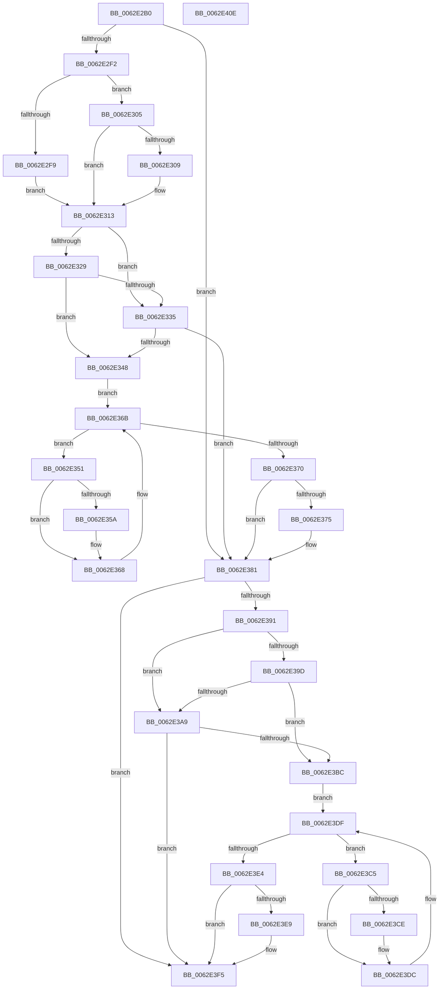

# DifKeAcquireInStackQueuedSpinLockAtDpcLevelWrapper

- RVA: `0x0062E2B0`–`0x0062E40F` (길이 `351` bytes)
- VA: `0x000000014062E2B0`
- 실행 섹션: `.text`
- PDB 이름 있음: `예`; PDB Function 태그: `아니요`
- unwind 정보 RVA: `0x00093E28`
- 디코드: `97`개 명령, `351/351` bytes 표시
- 미해석 바이트: `0` (있으면 어셈블리에 `.byte`로 보존)

> 이 문서는 커널 이미지의 기계어와 PDB 기호를 분석해 생성했습니다. 4번과 5번은 함수 원형과 자료형을 바이너리 사용 방식에서 추정한 C 해석이며 원본 소스 복구 결과는 아닙니다.

## 1. Dependencies

- 직접 호출 지점: **9**; 고유 호출 대상: **6**
- 직접 호출자로 확인된 함수: **0**
- RIP 상대 이미지 참조: **3**

### Outgoing calls
- `0x0062E2E1` → [DifGetAPIThunkContextById](../49/DifGetAPIThunkContextById_function_00495A34.md) (function, `0x00495A34`)
- `0x0062E309` → [DifGetReturnAddressForWrappers](../4D/DifGetReturnAddressForWrappers_function_004D3C08.md) (function, `0x004D3C08`)
- `0x0062E33C` → [ExAcquireRundownProtection](../21/ExAcquireRundownProtection_function_00216620.md) (function, `0x00216620`)
- `0x0062E363` → [guard_dispatch_icall](../6B/guard_dispatch_icall_function_006BAAD0.md) (function, `0x006BAAD0`)
- `0x0062E37C` → [ExReleaseRundownProtection](../34/ExReleaseRundownProtection_function_00349E80.md) (function, `0x00349E80`)
- `0x0062E387` → [KeAcquireInStackQueuedSpinLockAtDpcLevel](../27/KeAcquireInStackQueuedSpinLockAtDpcLevel_function_00275740.md) (function, `0x00275740`)
- `0x0062E3B0` → [ExAcquireRundownProtection](../21/ExAcquireRundownProtection_function_00216620.md) (function, `0x00216620`)
- `0x0062E3D7` → [guard_dispatch_icall](../6B/guard_dispatch_icall_function_006BAAD0.md) (function, `0x006BAAD0`)
- `0x0062E3F0` → [ExReleaseRundownProtection](../34/ExReleaseRundownProtection_function_00349E80.md) (function, `0x00349E80`)

### Direct callers
- 이 함수 시작 RVA로 연결되는 직접 call은 확인되지 않았습니다. 간접 호출은 완전히 역산할 수 없습니다.

### Static image references
- `0x0062E31B` → RVA `0x00F048B8` (`.data`; read)
- `0x0062E329` → RVA `0x00F04980` (`.data`; read)
- `0x0062E335` → RVA `0x00F03E80` (`.data`; read)

## 2. Other-region calls and transfers

- 다른 실행 섹션으로 향하는 call: **0**
- 별도 외부 분기/꼬리 이동을 확인하지 못했습니다.

## 3. Assembly (complete function range)

```asm
0062E2B0  4C 8B DC                        mov r11, rsp
0062E2B3  49 89 5B 08                     mov qword ptr [r11 + 8], rbx
0062E2B7  49 89 6B 10                     mov qword ptr [r11 + 0x10], rbp
0062E2BB  49 89 73 18                     mov qword ptr [r11 + 0x18], rsi
0062E2BF  57                              push rdi
0062E2C0  41 56                           push r14
0062E2C2  41 57                           push r15
0062E2C4  48 83 EC 40                     sub rsp, 0x40
0062E2C8  33 C0                           xor eax, eax
0062E2CA  0F 57 C0                        xorps xmm0, xmm0
0062E2CD  0F 11 44 24 20                  movups xmmword ptr [rsp + 0x20], xmm0
0062E2D2  4C 8B F9                        mov r15, rcx
0062E2D5  49 89 43 D8                     mov qword ptr [r11 - 0x28], rax
0062E2D9  B9 29 01 00 00                  mov ecx, 0x129
0062E2DE  4C 8B F2                        mov r14, rdx
0062E2E1  E8 4E 77 E6 FF                  call 0x140495a34
0062E2E6  48 8B F0                        mov rsi, rax
0062E2E9  48 85 C0                        test rax, rax
0062E2EC  0F 84 8F 00 00 00               je 0x14062e381
0062E2F2  8B 40 0C                        mov eax, dword ptr [rax + 0xc]
0062E2F5  A8 18                           test al, 0x18
0062E2F7  74 0C                           je 0x14062e305
0062E2F9  48 8B 4C 24 58                  mov rcx, qword ptr [rsp + 0x58]
0062E2FE  48 89 4C 24 20                  mov qword ptr [rsp + 0x20], rcx
0062E303  EB 0E                           jmp 0x14062e313
0062E305  A8 04                           test al, 4
0062E307  74 0A                           je 0x14062e313
0062E309  E8 FA 58 EA FF                  call 0x1404d3c08
0062E30E  48 89 44 24 20                  mov qword ptr [rsp + 0x20], rax
0062E313  40 32 ED                        xor bpl, bpl
0062E316  4C 89 7C 24 30                  mov qword ptr [rsp + 0x30], r15
0062E31B  40 38 2D 96 65 8D 00            cmp byte ptr [rip + 0x8d6596], bpl
0062E322  4C 89 74 24 28                  mov qword ptr [rsp + 0x28], r14
0062E327  75 0C                           jne 0x14062e335
0062E329  F7 05 4D 66 8D 00 00 08 00 00   test dword ptr [rip + 0x8d664d], 0x800
0062E333  74 13                           je 0x14062e348
0062E335  48 8D 0D 44 5B 8D 00            lea rcx, [rip + 0x8d5b44]
0062E33C  E8 DF 82 BE FF                  call 0x140216620
0062E341  40 8A E8                        mov bpl, al
0062E344  84 C0                           test al, al
0062E346  74 39                           je 0x14062e381
0062E348  48 8D 7E 20                     lea rdi, [rsi + 0x20]
0062E34C  48 8B 1F                        mov rbx, qword ptr [rdi]
0062E34F  EB 1A                           jmp 0x14062e36b
0062E351  48 8D 43 F0                     lea rax, [rbx - 0x10]
0062E355  48 85 C0                        test rax, rax
0062E358  74 0E                           je 0x14062e368
0062E35A  48 8B 40 08                     mov rax, qword ptr [rax + 8]
0062E35E  48 8D 4C 24 20                  lea rcx, [rsp + 0x20]
0062E363  E8 68 C7 08 00                  call 0x1406baad0
0062E368  48 8B 1B                        mov rbx, qword ptr [rbx]
0062E36B  48 3B DF                        cmp rbx, rdi
0062E36E  75 E1                           jne 0x14062e351
0062E370  40 84 ED                        test bpl, bpl
0062E373  74 0C                           je 0x14062e381
0062E375  48 8D 0D 04 5B 8D 00            lea rcx, [rip + 0x8d5b04]
0062E37C  E8 FF BA D1 FF                  call 0x140349e80
0062E381  49 8B D6                        mov rdx, r14
0062E384  49 8B CF                        mov rcx, r15
0062E387  E8 B4 73 C4 FF                  call 0x140275740
0062E38C  48 85 F6                        test rsi, rsi
0062E38F  74 64                           je 0x14062e3f5
0062E391  40 32 FF                        xor dil, dil
0062E394  40 38 3D 1D 65 8D 00            cmp byte ptr [rip + 0x8d651d], dil
0062E39B  75 0C                           jne 0x14062e3a9
0062E39D  F7 05 D9 65 8D 00 00 08 00 00   test dword ptr [rip + 0x8d65d9], 0x800
0062E3A7  74 13                           je 0x14062e3bc
0062E3A9  48 8D 0D D0 5A 8D 00            lea rcx, [rip + 0x8d5ad0]
0062E3B0  E8 6B 82 BE FF                  call 0x140216620
0062E3B5  40 8A F8                        mov dil, al
0062E3B8  84 C0                           test al, al
0062E3BA  74 39                           je 0x14062e3f5
0062E3BC  48 83 C6 30                     add rsi, 0x30
0062E3C0  48 8B 1E                        mov rbx, qword ptr [rsi]
0062E3C3  EB 1A                           jmp 0x14062e3df
0062E3C5  48 8D 43 F0                     lea rax, [rbx - 0x10]
0062E3C9  48 85 C0                        test rax, rax
0062E3CC  74 0E                           je 0x14062e3dc
0062E3CE  48 8B 40 08                     mov rax, qword ptr [rax + 8]
0062E3D2  48 8D 4C 24 20                  lea rcx, [rsp + 0x20]
0062E3D7  E8 F4 C6 08 00                  call 0x1406baad0
0062E3DC  48 8B 1B                        mov rbx, qword ptr [rbx]
0062E3DF  48 3B DE                        cmp rbx, rsi
0062E3E2  75 E1                           jne 0x14062e3c5
0062E3E4  40 84 FF                        test dil, dil
0062E3E7  74 0C                           je 0x14062e3f5
0062E3E9  48 8D 0D 90 5A 8D 00            lea rcx, [rip + 0x8d5a90]
0062E3F0  E8 8B BA D1 FF                  call 0x140349e80
0062E3F5  48 8B 5C 24 60                  mov rbx, qword ptr [rsp + 0x60]
0062E3FA  48 8B 6C 24 68                  mov rbp, qword ptr [rsp + 0x68]
0062E3FF  48 8B 74 24 70                  mov rsi, qword ptr [rsp + 0x70]
0062E404  48 83 C4 40                     add rsp, 0x40
0062E408  41 5F                           pop r15
0062E40A  41 5E                           pop r14
0062E40C  5F                              pop rdi
0062E40D  C3                              ret
0062E40E  CC                              int3
```

## 4. C-style interpretation (structured pseudocode)

```c
__int64 __fastcall DifKeAcquireInStackQueuedSpinLockAtDpcLevelWrapper(__int64 a1, __int64 a2)
{
    __int64 result;
    __int64 v_rbp;
    __int64 v_rdi;
    __int64 v_rsi;
    __int64 v_rsp;
    unsigned __int64 v_stack_m28;
    unsigned __int64 v_stack_m30;
    unsigned __int64 v_stack_m38;
    unsigned __int64 v_stack_p0;
    unsigned __int64 v_stack_p10;
    unsigned __int64 v_stack_p18;
    unsigned __int64 v_stack_p8;

    *(unsigned __int64 *)(v_rsp + 8) = v_rbx;
    *(unsigned __int64 *)(v_rsp + 16) = v_rbp;
    *(unsigned __int64 *)(v_rsp + 24) = v_rsi;
    v_rsp = (v_rsp) - (64);
    result = 0;
    v_stack_m38 = v_xmm0;
    *(unsigned __int64 *)(v_rsp - 40) = 0;
    result = DifGetAPIThunkContextById(297, a2, a3, a4);
    if (result == 0) goto loc_0062E381;
    if ((((unsigned __int8)((unsigned int)(*(unsigned int *)(result + 12)))) & (24)) == 0) goto loc_0062E305;
    v_stack_m38 = v_stack_p0;
    goto loc_0062E313;
loc_0062E305:
    result = (unsigned int)(*(unsigned int *)(result + 12));
    if ((((unsigned __int8)((unsigned int)(*(unsigned int *)(result + 12)))) & (4)) != 0) {
        result = DifGetReturnAddressForWrappers(v_stack_p0, a2, a3, a4);
        v_stack_m38 = result;
    }
    v_rbp = 0;
    v_stack_m28 = a1;
    v_stack_m30 = a2;
    if ((*(unsigned __int8 *)(v_rip + 9266582)) != 0) goto loc_0062E335;
    if (((*(unsigned int *)(v_rip + 9266765)) & (0x800ULL)) == 0) goto loc_0062E348;
loc_0062E335:
    result = ExAcquireRundownProtection(v_rip + 9263940, a2, a3, a4);
    if ((unsigned __int8)(result) == 0) goto loc_0062E381;
loc_0062E348:
    goto loc_0062E36B;
loc_0062E351:
    result = *(unsigned __int64 *)(result + 32) - 16;
    if (*(unsigned __int64 *)(result + 32) - 16 != 0) {
        result = *(unsigned __int64 *)(*(unsigned __int64 *)(result + 32) - 16 + 8);
        a1 = v_stack_m38;
        result = guard_dispatch_icall(a1, a2, a3, a4);
    }
loc_0062E36B:
    if ((*(unsigned __int64 *)(*(unsigned __int64 *)(result + 32))) != (result + 32)) goto loc_0062E351;
    if ((unsigned __int8)((unsigned __int8)(result)) != 0) {
        a1 = v_rip + 9263876;
        result = ExReleaseRundownProtection(a1, a2, a3, a4);
    }
    result = KeAcquireInStackQueuedSpinLockAtDpcLevel(a1, a2, a3, a4);
    if (result == 0) goto loc_0062E3F5;
    v_rdi = 0;
    if ((*(unsigned __int8 *)(v_rip + 9266461)) != 0) goto loc_0062E3A9;
    if (((*(unsigned int *)(v_rip + 9266649)) & (0x800ULL)) == 0) goto loc_0062E3BC;
loc_0062E3A9:
    result = ExAcquireRundownProtection(v_rip + 9263824, a2, a3, a4);
    if ((unsigned __int8)(result) == 0) goto loc_0062E3F5;
loc_0062E3BC:
    v_rsi = (result) + (48);
    goto loc_0062E3DF;
loc_0062E3C5:
    result = *(unsigned __int64 *)(v_rsi) - 16;
    if (*(unsigned __int64 *)(v_rsi) - 16 != 0) {
        result = *(unsigned __int64 *)(*(unsigned __int64 *)(v_rsi) - 16 + 8);
        a1 = v_stack_m38;
        result = guard_dispatch_icall(a1, a2, a3, a4);
    }
loc_0062E3DF:
    if ((*(unsigned __int64 *)(*(unsigned __int64 *)(v_rsi))) != v_rsi) goto loc_0062E3C5;
    if ((unsigned __int8)((unsigned __int8)(result)) != 0) {
        a1 = v_rip + 9263760;
        result = ExReleaseRundownProtection(a1, a2, a3, a4);
    }
    v_rsp = (v_rsp) + (64);
    return result;
}
```

## 5. (Beta) C Style

```c
int64_t DifKeAcquireInStackQueuedSpinLockAtDpcLevelWrapper(int64_t Arg1, int64_t Arg2)
{
    int64_t result;
    int64_t local_rbp;
    int64_t local_rdi;
    int64_t local_rsi;
    int64_t local_rsp;
    uint64_t v_stack_m28;
    uint64_t v_stack_m30;
    uint64_t v_stack_m38;
    uint64_t v_stack_p0;
    uint64_t v_stack_p10;
    uint64_t v_stack_p18;
    uint64_t v_stack_p8;

    *(uint64_t *)(local_rsp + 0x8) = local_rbx;
    *(uint64_t *)(local_rsp + 0x10) = local_rbp;
    *(uint64_t *)(local_rsp + 0x18) = local_rsi;
    local_rsp = (local_rsp) - (64);
    result = 0;
    v_stack_m38 = v_xmm0;
    *(uint64_t *)(local_rsp - 0x28) = 0;
    result = DifGetAPIThunkContextById(297, Arg2, a3, a4);
    if (result == 0) goto loc_0062E381;
    if ((((uint8_t)((uint32_t)(*(uint32_t *)(result + 0xC)))) & (24)) == 0) goto loc_0062E305;
    v_stack_m38 = v_stack_p0;
    goto loc_0062E313;
loc_0062E305:
    result = (uint32_t)(*(uint32_t *)(result + 0xC));
    if ((((uint8_t)((uint32_t)(*(uint32_t *)(result + 0xC)))) & (4)) != 0) {
        result = DifGetReturnAddressForWrappers(v_stack_p0, Arg2, a3, a4);
        v_stack_m38 = result;
    }
    local_rbp = 0;
    v_stack_m28 = Arg1;
    v_stack_m30 = Arg2;
    if ((*(uint8_t *)(v_rip + 0x8D6596)) != 0) goto loc_0062E335;
    if (((*(uint32_t *)(v_rip + 0x8D664D)) & (0x800ULL)) == 0) goto loc_0062E348;
loc_0062E335:
    result = ExAcquireRundownProtection(v_rip + 9263940, Arg2, a3, a4);
    if ((uint8_t)(result) == 0) goto loc_0062E381;
loc_0062E348:
    goto loc_0062E36B;
loc_0062E351:
    result = *(uint64_t *)(result + 0x20) - 16;
    if (*(uint64_t *)(result + 0x20) - 16 != 0) {
        result = *(uint64_t *)(*(uint64_t *)(result + 0x20) - 0x10 + 0x8);
        Arg1 = v_stack_m38;
        result = guard_dispatch_icall(Arg1, Arg2, a3, a4);
    }
loc_0062E36B:
    if ((*(uint64_t *)(*(uint64_t *)(result + 0x20))) != (result + 32)) goto loc_0062E351;
    if ((uint8_t)((uint8_t)(result)) != 0) {
        Arg1 = v_rip + 9263876;
        result = ExReleaseRundownProtection(Arg1, Arg2, a3, a4);
    }
    result = KeAcquireInStackQueuedSpinLockAtDpcLevel(Arg1, Arg2, a3, a4);
    if (result == 0) goto loc_0062E3F5;
    local_rdi = 0;
    if ((*(uint8_t *)(v_rip + 0x8D651D)) != 0) goto loc_0062E3A9;
    if (((*(uint32_t *)(v_rip + 0x8D65D9)) & (0x800ULL)) == 0) goto loc_0062E3BC;
loc_0062E3A9:
    result = ExAcquireRundownProtection(v_rip + 9263824, Arg2, a3, a4);
    if ((uint8_t)(result) == 0) goto loc_0062E3F5;
loc_0062E3BC:
    local_rsi = (result) + (48);
    goto loc_0062E3DF;
loc_0062E3C5:
    result = *(uint64_t *)(local_rsi) - 16;
    if (*(uint64_t *)(local_rsi) - 16 != 0) {
        result = *(uint64_t *)(*(uint64_t *)(local_rsi) - 0x10 + 0x8);
        Arg1 = v_stack_m38;
        result = guard_dispatch_icall(Arg1, Arg2, a3, a4);
    }
loc_0062E3DF:
    if ((*(uint64_t *)(*(uint64_t *)(local_rsi))) != local_rsi) goto loc_0062E3C5;
    if ((uint8_t)((uint8_t)(result)) != 0) {
        Arg1 = v_rip + 9263760;
        result = ExReleaseRundownProtection(Arg1, Arg2, a3, a4);
    }
    local_rsp = (local_rsp) + (64);
    return result;
}
```

## 6. Execution-region graph

[열기: 2D/3D 그래프와 함수 탐색 컨트롤 패널](../../../control-panel.html?section=text&rva=0x0062E2B0&view=graph)

- 2D 그래프는 위에서 아래로 흐르고, 3D 그래프는 빈 공간을 드래그해 회전합니다. Shift+드래그는 이동, 휠은 확대·축소, 함수 노드 선택은 대상 보고서 이동입니다.

### Static fallback


