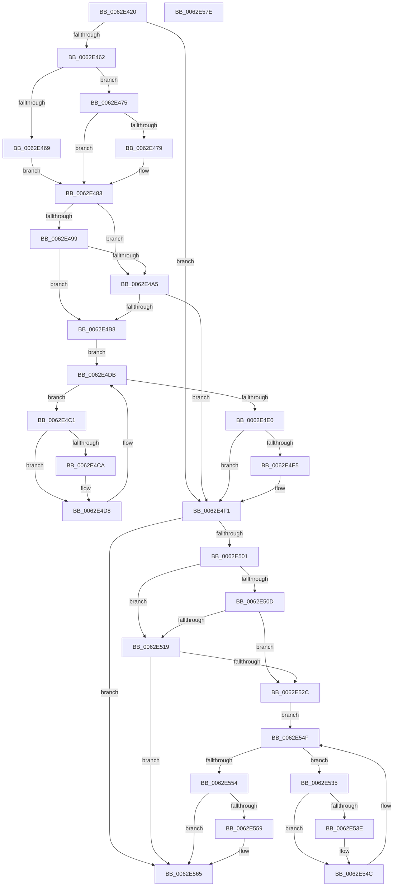

# DifKeAcquireInStackQueuedSpinLockForDpcWrapper

- RVA: `0x0062E420`–`0x0062E57F` (길이 `351` bytes)
- VA: `0x000000014062E420`
- 실행 섹션: `.text`
- PDB 이름 있음: `예`; PDB Function 태그: `아니요`
- unwind 정보 RVA: `0x00093E28`
- 디코드: `97`개 명령, `351/351` bytes 표시
- 미해석 바이트: `0` (있으면 어셈블리에 `.byte`로 보존)

> 이 문서는 커널 이미지의 기계어와 PDB 기호를 분석해 생성했습니다. 4번과 5번은 함수 원형과 자료형을 바이너리 사용 방식에서 추정한 C 해석이며 원본 소스 복구 결과는 아닙니다.

## 1. Dependencies

- 직접 호출 지점: **9**; 고유 호출 대상: **6**
- 직접 호출자로 확인된 함수: **0**
- RIP 상대 이미지 참조: **3**

### Outgoing calls
- `0x0062E451` → [DifGetAPIThunkContextById](../49/DifGetAPIThunkContextById_function_00495A34.md) (function, `0x00495A34`)
- `0x0062E479` → [DifGetReturnAddressForWrappers](../4D/DifGetReturnAddressForWrappers_function_004D3C08.md) (function, `0x004D3C08`)
- `0x0062E4AC` → [ExAcquireRundownProtection](../21/ExAcquireRundownProtection_function_00216620.md) (function, `0x00216620`)
- `0x0062E4D3` → [guard_dispatch_icall](../6B/guard_dispatch_icall_function_006BAAD0.md) (function, `0x006BAAD0`)
- `0x0062E4EC` → [ExReleaseRundownProtection](../34/ExReleaseRundownProtection_function_00349E80.md) (function, `0x00349E80`)
- `0x0062E4F7` → [KeAcquireInStackQueuedSpinLockForDpc](../45/KeAcquireInStackQueuedSpinLockForDpc_function_0045FE50.md) (function, `0x0045FE50`)
- `0x0062E520` → [ExAcquireRundownProtection](../21/ExAcquireRundownProtection_function_00216620.md) (function, `0x00216620`)
- `0x0062E547` → [guard_dispatch_icall](../6B/guard_dispatch_icall_function_006BAAD0.md) (function, `0x006BAAD0`)
- `0x0062E560` → [ExReleaseRundownProtection](../34/ExReleaseRundownProtection_function_00349E80.md) (function, `0x00349E80`)

### Direct callers
- 이 함수 시작 RVA로 연결되는 직접 call은 확인되지 않았습니다. 간접 호출은 완전히 역산할 수 없습니다.

### Static image references
- `0x0062E48B` → RVA `0x00F048B8` (`.data`; read)
- `0x0062E499` → RVA `0x00F04980` (`.data`; read)
- `0x0062E4A5` → RVA `0x00F03E80` (`.data`; read)

## 2. Other-region calls and transfers

- 다른 실행 섹션으로 향하는 call: **0**
- 별도 외부 분기/꼬리 이동을 확인하지 못했습니다.

## 3. Assembly (complete function range)

```asm
0062E420  4C 8B DC                        mov r11, rsp
0062E423  49 89 5B 08                     mov qword ptr [r11 + 8], rbx
0062E427  49 89 6B 10                     mov qword ptr [r11 + 0x10], rbp
0062E42B  49 89 73 18                     mov qword ptr [r11 + 0x18], rsi
0062E42F  57                              push rdi
0062E430  41 56                           push r14
0062E432  41 57                           push r15
0062E434  48 83 EC 40                     sub rsp, 0x40
0062E438  33 C0                           xor eax, eax
0062E43A  0F 57 C0                        xorps xmm0, xmm0
0062E43D  0F 11 44 24 20                  movups xmmword ptr [rsp + 0x20], xmm0
0062E442  4C 8B F9                        mov r15, rcx
0062E445  49 89 43 D8                     mov qword ptr [r11 - 0x28], rax
0062E449  B9 28 01 00 00                  mov ecx, 0x128
0062E44E  4C 8B F2                        mov r14, rdx
0062E451  E8 DE 75 E6 FF                  call 0x140495a34
0062E456  48 8B F0                        mov rsi, rax
0062E459  48 85 C0                        test rax, rax
0062E45C  0F 84 8F 00 00 00               je 0x14062e4f1
0062E462  8B 40 0C                        mov eax, dword ptr [rax + 0xc]
0062E465  A8 18                           test al, 0x18
0062E467  74 0C                           je 0x14062e475
0062E469  48 8B 4C 24 58                  mov rcx, qword ptr [rsp + 0x58]
0062E46E  48 89 4C 24 20                  mov qword ptr [rsp + 0x20], rcx
0062E473  EB 0E                           jmp 0x14062e483
0062E475  A8 04                           test al, 4
0062E477  74 0A                           je 0x14062e483
0062E479  E8 8A 57 EA FF                  call 0x1404d3c08
0062E47E  48 89 44 24 20                  mov qword ptr [rsp + 0x20], rax
0062E483  40 32 ED                        xor bpl, bpl
0062E486  4C 89 7C 24 30                  mov qword ptr [rsp + 0x30], r15
0062E48B  40 38 2D 26 64 8D 00            cmp byte ptr [rip + 0x8d6426], bpl
0062E492  4C 89 74 24 28                  mov qword ptr [rsp + 0x28], r14
0062E497  75 0C                           jne 0x14062e4a5
0062E499  F7 05 DD 64 8D 00 00 08 00 00   test dword ptr [rip + 0x8d64dd], 0x800
0062E4A3  74 13                           je 0x14062e4b8
0062E4A5  48 8D 0D D4 59 8D 00            lea rcx, [rip + 0x8d59d4]
0062E4AC  E8 6F 81 BE FF                  call 0x140216620
0062E4B1  40 8A E8                        mov bpl, al
0062E4B4  84 C0                           test al, al
0062E4B6  74 39                           je 0x14062e4f1
0062E4B8  48 8D 7E 20                     lea rdi, [rsi + 0x20]
0062E4BC  48 8B 1F                        mov rbx, qword ptr [rdi]
0062E4BF  EB 1A                           jmp 0x14062e4db
0062E4C1  48 8D 43 F0                     lea rax, [rbx - 0x10]
0062E4C5  48 85 C0                        test rax, rax
0062E4C8  74 0E                           je 0x14062e4d8
0062E4CA  48 8B 40 08                     mov rax, qword ptr [rax + 8]
0062E4CE  48 8D 4C 24 20                  lea rcx, [rsp + 0x20]
0062E4D3  E8 F8 C5 08 00                  call 0x1406baad0
0062E4D8  48 8B 1B                        mov rbx, qword ptr [rbx]
0062E4DB  48 3B DF                        cmp rbx, rdi
0062E4DE  75 E1                           jne 0x14062e4c1
0062E4E0  40 84 ED                        test bpl, bpl
0062E4E3  74 0C                           je 0x14062e4f1
0062E4E5  48 8D 0D 94 59 8D 00            lea rcx, [rip + 0x8d5994]
0062E4EC  E8 8F B9 D1 FF                  call 0x140349e80
0062E4F1  49 8B D6                        mov rdx, r14
0062E4F4  49 8B CF                        mov rcx, r15
0062E4F7  E8 54 19 E3 FF                  call 0x14045fe50
0062E4FC  48 85 F6                        test rsi, rsi
0062E4FF  74 64                           je 0x14062e565
0062E501  40 32 FF                        xor dil, dil
0062E504  40 38 3D AD 63 8D 00            cmp byte ptr [rip + 0x8d63ad], dil
0062E50B  75 0C                           jne 0x14062e519
0062E50D  F7 05 69 64 8D 00 00 08 00 00   test dword ptr [rip + 0x8d6469], 0x800
0062E517  74 13                           je 0x14062e52c
0062E519  48 8D 0D 60 59 8D 00            lea rcx, [rip + 0x8d5960]
0062E520  E8 FB 80 BE FF                  call 0x140216620
0062E525  40 8A F8                        mov dil, al
0062E528  84 C0                           test al, al
0062E52A  74 39                           je 0x14062e565
0062E52C  48 83 C6 30                     add rsi, 0x30
0062E530  48 8B 1E                        mov rbx, qword ptr [rsi]
0062E533  EB 1A                           jmp 0x14062e54f
0062E535  48 8D 43 F0                     lea rax, [rbx - 0x10]
0062E539  48 85 C0                        test rax, rax
0062E53C  74 0E                           je 0x14062e54c
0062E53E  48 8B 40 08                     mov rax, qword ptr [rax + 8]
0062E542  48 8D 4C 24 20                  lea rcx, [rsp + 0x20]
0062E547  E8 84 C5 08 00                  call 0x1406baad0
0062E54C  48 8B 1B                        mov rbx, qword ptr [rbx]
0062E54F  48 3B DE                        cmp rbx, rsi
0062E552  75 E1                           jne 0x14062e535
0062E554  40 84 FF                        test dil, dil
0062E557  74 0C                           je 0x14062e565
0062E559  48 8D 0D 20 59 8D 00            lea rcx, [rip + 0x8d5920]
0062E560  E8 1B B9 D1 FF                  call 0x140349e80
0062E565  48 8B 5C 24 60                  mov rbx, qword ptr [rsp + 0x60]
0062E56A  48 8B 6C 24 68                  mov rbp, qword ptr [rsp + 0x68]
0062E56F  48 8B 74 24 70                  mov rsi, qword ptr [rsp + 0x70]
0062E574  48 83 C4 40                     add rsp, 0x40
0062E578  41 5F                           pop r15
0062E57A  41 5E                           pop r14
0062E57C  5F                              pop rdi
0062E57D  C3                              ret
0062E57E  CC                              int3
```

## 4. C-style interpretation (structured pseudocode)

```c
__int64 __fastcall DifKeAcquireInStackQueuedSpinLockForDpcWrapper(__int64 a1, __int64 a2)
{
    __int64 result;
    __int64 v_rbp;
    __int64 v_rdi;
    __int64 v_rsi;
    __int64 v_rsp;
    unsigned __int64 v_stack_m28;
    unsigned __int64 v_stack_m30;
    unsigned __int64 v_stack_m38;
    unsigned __int64 v_stack_p0;
    unsigned __int64 v_stack_p10;
    unsigned __int64 v_stack_p18;
    unsigned __int64 v_stack_p8;

    *(unsigned __int64 *)(v_rsp + 8) = v_rbx;
    *(unsigned __int64 *)(v_rsp + 16) = v_rbp;
    *(unsigned __int64 *)(v_rsp + 24) = v_rsi;
    v_rsp = (v_rsp) - (64);
    result = 0;
    v_stack_m38 = v_xmm0;
    *(unsigned __int64 *)(v_rsp - 40) = 0;
    result = DifGetAPIThunkContextById(296, a2, a3, a4);
    if (result == 0) goto loc_0062E4F1;
    if ((((unsigned __int8)((unsigned int)(*(unsigned int *)(result + 12)))) & (24)) == 0) goto loc_0062E475;
    v_stack_m38 = v_stack_p0;
    goto loc_0062E483;
loc_0062E475:
    result = (unsigned int)(*(unsigned int *)(result + 12));
    if ((((unsigned __int8)((unsigned int)(*(unsigned int *)(result + 12)))) & (4)) != 0) {
        result = DifGetReturnAddressForWrappers(v_stack_p0, a2, a3, a4);
        v_stack_m38 = result;
    }
    v_rbp = 0;
    v_stack_m28 = a1;
    v_stack_m30 = a2;
    if ((*(unsigned __int8 *)(v_rip + 9266214)) != 0) goto loc_0062E4A5;
    if (((*(unsigned int *)(v_rip + 9266397)) & (0x800ULL)) == 0) goto loc_0062E4B8;
loc_0062E4A5:
    result = ExAcquireRundownProtection(v_rip + 9263572, a2, a3, a4);
    if ((unsigned __int8)(result) == 0) goto loc_0062E4F1;
loc_0062E4B8:
    goto loc_0062E4DB;
loc_0062E4C1:
    result = *(unsigned __int64 *)(result + 32) - 16;
    if (*(unsigned __int64 *)(result + 32) - 16 != 0) {
        result = *(unsigned __int64 *)(*(unsigned __int64 *)(result + 32) - 16 + 8);
        a1 = v_stack_m38;
        result = guard_dispatch_icall(a1, a2, a3, a4);
    }
loc_0062E4DB:
    if ((*(unsigned __int64 *)(*(unsigned __int64 *)(result + 32))) != (result + 32)) goto loc_0062E4C1;
    if ((unsigned __int8)((unsigned __int8)(result)) != 0) {
        a1 = v_rip + 9263508;
        result = ExReleaseRundownProtection(a1, a2, a3, a4);
    }
    result = KeAcquireInStackQueuedSpinLockForDpc(a1, a2, a3, a4);
    if (result == 0) goto loc_0062E565;
    v_rdi = 0;
    if ((*(unsigned __int8 *)(v_rip + 9266093)) != 0) goto loc_0062E519;
    if (((*(unsigned int *)(v_rip + 9266281)) & (0x800ULL)) == 0) goto loc_0062E52C;
loc_0062E519:
    result = ExAcquireRundownProtection(v_rip + 9263456, a2, a3, a4);
    if ((unsigned __int8)(result) == 0) goto loc_0062E565;
loc_0062E52C:
    v_rsi = (result) + (48);
    goto loc_0062E54F;
loc_0062E535:
    result = *(unsigned __int64 *)(v_rsi) - 16;
    if (*(unsigned __int64 *)(v_rsi) - 16 != 0) {
        result = *(unsigned __int64 *)(*(unsigned __int64 *)(v_rsi) - 16 + 8);
        a1 = v_stack_m38;
        result = guard_dispatch_icall(a1, a2, a3, a4);
    }
loc_0062E54F:
    if ((*(unsigned __int64 *)(*(unsigned __int64 *)(v_rsi))) != v_rsi) goto loc_0062E535;
    if ((unsigned __int8)((unsigned __int8)(result)) != 0) {
        a1 = v_rip + 9263392;
        result = ExReleaseRundownProtection(a1, a2, a3, a4);
    }
    v_rsp = (v_rsp) + (64);
    return result;
}
```

## 5. (Beta) C Style

```c
int64_t DifKeAcquireInStackQueuedSpinLockForDpcWrapper(int64_t Arg1, int64_t Arg2)
{
    int64_t result;
    int64_t local_rbp;
    int64_t local_rdi;
    int64_t local_rsi;
    int64_t local_rsp;
    uint64_t v_stack_m28;
    uint64_t v_stack_m30;
    uint64_t v_stack_m38;
    uint64_t v_stack_p0;
    uint64_t v_stack_p10;
    uint64_t v_stack_p18;
    uint64_t v_stack_p8;

    *(uint64_t *)(local_rsp + 0x8) = local_rbx;
    *(uint64_t *)(local_rsp + 0x10) = local_rbp;
    *(uint64_t *)(local_rsp + 0x18) = local_rsi;
    local_rsp = (local_rsp) - (64);
    result = 0;
    v_stack_m38 = v_xmm0;
    *(uint64_t *)(local_rsp - 0x28) = 0;
    result = DifGetAPIThunkContextById(296, Arg2, a3, a4);
    if (result == 0) goto loc_0062E4F1;
    if ((((uint8_t)((uint32_t)(*(uint32_t *)(result + 0xC)))) & (24)) == 0) goto loc_0062E475;
    v_stack_m38 = v_stack_p0;
    goto loc_0062E483;
loc_0062E475:
    result = (uint32_t)(*(uint32_t *)(result + 0xC));
    if ((((uint8_t)((uint32_t)(*(uint32_t *)(result + 0xC)))) & (4)) != 0) {
        result = DifGetReturnAddressForWrappers(v_stack_p0, Arg2, a3, a4);
        v_stack_m38 = result;
    }
    local_rbp = 0;
    v_stack_m28 = Arg1;
    v_stack_m30 = Arg2;
    if ((*(uint8_t *)(v_rip + 0x8D6426)) != 0) goto loc_0062E4A5;
    if (((*(uint32_t *)(v_rip + 0x8D64DD)) & (0x800ULL)) == 0) goto loc_0062E4B8;
loc_0062E4A5:
    result = ExAcquireRundownProtection(v_rip + 9263572, Arg2, a3, a4);
    if ((uint8_t)(result) == 0) goto loc_0062E4F1;
loc_0062E4B8:
    goto loc_0062E4DB;
loc_0062E4C1:
    result = *(uint64_t *)(result + 0x20) - 16;
    if (*(uint64_t *)(result + 0x20) - 16 != 0) {
        result = *(uint64_t *)(*(uint64_t *)(result + 0x20) - 0x10 + 0x8);
        Arg1 = v_stack_m38;
        result = guard_dispatch_icall(Arg1, Arg2, a3, a4);
    }
loc_0062E4DB:
    if ((*(uint64_t *)(*(uint64_t *)(result + 0x20))) != (result + 32)) goto loc_0062E4C1;
    if ((uint8_t)((uint8_t)(result)) != 0) {
        Arg1 = v_rip + 9263508;
        result = ExReleaseRundownProtection(Arg1, Arg2, a3, a4);
    }
    result = KeAcquireInStackQueuedSpinLockForDpc(Arg1, Arg2, a3, a4);
    if (result == 0) goto loc_0062E565;
    local_rdi = 0;
    if ((*(uint8_t *)(v_rip + 0x8D63AD)) != 0) goto loc_0062E519;
    if (((*(uint32_t *)(v_rip + 0x8D6469)) & (0x800ULL)) == 0) goto loc_0062E52C;
loc_0062E519:
    result = ExAcquireRundownProtection(v_rip + 9263456, Arg2, a3, a4);
    if ((uint8_t)(result) == 0) goto loc_0062E565;
loc_0062E52C:
    local_rsi = (result) + (48);
    goto loc_0062E54F;
loc_0062E535:
    result = *(uint64_t *)(local_rsi) - 16;
    if (*(uint64_t *)(local_rsi) - 16 != 0) {
        result = *(uint64_t *)(*(uint64_t *)(local_rsi) - 0x10 + 0x8);
        Arg1 = v_stack_m38;
        result = guard_dispatch_icall(Arg1, Arg2, a3, a4);
    }
loc_0062E54F:
    if ((*(uint64_t *)(*(uint64_t *)(local_rsi))) != local_rsi) goto loc_0062E535;
    if ((uint8_t)((uint8_t)(result)) != 0) {
        Arg1 = v_rip + 9263392;
        result = ExReleaseRundownProtection(Arg1, Arg2, a3, a4);
    }
    local_rsp = (local_rsp) + (64);
    return result;
}
```

## 6. Execution-region graph

[열기: 2D/3D 그래프와 함수 탐색 컨트롤 패널](../../../control-panel.html?section=text&rva=0x0062E420&view=graph)

- 2D 그래프는 위에서 아래로 흐르고, 3D 그래프는 빈 공간을 드래그해 회전합니다. Shift+드래그는 이동, 휠은 확대·축소, 함수 노드 선택은 대상 보고서 이동입니다.

### Static fallback


