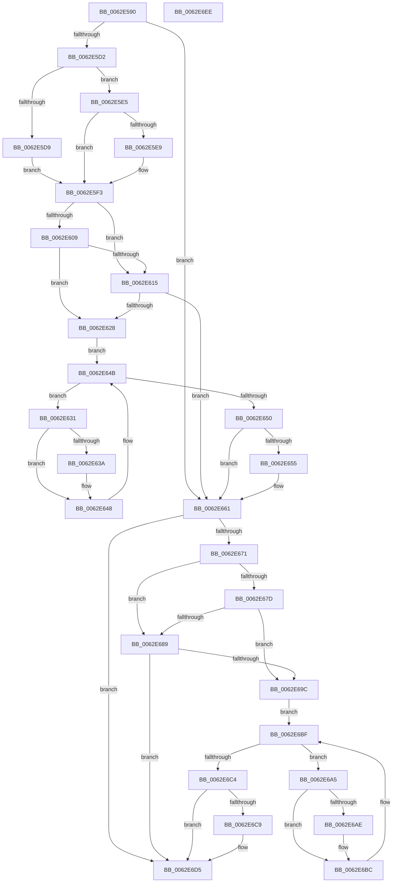

# DifKeAcquireInStackQueuedSpinLockRaiseToSynchWrapper

- RVA: `0x0062E590`–`0x0062E6EF` (길이 `351` bytes)
- VA: `0x000000014062E590`
- 실행 섹션: `.text`
- PDB 이름 있음: `예`; PDB Function 태그: `아니요`
- unwind 정보 RVA: `0x00093E28`
- 디코드: `97`개 명령, `351/351` bytes 표시
- 미해석 바이트: `0` (있으면 어셈블리에 `.byte`로 보존)

> 이 문서는 커널 이미지의 기계어와 PDB 기호를 분석해 생성했습니다. 4번과 5번은 함수 원형과 자료형을 바이너리 사용 방식에서 추정한 C 해석이며 원본 소스 복구 결과는 아닙니다.

## 1. Dependencies

- 직접 호출 지점: **9**; 고유 호출 대상: **6**
- 직접 호출자로 확인된 함수: **0**
- RIP 상대 이미지 참조: **3**

### Outgoing calls
- `0x0062E5C1` → [DifGetAPIThunkContextById](../49/DifGetAPIThunkContextById_function_00495A34.md) (function, `0x00495A34`)
- `0x0062E5E9` → [DifGetReturnAddressForWrappers](../4D/DifGetReturnAddressForWrappers_function_004D3C08.md) (function, `0x004D3C08`)
- `0x0062E61C` → [ExAcquireRundownProtection](../21/ExAcquireRundownProtection_function_00216620.md) (function, `0x00216620`)
- `0x0062E643` → [guard_dispatch_icall](../6B/guard_dispatch_icall_function_006BAAD0.md) (function, `0x006BAAD0`)
- `0x0062E65C` → [ExReleaseRundownProtection](../34/ExReleaseRundownProtection_function_00349E80.md) (function, `0x00349E80`)
- `0x0062E667` → [KeAcquireInStackQueuedSpinLockRaiseToSynch](../5B/KeAcquireInStackQueuedSpinLockRaiseToSynch_function_005BD3A0.md) (function, `0x005BD3A0`)
- `0x0062E690` → [ExAcquireRundownProtection](../21/ExAcquireRundownProtection_function_00216620.md) (function, `0x00216620`)
- `0x0062E6B7` → [guard_dispatch_icall](../6B/guard_dispatch_icall_function_006BAAD0.md) (function, `0x006BAAD0`)
- `0x0062E6D0` → [ExReleaseRundownProtection](../34/ExReleaseRundownProtection_function_00349E80.md) (function, `0x00349E80`)

### Direct callers
- 이 함수 시작 RVA로 연결되는 직접 call은 확인되지 않았습니다. 간접 호출은 완전히 역산할 수 없습니다.

### Static image references
- `0x0062E5FB` → RVA `0x00F048B8` (`.data`; read)
- `0x0062E609` → RVA `0x00F04980` (`.data`; read)
- `0x0062E615` → RVA `0x00F03E80` (`.data`; read)

## 2. Other-region calls and transfers

- 다른 실행 섹션으로 향하는 call: **0**
- 별도 외부 분기/꼬리 이동을 확인하지 못했습니다.

## 3. Assembly (complete function range)

```asm
0062E590  4C 8B DC                        mov r11, rsp
0062E593  49 89 5B 08                     mov qword ptr [r11 + 8], rbx
0062E597  49 89 6B 10                     mov qword ptr [r11 + 0x10], rbp
0062E59B  49 89 73 18                     mov qword ptr [r11 + 0x18], rsi
0062E59F  57                              push rdi
0062E5A0  41 56                           push r14
0062E5A2  41 57                           push r15
0062E5A4  48 83 EC 40                     sub rsp, 0x40
0062E5A8  33 C0                           xor eax, eax
0062E5AA  0F 57 C0                        xorps xmm0, xmm0
0062E5AD  0F 11 44 24 20                  movups xmmword ptr [rsp + 0x20], xmm0
0062E5B2  4C 8B F9                        mov r15, rcx
0062E5B5  49 89 43 D8                     mov qword ptr [r11 - 0x28], rax
0062E5B9  B9 27 01 00 00                  mov ecx, 0x127
0062E5BE  4C 8B F2                        mov r14, rdx
0062E5C1  E8 6E 74 E6 FF                  call 0x140495a34
0062E5C6  48 8B F0                        mov rsi, rax
0062E5C9  48 85 C0                        test rax, rax
0062E5CC  0F 84 8F 00 00 00               je 0x14062e661
0062E5D2  8B 40 0C                        mov eax, dword ptr [rax + 0xc]
0062E5D5  A8 18                           test al, 0x18
0062E5D7  74 0C                           je 0x14062e5e5
0062E5D9  48 8B 4C 24 58                  mov rcx, qword ptr [rsp + 0x58]
0062E5DE  48 89 4C 24 20                  mov qword ptr [rsp + 0x20], rcx
0062E5E3  EB 0E                           jmp 0x14062e5f3
0062E5E5  A8 04                           test al, 4
0062E5E7  74 0A                           je 0x14062e5f3
0062E5E9  E8 1A 56 EA FF                  call 0x1404d3c08
0062E5EE  48 89 44 24 20                  mov qword ptr [rsp + 0x20], rax
0062E5F3  40 32 ED                        xor bpl, bpl
0062E5F6  4C 89 7C 24 30                  mov qword ptr [rsp + 0x30], r15
0062E5FB  40 38 2D B6 62 8D 00            cmp byte ptr [rip + 0x8d62b6], bpl
0062E602  4C 89 74 24 28                  mov qword ptr [rsp + 0x28], r14
0062E607  75 0C                           jne 0x14062e615
0062E609  F7 05 6D 63 8D 00 00 08 00 00   test dword ptr [rip + 0x8d636d], 0x800
0062E613  74 13                           je 0x14062e628
0062E615  48 8D 0D 64 58 8D 00            lea rcx, [rip + 0x8d5864]
0062E61C  E8 FF 7F BE FF                  call 0x140216620
0062E621  40 8A E8                        mov bpl, al
0062E624  84 C0                           test al, al
0062E626  74 39                           je 0x14062e661
0062E628  48 8D 7E 20                     lea rdi, [rsi + 0x20]
0062E62C  48 8B 1F                        mov rbx, qword ptr [rdi]
0062E62F  EB 1A                           jmp 0x14062e64b
0062E631  48 8D 43 F0                     lea rax, [rbx - 0x10]
0062E635  48 85 C0                        test rax, rax
0062E638  74 0E                           je 0x14062e648
0062E63A  48 8B 40 08                     mov rax, qword ptr [rax + 8]
0062E63E  48 8D 4C 24 20                  lea rcx, [rsp + 0x20]
0062E643  E8 88 C4 08 00                  call 0x1406baad0
0062E648  48 8B 1B                        mov rbx, qword ptr [rbx]
0062E64B  48 3B DF                        cmp rbx, rdi
0062E64E  75 E1                           jne 0x14062e631
0062E650  40 84 ED                        test bpl, bpl
0062E653  74 0C                           je 0x14062e661
0062E655  48 8D 0D 24 58 8D 00            lea rcx, [rip + 0x8d5824]
0062E65C  E8 1F B8 D1 FF                  call 0x140349e80
0062E661  49 8B D6                        mov rdx, r14
0062E664  49 8B CF                        mov rcx, r15
0062E667  E8 34 ED F8 FF                  call 0x1405bd3a0
0062E66C  48 85 F6                        test rsi, rsi
0062E66F  74 64                           je 0x14062e6d5
0062E671  40 32 FF                        xor dil, dil
0062E674  40 38 3D 3D 62 8D 00            cmp byte ptr [rip + 0x8d623d], dil
0062E67B  75 0C                           jne 0x14062e689
0062E67D  F7 05 F9 62 8D 00 00 08 00 00   test dword ptr [rip + 0x8d62f9], 0x800
0062E687  74 13                           je 0x14062e69c
0062E689  48 8D 0D F0 57 8D 00            lea rcx, [rip + 0x8d57f0]
0062E690  E8 8B 7F BE FF                  call 0x140216620
0062E695  40 8A F8                        mov dil, al
0062E698  84 C0                           test al, al
0062E69A  74 39                           je 0x14062e6d5
0062E69C  48 83 C6 30                     add rsi, 0x30
0062E6A0  48 8B 1E                        mov rbx, qword ptr [rsi]
0062E6A3  EB 1A                           jmp 0x14062e6bf
0062E6A5  48 8D 43 F0                     lea rax, [rbx - 0x10]
0062E6A9  48 85 C0                        test rax, rax
0062E6AC  74 0E                           je 0x14062e6bc
0062E6AE  48 8B 40 08                     mov rax, qword ptr [rax + 8]
0062E6B2  48 8D 4C 24 20                  lea rcx, [rsp + 0x20]
0062E6B7  E8 14 C4 08 00                  call 0x1406baad0
0062E6BC  48 8B 1B                        mov rbx, qword ptr [rbx]
0062E6BF  48 3B DE                        cmp rbx, rsi
0062E6C2  75 E1                           jne 0x14062e6a5
0062E6C4  40 84 FF                        test dil, dil
0062E6C7  74 0C                           je 0x14062e6d5
0062E6C9  48 8D 0D B0 57 8D 00            lea rcx, [rip + 0x8d57b0]
0062E6D0  E8 AB B7 D1 FF                  call 0x140349e80
0062E6D5  48 8B 5C 24 60                  mov rbx, qword ptr [rsp + 0x60]
0062E6DA  48 8B 6C 24 68                  mov rbp, qword ptr [rsp + 0x68]
0062E6DF  48 8B 74 24 70                  mov rsi, qword ptr [rsp + 0x70]
0062E6E4  48 83 C4 40                     add rsp, 0x40
0062E6E8  41 5F                           pop r15
0062E6EA  41 5E                           pop r14
0062E6EC  5F                              pop rdi
0062E6ED  C3                              ret
0062E6EE  CC                              int3
```

## 4. C-style interpretation (structured pseudocode)

```c
__int64 __fastcall DifKeAcquireInStackQueuedSpinLockRaiseToSynchWrapper(__int64 a1, __int64 a2)
{
    __int64 result;
    __int64 v_rbp;
    __int64 v_rdi;
    __int64 v_rsi;
    __int64 v_rsp;
    unsigned __int64 v_stack_m28;
    unsigned __int64 v_stack_m30;
    unsigned __int64 v_stack_m38;
    unsigned __int64 v_stack_p0;
    unsigned __int64 v_stack_p10;
    unsigned __int64 v_stack_p18;
    unsigned __int64 v_stack_p8;

    *(unsigned __int64 *)(v_rsp + 8) = v_rbx;
    *(unsigned __int64 *)(v_rsp + 16) = v_rbp;
    *(unsigned __int64 *)(v_rsp + 24) = v_rsi;
    v_rsp = (v_rsp) - (64);
    result = 0;
    v_stack_m38 = v_xmm0;
    *(unsigned __int64 *)(v_rsp - 40) = 0;
    result = DifGetAPIThunkContextById(295, a2, a3, a4);
    if (result == 0) goto loc_0062E661;
    if ((((unsigned __int8)((unsigned int)(*(unsigned int *)(result + 12)))) & (24)) == 0) goto loc_0062E5E5;
    v_stack_m38 = v_stack_p0;
    goto loc_0062E5F3;
loc_0062E5E5:
    result = (unsigned int)(*(unsigned int *)(result + 12));
    if ((((unsigned __int8)((unsigned int)(*(unsigned int *)(result + 12)))) & (4)) != 0) {
        result = DifGetReturnAddressForWrappers(v_stack_p0, a2, a3, a4);
        v_stack_m38 = result;
    }
    v_rbp = 0;
    v_stack_m28 = a1;
    v_stack_m30 = a2;
    if ((*(unsigned __int8 *)(v_rip + 9265846)) != 0) goto loc_0062E615;
    if (((*(unsigned int *)(v_rip + 9266029)) & (0x800ULL)) == 0) goto loc_0062E628;
loc_0062E615:
    result = ExAcquireRundownProtection(v_rip + 9263204, a2, a3, a4);
    if ((unsigned __int8)(result) == 0) goto loc_0062E661;
loc_0062E628:
    goto loc_0062E64B;
loc_0062E631:
    result = *(unsigned __int64 *)(result + 32) - 16;
    if (*(unsigned __int64 *)(result + 32) - 16 != 0) {
        result = *(unsigned __int64 *)(*(unsigned __int64 *)(result + 32) - 16 + 8);
        a1 = v_stack_m38;
        result = guard_dispatch_icall(a1, a2, a3, a4);
    }
loc_0062E64B:
    if ((*(unsigned __int64 *)(*(unsigned __int64 *)(result + 32))) != (result + 32)) goto loc_0062E631;
    if ((unsigned __int8)((unsigned __int8)(result)) != 0) {
        a1 = v_rip + 9263140;
        result = ExReleaseRundownProtection(a1, a2, a3, a4);
    }
    result = KeAcquireInStackQueuedSpinLockRaiseToSynch(a1, a2, a3, a4);
    if (result == 0) goto loc_0062E6D5;
    v_rdi = 0;
    if ((*(unsigned __int8 *)(v_rip + 9265725)) != 0) goto loc_0062E689;
    if (((*(unsigned int *)(v_rip + 9265913)) & (0x800ULL)) == 0) goto loc_0062E69C;
loc_0062E689:
    result = ExAcquireRundownProtection(v_rip + 9263088, a2, a3, a4);
    if ((unsigned __int8)(result) == 0) goto loc_0062E6D5;
loc_0062E69C:
    v_rsi = (result) + (48);
    goto loc_0062E6BF;
loc_0062E6A5:
    result = *(unsigned __int64 *)(v_rsi) - 16;
    if (*(unsigned __int64 *)(v_rsi) - 16 != 0) {
        result = *(unsigned __int64 *)(*(unsigned __int64 *)(v_rsi) - 16 + 8);
        a1 = v_stack_m38;
        result = guard_dispatch_icall(a1, a2, a3, a4);
    }
loc_0062E6BF:
    if ((*(unsigned __int64 *)(*(unsigned __int64 *)(v_rsi))) != v_rsi) goto loc_0062E6A5;
    if ((unsigned __int8)((unsigned __int8)(result)) != 0) {
        a1 = v_rip + 9263024;
        result = ExReleaseRundownProtection(a1, a2, a3, a4);
    }
    v_rsp = (v_rsp) + (64);
    return result;
}
```

## 5. (Beta) C Style

```c
int64_t DifKeAcquireInStackQueuedSpinLockRaiseToSynchWrapper(int64_t Arg1, int64_t Arg2)
{
    int64_t result;
    int64_t local_rbp;
    int64_t local_rdi;
    int64_t local_rsi;
    int64_t local_rsp;
    uint64_t v_stack_m28;
    uint64_t v_stack_m30;
    uint64_t v_stack_m38;
    uint64_t v_stack_p0;
    uint64_t v_stack_p10;
    uint64_t v_stack_p18;
    uint64_t v_stack_p8;

    *(uint64_t *)(local_rsp + 0x8) = local_rbx;
    *(uint64_t *)(local_rsp + 0x10) = local_rbp;
    *(uint64_t *)(local_rsp + 0x18) = local_rsi;
    local_rsp = (local_rsp) - (64);
    result = 0;
    v_stack_m38 = v_xmm0;
    *(uint64_t *)(local_rsp - 0x28) = 0;
    result = DifGetAPIThunkContextById(295, Arg2, a3, a4);
    if (result == 0) goto loc_0062E661;
    if ((((uint8_t)((uint32_t)(*(uint32_t *)(result + 0xC)))) & (24)) == 0) goto loc_0062E5E5;
    v_stack_m38 = v_stack_p0;
    goto loc_0062E5F3;
loc_0062E5E5:
    result = (uint32_t)(*(uint32_t *)(result + 0xC));
    if ((((uint8_t)((uint32_t)(*(uint32_t *)(result + 0xC)))) & (4)) != 0) {
        result = DifGetReturnAddressForWrappers(v_stack_p0, Arg2, a3, a4);
        v_stack_m38 = result;
    }
    local_rbp = 0;
    v_stack_m28 = Arg1;
    v_stack_m30 = Arg2;
    if ((*(uint8_t *)(v_rip + 0x8D62B6)) != 0) goto loc_0062E615;
    if (((*(uint32_t *)(v_rip + 0x8D636D)) & (0x800ULL)) == 0) goto loc_0062E628;
loc_0062E615:
    result = ExAcquireRundownProtection(v_rip + 9263204, Arg2, a3, a4);
    if ((uint8_t)(result) == 0) goto loc_0062E661;
loc_0062E628:
    goto loc_0062E64B;
loc_0062E631:
    result = *(uint64_t *)(result + 0x20) - 16;
    if (*(uint64_t *)(result + 0x20) - 16 != 0) {
        result = *(uint64_t *)(*(uint64_t *)(result + 0x20) - 0x10 + 0x8);
        Arg1 = v_stack_m38;
        result = guard_dispatch_icall(Arg1, Arg2, a3, a4);
    }
loc_0062E64B:
    if ((*(uint64_t *)(*(uint64_t *)(result + 0x20))) != (result + 32)) goto loc_0062E631;
    if ((uint8_t)((uint8_t)(result)) != 0) {
        Arg1 = v_rip + 9263140;
        result = ExReleaseRundownProtection(Arg1, Arg2, a3, a4);
    }
    result = KeAcquireInStackQueuedSpinLockRaiseToSynch(Arg1, Arg2, a3, a4);
    if (result == 0) goto loc_0062E6D5;
    local_rdi = 0;
    if ((*(uint8_t *)(v_rip + 0x8D623D)) != 0) goto loc_0062E689;
    if (((*(uint32_t *)(v_rip + 0x8D62F9)) & (0x800ULL)) == 0) goto loc_0062E69C;
loc_0062E689:
    result = ExAcquireRundownProtection(v_rip + 9263088, Arg2, a3, a4);
    if ((uint8_t)(result) == 0) goto loc_0062E6D5;
loc_0062E69C:
    local_rsi = (result) + (48);
    goto loc_0062E6BF;
loc_0062E6A5:
    result = *(uint64_t *)(local_rsi) - 16;
    if (*(uint64_t *)(local_rsi) - 16 != 0) {
        result = *(uint64_t *)(*(uint64_t *)(local_rsi) - 0x10 + 0x8);
        Arg1 = v_stack_m38;
        result = guard_dispatch_icall(Arg1, Arg2, a3, a4);
    }
loc_0062E6BF:
    if ((*(uint64_t *)(*(uint64_t *)(local_rsi))) != local_rsi) goto loc_0062E6A5;
    if ((uint8_t)((uint8_t)(result)) != 0) {
        Arg1 = v_rip + 9263024;
        result = ExReleaseRundownProtection(Arg1, Arg2, a3, a4);
    }
    local_rsp = (local_rsp) + (64);
    return result;
}
```

## 6. Execution-region graph

[열기: 2D/3D 그래프와 함수 탐색 컨트롤 패널](../../../control-panel.html?section=text&rva=0x0062E590&view=graph)

- 2D 그래프는 위에서 아래로 흐르고, 3D 그래프는 빈 공간을 드래그해 회전합니다. Shift+드래그는 이동, 휠은 확대·축소, 함수 노드 선택은 대상 보고서 이동입니다.

### Static fallback


