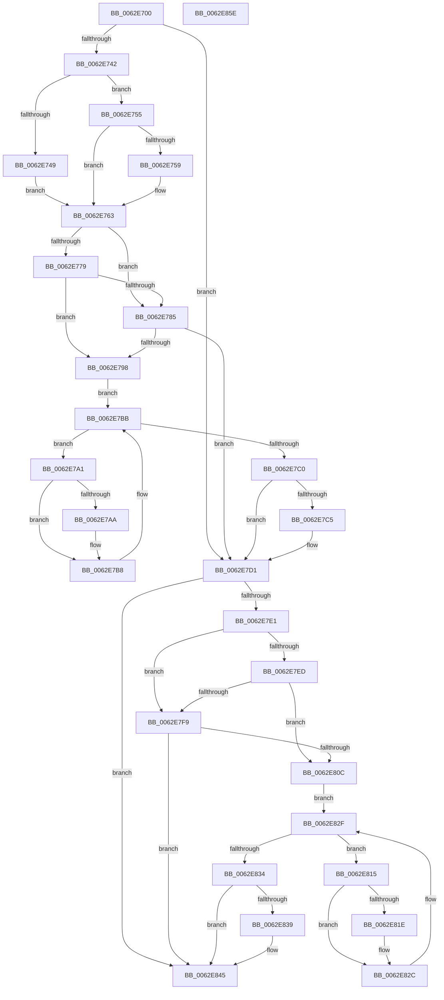

# DifKeAcquireInStackQueuedSpinLockWrapper

- RVA: `0x0062E700`–`0x0062E85F` (길이 `351` bytes)
- VA: `0x000000014062E700`
- 실행 섹션: `.text`
- PDB 이름 있음: `예`; PDB Function 태그: `아니요`
- unwind 정보 RVA: `0x00093E28`
- 디코드: `97`개 명령, `351/351` bytes 표시
- 미해석 바이트: `0` (있으면 어셈블리에 `.byte`로 보존)

> 이 문서는 커널 이미지의 기계어와 PDB 기호를 분석해 생성했습니다. 4번과 5번은 함수 원형과 자료형을 바이너리 사용 방식에서 추정한 C 해석이며 원본 소스 복구 결과는 아닙니다.

## 1. Dependencies

- 직접 호출 지점: **9**; 고유 호출 대상: **6**
- 직접 호출자로 확인된 함수: **0**
- RIP 상대 이미지 참조: **3**

### Outgoing calls
- `0x0062E731` → [DifGetAPIThunkContextById](../49/DifGetAPIThunkContextById_function_00495A34.md) (function, `0x00495A34`)
- `0x0062E759` → [DifGetReturnAddressForWrappers](../4D/DifGetReturnAddressForWrappers_function_004D3C08.md) (function, `0x004D3C08`)
- `0x0062E78C` → [ExAcquireRundownProtection](../21/ExAcquireRundownProtection_function_00216620.md) (function, `0x00216620`)
- `0x0062E7B3` → [guard_dispatch_icall](../6B/guard_dispatch_icall_function_006BAAD0.md) (function, `0x006BAAD0`)
- `0x0062E7CC` → [ExReleaseRundownProtection](../34/ExReleaseRundownProtection_function_00349E80.md) (function, `0x00349E80`)
- `0x0062E7D7` → [KeAcquireInStackQueuedSpinLock](../27/KeAcquireInStackQueuedSpinLock_function_002757A0.md) (function, `0x002757A0`)
- `0x0062E800` → [ExAcquireRundownProtection](../21/ExAcquireRundownProtection_function_00216620.md) (function, `0x00216620`)
- `0x0062E827` → [guard_dispatch_icall](../6B/guard_dispatch_icall_function_006BAAD0.md) (function, `0x006BAAD0`)
- `0x0062E840` → [ExReleaseRundownProtection](../34/ExReleaseRundownProtection_function_00349E80.md) (function, `0x00349E80`)

### Direct callers
- 이 함수 시작 RVA로 연결되는 직접 call은 확인되지 않았습니다. 간접 호출은 완전히 역산할 수 없습니다.

### Static image references
- `0x0062E76B` → RVA `0x00F048B8` (`.data`; read)
- `0x0062E779` → RVA `0x00F04980` (`.data`; read)
- `0x0062E785` → RVA `0x00F03E80` (`.data`; read)

## 2. Other-region calls and transfers

- 다른 실행 섹션으로 향하는 call: **0**
- 별도 외부 분기/꼬리 이동을 확인하지 못했습니다.

## 3. Assembly (complete function range)

```asm
0062E700  4C 8B DC                        mov r11, rsp
0062E703  49 89 5B 08                     mov qword ptr [r11 + 8], rbx
0062E707  49 89 6B 10                     mov qword ptr [r11 + 0x10], rbp
0062E70B  49 89 73 18                     mov qword ptr [r11 + 0x18], rsi
0062E70F  57                              push rdi
0062E710  41 56                           push r14
0062E712  41 57                           push r15
0062E714  48 83 EC 40                     sub rsp, 0x40
0062E718  33 C0                           xor eax, eax
0062E71A  0F 57 C0                        xorps xmm0, xmm0
0062E71D  0F 11 44 24 20                  movups xmmword ptr [rsp + 0x20], xmm0
0062E722  4C 8B F9                        mov r15, rcx
0062E725  49 89 43 D8                     mov qword ptr [r11 - 0x28], rax
0062E729  B9 2A 01 00 00                  mov ecx, 0x12a
0062E72E  4C 8B F2                        mov r14, rdx
0062E731  E8 FE 72 E6 FF                  call 0x140495a34
0062E736  48 8B F0                        mov rsi, rax
0062E739  48 85 C0                        test rax, rax
0062E73C  0F 84 8F 00 00 00               je 0x14062e7d1
0062E742  8B 40 0C                        mov eax, dword ptr [rax + 0xc]
0062E745  A8 18                           test al, 0x18
0062E747  74 0C                           je 0x14062e755
0062E749  48 8B 4C 24 58                  mov rcx, qword ptr [rsp + 0x58]
0062E74E  48 89 4C 24 20                  mov qword ptr [rsp + 0x20], rcx
0062E753  EB 0E                           jmp 0x14062e763
0062E755  A8 04                           test al, 4
0062E757  74 0A                           je 0x14062e763
0062E759  E8 AA 54 EA FF                  call 0x1404d3c08
0062E75E  48 89 44 24 20                  mov qword ptr [rsp + 0x20], rax
0062E763  40 32 ED                        xor bpl, bpl
0062E766  4C 89 7C 24 30                  mov qword ptr [rsp + 0x30], r15
0062E76B  40 38 2D 46 61 8D 00            cmp byte ptr [rip + 0x8d6146], bpl
0062E772  4C 89 74 24 28                  mov qword ptr [rsp + 0x28], r14
0062E777  75 0C                           jne 0x14062e785
0062E779  F7 05 FD 61 8D 00 00 08 00 00   test dword ptr [rip + 0x8d61fd], 0x800
0062E783  74 13                           je 0x14062e798
0062E785  48 8D 0D F4 56 8D 00            lea rcx, [rip + 0x8d56f4]
0062E78C  E8 8F 7E BE FF                  call 0x140216620
0062E791  40 8A E8                        mov bpl, al
0062E794  84 C0                           test al, al
0062E796  74 39                           je 0x14062e7d1
0062E798  48 8D 7E 20                     lea rdi, [rsi + 0x20]
0062E79C  48 8B 1F                        mov rbx, qword ptr [rdi]
0062E79F  EB 1A                           jmp 0x14062e7bb
0062E7A1  48 8D 43 F0                     lea rax, [rbx - 0x10]
0062E7A5  48 85 C0                        test rax, rax
0062E7A8  74 0E                           je 0x14062e7b8
0062E7AA  48 8B 40 08                     mov rax, qword ptr [rax + 8]
0062E7AE  48 8D 4C 24 20                  lea rcx, [rsp + 0x20]
0062E7B3  E8 18 C3 08 00                  call 0x1406baad0
0062E7B8  48 8B 1B                        mov rbx, qword ptr [rbx]
0062E7BB  48 3B DF                        cmp rbx, rdi
0062E7BE  75 E1                           jne 0x14062e7a1
0062E7C0  40 84 ED                        test bpl, bpl
0062E7C3  74 0C                           je 0x14062e7d1
0062E7C5  48 8D 0D B4 56 8D 00            lea rcx, [rip + 0x8d56b4]
0062E7CC  E8 AF B6 D1 FF                  call 0x140349e80
0062E7D1  49 8B D6                        mov rdx, r14
0062E7D4  49 8B CF                        mov rcx, r15
0062E7D7  E8 C4 6F C4 FF                  call 0x1402757a0
0062E7DC  48 85 F6                        test rsi, rsi
0062E7DF  74 64                           je 0x14062e845
0062E7E1  40 32 FF                        xor dil, dil
0062E7E4  40 38 3D CD 60 8D 00            cmp byte ptr [rip + 0x8d60cd], dil
0062E7EB  75 0C                           jne 0x14062e7f9
0062E7ED  F7 05 89 61 8D 00 00 08 00 00   test dword ptr [rip + 0x8d6189], 0x800
0062E7F7  74 13                           je 0x14062e80c
0062E7F9  48 8D 0D 80 56 8D 00            lea rcx, [rip + 0x8d5680]
0062E800  E8 1B 7E BE FF                  call 0x140216620
0062E805  40 8A F8                        mov dil, al
0062E808  84 C0                           test al, al
0062E80A  74 39                           je 0x14062e845
0062E80C  48 83 C6 30                     add rsi, 0x30
0062E810  48 8B 1E                        mov rbx, qword ptr [rsi]
0062E813  EB 1A                           jmp 0x14062e82f
0062E815  48 8D 43 F0                     lea rax, [rbx - 0x10]
0062E819  48 85 C0                        test rax, rax
0062E81C  74 0E                           je 0x14062e82c
0062E81E  48 8B 40 08                     mov rax, qword ptr [rax + 8]
0062E822  48 8D 4C 24 20                  lea rcx, [rsp + 0x20]
0062E827  E8 A4 C2 08 00                  call 0x1406baad0
0062E82C  48 8B 1B                        mov rbx, qword ptr [rbx]
0062E82F  48 3B DE                        cmp rbx, rsi
0062E832  75 E1                           jne 0x14062e815
0062E834  40 84 FF                        test dil, dil
0062E837  74 0C                           je 0x14062e845
0062E839  48 8D 0D 40 56 8D 00            lea rcx, [rip + 0x8d5640]
0062E840  E8 3B B6 D1 FF                  call 0x140349e80
0062E845  48 8B 5C 24 60                  mov rbx, qword ptr [rsp + 0x60]
0062E84A  48 8B 6C 24 68                  mov rbp, qword ptr [rsp + 0x68]
0062E84F  48 8B 74 24 70                  mov rsi, qword ptr [rsp + 0x70]
0062E854  48 83 C4 40                     add rsp, 0x40
0062E858  41 5F                           pop r15
0062E85A  41 5E                           pop r14
0062E85C  5F                              pop rdi
0062E85D  C3                              ret
0062E85E  CC                              int3
```

## 4. C-style interpretation (structured pseudocode)

```c
__int64 __fastcall DifKeAcquireInStackQueuedSpinLockWrapper(__int64 a1, __int64 a2)
{
    __int64 result;
    __int64 v_rbp;
    __int64 v_rdi;
    __int64 v_rsi;
    __int64 v_rsp;
    unsigned __int64 v_stack_m28;
    unsigned __int64 v_stack_m30;
    unsigned __int64 v_stack_m38;
    unsigned __int64 v_stack_p0;
    unsigned __int64 v_stack_p10;
    unsigned __int64 v_stack_p18;
    unsigned __int64 v_stack_p8;

    *(unsigned __int64 *)(v_rsp + 8) = v_rbx;
    *(unsigned __int64 *)(v_rsp + 16) = v_rbp;
    *(unsigned __int64 *)(v_rsp + 24) = v_rsi;
    v_rsp = (v_rsp) - (64);
    result = 0;
    v_stack_m38 = v_xmm0;
    *(unsigned __int64 *)(v_rsp - 40) = 0;
    result = DifGetAPIThunkContextById(298, a2, a3, a4);
    if (result == 0) goto loc_0062E7D1;
    if ((((unsigned __int8)((unsigned int)(*(unsigned int *)(result + 12)))) & (24)) == 0) goto loc_0062E755;
    v_stack_m38 = v_stack_p0;
    goto loc_0062E763;
loc_0062E755:
    result = (unsigned int)(*(unsigned int *)(result + 12));
    if ((((unsigned __int8)((unsigned int)(*(unsigned int *)(result + 12)))) & (4)) != 0) {
        result = DifGetReturnAddressForWrappers(v_stack_p0, a2, a3, a4);
        v_stack_m38 = result;
    }
    v_rbp = 0;
    v_stack_m28 = a1;
    v_stack_m30 = a2;
    if ((*(unsigned __int8 *)(v_rip + 9265478)) != 0) goto loc_0062E785;
    if (((*(unsigned int *)(v_rip + 9265661)) & (0x800ULL)) == 0) goto loc_0062E798;
loc_0062E785:
    result = ExAcquireRundownProtection(v_rip + 9262836, a2, a3, a4);
    if ((unsigned __int8)(result) == 0) goto loc_0062E7D1;
loc_0062E798:
    goto loc_0062E7BB;
loc_0062E7A1:
    result = *(unsigned __int64 *)(result + 32) - 16;
    if (*(unsigned __int64 *)(result + 32) - 16 != 0) {
        result = *(unsigned __int64 *)(*(unsigned __int64 *)(result + 32) - 16 + 8);
        a1 = v_stack_m38;
        result = guard_dispatch_icall(a1, a2, a3, a4);
    }
loc_0062E7BB:
    if ((*(unsigned __int64 *)(*(unsigned __int64 *)(result + 32))) != (result + 32)) goto loc_0062E7A1;
    if ((unsigned __int8)((unsigned __int8)(result)) != 0) {
        a1 = v_rip + 9262772;
        result = ExReleaseRundownProtection(a1, a2, a3, a4);
    }
    result = KeAcquireInStackQueuedSpinLock(a1, a2, a3, a4);
    if (result == 0) goto loc_0062E845;
    v_rdi = 0;
    if ((*(unsigned __int8 *)(v_rip + 9265357)) != 0) goto loc_0062E7F9;
    if (((*(unsigned int *)(v_rip + 9265545)) & (0x800ULL)) == 0) goto loc_0062E80C;
loc_0062E7F9:
    result = ExAcquireRundownProtection(v_rip + 9262720, a2, a3, a4);
    if ((unsigned __int8)(result) == 0) goto loc_0062E845;
loc_0062E80C:
    v_rsi = (result) + (48);
    goto loc_0062E82F;
loc_0062E815:
    result = *(unsigned __int64 *)(v_rsi) - 16;
    if (*(unsigned __int64 *)(v_rsi) - 16 != 0) {
        result = *(unsigned __int64 *)(*(unsigned __int64 *)(v_rsi) - 16 + 8);
        a1 = v_stack_m38;
        result = guard_dispatch_icall(a1, a2, a3, a4);
    }
loc_0062E82F:
    if ((*(unsigned __int64 *)(*(unsigned __int64 *)(v_rsi))) != v_rsi) goto loc_0062E815;
    if ((unsigned __int8)((unsigned __int8)(result)) != 0) {
        a1 = v_rip + 9262656;
        result = ExReleaseRundownProtection(a1, a2, a3, a4);
    }
    v_rsp = (v_rsp) + (64);
    return result;
}
```

## 5. (Beta) C Style

```c
int64_t DifKeAcquireInStackQueuedSpinLockWrapper(int64_t Arg1, int64_t Arg2)
{
    int64_t result;
    int64_t local_rbp;
    int64_t local_rdi;
    int64_t local_rsi;
    int64_t local_rsp;
    uint64_t v_stack_m28;
    uint64_t v_stack_m30;
    uint64_t v_stack_m38;
    uint64_t v_stack_p0;
    uint64_t v_stack_p10;
    uint64_t v_stack_p18;
    uint64_t v_stack_p8;

    *(uint64_t *)(local_rsp + 0x8) = local_rbx;
    *(uint64_t *)(local_rsp + 0x10) = local_rbp;
    *(uint64_t *)(local_rsp + 0x18) = local_rsi;
    local_rsp = (local_rsp) - (64);
    result = 0;
    v_stack_m38 = v_xmm0;
    *(uint64_t *)(local_rsp - 0x28) = 0;
    result = DifGetAPIThunkContextById(298, Arg2, a3, a4);
    if (result == 0) goto loc_0062E7D1;
    if ((((uint8_t)((uint32_t)(*(uint32_t *)(result + 0xC)))) & (24)) == 0) goto loc_0062E755;
    v_stack_m38 = v_stack_p0;
    goto loc_0062E763;
loc_0062E755:
    result = (uint32_t)(*(uint32_t *)(result + 0xC));
    if ((((uint8_t)((uint32_t)(*(uint32_t *)(result + 0xC)))) & (4)) != 0) {
        result = DifGetReturnAddressForWrappers(v_stack_p0, Arg2, a3, a4);
        v_stack_m38 = result;
    }
    local_rbp = 0;
    v_stack_m28 = Arg1;
    v_stack_m30 = Arg2;
    if ((*(uint8_t *)(v_rip + 0x8D6146)) != 0) goto loc_0062E785;
    if (((*(uint32_t *)(v_rip + 0x8D61FD)) & (0x800ULL)) == 0) goto loc_0062E798;
loc_0062E785:
    result = ExAcquireRundownProtection(v_rip + 9262836, Arg2, a3, a4);
    if ((uint8_t)(result) == 0) goto loc_0062E7D1;
loc_0062E798:
    goto loc_0062E7BB;
loc_0062E7A1:
    result = *(uint64_t *)(result + 0x20) - 16;
    if (*(uint64_t *)(result + 0x20) - 16 != 0) {
        result = *(uint64_t *)(*(uint64_t *)(result + 0x20) - 0x10 + 0x8);
        Arg1 = v_stack_m38;
        result = guard_dispatch_icall(Arg1, Arg2, a3, a4);
    }
loc_0062E7BB:
    if ((*(uint64_t *)(*(uint64_t *)(result + 0x20))) != (result + 32)) goto loc_0062E7A1;
    if ((uint8_t)((uint8_t)(result)) != 0) {
        Arg1 = v_rip + 9262772;
        result = ExReleaseRundownProtection(Arg1, Arg2, a3, a4);
    }
    result = KeAcquireInStackQueuedSpinLock(Arg1, Arg2, a3, a4);
    if (result == 0) goto loc_0062E845;
    local_rdi = 0;
    if ((*(uint8_t *)(v_rip + 0x8D60CD)) != 0) goto loc_0062E7F9;
    if (((*(uint32_t *)(v_rip + 0x8D6189)) & (0x800ULL)) == 0) goto loc_0062E80C;
loc_0062E7F9:
    result = ExAcquireRundownProtection(v_rip + 9262720, Arg2, a3, a4);
    if ((uint8_t)(result) == 0) goto loc_0062E845;
loc_0062E80C:
    local_rsi = (result) + (48);
    goto loc_0062E82F;
loc_0062E815:
    result = *(uint64_t *)(local_rsi) - 16;
    if (*(uint64_t *)(local_rsi) - 16 != 0) {
        result = *(uint64_t *)(*(uint64_t *)(local_rsi) - 0x10 + 0x8);
        Arg1 = v_stack_m38;
        result = guard_dispatch_icall(Arg1, Arg2, a3, a4);
    }
loc_0062E82F:
    if ((*(uint64_t *)(*(uint64_t *)(local_rsi))) != local_rsi) goto loc_0062E815;
    if ((uint8_t)((uint8_t)(result)) != 0) {
        Arg1 = v_rip + 9262656;
        result = ExReleaseRundownProtection(Arg1, Arg2, a3, a4);
    }
    local_rsp = (local_rsp) + (64);
    return result;
}
```

## 6. Execution-region graph

[열기: 2D/3D 그래프와 함수 탐색 컨트롤 패널](../../../control-panel.html?section=text&rva=0x0062E700&view=graph)

- 2D 그래프는 위에서 아래로 흐르고, 3D 그래프는 빈 공간을 드래그해 회전합니다. Shift+드래그는 이동, 휠은 확대·축소, 함수 노드 선택은 대상 보고서 이동입니다.

### Static fallback


