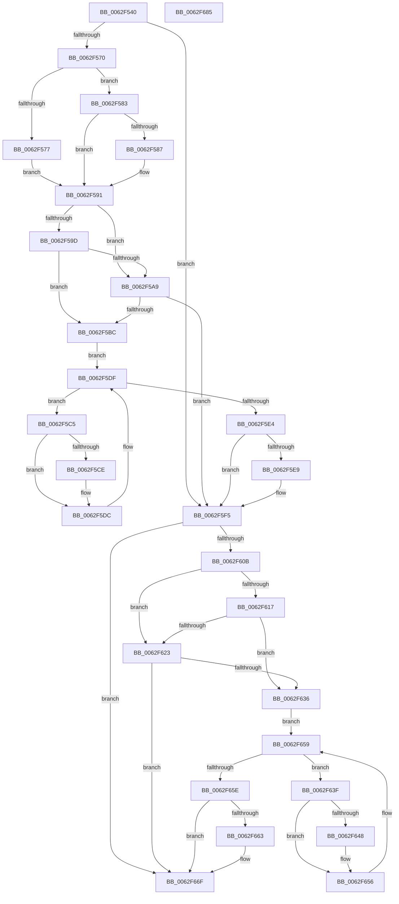

# DifKeEnterGuardedRegionWrapper

- RVA: `0x0062F540`–`0x0062F686` (길이 `326` bytes)
- VA: `0x000000014062F540`
- 실행 섹션: `.text`
- PDB 이름 있음: `예`; PDB Function 태그: `아니요`
- unwind 정보 RVA: `0x000A85B0`
- 디코드: `86`개 명령, `326/326` bytes 표시
- 미해석 바이트: `0` (있으면 어셈블리에 `.byte`로 보존)

> 이 문서는 커널 이미지의 기계어와 PDB 기호를 분석해 생성했습니다. 4번과 5번은 함수 원형과 자료형을 바이너리 사용 방식에서 추정한 C 해석이며 원본 소스 복구 결과는 아닙니다.

## 1. Dependencies

- 직접 호출 지점: **8**; 고유 호출 대상: **5**
- 직접 호출자로 확인된 함수: **0**
- RIP 상대 이미지 참조: **3**

### Outgoing calls
- `0x0062F55F` → [DifGetAPIThunkContextById](../49/DifGetAPIThunkContextById_function_00495A34.md) (function, `0x00495A34`)
- `0x0062F587` → [DifGetReturnAddressForWrappers](../4D/DifGetReturnAddressForWrappers_function_004D3C08.md) (function, `0x004D3C08`)
- `0x0062F5B0` → [ExAcquireRundownProtection](../21/ExAcquireRundownProtection_function_00216620.md) (function, `0x00216620`)
- `0x0062F5D7` → [guard_dispatch_icall](../6B/guard_dispatch_icall_function_006BAAD0.md) (function, `0x006BAAD0`)
- `0x0062F5F0` → [ExReleaseRundownProtection](../34/ExReleaseRundownProtection_function_00349E80.md) (function, `0x00349E80`)
- `0x0062F62A` → [ExAcquireRundownProtection](../21/ExAcquireRundownProtection_function_00216620.md) (function, `0x00216620`)
- `0x0062F651` → [guard_dispatch_icall](../6B/guard_dispatch_icall_function_006BAAD0.md) (function, `0x006BAAD0`)
- `0x0062F66A` → [ExReleaseRundownProtection](../34/ExReleaseRundownProtection_function_00349E80.md) (function, `0x00349E80`)

### Direct callers
- 이 함수 시작 RVA로 연결되는 직접 call은 확인되지 않았습니다. 간접 호출은 완전히 역산할 수 없습니다.

### Static image references
- `0x0062F594` → RVA `0x00F048B8` (`.data`; read)
- `0x0062F59D` → RVA `0x00F04980` (`.data`; read)
- `0x0062F5A9` → RVA `0x00F03E80` (`.data`; read)

## 2. Other-region calls and transfers

- 다른 실행 섹션으로 향하는 call: **0**
- 별도 외부 분기/꼬리 이동을 확인하지 못했습니다.

## 3. Assembly (complete function range)

```asm
0062F540  48 8B C4                        mov rax, rsp
0062F543  48 89 58 10                     mov qword ptr [rax + 0x10], rbx
0062F547  48 89 70 18                     mov qword ptr [rax + 0x18], rsi
0062F54B  48 89 78 20                     mov qword ptr [rax + 0x20], rdi
0062F54F  41 56                           push r14
0062F551  48 83 EC 20                     sub rsp, 0x20
0062F555  48 83 60 08 00                  and qword ptr [rax + 8], 0
0062F55A  B9 1D 01 00 00                  mov ecx, 0x11d
0062F55F  E8 D0 64 E6 FF                  call 0x140495a34
0062F564  48 8B F8                        mov rdi, rax
0062F567  48 85 C0                        test rax, rax
0062F56A  0F 84 85 00 00 00               je 0x14062f5f5
0062F570  8B 40 0C                        mov eax, dword ptr [rax + 0xc]
0062F573  A8 18                           test al, 0x18
0062F575  74 0C                           je 0x14062f583
0062F577  48 8B 4C 24 28                  mov rcx, qword ptr [rsp + 0x28]
0062F57C  48 89 4C 24 30                  mov qword ptr [rsp + 0x30], rcx
0062F581  EB 0E                           jmp 0x14062f591
0062F583  A8 04                           test al, 4
0062F585  74 0A                           je 0x14062f591
0062F587  E8 7C 46 EA FF                  call 0x1404d3c08
0062F58C  48 89 44 24 30                  mov qword ptr [rsp + 0x30], rax
0062F591  40 32 F6                        xor sil, sil
0062F594  40 38 35 1D 53 8D 00            cmp byte ptr [rip + 0x8d531d], sil
0062F59B  75 0C                           jne 0x14062f5a9
0062F59D  F7 05 D9 53 8D 00 00 08 00 00   test dword ptr [rip + 0x8d53d9], 0x800
0062F5A7  74 13                           je 0x14062f5bc
0062F5A9  48 8D 0D D0 48 8D 00            lea rcx, [rip + 0x8d48d0]
0062F5B0  E8 6B 70 BE FF                  call 0x140216620
0062F5B5  40 8A F0                        mov sil, al
0062F5B8  84 C0                           test al, al
0062F5BA  74 39                           je 0x14062f5f5
0062F5BC  4C 8D 77 20                     lea r14, [rdi + 0x20]
0062F5C0  49 8B 1E                        mov rbx, qword ptr [r14]
0062F5C3  EB 1A                           jmp 0x14062f5df
0062F5C5  48 8D 43 F0                     lea rax, [rbx - 0x10]
0062F5C9  48 85 C0                        test rax, rax
0062F5CC  74 0E                           je 0x14062f5dc
0062F5CE  48 8B 40 08                     mov rax, qword ptr [rax + 8]
0062F5D2  48 8D 4C 24 30                  lea rcx, [rsp + 0x30]
0062F5D7  E8 F4 B4 08 00                  call 0x1406baad0
0062F5DC  48 8B 1B                        mov rbx, qword ptr [rbx]
0062F5DF  49 3B DE                        cmp rbx, r14
0062F5E2  75 E1                           jne 0x14062f5c5
0062F5E4  40 84 F6                        test sil, sil
0062F5E7  74 0C                           je 0x14062f5f5
0062F5E9  48 8D 0D 90 48 8D 00            lea rcx, [rip + 0x8d4890]
0062F5F0  E8 8B A8 D1 FF                  call 0x140349e80
0062F5F5  65 48 8B 04 25 88 01 00 00      mov rax, qword ptr gs:[0x188]
0062F5FE  66 FF 88 E6 01 00 00            dec word ptr [rax + 0x1e6]
0062F605  90                              nop
0062F606  48 85 FF                        test rdi, rdi
0062F609  74 64                           je 0x14062f66f
0062F60B  40 32 F6                        xor sil, sil
0062F60E  40 38 35 A3 52 8D 00            cmp byte ptr [rip + 0x8d52a3], sil
0062F615  75 0C                           jne 0x14062f623
0062F617  F7 05 5F 53 8D 00 00 08 00 00   test dword ptr [rip + 0x8d535f], 0x800
0062F621  74 13                           je 0x14062f636
0062F623  48 8D 0D 56 48 8D 00            lea rcx, [rip + 0x8d4856]
0062F62A  E8 F1 6F BE FF                  call 0x140216620
0062F62F  40 8A F0                        mov sil, al
0062F632  84 C0                           test al, al
0062F634  74 39                           je 0x14062f66f
0062F636  48 83 C7 30                     add rdi, 0x30
0062F63A  48 8B 1F                        mov rbx, qword ptr [rdi]
0062F63D  EB 1A                           jmp 0x14062f659
0062F63F  48 8D 43 F0                     lea rax, [rbx - 0x10]
0062F643  48 85 C0                        test rax, rax
0062F646  74 0E                           je 0x14062f656
0062F648  48 8B 40 08                     mov rax, qword ptr [rax + 8]
0062F64C  48 8D 4C 24 30                  lea rcx, [rsp + 0x30]
0062F651  E8 7A B4 08 00                  call 0x1406baad0
0062F656  48 8B 1B                        mov rbx, qword ptr [rbx]
0062F659  48 3B DF                        cmp rbx, rdi
0062F65C  75 E1                           jne 0x14062f63f
0062F65E  40 84 F6                        test sil, sil
0062F661  74 0C                           je 0x14062f66f
0062F663  48 8D 0D 16 48 8D 00            lea rcx, [rip + 0x8d4816]
0062F66A  E8 11 A8 D1 FF                  call 0x140349e80
0062F66F  48 8B 5C 24 38                  mov rbx, qword ptr [rsp + 0x38]
0062F674  48 8B 74 24 40                  mov rsi, qword ptr [rsp + 0x40]
0062F679  48 8B 7C 24 48                  mov rdi, qword ptr [rsp + 0x48]
0062F67E  48 83 C4 20                     add rsp, 0x20
0062F682  41 5E                           pop r14
0062F684  C3                              ret
0062F685  CC                              int3
```

## 4. C-style interpretation (structured pseudocode)

```c
__int64 __fastcall DifKeEnterGuardedRegionWrapper(void)
{
    __int64 result;
    __int64 v_rdi;
    __int64 v_rsi;
    __int64 v_rsp;
    unsigned __int64 v_stack_p0;
    unsigned __int64 v_stack_p10;
    unsigned __int64 v_stack_p18;
    unsigned __int64 v_stack_p20;
    unsigned __int64 v_stack_p8;

    *(unsigned __int64 *)(v_rsp + 16) = v_rbx;
    *(unsigned __int64 *)(v_rsp + 24) = v_rsi;
    *(unsigned __int64 *)(v_rsp + 32) = v_rdi;
    v_rsp = (v_rsp) - (32);
    result = DifGetAPIThunkContextById(285, a2, a3, a4);
    if (result == 0) goto loc_0062F5F5;
    if ((((unsigned __int8)((unsigned int)(*(unsigned int *)(result + 12)))) & (24)) == 0) goto loc_0062F583;
    v_stack_p8 = v_stack_p0;
    goto loc_0062F591;
loc_0062F583:
    result = (unsigned int)(*(unsigned int *)(result + 12));
    if ((((unsigned __int8)((unsigned int)(*(unsigned int *)(result + 12)))) & (4)) != 0) {
        result = DifGetReturnAddressForWrappers(v_stack_p0, a2, a3, a4);
        v_stack_p8 = result;
    }
    v_rsi = 0;
    if ((*(unsigned __int8 *)(v_rip + 9261853)) != 0) goto loc_0062F5A9;
    if (((*(unsigned int *)(v_rip + 9262041)) & (0x800ULL)) == 0) goto loc_0062F5BC;
loc_0062F5A9:
    result = ExAcquireRundownProtection(v_rip + 9259216, a2, a3, a4);
    if ((unsigned __int8)(result) == 0) goto loc_0062F5F5;
loc_0062F5BC:
    goto loc_0062F5DF;
loc_0062F5C5:
    result = *(unsigned __int64 *)(result + 32) - 16;
    if (*(unsigned __int64 *)(result + 32) - 16 != 0) {
        result = *(unsigned __int64 *)(*(unsigned __int64 *)(result + 32) - 16 + 8);
        a1 = v_stack_p8;
        result = guard_dispatch_icall(a1, a2, a3, a4);
    }
loc_0062F5DF:
    if ((*(unsigned __int64 *)(*(unsigned __int64 *)(result + 32))) != (result + 32)) goto loc_0062F5C5;
    if ((unsigned __int8)((unsigned __int8)(result)) != 0) {
        a1 = v_rip + 9259152;
        result = ExReleaseRundownProtection(a1, a2, a3, a4);
    }
    if (result == 0) goto loc_0062F66F;
    v_rsi = 0;
    if ((*(unsigned __int8 *)(v_rip + 9261731)) != 0) goto loc_0062F623;
    if (((*(unsigned int *)(v_rip + 9261919)) & (0x800ULL)) == 0) goto loc_0062F636;
loc_0062F623:
    result = ExAcquireRundownProtection(v_rip + 9259094, a2, a3, a4);
    if ((unsigned __int8)(result) == 0) goto loc_0062F66F;
loc_0062F636:
    v_rdi = (result) + (48);
    goto loc_0062F659;
loc_0062F63F:
    result = *(unsigned __int64 *)(v_rdi) - 16;
    if (*(unsigned __int64 *)(v_rdi) - 16 != 0) {
        result = *(unsigned __int64 *)(*(unsigned __int64 *)(v_rdi) - 16 + 8);
        a1 = v_stack_p8;
        result = guard_dispatch_icall(a1, a2, a3, a4);
    }
loc_0062F659:
    if ((*(unsigned __int64 *)(*(unsigned __int64 *)(v_rdi))) != v_rdi) goto loc_0062F63F;
    if ((unsigned __int8)((unsigned __int8)(result)) != 0) {
        a1 = v_rip + 9259030;
        result = ExReleaseRundownProtection(a1, a2, a3, a4);
    }
    v_rsp = (v_rsp) + (32);
    return result;
}
```

## 5. (Beta) C Style

```c
void DifKeEnterGuardedRegionWrapper(void)
{
    int64_t result;
    int64_t local_rdi;
    int64_t local_rsi;
    int64_t local_rsp;
    uint64_t v_stack_p0;
    uint64_t v_stack_p10;
    uint64_t v_stack_p18;
    uint64_t v_stack_p20;
    uint64_t v_stack_p8;

    *(uint64_t *)(local_rsp + 0x10) = local_rbx;
    *(uint64_t *)(local_rsp + 0x18) = local_rsi;
    *(uint64_t *)(local_rsp + 0x20) = local_rdi;
    local_rsp = (local_rsp) - (32);
    result = DifGetAPIThunkContextById(285, a2, a3, a4);
    if (result == 0) goto loc_0062F5F5;
    if ((((uint8_t)((uint32_t)(*(uint32_t *)(result + 0xC)))) & (24)) == 0) goto loc_0062F583;
    v_stack_p8 = v_stack_p0;
    goto loc_0062F591;
loc_0062F583:
    result = (uint32_t)(*(uint32_t *)(result + 0xC));
    if ((((uint8_t)((uint32_t)(*(uint32_t *)(result + 0xC)))) & (4)) != 0) {
        result = DifGetReturnAddressForWrappers(v_stack_p0, a2, a3, a4);
        v_stack_p8 = result;
    }
    local_rsi = 0;
    if ((*(uint8_t *)(v_rip + 0x8D531D)) != 0) goto loc_0062F5A9;
    if (((*(uint32_t *)(v_rip + 0x8D53D9)) & (0x800ULL)) == 0) goto loc_0062F5BC;
loc_0062F5A9:
    result = ExAcquireRundownProtection(v_rip + 9259216, a2, a3, a4);
    if ((uint8_t)(result) == 0) goto loc_0062F5F5;
loc_0062F5BC:
    goto loc_0062F5DF;
loc_0062F5C5:
    result = *(uint64_t *)(result + 0x20) - 16;
    if (*(uint64_t *)(result + 0x20) - 16 != 0) {
        result = *(uint64_t *)(*(uint64_t *)(result + 0x20) - 0x10 + 0x8);
        a1 = v_stack_p8;
        result = guard_dispatch_icall(a1, a2, a3, a4);
    }
loc_0062F5DF:
    if ((*(uint64_t *)(*(uint64_t *)(result + 0x20))) != (result + 32)) goto loc_0062F5C5;
    if ((uint8_t)((uint8_t)(result)) != 0) {
        a1 = v_rip + 9259152;
        result = ExReleaseRundownProtection(a1, a2, a3, a4);
    }
    if (result == 0) goto loc_0062F66F;
    local_rsi = 0;
    if ((*(uint8_t *)(v_rip + 0x8D52A3)) != 0) goto loc_0062F623;
    if (((*(uint32_t *)(v_rip + 0x8D535F)) & (0x800ULL)) == 0) goto loc_0062F636;
loc_0062F623:
    result = ExAcquireRundownProtection(v_rip + 9259094, a2, a3, a4);
    if ((uint8_t)(result) == 0) goto loc_0062F66F;
loc_0062F636:
    local_rdi = (result) + (48);
    goto loc_0062F659;
loc_0062F63F:
    result = *(uint64_t *)(local_rdi) - 16;
    if (*(uint64_t *)(local_rdi) - 16 != 0) {
        result = *(uint64_t *)(*(uint64_t *)(local_rdi) - 0x10 + 0x8);
        a1 = v_stack_p8;
        result = guard_dispatch_icall(a1, a2, a3, a4);
    }
loc_0062F659:
    if ((*(uint64_t *)(*(uint64_t *)(local_rdi))) != local_rdi) goto loc_0062F63F;
    if ((uint8_t)((uint8_t)(result)) != 0) {
        a1 = v_rip + 9259030;
        result = ExReleaseRundownProtection(a1, a2, a3, a4);
    }
    local_rsp = (local_rsp) + (32);
    return result;
}
```

## 6. Execution-region graph

[열기: 2D/3D 그래프와 함수 탐색 컨트롤 패널](../../../control-panel.html?section=text&rva=0x0062F540&view=graph)

- 2D 그래프는 위에서 아래로 흐르고, 3D 그래프는 빈 공간을 드래그해 회전합니다. Shift+드래그는 이동, 휠은 확대·축소, 함수 노드 선택은 대상 보고서 이동입니다.

### Static fallback


