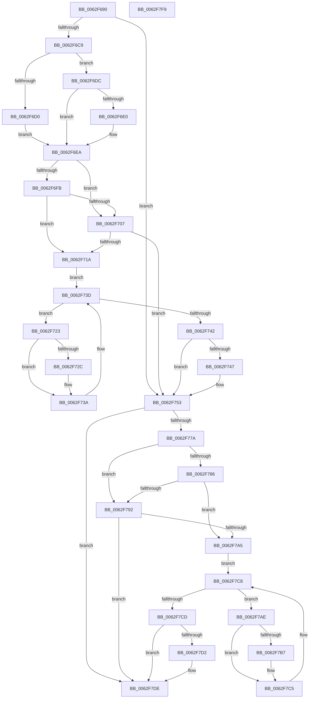

# DifKeInitializeDeviceQueueWrapper

- RVA: `0x0062F690`–`0x0062F7FA` (길이 `362` bytes)
- VA: `0x000000014062F690`
- 실행 섹션: `.text`
- PDB 이름 있음: `예`; PDB Function 태그: `아니요`
- unwind 정보 RVA: `0x0005D7BC`
- 디코드: `95`개 명령, `362/362` bytes 표시
- 미해석 바이트: `0` (있으면 어셈블리에 `.byte`로 보존)

> 이 문서는 커널 이미지의 기계어와 PDB 기호를 분석해 생성했습니다. 4번과 5번은 함수 원형과 자료형을 바이너리 사용 방식에서 추정한 C 해석이며 원본 소스 복구 결과는 아닙니다.

## 1. Dependencies

- 직접 호출 지점: **8**; 고유 호출 대상: **5**
- 직접 호출자로 확인된 함수: **0**
- RIP 상대 이미지 참조: **3**

### Outgoing calls
- `0x0062F6B8` → [DifGetAPIThunkContextById](../49/DifGetAPIThunkContextById_function_00495A34.md) (function, `0x00495A34`)
- `0x0062F6E0` → [DifGetReturnAddressForWrappers](../4D/DifGetReturnAddressForWrappers_function_004D3C08.md) (function, `0x004D3C08`)
- `0x0062F70E` → [ExAcquireRundownProtection](../21/ExAcquireRundownProtection_function_00216620.md) (function, `0x00216620`)
- `0x0062F735` → [guard_dispatch_icall](../6B/guard_dispatch_icall_function_006BAAD0.md) (function, `0x006BAAD0`)
- `0x0062F74E` → [ExReleaseRundownProtection](../34/ExReleaseRundownProtection_function_00349E80.md) (function, `0x00349E80`)
- `0x0062F799` → [ExAcquireRundownProtection](../21/ExAcquireRundownProtection_function_00216620.md) (function, `0x00216620`)
- `0x0062F7C0` → [guard_dispatch_icall](../6B/guard_dispatch_icall_function_006BAAD0.md) (function, `0x006BAAD0`)
- `0x0062F7D9` → [ExReleaseRundownProtection](../34/ExReleaseRundownProtection_function_00349E80.md) (function, `0x00349E80`)

### Direct callers
- 이 함수 시작 RVA로 연결되는 직접 call은 확인되지 않았습니다. 간접 호출은 완전히 역산할 수 없습니다.

### Static image references
- `0x0062F6F2` → RVA `0x00F048B8` (`.data`; read)
- `0x0062F6FB` → RVA `0x00F04980` (`.data`; read)
- `0x0062F707` → RVA `0x00F03E80` (`.data`; read)

## 2. Other-region calls and transfers

- 다른 실행 섹션으로 향하는 call: **0**
- 별도 외부 분기/꼬리 이동을 확인하지 못했습니다.

## 3. Assembly (complete function range)

```asm
0062F690  48 8B C4                        mov rax, rsp
0062F693  48 89 58 08                     mov qword ptr [rax + 8], rbx
0062F697  48 89 68 10                     mov qword ptr [rax + 0x10], rbp
0062F69B  48 89 70 18                     mov qword ptr [rax + 0x18], rsi
0062F69F  48 89 78 20                     mov qword ptr [rax + 0x20], rdi
0062F6A3  41 56                           push r14
0062F6A5  48 83 EC 30                     sub rsp, 0x30
0062F6A9  48 8B D9                        mov rbx, rcx
0062F6AC  0F 57 C0                        xorps xmm0, xmm0
0062F6AF  B9 1C 01 00 00                  mov ecx, 0x11c
0062F6B4  0F 11 40 E8                     movups xmmword ptr [rax - 0x18], xmm0
0062F6B8  E8 77 63 E6 FF                  call 0x140495a34
0062F6BD  48 8B F0                        mov rsi, rax
0062F6C0  48 85 C0                        test rax, rax
0062F6C3  0F 84 8A 00 00 00               je 0x14062f753
0062F6C9  8B 40 0C                        mov eax, dword ptr [rax + 0xc]
0062F6CC  A8 18                           test al, 0x18
0062F6CE  74 0C                           je 0x14062f6dc
0062F6D0  48 8B 4C 24 38                  mov rcx, qword ptr [rsp + 0x38]
0062F6D5  48 89 4C 24 20                  mov qword ptr [rsp + 0x20], rcx
0062F6DA  EB 0E                           jmp 0x14062f6ea
0062F6DC  A8 04                           test al, 4
0062F6DE  74 0A                           je 0x14062f6ea
0062F6E0  E8 23 45 EA FF                  call 0x1404d3c08
0062F6E5  48 89 44 24 20                  mov qword ptr [rsp + 0x20], rax
0062F6EA  40 32 ED                        xor bpl, bpl
0062F6ED  48 89 5C 24 28                  mov qword ptr [rsp + 0x28], rbx
0062F6F2  40 38 2D BF 51 8D 00            cmp byte ptr [rip + 0x8d51bf], bpl
0062F6F9  75 0C                           jne 0x14062f707
0062F6FB  F7 05 7B 52 8D 00 00 08 00 00   test dword ptr [rip + 0x8d527b], 0x800
0062F705  74 13                           je 0x14062f71a
0062F707  48 8D 0D 72 47 8D 00            lea rcx, [rip + 0x8d4772]
0062F70E  E8 0D 6F BE FF                  call 0x140216620
0062F713  40 8A E8                        mov bpl, al
0062F716  84 C0                           test al, al
0062F718  74 39                           je 0x14062f753
0062F71A  4C 8D 76 20                     lea r14, [rsi + 0x20]
0062F71E  49 8B 3E                        mov rdi, qword ptr [r14]
0062F721  EB 1A                           jmp 0x14062f73d
0062F723  48 8D 47 F0                     lea rax, [rdi - 0x10]
0062F727  48 85 C0                        test rax, rax
0062F72A  74 0E                           je 0x14062f73a
0062F72C  48 8B 40 08                     mov rax, qword ptr [rax + 8]
0062F730  48 8D 4C 24 20                  lea rcx, [rsp + 0x20]
0062F735  E8 96 B3 08 00                  call 0x1406baad0
0062F73A  48 8B 3F                        mov rdi, qword ptr [rdi]
0062F73D  49 3B FE                        cmp rdi, r14
0062F740  75 E1                           jne 0x14062f723
0062F742  40 84 ED                        test bpl, bpl
0062F745  74 0C                           je 0x14062f753
0062F747  48 8D 0D 32 47 8D 00            lea rcx, [rip + 0x8d4732]
0062F74E  E8 2D A7 D1 FF                  call 0x140349e80
0062F753  48 8D 43 08                     lea rax, [rbx + 8]
0062F757  C7 03 14 00 28 00               mov dword ptr [rbx], 0x280014
0062F75D  48 89 40 08                     mov qword ptr [rax + 8], rax
0062F761  48 89 00                        mov qword ptr [rax], rax
0062F764  48 83 63 18 00                  and qword ptr [rbx + 0x18], 0
0062F769  C6 43 20 00                     mov byte ptr [rbx + 0x20], 0
0062F76D  48 81 63 20 FF 00 00 00         and qword ptr [rbx + 0x20], 0xff
0062F775  48 85 F6                        test rsi, rsi
0062F778  74 64                           je 0x14062f7de
0062F77A  40 32 FF                        xor dil, dil
0062F77D  40 38 3D 34 51 8D 00            cmp byte ptr [rip + 0x8d5134], dil
0062F784  75 0C                           jne 0x14062f792
0062F786  F7 05 F0 51 8D 00 00 08 00 00   test dword ptr [rip + 0x8d51f0], 0x800
0062F790  74 13                           je 0x14062f7a5
0062F792  48 8D 0D E7 46 8D 00            lea rcx, [rip + 0x8d46e7]
0062F799  E8 82 6E BE FF                  call 0x140216620
0062F79E  40 8A F8                        mov dil, al
0062F7A1  84 C0                           test al, al
0062F7A3  74 39                           je 0x14062f7de
0062F7A5  48 83 C6 30                     add rsi, 0x30
0062F7A9  48 8B 1E                        mov rbx, qword ptr [rsi]
0062F7AC  EB 1A                           jmp 0x14062f7c8
0062F7AE  48 8D 43 F0                     lea rax, [rbx - 0x10]
0062F7B2  48 85 C0                        test rax, rax
0062F7B5  74 0E                           je 0x14062f7c5
0062F7B7  48 8B 40 08                     mov rax, qword ptr [rax + 8]
0062F7BB  48 8D 4C 24 20                  lea rcx, [rsp + 0x20]
0062F7C0  E8 0B B3 08 00                  call 0x1406baad0
0062F7C5  48 8B 1B                        mov rbx, qword ptr [rbx]
0062F7C8  48 3B DE                        cmp rbx, rsi
0062F7CB  75 E1                           jne 0x14062f7ae
0062F7CD  40 84 FF                        test dil, dil
0062F7D0  74 0C                           je 0x14062f7de
0062F7D2  48 8D 0D A7 46 8D 00            lea rcx, [rip + 0x8d46a7]
0062F7D9  E8 A2 A6 D1 FF                  call 0x140349e80
0062F7DE  48 8B 5C 24 40                  mov rbx, qword ptr [rsp + 0x40]
0062F7E3  48 8B 6C 24 48                  mov rbp, qword ptr [rsp + 0x48]
0062F7E8  48 8B 74 24 50                  mov rsi, qword ptr [rsp + 0x50]
0062F7ED  48 8B 7C 24 58                  mov rdi, qword ptr [rsp + 0x58]
0062F7F2  48 83 C4 30                     add rsp, 0x30
0062F7F6  41 5E                           pop r14
0062F7F8  C3                              ret
0062F7F9  CC                              int3
```

## 4. C-style interpretation (structured pseudocode)

```c
__int64 __fastcall DifKeInitializeDeviceQueueWrapper(__int64 a1)
{
    __int64 result;
    __int64 v_rbp;
    __int64 v_rdi;
    __int64 v_rsi;
    __int64 v_rsp;
    unsigned __int64 v_stack_m10;
    unsigned __int64 v_stack_m18;
    unsigned __int64 v_stack_p0;
    unsigned __int64 v_stack_p10;
    unsigned __int64 v_stack_p18;
    unsigned __int64 v_stack_p20;
    unsigned __int64 v_stack_p8;

    *(unsigned __int64 *)(v_rsp + 8) = v_rbx;
    *(unsigned __int64 *)(v_rsp + 16) = v_rbp;
    *(unsigned __int64 *)(v_rsp + 24) = v_rsi;
    *(unsigned __int64 *)(v_rsp + 32) = v_rdi;
    v_rsp = (v_rsp) - (48);
    *(unsigned __int64 *)(v_rsp - 24) = v_xmm0;
    result = DifGetAPIThunkContextById(284, a2, a3, a4);
    if (result == 0) goto loc_0062F753;
    if ((((unsigned __int8)((unsigned int)(*(unsigned int *)(result + 12)))) & (24)) == 0) goto loc_0062F6DC;
    v_stack_m18 = v_stack_p0;
    goto loc_0062F6EA;
loc_0062F6DC:
    result = (unsigned int)(*(unsigned int *)(result + 12));
    if ((((unsigned __int8)((unsigned int)(*(unsigned int *)(result + 12)))) & (4)) != 0) {
        result = DifGetReturnAddressForWrappers(v_stack_p0, a2, a3, a4);
        v_stack_m18 = result;
    }
    v_rbp = 0;
    v_stack_m10 = a1;
    if ((*(unsigned __int8 *)(v_rip + 9261503)) != 0) goto loc_0062F707;
    if (((*(unsigned int *)(v_rip + 9261691)) & (0x800ULL)) == 0) goto loc_0062F71A;
loc_0062F707:
    result = ExAcquireRundownProtection(v_rip + 9258866, a2, a3, a4);
    if ((unsigned __int8)(result) == 0) goto loc_0062F753;
loc_0062F71A:
    goto loc_0062F73D;
loc_0062F723:
    result = *(unsigned __int64 *)(result + 32) - 16;
    if (*(unsigned __int64 *)(result + 32) - 16 != 0) {
        result = *(unsigned __int64 *)(*(unsigned __int64 *)(result + 32) - 16 + 8);
        a1 = v_stack_m18;
        result = guard_dispatch_icall(a1, a2, a3, a4);
    }
loc_0062F73D:
    if ((*(unsigned __int64 *)(*(unsigned __int64 *)(result + 32))) != (result + 32)) goto loc_0062F723;
    if ((unsigned __int8)((unsigned __int8)(result)) != 0) {
        a1 = v_rip + 9258802;
        result = ExReleaseRundownProtection(a1, a2, a3, a4);
    }
    *(unsigned int *)(a1) = 0x280014ULL;
    *(unsigned __int64 *)(a1 + 8 + 8) = a1 + 8;
    *(unsigned __int64 *)(a1 + 8) = a1 + 8;
    *(unsigned __int8 *)(a1 + 32) = 0;
    if (result == 0) goto loc_0062F7DE;
    v_rdi = 0;
    if ((*(unsigned __int8 *)(v_rip + 9261364)) != 0) goto loc_0062F792;
    if (((*(unsigned int *)(v_rip + 9261552)) & (0x800ULL)) == 0) goto loc_0062F7A5;
loc_0062F792:
    result = ExAcquireRundownProtection(v_rip + 9258727, a2, a3, a4);
    if ((unsigned __int8)(result) == 0) goto loc_0062F7DE;
loc_0062F7A5:
    v_rsi = (result) + (48);
    goto loc_0062F7C8;
loc_0062F7AE:
    result = *(unsigned __int64 *)(v_rsi) - 16;
    if (*(unsigned __int64 *)(v_rsi) - 16 != 0) {
        result = *(unsigned __int64 *)(*(unsigned __int64 *)(v_rsi) - 16 + 8);
        a1 = v_stack_m18;
        result = guard_dispatch_icall(a1, a2, a3, a4);
    }
loc_0062F7C8:
    if ((*(unsigned __int64 *)(*(unsigned __int64 *)(v_rsi))) != v_rsi) goto loc_0062F7AE;
    if ((unsigned __int8)((unsigned __int8)(result)) != 0) {
        a1 = v_rip + 9258663;
        result = ExReleaseRundownProtection(a1, a2, a3, a4);
    }
    v_rsp = (v_rsp) + (48);
    return result;
}
```

## 5. (Beta) C Style

```c
int64_t DifKeInitializeDeviceQueueWrapper(void *Arg1)
{
    uint8_t *arg1 = (uint8_t *)Arg1;

    int64_t result;
    int64_t local_rbp;
    int64_t local_rdi;
    int64_t local_rsi;
    int64_t local_rsp;
    uint64_t v_stack_m10;
    uint64_t v_stack_m18;
    uint64_t v_stack_p0;
    uint64_t v_stack_p10;
    uint64_t v_stack_p18;
    uint64_t v_stack_p20;
    uint64_t v_stack_p8;

    *(uint64_t *)(local_rsp + 0x8) = local_rbx;
    *(uint64_t *)(local_rsp + 0x10) = local_rbp;
    *(uint64_t *)(local_rsp + 0x18) = local_rsi;
    *(uint64_t *)(local_rsp + 0x20) = local_rdi;
    local_rsp = (local_rsp) - (48);
    *(uint64_t *)(local_rsp - 0x18) = v_xmm0;
    result = DifGetAPIThunkContextById(284, a2, a3, a4);
    if (result == 0) goto loc_0062F753;
    if ((((uint8_t)((uint32_t)(*(uint32_t *)(result + 0xC)))) & (24)) == 0) goto loc_0062F6DC;
    v_stack_m18 = v_stack_p0;
    goto loc_0062F6EA;
loc_0062F6DC:
    result = (uint32_t)(*(uint32_t *)(result + 0xC));
    if ((((uint8_t)((uint32_t)(*(uint32_t *)(result + 0xC)))) & (4)) != 0) {
        result = DifGetReturnAddressForWrappers(v_stack_p0, a2, a3, a4);
        v_stack_m18 = result;
    }
    local_rbp = 0;
    v_stack_m10 = Arg1;
    if ((*(uint8_t *)(v_rip + 0x8D51BF)) != 0) goto loc_0062F707;
    if (((*(uint32_t *)(v_rip + 0x8D527B)) & (0x800ULL)) == 0) goto loc_0062F71A;
loc_0062F707:
    result = ExAcquireRundownProtection(v_rip + 9258866, a2, a3, a4);
    if ((uint8_t)(result) == 0) goto loc_0062F753;
loc_0062F71A:
    goto loc_0062F73D;
loc_0062F723:
    result = *(uint64_t *)(result + 0x20) - 16;
    if (*(uint64_t *)(result + 0x20) - 16 != 0) {
        result = *(uint64_t *)(*(uint64_t *)(result + 0x20) - 0x10 + 0x8);
        Arg1 = v_stack_m18;
        result = guard_dispatch_icall(Arg1, a2, a3, a4);
    }
loc_0062F73D:
    if ((*(uint64_t *)(*(uint64_t *)(result + 0x20))) != (result + 32)) goto loc_0062F723;
    if ((uint8_t)((uint8_t)(result)) != 0) {
        Arg1 = v_rip + 9258802;
        result = ExReleaseRundownProtection(Arg1, a2, a3, a4);
    }
    *(uint32_t *)(arg1) = 0x280014ULL;
    *(void **)(arg1 + 0x8 + 0x8) = Arg1 + 8;
    *(void **)(arg1 + 0x8) = Arg1 + 8;
    *(uint8_t *)(arg1 + 0x20) = 0;
    if (result == 0) goto loc_0062F7DE;
    local_rdi = 0;
    if ((*(uint8_t *)(v_rip + 0x8D5134)) != 0) goto loc_0062F792;
    if (((*(uint32_t *)(v_rip + 0x8D51F0)) & (0x800ULL)) == 0) goto loc_0062F7A5;
loc_0062F792:
    result = ExAcquireRundownProtection(v_rip + 9258727, a2, a3, a4);
    if ((uint8_t)(result) == 0) goto loc_0062F7DE;
loc_0062F7A5:
    local_rsi = (result) + (48);
    goto loc_0062F7C8;
loc_0062F7AE:
    result = *(uint64_t *)(local_rsi) - 16;
    if (*(uint64_t *)(local_rsi) - 16 != 0) {
        result = *(uint64_t *)(*(uint64_t *)(local_rsi) - 0x10 + 0x8);
        Arg1 = v_stack_m18;
        result = guard_dispatch_icall(Arg1, a2, a3, a4);
    }
loc_0062F7C8:
    if ((*(uint64_t *)(*(uint64_t *)(local_rsi))) != local_rsi) goto loc_0062F7AE;
    if ((uint8_t)((uint8_t)(result)) != 0) {
        Arg1 = v_rip + 9258663;
        result = ExReleaseRundownProtection(Arg1, a2, a3, a4);
    }
    local_rsp = (local_rsp) + (48);
    return result;
}
```

### 관측된 메모리 오프셋

구조체 형식이 확인되지 않은 접근은 인자 기준의 오프셋으로만 기록했습니다.

| 기준 인자 | 오프셋 표현 | 폭 (bit) | 접근 |
|---|---:|---:|---|
| `Arg1` | `+ 0x0` | `32` | `W` |
| `Arg1` | `+ 0x0` | `64` | `W` |
| `Arg1` | `+ 0x8` | `64` | `R` |
| `Arg1` | `+ 0x8` | `64` | `W` |
| `Arg1` | `+ 0x18` | `64` | `R/W` |
| `Arg1` | `+ 0x20` | `8` | `W` |
| `Arg1` | `+ 0x20` | `64` | `R/W` |

## 6. Execution-region graph

[열기: 2D/3D 그래프와 함수 탐색 컨트롤 패널](../../../control-panel.html?section=text&rva=0x0062F690&view=graph)

- 2D 그래프는 위에서 아래로 흐르고, 3D 그래프는 빈 공간을 드래그해 회전합니다. Shift+드래그는 이동, 휠은 확대·축소, 함수 노드 선택은 대상 보고서 이동입니다.

### Static fallback


