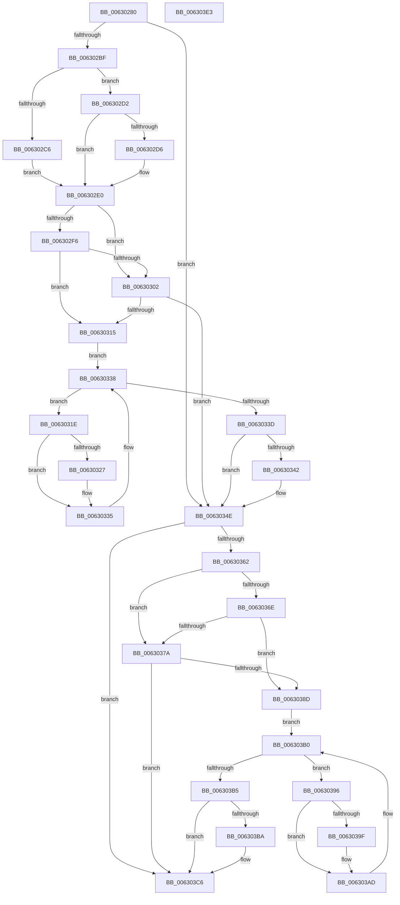

# DifKeInsertDeviceQueueWrapper

- RVA: `0x00630280`–`0x006303E4` (길이 `356` bytes)
- VA: `0x0000000140630280`
- 실행 섹션: `.text`
- PDB 이름 있음: `예`; PDB Function 태그: `아니요`
- unwind 정보 RVA: `0x00093E28`
- 디코드: `98`개 명령, `356/356` bytes 표시
- 미해석 바이트: `0` (있으면 어셈블리에 `.byte`로 보존)

> 이 문서는 커널 이미지의 기계어와 PDB 기호를 분석해 생성했습니다. 4번과 5번은 함수 원형과 자료형을 바이너리 사용 방식에서 추정한 C 해석이며 원본 소스 복구 결과는 아닙니다.

## 1. Dependencies

- 직접 호출 지점: **9**; 고유 호출 대상: **6**
- 직접 호출자로 확인된 함수: **0**
- RIP 상대 이미지 참조: **3**

### Outgoing calls
- `0x006302AE` → [DifGetAPIThunkContextById](../49/DifGetAPIThunkContextById_function_00495A34.md) (function, `0x00495A34`)
- `0x006302D6` → [DifGetReturnAddressForWrappers](../4D/DifGetReturnAddressForWrappers_function_004D3C08.md) (function, `0x004D3C08`)
- `0x00630309` → [ExAcquireRundownProtection](../21/ExAcquireRundownProtection_function_00216620.md) (function, `0x00216620`)
- `0x00630330` → [guard_dispatch_icall](../6B/guard_dispatch_icall_function_006BAAD0.md) (function, `0x006BAAD0`)
- `0x00630349` → [ExReleaseRundownProtection](../34/ExReleaseRundownProtection_function_00349E80.md) (function, `0x00349E80`)
- `0x00630354` → [KeInsertDeviceQueue](../3D/KeInsertDeviceQueue_function_003DD900.md) (function, `0x003DD900`)
- `0x00630381` → [ExAcquireRundownProtection](../21/ExAcquireRundownProtection_function_00216620.md) (function, `0x00216620`)
- `0x006303A8` → [guard_dispatch_icall](../6B/guard_dispatch_icall_function_006BAAD0.md) (function, `0x006BAAD0`)
- `0x006303C1` → [ExReleaseRundownProtection](../34/ExReleaseRundownProtection_function_00349E80.md) (function, `0x00349E80`)

### Direct callers
- 이 함수 시작 RVA로 연결되는 직접 call은 확인되지 않았습니다. 간접 호출은 완전히 역산할 수 없습니다.

### Static image references
- `0x006302E8` → RVA `0x00F048B8` (`.data`; read)
- `0x006302F6` → RVA `0x00F04980` (`.data`; read)
- `0x00630302` → RVA `0x00F03E80` (`.data`; read)

## 2. Other-region calls and transfers

- 다른 실행 섹션으로 향하는 call: **0**
- 별도 외부 분기/꼬리 이동을 확인하지 못했습니다.

## 3. Assembly (complete function range)

```asm
00630280  48 8B C4                        mov rax, rsp
00630283  48 89 58 08                     mov qword ptr [rax + 8], rbx
00630287  48 89 68 10                     mov qword ptr [rax + 0x10], rbp
0063028B  48 89 70 18                     mov qword ptr [rax + 0x18], rsi
0063028F  57                              push rdi
00630290  41 56                           push r14
00630292  41 57                           push r15
00630294  48 83 EC 40                     sub rsp, 0x40
00630298  0F 57 C0                        xorps xmm0, xmm0
0063029B  4C 8B F9                        mov r15, rcx
0063029E  B9 14 01 00 00                  mov ecx, 0x114
006302A3  4C 8B F2                        mov r14, rdx
006302A6  0F 11 40 C8                     movups xmmword ptr [rax - 0x38], xmm0
006302AA  0F 11 40 D8                     movups xmmword ptr [rax - 0x28], xmm0
006302AE  E8 81 57 E6 FF                  call 0x140495a34
006302B3  48 8B F0                        mov rsi, rax
006302B6  48 85 C0                        test rax, rax
006302B9  0F 84 8F 00 00 00               je 0x14063034e
006302BF  8B 40 0C                        mov eax, dword ptr [rax + 0xc]
006302C2  A8 18                           test al, 0x18
006302C4  74 0C                           je 0x1406302d2
006302C6  48 8B 4C 24 58                  mov rcx, qword ptr [rsp + 0x58]
006302CB  48 89 4C 24 20                  mov qword ptr [rsp + 0x20], rcx
006302D0  EB 0E                           jmp 0x1406302e0
006302D2  A8 04                           test al, 4
006302D4  74 0A                           je 0x1406302e0
006302D6  E8 2D 39 EA FF                  call 0x1404d3c08
006302DB  48 89 44 24 20                  mov qword ptr [rsp + 0x20], rax
006302E0  40 32 ED                        xor bpl, bpl
006302E3  4C 89 7C 24 30                  mov qword ptr [rsp + 0x30], r15
006302E8  40 38 2D C9 45 8D 00            cmp byte ptr [rip + 0x8d45c9], bpl
006302EF  4C 89 74 24 28                  mov qword ptr [rsp + 0x28], r14
006302F4  75 0C                           jne 0x140630302
006302F6  F7 05 80 46 8D 00 00 08 00 00   test dword ptr [rip + 0x8d4680], 0x800
00630300  74 13                           je 0x140630315
00630302  48 8D 0D 77 3B 8D 00            lea rcx, [rip + 0x8d3b77]
00630309  E8 12 63 BE FF                  call 0x140216620
0063030E  40 8A E8                        mov bpl, al
00630311  84 C0                           test al, al
00630313  74 39                           je 0x14063034e
00630315  48 8D 7E 20                     lea rdi, [rsi + 0x20]
00630319  48 8B 1F                        mov rbx, qword ptr [rdi]
0063031C  EB 1A                           jmp 0x140630338
0063031E  48 8D 43 F0                     lea rax, [rbx - 0x10]
00630322  48 85 C0                        test rax, rax
00630325  74 0E                           je 0x140630335
00630327  48 8B 40 08                     mov rax, qword ptr [rax + 8]
0063032B  48 8D 4C 24 20                  lea rcx, [rsp + 0x20]
00630330  E8 9B A7 08 00                  call 0x1406baad0
00630335  48 8B 1B                        mov rbx, qword ptr [rbx]
00630338  48 3B DF                        cmp rbx, rdi
0063033B  75 E1                           jne 0x14063031e
0063033D  40 84 ED                        test bpl, bpl
00630340  74 0C                           je 0x14063034e
00630342  48 8D 0D 37 3B 8D 00            lea rcx, [rip + 0x8d3b37]
00630349  E8 32 9B D1 FF                  call 0x140349e80
0063034E  49 8B D6                        mov rdx, r14
00630351  49 8B CF                        mov rcx, r15
00630354  E8 A7 D5 DA FF                  call 0x1403dd900
00630359  88 44 24 38                     mov byte ptr [rsp + 0x38], al
0063035D  48 85 F6                        test rsi, rsi
00630360  74 64                           je 0x1406303c6
00630362  40 32 FF                        xor dil, dil
00630365  40 38 3D 4C 45 8D 00            cmp byte ptr [rip + 0x8d454c], dil
0063036C  75 0C                           jne 0x14063037a
0063036E  F7 05 08 46 8D 00 00 08 00 00   test dword ptr [rip + 0x8d4608], 0x800
00630378  74 13                           je 0x14063038d
0063037A  48 8D 0D FF 3A 8D 00            lea rcx, [rip + 0x8d3aff]
00630381  E8 9A 62 BE FF                  call 0x140216620
00630386  40 8A F8                        mov dil, al
00630389  84 C0                           test al, al
0063038B  74 39                           je 0x1406303c6
0063038D  48 83 C6 30                     add rsi, 0x30
00630391  48 8B 1E                        mov rbx, qword ptr [rsi]
00630394  EB 1A                           jmp 0x1406303b0
00630396  48 8D 43 F0                     lea rax, [rbx - 0x10]
0063039A  48 85 C0                        test rax, rax
0063039D  74 0E                           je 0x1406303ad
0063039F  48 8B 40 08                     mov rax, qword ptr [rax + 8]
006303A3  48 8D 4C 24 20                  lea rcx, [rsp + 0x20]
006303A8  E8 23 A7 08 00                  call 0x1406baad0
006303AD  48 8B 1B                        mov rbx, qword ptr [rbx]
006303B0  48 3B DE                        cmp rbx, rsi
006303B3  75 E1                           jne 0x140630396
006303B5  40 84 FF                        test dil, dil
006303B8  74 0C                           je 0x1406303c6
006303BA  48 8D 0D BF 3A 8D 00            lea rcx, [rip + 0x8d3abf]
006303C1  E8 BA 9A D1 FF                  call 0x140349e80
006303C6  8A 44 24 38                     mov al, byte ptr [rsp + 0x38]
006303CA  48 8B 5C 24 60                  mov rbx, qword ptr [rsp + 0x60]
006303CF  48 8B 6C 24 68                  mov rbp, qword ptr [rsp + 0x68]
006303D4  48 8B 74 24 70                  mov rsi, qword ptr [rsp + 0x70]
006303D9  48 83 C4 40                     add rsp, 0x40
006303DD  41 5F                           pop r15
006303DF  41 5E                           pop r14
006303E1  5F                              pop rdi
006303E2  C3                              ret
006303E3  CC                              int3
```

## 4. C-style interpretation (structured pseudocode)

```c
__int64 __fastcall DifKeInsertDeviceQueueWrapper(__int64 a1, __int64 a2)
{
    __int64 result;
    __int64 v_rbp;
    __int64 v_rdi;
    __int64 v_rsi;
    __int64 v_rsp;
    unsigned __int8 v_stack_m20;
    unsigned __int64 v_stack_m28;
    unsigned __int64 v_stack_m30;
    unsigned __int64 v_stack_m38;
    unsigned __int64 v_stack_p0;
    unsigned __int64 v_stack_p10;
    unsigned __int64 v_stack_p18;
    unsigned __int64 v_stack_p8;

    *(unsigned __int64 *)(v_rsp + 8) = v_rbx;
    *(unsigned __int64 *)(v_rsp + 16) = v_rbp;
    *(unsigned __int64 *)(v_rsp + 24) = v_rsi;
    v_rsp = (v_rsp) - (64);
    *(unsigned __int64 *)(v_rsp - 56) = v_xmm0;
    *(unsigned __int64 *)(v_rsp - 40) = v_xmm0;
    result = DifGetAPIThunkContextById(276, a2, a3, a4);
    if (result == 0) goto loc_0063034E;
    if ((((unsigned __int8)((unsigned int)(*(unsigned int *)(result + 12)))) & (24)) == 0) goto loc_006302D2;
    v_stack_m38 = v_stack_p0;
    goto loc_006302E0;
loc_006302D2:
    result = (unsigned int)(*(unsigned int *)(result + 12));
    if ((((unsigned __int8)((unsigned int)(*(unsigned int *)(result + 12)))) & (4)) != 0) {
        result = DifGetReturnAddressForWrappers(v_stack_p0, a2, a3, a4);
        v_stack_m38 = result;
    }
    v_rbp = 0;
    v_stack_m28 = a1;
    v_stack_m30 = a2;
    if ((*(unsigned __int8 *)(v_rip + 9258441)) != 0) goto loc_00630302;
    if (((*(unsigned int *)(v_rip + 9258624)) & (0x800ULL)) == 0) goto loc_00630315;
loc_00630302:
    result = ExAcquireRundownProtection(v_rip + 9255799, a2, a3, a4);
    if ((unsigned __int8)(result) == 0) goto loc_0063034E;
loc_00630315:
    goto loc_00630338;
loc_0063031E:
    result = *(unsigned __int64 *)(result + 32) - 16;
    if (*(unsigned __int64 *)(result + 32) - 16 != 0) {
        result = *(unsigned __int64 *)(*(unsigned __int64 *)(result + 32) - 16 + 8);
        a1 = v_stack_m38;
        result = guard_dispatch_icall(a1, a2, a3, a4);
    }
loc_00630338:
    if ((*(unsigned __int64 *)(*(unsigned __int64 *)(result + 32))) != (result + 32)) goto loc_0063031E;
    if ((unsigned __int8)((unsigned __int8)(result)) != 0) {
        a1 = v_rip + 9255735;
        result = ExReleaseRundownProtection(a1, a2, a3, a4);
    }
    result = KeInsertDeviceQueue(a1, a2, a3, a4);
    v_stack_m20 = (unsigned __int8)(result);
    if (result == 0) goto loc_006303C6;
    v_rdi = 0;
    if ((*(unsigned __int8 *)(v_rip + 9258316)) != 0) goto loc_0063037A;
    if (((*(unsigned int *)(v_rip + 9258504)) & (0x800ULL)) == 0) goto loc_0063038D;
loc_0063037A:
    result = ExAcquireRundownProtection(v_rip + 9255679, a2, a3, a4);
    if ((unsigned __int8)(result) == 0) goto loc_006303C6;
loc_0063038D:
    v_rsi = (result) + (48);
    goto loc_006303B0;
loc_00630396:
    result = *(unsigned __int64 *)(v_rsi) - 16;
    if (*(unsigned __int64 *)(v_rsi) - 16 != 0) {
        result = *(unsigned __int64 *)(*(unsigned __int64 *)(v_rsi) - 16 + 8);
        a1 = v_stack_m38;
        result = guard_dispatch_icall(a1, a2, a3, a4);
    }
loc_006303B0:
    if ((*(unsigned __int64 *)(*(unsigned __int64 *)(v_rsi))) != v_rsi) goto loc_00630396;
    if ((unsigned __int8)((unsigned __int8)(result)) != 0) {
        a1 = v_rip + 9255615;
        result = ExReleaseRundownProtection(a1, a2, a3, a4);
    }
    v_rsp = (v_rsp) + (64);
    return v_stack_m20;
}
```

## 5. (Beta) C Style

```c
int64_t DifKeInsertDeviceQueueWrapper(int64_t Arg1, int64_t Arg2)
{
    int64_t result;
    int64_t local_rbp;
    int64_t local_rdi;
    int64_t local_rsi;
    int64_t local_rsp;
    uint8_t v_stack_m20;
    uint64_t v_stack_m28;
    uint64_t v_stack_m30;
    uint64_t v_stack_m38;
    uint64_t v_stack_p0;
    uint64_t v_stack_p10;
    uint64_t v_stack_p18;
    uint64_t v_stack_p8;

    *(uint64_t *)(local_rsp + 0x8) = local_rbx;
    *(uint64_t *)(local_rsp + 0x10) = local_rbp;
    *(uint64_t *)(local_rsp + 0x18) = local_rsi;
    local_rsp = (local_rsp) - (64);
    *(uint64_t *)(local_rsp - 0x38) = v_xmm0;
    *(uint64_t *)(local_rsp - 0x28) = v_xmm0;
    result = DifGetAPIThunkContextById(276, Arg2, a3, a4);
    if (result == 0) goto loc_0063034E;
    if ((((uint8_t)((uint32_t)(*(uint32_t *)(result + 0xC)))) & (24)) == 0) goto loc_006302D2;
    v_stack_m38 = v_stack_p0;
    goto loc_006302E0;
loc_006302D2:
    result = (uint32_t)(*(uint32_t *)(result + 0xC));
    if ((((uint8_t)((uint32_t)(*(uint32_t *)(result + 0xC)))) & (4)) != 0) {
        result = DifGetReturnAddressForWrappers(v_stack_p0, Arg2, a3, a4);
        v_stack_m38 = result;
    }
    local_rbp = 0;
    v_stack_m28 = Arg1;
    v_stack_m30 = Arg2;
    if ((*(uint8_t *)(v_rip + 0x8D45C9)) != 0) goto loc_00630302;
    if (((*(uint32_t *)(v_rip + 0x8D4680)) & (0x800ULL)) == 0) goto loc_00630315;
loc_00630302:
    result = ExAcquireRundownProtection(v_rip + 9255799, Arg2, a3, a4);
    if ((uint8_t)(result) == 0) goto loc_0063034E;
loc_00630315:
    goto loc_00630338;
loc_0063031E:
    result = *(uint64_t *)(result + 0x20) - 16;
    if (*(uint64_t *)(result + 0x20) - 16 != 0) {
        result = *(uint64_t *)(*(uint64_t *)(result + 0x20) - 0x10 + 0x8);
        Arg1 = v_stack_m38;
        result = guard_dispatch_icall(Arg1, Arg2, a3, a4);
    }
loc_00630338:
    if ((*(uint64_t *)(*(uint64_t *)(result + 0x20))) != (result + 32)) goto loc_0063031E;
    if ((uint8_t)((uint8_t)(result)) != 0) {
        Arg1 = v_rip + 9255735;
        result = ExReleaseRundownProtection(Arg1, Arg2, a3, a4);
    }
    result = KeInsertDeviceQueue(Arg1, Arg2, a3, a4);
    v_stack_m20 = (uint8_t)(result);
    if (result == 0) goto loc_006303C6;
    local_rdi = 0;
    if ((*(uint8_t *)(v_rip + 0x8D454C)) != 0) goto loc_0063037A;
    if (((*(uint32_t *)(v_rip + 0x8D4608)) & (0x800ULL)) == 0) goto loc_0063038D;
loc_0063037A:
    result = ExAcquireRundownProtection(v_rip + 9255679, Arg2, a3, a4);
    if ((uint8_t)(result) == 0) goto loc_006303C6;
loc_0063038D:
    local_rsi = (result) + (48);
    goto loc_006303B0;
loc_00630396:
    result = *(uint64_t *)(local_rsi) - 16;
    if (*(uint64_t *)(local_rsi) - 16 != 0) {
        result = *(uint64_t *)(*(uint64_t *)(local_rsi) - 0x10 + 0x8);
        Arg1 = v_stack_m38;
        result = guard_dispatch_icall(Arg1, Arg2, a3, a4);
    }
loc_006303B0:
    if ((*(uint64_t *)(*(uint64_t *)(local_rsi))) != local_rsi) goto loc_00630396;
    if ((uint8_t)((uint8_t)(result)) != 0) {
        Arg1 = v_rip + 9255615;
        result = ExReleaseRundownProtection(Arg1, Arg2, a3, a4);
    }
    local_rsp = (local_rsp) + (64);
    return v_stack_m20;
}
```

## 6. Execution-region graph

[열기: 2D/3D 그래프와 함수 탐색 컨트롤 패널](../../../control-panel.html?section=text&rva=0x00630280&view=graph)

- 2D 그래프는 위에서 아래로 흐르고, 3D 그래프는 빈 공간을 드래그해 회전합니다. Shift+드래그는 이동, 휠은 확대·축소, 함수 노드 선택은 대상 보고서 이동입니다.

### Static fallback


