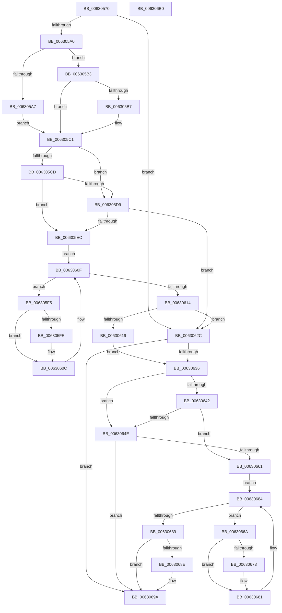

# DifKeLeaveCriticalRegionWrapper

- RVA: `0x00630570`–`0x006306B1` (길이 `321` bytes)
- VA: `0x0000000140630570`
- 실행 섹션: `.text`
- PDB 이름 있음: `예`; PDB Function 태그: `아니요`
- unwind 정보 RVA: `0x000A85B0`
- 디코드: `86`개 명령, `321/321` bytes 표시
- 미해석 바이트: `0` (있으면 어셈블리에 `.byte`로 보존)

> 이 문서는 커널 이미지의 기계어와 PDB 기호를 분석해 생성했습니다. 4번과 5번은 함수 원형과 자료형을 바이너리 사용 방식에서 추정한 C 해석이며 원본 소스 복구 결과는 아닙니다.

## 1. Dependencies

- 직접 호출 지점: **10**; 고유 호출 대상: **6**
- 직접 호출자로 확인된 함수: **0**
- RIP 상대 이미지 참조: **3**

### Outgoing calls
- `0x0063058F` → [DifGetAPIThunkContextById](../49/DifGetAPIThunkContextById_function_00495A34.md) (function, `0x00495A34`)
- `0x006305B7` → [DifGetReturnAddressForWrappers](../4D/DifGetReturnAddressForWrappers_function_004D3C08.md) (function, `0x004D3C08`)
- `0x006305E0` → [ExAcquireRundownProtection](../21/ExAcquireRundownProtection_function_00216620.md) (function, `0x00216620`)
- `0x00630607` → [guard_dispatch_icall](../6B/guard_dispatch_icall_function_006BAAD0.md) (function, `0x006BAAD0`)
- `0x00630620` → [ExReleaseRundownProtection](../34/ExReleaseRundownProtection_function_00349E80.md) (function, `0x00349E80`)
- `0x00630625` → [KeLeaveCriticalRegion](../25/KeLeaveCriticalRegion_function_0025D8B0.md) (function, `0x0025D8B0`)
- `0x0063062C` → [KeLeaveCriticalRegion](../25/KeLeaveCriticalRegion_function_0025D8B0.md) (function, `0x0025D8B0`)
- `0x00630655` → [ExAcquireRundownProtection](../21/ExAcquireRundownProtection_function_00216620.md) (function, `0x00216620`)
- `0x0063067C` → [guard_dispatch_icall](../6B/guard_dispatch_icall_function_006BAAD0.md) (function, `0x006BAAD0`)
- `0x00630695` → [ExReleaseRundownProtection](../34/ExReleaseRundownProtection_function_00349E80.md) (function, `0x00349E80`)

### Direct callers
- 이 함수 시작 RVA로 연결되는 직접 call은 확인되지 않았습니다. 간접 호출은 완전히 역산할 수 없습니다.

### Static image references
- `0x006305C4` → RVA `0x00F048B8` (`.data`; read)
- `0x006305CD` → RVA `0x00F04980` (`.data`; read)
- `0x006305D9` → RVA `0x00F03E80` (`.data`; read)

## 2. Other-region calls and transfers

- 다른 실행 섹션으로 향하는 call: **0**
- 별도 외부 분기/꼬리 이동을 확인하지 못했습니다.

## 3. Assembly (complete function range)

```asm
00630570  48 8B C4                        mov rax, rsp
00630573  48 89 58 10                     mov qword ptr [rax + 0x10], rbx
00630577  48 89 70 18                     mov qword ptr [rax + 0x18], rsi
0063057B  48 89 78 20                     mov qword ptr [rax + 0x20], rdi
0063057F  41 56                           push r14
00630581  48 83 EC 20                     sub rsp, 0x20
00630585  48 83 60 08 00                  and qword ptr [rax + 8], 0
0063058A  B9 12 01 00 00                  mov ecx, 0x112
0063058F  E8 A0 54 E6 FF                  call 0x140495a34
00630594  48 8B F8                        mov rdi, rax
00630597  48 85 C0                        test rax, rax
0063059A  0F 84 8C 00 00 00               je 0x14063062c
006305A0  8B 40 0C                        mov eax, dword ptr [rax + 0xc]
006305A3  A8 18                           test al, 0x18
006305A5  74 0C                           je 0x1406305b3
006305A7  48 8B 4C 24 28                  mov rcx, qword ptr [rsp + 0x28]
006305AC  48 89 4C 24 30                  mov qword ptr [rsp + 0x30], rcx
006305B1  EB 0E                           jmp 0x1406305c1
006305B3  A8 04                           test al, 4
006305B5  74 0A                           je 0x1406305c1
006305B7  E8 4C 36 EA FF                  call 0x1404d3c08
006305BC  48 89 44 24 30                  mov qword ptr [rsp + 0x30], rax
006305C1  40 32 F6                        xor sil, sil
006305C4  40 38 35 ED 42 8D 00            cmp byte ptr [rip + 0x8d42ed], sil
006305CB  75 0C                           jne 0x1406305d9
006305CD  F7 05 A9 43 8D 00 00 08 00 00   test dword ptr [rip + 0x8d43a9], 0x800
006305D7  74 13                           je 0x1406305ec
006305D9  48 8D 0D A0 38 8D 00            lea rcx, [rip + 0x8d38a0]
006305E0  E8 3B 60 BE FF                  call 0x140216620
006305E5  40 8A F0                        mov sil, al
006305E8  84 C0                           test al, al
006305EA  74 40                           je 0x14063062c
006305EC  4C 8D 77 20                     lea r14, [rdi + 0x20]
006305F0  49 8B 1E                        mov rbx, qword ptr [r14]
006305F3  EB 1A                           jmp 0x14063060f
006305F5  48 8D 43 F0                     lea rax, [rbx - 0x10]
006305F9  48 85 C0                        test rax, rax
006305FC  74 0E                           je 0x14063060c
006305FE  48 8B 40 08                     mov rax, qword ptr [rax + 8]
00630602  48 8D 4C 24 30                  lea rcx, [rsp + 0x30]
00630607  E8 C4 A4 08 00                  call 0x1406baad0
0063060C  48 8B 1B                        mov rbx, qword ptr [rbx]
0063060F  49 3B DE                        cmp rbx, r14
00630612  75 E1                           jne 0x1406305f5
00630614  40 84 F6                        test sil, sil
00630617  74 13                           je 0x14063062c
00630619  48 8D 0D 60 38 8D 00            lea rcx, [rip + 0x8d3860]
00630620  E8 5B 98 D1 FF                  call 0x140349e80
00630625  E8 86 D2 C2 FF                  call 0x14025d8b0
0063062A  EB 0A                           jmp 0x140630636
0063062C  E8 7F D2 C2 FF                  call 0x14025d8b0
00630631  48 85 FF                        test rdi, rdi
00630634  74 64                           je 0x14063069a
00630636  40 32 F6                        xor sil, sil
00630639  40 38 35 78 42 8D 00            cmp byte ptr [rip + 0x8d4278], sil
00630640  75 0C                           jne 0x14063064e
00630642  F7 05 34 43 8D 00 00 08 00 00   test dword ptr [rip + 0x8d4334], 0x800
0063064C  74 13                           je 0x140630661
0063064E  48 8D 0D 2B 38 8D 00            lea rcx, [rip + 0x8d382b]
00630655  E8 C6 5F BE FF                  call 0x140216620
0063065A  40 8A F0                        mov sil, al
0063065D  84 C0                           test al, al
0063065F  74 39                           je 0x14063069a
00630661  48 83 C7 30                     add rdi, 0x30
00630665  48 8B 1F                        mov rbx, qword ptr [rdi]
00630668  EB 1A                           jmp 0x140630684
0063066A  48 8D 43 F0                     lea rax, [rbx - 0x10]
0063066E  48 85 C0                        test rax, rax
00630671  74 0E                           je 0x140630681
00630673  48 8B 40 08                     mov rax, qword ptr [rax + 8]
00630677  48 8D 4C 24 30                  lea rcx, [rsp + 0x30]
0063067C  E8 4F A4 08 00                  call 0x1406baad0
00630681  48 8B 1B                        mov rbx, qword ptr [rbx]
00630684  48 3B DF                        cmp rbx, rdi
00630687  75 E1                           jne 0x14063066a
00630689  40 84 F6                        test sil, sil
0063068C  74 0C                           je 0x14063069a
0063068E  48 8D 0D EB 37 8D 00            lea rcx, [rip + 0x8d37eb]
00630695  E8 E6 97 D1 FF                  call 0x140349e80
0063069A  48 8B 5C 24 38                  mov rbx, qword ptr [rsp + 0x38]
0063069F  48 8B 74 24 40                  mov rsi, qword ptr [rsp + 0x40]
006306A4  48 8B 7C 24 48                  mov rdi, qword ptr [rsp + 0x48]
006306A9  48 83 C4 20                     add rsp, 0x20
006306AD  41 5E                           pop r14
006306AF  C3                              ret
006306B0  CC                              int3
```

## 4. C-style interpretation (structured pseudocode)

```c
__int64 __fastcall DifKeLeaveCriticalRegionWrapper(void)
{
    __int64 result;
    __int64 v_rdi;
    __int64 v_rsi;
    __int64 v_rsp;
    unsigned __int64 v_stack_p0;
    unsigned __int64 v_stack_p10;
    unsigned __int64 v_stack_p18;
    unsigned __int64 v_stack_p20;
    unsigned __int64 v_stack_p8;

    *(unsigned __int64 *)(v_rsp + 16) = v_rbx;
    *(unsigned __int64 *)(v_rsp + 24) = v_rsi;
    *(unsigned __int64 *)(v_rsp + 32) = v_rdi;
    v_rsp = (v_rsp) - (32);
    result = DifGetAPIThunkContextById(274, a2, a3, a4);
    if (result == 0) goto loc_0063062C;
    if ((((unsigned __int8)((unsigned int)(*(unsigned int *)(result + 12)))) & (24)) == 0) goto loc_006305B3;
    v_stack_p8 = v_stack_p0;
    goto loc_006305C1;
loc_006305B3:
    result = (unsigned int)(*(unsigned int *)(result + 12));
    if ((((unsigned __int8)((unsigned int)(*(unsigned int *)(result + 12)))) & (4)) != 0) {
        result = DifGetReturnAddressForWrappers(v_stack_p0, a2, a3, a4);
        v_stack_p8 = result;
    }
    v_rsi = 0;
    if ((*(unsigned __int8 *)(v_rip + 9257709)) != 0) goto loc_006305D9;
    if (((*(unsigned int *)(v_rip + 9257897)) & (0x800ULL)) == 0) goto loc_006305EC;
loc_006305D9:
    result = ExAcquireRundownProtection(v_rip + 9255072, a2, a3, a4);
    if ((unsigned __int8)(result) == 0) goto loc_0063062C;
loc_006305EC:
    goto loc_0063060F;
loc_006305F5:
    result = *(unsigned __int64 *)(result + 32) - 16;
    if (*(unsigned __int64 *)(result + 32) - 16 != 0) {
        result = *(unsigned __int64 *)(*(unsigned __int64 *)(result + 32) - 16 + 8);
        a1 = v_stack_p8;
        result = guard_dispatch_icall(a1, a2, a3, a4);
    }
loc_0063060F:
    if ((*(unsigned __int64 *)(*(unsigned __int64 *)(result + 32))) != (result + 32)) goto loc_006305F5;
    if ((unsigned __int8)((unsigned __int8)(result)) == 0) goto loc_0063062C;
    result = ExReleaseRundownProtection(v_rip + 9255008, a2, a3, a4);
    result = KeLeaveCriticalRegion(v_rip + 9255008, a2, a3, a4);
    goto loc_00630636;
loc_0063062C:
    result = KeLeaveCriticalRegion(v_rip + 9255008, a2, a3, a4);
    if (result == 0) goto loc_0063069A;
loc_00630636:
    v_rsi = 0;
    if ((*(unsigned __int8 *)(v_rip + 9257592)) != 0) goto loc_0063064E;
    if (((*(unsigned int *)(v_rip + 9257780)) & (0x800ULL)) == 0) goto loc_00630661;
loc_0063064E:
    result = ExAcquireRundownProtection(v_rip + 9254955, a2, a3, a4);
    if ((unsigned __int8)(result) == 0) goto loc_0063069A;
loc_00630661:
    v_rdi = (result) + (48);
    goto loc_00630684;
loc_0063066A:
    result = *(unsigned __int64 *)(v_rdi) - 16;
    if (*(unsigned __int64 *)(v_rdi) - 16 != 0) {
        result = *(unsigned __int64 *)(*(unsigned __int64 *)(v_rdi) - 16 + 8);
        a1 = v_stack_p8;
        result = guard_dispatch_icall(a1, a2, a3, a4);
    }
loc_00630684:
    if ((*(unsigned __int64 *)(*(unsigned __int64 *)(v_rdi))) != v_rdi) goto loc_0063066A;
    if ((unsigned __int8)((unsigned __int8)(result)) != 0) {
        a1 = v_rip + 9254891;
        result = ExReleaseRundownProtection(a1, a2, a3, a4);
    }
    v_rsp = (v_rsp) + (32);
    return result;
}
```

## 5. (Beta) C Style

```c
void DifKeLeaveCriticalRegionWrapper(void)
{
    int64_t result;
    int64_t local_rdi;
    int64_t local_rsi;
    int64_t local_rsp;
    uint64_t v_stack_p0;
    uint64_t v_stack_p10;
    uint64_t v_stack_p18;
    uint64_t v_stack_p20;
    uint64_t v_stack_p8;

    *(uint64_t *)(local_rsp + 0x10) = local_rbx;
    *(uint64_t *)(local_rsp + 0x18) = local_rsi;
    *(uint64_t *)(local_rsp + 0x20) = local_rdi;
    local_rsp = (local_rsp) - (32);
    result = DifGetAPIThunkContextById(274, a2, a3, a4);
    if (result == 0) goto loc_0063062C;
    if ((((uint8_t)((uint32_t)(*(uint32_t *)(result + 0xC)))) & (24)) == 0) goto loc_006305B3;
    v_stack_p8 = v_stack_p0;
    goto loc_006305C1;
loc_006305B3:
    result = (uint32_t)(*(uint32_t *)(result + 0xC));
    if ((((uint8_t)((uint32_t)(*(uint32_t *)(result + 0xC)))) & (4)) != 0) {
        result = DifGetReturnAddressForWrappers(v_stack_p0, a2, a3, a4);
        v_stack_p8 = result;
    }
    local_rsi = 0;
    if ((*(uint8_t *)(v_rip + 0x8D42ED)) != 0) goto loc_006305D9;
    if (((*(uint32_t *)(v_rip + 0x8D43A9)) & (0x800ULL)) == 0) goto loc_006305EC;
loc_006305D9:
    result = ExAcquireRundownProtection(v_rip + 9255072, a2, a3, a4);
    if ((uint8_t)(result) == 0) goto loc_0063062C;
loc_006305EC:
    goto loc_0063060F;
loc_006305F5:
    result = *(uint64_t *)(result + 0x20) - 16;
    if (*(uint64_t *)(result + 0x20) - 16 != 0) {
        result = *(uint64_t *)(*(uint64_t *)(result + 0x20) - 0x10 + 0x8);
        a1 = v_stack_p8;
        result = guard_dispatch_icall(a1, a2, a3, a4);
    }
loc_0063060F:
    if ((*(uint64_t *)(*(uint64_t *)(result + 0x20))) != (result + 32)) goto loc_006305F5;
    if ((uint8_t)((uint8_t)(result)) == 0) goto loc_0063062C;
    result = ExReleaseRundownProtection(v_rip + 9255008, a2, a3, a4);
    result = KeLeaveCriticalRegion(v_rip + 9255008, a2, a3, a4);
    goto loc_00630636;
loc_0063062C:
    result = KeLeaveCriticalRegion(v_rip + 9255008, a2, a3, a4);
    if (result == 0) goto loc_0063069A;
loc_00630636:
    local_rsi = 0;
    if ((*(uint8_t *)(v_rip + 0x8D4278)) != 0) goto loc_0063064E;
    if (((*(uint32_t *)(v_rip + 0x8D4334)) & (0x800ULL)) == 0) goto loc_00630661;
loc_0063064E:
    result = ExAcquireRundownProtection(v_rip + 9254955, a2, a3, a4);
    if ((uint8_t)(result) == 0) goto loc_0063069A;
loc_00630661:
    local_rdi = (result) + (48);
    goto loc_00630684;
loc_0063066A:
    result = *(uint64_t *)(local_rdi) - 16;
    if (*(uint64_t *)(local_rdi) - 16 != 0) {
        result = *(uint64_t *)(*(uint64_t *)(local_rdi) - 0x10 + 0x8);
        a1 = v_stack_p8;
        result = guard_dispatch_icall(a1, a2, a3, a4);
    }
loc_00630684:
    if ((*(uint64_t *)(*(uint64_t *)(local_rdi))) != local_rdi) goto loc_0063066A;
    if ((uint8_t)((uint8_t)(result)) != 0) {
        a1 = v_rip + 9254891;
        result = ExReleaseRundownProtection(a1, a2, a3, a4);
    }
    local_rsp = (local_rsp) + (32);
    return result;
}
```

## 6. Execution-region graph

[열기: 2D/3D 그래프와 함수 탐색 컨트롤 패널](../../../control-panel.html?section=text&rva=0x00630570&view=graph)

- 2D 그래프는 위에서 아래로 흐르고, 3D 그래프는 빈 공간을 드래그해 회전합니다. Shift+드래그는 이동, 휠은 확대·축소, 함수 노드 선택은 대상 보고서 이동입니다.

### Static fallback


