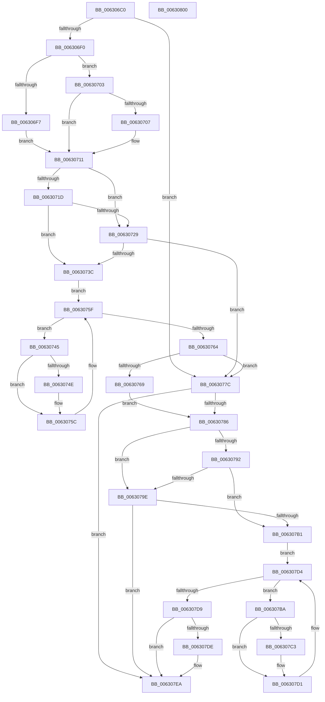

# DifKeLeaveGuardedRegionWrapper

- RVA: `0x006306C0`–`0x00630801` (길이 `321` bytes)
- VA: `0x00000001406306C0`
- 실행 섹션: `.text`
- PDB 이름 있음: `예`; PDB Function 태그: `아니요`
- unwind 정보 RVA: `0x000A85B0`
- 디코드: `86`개 명령, `321/321` bytes 표시
- 미해석 바이트: `0` (있으면 어셈블리에 `.byte`로 보존)

> 이 문서는 커널 이미지의 기계어와 PDB 기호를 분석해 생성했습니다. 4번과 5번은 함수 원형과 자료형을 바이너리 사용 방식에서 추정한 C 해석이며 원본 소스 복구 결과는 아닙니다.

## 1. Dependencies

- 직접 호출 지점: **10**; 고유 호출 대상: **6**
- 직접 호출자로 확인된 함수: **0**
- RIP 상대 이미지 참조: **3**

### Outgoing calls
- `0x006306DF` → [DifGetAPIThunkContextById](../49/DifGetAPIThunkContextById_function_00495A34.md) (function, `0x00495A34`)
- `0x00630707` → [DifGetReturnAddressForWrappers](../4D/DifGetReturnAddressForWrappers_function_004D3C08.md) (function, `0x004D3C08`)
- `0x00630730` → [ExAcquireRundownProtection](../21/ExAcquireRundownProtection_function_00216620.md) (function, `0x00216620`)
- `0x00630757` → [guard_dispatch_icall](../6B/guard_dispatch_icall_function_006BAAD0.md) (function, `0x006BAAD0`)
- `0x00630770` → [ExReleaseRundownProtection](../34/ExReleaseRundownProtection_function_00349E80.md) (function, `0x00349E80`)
- `0x00630775` → [KeLeaveGuardedRegion](../2E/KeLeaveGuardedRegion_function_002E2C40.md) (function, `0x002E2C40`)
- `0x0063077C` → [KeLeaveGuardedRegion](../2E/KeLeaveGuardedRegion_function_002E2C40.md) (function, `0x002E2C40`)
- `0x006307A5` → [ExAcquireRundownProtection](../21/ExAcquireRundownProtection_function_00216620.md) (function, `0x00216620`)
- `0x006307CC` → [guard_dispatch_icall](../6B/guard_dispatch_icall_function_006BAAD0.md) (function, `0x006BAAD0`)
- `0x006307E5` → [ExReleaseRundownProtection](../34/ExReleaseRundownProtection_function_00349E80.md) (function, `0x00349E80`)

### Direct callers
- 이 함수 시작 RVA로 연결되는 직접 call은 확인되지 않았습니다. 간접 호출은 완전히 역산할 수 없습니다.

### Static image references
- `0x00630714` → RVA `0x00F048B8` (`.data`; read)
- `0x0063071D` → RVA `0x00F04980` (`.data`; read)
- `0x00630729` → RVA `0x00F03E80` (`.data`; read)

## 2. Other-region calls and transfers

- 다른 실행 섹션으로 향하는 call: **0**
- 별도 외부 분기/꼬리 이동을 확인하지 못했습니다.

## 3. Assembly (complete function range)

```asm
006306C0  48 8B C4                        mov rax, rsp
006306C3  48 89 58 10                     mov qword ptr [rax + 0x10], rbx
006306C7  48 89 70 18                     mov qword ptr [rax + 0x18], rsi
006306CB  48 89 78 20                     mov qword ptr [rax + 0x20], rdi
006306CF  41 56                           push r14
006306D1  48 83 EC 20                     sub rsp, 0x20
006306D5  48 83 60 08 00                  and qword ptr [rax + 8], 0
006306DA  B9 11 01 00 00                  mov ecx, 0x111
006306DF  E8 50 53 E6 FF                  call 0x140495a34
006306E4  48 8B F8                        mov rdi, rax
006306E7  48 85 C0                        test rax, rax
006306EA  0F 84 8C 00 00 00               je 0x14063077c
006306F0  8B 40 0C                        mov eax, dword ptr [rax + 0xc]
006306F3  A8 18                           test al, 0x18
006306F5  74 0C                           je 0x140630703
006306F7  48 8B 4C 24 28                  mov rcx, qword ptr [rsp + 0x28]
006306FC  48 89 4C 24 30                  mov qword ptr [rsp + 0x30], rcx
00630701  EB 0E                           jmp 0x140630711
00630703  A8 04                           test al, 4
00630705  74 0A                           je 0x140630711
00630707  E8 FC 34 EA FF                  call 0x1404d3c08
0063070C  48 89 44 24 30                  mov qword ptr [rsp + 0x30], rax
00630711  40 32 F6                        xor sil, sil
00630714  40 38 35 9D 41 8D 00            cmp byte ptr [rip + 0x8d419d], sil
0063071B  75 0C                           jne 0x140630729
0063071D  F7 05 59 42 8D 00 00 08 00 00   test dword ptr [rip + 0x8d4259], 0x800
00630727  74 13                           je 0x14063073c
00630729  48 8D 0D 50 37 8D 00            lea rcx, [rip + 0x8d3750]
00630730  E8 EB 5E BE FF                  call 0x140216620
00630735  40 8A F0                        mov sil, al
00630738  84 C0                           test al, al
0063073A  74 40                           je 0x14063077c
0063073C  4C 8D 77 20                     lea r14, [rdi + 0x20]
00630740  49 8B 1E                        mov rbx, qword ptr [r14]
00630743  EB 1A                           jmp 0x14063075f
00630745  48 8D 43 F0                     lea rax, [rbx - 0x10]
00630749  48 85 C0                        test rax, rax
0063074C  74 0E                           je 0x14063075c
0063074E  48 8B 40 08                     mov rax, qword ptr [rax + 8]
00630752  48 8D 4C 24 30                  lea rcx, [rsp + 0x30]
00630757  E8 74 A3 08 00                  call 0x1406baad0
0063075C  48 8B 1B                        mov rbx, qword ptr [rbx]
0063075F  49 3B DE                        cmp rbx, r14
00630762  75 E1                           jne 0x140630745
00630764  40 84 F6                        test sil, sil
00630767  74 13                           je 0x14063077c
00630769  48 8D 0D 10 37 8D 00            lea rcx, [rip + 0x8d3710]
00630770  E8 0B 97 D1 FF                  call 0x140349e80
00630775  E8 C6 24 CB FF                  call 0x1402e2c40
0063077A  EB 0A                           jmp 0x140630786
0063077C  E8 BF 24 CB FF                  call 0x1402e2c40
00630781  48 85 FF                        test rdi, rdi
00630784  74 64                           je 0x1406307ea
00630786  40 32 F6                        xor sil, sil
00630789  40 38 35 28 41 8D 00            cmp byte ptr [rip + 0x8d4128], sil
00630790  75 0C                           jne 0x14063079e
00630792  F7 05 E4 41 8D 00 00 08 00 00   test dword ptr [rip + 0x8d41e4], 0x800
0063079C  74 13                           je 0x1406307b1
0063079E  48 8D 0D DB 36 8D 00            lea rcx, [rip + 0x8d36db]
006307A5  E8 76 5E BE FF                  call 0x140216620
006307AA  40 8A F0                        mov sil, al
006307AD  84 C0                           test al, al
006307AF  74 39                           je 0x1406307ea
006307B1  48 83 C7 30                     add rdi, 0x30
006307B5  48 8B 1F                        mov rbx, qword ptr [rdi]
006307B8  EB 1A                           jmp 0x1406307d4
006307BA  48 8D 43 F0                     lea rax, [rbx - 0x10]
006307BE  48 85 C0                        test rax, rax
006307C1  74 0E                           je 0x1406307d1
006307C3  48 8B 40 08                     mov rax, qword ptr [rax + 8]
006307C7  48 8D 4C 24 30                  lea rcx, [rsp + 0x30]
006307CC  E8 FF A2 08 00                  call 0x1406baad0
006307D1  48 8B 1B                        mov rbx, qword ptr [rbx]
006307D4  48 3B DF                        cmp rbx, rdi
006307D7  75 E1                           jne 0x1406307ba
006307D9  40 84 F6                        test sil, sil
006307DC  74 0C                           je 0x1406307ea
006307DE  48 8D 0D 9B 36 8D 00            lea rcx, [rip + 0x8d369b]
006307E5  E8 96 96 D1 FF                  call 0x140349e80
006307EA  48 8B 5C 24 38                  mov rbx, qword ptr [rsp + 0x38]
006307EF  48 8B 74 24 40                  mov rsi, qword ptr [rsp + 0x40]
006307F4  48 8B 7C 24 48                  mov rdi, qword ptr [rsp + 0x48]
006307F9  48 83 C4 20                     add rsp, 0x20
006307FD  41 5E                           pop r14
006307FF  C3                              ret
00630800  CC                              int3
```

## 4. C-style interpretation (structured pseudocode)

```c
__int64 __fastcall DifKeLeaveGuardedRegionWrapper(void)
{
    __int64 result;
    __int64 v_rdi;
    __int64 v_rsi;
    __int64 v_rsp;
    unsigned __int64 v_stack_p0;
    unsigned __int64 v_stack_p10;
    unsigned __int64 v_stack_p18;
    unsigned __int64 v_stack_p20;
    unsigned __int64 v_stack_p8;

    *(unsigned __int64 *)(v_rsp + 16) = v_rbx;
    *(unsigned __int64 *)(v_rsp + 24) = v_rsi;
    *(unsigned __int64 *)(v_rsp + 32) = v_rdi;
    v_rsp = (v_rsp) - (32);
    result = DifGetAPIThunkContextById(273, a2, a3, a4);
    if (result == 0) goto loc_0063077C;
    if ((((unsigned __int8)((unsigned int)(*(unsigned int *)(result + 12)))) & (24)) == 0) goto loc_00630703;
    v_stack_p8 = v_stack_p0;
    goto loc_00630711;
loc_00630703:
    result = (unsigned int)(*(unsigned int *)(result + 12));
    if ((((unsigned __int8)((unsigned int)(*(unsigned int *)(result + 12)))) & (4)) != 0) {
        result = DifGetReturnAddressForWrappers(v_stack_p0, a2, a3, a4);
        v_stack_p8 = result;
    }
    v_rsi = 0;
    if ((*(unsigned __int8 *)(v_rip + 9257373)) != 0) goto loc_00630729;
    if (((*(unsigned int *)(v_rip + 9257561)) & (0x800ULL)) == 0) goto loc_0063073C;
loc_00630729:
    result = ExAcquireRundownProtection(v_rip + 9254736, a2, a3, a4);
    if ((unsigned __int8)(result) == 0) goto loc_0063077C;
loc_0063073C:
    goto loc_0063075F;
loc_00630745:
    result = *(unsigned __int64 *)(result + 32) - 16;
    if (*(unsigned __int64 *)(result + 32) - 16 != 0) {
        result = *(unsigned __int64 *)(*(unsigned __int64 *)(result + 32) - 16 + 8);
        a1 = v_stack_p8;
        result = guard_dispatch_icall(a1, a2, a3, a4);
    }
loc_0063075F:
    if ((*(unsigned __int64 *)(*(unsigned __int64 *)(result + 32))) != (result + 32)) goto loc_00630745;
    if ((unsigned __int8)((unsigned __int8)(result)) == 0) goto loc_0063077C;
    result = ExReleaseRundownProtection(v_rip + 9254672, a2, a3, a4);
    result = KeLeaveGuardedRegion(v_rip + 9254672, a2, a3, a4);
    goto loc_00630786;
loc_0063077C:
    result = KeLeaveGuardedRegion(v_rip + 9254672, a2, a3, a4);
    if (result == 0) goto loc_006307EA;
loc_00630786:
    v_rsi = 0;
    if ((*(unsigned __int8 *)(v_rip + 9257256)) != 0) goto loc_0063079E;
    if (((*(unsigned int *)(v_rip + 9257444)) & (0x800ULL)) == 0) goto loc_006307B1;
loc_0063079E:
    result = ExAcquireRundownProtection(v_rip + 9254619, a2, a3, a4);
    if ((unsigned __int8)(result) == 0) goto loc_006307EA;
loc_006307B1:
    v_rdi = (result) + (48);
    goto loc_006307D4;
loc_006307BA:
    result = *(unsigned __int64 *)(v_rdi) - 16;
    if (*(unsigned __int64 *)(v_rdi) - 16 != 0) {
        result = *(unsigned __int64 *)(*(unsigned __int64 *)(v_rdi) - 16 + 8);
        a1 = v_stack_p8;
        result = guard_dispatch_icall(a1, a2, a3, a4);
    }
loc_006307D4:
    if ((*(unsigned __int64 *)(*(unsigned __int64 *)(v_rdi))) != v_rdi) goto loc_006307BA;
    if ((unsigned __int8)((unsigned __int8)(result)) != 0) {
        a1 = v_rip + 9254555;
        result = ExReleaseRundownProtection(a1, a2, a3, a4);
    }
    v_rsp = (v_rsp) + (32);
    return result;
}
```

## 5. (Beta) C Style

```c
void DifKeLeaveGuardedRegionWrapper(void)
{
    int64_t result;
    int64_t local_rdi;
    int64_t local_rsi;
    int64_t local_rsp;
    uint64_t v_stack_p0;
    uint64_t v_stack_p10;
    uint64_t v_stack_p18;
    uint64_t v_stack_p20;
    uint64_t v_stack_p8;

    *(uint64_t *)(local_rsp + 0x10) = local_rbx;
    *(uint64_t *)(local_rsp + 0x18) = local_rsi;
    *(uint64_t *)(local_rsp + 0x20) = local_rdi;
    local_rsp = (local_rsp) - (32);
    result = DifGetAPIThunkContextById(273, a2, a3, a4);
    if (result == 0) goto loc_0063077C;
    if ((((uint8_t)((uint32_t)(*(uint32_t *)(result + 0xC)))) & (24)) == 0) goto loc_00630703;
    v_stack_p8 = v_stack_p0;
    goto loc_00630711;
loc_00630703:
    result = (uint32_t)(*(uint32_t *)(result + 0xC));
    if ((((uint8_t)((uint32_t)(*(uint32_t *)(result + 0xC)))) & (4)) != 0) {
        result = DifGetReturnAddressForWrappers(v_stack_p0, a2, a3, a4);
        v_stack_p8 = result;
    }
    local_rsi = 0;
    if ((*(uint8_t *)(v_rip + 0x8D419D)) != 0) goto loc_00630729;
    if (((*(uint32_t *)(v_rip + 0x8D4259)) & (0x800ULL)) == 0) goto loc_0063073C;
loc_00630729:
    result = ExAcquireRundownProtection(v_rip + 9254736, a2, a3, a4);
    if ((uint8_t)(result) == 0) goto loc_0063077C;
loc_0063073C:
    goto loc_0063075F;
loc_00630745:
    result = *(uint64_t *)(result + 0x20) - 16;
    if (*(uint64_t *)(result + 0x20) - 16 != 0) {
        result = *(uint64_t *)(*(uint64_t *)(result + 0x20) - 0x10 + 0x8);
        a1 = v_stack_p8;
        result = guard_dispatch_icall(a1, a2, a3, a4);
    }
loc_0063075F:
    if ((*(uint64_t *)(*(uint64_t *)(result + 0x20))) != (result + 32)) goto loc_00630745;
    if ((uint8_t)((uint8_t)(result)) == 0) goto loc_0063077C;
    result = ExReleaseRundownProtection(v_rip + 9254672, a2, a3, a4);
    result = KeLeaveGuardedRegion(v_rip + 9254672, a2, a3, a4);
    goto loc_00630786;
loc_0063077C:
    result = KeLeaveGuardedRegion(v_rip + 9254672, a2, a3, a4);
    if (result == 0) goto loc_006307EA;
loc_00630786:
    local_rsi = 0;
    if ((*(uint8_t *)(v_rip + 0x8D4128)) != 0) goto loc_0063079E;
    if (((*(uint32_t *)(v_rip + 0x8D41E4)) & (0x800ULL)) == 0) goto loc_006307B1;
loc_0063079E:
    result = ExAcquireRundownProtection(v_rip + 9254619, a2, a3, a4);
    if ((uint8_t)(result) == 0) goto loc_006307EA;
loc_006307B1:
    local_rdi = (result) + (48);
    goto loc_006307D4;
loc_006307BA:
    result = *(uint64_t *)(local_rdi) - 16;
    if (*(uint64_t *)(local_rdi) - 16 != 0) {
        result = *(uint64_t *)(*(uint64_t *)(local_rdi) - 0x10 + 0x8);
        a1 = v_stack_p8;
        result = guard_dispatch_icall(a1, a2, a3, a4);
    }
loc_006307D4:
    if ((*(uint64_t *)(*(uint64_t *)(local_rdi))) != local_rdi) goto loc_006307BA;
    if ((uint8_t)((uint8_t)(result)) != 0) {
        a1 = v_rip + 9254555;
        result = ExReleaseRundownProtection(a1, a2, a3, a4);
    }
    local_rsp = (local_rsp) + (32);
    return result;
}
```

## 6. Execution-region graph

[열기: 2D/3D 그래프와 함수 탐색 컨트롤 패널](../../../control-panel.html?section=text&rva=0x006306C0&view=graph)

- 2D 그래프는 위에서 아래로 흐르고, 3D 그래프는 빈 공간을 드래그해 회전합니다. Shift+드래그는 이동, 휠은 확대·축소, 함수 노드 선택은 대상 보고서 이동입니다.

### Static fallback


