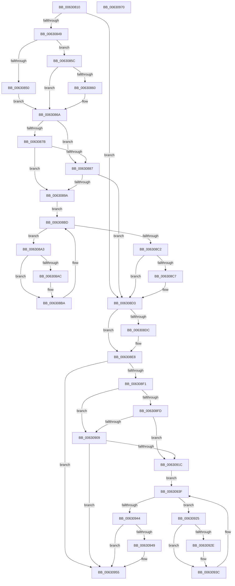

# DifKeLowerIrqlWrapper

- RVA: `0x00630810`–`0x00630971` (길이 `353` bytes)
- VA: `0x0000000140630810`
- 실행 섹션: `.text`
- PDB 이름 있음: `예`; PDB Function 태그: `아니요`
- unwind 정보 RVA: `0x0005D7BC`
- 디코드: `94`개 명령, `353/353` bytes 표시
- 미해석 바이트: `0` (있으면 어셈블리에 `.byte`로 보존)

> 이 문서는 커널 이미지의 기계어와 PDB 기호를 분석해 생성했습니다. 4번과 5번은 함수 원형과 자료형을 바이너리 사용 방식에서 추정한 C 해석이며 원본 소스 복구 결과는 아닙니다.

## 1. Dependencies

- 직접 호출 지점: **9**; 고유 호출 대상: **6**
- 직접 호출자로 확인된 함수: **0**
- RIP 상대 이미지 참조: **4**

### Outgoing calls
- `0x00630838` → [DifGetAPIThunkContextById](../49/DifGetAPIThunkContextById_function_00495A34.md) (function, `0x00495A34`)
- `0x00630860` → [DifGetReturnAddressForWrappers](../4D/DifGetReturnAddressForWrappers_function_004D3C08.md) (function, `0x004D3C08`)
- `0x0063088E` → [ExAcquireRundownProtection](../21/ExAcquireRundownProtection_function_00216620.md) (function, `0x00216620`)
- `0x006308B5` → [guard_dispatch_icall](../6B/guard_dispatch_icall_function_006BAAD0.md) (function, `0x006BAAD0`)
- `0x006308CE` → [ExReleaseRundownProtection](../34/ExReleaseRundownProtection_function_00349E80.md) (function, `0x00349E80`)
- `0x006308E3` → [KiLowerIrqlProcessIrqlFlags](../4F/KiLowerIrqlProcessIrqlFlags_function_004F5698.md) (function, `0x004F5698`)
- `0x00630910` → [ExAcquireRundownProtection](../21/ExAcquireRundownProtection_function_00216620.md) (function, `0x00216620`)
- `0x00630937` → [guard_dispatch_icall](../6B/guard_dispatch_icall_function_006BAAD0.md) (function, `0x006BAAD0`)
- `0x00630950` → [ExReleaseRundownProtection](../34/ExReleaseRundownProtection_function_00349E80.md) (function, `0x00349E80`)

### Direct callers
- 이 함수 시작 RVA로 연결되는 직접 call은 확인되지 않았습니다. 간접 호출은 완전히 역산할 수 없습니다.

### Static image references
- `0x00630872` → RVA `0x00F048B8` (`.data`; read)
- `0x0063087B` → RVA `0x00F04980` (`.data`; read)
- `0x00630887` → RVA `0x00F03E80` (`.data`; read)
- `0x006308D3` → RVA `0x00FC6D20` (`ALMOSTRO`; read)

## 2. Other-region calls and transfers

- 다른 실행 섹션으로 향하는 call: **0**
- 별도 외부 분기/꼬리 이동을 확인하지 못했습니다.

## 3. Assembly (complete function range)

```asm
00630810  48 8B C4                        mov rax, rsp
00630813  48 89 58 08                     mov qword ptr [rax + 8], rbx
00630817  48 89 68 10                     mov qword ptr [rax + 0x10], rbp
0063081B  48 89 70 18                     mov qword ptr [rax + 0x18], rsi
0063081F  48 89 78 20                     mov qword ptr [rax + 0x20], rdi
00630823  41 56                           push r14
00630825  48 83 EC 30                     sub rsp, 0x30
00630829  0F B6 E9                        movzx ebp, cl
0063082C  0F 57 C0                        xorps xmm0, xmm0
0063082F  B9 10 01 00 00                  mov ecx, 0x110
00630834  0F 11 40 E8                     movups xmmword ptr [rax - 0x18], xmm0
00630838  E8 F7 51 E6 FF                  call 0x140495a34
0063083D  48 8B F0                        mov rsi, rax
00630840  48 85 C0                        test rax, rax
00630843  0F 84 8A 00 00 00               je 0x1406308d3
00630849  8B 40 0C                        mov eax, dword ptr [rax + 0xc]
0063084C  A8 18                           test al, 0x18
0063084E  74 0C                           je 0x14063085c
00630850  48 8B 4C 24 38                  mov rcx, qword ptr [rsp + 0x38]
00630855  48 89 4C 24 20                  mov qword ptr [rsp + 0x20], rcx
0063085A  EB 0E                           jmp 0x14063086a
0063085C  A8 04                           test al, 4
0063085E  74 0A                           je 0x14063086a
00630860  E8 A3 33 EA FF                  call 0x1404d3c08
00630865  48 89 44 24 20                  mov qword ptr [rsp + 0x20], rax
0063086A  40 32 FF                        xor dil, dil
0063086D  40 88 6C 24 28                  mov byte ptr [rsp + 0x28], bpl
00630872  40 38 3D 3F 40 8D 00            cmp byte ptr [rip + 0x8d403f], dil
00630879  75 0C                           jne 0x140630887
0063087B  F7 05 FB 40 8D 00 00 08 00 00   test dword ptr [rip + 0x8d40fb], 0x800
00630885  74 13                           je 0x14063089a
00630887  48 8D 0D F2 35 8D 00            lea rcx, [rip + 0x8d35f2]
0063088E  E8 8D 5D BE FF                  call 0x140216620
00630893  40 8A F8                        mov dil, al
00630896  84 C0                           test al, al
00630898  74 39                           je 0x1406308d3
0063089A  4C 8D 76 20                     lea r14, [rsi + 0x20]
0063089E  49 8B 1E                        mov rbx, qword ptr [r14]
006308A1  EB 1A                           jmp 0x1406308bd
006308A3  48 8D 43 F0                     lea rax, [rbx - 0x10]
006308A7  48 85 C0                        test rax, rax
006308AA  74 0E                           je 0x1406308ba
006308AC  48 8B 40 08                     mov rax, qword ptr [rax + 8]
006308B0  48 8D 4C 24 20                  lea rcx, [rsp + 0x20]
006308B5  E8 16 A2 08 00                  call 0x1406baad0
006308BA  48 8B 1B                        mov rbx, qword ptr [rbx]
006308BD  49 3B DE                        cmp rbx, r14
006308C0  75 E1                           jne 0x1406308a3
006308C2  40 84 FF                        test dil, dil
006308C5  74 0C                           je 0x1406308d3
006308C7  48 8D 0D B2 35 8D 00            lea rcx, [rip + 0x8d35b2]
006308CE  E8 AD 95 D1 FF                  call 0x140349e80
006308D3  83 3D 46 64 99 00 00            cmp dword ptr [rip + 0x996446], 0
006308DA  74 0C                           je 0x1406308e8
006308DC  44 0F 20 C1                     mov rcx, cr8
006308E0  40 8A D5                        mov dl, bpl
006308E3  E8 B0 4D EC FF                  call 0x1404f5698
006308E8  44 0F 22 C5                     mov cr8, rbp
006308EC  48 85 F6                        test rsi, rsi
006308EF  74 64                           je 0x140630955
006308F1  40 32 FF                        xor dil, dil
006308F4  40 38 3D BD 3F 8D 00            cmp byte ptr [rip + 0x8d3fbd], dil
006308FB  75 0C                           jne 0x140630909
006308FD  F7 05 79 40 8D 00 00 08 00 00   test dword ptr [rip + 0x8d4079], 0x800
00630907  74 13                           je 0x14063091c
00630909  48 8D 0D 70 35 8D 00            lea rcx, [rip + 0x8d3570]
00630910  E8 0B 5D BE FF                  call 0x140216620
00630915  40 8A F8                        mov dil, al
00630918  84 C0                           test al, al
0063091A  74 39                           je 0x140630955
0063091C  48 83 C6 30                     add rsi, 0x30
00630920  48 8B 1E                        mov rbx, qword ptr [rsi]
00630923  EB 1A                           jmp 0x14063093f
00630925  48 8D 43 F0                     lea rax, [rbx - 0x10]
00630929  48 85 C0                        test rax, rax
0063092C  74 0E                           je 0x14063093c
0063092E  48 8B 40 08                     mov rax, qword ptr [rax + 8]
00630932  48 8D 4C 24 20                  lea rcx, [rsp + 0x20]
00630937  E8 94 A1 08 00                  call 0x1406baad0
0063093C  48 8B 1B                        mov rbx, qword ptr [rbx]
0063093F  48 3B DE                        cmp rbx, rsi
00630942  75 E1                           jne 0x140630925
00630944  40 84 FF                        test dil, dil
00630947  74 0C                           je 0x140630955
00630949  48 8D 0D 30 35 8D 00            lea rcx, [rip + 0x8d3530]
00630950  E8 2B 95 D1 FF                  call 0x140349e80
00630955  48 8B 5C 24 40                  mov rbx, qword ptr [rsp + 0x40]
0063095A  48 8B 6C 24 48                  mov rbp, qword ptr [rsp + 0x48]
0063095F  48 8B 74 24 50                  mov rsi, qword ptr [rsp + 0x50]
00630964  48 8B 7C 24 58                  mov rdi, qword ptr [rsp + 0x58]
00630969  48 83 C4 30                     add rsp, 0x30
0063096D  41 5E                           pop r14
0063096F  C3                              ret
00630970  CC                              int3
```

## 4. C-style interpretation (structured pseudocode)

```c
__int64 __fastcall DifKeLowerIrqlWrapper(unsigned __int8 a1)
{
    __int64 result;
    __int64 v_rdi;
    __int64 v_rsi;
    __int64 v_rsp;
    unsigned __int8 v_stack_m10;
    unsigned __int64 v_stack_m18;
    unsigned __int64 v_stack_p0;
    unsigned __int64 v_stack_p10;
    unsigned __int64 v_stack_p18;
    unsigned __int64 v_stack_p20;
    unsigned __int64 v_stack_p8;

    *(unsigned __int64 *)(v_rsp + 8) = v_rbx;
    *(unsigned __int64 *)(v_rsp + 16) = v_rbp;
    *(unsigned __int64 *)(v_rsp + 24) = v_rsi;
    *(unsigned __int64 *)(v_rsp + 32) = v_rdi;
    v_rsp = (v_rsp) - (48);
    *(unsigned __int64 *)(v_rsp - 24) = v_xmm0;
    result = DifGetAPIThunkContextById(272, a2, a3, a4);
    if (result == 0) goto loc_006308D3;
    if ((((unsigned __int8)((unsigned int)(*(unsigned int *)(result + 12)))) & (24)) == 0) goto loc_0063085C;
    v_stack_m18 = v_stack_p0;
    goto loc_0063086A;
loc_0063085C:
    result = (unsigned int)(*(unsigned int *)(result + 12));
    if ((((unsigned __int8)((unsigned int)(*(unsigned int *)(result + 12)))) & (4)) != 0) {
        result = DifGetReturnAddressForWrappers(v_stack_p0, a2, a3, a4);
        v_stack_m18 = result;
    }
    v_rdi = 0;
    v_stack_m10 = a1;
    if ((*(unsigned __int8 *)(v_rip + 9257023)) != 0) goto loc_00630887;
    if (((*(unsigned int *)(v_rip + 9257211)) & (0x800ULL)) == 0) goto loc_0063089A;
loc_00630887:
    result = ExAcquireRundownProtection(v_rip + 9254386, a2, a3, a4);
    if ((unsigned __int8)(result) == 0) goto loc_006308D3;
loc_0063089A:
    goto loc_006308BD;
loc_006308A3:
    result = *(unsigned __int64 *)(result + 32) - 16;
    if (*(unsigned __int64 *)(result + 32) - 16 != 0) {
        result = *(unsigned __int64 *)(*(unsigned __int64 *)(result + 32) - 16 + 8);
        a1 = v_stack_m18;
        result = guard_dispatch_icall(a1, a2, a3, a4);
    }
loc_006308BD:
    if ((*(unsigned __int64 *)(*(unsigned __int64 *)(result + 32))) != (result + 32)) goto loc_006308A3;
    if ((unsigned __int8)((unsigned __int8)(result)) != 0) {
        a1 = v_rip + 9254322;
        result = ExReleaseRundownProtection(a1, a2, a3, a4);
    }
    if ((*(unsigned int *)(v_rip + 10052678)) != 0) {
        a1 = v_cr8;
        a2 = a1;
        result = KiLowerIrqlProcessIrqlFlags(a1, a2, a3, a4);
    }
    if (result == 0) goto loc_00630955;
    v_rdi = 0;
    if ((*(unsigned __int8 *)(v_rip + 9256893)) != 0) goto loc_00630909;
    if (((*(unsigned int *)(v_rip + 9257081)) & (0x800ULL)) == 0) goto loc_0063091C;
loc_00630909:
    result = ExAcquireRundownProtection(v_rip + 9254256, a2, a3, a4);
    if ((unsigned __int8)(result) == 0) goto loc_00630955;
loc_0063091C:
    v_rsi = (result) + (48);
    goto loc_0063093F;
loc_00630925:
    result = *(unsigned __int64 *)(v_rsi) - 16;
    if (*(unsigned __int64 *)(v_rsi) - 16 != 0) {
        result = *(unsigned __int64 *)(*(unsigned __int64 *)(v_rsi) - 16 + 8);
        a1 = v_stack_m18;
        result = guard_dispatch_icall(a1, a2, a3, a4);
    }
loc_0063093F:
    if ((*(unsigned __int64 *)(*(unsigned __int64 *)(v_rsi))) != v_rsi) goto loc_00630925;
    if ((unsigned __int8)((unsigned __int8)(result)) != 0) {
        a1 = v_rip + 9254192;
        result = ExReleaseRundownProtection(a1, a2, a3, a4);
    }
    v_rsp = (v_rsp) + (48);
    return result;
}
```

## 5. (Beta) C Style

```c
int64_t DifKeLowerIrqlWrapper(uint8_t Arg1)
{
    int64_t result;
    int64_t local_rdi;
    int64_t local_rsi;
    int64_t local_rsp;
    uint8_t v_stack_m10;
    uint64_t v_stack_m18;
    uint64_t v_stack_p0;
    uint64_t v_stack_p10;
    uint64_t v_stack_p18;
    uint64_t v_stack_p20;
    uint64_t v_stack_p8;

    *(uint64_t *)(local_rsp + 0x8) = local_rbx;
    *(uint64_t *)(local_rsp + 0x10) = local_rbp;
    *(uint64_t *)(local_rsp + 0x18) = local_rsi;
    *(uint64_t *)(local_rsp + 0x20) = local_rdi;
    local_rsp = (local_rsp) - (48);
    *(uint64_t *)(local_rsp - 0x18) = v_xmm0;
    result = DifGetAPIThunkContextById(272, a2, a3, a4);
    if (result == 0) goto loc_006308D3;
    if ((((uint8_t)((uint32_t)(*(uint32_t *)(result + 0xC)))) & (24)) == 0) goto loc_0063085C;
    v_stack_m18 = v_stack_p0;
    goto loc_0063086A;
loc_0063085C:
    result = (uint32_t)(*(uint32_t *)(result + 0xC));
    if ((((uint8_t)((uint32_t)(*(uint32_t *)(result + 0xC)))) & (4)) != 0) {
        result = DifGetReturnAddressForWrappers(v_stack_p0, a2, a3, a4);
        v_stack_m18 = result;
    }
    local_rdi = 0;
    v_stack_m10 = Arg1;
    if ((*(uint8_t *)(v_rip + 0x8D403F)) != 0) goto loc_00630887;
    if (((*(uint32_t *)(v_rip + 0x8D40FB)) & (0x800ULL)) == 0) goto loc_0063089A;
loc_00630887:
    result = ExAcquireRundownProtection(v_rip + 9254386, a2, a3, a4);
    if ((uint8_t)(result) == 0) goto loc_006308D3;
loc_0063089A:
    goto loc_006308BD;
loc_006308A3:
    result = *(uint64_t *)(result + 0x20) - 16;
    if (*(uint64_t *)(result + 0x20) - 16 != 0) {
        result = *(uint64_t *)(*(uint64_t *)(result + 0x20) - 0x10 + 0x8);
        Arg1 = v_stack_m18;
        result = guard_dispatch_icall(Arg1, a2, a3, a4);
    }
loc_006308BD:
    if ((*(uint64_t *)(*(uint64_t *)(result + 0x20))) != (result + 32)) goto loc_006308A3;
    if ((uint8_t)((uint8_t)(result)) != 0) {
        Arg1 = v_rip + 9254322;
        result = ExReleaseRundownProtection(Arg1, a2, a3, a4);
    }
    if ((*(uint32_t *)(v_rip + 0x996446)) != 0) {
        Arg1 = v_cr8;
        a2 = Arg1;
        result = KiLowerIrqlProcessIrqlFlags(Arg1, a2, a3, a4);
    }
    if (result == 0) goto loc_00630955;
    local_rdi = 0;
    if ((*(uint8_t *)(v_rip + 0x8D3FBD)) != 0) goto loc_00630909;
    if (((*(uint32_t *)(v_rip + 0x8D4079)) & (0x800ULL)) == 0) goto loc_0063091C;
loc_00630909:
    result = ExAcquireRundownProtection(v_rip + 9254256, a2, a3, a4);
    if ((uint8_t)(result) == 0) goto loc_00630955;
loc_0063091C:
    local_rsi = (result) + (48);
    goto loc_0063093F;
loc_00630925:
    result = *(uint64_t *)(local_rsi) - 16;
    if (*(uint64_t *)(local_rsi) - 16 != 0) {
        result = *(uint64_t *)(*(uint64_t *)(local_rsi) - 0x10 + 0x8);
        Arg1 = v_stack_m18;
        result = guard_dispatch_icall(Arg1, a2, a3, a4);
    }
loc_0063093F:
    if ((*(uint64_t *)(*(uint64_t *)(local_rsi))) != local_rsi) goto loc_00630925;
    if ((uint8_t)((uint8_t)(result)) != 0) {
        Arg1 = v_rip + 9254192;
        result = ExReleaseRundownProtection(Arg1, a2, a3, a4);
    }
    local_rsp = (local_rsp) + (48);
    return result;
}
```

## 6. Execution-region graph

[열기: 2D/3D 그래프와 함수 탐색 컨트롤 패널](../../../control-panel.html?section=text&rva=0x00630810&view=graph)

- 2D 그래프는 위에서 아래로 흐르고, 3D 그래프는 빈 공간을 드래그해 회전합니다. Shift+드래그는 이동, 휠은 확대·축소, 함수 노드 선택은 대상 보고서 이동입니다.

### Static fallback


