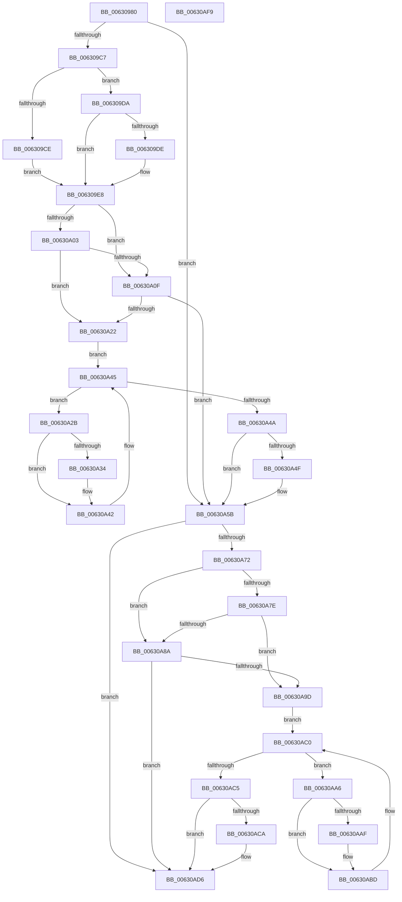

# DifKePulseEventWrapper

- RVA: `0x00630980`–`0x00630AFA` (길이 `378` bytes)
- VA: `0x0000000140630980`
- 실행 섹션: `.text`
- PDB 이름 있음: `예`; PDB Function 태그: `아니요`
- unwind 정보 RVA: `0x0008A668`
- 디코드: `103`개 명령, `378/378` bytes 표시
- 미해석 바이트: `0` (있으면 어셈블리에 `.byte`로 보존)

> 이 문서는 커널 이미지의 기계어와 PDB 기호를 분석해 생성했습니다. 4번과 5번은 함수 원형과 자료형을 바이너리 사용 방식에서 추정한 C 해석이며 원본 소스 복구 결과는 아닙니다.

## 1. Dependencies

- 직접 호출 지점: **9**; 고유 호출 대상: **6**
- 직접 호출자로 확인된 함수: **0**
- RIP 상대 이미지 참조: **3**

### Outgoing calls
- `0x006309B6` → [DifGetAPIThunkContextById](../49/DifGetAPIThunkContextById_function_00495A34.md) (function, `0x00495A34`)
- `0x006309DE` → [DifGetReturnAddressForWrappers](../4D/DifGetReturnAddressForWrappers_function_004D3C08.md) (function, `0x004D3C08`)
- `0x00630A16` → [ExAcquireRundownProtection](../21/ExAcquireRundownProtection_function_00216620.md) (function, `0x00216620`)
- `0x00630A3D` → [guard_dispatch_icall](../6B/guard_dispatch_icall_function_006BAAD0.md) (function, `0x006BAAD0`)
- `0x00630A56` → [ExReleaseRundownProtection](../34/ExReleaseRundownProtection_function_00349E80.md) (function, `0x00349E80`)
- `0x00630A64` → [KePulseEvent](../35/KePulseEvent_function_00351EF0.md) (function, `0x00351EF0`)
- `0x00630A91` → [ExAcquireRundownProtection](../21/ExAcquireRundownProtection_function_00216620.md) (function, `0x00216620`)
- `0x00630AB8` → [guard_dispatch_icall](../6B/guard_dispatch_icall_function_006BAAD0.md) (function, `0x006BAAD0`)
- `0x00630AD1` → [ExReleaseRundownProtection](../34/ExReleaseRundownProtection_function_00349E80.md) (function, `0x00349E80`)

### Direct callers
- 이 함수 시작 RVA로 연결되는 직접 call은 확인되지 않았습니다. 간접 호출은 완전히 역산할 수 없습니다.

### Static image references
- `0x006309F0` → RVA `0x00F048B8` (`.data`; read)
- `0x00630A03` → RVA `0x00F04980` (`.data`; read)
- `0x00630A0F` → RVA `0x00F03E80` (`.data`; read)

## 2. Other-region calls and transfers

- 다른 실행 섹션으로 향하는 call: **0**
- 별도 외부 분기/꼬리 이동을 확인하지 못했습니다.

## 3. Assembly (complete function range)

```asm
00630980  48 8B C4                        mov rax, rsp
00630983  48 89 58 08                     mov qword ptr [rax + 8], rbx
00630987  48 89 68 10                     mov qword ptr [rax + 0x10], rbp
0063098B  48 89 70 18                     mov qword ptr [rax + 0x18], rsi
0063098F  48 89 78 20                     mov qword ptr [rax + 0x20], rdi
00630993  41 54                           push r12
00630995  41 56                           push r14
00630997  41 57                           push r15
00630999  48 83 EC 40                     sub rsp, 0x40
0063099D  0F 57 C0                        xorps xmm0, xmm0
006309A0  4C 8B E1                        mov r12, rcx
006309A3  B9 0F 01 00 00                  mov ecx, 0x10f
006309A8  45 8A F0                        mov r14b, r8b
006309AB  0F 11 40 C8                     movups xmmword ptr [rax - 0x38], xmm0
006309AF  44 8B FA                        mov r15d, edx
006309B2  0F 11 40 D8                     movups xmmword ptr [rax - 0x28], xmm0
006309B6  E8 79 50 E6 FF                  call 0x140495a34
006309BB  48 8B F0                        mov rsi, rax
006309BE  48 85 C0                        test rax, rax
006309C1  0F 84 94 00 00 00               je 0x140630a5b
006309C7  8B 40 0C                        mov eax, dword ptr [rax + 0xc]
006309CA  A8 18                           test al, 0x18
006309CC  74 0C                           je 0x1406309da
006309CE  48 8B 4C 24 58                  mov rcx, qword ptr [rsp + 0x58]
006309D3  48 89 4C 24 20                  mov qword ptr [rsp + 0x20], rcx
006309D8  EB 0E                           jmp 0x1406309e8
006309DA  A8 04                           test al, 4
006309DC  74 0A                           je 0x1406309e8
006309DE  E8 25 32 EA FF                  call 0x1404d3c08
006309E3  48 89 44 24 20                  mov qword ptr [rsp + 0x20], rax
006309E8  40 32 ED                        xor bpl, bpl
006309EB  4C 89 64 24 30                  mov qword ptr [rsp + 0x30], r12
006309F0  40 38 2D C1 3E 8D 00            cmp byte ptr [rip + 0x8d3ec1], bpl
006309F7  44 89 7C 24 2C                  mov dword ptr [rsp + 0x2c], r15d
006309FC  44 88 74 24 28                  mov byte ptr [rsp + 0x28], r14b
00630A01  75 0C                           jne 0x140630a0f
00630A03  F7 05 73 3F 8D 00 00 08 00 00   test dword ptr [rip + 0x8d3f73], 0x800
00630A0D  74 13                           je 0x140630a22
00630A0F  48 8D 0D 6A 34 8D 00            lea rcx, [rip + 0x8d346a]
00630A16  E8 05 5C BE FF                  call 0x140216620
00630A1B  40 8A E8                        mov bpl, al
00630A1E  84 C0                           test al, al
00630A20  74 39                           je 0x140630a5b
00630A22  48 8D 7E 20                     lea rdi, [rsi + 0x20]
00630A26  48 8B 1F                        mov rbx, qword ptr [rdi]
00630A29  EB 1A                           jmp 0x140630a45
00630A2B  48 8D 43 F0                     lea rax, [rbx - 0x10]
00630A2F  48 85 C0                        test rax, rax
00630A32  74 0E                           je 0x140630a42
00630A34  48 8B 40 08                     mov rax, qword ptr [rax + 8]
00630A38  48 8D 4C 24 20                  lea rcx, [rsp + 0x20]
00630A3D  E8 8E A0 08 00                  call 0x1406baad0
00630A42  48 8B 1B                        mov rbx, qword ptr [rbx]
00630A45  48 3B DF                        cmp rbx, rdi
00630A48  75 E1                           jne 0x140630a2b
00630A4A  40 84 ED                        test bpl, bpl
00630A4D  74 0C                           je 0x140630a5b
00630A4F  48 8D 0D 2A 34 8D 00            lea rcx, [rip + 0x8d342a]
00630A56  E8 25 94 D1 FF                  call 0x140349e80
00630A5B  45 8A C6                        mov r8b, r14b
00630A5E  41 8B D7                        mov edx, r15d
00630A61  49 8B CC                        mov rcx, r12
00630A64  E8 87 14 D2 FF                  call 0x140351ef0
00630A69  89 44 24 38                     mov dword ptr [rsp + 0x38], eax
00630A6D  48 85 F6                        test rsi, rsi
00630A70  74 64                           je 0x140630ad6
00630A72  40 32 FF                        xor dil, dil
00630A75  40 38 3D 3C 3E 8D 00            cmp byte ptr [rip + 0x8d3e3c], dil
00630A7C  75 0C                           jne 0x140630a8a
00630A7E  F7 05 F8 3E 8D 00 00 08 00 00   test dword ptr [rip + 0x8d3ef8], 0x800
00630A88  74 13                           je 0x140630a9d
00630A8A  48 8D 0D EF 33 8D 00            lea rcx, [rip + 0x8d33ef]
00630A91  E8 8A 5B BE FF                  call 0x140216620
00630A96  40 8A F8                        mov dil, al
00630A99  84 C0                           test al, al
00630A9B  74 39                           je 0x140630ad6
00630A9D  48 83 C6 30                     add rsi, 0x30
00630AA1  48 8B 1E                        mov rbx, qword ptr [rsi]
00630AA4  EB 1A                           jmp 0x140630ac0
00630AA6  48 8D 43 F0                     lea rax, [rbx - 0x10]
00630AAA  48 85 C0                        test rax, rax
00630AAD  74 0E                           je 0x140630abd
00630AAF  48 8B 40 08                     mov rax, qword ptr [rax + 8]
00630AB3  48 8D 4C 24 20                  lea rcx, [rsp + 0x20]
00630AB8  E8 13 A0 08 00                  call 0x1406baad0
00630ABD  48 8B 1B                        mov rbx, qword ptr [rbx]
00630AC0  48 3B DE                        cmp rbx, rsi
00630AC3  75 E1                           jne 0x140630aa6
00630AC5  40 84 FF                        test dil, dil
00630AC8  74 0C                           je 0x140630ad6
00630ACA  48 8D 0D AF 33 8D 00            lea rcx, [rip + 0x8d33af]
00630AD1  E8 AA 93 D1 FF                  call 0x140349e80
00630AD6  8B 44 24 38                     mov eax, dword ptr [rsp + 0x38]
00630ADA  48 8B 5C 24 60                  mov rbx, qword ptr [rsp + 0x60]
00630ADF  48 8B 6C 24 68                  mov rbp, qword ptr [rsp + 0x68]
00630AE4  48 8B 74 24 70                  mov rsi, qword ptr [rsp + 0x70]
00630AE9  48 8B 7C 24 78                  mov rdi, qword ptr [rsp + 0x78]
00630AEE  48 83 C4 40                     add rsp, 0x40
00630AF2  41 5F                           pop r15
00630AF4  41 5E                           pop r14
00630AF6  41 5C                           pop r12
00630AF8  C3                              ret
00630AF9  CC                              int3
```

## 4. C-style interpretation (structured pseudocode)

```c
__int64 __fastcall DifKePulseEventWrapper(__int64 a1, int a2, unsigned __int8 a3)
{
    __int64 result;
    __int64 v_rbp;
    __int64 v_rdi;
    __int64 v_rsi;
    __int64 v_rsp;
    unsigned int v_stack_m20;
    unsigned __int64 v_stack_m28;
    unsigned int v_stack_m2C;
    unsigned __int8 v_stack_m30;
    unsigned __int64 v_stack_m38;
    unsigned __int64 v_stack_p0;
    unsigned __int64 v_stack_p10;
    unsigned __int64 v_stack_p18;
    unsigned __int64 v_stack_p20;
    unsigned __int64 v_stack_p8;

    *(unsigned __int64 *)(v_rsp + 8) = v_rbx;
    *(unsigned __int64 *)(v_rsp + 16) = v_rbp;
    *(unsigned __int64 *)(v_rsp + 24) = v_rsi;
    *(unsigned __int64 *)(v_rsp + 32) = v_rdi;
    v_rsp = (v_rsp) - (64);
    *(unsigned __int64 *)(v_rsp - 56) = v_xmm0;
    *(unsigned __int64 *)(v_rsp - 40) = v_xmm0;
    result = DifGetAPIThunkContextById(271, a2, a3, a4);
    if (result == 0) goto loc_00630A5B;
    if ((((unsigned __int8)((unsigned int)(*(unsigned int *)(result + 12)))) & (24)) == 0) goto loc_006309DA;
    v_stack_m38 = v_stack_p0;
    goto loc_006309E8;
loc_006309DA:
    result = (unsigned int)(*(unsigned int *)(result + 12));
    if ((((unsigned __int8)((unsigned int)(*(unsigned int *)(result + 12)))) & (4)) != 0) {
        result = DifGetReturnAddressForWrappers(v_stack_p0, a2, a3, a4);
        v_stack_m38 = result;
    }
    v_rbp = 0;
    v_stack_m28 = a1;
    v_stack_m2C = (unsigned int)((unsigned int)(a2));
    v_stack_m30 = a3;
    if ((*(unsigned __int8 *)(v_rip + 9256641)) != 0) goto loc_00630A0F;
    if (((*(unsigned int *)(v_rip + 9256819)) & (0x800ULL)) == 0) goto loc_00630A22;
loc_00630A0F:
    result = ExAcquireRundownProtection(v_rip + 9253994, a2, a3, a4);
    if ((unsigned __int8)(result) == 0) goto loc_00630A5B;
loc_00630A22:
    goto loc_00630A45;
loc_00630A2B:
    result = *(unsigned __int64 *)(result + 32) - 16;
    if (*(unsigned __int64 *)(result + 32) - 16 != 0) {
        result = *(unsigned __int64 *)(*(unsigned __int64 *)(result + 32) - 16 + 8);
        a1 = v_stack_m38;
        result = guard_dispatch_icall(a1, a2, a3, a4);
    }
loc_00630A45:
    if ((*(unsigned __int64 *)(*(unsigned __int64 *)(result + 32))) != (result + 32)) goto loc_00630A2B;
    if ((unsigned __int8)((unsigned __int8)(result)) != 0) {
        a1 = v_rip + 9253930;
        result = ExReleaseRundownProtection(a1, a2, a3, a4);
    }
    result = KePulseEvent(a1, (unsigned int)((unsigned int)((unsigned int)(a2))), a3, a4);
    v_stack_m20 = (unsigned int)(result);
    if (result == 0) goto loc_00630AD6;
    v_rdi = 0;
    if ((*(unsigned __int8 *)(v_rip + 9256508)) != 0) goto loc_00630A8A;
    if (((*(unsigned int *)(v_rip + 9256696)) & (0x800ULL)) == 0) goto loc_00630A9D;
loc_00630A8A:
    result = ExAcquireRundownProtection(v_rip + 9253871, (unsigned int)((unsigned int)((unsigned int)(a2))), a3, a4);
    if ((unsigned __int8)(result) == 0) goto loc_00630AD6;
loc_00630A9D:
    v_rsi = (result) + (48);
    goto loc_00630AC0;
loc_00630AA6:
    result = *(unsigned __int64 *)(v_rsi) - 16;
    if (*(unsigned __int64 *)(v_rsi) - 16 != 0) {
        result = *(unsigned __int64 *)(*(unsigned __int64 *)(v_rsi) - 16 + 8);
        a1 = v_stack_m38;
        result = guard_dispatch_icall(a1, (unsigned int)((unsigned int)((unsigned int)(a2))), a3, a4);
    }
loc_00630AC0:
    if ((*(unsigned __int64 *)(*(unsigned __int64 *)(v_rsi))) != v_rsi) goto loc_00630AA6;
    if ((unsigned __int8)((unsigned __int8)(result)) != 0) {
        a1 = v_rip + 9253807;
        result = ExReleaseRundownProtection(a1, (unsigned int)((unsigned int)((unsigned int)(a2))), a3, a4);
    }
    v_rsp = (v_rsp) + (64);
    return (unsigned int)(v_stack_m20);
}
```

## 5. (Beta) C Style

```c
int64_t DifKePulseEventWrapper(int64_t Arg1, int32_t Arg2, uint8_t Arg3)
{
    int64_t result;
    int64_t local_rbp;
    int64_t local_rdi;
    int64_t local_rsi;
    int64_t local_rsp;
    uint32_t v_stack_m20;
    uint64_t v_stack_m28;
    uint32_t v_stack_m2C;
    uint8_t v_stack_m30;
    uint64_t v_stack_m38;
    uint64_t v_stack_p0;
    uint64_t v_stack_p10;
    uint64_t v_stack_p18;
    uint64_t v_stack_p20;
    uint64_t v_stack_p8;

    *(uint64_t *)(local_rsp + 0x8) = local_rbx;
    *(uint64_t *)(local_rsp + 0x10) = local_rbp;
    *(uint64_t *)(local_rsp + 0x18) = local_rsi;
    *(uint64_t *)(local_rsp + 0x20) = local_rdi;
    local_rsp = (local_rsp) - (64);
    *(uint64_t *)(local_rsp - 0x38) = v_xmm0;
    *(uint64_t *)(local_rsp - 0x28) = v_xmm0;
    result = DifGetAPIThunkContextById(271, Arg2, Arg3, a4);
    if (result == 0) goto loc_00630A5B;
    if ((((uint8_t)((uint32_t)(*(uint32_t *)(result + 0xC)))) & (24)) == 0) goto loc_006309DA;
    v_stack_m38 = v_stack_p0;
    goto loc_006309E8;
loc_006309DA:
    result = (uint32_t)(*(uint32_t *)(result + 0xC));
    if ((((uint8_t)((uint32_t)(*(uint32_t *)(result + 0xC)))) & (4)) != 0) {
        result = DifGetReturnAddressForWrappers(v_stack_p0, Arg2, Arg3, a4);
        v_stack_m38 = result;
    }
    local_rbp = 0;
    v_stack_m28 = Arg1;
    v_stack_m2C = (uint32_t)((uint32_t)(Arg2));
    v_stack_m30 = Arg3;
    if ((*(uint8_t *)(v_rip + 0x8D3EC1)) != 0) goto loc_00630A0F;
    if (((*(uint32_t *)(v_rip + 0x8D3F73)) & (0x800ULL)) == 0) goto loc_00630A22;
loc_00630A0F:
    result = ExAcquireRundownProtection(v_rip + 9253994, Arg2, Arg3, a4);
    if ((uint8_t)(result) == 0) goto loc_00630A5B;
loc_00630A22:
    goto loc_00630A45;
loc_00630A2B:
    result = *(uint64_t *)(result + 0x20) - 16;
    if (*(uint64_t *)(result + 0x20) - 16 != 0) {
        result = *(uint64_t *)(*(uint64_t *)(result + 0x20) - 0x10 + 0x8);
        Arg1 = v_stack_m38;
        result = guard_dispatch_icall(Arg1, Arg2, Arg3, a4);
    }
loc_00630A45:
    if ((*(uint64_t *)(*(uint64_t *)(result + 0x20))) != (result + 32)) goto loc_00630A2B;
    if ((uint8_t)((uint8_t)(result)) != 0) {
        Arg1 = v_rip + 9253930;
        result = ExReleaseRundownProtection(Arg1, Arg2, Arg3, a4);
    }
    result = KePulseEvent(Arg1, (uint32_t)((uint32_t)((uint32_t)(Arg2))), Arg3, a4);
    v_stack_m20 = (uint32_t)(result);
    if (result == 0) goto loc_00630AD6;
    local_rdi = 0;
    if ((*(uint8_t *)(v_rip + 0x8D3E3C)) != 0) goto loc_00630A8A;
    if (((*(uint32_t *)(v_rip + 0x8D3EF8)) & (0x800ULL)) == 0) goto loc_00630A9D;
loc_00630A8A:
    result = ExAcquireRundownProtection(v_rip + 9253871, (uint32_t)((uint32_t)((uint32_t)(Arg2))), Arg3, a4);
    if ((uint8_t)(result) == 0) goto loc_00630AD6;
loc_00630A9D:
    local_rsi = (result) + (48);
    goto loc_00630AC0;
loc_00630AA6:
    result = *(uint64_t *)(local_rsi) - 16;
    if (*(uint64_t *)(local_rsi) - 16 != 0) {
        result = *(uint64_t *)(*(uint64_t *)(local_rsi) - 0x10 + 0x8);
        Arg1 = v_stack_m38;
        result = guard_dispatch_icall(Arg1, (uint32_t)((uint32_t)((uint32_t)(Arg2))), Arg3, a4);
    }
loc_00630AC0:
    if ((*(uint64_t *)(*(uint64_t *)(local_rsi))) != local_rsi) goto loc_00630AA6;
    if ((uint8_t)((uint8_t)(result)) != 0) {
        Arg1 = v_rip + 9253807;
        result = ExReleaseRundownProtection(Arg1, (uint32_t)((uint32_t)((uint32_t)(Arg2))), Arg3, a4);
    }
    local_rsp = (local_rsp) + (64);
    return (uint32_t)(v_stack_m20);
}
```

## 6. Execution-region graph

[열기: 2D/3D 그래프와 함수 탐색 컨트롤 패널](../../../control-panel.html?section=text&rva=0x00630980&view=graph)

- 2D 그래프는 위에서 아래로 흐르고, 3D 그래프는 빈 공간을 드래그해 회전합니다. Shift+드래그는 이동, 휠은 확대·축소, 함수 노드 선택은 대상 보고서 이동입니다.

### Static fallback


