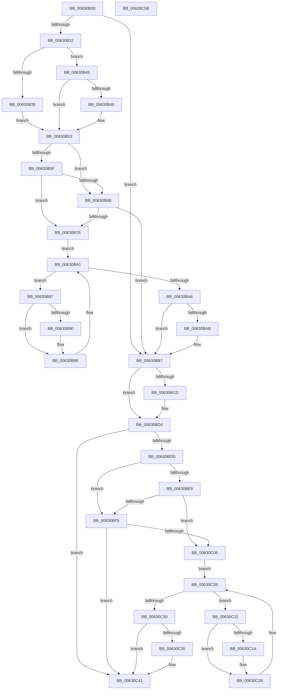

# DifKeRaiseIrqlToDpcLevelWrapper

- RVA: `0x00630B00`–`0x00630C5C` (길이 `348` bytes)
- VA: `0x0000000140630B00`
- 실행 섹션: `.text`
- PDB 이름 있음: `예`; PDB Function 태그: `아니요`
- unwind 정보 RVA: `0x0009B270`
- 디코드: `93`개 명령, `348/348` bytes 표시
- 미해석 바이트: `0` (있으면 어셈블리에 `.byte`로 보존)

> 이 문서는 커널 이미지의 기계어와 PDB 기호를 분석해 생성했습니다. 4번과 5번은 함수 원형과 자료형을 바이너리 사용 방식에서 추정한 C 해석이며 원본 소스 복구 결과는 아닙니다.

## 1. Dependencies

- 직접 호출 지점: **9**; 고유 호출 대상: **6**
- 직접 호출자로 확인된 함수: **0**
- RIP 상대 이미지 참조: **4**

### Outgoing calls
- `0x00630B21` → [DifGetAPIThunkContextById](../49/DifGetAPIThunkContextById_function_00495A34.md) (function, `0x00495A34`)
- `0x00630B49` → [DifGetReturnAddressForWrappers](../4D/DifGetReturnAddressForWrappers_function_004D3C08.md) (function, `0x004D3C08`)
- `0x00630B72` → [ExAcquireRundownProtection](../21/ExAcquireRundownProtection_function_00216620.md) (function, `0x00216620`)
- `0x00630B99` → [guard_dispatch_icall](../6B/guard_dispatch_icall_function_006BAAD0.md) (function, `0x006BAAD0`)
- `0x00630BB2` → [ExReleaseRundownProtection](../34/ExReleaseRundownProtection_function_00349E80.md) (function, `0x00349E80`)
- `0x00630BCF` → [KiRaiseIrqlProcessIrqlFlags](../4F/KiRaiseIrqlProcessIrqlFlags_function_004F56FC.md) (function, `0x004F56FC`)
- `0x00630BFC` → [ExAcquireRundownProtection](../21/ExAcquireRundownProtection_function_00216620.md) (function, `0x00216620`)
- `0x00630C23` → [guard_dispatch_icall](../6B/guard_dispatch_icall_function_006BAAD0.md) (function, `0x006BAAD0`)
- `0x00630C3C` → [ExReleaseRundownProtection](../34/ExReleaseRundownProtection_function_00349E80.md) (function, `0x00349E80`)

### Direct callers
- 이 함수 시작 RVA로 연결되는 직접 call은 확인되지 않았습니다. 간접 호출은 완전히 역산할 수 없습니다.

### Static image references
- `0x00630B56` → RVA `0x00F048B8` (`.data`; read)
- `0x00630B5F` → RVA `0x00F04980` (`.data`; read)
- `0x00630B6B` → RVA `0x00F03E80` (`.data`; read)
- `0x00630BC4` → RVA `0x00FC6D20` (`ALMOSTRO`; read)

## 2. Other-region calls and transfers

- 다른 실행 섹션으로 향하는 call: **0**
- 별도 외부 분기/꼬리 이동을 확인하지 못했습니다.

## 3. Assembly (complete function range)

```asm
00630B00  48 8B C4                        mov rax, rsp
00630B03  48 89 58 08                     mov qword ptr [rax + 8], rbx
00630B07  48 89 70 10                     mov qword ptr [rax + 0x10], rsi
00630B0B  48 89 78 18                     mov qword ptr [rax + 0x18], rdi
00630B0F  41 56                           push r14
00630B11  48 83 EC 30                     sub rsp, 0x30
00630B15  0F 57 C0                        xorps xmm0, xmm0
00630B18  B9 0E 01 00 00                  mov ecx, 0x10e
00630B1D  0F 11 40 E8                     movups xmmword ptr [rax - 0x18], xmm0
00630B21  E8 0E 4F E6 FF                  call 0x140495a34
00630B26  48 8B F8                        mov rdi, rax
00630B29  48 85 C0                        test rax, rax
00630B2C  0F 84 85 00 00 00               je 0x140630bb7
00630B32  8B 40 0C                        mov eax, dword ptr [rax + 0xc]
00630B35  A8 18                           test al, 0x18
00630B37  74 0C                           je 0x140630b45
00630B39  48 8B 4C 24 38                  mov rcx, qword ptr [rsp + 0x38]
00630B3E  48 89 4C 24 20                  mov qword ptr [rsp + 0x20], rcx
00630B43  EB 0E                           jmp 0x140630b53
00630B45  A8 04                           test al, 4
00630B47  74 0A                           je 0x140630b53
00630B49  E8 BA 30 EA FF                  call 0x1404d3c08
00630B4E  48 89 44 24 20                  mov qword ptr [rsp + 0x20], rax
00630B53  40 32 F6                        xor sil, sil
00630B56  40 38 35 5B 3D 8D 00            cmp byte ptr [rip + 0x8d3d5b], sil
00630B5D  75 0C                           jne 0x140630b6b
00630B5F  F7 05 17 3E 8D 00 00 08 00 00   test dword ptr [rip + 0x8d3e17], 0x800
00630B69  74 13                           je 0x140630b7e
00630B6B  48 8D 0D 0E 33 8D 00            lea rcx, [rip + 0x8d330e]
00630B72  E8 A9 5A BE FF                  call 0x140216620
00630B77  40 8A F0                        mov sil, al
00630B7A  84 C0                           test al, al
00630B7C  74 39                           je 0x140630bb7
00630B7E  4C 8D 77 20                     lea r14, [rdi + 0x20]
00630B82  49 8B 1E                        mov rbx, qword ptr [r14]
00630B85  EB 1A                           jmp 0x140630ba1
00630B87  48 8D 43 F0                     lea rax, [rbx - 0x10]
00630B8B  48 85 C0                        test rax, rax
00630B8E  74 0E                           je 0x140630b9e
00630B90  48 8B 40 08                     mov rax, qword ptr [rax + 8]
00630B94  48 8D 4C 24 20                  lea rcx, [rsp + 0x20]
00630B99  E8 32 9F 08 00                  call 0x1406baad0
00630B9E  48 8B 1B                        mov rbx, qword ptr [rbx]
00630BA1  49 3B DE                        cmp rbx, r14
00630BA4  75 E1                           jne 0x140630b87
00630BA6  40 84 F6                        test sil, sil
00630BA9  74 0C                           je 0x140630bb7
00630BAB  48 8D 0D CE 32 8D 00            lea rcx, [rip + 0x8d32ce]
00630BB2  E8 C9 92 D1 FF                  call 0x140349e80
00630BB7  44 0F 20 C3                     mov rbx, cr8
00630BBB  BA 02 00 00 00                  mov edx, 2
00630BC0  44 0F 22 C2                     mov cr8, rdx
00630BC4  83 3D 55 61 99 00 00            cmp dword ptr [rip + 0x996155], 0
00630BCB  74 07                           je 0x140630bd4
00630BCD  8A CB                           mov cl, bl
00630BCF  E8 28 4B EC FF                  call 0x1404f56fc
00630BD4  88 5C 24 28                     mov byte ptr [rsp + 0x28], bl
00630BD8  48 85 FF                        test rdi, rdi
00630BDB  74 64                           je 0x140630c41
00630BDD  40 32 F6                        xor sil, sil
00630BE0  40 38 35 D1 3C 8D 00            cmp byte ptr [rip + 0x8d3cd1], sil
00630BE7  75 0C                           jne 0x140630bf5
00630BE9  F7 05 8D 3D 8D 00 00 08 00 00   test dword ptr [rip + 0x8d3d8d], 0x800
00630BF3  74 13                           je 0x140630c08
00630BF5  48 8D 0D 84 32 8D 00            lea rcx, [rip + 0x8d3284]
00630BFC  E8 1F 5A BE FF                  call 0x140216620
00630C01  40 8A F0                        mov sil, al
00630C04  84 C0                           test al, al
00630C06  74 39                           je 0x140630c41
00630C08  48 83 C7 30                     add rdi, 0x30
00630C0C  48 8B 1F                        mov rbx, qword ptr [rdi]
00630C0F  EB 1A                           jmp 0x140630c2b
00630C11  48 8D 43 F0                     lea rax, [rbx - 0x10]
00630C15  48 85 C0                        test rax, rax
00630C18  74 0E                           je 0x140630c28
00630C1A  48 8B 40 08                     mov rax, qword ptr [rax + 8]
00630C1E  48 8D 4C 24 20                  lea rcx, [rsp + 0x20]
00630C23  E8 A8 9E 08 00                  call 0x1406baad0
00630C28  48 8B 1B                        mov rbx, qword ptr [rbx]
00630C2B  48 3B DF                        cmp rbx, rdi
00630C2E  75 E1                           jne 0x140630c11
00630C30  40 84 F6                        test sil, sil
00630C33  74 0C                           je 0x140630c41
00630C35  48 8D 0D 44 32 8D 00            lea rcx, [rip + 0x8d3244]
00630C3C  E8 3F 92 D1 FF                  call 0x140349e80
00630C41  8A 44 24 28                     mov al, byte ptr [rsp + 0x28]
00630C45  48 8B 5C 24 40                  mov rbx, qword ptr [rsp + 0x40]
00630C4A  48 8B 74 24 48                  mov rsi, qword ptr [rsp + 0x48]
00630C4F  48 8B 7C 24 50                  mov rdi, qword ptr [rsp + 0x50]
00630C54  48 83 C4 30                     add rsp, 0x30
00630C58  41 5E                           pop r14
00630C5A  C3                              ret
00630C5B  CC                              int3
```

## 4. C-style interpretation (structured pseudocode)

```c
__int64 __fastcall DifKeRaiseIrqlToDpcLevelWrapper(void)
{
    __int64 result;
    __int64 v_rdi;
    __int64 v_rsi;
    __int64 v_rsp;
    unsigned __int8 v_stack_m10;
    unsigned __int64 v_stack_m18;
    unsigned __int64 v_stack_p0;
    unsigned __int64 v_stack_p10;
    unsigned __int64 v_stack_p18;
    unsigned __int64 v_stack_p8;

    *(unsigned __int64 *)(v_rsp + 8) = v_rbx;
    *(unsigned __int64 *)(v_rsp + 16) = v_rsi;
    *(unsigned __int64 *)(v_rsp + 24) = v_rdi;
    v_rsp = (v_rsp) - (48);
    *(unsigned __int64 *)(v_rsp - 24) = v_xmm0;
    result = DifGetAPIThunkContextById(270, a2, a3, a4);
    if (result == 0) goto loc_00630BB7;
    if ((((unsigned __int8)((unsigned int)(*(unsigned int *)(result + 12)))) & (24)) == 0) goto loc_00630B45;
    v_stack_m18 = v_stack_p0;
    goto loc_00630B53;
loc_00630B45:
    result = (unsigned int)(*(unsigned int *)(result + 12));
    if ((((unsigned __int8)((unsigned int)(*(unsigned int *)(result + 12)))) & (4)) != 0) {
        result = DifGetReturnAddressForWrappers(v_stack_p0, a2, a3, a4);
        v_stack_m18 = result;
    }
    v_rsi = 0;
    if ((*(unsigned __int8 *)(v_rip + 9256283)) != 0) goto loc_00630B6B;
    if (((*(unsigned int *)(v_rip + 9256471)) & (0x800ULL)) == 0) goto loc_00630B7E;
loc_00630B6B:
    result = ExAcquireRundownProtection(v_rip + 9253646, a2, a3, a4);
    if ((unsigned __int8)(result) == 0) goto loc_00630BB7;
loc_00630B7E:
    goto loc_00630BA1;
loc_00630B87:
    result = *(unsigned __int64 *)(result + 32) - 16;
    if (*(unsigned __int64 *)(result + 32) - 16 != 0) {
        result = *(unsigned __int64 *)(*(unsigned __int64 *)(result + 32) - 16 + 8);
        a1 = v_stack_m18;
        result = guard_dispatch_icall(a1, a2, a3, a4);
    }
loc_00630BA1:
    if ((*(unsigned __int64 *)(*(unsigned __int64 *)(result + 32))) != (result + 32)) goto loc_00630B87;
    if ((unsigned __int8)((unsigned __int8)(result)) != 0) {
        a1 = v_rip + 9253582;
        result = ExReleaseRundownProtection(a1, a2, a3, a4);
    }
    if ((*(unsigned int *)(v_rip + 10051925)) != 0) {
        a1 = (unsigned __int8)(v_cr8);
        result = KiRaiseIrqlProcessIrqlFlags(a1, 2, a3, a4);
    }
    v_stack_m10 = (unsigned __int8)(v_cr8);
    if (result == 0) goto loc_00630C41;
    v_rsi = 0;
    if ((*(unsigned __int8 *)(v_rip + 9256145)) != 0) goto loc_00630BF5;
    if (((*(unsigned int *)(v_rip + 9256333)) & (0x800ULL)) == 0) goto loc_00630C08;
loc_00630BF5:
    result = ExAcquireRundownProtection(v_rip + 9253508, 2, a3, a4);
    if ((unsigned __int8)(result) == 0) goto loc_00630C41;
loc_00630C08:
    v_rdi = (result) + (48);
    goto loc_00630C2B;
loc_00630C11:
    result = *(unsigned __int64 *)(v_rdi) - 16;
    if (*(unsigned __int64 *)(v_rdi) - 16 != 0) {
        result = *(unsigned __int64 *)(*(unsigned __int64 *)(v_rdi) - 16 + 8);
        a1 = v_stack_m18;
        result = guard_dispatch_icall(a1, 2, a3, a4);
    }
loc_00630C2B:
    if ((*(unsigned __int64 *)(*(unsigned __int64 *)(v_rdi))) != v_rdi) goto loc_00630C11;
    if ((unsigned __int8)((unsigned __int8)(result)) != 0) {
        a1 = v_rip + 9253444;
        result = ExReleaseRundownProtection(a1, 2, a3, a4);
    }
    v_rsp = (v_rsp) + (48);
    return v_stack_m10;
}
```

## 5. (Beta) C Style

```c
void DifKeRaiseIrqlToDpcLevelWrapper(void)
{
    int64_t result;
    int64_t local_rdi;
    int64_t local_rsi;
    int64_t local_rsp;
    uint8_t v_stack_m10;
    uint64_t v_stack_m18;
    uint64_t v_stack_p0;
    uint64_t v_stack_p10;
    uint64_t v_stack_p18;
    uint64_t v_stack_p8;

    *(uint64_t *)(local_rsp + 0x8) = local_rbx;
    *(uint64_t *)(local_rsp + 0x10) = local_rsi;
    *(uint64_t *)(local_rsp + 0x18) = local_rdi;
    local_rsp = (local_rsp) - (48);
    *(uint64_t *)(local_rsp - 0x18) = v_xmm0;
    result = DifGetAPIThunkContextById(270, a2, a3, a4);
    if (result == 0) goto loc_00630BB7;
    if ((((uint8_t)((uint32_t)(*(uint32_t *)(result + 0xC)))) & (24)) == 0) goto loc_00630B45;
    v_stack_m18 = v_stack_p0;
    goto loc_00630B53;
loc_00630B45:
    result = (uint32_t)(*(uint32_t *)(result + 0xC));
    if ((((uint8_t)((uint32_t)(*(uint32_t *)(result + 0xC)))) & (4)) != 0) {
        result = DifGetReturnAddressForWrappers(v_stack_p0, a2, a3, a4);
        v_stack_m18 = result;
    }
    local_rsi = 0;
    if ((*(uint8_t *)(v_rip + 0x8D3D5B)) != 0) goto loc_00630B6B;
    if (((*(uint32_t *)(v_rip + 0x8D3E17)) & (0x800ULL)) == 0) goto loc_00630B7E;
loc_00630B6B:
    result = ExAcquireRundownProtection(v_rip + 9253646, a2, a3, a4);
    if ((uint8_t)(result) == 0) goto loc_00630BB7;
loc_00630B7E:
    goto loc_00630BA1;
loc_00630B87:
    result = *(uint64_t *)(result + 0x20) - 16;
    if (*(uint64_t *)(result + 0x20) - 16 != 0) {
        result = *(uint64_t *)(*(uint64_t *)(result + 0x20) - 0x10 + 0x8);
        a1 = v_stack_m18;
        result = guard_dispatch_icall(a1, a2, a3, a4);
    }
loc_00630BA1:
    if ((*(uint64_t *)(*(uint64_t *)(result + 0x20))) != (result + 32)) goto loc_00630B87;
    if ((uint8_t)((uint8_t)(result)) != 0) {
        a1 = v_rip + 9253582;
        result = ExReleaseRundownProtection(a1, a2, a3, a4);
    }
    if ((*(uint32_t *)(v_rip + 0x996155)) != 0) {
        a1 = (uint8_t)(v_cr8);
        result = KiRaiseIrqlProcessIrqlFlags(a1, 2, a3, a4);
    }
    v_stack_m10 = (uint8_t)(v_cr8);
    if (result == 0) goto loc_00630C41;
    local_rsi = 0;
    if ((*(uint8_t *)(v_rip + 0x8D3CD1)) != 0) goto loc_00630BF5;
    if (((*(uint32_t *)(v_rip + 0x8D3D8D)) & (0x800ULL)) == 0) goto loc_00630C08;
loc_00630BF5:
    result = ExAcquireRundownProtection(v_rip + 9253508, 2, a3, a4);
    if ((uint8_t)(result) == 0) goto loc_00630C41;
loc_00630C08:
    local_rdi = (result) + (48);
    goto loc_00630C2B;
loc_00630C11:
    result = *(uint64_t *)(local_rdi) - 16;
    if (*(uint64_t *)(local_rdi) - 16 != 0) {
        result = *(uint64_t *)(*(uint64_t *)(local_rdi) - 0x10 + 0x8);
        a1 = v_stack_m18;
        result = guard_dispatch_icall(a1, 2, a3, a4);
    }
loc_00630C2B:
    if ((*(uint64_t *)(*(uint64_t *)(local_rdi))) != local_rdi) goto loc_00630C11;
    if ((uint8_t)((uint8_t)(result)) != 0) {
        a1 = v_rip + 9253444;
        result = ExReleaseRundownProtection(a1, 2, a3, a4);
    }
    local_rsp = (local_rsp) + (48);
    return v_stack_m10;
}
```

## 6. Execution-region graph

[열기: 2D/3D 그래프와 함수 탐색 컨트롤 패널](../../../control-panel.html?section=text&rva=0x00630B00&view=graph)

- 2D 그래프는 위에서 아래로 흐르고, 3D 그래프는 빈 공간을 드래그해 회전합니다. Shift+드래그는 이동, 휠은 확대·축소, 함수 노드 선택은 대상 보고서 이동입니다.

### Static fallback


