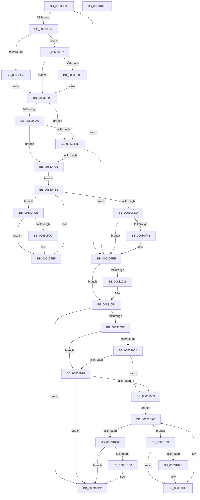

# DifKeRegisterNmiCallbackWrapper

- RVA: `0x00630F30`–`0x006310E1` (길이 `433` bytes)
- VA: `0x0000000140630F30`
- 실행 섹션: `.text`
- PDB 이름 있음: `예`; PDB Function 태그: `아니요`
- unwind 정보 RVA: `0x00093E28`
- 디코드: `114`개 명령, `433/433` bytes 표시
- 미해석 바이트: `0` (있으면 어셈블리에 `.byte`로 보존)

> 이 문서는 커널 이미지의 기계어와 PDB 기호를 분석해 생성했습니다. 4번과 5번은 함수 원형과 자료형을 바이너리 사용 방식에서 추정한 C 해석이며 원본 소스 복구 결과는 아닙니다.

## 1. Dependencies

- 직접 호출 지점: **11**; 고유 호출 대상: **8**
- 직접 호출자로 확인된 함수: **0**
- RIP 상대 이미지 참조: **6**

### Outgoing calls
- `0x00630F5E` → [DifGetAPIThunkContextById](../49/DifGetAPIThunkContextById_function_00495A34.md) (function, `0x00495A34`)
- `0x00630F86` → [DifGetReturnAddressForWrappers](../4D/DifGetReturnAddressForWrappers_function_004D3C08.md) (function, `0x004D3C08`)
- `0x00630FB9` → [ExAcquireRundownProtection](../21/ExAcquireRundownProtection_function_00216620.md) (function, `0x00216620`)
- `0x00630FE0` → [guard_dispatch_icall](../6B/guard_dispatch_icall_function_006BAAD0.md) (function, `0x006BAAD0`)
- `0x00630FF9` → [ExReleaseRundownProtection](../34/ExReleaseRundownProtection_function_00349E80.md) (function, `0x00349E80`)
- `0x0063100C` → [ExAllocatePool2](../../poolcode/B8/ExAllocatePool2_function_00B820F0.md) (function, `0x00B820F0`)
- `0x0063102C` → [KeAcquireSpinLockRaiseToDpc](../20/KeAcquireSpinLockRaiseToDpc_function_00208470.md) (function, `0x00208470`)
- `0x0063104B` → [KeReleaseSpinLock](../39/KeReleaseSpinLock_function_00392BA0.md) (function, `0x00392BA0`)
- `0x0063107D` → [ExAcquireRundownProtection](../21/ExAcquireRundownProtection_function_00216620.md) (function, `0x00216620`)
- `0x006310A4` → [guard_dispatch_icall](../6B/guard_dispatch_icall_function_006BAAD0.md) (function, `0x006BAAD0`)
- `0x006310BD` → [ExReleaseRundownProtection](../34/ExReleaseRundownProtection_function_00349E80.md) (function, `0x00349E80`)

### Direct callers
- 이 함수 시작 RVA로 연결되는 직접 call은 확인되지 않았습니다. 간접 호출은 완전히 역산할 수 없습니다.

### Static image references
- `0x00630F98` → RVA `0x00F048B8` (`.data`; read)
- `0x00630FA6` → RVA `0x00F04980` (`.data`; read)
- `0x00630FB2` → RVA `0x00F03E80` (`.data`; read)
- `0x00631019` → RVA `0x00F475B0` (`.data`; read)
- `0x00631031` → RVA `0x00F475A8` (`.data`; read)
- `0x00631044` → RVA `0x00F475A8` (`.data`; write)

## 2. Other-region calls and transfers

- 다른 실행 섹션으로 향하는 call: **1**
  - `0x0063100C` → [ExAllocatePool2](../../poolcode/B8/ExAllocatePool2_function_00B820F0.md) (`.text` → `POOLCODE`)
- 별도 외부 분기/꼬리 이동을 확인하지 못했습니다.

## 3. Assembly (complete function range)

```asm
00630F30  48 8B C4                        mov rax, rsp
00630F33  48 89 58 08                     mov qword ptr [rax + 8], rbx
00630F37  48 89 68 10                     mov qword ptr [rax + 0x10], rbp
00630F3B  48 89 70 18                     mov qword ptr [rax + 0x18], rsi
00630F3F  57                              push rdi
00630F40  41 56                           push r14
00630F42  41 57                           push r15
00630F44  48 83 EC 40                     sub rsp, 0x40
00630F48  0F 57 C0                        xorps xmm0, xmm0
00630F4B  4C 8B F9                        mov r15, rcx
00630F4E  B9 0B 01 00 00                  mov ecx, 0x10b
00630F53  4C 8B F2                        mov r14, rdx
00630F56  0F 11 40 C8                     movups xmmword ptr [rax - 0x38], xmm0
00630F5A  0F 11 40 D8                     movups xmmword ptr [rax - 0x28], xmm0
00630F5E  E8 D1 4A E6 FF                  call 0x140495a34
00630F63  48 8B F0                        mov rsi, rax
00630F66  48 85 C0                        test rax, rax
00630F69  0F 84 8F 00 00 00               je 0x140630ffe
00630F6F  8B 40 0C                        mov eax, dword ptr [rax + 0xc]
00630F72  A8 18                           test al, 0x18
00630F74  74 0C                           je 0x140630f82
00630F76  48 8B 4C 24 58                  mov rcx, qword ptr [rsp + 0x58]
00630F7B  48 89 4C 24 20                  mov qword ptr [rsp + 0x20], rcx
00630F80  EB 0E                           jmp 0x140630f90
00630F82  A8 04                           test al, 4
00630F84  74 0A                           je 0x140630f90
00630F86  E8 7D 2C EA FF                  call 0x1404d3c08
00630F8B  48 89 44 24 20                  mov qword ptr [rsp + 0x20], rax
00630F90  40 32 ED                        xor bpl, bpl
00630F93  4C 89 7C 24 30                  mov qword ptr [rsp + 0x30], r15
00630F98  40 38 2D 19 39 8D 00            cmp byte ptr [rip + 0x8d3919], bpl
00630F9F  4C 89 74 24 28                  mov qword ptr [rsp + 0x28], r14
00630FA4  75 0C                           jne 0x140630fb2
00630FA6  F7 05 D0 39 8D 00 00 08 00 00   test dword ptr [rip + 0x8d39d0], 0x800
00630FB0  74 13                           je 0x140630fc5
00630FB2  48 8D 0D C7 2E 8D 00            lea rcx, [rip + 0x8d2ec7]
00630FB9  E8 62 56 BE FF                  call 0x140216620
00630FBE  40 8A E8                        mov bpl, al
00630FC1  84 C0                           test al, al
00630FC3  74 39                           je 0x140630ffe
00630FC5  48 8D 7E 20                     lea rdi, [rsi + 0x20]
00630FC9  48 8B 1F                        mov rbx, qword ptr [rdi]
00630FCC  EB 1A                           jmp 0x140630fe8
00630FCE  48 8D 43 F0                     lea rax, [rbx - 0x10]
00630FD2  48 85 C0                        test rax, rax
00630FD5  74 0E                           je 0x140630fe5
00630FD7  48 8B 40 08                     mov rax, qword ptr [rax + 8]
00630FDB  48 8D 4C 24 20                  lea rcx, [rsp + 0x20]
00630FE0  E8 EB 9A 08 00                  call 0x1406baad0
00630FE5  48 8B 1B                        mov rbx, qword ptr [rbx]
00630FE8  48 3B DF                        cmp rbx, rdi
00630FEB  75 E1                           jne 0x140630fce
00630FED  40 84 ED                        test bpl, bpl
00630FF0  74 0C                           je 0x140630ffe
00630FF2  48 8D 0D 87 2E 8D 00            lea rcx, [rip + 0x8d2e87]
00630FF9  E8 82 8E D1 FF                  call 0x140349e80
00630FFE  BA 20 00 00 00                  mov edx, 0x20
00631003  41 B8 4B 4E 4D 49               mov r8d, 0x494d4e4b
00631009  8D 4A 20                        lea ecx, [rdx + 0x20]
0063100C  E8 DF 10 55 00                  call 0x140b820f0
00631011  48 8B D8                        mov rbx, rax
00631014  48 85 C0                        test rax, rax
00631017  74 3B                           je 0x140631054
00631019  48 8D 0D 90 65 91 00            lea rcx, [rip + 0x916590]
00631020  4C 89 78 08                     mov qword ptr [rax + 8], r15
00631024  4C 89 70 10                     mov qword ptr [rax + 0x10], r14
00631028  48 89 58 18                     mov qword ptr [rax + 0x18], rbx
0063102C  E8 3F 74 BD FF                  call 0x140208470
00631031  48 8B 15 70 65 91 00            mov rdx, qword ptr [rip + 0x916570]
00631038  48 8D 0D 71 65 91 00            lea rcx, [rip + 0x916571]
0063103F  48 89 13                        mov qword ptr [rbx], rdx
00631042  8A D0                           mov dl, al
00631044  48 89 1D 5D 65 91 00            mov qword ptr [rip + 0x91655d], rbx
0063104B  E8 50 1B D6 FF                  call 0x140392ba0
00631050  48 8B 43 18                     mov rax, qword ptr [rbx + 0x18]
00631054  48 89 44 24 38                  mov qword ptr [rsp + 0x38], rax
00631059  48 85 F6                        test rsi, rsi
0063105C  74 64                           je 0x1406310c2
0063105E  40 32 FF                        xor dil, dil
00631061  40 38 3D 50 38 8D 00            cmp byte ptr [rip + 0x8d3850], dil
00631068  75 0C                           jne 0x140631076
0063106A  F7 05 0C 39 8D 00 00 08 00 00   test dword ptr [rip + 0x8d390c], 0x800
00631074  74 13                           je 0x140631089
00631076  48 8D 0D 03 2E 8D 00            lea rcx, [rip + 0x8d2e03]
0063107D  E8 9E 55 BE FF                  call 0x140216620
00631082  40 8A F8                        mov dil, al
00631085  84 C0                           test al, al
00631087  74 39                           je 0x1406310c2
00631089  48 83 C6 30                     add rsi, 0x30
0063108D  48 8B 1E                        mov rbx, qword ptr [rsi]
00631090  EB 1A                           jmp 0x1406310ac
00631092  48 8D 43 F0                     lea rax, [rbx - 0x10]
00631096  48 85 C0                        test rax, rax
00631099  74 0E                           je 0x1406310a9
0063109B  48 8B 40 08                     mov rax, qword ptr [rax + 8]
0063109F  48 8D 4C 24 20                  lea rcx, [rsp + 0x20]
006310A4  E8 27 9A 08 00                  call 0x1406baad0
006310A9  48 8B 1B                        mov rbx, qword ptr [rbx]
006310AC  48 3B DE                        cmp rbx, rsi
006310AF  75 E1                           jne 0x140631092
006310B1  40 84 FF                        test dil, dil
006310B4  74 0C                           je 0x1406310c2
006310B6  48 8D 0D C3 2D 8D 00            lea rcx, [rip + 0x8d2dc3]
006310BD  E8 BE 8D D1 FF                  call 0x140349e80
006310C2  48 8B 44 24 38                  mov rax, qword ptr [rsp + 0x38]
006310C7  48 8B 5C 24 60                  mov rbx, qword ptr [rsp + 0x60]
006310CC  48 8B 6C 24 68                  mov rbp, qword ptr [rsp + 0x68]
006310D1  48 8B 74 24 70                  mov rsi, qword ptr [rsp + 0x70]
006310D6  48 83 C4 40                     add rsp, 0x40
006310DA  41 5F                           pop r15
006310DC  41 5E                           pop r14
006310DE  5F                              pop rdi
006310DF  C3                              ret
006310E0  CC                              int3
```

## 4. C-style interpretation (structured pseudocode)

```c
__int64 __fastcall DifKeRegisterNmiCallbackWrapper(__int64 a1, __int64 a2)
{
    __int64 result;
    __int64 v_rbp;
    __int64 v_rdi;
    __int64 v_rsi;
    __int64 v_rsp;
    unsigned __int64 v_stack_m20;
    unsigned __int64 v_stack_m28;
    unsigned __int64 v_stack_m30;
    unsigned __int64 v_stack_m38;
    unsigned __int64 v_stack_p0;
    unsigned __int64 v_stack_p10;
    unsigned __int64 v_stack_p18;
    unsigned __int64 v_stack_p8;

    *(unsigned __int64 *)(v_rsp + 8) = v_rbx;
    *(unsigned __int64 *)(v_rsp + 16) = v_rbp;
    *(unsigned __int64 *)(v_rsp + 24) = v_rsi;
    v_rsp = (v_rsp) - (64);
    *(unsigned __int64 *)(v_rsp - 56) = v_xmm0;
    *(unsigned __int64 *)(v_rsp - 40) = v_xmm0;
    result = DifGetAPIThunkContextById(267, a2, a3, a4);
    if (result == 0) goto loc_00630FFE;
    if ((((unsigned __int8)((unsigned int)(*(unsigned int *)(result + 12)))) & (24)) == 0) goto loc_00630F82;
    v_stack_m38 = v_stack_p0;
    goto loc_00630F90;
loc_00630F82:
    result = (unsigned int)(*(unsigned int *)(result + 12));
    if ((((unsigned __int8)((unsigned int)(*(unsigned int *)(result + 12)))) & (4)) != 0) {
        result = DifGetReturnAddressForWrappers(v_stack_p0, a2, a3, a4);
        v_stack_m38 = result;
    }
    v_rbp = 0;
    v_stack_m28 = a1;
    v_stack_m30 = a2;
    if ((*(unsigned __int8 *)(v_rip + 9255193)) != 0) goto loc_00630FB2;
    if (((*(unsigned int *)(v_rip + 9255376)) & (0x800ULL)) == 0) goto loc_00630FC5;
loc_00630FB2:
    result = ExAcquireRundownProtection(v_rip + 9252551, a2, a3, a4);
    if ((unsigned __int8)(result) == 0) goto loc_00630FFE;
loc_00630FC5:
    goto loc_00630FE8;
loc_00630FCE:
    result = *(unsigned __int64 *)(result + 32) - 16;
    if (*(unsigned __int64 *)(result + 32) - 16 != 0) {
        result = *(unsigned __int64 *)(*(unsigned __int64 *)(result + 32) - 16 + 8);
        a1 = v_stack_m38;
        result = guard_dispatch_icall(a1, a2, a3, a4);
    }
loc_00630FE8:
    if ((*(unsigned __int64 *)(*(unsigned __int64 *)(result + 32))) != (result + 32)) goto loc_00630FCE;
    if ((unsigned __int8)((unsigned __int8)(result)) != 0) {
        a1 = v_rip + 9252487;
        result = ExReleaseRundownProtection(a1, a2, a3, a4);
    }
    result = ExAllocatePool2(32 + 32, 32, (unsigned int)(0x494D4E4BULL), a4);
    if (result != 0) {
        a1 = v_rip + 9528720;
        *(unsigned __int64 *)(result + 8) = a1;
        *(unsigned __int64 *)(result + 16) = a2;
        *(unsigned __int64 *)(result + 24) = result;
        result = KeAcquireSpinLockRaiseToDpc(a1, 32, (unsigned int)(0x494D4E4BULL), a4);
        a2 = *(unsigned __int64 *)(v_rip + 9528688);
        a1 = v_rip + 9528689;
        *(unsigned __int64 *)(result) = a2;
        a2 = (unsigned __int8)(result);
        *(unsigned __int64 *)(v_rip + 9528669) = result;
        result = KeReleaseSpinLock(a1, a2, (unsigned int)(0x494D4E4BULL), a4);
        result = *(unsigned __int64 *)(result + 24);
    }
    v_stack_m20 = result;
    if (result == 0) goto loc_006310C2;
    v_rdi = 0;
    if ((*(unsigned __int8 *)(v_rip + 9254992)) != 0) goto loc_00631076;
    if (((*(unsigned int *)(v_rip + 9255180)) & (0x800ULL)) == 0) goto loc_00631089;
loc_00631076:
    result = ExAcquireRundownProtection(v_rip + 9252355, a2, (unsigned int)(0x494D4E4BULL), a4);
    if ((unsigned __int8)(result) == 0) goto loc_006310C2;
loc_00631089:
    v_rsi = (result) + (48);
    goto loc_006310AC;
loc_00631092:
    result = *(unsigned __int64 *)(v_rsi) - 16;
    if (*(unsigned __int64 *)(v_rsi) - 16 != 0) {
        result = *(unsigned __int64 *)(*(unsigned __int64 *)(v_rsi) - 16 + 8);
        a1 = v_stack_m38;
        result = guard_dispatch_icall(a1, a2, (unsigned int)(0x494D4E4BULL), a4);
    }
loc_006310AC:
    if ((*(unsigned __int64 *)(*(unsigned __int64 *)(v_rsi))) != v_rsi) goto loc_00631092;
    if ((unsigned __int8)((unsigned __int8)(result)) != 0) {
        a1 = v_rip + 9252291;
        result = ExReleaseRundownProtection(a1, a2, (unsigned int)(0x494D4E4BULL), a4);
    }
    v_rsp = (v_rsp) + (64);
    return v_stack_m20;
}
```

## 5. (Beta) C Style

```c
int64_t DifKeRegisterNmiCallbackWrapper(int64_t Arg1, int64_t Arg2)
{
    int64_t result;
    int64_t local_rbp;
    int64_t local_rdi;
    int64_t local_rsi;
    int64_t local_rsp;
    uint64_t v_stack_m20;
    uint64_t v_stack_m28;
    uint64_t v_stack_m30;
    uint64_t v_stack_m38;
    uint64_t v_stack_p0;
    uint64_t v_stack_p10;
    uint64_t v_stack_p18;
    uint64_t v_stack_p8;

    *(uint64_t *)(local_rsp + 0x8) = local_rbx;
    *(uint64_t *)(local_rsp + 0x10) = local_rbp;
    *(uint64_t *)(local_rsp + 0x18) = local_rsi;
    local_rsp = (local_rsp) - (64);
    *(uint64_t *)(local_rsp - 0x38) = v_xmm0;
    *(uint64_t *)(local_rsp - 0x28) = v_xmm0;
    result = DifGetAPIThunkContextById(267, Arg2, a3, a4);
    if (result == 0) goto loc_00630FFE;
    if ((((uint8_t)((uint32_t)(*(uint32_t *)(result + 0xC)))) & (24)) == 0) goto loc_00630F82;
    v_stack_m38 = v_stack_p0;
    goto loc_00630F90;
loc_00630F82:
    result = (uint32_t)(*(uint32_t *)(result + 0xC));
    if ((((uint8_t)((uint32_t)(*(uint32_t *)(result + 0xC)))) & (4)) != 0) {
        result = DifGetReturnAddressForWrappers(v_stack_p0, Arg2, a3, a4);
        v_stack_m38 = result;
    }
    local_rbp = 0;
    v_stack_m28 = Arg1;
    v_stack_m30 = Arg2;
    if ((*(uint8_t *)(v_rip + 0x8D3919)) != 0) goto loc_00630FB2;
    if (((*(uint32_t *)(v_rip + 0x8D39D0)) & (0x800ULL)) == 0) goto loc_00630FC5;
loc_00630FB2:
    result = ExAcquireRundownProtection(v_rip + 9252551, Arg2, a3, a4);
    if ((uint8_t)(result) == 0) goto loc_00630FFE;
loc_00630FC5:
    goto loc_00630FE8;
loc_00630FCE:
    result = *(uint64_t *)(result + 0x20) - 16;
    if (*(uint64_t *)(result + 0x20) - 16 != 0) {
        result = *(uint64_t *)(*(uint64_t *)(result + 0x20) - 0x10 + 0x8);
        Arg1 = v_stack_m38;
        result = guard_dispatch_icall(Arg1, Arg2, a3, a4);
    }
loc_00630FE8:
    if ((*(uint64_t *)(*(uint64_t *)(result + 0x20))) != (result + 32)) goto loc_00630FCE;
    if ((uint8_t)((uint8_t)(result)) != 0) {
        Arg1 = v_rip + 9252487;
        result = ExReleaseRundownProtection(Arg1, Arg2, a3, a4);
    }
    result = ExAllocatePool2(32 + 32, 32, (uint32_t)(0x494D4E4BULL), a4);
    if (result != 0) {
        Arg1 = v_rip + 9528720;
        *(uint64_t *)(result + 0x8) = Arg1;
        *(uint64_t *)(result + 0x10) = Arg2;
        *(uint64_t *)(result + 0x18) = result;
        result = KeAcquireSpinLockRaiseToDpc(Arg1, 32, (uint32_t)(0x494D4E4BULL), a4);
        Arg2 = *(uint64_t *)(v_rip + 0x916570);
        Arg1 = v_rip + 9528689;
        *(uint64_t *)(result) = Arg2;
        Arg2 = (uint8_t)(result);
        *(uint64_t *)(v_rip + 0x91655D) = result;
        result = KeReleaseSpinLock(Arg1, Arg2, (uint32_t)(0x494D4E4BULL), a4);
        result = *(uint64_t *)(result + 0x18);
    }
    v_stack_m20 = result;
    if (result == 0) goto loc_006310C2;
    local_rdi = 0;
    if ((*(uint8_t *)(v_rip + 0x8D3850)) != 0) goto loc_00631076;
    if (((*(uint32_t *)(v_rip + 0x8D390C)) & (0x800ULL)) == 0) goto loc_00631089;
loc_00631076:
    result = ExAcquireRundownProtection(v_rip + 9252355, Arg2, (uint32_t)(0x494D4E4BULL), a4);
    if ((uint8_t)(result) == 0) goto loc_006310C2;
loc_00631089:
    local_rsi = (result) + (48);
    goto loc_006310AC;
loc_00631092:
    result = *(uint64_t *)(local_rsi) - 16;
    if (*(uint64_t *)(local_rsi) - 16 != 0) {
        result = *(uint64_t *)(*(uint64_t *)(local_rsi) - 0x10 + 0x8);
        Arg1 = v_stack_m38;
        result = guard_dispatch_icall(Arg1, Arg2, (uint32_t)(0x494D4E4BULL), a4);
    }
loc_006310AC:
    if ((*(uint64_t *)(*(uint64_t *)(local_rsi))) != local_rsi) goto loc_00631092;
    if ((uint8_t)((uint8_t)(result)) != 0) {
        Arg1 = v_rip + 9252291;
        result = ExReleaseRundownProtection(Arg1, Arg2, (uint32_t)(0x494D4E4BULL), a4);
    }
    local_rsp = (local_rsp) + (64);
    return v_stack_m20;
}
```

## 6. Execution-region graph

[열기: 2D/3D 그래프와 함수 탐색 컨트롤 패널](../../../control-panel.html?section=text&rva=0x00630F30&view=graph)

- 2D 그래프는 위에서 아래로 흐르고, 3D 그래프는 빈 공간을 드래그해 회전합니다. Shift+드래그는 이동, 휠은 확대·축소, 함수 노드 선택은 대상 보고서 이동입니다.

### Static fallback


