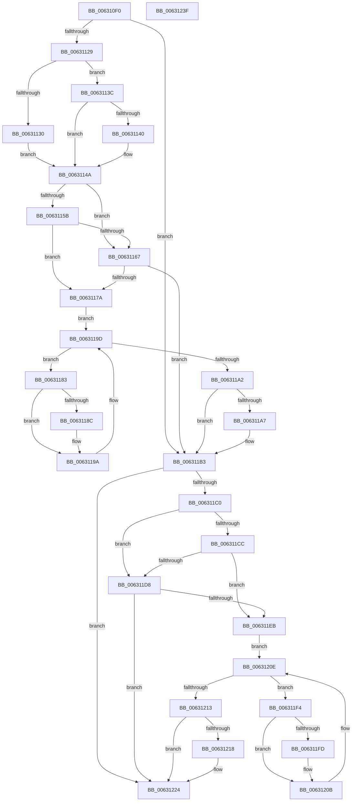

# DifKeReleaseGuardedMutexUnsafeWrapper

- RVA: `0x006310F0`–`0x00631240` (길이 `336` bytes)
- VA: `0x00000001406310F0`
- 실행 섹션: `.text`
- PDB 이름 있음: `예`; PDB Function 태그: `아니요`
- unwind 정보 RVA: `0x0005D7BC`
- 디코드: `90`개 명령, `336/336` bytes 표시
- 미해석 바이트: `0` (있으면 어셈블리에 `.byte`로 보존)

> 이 문서는 커널 이미지의 기계어와 PDB 기호를 분석해 생성했습니다. 4번과 5번은 함수 원형과 자료형을 바이너리 사용 방식에서 추정한 C 해석이며 원본 소스 복구 결과는 아닙니다.

## 1. Dependencies

- 직접 호출 지점: **9**; 고유 호출 대상: **6**
- 직접 호출자로 확인된 함수: **0**
- RIP 상대 이미지 참조: **3**

### Outgoing calls
- `0x00631118` → [DifGetAPIThunkContextById](../49/DifGetAPIThunkContextById_function_00495A34.md) (function, `0x00495A34`)
- `0x00631140` → [DifGetReturnAddressForWrappers](../4D/DifGetReturnAddressForWrappers_function_004D3C08.md) (function, `0x004D3C08`)
- `0x0063116E` → [ExAcquireRundownProtection](../21/ExAcquireRundownProtection_function_00216620.md) (function, `0x00216620`)
- `0x00631195` → [guard_dispatch_icall](../6B/guard_dispatch_icall_function_006BAAD0.md) (function, `0x006BAAD0`)
- `0x006311AE` → [ExReleaseRundownProtection](../34/ExReleaseRundownProtection_function_00349E80.md) (function, `0x00349E80`)
- `0x006311B6` → [ExReleaseFastMutexUnsafe](../25/ExReleaseFastMutexUnsafe_function_002503A0.md) (function, `0x002503A0`)
- `0x006311DF` → [ExAcquireRundownProtection](../21/ExAcquireRundownProtection_function_00216620.md) (function, `0x00216620`)
- `0x00631206` → [guard_dispatch_icall](../6B/guard_dispatch_icall_function_006BAAD0.md) (function, `0x006BAAD0`)
- `0x0063121F` → [ExReleaseRundownProtection](../34/ExReleaseRundownProtection_function_00349E80.md) (function, `0x00349E80`)

### Direct callers
- 이 함수 시작 RVA로 연결되는 직접 call은 확인되지 않았습니다. 간접 호출은 완전히 역산할 수 없습니다.

### Static image references
- `0x00631152` → RVA `0x00F048B8` (`.data`; read)
- `0x0063115B` → RVA `0x00F04980` (`.data`; read)
- `0x00631167` → RVA `0x00F03E80` (`.data`; read)

## 2. Other-region calls and transfers

- 다른 실행 섹션으로 향하는 call: **0**
- 별도 외부 분기/꼬리 이동을 확인하지 못했습니다.

## 3. Assembly (complete function range)

```asm
006310F0  48 8B C4                        mov rax, rsp
006310F3  48 89 58 08                     mov qword ptr [rax + 8], rbx
006310F7  48 89 68 10                     mov qword ptr [rax + 0x10], rbp
006310FB  48 89 70 18                     mov qword ptr [rax + 0x18], rsi
006310FF  48 89 78 20                     mov qword ptr [rax + 0x20], rdi
00631103  41 56                           push r14
00631105  48 83 EC 30                     sub rsp, 0x30
00631109  48 8B E9                        mov rbp, rcx
0063110C  0F 57 C0                        xorps xmm0, xmm0
0063110F  B9 09 01 00 00                  mov ecx, 0x109
00631114  0F 11 40 E8                     movups xmmword ptr [rax - 0x18], xmm0
00631118  E8 17 49 E6 FF                  call 0x140495a34
0063111D  48 8B F8                        mov rdi, rax
00631120  48 85 C0                        test rax, rax
00631123  0F 84 8A 00 00 00               je 0x1406311b3
00631129  8B 40 0C                        mov eax, dword ptr [rax + 0xc]
0063112C  A8 18                           test al, 0x18
0063112E  74 0C                           je 0x14063113c
00631130  48 8B 4C 24 38                  mov rcx, qword ptr [rsp + 0x38]
00631135  48 89 4C 24 20                  mov qword ptr [rsp + 0x20], rcx
0063113A  EB 0E                           jmp 0x14063114a
0063113C  A8 04                           test al, 4
0063113E  74 0A                           je 0x14063114a
00631140  E8 C3 2A EA FF                  call 0x1404d3c08
00631145  48 89 44 24 20                  mov qword ptr [rsp + 0x20], rax
0063114A  40 32 F6                        xor sil, sil
0063114D  48 89 6C 24 28                  mov qword ptr [rsp + 0x28], rbp
00631152  40 38 35 5F 37 8D 00            cmp byte ptr [rip + 0x8d375f], sil
00631159  75 0C                           jne 0x140631167
0063115B  F7 05 1B 38 8D 00 00 08 00 00   test dword ptr [rip + 0x8d381b], 0x800
00631165  74 13                           je 0x14063117a
00631167  48 8D 0D 12 2D 8D 00            lea rcx, [rip + 0x8d2d12]
0063116E  E8 AD 54 BE FF                  call 0x140216620
00631173  40 8A F0                        mov sil, al
00631176  84 C0                           test al, al
00631178  74 39                           je 0x1406311b3
0063117A  4C 8D 77 20                     lea r14, [rdi + 0x20]
0063117E  49 8B 1E                        mov rbx, qword ptr [r14]
00631181  EB 1A                           jmp 0x14063119d
00631183  48 8D 43 F0                     lea rax, [rbx - 0x10]
00631187  48 85 C0                        test rax, rax
0063118A  74 0E                           je 0x14063119a
0063118C  48 8B 40 08                     mov rax, qword ptr [rax + 8]
00631190  48 8D 4C 24 20                  lea rcx, [rsp + 0x20]
00631195  E8 36 99 08 00                  call 0x1406baad0
0063119A  48 8B 1B                        mov rbx, qword ptr [rbx]
0063119D  49 3B DE                        cmp rbx, r14
006311A0  75 E1                           jne 0x140631183
006311A2  40 84 F6                        test sil, sil
006311A5  74 0C                           je 0x1406311b3
006311A7  48 8D 0D D2 2C 8D 00            lea rcx, [rip + 0x8d2cd2]
006311AE  E8 CD 8C D1 FF                  call 0x140349e80
006311B3  48 8B CD                        mov rcx, rbp
006311B6  E8 E5 F1 C1 FF                  call 0x1402503a0
006311BB  48 85 FF                        test rdi, rdi
006311BE  74 64                           je 0x140631224
006311C0  40 32 F6                        xor sil, sil
006311C3  40 38 35 EE 36 8D 00            cmp byte ptr [rip + 0x8d36ee], sil
006311CA  75 0C                           jne 0x1406311d8
006311CC  F7 05 AA 37 8D 00 00 08 00 00   test dword ptr [rip + 0x8d37aa], 0x800
006311D6  74 13                           je 0x1406311eb
006311D8  48 8D 0D A1 2C 8D 00            lea rcx, [rip + 0x8d2ca1]
006311DF  E8 3C 54 BE FF                  call 0x140216620
006311E4  40 8A F0                        mov sil, al
006311E7  84 C0                           test al, al
006311E9  74 39                           je 0x140631224
006311EB  48 83 C7 30                     add rdi, 0x30
006311EF  48 8B 1F                        mov rbx, qword ptr [rdi]
006311F2  EB 1A                           jmp 0x14063120e
006311F4  48 8D 43 F0                     lea rax, [rbx - 0x10]
006311F8  48 85 C0                        test rax, rax
006311FB  74 0E                           je 0x14063120b
006311FD  48 8B 40 08                     mov rax, qword ptr [rax + 8]
00631201  48 8D 4C 24 20                  lea rcx, [rsp + 0x20]
00631206  E8 C5 98 08 00                  call 0x1406baad0
0063120B  48 8B 1B                        mov rbx, qword ptr [rbx]
0063120E  48 3B DF                        cmp rbx, rdi
00631211  75 E1                           jne 0x1406311f4
00631213  40 84 F6                        test sil, sil
00631216  74 0C                           je 0x140631224
00631218  48 8D 0D 61 2C 8D 00            lea rcx, [rip + 0x8d2c61]
0063121F  E8 5C 8C D1 FF                  call 0x140349e80
00631224  48 8B 5C 24 40                  mov rbx, qword ptr [rsp + 0x40]
00631229  48 8B 6C 24 48                  mov rbp, qword ptr [rsp + 0x48]
0063122E  48 8B 74 24 50                  mov rsi, qword ptr [rsp + 0x50]
00631233  48 8B 7C 24 58                  mov rdi, qword ptr [rsp + 0x58]
00631238  48 83 C4 30                     add rsp, 0x30
0063123C  41 5E                           pop r14
0063123E  C3                              ret
0063123F  CC                              int3
```

## 4. C-style interpretation (structured pseudocode)

```c
__int64 __fastcall DifKeReleaseGuardedMutexUnsafeWrapper(__int64 a1)
{
    __int64 result;
    __int64 v_rdi;
    __int64 v_rsi;
    __int64 v_rsp;
    unsigned __int64 v_stack_m10;
    unsigned __int64 v_stack_m18;
    unsigned __int64 v_stack_p0;
    unsigned __int64 v_stack_p10;
    unsigned __int64 v_stack_p18;
    unsigned __int64 v_stack_p20;
    unsigned __int64 v_stack_p8;

    *(unsigned __int64 *)(v_rsp + 8) = v_rbx;
    *(unsigned __int64 *)(v_rsp + 16) = v_rbp;
    *(unsigned __int64 *)(v_rsp + 24) = v_rsi;
    *(unsigned __int64 *)(v_rsp + 32) = v_rdi;
    v_rsp = (v_rsp) - (48);
    *(unsigned __int64 *)(v_rsp - 24) = v_xmm0;
    result = DifGetAPIThunkContextById(265, a2, a3, a4);
    if (result == 0) goto loc_006311B3;
    if ((((unsigned __int8)((unsigned int)(*(unsigned int *)(result + 12)))) & (24)) == 0) goto loc_0063113C;
    v_stack_m18 = v_stack_p0;
    goto loc_0063114A;
loc_0063113C:
    result = (unsigned int)(*(unsigned int *)(result + 12));
    if ((((unsigned __int8)((unsigned int)(*(unsigned int *)(result + 12)))) & (4)) != 0) {
        result = DifGetReturnAddressForWrappers(v_stack_p0, a2, a3, a4);
        v_stack_m18 = result;
    }
    v_rsi = 0;
    v_stack_m10 = a1;
    if ((*(unsigned __int8 *)(v_rip + 9254751)) != 0) goto loc_00631167;
    if (((*(unsigned int *)(v_rip + 9254939)) & (0x800ULL)) == 0) goto loc_0063117A;
loc_00631167:
    result = ExAcquireRundownProtection(v_rip + 9252114, a2, a3, a4);
    if ((unsigned __int8)(result) == 0) goto loc_006311B3;
loc_0063117A:
    goto loc_0063119D;
loc_00631183:
    result = *(unsigned __int64 *)(result + 32) - 16;
    if (*(unsigned __int64 *)(result + 32) - 16 != 0) {
        result = *(unsigned __int64 *)(*(unsigned __int64 *)(result + 32) - 16 + 8);
        a1 = v_stack_m18;
        result = guard_dispatch_icall(a1, a2, a3, a4);
    }
loc_0063119D:
    if ((*(unsigned __int64 *)(*(unsigned __int64 *)(result + 32))) != (result + 32)) goto loc_00631183;
    if ((unsigned __int8)((unsigned __int8)(result)) != 0) {
        a1 = v_rip + 9252050;
        result = ExReleaseRundownProtection(a1, a2, a3, a4);
    }
    result = ExReleaseFastMutexUnsafe(a1, a2, a3, a4);
    if (result == 0) goto loc_00631224;
    v_rsi = 0;
    if ((*(unsigned __int8 *)(v_rip + 9254638)) != 0) goto loc_006311D8;
    if (((*(unsigned int *)(v_rip + 9254826)) & (0x800ULL)) == 0) goto loc_006311EB;
loc_006311D8:
    result = ExAcquireRundownProtection(v_rip + 9252001, a2, a3, a4);
    if ((unsigned __int8)(result) == 0) goto loc_00631224;
loc_006311EB:
    v_rdi = (result) + (48);
    goto loc_0063120E;
loc_006311F4:
    result = *(unsigned __int64 *)(v_rdi) - 16;
    if (*(unsigned __int64 *)(v_rdi) - 16 != 0) {
        result = *(unsigned __int64 *)(*(unsigned __int64 *)(v_rdi) - 16 + 8);
        a1 = v_stack_m18;
        result = guard_dispatch_icall(a1, a2, a3, a4);
    }
loc_0063120E:
    if ((*(unsigned __int64 *)(*(unsigned __int64 *)(v_rdi))) != v_rdi) goto loc_006311F4;
    if ((unsigned __int8)((unsigned __int8)(result)) != 0) {
        a1 = v_rip + 9251937;
        result = ExReleaseRundownProtection(a1, a2, a3, a4);
    }
    v_rsp = (v_rsp) + (48);
    return result;
}
```

## 5. (Beta) C Style

```c
int64_t DifKeReleaseGuardedMutexUnsafeWrapper(int64_t Arg1)
{
    int64_t result;
    int64_t local_rdi;
    int64_t local_rsi;
    int64_t local_rsp;
    uint64_t v_stack_m10;
    uint64_t v_stack_m18;
    uint64_t v_stack_p0;
    uint64_t v_stack_p10;
    uint64_t v_stack_p18;
    uint64_t v_stack_p20;
    uint64_t v_stack_p8;

    *(uint64_t *)(local_rsp + 0x8) = local_rbx;
    *(uint64_t *)(local_rsp + 0x10) = local_rbp;
    *(uint64_t *)(local_rsp + 0x18) = local_rsi;
    *(uint64_t *)(local_rsp + 0x20) = local_rdi;
    local_rsp = (local_rsp) - (48);
    *(uint64_t *)(local_rsp - 0x18) = v_xmm0;
    result = DifGetAPIThunkContextById(265, a2, a3, a4);
    if (result == 0) goto loc_006311B3;
    if ((((uint8_t)((uint32_t)(*(uint32_t *)(result + 0xC)))) & (24)) == 0) goto loc_0063113C;
    v_stack_m18 = v_stack_p0;
    goto loc_0063114A;
loc_0063113C:
    result = (uint32_t)(*(uint32_t *)(result + 0xC));
    if ((((uint8_t)((uint32_t)(*(uint32_t *)(result + 0xC)))) & (4)) != 0) {
        result = DifGetReturnAddressForWrappers(v_stack_p0, a2, a3, a4);
        v_stack_m18 = result;
    }
    local_rsi = 0;
    v_stack_m10 = Arg1;
    if ((*(uint8_t *)(v_rip + 0x8D375F)) != 0) goto loc_00631167;
    if (((*(uint32_t *)(v_rip + 0x8D381B)) & (0x800ULL)) == 0) goto loc_0063117A;
loc_00631167:
    result = ExAcquireRundownProtection(v_rip + 9252114, a2, a3, a4);
    if ((uint8_t)(result) == 0) goto loc_006311B3;
loc_0063117A:
    goto loc_0063119D;
loc_00631183:
    result = *(uint64_t *)(result + 0x20) - 16;
    if (*(uint64_t *)(result + 0x20) - 16 != 0) {
        result = *(uint64_t *)(*(uint64_t *)(result + 0x20) - 0x10 + 0x8);
        Arg1 = v_stack_m18;
        result = guard_dispatch_icall(Arg1, a2, a3, a4);
    }
loc_0063119D:
    if ((*(uint64_t *)(*(uint64_t *)(result + 0x20))) != (result + 32)) goto loc_00631183;
    if ((uint8_t)((uint8_t)(result)) != 0) {
        Arg1 = v_rip + 9252050;
        result = ExReleaseRundownProtection(Arg1, a2, a3, a4);
    }
    result = ExReleaseFastMutexUnsafe(Arg1, a2, a3, a4);
    if (result == 0) goto loc_00631224;
    local_rsi = 0;
    if ((*(uint8_t *)(v_rip + 0x8D36EE)) != 0) goto loc_006311D8;
    if (((*(uint32_t *)(v_rip + 0x8D37AA)) & (0x800ULL)) == 0) goto loc_006311EB;
loc_006311D8:
    result = ExAcquireRundownProtection(v_rip + 9252001, a2, a3, a4);
    if ((uint8_t)(result) == 0) goto loc_00631224;
loc_006311EB:
    local_rdi = (result) + (48);
    goto loc_0063120E;
loc_006311F4:
    result = *(uint64_t *)(local_rdi) - 16;
    if (*(uint64_t *)(local_rdi) - 16 != 0) {
        result = *(uint64_t *)(*(uint64_t *)(local_rdi) - 0x10 + 0x8);
        Arg1 = v_stack_m18;
        result = guard_dispatch_icall(Arg1, a2, a3, a4);
    }
loc_0063120E:
    if ((*(uint64_t *)(*(uint64_t *)(local_rdi))) != local_rdi) goto loc_006311F4;
    if ((uint8_t)((uint8_t)(result)) != 0) {
        Arg1 = v_rip + 9251937;
        result = ExReleaseRundownProtection(Arg1, a2, a3, a4);
    }
    local_rsp = (local_rsp) + (48);
    return result;
}
```

## 6. Execution-region graph

[열기: 2D/3D 그래프와 함수 탐색 컨트롤 패널](../../../control-panel.html?section=text&rva=0x006310F0&view=graph)

- 2D 그래프는 위에서 아래로 흐르고, 3D 그래프는 빈 공간을 드래그해 회전합니다. Shift+드래그는 이동, 휠은 확대·축소, 함수 노드 선택은 대상 보고서 이동입니다.

### Static fallback


