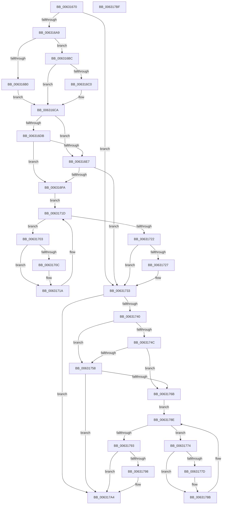

# DifKeReleaseInStackQueuedSpinLockWrapper

- RVA: `0x00631670`–`0x006317C0` (길이 `336` bytes)
- VA: `0x0000000140631670`
- 실행 섹션: `.text`
- PDB 이름 있음: `예`; PDB Function 태그: `아니요`
- unwind 정보 RVA: `0x0005D7BC`
- 디코드: `90`개 명령, `336/336` bytes 표시
- 미해석 바이트: `0` (있으면 어셈블리에 `.byte`로 보존)

> 이 문서는 커널 이미지의 기계어와 PDB 기호를 분석해 생성했습니다. 4번과 5번은 함수 원형과 자료형을 바이너리 사용 방식에서 추정한 C 해석이며 원본 소스 복구 결과는 아닙니다.

## 1. Dependencies

- 직접 호출 지점: **9**; 고유 호출 대상: **6**
- 직접 호출자로 확인된 함수: **0**
- RIP 상대 이미지 참조: **3**

### Outgoing calls
- `0x00631698` → [DifGetAPIThunkContextById](../49/DifGetAPIThunkContextById_function_00495A34.md) (function, `0x00495A34`)
- `0x006316C0` → [DifGetReturnAddressForWrappers](../4D/DifGetReturnAddressForWrappers_function_004D3C08.md) (function, `0x004D3C08`)
- `0x006316EE` → [ExAcquireRundownProtection](../21/ExAcquireRundownProtection_function_00216620.md) (function, `0x00216620`)
- `0x00631715` → [guard_dispatch_icall](../6B/guard_dispatch_icall_function_006BAAD0.md) (function, `0x006BAAD0`)
- `0x0063172E` → [ExReleaseRundownProtection](../34/ExReleaseRundownProtection_function_00349E80.md) (function, `0x00349E80`)
- `0x00631736` → [KeReleaseInStackQueuedSpinLock](../34/KeReleaseInStackQueuedSpinLock_function_00342CE0.md) (function, `0x00342CE0`)
- `0x0063175F` → [ExAcquireRundownProtection](../21/ExAcquireRundownProtection_function_00216620.md) (function, `0x00216620`)
- `0x00631786` → [guard_dispatch_icall](../6B/guard_dispatch_icall_function_006BAAD0.md) (function, `0x006BAAD0`)
- `0x0063179F` → [ExReleaseRundownProtection](../34/ExReleaseRundownProtection_function_00349E80.md) (function, `0x00349E80`)

### Direct callers
- 이 함수 시작 RVA로 연결되는 직접 call은 확인되지 않았습니다. 간접 호출은 완전히 역산할 수 없습니다.

### Static image references
- `0x006316D2` → RVA `0x00F048B8` (`.data`; read)
- `0x006316DB` → RVA `0x00F04980` (`.data`; read)
- `0x006316E7` → RVA `0x00F03E80` (`.data`; read)

## 2. Other-region calls and transfers

- 다른 실행 섹션으로 향하는 call: **0**
- 별도 외부 분기/꼬리 이동을 확인하지 못했습니다.

## 3. Assembly (complete function range)

```asm
00631670  48 8B C4                        mov rax, rsp
00631673  48 89 58 08                     mov qword ptr [rax + 8], rbx
00631677  48 89 68 10                     mov qword ptr [rax + 0x10], rbp
0063167B  48 89 70 18                     mov qword ptr [rax + 0x18], rsi
0063167F  48 89 78 20                     mov qword ptr [rax + 0x20], rdi
00631683  41 56                           push r14
00631685  48 83 EC 30                     sub rsp, 0x30
00631689  48 8B E9                        mov rbp, rcx
0063168C  0F 57 C0                        xorps xmm0, xmm0
0063168F  B9 08 01 00 00                  mov ecx, 0x108
00631694  0F 11 40 E8                     movups xmmword ptr [rax - 0x18], xmm0
00631698  E8 97 43 E6 FF                  call 0x140495a34
0063169D  48 8B F8                        mov rdi, rax
006316A0  48 85 C0                        test rax, rax
006316A3  0F 84 8A 00 00 00               je 0x140631733
006316A9  8B 40 0C                        mov eax, dword ptr [rax + 0xc]
006316AC  A8 18                           test al, 0x18
006316AE  74 0C                           je 0x1406316bc
006316B0  48 8B 4C 24 38                  mov rcx, qword ptr [rsp + 0x38]
006316B5  48 89 4C 24 20                  mov qword ptr [rsp + 0x20], rcx
006316BA  EB 0E                           jmp 0x1406316ca
006316BC  A8 04                           test al, 4
006316BE  74 0A                           je 0x1406316ca
006316C0  E8 43 25 EA FF                  call 0x1404d3c08
006316C5  48 89 44 24 20                  mov qword ptr [rsp + 0x20], rax
006316CA  40 32 F6                        xor sil, sil
006316CD  48 89 6C 24 28                  mov qword ptr [rsp + 0x28], rbp
006316D2  40 38 35 DF 31 8D 00            cmp byte ptr [rip + 0x8d31df], sil
006316D9  75 0C                           jne 0x1406316e7
006316DB  F7 05 9B 32 8D 00 00 08 00 00   test dword ptr [rip + 0x8d329b], 0x800
006316E5  74 13                           je 0x1406316fa
006316E7  48 8D 0D 92 27 8D 00            lea rcx, [rip + 0x8d2792]
006316EE  E8 2D 4F BE FF                  call 0x140216620
006316F3  40 8A F0                        mov sil, al
006316F6  84 C0                           test al, al
006316F8  74 39                           je 0x140631733
006316FA  4C 8D 77 20                     lea r14, [rdi + 0x20]
006316FE  49 8B 1E                        mov rbx, qword ptr [r14]
00631701  EB 1A                           jmp 0x14063171d
00631703  48 8D 43 F0                     lea rax, [rbx - 0x10]
00631707  48 85 C0                        test rax, rax
0063170A  74 0E                           je 0x14063171a
0063170C  48 8B 40 08                     mov rax, qword ptr [rax + 8]
00631710  48 8D 4C 24 20                  lea rcx, [rsp + 0x20]
00631715  E8 B6 93 08 00                  call 0x1406baad0
0063171A  48 8B 1B                        mov rbx, qword ptr [rbx]
0063171D  49 3B DE                        cmp rbx, r14
00631720  75 E1                           jne 0x140631703
00631722  40 84 F6                        test sil, sil
00631725  74 0C                           je 0x140631733
00631727  48 8D 0D 52 27 8D 00            lea rcx, [rip + 0x8d2752]
0063172E  E8 4D 87 D1 FF                  call 0x140349e80
00631733  48 8B CD                        mov rcx, rbp
00631736  E8 A5 15 D1 FF                  call 0x140342ce0
0063173B  48 85 FF                        test rdi, rdi
0063173E  74 64                           je 0x1406317a4
00631740  40 32 F6                        xor sil, sil
00631743  40 38 35 6E 31 8D 00            cmp byte ptr [rip + 0x8d316e], sil
0063174A  75 0C                           jne 0x140631758
0063174C  F7 05 2A 32 8D 00 00 08 00 00   test dword ptr [rip + 0x8d322a], 0x800
00631756  74 13                           je 0x14063176b
00631758  48 8D 0D 21 27 8D 00            lea rcx, [rip + 0x8d2721]
0063175F  E8 BC 4E BE FF                  call 0x140216620
00631764  40 8A F0                        mov sil, al
00631767  84 C0                           test al, al
00631769  74 39                           je 0x1406317a4
0063176B  48 83 C7 30                     add rdi, 0x30
0063176F  48 8B 1F                        mov rbx, qword ptr [rdi]
00631772  EB 1A                           jmp 0x14063178e
00631774  48 8D 43 F0                     lea rax, [rbx - 0x10]
00631778  48 85 C0                        test rax, rax
0063177B  74 0E                           je 0x14063178b
0063177D  48 8B 40 08                     mov rax, qword ptr [rax + 8]
00631781  48 8D 4C 24 20                  lea rcx, [rsp + 0x20]
00631786  E8 45 93 08 00                  call 0x1406baad0
0063178B  48 8B 1B                        mov rbx, qword ptr [rbx]
0063178E  48 3B DF                        cmp rbx, rdi
00631791  75 E1                           jne 0x140631774
00631793  40 84 F6                        test sil, sil
00631796  74 0C                           je 0x1406317a4
00631798  48 8D 0D E1 26 8D 00            lea rcx, [rip + 0x8d26e1]
0063179F  E8 DC 86 D1 FF                  call 0x140349e80
006317A4  48 8B 5C 24 40                  mov rbx, qword ptr [rsp + 0x40]
006317A9  48 8B 6C 24 48                  mov rbp, qword ptr [rsp + 0x48]
006317AE  48 8B 74 24 50                  mov rsi, qword ptr [rsp + 0x50]
006317B3  48 8B 7C 24 58                  mov rdi, qword ptr [rsp + 0x58]
006317B8  48 83 C4 30                     add rsp, 0x30
006317BC  41 5E                           pop r14
006317BE  C3                              ret
006317BF  CC                              int3
```

## 4. C-style interpretation (structured pseudocode)

```c
__int64 __fastcall DifKeReleaseInStackQueuedSpinLockWrapper(__int64 a1)
{
    __int64 result;
    __int64 v_rdi;
    __int64 v_rsi;
    __int64 v_rsp;
    unsigned __int64 v_stack_m10;
    unsigned __int64 v_stack_m18;
    unsigned __int64 v_stack_p0;
    unsigned __int64 v_stack_p10;
    unsigned __int64 v_stack_p18;
    unsigned __int64 v_stack_p20;
    unsigned __int64 v_stack_p8;

    *(unsigned __int64 *)(v_rsp + 8) = v_rbx;
    *(unsigned __int64 *)(v_rsp + 16) = v_rbp;
    *(unsigned __int64 *)(v_rsp + 24) = v_rsi;
    *(unsigned __int64 *)(v_rsp + 32) = v_rdi;
    v_rsp = (v_rsp) - (48);
    *(unsigned __int64 *)(v_rsp - 24) = v_xmm0;
    result = DifGetAPIThunkContextById(264, a2, a3, a4);
    if (result == 0) goto loc_00631733;
    if ((((unsigned __int8)((unsigned int)(*(unsigned int *)(result + 12)))) & (24)) == 0) goto loc_006316BC;
    v_stack_m18 = v_stack_p0;
    goto loc_006316CA;
loc_006316BC:
    result = (unsigned int)(*(unsigned int *)(result + 12));
    if ((((unsigned __int8)((unsigned int)(*(unsigned int *)(result + 12)))) & (4)) != 0) {
        result = DifGetReturnAddressForWrappers(v_stack_p0, a2, a3, a4);
        v_stack_m18 = result;
    }
    v_rsi = 0;
    v_stack_m10 = a1;
    if ((*(unsigned __int8 *)(v_rip + 9253343)) != 0) goto loc_006316E7;
    if (((*(unsigned int *)(v_rip + 9253531)) & (0x800ULL)) == 0) goto loc_006316FA;
loc_006316E7:
    result = ExAcquireRundownProtection(v_rip + 9250706, a2, a3, a4);
    if ((unsigned __int8)(result) == 0) goto loc_00631733;
loc_006316FA:
    goto loc_0063171D;
loc_00631703:
    result = *(unsigned __int64 *)(result + 32) - 16;
    if (*(unsigned __int64 *)(result + 32) - 16 != 0) {
        result = *(unsigned __int64 *)(*(unsigned __int64 *)(result + 32) - 16 + 8);
        a1 = v_stack_m18;
        result = guard_dispatch_icall(a1, a2, a3, a4);
    }
loc_0063171D:
    if ((*(unsigned __int64 *)(*(unsigned __int64 *)(result + 32))) != (result + 32)) goto loc_00631703;
    if ((unsigned __int8)((unsigned __int8)(result)) != 0) {
        a1 = v_rip + 9250642;
        result = ExReleaseRundownProtection(a1, a2, a3, a4);
    }
    result = KeReleaseInStackQueuedSpinLock(a1, a2, a3, a4);
    if (result == 0) goto loc_006317A4;
    v_rsi = 0;
    if ((*(unsigned __int8 *)(v_rip + 9253230)) != 0) goto loc_00631758;
    if (((*(unsigned int *)(v_rip + 9253418)) & (0x800ULL)) == 0) goto loc_0063176B;
loc_00631758:
    result = ExAcquireRundownProtection(v_rip + 9250593, a2, a3, a4);
    if ((unsigned __int8)(result) == 0) goto loc_006317A4;
loc_0063176B:
    v_rdi = (result) + (48);
    goto loc_0063178E;
loc_00631774:
    result = *(unsigned __int64 *)(v_rdi) - 16;
    if (*(unsigned __int64 *)(v_rdi) - 16 != 0) {
        result = *(unsigned __int64 *)(*(unsigned __int64 *)(v_rdi) - 16 + 8);
        a1 = v_stack_m18;
        result = guard_dispatch_icall(a1, a2, a3, a4);
    }
loc_0063178E:
    if ((*(unsigned __int64 *)(*(unsigned __int64 *)(v_rdi))) != v_rdi) goto loc_00631774;
    if ((unsigned __int8)((unsigned __int8)(result)) != 0) {
        a1 = v_rip + 9250529;
        result = ExReleaseRundownProtection(a1, a2, a3, a4);
    }
    v_rsp = (v_rsp) + (48);
    return result;
}
```

## 5. (Beta) C Style

```c
int64_t DifKeReleaseInStackQueuedSpinLockWrapper(int64_t Arg1)
{
    int64_t result;
    int64_t local_rdi;
    int64_t local_rsi;
    int64_t local_rsp;
    uint64_t v_stack_m10;
    uint64_t v_stack_m18;
    uint64_t v_stack_p0;
    uint64_t v_stack_p10;
    uint64_t v_stack_p18;
    uint64_t v_stack_p20;
    uint64_t v_stack_p8;

    *(uint64_t *)(local_rsp + 0x8) = local_rbx;
    *(uint64_t *)(local_rsp + 0x10) = local_rbp;
    *(uint64_t *)(local_rsp + 0x18) = local_rsi;
    *(uint64_t *)(local_rsp + 0x20) = local_rdi;
    local_rsp = (local_rsp) - (48);
    *(uint64_t *)(local_rsp - 0x18) = v_xmm0;
    result = DifGetAPIThunkContextById(264, a2, a3, a4);
    if (result == 0) goto loc_00631733;
    if ((((uint8_t)((uint32_t)(*(uint32_t *)(result + 0xC)))) & (24)) == 0) goto loc_006316BC;
    v_stack_m18 = v_stack_p0;
    goto loc_006316CA;
loc_006316BC:
    result = (uint32_t)(*(uint32_t *)(result + 0xC));
    if ((((uint8_t)((uint32_t)(*(uint32_t *)(result + 0xC)))) & (4)) != 0) {
        result = DifGetReturnAddressForWrappers(v_stack_p0, a2, a3, a4);
        v_stack_m18 = result;
    }
    local_rsi = 0;
    v_stack_m10 = Arg1;
    if ((*(uint8_t *)(v_rip + 0x8D31DF)) != 0) goto loc_006316E7;
    if (((*(uint32_t *)(v_rip + 0x8D329B)) & (0x800ULL)) == 0) goto loc_006316FA;
loc_006316E7:
    result = ExAcquireRundownProtection(v_rip + 9250706, a2, a3, a4);
    if ((uint8_t)(result) == 0) goto loc_00631733;
loc_006316FA:
    goto loc_0063171D;
loc_00631703:
    result = *(uint64_t *)(result + 0x20) - 16;
    if (*(uint64_t *)(result + 0x20) - 16 != 0) {
        result = *(uint64_t *)(*(uint64_t *)(result + 0x20) - 0x10 + 0x8);
        Arg1 = v_stack_m18;
        result = guard_dispatch_icall(Arg1, a2, a3, a4);
    }
loc_0063171D:
    if ((*(uint64_t *)(*(uint64_t *)(result + 0x20))) != (result + 32)) goto loc_00631703;
    if ((uint8_t)((uint8_t)(result)) != 0) {
        Arg1 = v_rip + 9250642;
        result = ExReleaseRundownProtection(Arg1, a2, a3, a4);
    }
    result = KeReleaseInStackQueuedSpinLock(Arg1, a2, a3, a4);
    if (result == 0) goto loc_006317A4;
    local_rsi = 0;
    if ((*(uint8_t *)(v_rip + 0x8D316E)) != 0) goto loc_00631758;
    if (((*(uint32_t *)(v_rip + 0x8D322A)) & (0x800ULL)) == 0) goto loc_0063176B;
loc_00631758:
    result = ExAcquireRundownProtection(v_rip + 9250593, a2, a3, a4);
    if ((uint8_t)(result) == 0) goto loc_006317A4;
loc_0063176B:
    local_rdi = (result) + (48);
    goto loc_0063178E;
loc_00631774:
    result = *(uint64_t *)(local_rdi) - 16;
    if (*(uint64_t *)(local_rdi) - 16 != 0) {
        result = *(uint64_t *)(*(uint64_t *)(local_rdi) - 0x10 + 0x8);
        Arg1 = v_stack_m18;
        result = guard_dispatch_icall(Arg1, a2, a3, a4);
    }
loc_0063178E:
    if ((*(uint64_t *)(*(uint64_t *)(local_rdi))) != local_rdi) goto loc_00631774;
    if ((uint8_t)((uint8_t)(result)) != 0) {
        Arg1 = v_rip + 9250529;
        result = ExReleaseRundownProtection(Arg1, a2, a3, a4);
    }
    local_rsp = (local_rsp) + (48);
    return result;
}
```

## 6. Execution-region graph

[열기: 2D/3D 그래프와 함수 탐색 컨트롤 패널](../../../control-panel.html?section=text&rva=0x00631670&view=graph)

- 2D 그래프는 위에서 아래로 흐르고, 3D 그래프는 빈 공간을 드래그해 회전합니다. Shift+드래그는 이동, 휠은 확대·축소, 함수 노드 선택은 대상 보고서 이동입니다.

### Static fallback


