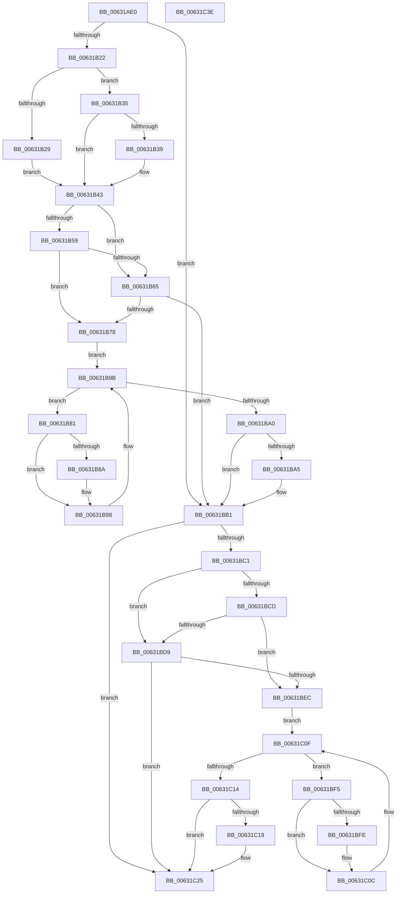

# DifKeReleaseQueuedSpinLockWrapper

- RVA: `0x00631AE0`–`0x00631C3F` (길이 `351` bytes)
- VA: `0x0000000140631AE0`
- 실행 섹션: `.text`
- PDB 이름 있음: `예`; PDB Function 태그: `아니요`
- unwind 정보 RVA: `0x00093E28`
- 디코드: `97`개 명령, `351/351` bytes 표시
- 미해석 바이트: `0` (있으면 어셈블리에 `.byte`로 보존)

> 이 문서는 커널 이미지의 기계어와 PDB 기호를 분석해 생성했습니다. 4번과 5번은 함수 원형과 자료형을 바이너리 사용 방식에서 추정한 C 해석이며 원본 소스 복구 결과는 아닙니다.

## 1. Dependencies

- 직접 호출 지점: **9**; 고유 호출 대상: **6**
- 직접 호출자로 확인된 함수: **0**
- RIP 상대 이미지 참조: **3**

### Outgoing calls
- `0x00631B11` → [DifGetAPIThunkContextById](../49/DifGetAPIThunkContextById_function_00495A34.md) (function, `0x00495A34`)
- `0x00631B39` → [DifGetReturnAddressForWrappers](../4D/DifGetReturnAddressForWrappers_function_004D3C08.md) (function, `0x004D3C08`)
- `0x00631B6C` → [ExAcquireRundownProtection](../21/ExAcquireRundownProtection_function_00216620.md) (function, `0x00216620`)
- `0x00631B93` → [guard_dispatch_icall](../6B/guard_dispatch_icall_function_006BAAD0.md) (function, `0x006BAAD0`)
- `0x00631BAC` → [ExReleaseRundownProtection](../34/ExReleaseRundownProtection_function_00349E80.md) (function, `0x00349E80`)
- `0x00631BB7` → [KeReleaseQueuedSpinLock](../27/KeReleaseQueuedSpinLock_function_00272540.md) (function, `0x00272540`)
- `0x00631BE0` → [ExAcquireRundownProtection](../21/ExAcquireRundownProtection_function_00216620.md) (function, `0x00216620`)
- `0x00631C07` → [guard_dispatch_icall](../6B/guard_dispatch_icall_function_006BAAD0.md) (function, `0x006BAAD0`)
- `0x00631C20` → [ExReleaseRundownProtection](../34/ExReleaseRundownProtection_function_00349E80.md) (function, `0x00349E80`)

### Direct callers
- 이 함수 시작 RVA로 연결되는 직접 call은 확인되지 않았습니다. 간접 호출은 완전히 역산할 수 없습니다.

### Static image references
- `0x00631B4B` → RVA `0x00F048B8` (`.data`; read)
- `0x00631B59` → RVA `0x00F04980` (`.data`; read)
- `0x00631B65` → RVA `0x00F03E80` (`.data`; read)

## 2. Other-region calls and transfers

- 다른 실행 섹션으로 향하는 call: **0**
- 별도 외부 분기/꼬리 이동을 확인하지 못했습니다.

## 3. Assembly (complete function range)

```asm
00631AE0  4C 8B DC                        mov r11, rsp
00631AE3  49 89 5B 08                     mov qword ptr [r11 + 8], rbx
00631AE7  49 89 6B 10                     mov qword ptr [r11 + 0x10], rbp
00631AEB  49 89 73 18                     mov qword ptr [r11 + 0x18], rsi
00631AEF  57                              push rdi
00631AF0  41 56                           push r14
00631AF2  41 57                           push r15
00631AF4  48 83 EC 40                     sub rsp, 0x40
00631AF8  33 C0                           xor eax, eax
00631AFA  0F 57 C0                        xorps xmm0, xmm0
00631AFD  0F 11 44 24 20                  movups xmmword ptr [rsp + 0x20], xmm0
00631B02  4C 8B F9                        mov r15, rcx
00631B05  49 89 43 D8                     mov qword ptr [r11 - 0x28], rax
00631B09  B9 03 01 00 00                  mov ecx, 0x103
00631B0E  44 8A F2                        mov r14b, dl
00631B11  E8 1E 3F E6 FF                  call 0x140495a34
00631B16  48 8B F0                        mov rsi, rax
00631B19  48 85 C0                        test rax, rax
00631B1C  0F 84 8F 00 00 00               je 0x140631bb1
00631B22  8B 40 0C                        mov eax, dword ptr [rax + 0xc]
00631B25  A8 18                           test al, 0x18
00631B27  74 0C                           je 0x140631b35
00631B29  48 8B 4C 24 58                  mov rcx, qword ptr [rsp + 0x58]
00631B2E  48 89 4C 24 20                  mov qword ptr [rsp + 0x20], rcx
00631B33  EB 0E                           jmp 0x140631b43
00631B35  A8 04                           test al, 4
00631B37  74 0A                           je 0x140631b43
00631B39  E8 CA 20 EA FF                  call 0x1404d3c08
00631B3E  48 89 44 24 20                  mov qword ptr [rsp + 0x20], rax
00631B43  40 32 ED                        xor bpl, bpl
00631B46  4C 89 7C 24 30                  mov qword ptr [rsp + 0x30], r15
00631B4B  40 38 2D 66 2D 8D 00            cmp byte ptr [rip + 0x8d2d66], bpl
00631B52  44 88 74 24 28                  mov byte ptr [rsp + 0x28], r14b
00631B57  75 0C                           jne 0x140631b65
00631B59  F7 05 1D 2E 8D 00 00 08 00 00   test dword ptr [rip + 0x8d2e1d], 0x800
00631B63  74 13                           je 0x140631b78
00631B65  48 8D 0D 14 23 8D 00            lea rcx, [rip + 0x8d2314]
00631B6C  E8 AF 4A BE FF                  call 0x140216620
00631B71  40 8A E8                        mov bpl, al
00631B74  84 C0                           test al, al
00631B76  74 39                           je 0x140631bb1
00631B78  48 8D 7E 20                     lea rdi, [rsi + 0x20]
00631B7C  48 8B 1F                        mov rbx, qword ptr [rdi]
00631B7F  EB 1A                           jmp 0x140631b9b
00631B81  48 8D 43 F0                     lea rax, [rbx - 0x10]
00631B85  48 85 C0                        test rax, rax
00631B88  74 0E                           je 0x140631b98
00631B8A  48 8B 40 08                     mov rax, qword ptr [rax + 8]
00631B8E  48 8D 4C 24 20                  lea rcx, [rsp + 0x20]
00631B93  E8 38 8F 08 00                  call 0x1406baad0
00631B98  48 8B 1B                        mov rbx, qword ptr [rbx]
00631B9B  48 3B DF                        cmp rbx, rdi
00631B9E  75 E1                           jne 0x140631b81
00631BA0  40 84 ED                        test bpl, bpl
00631BA3  74 0C                           je 0x140631bb1
00631BA5  48 8D 0D D4 22 8D 00            lea rcx, [rip + 0x8d22d4]
00631BAC  E8 CF 82 D1 FF                  call 0x140349e80
00631BB1  41 8A D6                        mov dl, r14b
00631BB4  49 8B CF                        mov rcx, r15
00631BB7  E8 84 09 C4 FF                  call 0x140272540
00631BBC  48 85 F6                        test rsi, rsi
00631BBF  74 64                           je 0x140631c25
00631BC1  40 32 FF                        xor dil, dil
00631BC4  40 38 3D ED 2C 8D 00            cmp byte ptr [rip + 0x8d2ced], dil
00631BCB  75 0C                           jne 0x140631bd9
00631BCD  F7 05 A9 2D 8D 00 00 08 00 00   test dword ptr [rip + 0x8d2da9], 0x800
00631BD7  74 13                           je 0x140631bec
00631BD9  48 8D 0D A0 22 8D 00            lea rcx, [rip + 0x8d22a0]
00631BE0  E8 3B 4A BE FF                  call 0x140216620
00631BE5  40 8A F8                        mov dil, al
00631BE8  84 C0                           test al, al
00631BEA  74 39                           je 0x140631c25
00631BEC  48 83 C6 30                     add rsi, 0x30
00631BF0  48 8B 1E                        mov rbx, qword ptr [rsi]
00631BF3  EB 1A                           jmp 0x140631c0f
00631BF5  48 8D 43 F0                     lea rax, [rbx - 0x10]
00631BF9  48 85 C0                        test rax, rax
00631BFC  74 0E                           je 0x140631c0c
00631BFE  48 8B 40 08                     mov rax, qword ptr [rax + 8]
00631C02  48 8D 4C 24 20                  lea rcx, [rsp + 0x20]
00631C07  E8 C4 8E 08 00                  call 0x1406baad0
00631C0C  48 8B 1B                        mov rbx, qword ptr [rbx]
00631C0F  48 3B DE                        cmp rbx, rsi
00631C12  75 E1                           jne 0x140631bf5
00631C14  40 84 FF                        test dil, dil
00631C17  74 0C                           je 0x140631c25
00631C19  48 8D 0D 60 22 8D 00            lea rcx, [rip + 0x8d2260]
00631C20  E8 5B 82 D1 FF                  call 0x140349e80
00631C25  48 8B 5C 24 60                  mov rbx, qword ptr [rsp + 0x60]
00631C2A  48 8B 6C 24 68                  mov rbp, qword ptr [rsp + 0x68]
00631C2F  48 8B 74 24 70                  mov rsi, qword ptr [rsp + 0x70]
00631C34  48 83 C4 40                     add rsp, 0x40
00631C38  41 5F                           pop r15
00631C3A  41 5E                           pop r14
00631C3C  5F                              pop rdi
00631C3D  C3                              ret
00631C3E  CC                              int3
```

## 4. C-style interpretation (structured pseudocode)

```c
__int64 __fastcall DifKeReleaseQueuedSpinLockWrapper(__int64 a1, unsigned __int8 a2)
{
    __int64 result;
    __int64 v_rbp;
    __int64 v_rdi;
    __int64 v_rsi;
    __int64 v_rsp;
    unsigned __int64 v_stack_m28;
    unsigned __int8 v_stack_m30;
    unsigned __int64 v_stack_m38;
    unsigned __int64 v_stack_p0;
    unsigned __int64 v_stack_p10;
    unsigned __int64 v_stack_p18;
    unsigned __int64 v_stack_p8;

    *(unsigned __int64 *)(v_rsp + 8) = v_rbx;
    *(unsigned __int64 *)(v_rsp + 16) = v_rbp;
    *(unsigned __int64 *)(v_rsp + 24) = v_rsi;
    v_rsp = (v_rsp) - (64);
    result = 0;
    v_stack_m38 = v_xmm0;
    *(unsigned __int64 *)(v_rsp - 40) = 0;
    result = DifGetAPIThunkContextById(259, a2, a3, a4);
    if (result == 0) goto loc_00631BB1;
    if ((((unsigned __int8)((unsigned int)(*(unsigned int *)(result + 12)))) & (24)) == 0) goto loc_00631B35;
    v_stack_m38 = v_stack_p0;
    goto loc_00631B43;
loc_00631B35:
    result = (unsigned int)(*(unsigned int *)(result + 12));
    if ((((unsigned __int8)((unsigned int)(*(unsigned int *)(result + 12)))) & (4)) != 0) {
        result = DifGetReturnAddressForWrappers(v_stack_p0, a2, a3, a4);
        v_stack_m38 = result;
    }
    v_rbp = 0;
    v_stack_m28 = a1;
    v_stack_m30 = a2;
    if ((*(unsigned __int8 *)(v_rip + 9252198)) != 0) goto loc_00631B65;
    if (((*(unsigned int *)(v_rip + 9252381)) & (0x800ULL)) == 0) goto loc_00631B78;
loc_00631B65:
    result = ExAcquireRundownProtection(v_rip + 9249556, a2, a3, a4);
    if ((unsigned __int8)(result) == 0) goto loc_00631BB1;
loc_00631B78:
    goto loc_00631B9B;
loc_00631B81:
    result = *(unsigned __int64 *)(result + 32) - 16;
    if (*(unsigned __int64 *)(result + 32) - 16 != 0) {
        result = *(unsigned __int64 *)(*(unsigned __int64 *)(result + 32) - 16 + 8);
        a1 = v_stack_m38;
        result = guard_dispatch_icall(a1, a2, a3, a4);
    }
loc_00631B9B:
    if ((*(unsigned __int64 *)(*(unsigned __int64 *)(result + 32))) != (result + 32)) goto loc_00631B81;
    if ((unsigned __int8)((unsigned __int8)(result)) != 0) {
        a1 = v_rip + 9249492;
        result = ExReleaseRundownProtection(a1, a2, a3, a4);
    }
    result = KeReleaseQueuedSpinLock(a1, a2, a3, a4);
    if (result == 0) goto loc_00631C25;
    v_rdi = 0;
    if ((*(unsigned __int8 *)(v_rip + 9252077)) != 0) goto loc_00631BD9;
    if (((*(unsigned int *)(v_rip + 9252265)) & (0x800ULL)) == 0) goto loc_00631BEC;
loc_00631BD9:
    result = ExAcquireRundownProtection(v_rip + 9249440, a2, a3, a4);
    if ((unsigned __int8)(result) == 0) goto loc_00631C25;
loc_00631BEC:
    v_rsi = (result) + (48);
    goto loc_00631C0F;
loc_00631BF5:
    result = *(unsigned __int64 *)(v_rsi) - 16;
    if (*(unsigned __int64 *)(v_rsi) - 16 != 0) {
        result = *(unsigned __int64 *)(*(unsigned __int64 *)(v_rsi) - 16 + 8);
        a1 = v_stack_m38;
        result = guard_dispatch_icall(a1, a2, a3, a4);
    }
loc_00631C0F:
    if ((*(unsigned __int64 *)(*(unsigned __int64 *)(v_rsi))) != v_rsi) goto loc_00631BF5;
    if ((unsigned __int8)((unsigned __int8)(result)) != 0) {
        a1 = v_rip + 9249376;
        result = ExReleaseRundownProtection(a1, a2, a3, a4);
    }
    v_rsp = (v_rsp) + (64);
    return result;
}
```

## 5. (Beta) C Style

```c
int64_t DifKeReleaseQueuedSpinLockWrapper(int64_t Arg1, uint8_t Arg2)
{
    int64_t result;
    int64_t local_rbp;
    int64_t local_rdi;
    int64_t local_rsi;
    int64_t local_rsp;
    uint64_t v_stack_m28;
    uint8_t v_stack_m30;
    uint64_t v_stack_m38;
    uint64_t v_stack_p0;
    uint64_t v_stack_p10;
    uint64_t v_stack_p18;
    uint64_t v_stack_p8;

    *(uint64_t *)(local_rsp + 0x8) = local_rbx;
    *(uint64_t *)(local_rsp + 0x10) = local_rbp;
    *(uint64_t *)(local_rsp + 0x18) = local_rsi;
    local_rsp = (local_rsp) - (64);
    result = 0;
    v_stack_m38 = v_xmm0;
    *(uint64_t *)(local_rsp - 0x28) = 0;
    result = DifGetAPIThunkContextById(259, Arg2, a3, a4);
    if (result == 0) goto loc_00631BB1;
    if ((((uint8_t)((uint32_t)(*(uint32_t *)(result + 0xC)))) & (24)) == 0) goto loc_00631B35;
    v_stack_m38 = v_stack_p0;
    goto loc_00631B43;
loc_00631B35:
    result = (uint32_t)(*(uint32_t *)(result + 0xC));
    if ((((uint8_t)((uint32_t)(*(uint32_t *)(result + 0xC)))) & (4)) != 0) {
        result = DifGetReturnAddressForWrappers(v_stack_p0, Arg2, a3, a4);
        v_stack_m38 = result;
    }
    local_rbp = 0;
    v_stack_m28 = Arg1;
    v_stack_m30 = Arg2;
    if ((*(uint8_t *)(v_rip + 0x8D2D66)) != 0) goto loc_00631B65;
    if (((*(uint32_t *)(v_rip + 0x8D2E1D)) & (0x800ULL)) == 0) goto loc_00631B78;
loc_00631B65:
    result = ExAcquireRundownProtection(v_rip + 9249556, Arg2, a3, a4);
    if ((uint8_t)(result) == 0) goto loc_00631BB1;
loc_00631B78:
    goto loc_00631B9B;
loc_00631B81:
    result = *(uint64_t *)(result + 0x20) - 16;
    if (*(uint64_t *)(result + 0x20) - 16 != 0) {
        result = *(uint64_t *)(*(uint64_t *)(result + 0x20) - 0x10 + 0x8);
        Arg1 = v_stack_m38;
        result = guard_dispatch_icall(Arg1, Arg2, a3, a4);
    }
loc_00631B9B:
    if ((*(uint64_t *)(*(uint64_t *)(result + 0x20))) != (result + 32)) goto loc_00631B81;
    if ((uint8_t)((uint8_t)(result)) != 0) {
        Arg1 = v_rip + 9249492;
        result = ExReleaseRundownProtection(Arg1, Arg2, a3, a4);
    }
    result = KeReleaseQueuedSpinLock(Arg1, Arg2, a3, a4);
    if (result == 0) goto loc_00631C25;
    local_rdi = 0;
    if ((*(uint8_t *)(v_rip + 0x8D2CED)) != 0) goto loc_00631BD9;
    if (((*(uint32_t *)(v_rip + 0x8D2DA9)) & (0x800ULL)) == 0) goto loc_00631BEC;
loc_00631BD9:
    result = ExAcquireRundownProtection(v_rip + 9249440, Arg2, a3, a4);
    if ((uint8_t)(result) == 0) goto loc_00631C25;
loc_00631BEC:
    local_rsi = (result) + (48);
    goto loc_00631C0F;
loc_00631BF5:
    result = *(uint64_t *)(local_rsi) - 16;
    if (*(uint64_t *)(local_rsi) - 16 != 0) {
        result = *(uint64_t *)(*(uint64_t *)(local_rsi) - 0x10 + 0x8);
        Arg1 = v_stack_m38;
        result = guard_dispatch_icall(Arg1, Arg2, a3, a4);
    }
loc_00631C0F:
    if ((*(uint64_t *)(*(uint64_t *)(local_rsi))) != local_rsi) goto loc_00631BF5;
    if ((uint8_t)((uint8_t)(result)) != 0) {
        Arg1 = v_rip + 9249376;
        result = ExReleaseRundownProtection(Arg1, Arg2, a3, a4);
    }
    local_rsp = (local_rsp) + (64);
    return result;
}
```

## 6. Execution-region graph

[열기: 2D/3D 그래프와 함수 탐색 컨트롤 패널](../../../control-panel.html?section=text&rva=0x00631AE0&view=graph)

- 2D 그래프는 위에서 아래로 흐르고, 3D 그래프는 빈 공간을 드래그해 회전합니다. Shift+드래그는 이동, 휠은 확대·축소, 함수 노드 선택은 대상 보고서 이동입니다.

### Static fallback


