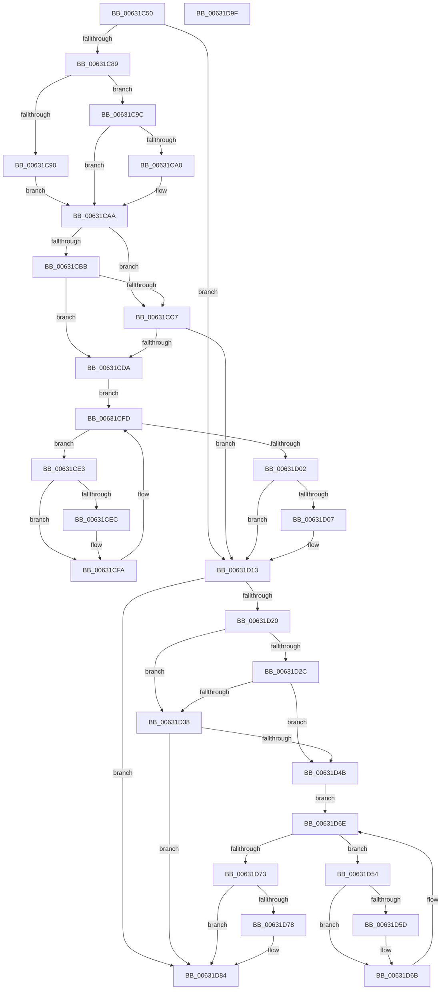

# DifKeReleaseSpinLockFromDpcLevelWrapper

- RVA: `0x00631C50`–`0x00631DA0` (길이 `336` bytes)
- VA: `0x0000000140631C50`
- 실행 섹션: `.text`
- PDB 이름 있음: `예`; PDB Function 태그: `아니요`
- unwind 정보 RVA: `0x0005D7BC`
- 디코드: `90`개 명령, `336/336` bytes 표시
- 미해석 바이트: `0` (있으면 어셈블리에 `.byte`로 보존)

> 이 문서는 커널 이미지의 기계어와 PDB 기호를 분석해 생성했습니다. 4번과 5번은 함수 원형과 자료형을 바이너리 사용 방식에서 추정한 C 해석이며 원본 소스 복구 결과는 아닙니다.

## 1. Dependencies

- 직접 호출 지점: **9**; 고유 호출 대상: **6**
- 직접 호출자로 확인된 함수: **0**
- RIP 상대 이미지 참조: **3**

### Outgoing calls
- `0x00631C78` → [DifGetAPIThunkContextById](../49/DifGetAPIThunkContextById_function_00495A34.md) (function, `0x00495A34`)
- `0x00631CA0` → [DifGetReturnAddressForWrappers](../4D/DifGetReturnAddressForWrappers_function_004D3C08.md) (function, `0x004D3C08`)
- `0x00631CCE` → [ExAcquireRundownProtection](../21/ExAcquireRundownProtection_function_00216620.md) (function, `0x00216620`)
- `0x00631CF5` → [guard_dispatch_icall](../6B/guard_dispatch_icall_function_006BAAD0.md) (function, `0x006BAAD0`)
- `0x00631D0E` → [ExReleaseRundownProtection](../34/ExReleaseRundownProtection_function_00349E80.md) (function, `0x00349E80`)
- `0x00631D16` → [KxReleaseSpinLock](../20/KxReleaseSpinLock_function_00206670.md) (function, `0x00206670`)
- `0x00631D3F` → [ExAcquireRundownProtection](../21/ExAcquireRundownProtection_function_00216620.md) (function, `0x00216620`)
- `0x00631D66` → [guard_dispatch_icall](../6B/guard_dispatch_icall_function_006BAAD0.md) (function, `0x006BAAD0`)
- `0x00631D7F` → [ExReleaseRundownProtection](../34/ExReleaseRundownProtection_function_00349E80.md) (function, `0x00349E80`)

### Direct callers
- 이 함수 시작 RVA로 연결되는 직접 call은 확인되지 않았습니다. 간접 호출은 완전히 역산할 수 없습니다.

### Static image references
- `0x00631CB2` → RVA `0x00F048B8` (`.data`; read)
- `0x00631CBB` → RVA `0x00F04980` (`.data`; read)
- `0x00631CC7` → RVA `0x00F03E80` (`.data`; read)

## 2. Other-region calls and transfers

- 다른 실행 섹션으로 향하는 call: **0**
- 별도 외부 분기/꼬리 이동을 확인하지 못했습니다.

## 3. Assembly (complete function range)

```asm
00631C50  48 8B C4                        mov rax, rsp
00631C53  48 89 58 08                     mov qword ptr [rax + 8], rbx
00631C57  48 89 68 10                     mov qword ptr [rax + 0x10], rbp
00631C5B  48 89 70 18                     mov qword ptr [rax + 0x18], rsi
00631C5F  48 89 78 20                     mov qword ptr [rax + 0x20], rdi
00631C63  41 56                           push r14
00631C65  48 83 EC 30                     sub rsp, 0x30
00631C69  48 8B E9                        mov rbp, rcx
00631C6C  0F 57 C0                        xorps xmm0, xmm0
00631C6F  B9 01 01 00 00                  mov ecx, 0x101
00631C74  0F 11 40 E8                     movups xmmword ptr [rax - 0x18], xmm0
00631C78  E8 B7 3D E6 FF                  call 0x140495a34
00631C7D  48 8B F8                        mov rdi, rax
00631C80  48 85 C0                        test rax, rax
00631C83  0F 84 8A 00 00 00               je 0x140631d13
00631C89  8B 40 0C                        mov eax, dword ptr [rax + 0xc]
00631C8C  A8 18                           test al, 0x18
00631C8E  74 0C                           je 0x140631c9c
00631C90  48 8B 4C 24 38                  mov rcx, qword ptr [rsp + 0x38]
00631C95  48 89 4C 24 20                  mov qword ptr [rsp + 0x20], rcx
00631C9A  EB 0E                           jmp 0x140631caa
00631C9C  A8 04                           test al, 4
00631C9E  74 0A                           je 0x140631caa
00631CA0  E8 63 1F EA FF                  call 0x1404d3c08
00631CA5  48 89 44 24 20                  mov qword ptr [rsp + 0x20], rax
00631CAA  40 32 F6                        xor sil, sil
00631CAD  48 89 6C 24 28                  mov qword ptr [rsp + 0x28], rbp
00631CB2  40 38 35 FF 2B 8D 00            cmp byte ptr [rip + 0x8d2bff], sil
00631CB9  75 0C                           jne 0x140631cc7
00631CBB  F7 05 BB 2C 8D 00 00 08 00 00   test dword ptr [rip + 0x8d2cbb], 0x800
00631CC5  74 13                           je 0x140631cda
00631CC7  48 8D 0D B2 21 8D 00            lea rcx, [rip + 0x8d21b2]
00631CCE  E8 4D 49 BE FF                  call 0x140216620
00631CD3  40 8A F0                        mov sil, al
00631CD6  84 C0                           test al, al
00631CD8  74 39                           je 0x140631d13
00631CDA  4C 8D 77 20                     lea r14, [rdi + 0x20]
00631CDE  49 8B 1E                        mov rbx, qword ptr [r14]
00631CE1  EB 1A                           jmp 0x140631cfd
00631CE3  48 8D 43 F0                     lea rax, [rbx - 0x10]
00631CE7  48 85 C0                        test rax, rax
00631CEA  74 0E                           je 0x140631cfa
00631CEC  48 8B 40 08                     mov rax, qword ptr [rax + 8]
00631CF0  48 8D 4C 24 20                  lea rcx, [rsp + 0x20]
00631CF5  E8 D6 8D 08 00                  call 0x1406baad0
00631CFA  48 8B 1B                        mov rbx, qword ptr [rbx]
00631CFD  49 3B DE                        cmp rbx, r14
00631D00  75 E1                           jne 0x140631ce3
00631D02  40 84 F6                        test sil, sil
00631D05  74 0C                           je 0x140631d13
00631D07  48 8D 0D 72 21 8D 00            lea rcx, [rip + 0x8d2172]
00631D0E  E8 6D 81 D1 FF                  call 0x140349e80
00631D13  48 8B CD                        mov rcx, rbp
00631D16  E8 55 49 BD FF                  call 0x140206670
00631D1B  48 85 FF                        test rdi, rdi
00631D1E  74 64                           je 0x140631d84
00631D20  40 32 F6                        xor sil, sil
00631D23  40 38 35 8E 2B 8D 00            cmp byte ptr [rip + 0x8d2b8e], sil
00631D2A  75 0C                           jne 0x140631d38
00631D2C  F7 05 4A 2C 8D 00 00 08 00 00   test dword ptr [rip + 0x8d2c4a], 0x800
00631D36  74 13                           je 0x140631d4b
00631D38  48 8D 0D 41 21 8D 00            lea rcx, [rip + 0x8d2141]
00631D3F  E8 DC 48 BE FF                  call 0x140216620
00631D44  40 8A F0                        mov sil, al
00631D47  84 C0                           test al, al
00631D49  74 39                           je 0x140631d84
00631D4B  48 83 C7 30                     add rdi, 0x30
00631D4F  48 8B 1F                        mov rbx, qword ptr [rdi]
00631D52  EB 1A                           jmp 0x140631d6e
00631D54  48 8D 43 F0                     lea rax, [rbx - 0x10]
00631D58  48 85 C0                        test rax, rax
00631D5B  74 0E                           je 0x140631d6b
00631D5D  48 8B 40 08                     mov rax, qword ptr [rax + 8]
00631D61  48 8D 4C 24 20                  lea rcx, [rsp + 0x20]
00631D66  E8 65 8D 08 00                  call 0x1406baad0
00631D6B  48 8B 1B                        mov rbx, qword ptr [rbx]
00631D6E  48 3B DF                        cmp rbx, rdi
00631D71  75 E1                           jne 0x140631d54
00631D73  40 84 F6                        test sil, sil
00631D76  74 0C                           je 0x140631d84
00631D78  48 8D 0D 01 21 8D 00            lea rcx, [rip + 0x8d2101]
00631D7F  E8 FC 80 D1 FF                  call 0x140349e80
00631D84  48 8B 5C 24 40                  mov rbx, qword ptr [rsp + 0x40]
00631D89  48 8B 6C 24 48                  mov rbp, qword ptr [rsp + 0x48]
00631D8E  48 8B 74 24 50                  mov rsi, qword ptr [rsp + 0x50]
00631D93  48 8B 7C 24 58                  mov rdi, qword ptr [rsp + 0x58]
00631D98  48 83 C4 30                     add rsp, 0x30
00631D9C  41 5E                           pop r14
00631D9E  C3                              ret
00631D9F  CC                              int3
```

## 4. C-style interpretation (structured pseudocode)

```c
__int64 __fastcall DifKeReleaseSpinLockFromDpcLevelWrapper(__int64 a1)
{
    __int64 result;
    __int64 v_rdi;
    __int64 v_rsi;
    __int64 v_rsp;
    unsigned __int64 v_stack_m10;
    unsigned __int64 v_stack_m18;
    unsigned __int64 v_stack_p0;
    unsigned __int64 v_stack_p10;
    unsigned __int64 v_stack_p18;
    unsigned __int64 v_stack_p20;
    unsigned __int64 v_stack_p8;

    *(unsigned __int64 *)(v_rsp + 8) = v_rbx;
    *(unsigned __int64 *)(v_rsp + 16) = v_rbp;
    *(unsigned __int64 *)(v_rsp + 24) = v_rsi;
    *(unsigned __int64 *)(v_rsp + 32) = v_rdi;
    v_rsp = (v_rsp) - (48);
    *(unsigned __int64 *)(v_rsp - 24) = v_xmm0;
    result = DifGetAPIThunkContextById(257, a2, a3, a4);
    if (result == 0) goto loc_00631D13;
    if ((((unsigned __int8)((unsigned int)(*(unsigned int *)(result + 12)))) & (24)) == 0) goto loc_00631C9C;
    v_stack_m18 = v_stack_p0;
    goto loc_00631CAA;
loc_00631C9C:
    result = (unsigned int)(*(unsigned int *)(result + 12));
    if ((((unsigned __int8)((unsigned int)(*(unsigned int *)(result + 12)))) & (4)) != 0) {
        result = DifGetReturnAddressForWrappers(v_stack_p0, a2, a3, a4);
        v_stack_m18 = result;
    }
    v_rsi = 0;
    v_stack_m10 = a1;
    if ((*(unsigned __int8 *)(v_rip + 9251839)) != 0) goto loc_00631CC7;
    if (((*(unsigned int *)(v_rip + 9252027)) & (0x800ULL)) == 0) goto loc_00631CDA;
loc_00631CC7:
    result = ExAcquireRundownProtection(v_rip + 9249202, a2, a3, a4);
    if ((unsigned __int8)(result) == 0) goto loc_00631D13;
loc_00631CDA:
    goto loc_00631CFD;
loc_00631CE3:
    result = *(unsigned __int64 *)(result + 32) - 16;
    if (*(unsigned __int64 *)(result + 32) - 16 != 0) {
        result = *(unsigned __int64 *)(*(unsigned __int64 *)(result + 32) - 16 + 8);
        a1 = v_stack_m18;
        result = guard_dispatch_icall(a1, a2, a3, a4);
    }
loc_00631CFD:
    if ((*(unsigned __int64 *)(*(unsigned __int64 *)(result + 32))) != (result + 32)) goto loc_00631CE3;
    if ((unsigned __int8)((unsigned __int8)(result)) != 0) {
        a1 = v_rip + 9249138;
        result = ExReleaseRundownProtection(a1, a2, a3, a4);
    }
    result = KxReleaseSpinLock(a1, a2, a3, a4);
    if (result == 0) goto loc_00631D84;
    v_rsi = 0;
    if ((*(unsigned __int8 *)(v_rip + 9251726)) != 0) goto loc_00631D38;
    if (((*(unsigned int *)(v_rip + 9251914)) & (0x800ULL)) == 0) goto loc_00631D4B;
loc_00631D38:
    result = ExAcquireRundownProtection(v_rip + 9249089, a2, a3, a4);
    if ((unsigned __int8)(result) == 0) goto loc_00631D84;
loc_00631D4B:
    v_rdi = (result) + (48);
    goto loc_00631D6E;
loc_00631D54:
    result = *(unsigned __int64 *)(v_rdi) - 16;
    if (*(unsigned __int64 *)(v_rdi) - 16 != 0) {
        result = *(unsigned __int64 *)(*(unsigned __int64 *)(v_rdi) - 16 + 8);
        a1 = v_stack_m18;
        result = guard_dispatch_icall(a1, a2, a3, a4);
    }
loc_00631D6E:
    if ((*(unsigned __int64 *)(*(unsigned __int64 *)(v_rdi))) != v_rdi) goto loc_00631D54;
    if ((unsigned __int8)((unsigned __int8)(result)) != 0) {
        a1 = v_rip + 9249025;
        result = ExReleaseRundownProtection(a1, a2, a3, a4);
    }
    v_rsp = (v_rsp) + (48);
    return result;
}
```

## 5. (Beta) C Style

```c
int64_t DifKeReleaseSpinLockFromDpcLevelWrapper(int64_t Arg1)
{
    int64_t result;
    int64_t local_rdi;
    int64_t local_rsi;
    int64_t local_rsp;
    uint64_t v_stack_m10;
    uint64_t v_stack_m18;
    uint64_t v_stack_p0;
    uint64_t v_stack_p10;
    uint64_t v_stack_p18;
    uint64_t v_stack_p20;
    uint64_t v_stack_p8;

    *(uint64_t *)(local_rsp + 0x8) = local_rbx;
    *(uint64_t *)(local_rsp + 0x10) = local_rbp;
    *(uint64_t *)(local_rsp + 0x18) = local_rsi;
    *(uint64_t *)(local_rsp + 0x20) = local_rdi;
    local_rsp = (local_rsp) - (48);
    *(uint64_t *)(local_rsp - 0x18) = v_xmm0;
    result = DifGetAPIThunkContextById(257, a2, a3, a4);
    if (result == 0) goto loc_00631D13;
    if ((((uint8_t)((uint32_t)(*(uint32_t *)(result + 0xC)))) & (24)) == 0) goto loc_00631C9C;
    v_stack_m18 = v_stack_p0;
    goto loc_00631CAA;
loc_00631C9C:
    result = (uint32_t)(*(uint32_t *)(result + 0xC));
    if ((((uint8_t)((uint32_t)(*(uint32_t *)(result + 0xC)))) & (4)) != 0) {
        result = DifGetReturnAddressForWrappers(v_stack_p0, a2, a3, a4);
        v_stack_m18 = result;
    }
    local_rsi = 0;
    v_stack_m10 = Arg1;
    if ((*(uint8_t *)(v_rip + 0x8D2BFF)) != 0) goto loc_00631CC7;
    if (((*(uint32_t *)(v_rip + 0x8D2CBB)) & (0x800ULL)) == 0) goto loc_00631CDA;
loc_00631CC7:
    result = ExAcquireRundownProtection(v_rip + 9249202, a2, a3, a4);
    if ((uint8_t)(result) == 0) goto loc_00631D13;
loc_00631CDA:
    goto loc_00631CFD;
loc_00631CE3:
    result = *(uint64_t *)(result + 0x20) - 16;
    if (*(uint64_t *)(result + 0x20) - 16 != 0) {
        result = *(uint64_t *)(*(uint64_t *)(result + 0x20) - 0x10 + 0x8);
        Arg1 = v_stack_m18;
        result = guard_dispatch_icall(Arg1, a2, a3, a4);
    }
loc_00631CFD:
    if ((*(uint64_t *)(*(uint64_t *)(result + 0x20))) != (result + 32)) goto loc_00631CE3;
    if ((uint8_t)((uint8_t)(result)) != 0) {
        Arg1 = v_rip + 9249138;
        result = ExReleaseRundownProtection(Arg1, a2, a3, a4);
    }
    result = KxReleaseSpinLock(Arg1, a2, a3, a4);
    if (result == 0) goto loc_00631D84;
    local_rsi = 0;
    if ((*(uint8_t *)(v_rip + 0x8D2B8E)) != 0) goto loc_00631D38;
    if (((*(uint32_t *)(v_rip + 0x8D2C4A)) & (0x800ULL)) == 0) goto loc_00631D4B;
loc_00631D38:
    result = ExAcquireRundownProtection(v_rip + 9249089, a2, a3, a4);
    if ((uint8_t)(result) == 0) goto loc_00631D84;
loc_00631D4B:
    local_rdi = (result) + (48);
    goto loc_00631D6E;
loc_00631D54:
    result = *(uint64_t *)(local_rdi) - 16;
    if (*(uint64_t *)(local_rdi) - 16 != 0) {
        result = *(uint64_t *)(*(uint64_t *)(local_rdi) - 0x10 + 0x8);
        Arg1 = v_stack_m18;
        result = guard_dispatch_icall(Arg1, a2, a3, a4);
    }
loc_00631D6E:
    if ((*(uint64_t *)(*(uint64_t *)(local_rdi))) != local_rdi) goto loc_00631D54;
    if ((uint8_t)((uint8_t)(result)) != 0) {
        Arg1 = v_rip + 9249025;
        result = ExReleaseRundownProtection(Arg1, a2, a3, a4);
    }
    local_rsp = (local_rsp) + (48);
    return result;
}
```

## 6. Execution-region graph

[열기: 2D/3D 그래프와 함수 탐색 컨트롤 패널](../../../control-panel.html?section=text&rva=0x00631C50&view=graph)

- 2D 그래프는 위에서 아래로 흐르고, 3D 그래프는 빈 공간을 드래그해 회전합니다. Shift+드래그는 이동, 휠은 확대·축소, 함수 노드 선택은 대상 보고서 이동입니다.

### Static fallback


