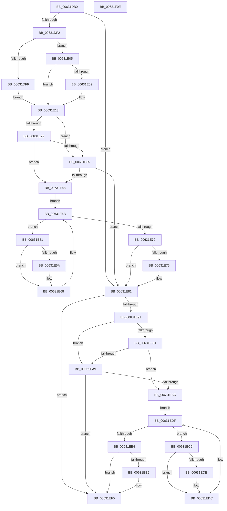

# DifKeReleaseSpinLockWrapper

- RVA: `0x00631DB0`–`0x00631F0F` (길이 `351` bytes)
- VA: `0x0000000140631DB0`
- 실행 섹션: `.text`
- PDB 이름 있음: `예`; PDB Function 태그: `아니요`
- unwind 정보 RVA: `0x00093E28`
- 디코드: `97`개 명령, `351/351` bytes 표시
- 미해석 바이트: `0` (있으면 어셈블리에 `.byte`로 보존)

> 이 문서는 커널 이미지의 기계어와 PDB 기호를 분석해 생성했습니다. 4번과 5번은 함수 원형과 자료형을 바이너리 사용 방식에서 추정한 C 해석이며 원본 소스 복구 결과는 아닙니다.

## 1. Dependencies

- 직접 호출 지점: **9**; 고유 호출 대상: **6**
- 직접 호출자로 확인된 함수: **0**
- RIP 상대 이미지 참조: **3**

### Outgoing calls
- `0x00631DE1` → [DifGetAPIThunkContextById](../49/DifGetAPIThunkContextById_function_00495A34.md) (function, `0x00495A34`)
- `0x00631E09` → [DifGetReturnAddressForWrappers](../4D/DifGetReturnAddressForWrappers_function_004D3C08.md) (function, `0x004D3C08`)
- `0x00631E3C` → [ExAcquireRundownProtection](../21/ExAcquireRundownProtection_function_00216620.md) (function, `0x00216620`)
- `0x00631E63` → [guard_dispatch_icall](../6B/guard_dispatch_icall_function_006BAAD0.md) (function, `0x006BAAD0`)
- `0x00631E7C` → [ExReleaseRundownProtection](../34/ExReleaseRundownProtection_function_00349E80.md) (function, `0x00349E80`)
- `0x00631E87` → [KeReleaseSpinLock](../39/KeReleaseSpinLock_function_00392BA0.md) (function, `0x00392BA0`)
- `0x00631EB0` → [ExAcquireRundownProtection](../21/ExAcquireRundownProtection_function_00216620.md) (function, `0x00216620`)
- `0x00631ED7` → [guard_dispatch_icall](../6B/guard_dispatch_icall_function_006BAAD0.md) (function, `0x006BAAD0`)
- `0x00631EF0` → [ExReleaseRundownProtection](../34/ExReleaseRundownProtection_function_00349E80.md) (function, `0x00349E80`)

### Direct callers
- 이 함수 시작 RVA로 연결되는 직접 call은 확인되지 않았습니다. 간접 호출은 완전히 역산할 수 없습니다.

### Static image references
- `0x00631E1B` → RVA `0x00F048B8` (`.data`; read)
- `0x00631E29` → RVA `0x00F04980` (`.data`; read)
- `0x00631E35` → RVA `0x00F03E80` (`.data`; read)

## 2. Other-region calls and transfers

- 다른 실행 섹션으로 향하는 call: **0**
- 별도 외부 분기/꼬리 이동을 확인하지 못했습니다.

## 3. Assembly (complete function range)

```asm
00631DB0  4C 8B DC                        mov r11, rsp
00631DB3  49 89 5B 08                     mov qword ptr [r11 + 8], rbx
00631DB7  49 89 6B 10                     mov qword ptr [r11 + 0x10], rbp
00631DBB  49 89 73 18                     mov qword ptr [r11 + 0x18], rsi
00631DBF  57                              push rdi
00631DC0  41 56                           push r14
00631DC2  41 57                           push r15
00631DC4  48 83 EC 40                     sub rsp, 0x40
00631DC8  33 C0                           xor eax, eax
00631DCA  0F 57 C0                        xorps xmm0, xmm0
00631DCD  0F 11 44 24 20                  movups xmmword ptr [rsp + 0x20], xmm0
00631DD2  4C 8B F9                        mov r15, rcx
00631DD5  49 89 43 D8                     mov qword ptr [r11 - 0x28], rax
00631DD9  B9 02 01 00 00                  mov ecx, 0x102
00631DDE  44 8A F2                        mov r14b, dl
00631DE1  E8 4E 3C E6 FF                  call 0x140495a34
00631DE6  48 8B F0                        mov rsi, rax
00631DE9  48 85 C0                        test rax, rax
00631DEC  0F 84 8F 00 00 00               je 0x140631e81
00631DF2  8B 40 0C                        mov eax, dword ptr [rax + 0xc]
00631DF5  A8 18                           test al, 0x18
00631DF7  74 0C                           je 0x140631e05
00631DF9  48 8B 4C 24 58                  mov rcx, qword ptr [rsp + 0x58]
00631DFE  48 89 4C 24 20                  mov qword ptr [rsp + 0x20], rcx
00631E03  EB 0E                           jmp 0x140631e13
00631E05  A8 04                           test al, 4
00631E07  74 0A                           je 0x140631e13
00631E09  E8 FA 1D EA FF                  call 0x1404d3c08
00631E0E  48 89 44 24 20                  mov qword ptr [rsp + 0x20], rax
00631E13  40 32 ED                        xor bpl, bpl
00631E16  4C 89 7C 24 30                  mov qword ptr [rsp + 0x30], r15
00631E1B  40 38 2D 96 2A 8D 00            cmp byte ptr [rip + 0x8d2a96], bpl
00631E22  44 88 74 24 28                  mov byte ptr [rsp + 0x28], r14b
00631E27  75 0C                           jne 0x140631e35
00631E29  F7 05 4D 2B 8D 00 00 08 00 00   test dword ptr [rip + 0x8d2b4d], 0x800
00631E33  74 13                           je 0x140631e48
00631E35  48 8D 0D 44 20 8D 00            lea rcx, [rip + 0x8d2044]
00631E3C  E8 DF 47 BE FF                  call 0x140216620
00631E41  40 8A E8                        mov bpl, al
00631E44  84 C0                           test al, al
00631E46  74 39                           je 0x140631e81
00631E48  48 8D 7E 20                     lea rdi, [rsi + 0x20]
00631E4C  48 8B 1F                        mov rbx, qword ptr [rdi]
00631E4F  EB 1A                           jmp 0x140631e6b
00631E51  48 8D 43 F0                     lea rax, [rbx - 0x10]
00631E55  48 85 C0                        test rax, rax
00631E58  74 0E                           je 0x140631e68
00631E5A  48 8B 40 08                     mov rax, qword ptr [rax + 8]
00631E5E  48 8D 4C 24 20                  lea rcx, [rsp + 0x20]
00631E63  E8 68 8C 08 00                  call 0x1406baad0
00631E68  48 8B 1B                        mov rbx, qword ptr [rbx]
00631E6B  48 3B DF                        cmp rbx, rdi
00631E6E  75 E1                           jne 0x140631e51
00631E70  40 84 ED                        test bpl, bpl
00631E73  74 0C                           je 0x140631e81
00631E75  48 8D 0D 04 20 8D 00            lea rcx, [rip + 0x8d2004]
00631E7C  E8 FF 7F D1 FF                  call 0x140349e80
00631E81  41 8A D6                        mov dl, r14b
00631E84  49 8B CF                        mov rcx, r15
00631E87  E8 14 0D D6 FF                  call 0x140392ba0
00631E8C  48 85 F6                        test rsi, rsi
00631E8F  74 64                           je 0x140631ef5
00631E91  40 32 FF                        xor dil, dil
00631E94  40 38 3D 1D 2A 8D 00            cmp byte ptr [rip + 0x8d2a1d], dil
00631E9B  75 0C                           jne 0x140631ea9
00631E9D  F7 05 D9 2A 8D 00 00 08 00 00   test dword ptr [rip + 0x8d2ad9], 0x800
00631EA7  74 13                           je 0x140631ebc
00631EA9  48 8D 0D D0 1F 8D 00            lea rcx, [rip + 0x8d1fd0]
00631EB0  E8 6B 47 BE FF                  call 0x140216620
00631EB5  40 8A F8                        mov dil, al
00631EB8  84 C0                           test al, al
00631EBA  74 39                           je 0x140631ef5
00631EBC  48 83 C6 30                     add rsi, 0x30
00631EC0  48 8B 1E                        mov rbx, qword ptr [rsi]
00631EC3  EB 1A                           jmp 0x140631edf
00631EC5  48 8D 43 F0                     lea rax, [rbx - 0x10]
00631EC9  48 85 C0                        test rax, rax
00631ECC  74 0E                           je 0x140631edc
00631ECE  48 8B 40 08                     mov rax, qword ptr [rax + 8]
00631ED2  48 8D 4C 24 20                  lea rcx, [rsp + 0x20]
00631ED7  E8 F4 8B 08 00                  call 0x1406baad0
00631EDC  48 8B 1B                        mov rbx, qword ptr [rbx]
00631EDF  48 3B DE                        cmp rbx, rsi
00631EE2  75 E1                           jne 0x140631ec5
00631EE4  40 84 FF                        test dil, dil
00631EE7  74 0C                           je 0x140631ef5
00631EE9  48 8D 0D 90 1F 8D 00            lea rcx, [rip + 0x8d1f90]
00631EF0  E8 8B 7F D1 FF                  call 0x140349e80
00631EF5  48 8B 5C 24 60                  mov rbx, qword ptr [rsp + 0x60]
00631EFA  48 8B 6C 24 68                  mov rbp, qword ptr [rsp + 0x68]
00631EFF  48 8B 74 24 70                  mov rsi, qword ptr [rsp + 0x70]
00631F04  48 83 C4 40                     add rsp, 0x40
00631F08  41 5F                           pop r15
00631F0A  41 5E                           pop r14
00631F0C  5F                              pop rdi
00631F0D  C3                              ret
00631F0E  CC                              int3
```

## 4. C-style interpretation (structured pseudocode)

```c
__int64 __fastcall DifKeReleaseSpinLockWrapper(__int64 a1, unsigned __int8 a2)
{
    __int64 result;
    __int64 v_rbp;
    __int64 v_rdi;
    __int64 v_rsi;
    __int64 v_rsp;
    unsigned __int64 v_stack_m28;
    unsigned __int8 v_stack_m30;
    unsigned __int64 v_stack_m38;
    unsigned __int64 v_stack_p0;
    unsigned __int64 v_stack_p10;
    unsigned __int64 v_stack_p18;
    unsigned __int64 v_stack_p8;

    *(unsigned __int64 *)(v_rsp + 8) = v_rbx;
    *(unsigned __int64 *)(v_rsp + 16) = v_rbp;
    *(unsigned __int64 *)(v_rsp + 24) = v_rsi;
    v_rsp = (v_rsp) - (64);
    result = 0;
    v_stack_m38 = v_xmm0;
    *(unsigned __int64 *)(v_rsp - 40) = 0;
    result = DifGetAPIThunkContextById(258, a2, a3, a4);
    if (result == 0) goto loc_00631E81;
    if ((((unsigned __int8)((unsigned int)(*(unsigned int *)(result + 12)))) & (24)) == 0) goto loc_00631E05;
    v_stack_m38 = v_stack_p0;
    goto loc_00631E13;
loc_00631E05:
    result = (unsigned int)(*(unsigned int *)(result + 12));
    if ((((unsigned __int8)((unsigned int)(*(unsigned int *)(result + 12)))) & (4)) != 0) {
        result = DifGetReturnAddressForWrappers(v_stack_p0, a2, a3, a4);
        v_stack_m38 = result;
    }
    v_rbp = 0;
    v_stack_m28 = a1;
    v_stack_m30 = a2;
    if ((*(unsigned __int8 *)(v_rip + 9251478)) != 0) goto loc_00631E35;
    if (((*(unsigned int *)(v_rip + 9251661)) & (0x800ULL)) == 0) goto loc_00631E48;
loc_00631E35:
    result = ExAcquireRundownProtection(v_rip + 9248836, a2, a3, a4);
    if ((unsigned __int8)(result) == 0) goto loc_00631E81;
loc_00631E48:
    goto loc_00631E6B;
loc_00631E51:
    result = *(unsigned __int64 *)(result + 32) - 16;
    if (*(unsigned __int64 *)(result + 32) - 16 != 0) {
        result = *(unsigned __int64 *)(*(unsigned __int64 *)(result + 32) - 16 + 8);
        a1 = v_stack_m38;
        result = guard_dispatch_icall(a1, a2, a3, a4);
    }
loc_00631E6B:
    if ((*(unsigned __int64 *)(*(unsigned __int64 *)(result + 32))) != (result + 32)) goto loc_00631E51;
    if ((unsigned __int8)((unsigned __int8)(result)) != 0) {
        a1 = v_rip + 9248772;
        result = ExReleaseRundownProtection(a1, a2, a3, a4);
    }
    result = KeReleaseSpinLock(a1, a2, a3, a4);
    if (result == 0) goto loc_00631EF5;
    v_rdi = 0;
    if ((*(unsigned __int8 *)(v_rip + 9251357)) != 0) goto loc_00631EA9;
    if (((*(unsigned int *)(v_rip + 9251545)) & (0x800ULL)) == 0) goto loc_00631EBC;
loc_00631EA9:
    result = ExAcquireRundownProtection(v_rip + 9248720, a2, a3, a4);
    if ((unsigned __int8)(result) == 0) goto loc_00631EF5;
loc_00631EBC:
    v_rsi = (result) + (48);
    goto loc_00631EDF;
loc_00631EC5:
    result = *(unsigned __int64 *)(v_rsi) - 16;
    if (*(unsigned __int64 *)(v_rsi) - 16 != 0) {
        result = *(unsigned __int64 *)(*(unsigned __int64 *)(v_rsi) - 16 + 8);
        a1 = v_stack_m38;
        result = guard_dispatch_icall(a1, a2, a3, a4);
    }
loc_00631EDF:
    if ((*(unsigned __int64 *)(*(unsigned __int64 *)(v_rsi))) != v_rsi) goto loc_00631EC5;
    if ((unsigned __int8)((unsigned __int8)(result)) != 0) {
        a1 = v_rip + 9248656;
        result = ExReleaseRundownProtection(a1, a2, a3, a4);
    }
    v_rsp = (v_rsp) + (64);
    return result;
}
```

## 5. (Beta) C Style

```c
int64_t DifKeReleaseSpinLockWrapper(int64_t Arg1, uint8_t Arg2)
{
    int64_t result;
    int64_t local_rbp;
    int64_t local_rdi;
    int64_t local_rsi;
    int64_t local_rsp;
    uint64_t v_stack_m28;
    uint8_t v_stack_m30;
    uint64_t v_stack_m38;
    uint64_t v_stack_p0;
    uint64_t v_stack_p10;
    uint64_t v_stack_p18;
    uint64_t v_stack_p8;

    *(uint64_t *)(local_rsp + 0x8) = local_rbx;
    *(uint64_t *)(local_rsp + 0x10) = local_rbp;
    *(uint64_t *)(local_rsp + 0x18) = local_rsi;
    local_rsp = (local_rsp) - (64);
    result = 0;
    v_stack_m38 = v_xmm0;
    *(uint64_t *)(local_rsp - 0x28) = 0;
    result = DifGetAPIThunkContextById(258, Arg2, a3, a4);
    if (result == 0) goto loc_00631E81;
    if ((((uint8_t)((uint32_t)(*(uint32_t *)(result + 0xC)))) & (24)) == 0) goto loc_00631E05;
    v_stack_m38 = v_stack_p0;
    goto loc_00631E13;
loc_00631E05:
    result = (uint32_t)(*(uint32_t *)(result + 0xC));
    if ((((uint8_t)((uint32_t)(*(uint32_t *)(result + 0xC)))) & (4)) != 0) {
        result = DifGetReturnAddressForWrappers(v_stack_p0, Arg2, a3, a4);
        v_stack_m38 = result;
    }
    local_rbp = 0;
    v_stack_m28 = Arg1;
    v_stack_m30 = Arg2;
    if ((*(uint8_t *)(v_rip + 0x8D2A96)) != 0) goto loc_00631E35;
    if (((*(uint32_t *)(v_rip + 0x8D2B4D)) & (0x800ULL)) == 0) goto loc_00631E48;
loc_00631E35:
    result = ExAcquireRundownProtection(v_rip + 9248836, Arg2, a3, a4);
    if ((uint8_t)(result) == 0) goto loc_00631E81;
loc_00631E48:
    goto loc_00631E6B;
loc_00631E51:
    result = *(uint64_t *)(result + 0x20) - 16;
    if (*(uint64_t *)(result + 0x20) - 16 != 0) {
        result = *(uint64_t *)(*(uint64_t *)(result + 0x20) - 0x10 + 0x8);
        Arg1 = v_stack_m38;
        result = guard_dispatch_icall(Arg1, Arg2, a3, a4);
    }
loc_00631E6B:
    if ((*(uint64_t *)(*(uint64_t *)(result + 0x20))) != (result + 32)) goto loc_00631E51;
    if ((uint8_t)((uint8_t)(result)) != 0) {
        Arg1 = v_rip + 9248772;
        result = ExReleaseRundownProtection(Arg1, Arg2, a3, a4);
    }
    result = KeReleaseSpinLock(Arg1, Arg2, a3, a4);
    if (result == 0) goto loc_00631EF5;
    local_rdi = 0;
    if ((*(uint8_t *)(v_rip + 0x8D2A1D)) != 0) goto loc_00631EA9;
    if (((*(uint32_t *)(v_rip + 0x8D2AD9)) & (0x800ULL)) == 0) goto loc_00631EBC;
loc_00631EA9:
    result = ExAcquireRundownProtection(v_rip + 9248720, Arg2, a3, a4);
    if ((uint8_t)(result) == 0) goto loc_00631EF5;
loc_00631EBC:
    local_rsi = (result) + (48);
    goto loc_00631EDF;
loc_00631EC5:
    result = *(uint64_t *)(local_rsi) - 16;
    if (*(uint64_t *)(local_rsi) - 16 != 0) {
        result = *(uint64_t *)(*(uint64_t *)(local_rsi) - 0x10 + 0x8);
        Arg1 = v_stack_m38;
        result = guard_dispatch_icall(Arg1, Arg2, a3, a4);
    }
loc_00631EDF:
    if ((*(uint64_t *)(*(uint64_t *)(local_rsi))) != local_rsi) goto loc_00631EC5;
    if ((uint8_t)((uint8_t)(result)) != 0) {
        Arg1 = v_rip + 9248656;
        result = ExReleaseRundownProtection(Arg1, Arg2, a3, a4);
    }
    local_rsp = (local_rsp) + (64);
    return result;
}
```

## 6. Execution-region graph

[열기: 2D/3D 그래프와 함수 탐색 컨트롤 패널](../../../control-panel.html?section=text&rva=0x00631DB0&view=graph)

- 2D 그래프는 위에서 아래로 흐르고, 3D 그래프는 빈 공간을 드래그해 회전합니다. Shift+드래그는 이동, 휠은 확대·축소, 함수 노드 선택은 대상 보고서 이동입니다.

### Static fallback


