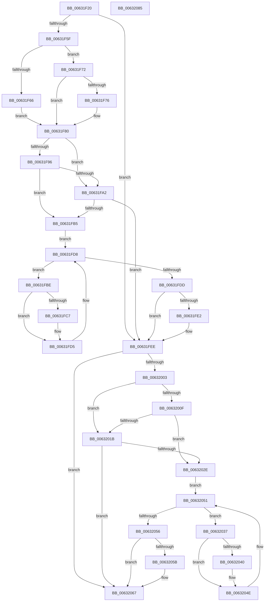

# DifKeRemoveByKeyDeviceQueueWrapper

- RVA: `0x00631F20`–`0x00632086` (길이 `358` bytes)
- VA: `0x0000000140631F20`
- 실행 섹션: `.text`
- PDB 이름 있음: `예`; PDB Function 태그: `아니요`
- unwind 정보 RVA: `0x00093E28`
- 디코드: `98`개 명령, `358/358` bytes 표시
- 미해석 바이트: `0` (있으면 어셈블리에 `.byte`로 보존)

> 이 문서는 커널 이미지의 기계어와 PDB 기호를 분석해 생성했습니다. 4번과 5번은 함수 원형과 자료형을 바이너리 사용 방식에서 추정한 C 해석이며 원본 소스 복구 결과는 아닙니다.

## 1. Dependencies

- 직접 호출 지점: **9**; 고유 호출 대상: **6**
- 직접 호출자로 확인된 함수: **0**
- RIP 상대 이미지 참조: **3**

### Outgoing calls
- `0x00631F4E` → [DifGetAPIThunkContextById](../49/DifGetAPIThunkContextById_function_00495A34.md) (function, `0x00495A34`)
- `0x00631F76` → [DifGetReturnAddressForWrappers](../4D/DifGetReturnAddressForWrappers_function_004D3C08.md) (function, `0x004D3C08`)
- `0x00631FA9` → [ExAcquireRundownProtection](../21/ExAcquireRundownProtection_function_00216620.md) (function, `0x00216620`)
- `0x00631FD0` → [guard_dispatch_icall](../6B/guard_dispatch_icall_function_006BAAD0.md) (function, `0x006BAAD0`)
- `0x00631FE9` → [ExReleaseRundownProtection](../34/ExReleaseRundownProtection_function_00349E80.md) (function, `0x00349E80`)
- `0x00631FF4` → [KeRemoveByKeyDeviceQueue](../45/KeRemoveByKeyDeviceQueue_function_0045FB30.md) (function, `0x0045FB30`)
- `0x00632022` → [ExAcquireRundownProtection](../21/ExAcquireRundownProtection_function_00216620.md) (function, `0x00216620`)
- `0x00632049` → [guard_dispatch_icall](../6B/guard_dispatch_icall_function_006BAAD0.md) (function, `0x006BAAD0`)
- `0x00632062` → [ExReleaseRundownProtection](../34/ExReleaseRundownProtection_function_00349E80.md) (function, `0x00349E80`)

### Direct callers
- 이 함수 시작 RVA로 연결되는 직접 call은 확인되지 않았습니다. 간접 호출은 완전히 역산할 수 없습니다.

### Static image references
- `0x00631F88` → RVA `0x00F048B8` (`.data`; read)
- `0x00631F96` → RVA `0x00F04980` (`.data`; read)
- `0x00631FA2` → RVA `0x00F03E80` (`.data`; read)

## 2. Other-region calls and transfers

- 다른 실행 섹션으로 향하는 call: **0**
- 별도 외부 분기/꼬리 이동을 확인하지 못했습니다.

## 3. Assembly (complete function range)

```asm
00631F20  48 8B C4                        mov rax, rsp
00631F23  48 89 58 08                     mov qword ptr [rax + 8], rbx
00631F27  48 89 68 10                     mov qword ptr [rax + 0x10], rbp
00631F2B  48 89 70 18                     mov qword ptr [rax + 0x18], rsi
00631F2F  57                              push rdi
00631F30  41 56                           push r14
00631F32  41 57                           push r15
00631F34  48 83 EC 40                     sub rsp, 0x40
00631F38  0F 57 C0                        xorps xmm0, xmm0
00631F3B  4C 8B F9                        mov r15, rcx
00631F3E  B9 00 01 00 00                  mov ecx, 0x100
00631F43  44 8B F2                        mov r14d, edx
00631F46  0F 11 40 C8                     movups xmmword ptr [rax - 0x38], xmm0
00631F4A  0F 11 40 D8                     movups xmmword ptr [rax - 0x28], xmm0
00631F4E  E8 E1 3A E6 FF                  call 0x140495a34
00631F53  48 8B F0                        mov rsi, rax
00631F56  48 85 C0                        test rax, rax
00631F59  0F 84 8F 00 00 00               je 0x140631fee
00631F5F  8B 40 0C                        mov eax, dword ptr [rax + 0xc]
00631F62  A8 18                           test al, 0x18
00631F64  74 0C                           je 0x140631f72
00631F66  48 8B 4C 24 58                  mov rcx, qword ptr [rsp + 0x58]
00631F6B  48 89 4C 24 20                  mov qword ptr [rsp + 0x20], rcx
00631F70  EB 0E                           jmp 0x140631f80
00631F72  A8 04                           test al, 4
00631F74  74 0A                           je 0x140631f80
00631F76  E8 8D 1C EA FF                  call 0x1404d3c08
00631F7B  48 89 44 24 20                  mov qword ptr [rsp + 0x20], rax
00631F80  40 32 ED                        xor bpl, bpl
00631F83  4C 89 7C 24 30                  mov qword ptr [rsp + 0x30], r15
00631F88  40 38 2D 29 29 8D 00            cmp byte ptr [rip + 0x8d2929], bpl
00631F8F  44 89 74 24 28                  mov dword ptr [rsp + 0x28], r14d
00631F94  75 0C                           jne 0x140631fa2
00631F96  F7 05 E0 29 8D 00 00 08 00 00   test dword ptr [rip + 0x8d29e0], 0x800
00631FA0  74 13                           je 0x140631fb5
00631FA2  48 8D 0D D7 1E 8D 00            lea rcx, [rip + 0x8d1ed7]
00631FA9  E8 72 46 BE FF                  call 0x140216620
00631FAE  40 8A E8                        mov bpl, al
00631FB1  84 C0                           test al, al
00631FB3  74 39                           je 0x140631fee
00631FB5  48 8D 7E 20                     lea rdi, [rsi + 0x20]
00631FB9  48 8B 1F                        mov rbx, qword ptr [rdi]
00631FBC  EB 1A                           jmp 0x140631fd8
00631FBE  48 8D 43 F0                     lea rax, [rbx - 0x10]
00631FC2  48 85 C0                        test rax, rax
00631FC5  74 0E                           je 0x140631fd5
00631FC7  48 8B 40 08                     mov rax, qword ptr [rax + 8]
00631FCB  48 8D 4C 24 20                  lea rcx, [rsp + 0x20]
00631FD0  E8 FB 8A 08 00                  call 0x1406baad0
00631FD5  48 8B 1B                        mov rbx, qword ptr [rbx]
00631FD8  48 3B DF                        cmp rbx, rdi
00631FDB  75 E1                           jne 0x140631fbe
00631FDD  40 84 ED                        test bpl, bpl
00631FE0  74 0C                           je 0x140631fee
00631FE2  48 8D 0D 97 1E 8D 00            lea rcx, [rip + 0x8d1e97]
00631FE9  E8 92 7E D1 FF                  call 0x140349e80
00631FEE  41 8B D6                        mov edx, r14d
00631FF1  49 8B CF                        mov rcx, r15
00631FF4  E8 37 DB E2 FF                  call 0x14045fb30
00631FF9  48 89 44 24 38                  mov qword ptr [rsp + 0x38], rax
00631FFE  48 85 F6                        test rsi, rsi
00632001  74 64                           je 0x140632067
00632003  40 32 FF                        xor dil, dil
00632006  40 38 3D AB 28 8D 00            cmp byte ptr [rip + 0x8d28ab], dil
0063200D  75 0C                           jne 0x14063201b
0063200F  F7 05 67 29 8D 00 00 08 00 00   test dword ptr [rip + 0x8d2967], 0x800
00632019  74 13                           je 0x14063202e
0063201B  48 8D 0D 5E 1E 8D 00            lea rcx, [rip + 0x8d1e5e]
00632022  E8 F9 45 BE FF                  call 0x140216620
00632027  40 8A F8                        mov dil, al
0063202A  84 C0                           test al, al
0063202C  74 39                           je 0x140632067
0063202E  48 83 C6 30                     add rsi, 0x30
00632032  48 8B 1E                        mov rbx, qword ptr [rsi]
00632035  EB 1A                           jmp 0x140632051
00632037  48 8D 43 F0                     lea rax, [rbx - 0x10]
0063203B  48 85 C0                        test rax, rax
0063203E  74 0E                           je 0x14063204e
00632040  48 8B 40 08                     mov rax, qword ptr [rax + 8]
00632044  48 8D 4C 24 20                  lea rcx, [rsp + 0x20]
00632049  E8 82 8A 08 00                  call 0x1406baad0
0063204E  48 8B 1B                        mov rbx, qword ptr [rbx]
00632051  48 3B DE                        cmp rbx, rsi
00632054  75 E1                           jne 0x140632037
00632056  40 84 FF                        test dil, dil
00632059  74 0C                           je 0x140632067
0063205B  48 8D 0D 1E 1E 8D 00            lea rcx, [rip + 0x8d1e1e]
00632062  E8 19 7E D1 FF                  call 0x140349e80
00632067  48 8B 44 24 38                  mov rax, qword ptr [rsp + 0x38]
0063206C  48 8B 5C 24 60                  mov rbx, qword ptr [rsp + 0x60]
00632071  48 8B 6C 24 68                  mov rbp, qword ptr [rsp + 0x68]
00632076  48 8B 74 24 70                  mov rsi, qword ptr [rsp + 0x70]
0063207B  48 83 C4 40                     add rsp, 0x40
0063207F  41 5F                           pop r15
00632081  41 5E                           pop r14
00632083  5F                              pop rdi
00632084  C3                              ret
00632085  CC                              int3
```

## 4. C-style interpretation (structured pseudocode)

```c
__int64 __fastcall DifKeRemoveByKeyDeviceQueueWrapper(__int64 a1, int a2)
{
    __int64 result;
    __int64 v_rbp;
    __int64 v_rdi;
    __int64 v_rsi;
    __int64 v_rsp;
    unsigned __int64 v_stack_m20;
    unsigned __int64 v_stack_m28;
    unsigned int v_stack_m30;
    unsigned __int64 v_stack_m38;
    unsigned __int64 v_stack_p0;
    unsigned __int64 v_stack_p10;
    unsigned __int64 v_stack_p18;
    unsigned __int64 v_stack_p8;

    *(unsigned __int64 *)(v_rsp + 8) = v_rbx;
    *(unsigned __int64 *)(v_rsp + 16) = v_rbp;
    *(unsigned __int64 *)(v_rsp + 24) = v_rsi;
    v_rsp = (v_rsp) - (64);
    *(unsigned __int64 *)(v_rsp - 56) = v_xmm0;
    *(unsigned __int64 *)(v_rsp - 40) = v_xmm0;
    result = DifGetAPIThunkContextById(256, a2, a3, a4);
    if (result == 0) goto loc_00631FEE;
    if ((((unsigned __int8)((unsigned int)(*(unsigned int *)(result + 12)))) & (24)) == 0) goto loc_00631F72;
    v_stack_m38 = v_stack_p0;
    goto loc_00631F80;
loc_00631F72:
    result = (unsigned int)(*(unsigned int *)(result + 12));
    if ((((unsigned __int8)((unsigned int)(*(unsigned int *)(result + 12)))) & (4)) != 0) {
        result = DifGetReturnAddressForWrappers(v_stack_p0, a2, a3, a4);
        v_stack_m38 = result;
    }
    v_rbp = 0;
    v_stack_m28 = a1;
    v_stack_m30 = (unsigned int)((unsigned int)(a2));
    if ((*(unsigned __int8 *)(v_rip + 9251113)) != 0) goto loc_00631FA2;
    if (((*(unsigned int *)(v_rip + 9251296)) & (0x800ULL)) == 0) goto loc_00631FB5;
loc_00631FA2:
    result = ExAcquireRundownProtection(v_rip + 9248471, a2, a3, a4);
    if ((unsigned __int8)(result) == 0) goto loc_00631FEE;
loc_00631FB5:
    goto loc_00631FD8;
loc_00631FBE:
    result = *(unsigned __int64 *)(result + 32) - 16;
    if (*(unsigned __int64 *)(result + 32) - 16 != 0) {
        result = *(unsigned __int64 *)(*(unsigned __int64 *)(result + 32) - 16 + 8);
        a1 = v_stack_m38;
        result = guard_dispatch_icall(a1, a2, a3, a4);
    }
loc_00631FD8:
    if ((*(unsigned __int64 *)(*(unsigned __int64 *)(result + 32))) != (result + 32)) goto loc_00631FBE;
    if ((unsigned __int8)((unsigned __int8)(result)) != 0) {
        a1 = v_rip + 9248407;
        result = ExReleaseRundownProtection(a1, a2, a3, a4);
    }
    result = KeRemoveByKeyDeviceQueue(a1, (unsigned int)((unsigned int)((unsigned int)(a2))), a3, a4);
    v_stack_m20 = result;
    if (result == 0) goto loc_00632067;
    v_rdi = 0;
    if ((*(unsigned __int8 *)(v_rip + 9250987)) != 0) goto loc_0063201B;
    if (((*(unsigned int *)(v_rip + 9251175)) & (0x800ULL)) == 0) goto loc_0063202E;
loc_0063201B:
    result = ExAcquireRundownProtection(v_rip + 9248350, (unsigned int)((unsigned int)((unsigned int)(a2))), a3, a4);
    if ((unsigned __int8)(result) == 0) goto loc_00632067;
loc_0063202E:
    v_rsi = (result) + (48);
    goto loc_00632051;
loc_00632037:
    result = *(unsigned __int64 *)(v_rsi) - 16;
    if (*(unsigned __int64 *)(v_rsi) - 16 != 0) {
        result = *(unsigned __int64 *)(*(unsigned __int64 *)(v_rsi) - 16 + 8);
        a1 = v_stack_m38;
        result = guard_dispatch_icall(a1, (unsigned int)((unsigned int)((unsigned int)(a2))), a3, a4);
    }
loc_00632051:
    if ((*(unsigned __int64 *)(*(unsigned __int64 *)(v_rsi))) != v_rsi) goto loc_00632037;
    if ((unsigned __int8)((unsigned __int8)(result)) != 0) {
        a1 = v_rip + 9248286;
        result = ExReleaseRundownProtection(a1, (unsigned int)((unsigned int)((unsigned int)(a2))), a3, a4);
    }
    v_rsp = (v_rsp) + (64);
    return v_stack_m20;
}
```

## 5. (Beta) C Style

```c
int64_t DifKeRemoveByKeyDeviceQueueWrapper(int64_t Arg1, int32_t Arg2)
{
    int64_t result;
    int64_t local_rbp;
    int64_t local_rdi;
    int64_t local_rsi;
    int64_t local_rsp;
    uint64_t v_stack_m20;
    uint64_t v_stack_m28;
    uint32_t v_stack_m30;
    uint64_t v_stack_m38;
    uint64_t v_stack_p0;
    uint64_t v_stack_p10;
    uint64_t v_stack_p18;
    uint64_t v_stack_p8;

    *(uint64_t *)(local_rsp + 0x8) = local_rbx;
    *(uint64_t *)(local_rsp + 0x10) = local_rbp;
    *(uint64_t *)(local_rsp + 0x18) = local_rsi;
    local_rsp = (local_rsp) - (64);
    *(uint64_t *)(local_rsp - 0x38) = v_xmm0;
    *(uint64_t *)(local_rsp - 0x28) = v_xmm0;
    result = DifGetAPIThunkContextById(256, Arg2, a3, a4);
    if (result == 0) goto loc_00631FEE;
    if ((((uint8_t)((uint32_t)(*(uint32_t *)(result + 0xC)))) & (24)) == 0) goto loc_00631F72;
    v_stack_m38 = v_stack_p0;
    goto loc_00631F80;
loc_00631F72:
    result = (uint32_t)(*(uint32_t *)(result + 0xC));
    if ((((uint8_t)((uint32_t)(*(uint32_t *)(result + 0xC)))) & (4)) != 0) {
        result = DifGetReturnAddressForWrappers(v_stack_p0, Arg2, a3, a4);
        v_stack_m38 = result;
    }
    local_rbp = 0;
    v_stack_m28 = Arg1;
    v_stack_m30 = (uint32_t)((uint32_t)(Arg2));
    if ((*(uint8_t *)(v_rip + 0x8D2929)) != 0) goto loc_00631FA2;
    if (((*(uint32_t *)(v_rip + 0x8D29E0)) & (0x800ULL)) == 0) goto loc_00631FB5;
loc_00631FA2:
    result = ExAcquireRundownProtection(v_rip + 9248471, Arg2, a3, a4);
    if ((uint8_t)(result) == 0) goto loc_00631FEE;
loc_00631FB5:
    goto loc_00631FD8;
loc_00631FBE:
    result = *(uint64_t *)(result + 0x20) - 16;
    if (*(uint64_t *)(result + 0x20) - 16 != 0) {
        result = *(uint64_t *)(*(uint64_t *)(result + 0x20) - 0x10 + 0x8);
        Arg1 = v_stack_m38;
        result = guard_dispatch_icall(Arg1, Arg2, a3, a4);
    }
loc_00631FD8:
    if ((*(uint64_t *)(*(uint64_t *)(result + 0x20))) != (result + 32)) goto loc_00631FBE;
    if ((uint8_t)((uint8_t)(result)) != 0) {
        Arg1 = v_rip + 9248407;
        result = ExReleaseRundownProtection(Arg1, Arg2, a3, a4);
    }
    result = KeRemoveByKeyDeviceQueue(Arg1, (uint32_t)((uint32_t)((uint32_t)(Arg2))), a3, a4);
    v_stack_m20 = result;
    if (result == 0) goto loc_00632067;
    local_rdi = 0;
    if ((*(uint8_t *)(v_rip + 0x8D28AB)) != 0) goto loc_0063201B;
    if (((*(uint32_t *)(v_rip + 0x8D2967)) & (0x800ULL)) == 0) goto loc_0063202E;
loc_0063201B:
    result = ExAcquireRundownProtection(v_rip + 9248350, (uint32_t)((uint32_t)((uint32_t)(Arg2))), a3, a4);
    if ((uint8_t)(result) == 0) goto loc_00632067;
loc_0063202E:
    local_rsi = (result) + (48);
    goto loc_00632051;
loc_00632037:
    result = *(uint64_t *)(local_rsi) - 16;
    if (*(uint64_t *)(local_rsi) - 16 != 0) {
        result = *(uint64_t *)(*(uint64_t *)(local_rsi) - 0x10 + 0x8);
        Arg1 = v_stack_m38;
        result = guard_dispatch_icall(Arg1, (uint32_t)((uint32_t)((uint32_t)(Arg2))), a3, a4);
    }
loc_00632051:
    if ((*(uint64_t *)(*(uint64_t *)(local_rsi))) != local_rsi) goto loc_00632037;
    if ((uint8_t)((uint8_t)(result)) != 0) {
        Arg1 = v_rip + 9248286;
        result = ExReleaseRundownProtection(Arg1, (uint32_t)((uint32_t)((uint32_t)(Arg2))), a3, a4);
    }
    local_rsp = (local_rsp) + (64);
    return v_stack_m20;
}
```

## 6. Execution-region graph

[열기: 2D/3D 그래프와 함수 탐색 컨트롤 패널](../../../control-panel.html?section=text&rva=0x00631F20&view=graph)

- 2D 그래프는 위에서 아래로 흐르고, 3D 그래프는 빈 공간을 드래그해 회전합니다. Shift+드래그는 이동, 휠은 확대·축소, 함수 노드 선택은 대상 보고서 이동입니다.

### Static fallback


