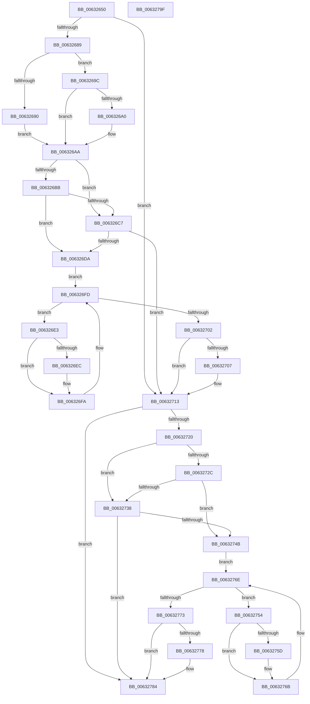

# DifKeRestoreExtendedProcessorStateWrapper

- RVA: `0x00632650`–`0x006327A0` (길이 `336` bytes)
- VA: `0x0000000140632650`
- 실행 섹션: `.text`
- PDB 이름 있음: `예`; PDB Function 태그: `아니요`
- unwind 정보 RVA: `0x0005D7BC`
- 디코드: `90`개 명령, `336/336` bytes 표시
- 미해석 바이트: `0` (있으면 어셈블리에 `.byte`로 보존)

> 이 문서는 커널 이미지의 기계어와 PDB 기호를 분석해 생성했습니다. 4번과 5번은 함수 원형과 자료형을 바이너리 사용 방식에서 추정한 C 해석이며 원본 소스 복구 결과는 아닙니다.

## 1. Dependencies

- 직접 호출 지점: **9**; 고유 호출 대상: **6**
- 직접 호출자로 확인된 함수: **0**
- RIP 상대 이미지 참조: **3**

### Outgoing calls
- `0x00632678` → [DifGetAPIThunkContextById](../49/DifGetAPIThunkContextById_function_00495A34.md) (function, `0x00495A34`)
- `0x006326A0` → [DifGetReturnAddressForWrappers](../4D/DifGetReturnAddressForWrappers_function_004D3C08.md) (function, `0x004D3C08`)
- `0x006326CE` → [ExAcquireRundownProtection](../21/ExAcquireRundownProtection_function_00216620.md) (function, `0x00216620`)
- `0x006326F5` → [guard_dispatch_icall](../6B/guard_dispatch_icall_function_006BAAD0.md) (function, `0x006BAAD0`)
- `0x0063270E` → [ExReleaseRundownProtection](../34/ExReleaseRundownProtection_function_00349E80.md) (function, `0x00349E80`)
- `0x00632716` → [KeRestoreExtendedAndSupervisorState](../3D/KeRestoreExtendedAndSupervisorState_function_003D60D0.md) (function, `0x003D60D0`)
- `0x0063273F` → [ExAcquireRundownProtection](../21/ExAcquireRundownProtection_function_00216620.md) (function, `0x00216620`)
- `0x00632766` → [guard_dispatch_icall](../6B/guard_dispatch_icall_function_006BAAD0.md) (function, `0x006BAAD0`)
- `0x0063277F` → [ExReleaseRundownProtection](../34/ExReleaseRundownProtection_function_00349E80.md) (function, `0x00349E80`)

### Direct callers
- 이 함수 시작 RVA로 연결되는 직접 call은 확인되지 않았습니다. 간접 호출은 완전히 역산할 수 없습니다.

### Static image references
- `0x006326B2` → RVA `0x00F048B8` (`.data`; read)
- `0x006326BB` → RVA `0x00F04980` (`.data`; read)
- `0x006326C7` → RVA `0x00F03E80` (`.data`; read)

## 2. Other-region calls and transfers

- 다른 실행 섹션으로 향하는 call: **0**
- 별도 외부 분기/꼬리 이동을 확인하지 못했습니다.

## 3. Assembly (complete function range)

```asm
00632650  48 8B C4                        mov rax, rsp
00632653  48 89 58 08                     mov qword ptr [rax + 8], rbx
00632657  48 89 68 10                     mov qword ptr [rax + 0x10], rbp
0063265B  48 89 70 18                     mov qword ptr [rax + 0x18], rsi
0063265F  48 89 78 20                     mov qword ptr [rax + 0x20], rdi
00632663  41 56                           push r14
00632665  48 83 EC 30                     sub rsp, 0x30
00632669  48 8B E9                        mov rbp, rcx
0063266C  0F 57 C0                        xorps xmm0, xmm0
0063266F  B9 FB 00 00 00                  mov ecx, 0xfb
00632674  0F 11 40 E8                     movups xmmword ptr [rax - 0x18], xmm0
00632678  E8 B7 33 E6 FF                  call 0x140495a34
0063267D  48 8B F8                        mov rdi, rax
00632680  48 85 C0                        test rax, rax
00632683  0F 84 8A 00 00 00               je 0x140632713
00632689  8B 40 0C                        mov eax, dword ptr [rax + 0xc]
0063268C  A8 18                           test al, 0x18
0063268E  74 0C                           je 0x14063269c
00632690  48 8B 4C 24 38                  mov rcx, qword ptr [rsp + 0x38]
00632695  48 89 4C 24 20                  mov qword ptr [rsp + 0x20], rcx
0063269A  EB 0E                           jmp 0x1406326aa
0063269C  A8 04                           test al, 4
0063269E  74 0A                           je 0x1406326aa
006326A0  E8 63 15 EA FF                  call 0x1404d3c08
006326A5  48 89 44 24 20                  mov qword ptr [rsp + 0x20], rax
006326AA  40 32 F6                        xor sil, sil
006326AD  48 89 6C 24 28                  mov qword ptr [rsp + 0x28], rbp
006326B2  40 38 35 FF 21 8D 00            cmp byte ptr [rip + 0x8d21ff], sil
006326B9  75 0C                           jne 0x1406326c7
006326BB  F7 05 BB 22 8D 00 00 08 00 00   test dword ptr [rip + 0x8d22bb], 0x800
006326C5  74 13                           je 0x1406326da
006326C7  48 8D 0D B2 17 8D 00            lea rcx, [rip + 0x8d17b2]
006326CE  E8 4D 3F BE FF                  call 0x140216620
006326D3  40 8A F0                        mov sil, al
006326D6  84 C0                           test al, al
006326D8  74 39                           je 0x140632713
006326DA  4C 8D 77 20                     lea r14, [rdi + 0x20]
006326DE  49 8B 1E                        mov rbx, qword ptr [r14]
006326E1  EB 1A                           jmp 0x1406326fd
006326E3  48 8D 43 F0                     lea rax, [rbx - 0x10]
006326E7  48 85 C0                        test rax, rax
006326EA  74 0E                           je 0x1406326fa
006326EC  48 8B 40 08                     mov rax, qword ptr [rax + 8]
006326F0  48 8D 4C 24 20                  lea rcx, [rsp + 0x20]
006326F5  E8 D6 83 08 00                  call 0x1406baad0
006326FA  48 8B 1B                        mov rbx, qword ptr [rbx]
006326FD  49 3B DE                        cmp rbx, r14
00632700  75 E1                           jne 0x1406326e3
00632702  40 84 F6                        test sil, sil
00632705  74 0C                           je 0x140632713
00632707  48 8D 0D 72 17 8D 00            lea rcx, [rip + 0x8d1772]
0063270E  E8 6D 77 D1 FF                  call 0x140349e80
00632713  48 8B CD                        mov rcx, rbp
00632716  E8 B5 39 DA FF                  call 0x1403d60d0
0063271B  48 85 FF                        test rdi, rdi
0063271E  74 64                           je 0x140632784
00632720  40 32 F6                        xor sil, sil
00632723  40 38 35 8E 21 8D 00            cmp byte ptr [rip + 0x8d218e], sil
0063272A  75 0C                           jne 0x140632738
0063272C  F7 05 4A 22 8D 00 00 08 00 00   test dword ptr [rip + 0x8d224a], 0x800
00632736  74 13                           je 0x14063274b
00632738  48 8D 0D 41 17 8D 00            lea rcx, [rip + 0x8d1741]
0063273F  E8 DC 3E BE FF                  call 0x140216620
00632744  40 8A F0                        mov sil, al
00632747  84 C0                           test al, al
00632749  74 39                           je 0x140632784
0063274B  48 83 C7 30                     add rdi, 0x30
0063274F  48 8B 1F                        mov rbx, qword ptr [rdi]
00632752  EB 1A                           jmp 0x14063276e
00632754  48 8D 43 F0                     lea rax, [rbx - 0x10]
00632758  48 85 C0                        test rax, rax
0063275B  74 0E                           je 0x14063276b
0063275D  48 8B 40 08                     mov rax, qword ptr [rax + 8]
00632761  48 8D 4C 24 20                  lea rcx, [rsp + 0x20]
00632766  E8 65 83 08 00                  call 0x1406baad0
0063276B  48 8B 1B                        mov rbx, qword ptr [rbx]
0063276E  48 3B DF                        cmp rbx, rdi
00632771  75 E1                           jne 0x140632754
00632773  40 84 F6                        test sil, sil
00632776  74 0C                           je 0x140632784
00632778  48 8D 0D 01 17 8D 00            lea rcx, [rip + 0x8d1701]
0063277F  E8 FC 76 D1 FF                  call 0x140349e80
00632784  48 8B 5C 24 40                  mov rbx, qword ptr [rsp + 0x40]
00632789  48 8B 6C 24 48                  mov rbp, qword ptr [rsp + 0x48]
0063278E  48 8B 74 24 50                  mov rsi, qword ptr [rsp + 0x50]
00632793  48 8B 7C 24 58                  mov rdi, qword ptr [rsp + 0x58]
00632798  48 83 C4 30                     add rsp, 0x30
0063279C  41 5E                           pop r14
0063279E  C3                              ret
0063279F  CC                              int3
```

## 4. C-style interpretation (structured pseudocode)

```c
__int64 __fastcall DifKeRestoreExtendedProcessorStateWrapper(__int64 a1)
{
    __int64 result;
    __int64 v_rdi;
    __int64 v_rsi;
    __int64 v_rsp;
    unsigned __int64 v_stack_m10;
    unsigned __int64 v_stack_m18;
    unsigned __int64 v_stack_p0;
    unsigned __int64 v_stack_p10;
    unsigned __int64 v_stack_p18;
    unsigned __int64 v_stack_p20;
    unsigned __int64 v_stack_p8;

    *(unsigned __int64 *)(v_rsp + 8) = v_rbx;
    *(unsigned __int64 *)(v_rsp + 16) = v_rbp;
    *(unsigned __int64 *)(v_rsp + 24) = v_rsi;
    *(unsigned __int64 *)(v_rsp + 32) = v_rdi;
    v_rsp = (v_rsp) - (48);
    *(unsigned __int64 *)(v_rsp - 24) = v_xmm0;
    result = DifGetAPIThunkContextById(251, a2, a3, a4);
    if (result == 0) goto loc_00632713;
    if ((((unsigned __int8)((unsigned int)(*(unsigned int *)(result + 12)))) & (24)) == 0) goto loc_0063269C;
    v_stack_m18 = v_stack_p0;
    goto loc_006326AA;
loc_0063269C:
    result = (unsigned int)(*(unsigned int *)(result + 12));
    if ((((unsigned __int8)((unsigned int)(*(unsigned int *)(result + 12)))) & (4)) != 0) {
        result = DifGetReturnAddressForWrappers(v_stack_p0, a2, a3, a4);
        v_stack_m18 = result;
    }
    v_rsi = 0;
    v_stack_m10 = a1;
    if ((*(unsigned __int8 *)(v_rip + 9249279)) != 0) goto loc_006326C7;
    if (((*(unsigned int *)(v_rip + 9249467)) & (0x800ULL)) == 0) goto loc_006326DA;
loc_006326C7:
    result = ExAcquireRundownProtection(v_rip + 9246642, a2, a3, a4);
    if ((unsigned __int8)(result) == 0) goto loc_00632713;
loc_006326DA:
    goto loc_006326FD;
loc_006326E3:
    result = *(unsigned __int64 *)(result + 32) - 16;
    if (*(unsigned __int64 *)(result + 32) - 16 != 0) {
        result = *(unsigned __int64 *)(*(unsigned __int64 *)(result + 32) - 16 + 8);
        a1 = v_stack_m18;
        result = guard_dispatch_icall(a1, a2, a3, a4);
    }
loc_006326FD:
    if ((*(unsigned __int64 *)(*(unsigned __int64 *)(result + 32))) != (result + 32)) goto loc_006326E3;
    if ((unsigned __int8)((unsigned __int8)(result)) != 0) {
        a1 = v_rip + 9246578;
        result = ExReleaseRundownProtection(a1, a2, a3, a4);
    }
    result = KeRestoreExtendedAndSupervisorState(a1, a2, a3, a4);
    if (result == 0) goto loc_00632784;
    v_rsi = 0;
    if ((*(unsigned __int8 *)(v_rip + 9249166)) != 0) goto loc_00632738;
    if (((*(unsigned int *)(v_rip + 9249354)) & (0x800ULL)) == 0) goto loc_0063274B;
loc_00632738:
    result = ExAcquireRundownProtection(v_rip + 9246529, a2, a3, a4);
    if ((unsigned __int8)(result) == 0) goto loc_00632784;
loc_0063274B:
    v_rdi = (result) + (48);
    goto loc_0063276E;
loc_00632754:
    result = *(unsigned __int64 *)(v_rdi) - 16;
    if (*(unsigned __int64 *)(v_rdi) - 16 != 0) {
        result = *(unsigned __int64 *)(*(unsigned __int64 *)(v_rdi) - 16 + 8);
        a1 = v_stack_m18;
        result = guard_dispatch_icall(a1, a2, a3, a4);
    }
loc_0063276E:
    if ((*(unsigned __int64 *)(*(unsigned __int64 *)(v_rdi))) != v_rdi) goto loc_00632754;
    if ((unsigned __int8)((unsigned __int8)(result)) != 0) {
        a1 = v_rip + 9246465;
        result = ExReleaseRundownProtection(a1, a2, a3, a4);
    }
    v_rsp = (v_rsp) + (48);
    return result;
}
```

## 5. (Beta) C Style

```c
int64_t DifKeRestoreExtendedProcessorStateWrapper(int64_t Arg1)
{
    int64_t result;
    int64_t local_rdi;
    int64_t local_rsi;
    int64_t local_rsp;
    uint64_t v_stack_m10;
    uint64_t v_stack_m18;
    uint64_t v_stack_p0;
    uint64_t v_stack_p10;
    uint64_t v_stack_p18;
    uint64_t v_stack_p20;
    uint64_t v_stack_p8;

    *(uint64_t *)(local_rsp + 0x8) = local_rbx;
    *(uint64_t *)(local_rsp + 0x10) = local_rbp;
    *(uint64_t *)(local_rsp + 0x18) = local_rsi;
    *(uint64_t *)(local_rsp + 0x20) = local_rdi;
    local_rsp = (local_rsp) - (48);
    *(uint64_t *)(local_rsp - 0x18) = v_xmm0;
    result = DifGetAPIThunkContextById(251, a2, a3, a4);
    if (result == 0) goto loc_00632713;
    if ((((uint8_t)((uint32_t)(*(uint32_t *)(result + 0xC)))) & (24)) == 0) goto loc_0063269C;
    v_stack_m18 = v_stack_p0;
    goto loc_006326AA;
loc_0063269C:
    result = (uint32_t)(*(uint32_t *)(result + 0xC));
    if ((((uint8_t)((uint32_t)(*(uint32_t *)(result + 0xC)))) & (4)) != 0) {
        result = DifGetReturnAddressForWrappers(v_stack_p0, a2, a3, a4);
        v_stack_m18 = result;
    }
    local_rsi = 0;
    v_stack_m10 = Arg1;
    if ((*(uint8_t *)(v_rip + 0x8D21FF)) != 0) goto loc_006326C7;
    if (((*(uint32_t *)(v_rip + 0x8D22BB)) & (0x800ULL)) == 0) goto loc_006326DA;
loc_006326C7:
    result = ExAcquireRundownProtection(v_rip + 9246642, a2, a3, a4);
    if ((uint8_t)(result) == 0) goto loc_00632713;
loc_006326DA:
    goto loc_006326FD;
loc_006326E3:
    result = *(uint64_t *)(result + 0x20) - 16;
    if (*(uint64_t *)(result + 0x20) - 16 != 0) {
        result = *(uint64_t *)(*(uint64_t *)(result + 0x20) - 0x10 + 0x8);
        Arg1 = v_stack_m18;
        result = guard_dispatch_icall(Arg1, a2, a3, a4);
    }
loc_006326FD:
    if ((*(uint64_t *)(*(uint64_t *)(result + 0x20))) != (result + 32)) goto loc_006326E3;
    if ((uint8_t)((uint8_t)(result)) != 0) {
        Arg1 = v_rip + 9246578;
        result = ExReleaseRundownProtection(Arg1, a2, a3, a4);
    }
    result = KeRestoreExtendedAndSupervisorState(Arg1, a2, a3, a4);
    if (result == 0) goto loc_00632784;
    local_rsi = 0;
    if ((*(uint8_t *)(v_rip + 0x8D218E)) != 0) goto loc_00632738;
    if (((*(uint32_t *)(v_rip + 0x8D224A)) & (0x800ULL)) == 0) goto loc_0063274B;
loc_00632738:
    result = ExAcquireRundownProtection(v_rip + 9246529, a2, a3, a4);
    if ((uint8_t)(result) == 0) goto loc_00632784;
loc_0063274B:
    local_rdi = (result) + (48);
    goto loc_0063276E;
loc_00632754:
    result = *(uint64_t *)(local_rdi) - 16;
    if (*(uint64_t *)(local_rdi) - 16 != 0) {
        result = *(uint64_t *)(*(uint64_t *)(local_rdi) - 0x10 + 0x8);
        Arg1 = v_stack_m18;
        result = guard_dispatch_icall(Arg1, a2, a3, a4);
    }
loc_0063276E:
    if ((*(uint64_t *)(*(uint64_t *)(local_rdi))) != local_rdi) goto loc_00632754;
    if ((uint8_t)((uint8_t)(result)) != 0) {
        Arg1 = v_rip + 9246465;
        result = ExReleaseRundownProtection(Arg1, a2, a3, a4);
    }
    local_rsp = (local_rsp) + (48);
    return result;
}
```

## 6. Execution-region graph

[열기: 2D/3D 그래프와 함수 탐색 컨트롤 패널](../../../control-panel.html?section=text&rva=0x00632650&view=graph)

- 2D 그래프는 위에서 아래로 흐르고, 3D 그래프는 빈 공간을 드래그해 회전합니다. Shift+드래그는 이동, 휠은 확대·축소, 함수 노드 선택은 대상 보고서 이동입니다.

### Static fallback


