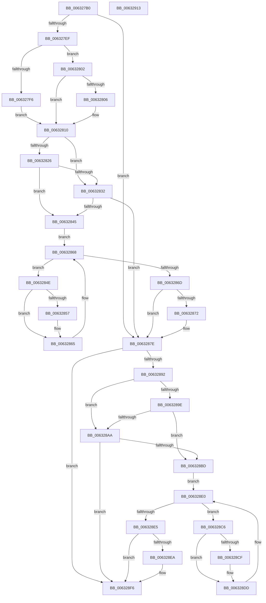

# DifKeSaveExtendedProcessorStateWrapper

- RVA: `0x006327B0`–`0x00632914` (길이 `356` bytes)
- VA: `0x00000001406327B0`
- 실행 섹션: `.text`
- PDB 이름 있음: `예`; PDB Function 태그: `아니요`
- unwind 정보 RVA: `0x00093E28`
- 디코드: `98`개 명령, `356/356` bytes 표시
- 미해석 바이트: `0` (있으면 어셈블리에 `.byte`로 보존)

> 이 문서는 커널 이미지의 기계어와 PDB 기호를 분석해 생성했습니다. 4번과 5번은 함수 원형과 자료형을 바이너리 사용 방식에서 추정한 C 해석이며 원본 소스 복구 결과는 아닙니다.

## 1. Dependencies

- 직접 호출 지점: **9**; 고유 호출 대상: **6**
- 직접 호출자로 확인된 함수: **0**
- RIP 상대 이미지 참조: **3**

### Outgoing calls
- `0x006327DE` → [DifGetAPIThunkContextById](../49/DifGetAPIThunkContextById_function_00495A34.md) (function, `0x00495A34`)
- `0x00632806` → [DifGetReturnAddressForWrappers](../4D/DifGetReturnAddressForWrappers_function_004D3C08.md) (function, `0x004D3C08`)
- `0x00632839` → [ExAcquireRundownProtection](../21/ExAcquireRundownProtection_function_00216620.md) (function, `0x00216620`)
- `0x00632860` → [guard_dispatch_icall](../6B/guard_dispatch_icall_function_006BAAD0.md) (function, `0x006BAAD0`)
- `0x00632879` → [ExReleaseRundownProtection](../34/ExReleaseRundownProtection_function_00349E80.md) (function, `0x00349E80`)
- `0x00632884` → [KeSaveExtendedProcessorState](../3D/KeSaveExtendedProcessorState_function_003D99B0.md) (function, `0x003D99B0`)
- `0x006328B1` → [ExAcquireRundownProtection](../21/ExAcquireRundownProtection_function_00216620.md) (function, `0x00216620`)
- `0x006328D8` → [guard_dispatch_icall](../6B/guard_dispatch_icall_function_006BAAD0.md) (function, `0x006BAAD0`)
- `0x006328F1` → [ExReleaseRundownProtection](../34/ExReleaseRundownProtection_function_00349E80.md) (function, `0x00349E80`)

### Direct callers
- 이 함수 시작 RVA로 연결되는 직접 call은 확인되지 않았습니다. 간접 호출은 완전히 역산할 수 없습니다.

### Static image references
- `0x00632818` → RVA `0x00F048B8` (`.data`; read)
- `0x00632826` → RVA `0x00F04980` (`.data`; read)
- `0x00632832` → RVA `0x00F03E80` (`.data`; read)

## 2. Other-region calls and transfers

- 다른 실행 섹션으로 향하는 call: **0**
- 별도 외부 분기/꼬리 이동을 확인하지 못했습니다.

## 3. Assembly (complete function range)

```asm
006327B0  48 8B C4                        mov rax, rsp
006327B3  48 89 58 08                     mov qword ptr [rax + 8], rbx
006327B7  48 89 68 10                     mov qword ptr [rax + 0x10], rbp
006327BB  48 89 70 18                     mov qword ptr [rax + 0x18], rsi
006327BF  57                              push rdi
006327C0  41 56                           push r14
006327C2  41 57                           push r15
006327C4  48 83 EC 40                     sub rsp, 0x40
006327C8  0F 57 C0                        xorps xmm0, xmm0
006327CB  4C 8B F9                        mov r15, rcx
006327CE  B9 FA 00 00 00                  mov ecx, 0xfa
006327D3  4C 8B F2                        mov r14, rdx
006327D6  0F 11 40 C8                     movups xmmword ptr [rax - 0x38], xmm0
006327DA  0F 11 40 D8                     movups xmmword ptr [rax - 0x28], xmm0
006327DE  E8 51 32 E6 FF                  call 0x140495a34
006327E3  48 8B F0                        mov rsi, rax
006327E6  48 85 C0                        test rax, rax
006327E9  0F 84 8F 00 00 00               je 0x14063287e
006327EF  8B 40 0C                        mov eax, dword ptr [rax + 0xc]
006327F2  A8 18                           test al, 0x18
006327F4  74 0C                           je 0x140632802
006327F6  48 8B 4C 24 58                  mov rcx, qword ptr [rsp + 0x58]
006327FB  48 89 4C 24 20                  mov qword ptr [rsp + 0x20], rcx
00632800  EB 0E                           jmp 0x140632810
00632802  A8 04                           test al, 4
00632804  74 0A                           je 0x140632810
00632806  E8 FD 13 EA FF                  call 0x1404d3c08
0063280B  48 89 44 24 20                  mov qword ptr [rsp + 0x20], rax
00632810  40 32 ED                        xor bpl, bpl
00632813  4C 89 7C 24 30                  mov qword ptr [rsp + 0x30], r15
00632818  40 38 2D 99 20 8D 00            cmp byte ptr [rip + 0x8d2099], bpl
0063281F  4C 89 74 24 28                  mov qword ptr [rsp + 0x28], r14
00632824  75 0C                           jne 0x140632832
00632826  F7 05 50 21 8D 00 00 08 00 00   test dword ptr [rip + 0x8d2150], 0x800
00632830  74 13                           je 0x140632845
00632832  48 8D 0D 47 16 8D 00            lea rcx, [rip + 0x8d1647]
00632839  E8 E2 3D BE FF                  call 0x140216620
0063283E  40 8A E8                        mov bpl, al
00632841  84 C0                           test al, al
00632843  74 39                           je 0x14063287e
00632845  48 8D 7E 20                     lea rdi, [rsi + 0x20]
00632849  48 8B 1F                        mov rbx, qword ptr [rdi]
0063284C  EB 1A                           jmp 0x140632868
0063284E  48 8D 43 F0                     lea rax, [rbx - 0x10]
00632852  48 85 C0                        test rax, rax
00632855  74 0E                           je 0x140632865
00632857  48 8B 40 08                     mov rax, qword ptr [rax + 8]
0063285B  48 8D 4C 24 20                  lea rcx, [rsp + 0x20]
00632860  E8 6B 82 08 00                  call 0x1406baad0
00632865  48 8B 1B                        mov rbx, qword ptr [rbx]
00632868  48 3B DF                        cmp rbx, rdi
0063286B  75 E1                           jne 0x14063284e
0063286D  40 84 ED                        test bpl, bpl
00632870  74 0C                           je 0x14063287e
00632872  48 8D 0D 07 16 8D 00            lea rcx, [rip + 0x8d1607]
00632879  E8 02 76 D1 FF                  call 0x140349e80
0063287E  49 8B D6                        mov rdx, r14
00632881  49 8B CF                        mov rcx, r15
00632884  E8 27 71 DA FF                  call 0x1403d99b0
00632889  89 44 24 38                     mov dword ptr [rsp + 0x38], eax
0063288D  48 85 F6                        test rsi, rsi
00632890  74 64                           je 0x1406328f6
00632892  40 32 FF                        xor dil, dil
00632895  40 38 3D 1C 20 8D 00            cmp byte ptr [rip + 0x8d201c], dil
0063289C  75 0C                           jne 0x1406328aa
0063289E  F7 05 D8 20 8D 00 00 08 00 00   test dword ptr [rip + 0x8d20d8], 0x800
006328A8  74 13                           je 0x1406328bd
006328AA  48 8D 0D CF 15 8D 00            lea rcx, [rip + 0x8d15cf]
006328B1  E8 6A 3D BE FF                  call 0x140216620
006328B6  40 8A F8                        mov dil, al
006328B9  84 C0                           test al, al
006328BB  74 39                           je 0x1406328f6
006328BD  48 83 C6 30                     add rsi, 0x30
006328C1  48 8B 1E                        mov rbx, qword ptr [rsi]
006328C4  EB 1A                           jmp 0x1406328e0
006328C6  48 8D 43 F0                     lea rax, [rbx - 0x10]
006328CA  48 85 C0                        test rax, rax
006328CD  74 0E                           je 0x1406328dd
006328CF  48 8B 40 08                     mov rax, qword ptr [rax + 8]
006328D3  48 8D 4C 24 20                  lea rcx, [rsp + 0x20]
006328D8  E8 F3 81 08 00                  call 0x1406baad0
006328DD  48 8B 1B                        mov rbx, qword ptr [rbx]
006328E0  48 3B DE                        cmp rbx, rsi
006328E3  75 E1                           jne 0x1406328c6
006328E5  40 84 FF                        test dil, dil
006328E8  74 0C                           je 0x1406328f6
006328EA  48 8D 0D 8F 15 8D 00            lea rcx, [rip + 0x8d158f]
006328F1  E8 8A 75 D1 FF                  call 0x140349e80
006328F6  8B 44 24 38                     mov eax, dword ptr [rsp + 0x38]
006328FA  48 8B 5C 24 60                  mov rbx, qword ptr [rsp + 0x60]
006328FF  48 8B 6C 24 68                  mov rbp, qword ptr [rsp + 0x68]
00632904  48 8B 74 24 70                  mov rsi, qword ptr [rsp + 0x70]
00632909  48 83 C4 40                     add rsp, 0x40
0063290D  41 5F                           pop r15
0063290F  41 5E                           pop r14
00632911  5F                              pop rdi
00632912  C3                              ret
00632913  CC                              int3
```

## 4. C-style interpretation (structured pseudocode)

```c
__int64 __fastcall DifKeSaveExtendedProcessorStateWrapper(__int64 a1, __int64 a2)
{
    __int64 result;
    __int64 v_rbp;
    __int64 v_rdi;
    __int64 v_rsi;
    __int64 v_rsp;
    unsigned int v_stack_m20;
    unsigned __int64 v_stack_m28;
    unsigned __int64 v_stack_m30;
    unsigned __int64 v_stack_m38;
    unsigned __int64 v_stack_p0;
    unsigned __int64 v_stack_p10;
    unsigned __int64 v_stack_p18;
    unsigned __int64 v_stack_p8;

    *(unsigned __int64 *)(v_rsp + 8) = v_rbx;
    *(unsigned __int64 *)(v_rsp + 16) = v_rbp;
    *(unsigned __int64 *)(v_rsp + 24) = v_rsi;
    v_rsp = (v_rsp) - (64);
    *(unsigned __int64 *)(v_rsp - 56) = v_xmm0;
    *(unsigned __int64 *)(v_rsp - 40) = v_xmm0;
    result = DifGetAPIThunkContextById(250, a2, a3, a4);
    if (result == 0) goto loc_0063287E;
    if ((((unsigned __int8)((unsigned int)(*(unsigned int *)(result + 12)))) & (24)) == 0) goto loc_00632802;
    v_stack_m38 = v_stack_p0;
    goto loc_00632810;
loc_00632802:
    result = (unsigned int)(*(unsigned int *)(result + 12));
    if ((((unsigned __int8)((unsigned int)(*(unsigned int *)(result + 12)))) & (4)) != 0) {
        result = DifGetReturnAddressForWrappers(v_stack_p0, a2, a3, a4);
        v_stack_m38 = result;
    }
    v_rbp = 0;
    v_stack_m28 = a1;
    v_stack_m30 = a2;
    if ((*(unsigned __int8 *)(v_rip + 9248921)) != 0) goto loc_00632832;
    if (((*(unsigned int *)(v_rip + 9249104)) & (0x800ULL)) == 0) goto loc_00632845;
loc_00632832:
    result = ExAcquireRundownProtection(v_rip + 9246279, a2, a3, a4);
    if ((unsigned __int8)(result) == 0) goto loc_0063287E;
loc_00632845:
    goto loc_00632868;
loc_0063284E:
    result = *(unsigned __int64 *)(result + 32) - 16;
    if (*(unsigned __int64 *)(result + 32) - 16 != 0) {
        result = *(unsigned __int64 *)(*(unsigned __int64 *)(result + 32) - 16 + 8);
        a1 = v_stack_m38;
        result = guard_dispatch_icall(a1, a2, a3, a4);
    }
loc_00632868:
    if ((*(unsigned __int64 *)(*(unsigned __int64 *)(result + 32))) != (result + 32)) goto loc_0063284E;
    if ((unsigned __int8)((unsigned __int8)(result)) != 0) {
        a1 = v_rip + 9246215;
        result = ExReleaseRundownProtection(a1, a2, a3, a4);
    }
    result = KeSaveExtendedProcessorState(a1, a2, a3, a4);
    v_stack_m20 = (unsigned int)(result);
    if (result == 0) goto loc_006328F6;
    v_rdi = 0;
    if ((*(unsigned __int8 *)(v_rip + 9248796)) != 0) goto loc_006328AA;
    if (((*(unsigned int *)(v_rip + 9248984)) & (0x800ULL)) == 0) goto loc_006328BD;
loc_006328AA:
    result = ExAcquireRundownProtection(v_rip + 9246159, a2, a3, a4);
    if ((unsigned __int8)(result) == 0) goto loc_006328F6;
loc_006328BD:
    v_rsi = (result) + (48);
    goto loc_006328E0;
loc_006328C6:
    result = *(unsigned __int64 *)(v_rsi) - 16;
    if (*(unsigned __int64 *)(v_rsi) - 16 != 0) {
        result = *(unsigned __int64 *)(*(unsigned __int64 *)(v_rsi) - 16 + 8);
        a1 = v_stack_m38;
        result = guard_dispatch_icall(a1, a2, a3, a4);
    }
loc_006328E0:
    if ((*(unsigned __int64 *)(*(unsigned __int64 *)(v_rsi))) != v_rsi) goto loc_006328C6;
    if ((unsigned __int8)((unsigned __int8)(result)) != 0) {
        a1 = v_rip + 9246095;
        result = ExReleaseRundownProtection(a1, a2, a3, a4);
    }
    v_rsp = (v_rsp) + (64);
    return (unsigned int)(v_stack_m20);
}
```

## 5. (Beta) C Style

```c
int64_t DifKeSaveExtendedProcessorStateWrapper(int64_t Arg1, int64_t Arg2)
{
    int64_t result;
    int64_t local_rbp;
    int64_t local_rdi;
    int64_t local_rsi;
    int64_t local_rsp;
    uint32_t v_stack_m20;
    uint64_t v_stack_m28;
    uint64_t v_stack_m30;
    uint64_t v_stack_m38;
    uint64_t v_stack_p0;
    uint64_t v_stack_p10;
    uint64_t v_stack_p18;
    uint64_t v_stack_p8;

    *(uint64_t *)(local_rsp + 0x8) = local_rbx;
    *(uint64_t *)(local_rsp + 0x10) = local_rbp;
    *(uint64_t *)(local_rsp + 0x18) = local_rsi;
    local_rsp = (local_rsp) - (64);
    *(uint64_t *)(local_rsp - 0x38) = v_xmm0;
    *(uint64_t *)(local_rsp - 0x28) = v_xmm0;
    result = DifGetAPIThunkContextById(250, Arg2, a3, a4);
    if (result == 0) goto loc_0063287E;
    if ((((uint8_t)((uint32_t)(*(uint32_t *)(result + 0xC)))) & (24)) == 0) goto loc_00632802;
    v_stack_m38 = v_stack_p0;
    goto loc_00632810;
loc_00632802:
    result = (uint32_t)(*(uint32_t *)(result + 0xC));
    if ((((uint8_t)((uint32_t)(*(uint32_t *)(result + 0xC)))) & (4)) != 0) {
        result = DifGetReturnAddressForWrappers(v_stack_p0, Arg2, a3, a4);
        v_stack_m38 = result;
    }
    local_rbp = 0;
    v_stack_m28 = Arg1;
    v_stack_m30 = Arg2;
    if ((*(uint8_t *)(v_rip + 0x8D2099)) != 0) goto loc_00632832;
    if (((*(uint32_t *)(v_rip + 0x8D2150)) & (0x800ULL)) == 0) goto loc_00632845;
loc_00632832:
    result = ExAcquireRundownProtection(v_rip + 9246279, Arg2, a3, a4);
    if ((uint8_t)(result) == 0) goto loc_0063287E;
loc_00632845:
    goto loc_00632868;
loc_0063284E:
    result = *(uint64_t *)(result + 0x20) - 16;
    if (*(uint64_t *)(result + 0x20) - 16 != 0) {
        result = *(uint64_t *)(*(uint64_t *)(result + 0x20) - 0x10 + 0x8);
        Arg1 = v_stack_m38;
        result = guard_dispatch_icall(Arg1, Arg2, a3, a4);
    }
loc_00632868:
    if ((*(uint64_t *)(*(uint64_t *)(result + 0x20))) != (result + 32)) goto loc_0063284E;
    if ((uint8_t)((uint8_t)(result)) != 0) {
        Arg1 = v_rip + 9246215;
        result = ExReleaseRundownProtection(Arg1, Arg2, a3, a4);
    }
    result = KeSaveExtendedProcessorState(Arg1, Arg2, a3, a4);
    v_stack_m20 = (uint32_t)(result);
    if (result == 0) goto loc_006328F6;
    local_rdi = 0;
    if ((*(uint8_t *)(v_rip + 0x8D201C)) != 0) goto loc_006328AA;
    if (((*(uint32_t *)(v_rip + 0x8D20D8)) & (0x800ULL)) == 0) goto loc_006328BD;
loc_006328AA:
    result = ExAcquireRundownProtection(v_rip + 9246159, Arg2, a3, a4);
    if ((uint8_t)(result) == 0) goto loc_006328F6;
loc_006328BD:
    local_rsi = (result) + (48);
    goto loc_006328E0;
loc_006328C6:
    result = *(uint64_t *)(local_rsi) - 16;
    if (*(uint64_t *)(local_rsi) - 16 != 0) {
        result = *(uint64_t *)(*(uint64_t *)(local_rsi) - 0x10 + 0x8);
        Arg1 = v_stack_m38;
        result = guard_dispatch_icall(Arg1, Arg2, a3, a4);
    }
loc_006328E0:
    if ((*(uint64_t *)(*(uint64_t *)(local_rsi))) != local_rsi) goto loc_006328C6;
    if ((uint8_t)((uint8_t)(result)) != 0) {
        Arg1 = v_rip + 9246095;
        result = ExReleaseRundownProtection(Arg1, Arg2, a3, a4);
    }
    local_rsp = (local_rsp) + (64);
    return (uint32_t)(v_stack_m20);
}
```

## 6. Execution-region graph

[열기: 2D/3D 그래프와 함수 탐색 컨트롤 패널](../../../control-panel.html?section=text&rva=0x006327B0&view=graph)

- 2D 그래프는 위에서 아래로 흐르고, 3D 그래프는 빈 공간을 드래그해 회전합니다. Shift+드래그는 이동, 휠은 확대·축소, 함수 노드 선택은 대상 보고서 이동입니다.

### Static fallback


