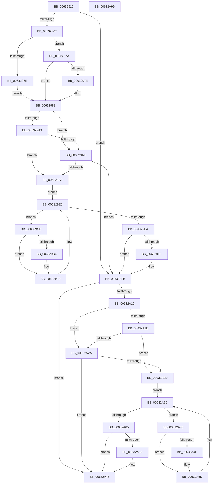

# DifKeSetEventWrapper

- RVA: `0x00632920`–`0x00632A9A` (길이 `378` bytes)
- VA: `0x0000000140632920`
- 실행 섹션: `.text`
- PDB 이름 있음: `예`; PDB Function 태그: `아니요`
- unwind 정보 RVA: `0x0008A668`
- 디코드: `103`개 명령, `378/378` bytes 표시
- 미해석 바이트: `0` (있으면 어셈블리에 `.byte`로 보존)

> 이 문서는 커널 이미지의 기계어와 PDB 기호를 분석해 생성했습니다. 4번과 5번은 함수 원형과 자료형을 바이너리 사용 방식에서 추정한 C 해석이며 원본 소스 복구 결과는 아닙니다.

## 1. Dependencies

- 직접 호출 지점: **9**; 고유 호출 대상: **6**
- 직접 호출자로 확인된 함수: **0**
- RIP 상대 이미지 참조: **3**

### Outgoing calls
- `0x00632956` → [DifGetAPIThunkContextById](../49/DifGetAPIThunkContextById_function_00495A34.md) (function, `0x00495A34`)
- `0x0063297E` → [DifGetReturnAddressForWrappers](../4D/DifGetReturnAddressForWrappers_function_004D3C08.md) (function, `0x004D3C08`)
- `0x006329B6` → [ExAcquireRundownProtection](../21/ExAcquireRundownProtection_function_00216620.md) (function, `0x00216620`)
- `0x006329DD` → [guard_dispatch_icall](../6B/guard_dispatch_icall_function_006BAAD0.md) (function, `0x006BAAD0`)
- `0x006329F6` → [ExReleaseRundownProtection](../34/ExReleaseRundownProtection_function_00349E80.md) (function, `0x00349E80`)
- `0x00632A04` → [KeSetEvent](../33/KeSetEvent_function_0033F310.md) (function, `0x0033F310`)
- `0x00632A31` → [ExAcquireRundownProtection](../21/ExAcquireRundownProtection_function_00216620.md) (function, `0x00216620`)
- `0x00632A58` → [guard_dispatch_icall](../6B/guard_dispatch_icall_function_006BAAD0.md) (function, `0x006BAAD0`)
- `0x00632A71` → [ExReleaseRundownProtection](../34/ExReleaseRundownProtection_function_00349E80.md) (function, `0x00349E80`)

### Direct callers
- 이 함수 시작 RVA로 연결되는 직접 call은 확인되지 않았습니다. 간접 호출은 완전히 역산할 수 없습니다.

### Static image references
- `0x00632990` → RVA `0x00F048B8` (`.data`; read)
- `0x006329A3` → RVA `0x00F04980` (`.data`; read)
- `0x006329AF` → RVA `0x00F03E80` (`.data`; read)

## 2. Other-region calls and transfers

- 다른 실행 섹션으로 향하는 call: **0**
- 별도 외부 분기/꼬리 이동을 확인하지 못했습니다.

## 3. Assembly (complete function range)

```asm
00632920  48 8B C4                        mov rax, rsp
00632923  48 89 58 08                     mov qword ptr [rax + 8], rbx
00632927  48 89 68 10                     mov qword ptr [rax + 0x10], rbp
0063292B  48 89 70 18                     mov qword ptr [rax + 0x18], rsi
0063292F  48 89 78 20                     mov qword ptr [rax + 0x20], rdi
00632933  41 54                           push r12
00632935  41 56                           push r14
00632937  41 57                           push r15
00632939  48 83 EC 40                     sub rsp, 0x40
0063293D  0F 57 C0                        xorps xmm0, xmm0
00632940  4C 8B E1                        mov r12, rcx
00632943  B9 F9 00 00 00                  mov ecx, 0xf9
00632948  45 8A F0                        mov r14b, r8b
0063294B  0F 11 40 C8                     movups xmmword ptr [rax - 0x38], xmm0
0063294F  44 8B FA                        mov r15d, edx
00632952  0F 11 40 D8                     movups xmmword ptr [rax - 0x28], xmm0
00632956  E8 D9 30 E6 FF                  call 0x140495a34
0063295B  48 8B F0                        mov rsi, rax
0063295E  48 85 C0                        test rax, rax
00632961  0F 84 94 00 00 00               je 0x1406329fb
00632967  8B 40 0C                        mov eax, dword ptr [rax + 0xc]
0063296A  A8 18                           test al, 0x18
0063296C  74 0C                           je 0x14063297a
0063296E  48 8B 4C 24 58                  mov rcx, qword ptr [rsp + 0x58]
00632973  48 89 4C 24 20                  mov qword ptr [rsp + 0x20], rcx
00632978  EB 0E                           jmp 0x140632988
0063297A  A8 04                           test al, 4
0063297C  74 0A                           je 0x140632988
0063297E  E8 85 12 EA FF                  call 0x1404d3c08
00632983  48 89 44 24 20                  mov qword ptr [rsp + 0x20], rax
00632988  40 32 ED                        xor bpl, bpl
0063298B  4C 89 64 24 30                  mov qword ptr [rsp + 0x30], r12
00632990  40 38 2D 21 1F 8D 00            cmp byte ptr [rip + 0x8d1f21], bpl
00632997  44 89 7C 24 2C                  mov dword ptr [rsp + 0x2c], r15d
0063299C  44 88 74 24 28                  mov byte ptr [rsp + 0x28], r14b
006329A1  75 0C                           jne 0x1406329af
006329A3  F7 05 D3 1F 8D 00 00 08 00 00   test dword ptr [rip + 0x8d1fd3], 0x800
006329AD  74 13                           je 0x1406329c2
006329AF  48 8D 0D CA 14 8D 00            lea rcx, [rip + 0x8d14ca]
006329B6  E8 65 3C BE FF                  call 0x140216620
006329BB  40 8A E8                        mov bpl, al
006329BE  84 C0                           test al, al
006329C0  74 39                           je 0x1406329fb
006329C2  48 8D 7E 20                     lea rdi, [rsi + 0x20]
006329C6  48 8B 1F                        mov rbx, qword ptr [rdi]
006329C9  EB 1A                           jmp 0x1406329e5
006329CB  48 8D 43 F0                     lea rax, [rbx - 0x10]
006329CF  48 85 C0                        test rax, rax
006329D2  74 0E                           je 0x1406329e2
006329D4  48 8B 40 08                     mov rax, qword ptr [rax + 8]
006329D8  48 8D 4C 24 20                  lea rcx, [rsp + 0x20]
006329DD  E8 EE 80 08 00                  call 0x1406baad0
006329E2  48 8B 1B                        mov rbx, qword ptr [rbx]
006329E5  48 3B DF                        cmp rbx, rdi
006329E8  75 E1                           jne 0x1406329cb
006329EA  40 84 ED                        test bpl, bpl
006329ED  74 0C                           je 0x1406329fb
006329EF  48 8D 0D 8A 14 8D 00            lea rcx, [rip + 0x8d148a]
006329F6  E8 85 74 D1 FF                  call 0x140349e80
006329FB  45 8A C6                        mov r8b, r14b
006329FE  41 8B D7                        mov edx, r15d
00632A01  49 8B CC                        mov rcx, r12
00632A04  E8 07 C9 D0 FF                  call 0x14033f310
00632A09  89 44 24 38                     mov dword ptr [rsp + 0x38], eax
00632A0D  48 85 F6                        test rsi, rsi
00632A10  74 64                           je 0x140632a76
00632A12  40 32 FF                        xor dil, dil
00632A15  40 38 3D 9C 1E 8D 00            cmp byte ptr [rip + 0x8d1e9c], dil
00632A1C  75 0C                           jne 0x140632a2a
00632A1E  F7 05 58 1F 8D 00 00 08 00 00   test dword ptr [rip + 0x8d1f58], 0x800
00632A28  74 13                           je 0x140632a3d
00632A2A  48 8D 0D 4F 14 8D 00            lea rcx, [rip + 0x8d144f]
00632A31  E8 EA 3B BE FF                  call 0x140216620
00632A36  40 8A F8                        mov dil, al
00632A39  84 C0                           test al, al
00632A3B  74 39                           je 0x140632a76
00632A3D  48 83 C6 30                     add rsi, 0x30
00632A41  48 8B 1E                        mov rbx, qword ptr [rsi]
00632A44  EB 1A                           jmp 0x140632a60
00632A46  48 8D 43 F0                     lea rax, [rbx - 0x10]
00632A4A  48 85 C0                        test rax, rax
00632A4D  74 0E                           je 0x140632a5d
00632A4F  48 8B 40 08                     mov rax, qword ptr [rax + 8]
00632A53  48 8D 4C 24 20                  lea rcx, [rsp + 0x20]
00632A58  E8 73 80 08 00                  call 0x1406baad0
00632A5D  48 8B 1B                        mov rbx, qword ptr [rbx]
00632A60  48 3B DE                        cmp rbx, rsi
00632A63  75 E1                           jne 0x140632a46
00632A65  40 84 FF                        test dil, dil
00632A68  74 0C                           je 0x140632a76
00632A6A  48 8D 0D 0F 14 8D 00            lea rcx, [rip + 0x8d140f]
00632A71  E8 0A 74 D1 FF                  call 0x140349e80
00632A76  8B 44 24 38                     mov eax, dword ptr [rsp + 0x38]
00632A7A  48 8B 5C 24 60                  mov rbx, qword ptr [rsp + 0x60]
00632A7F  48 8B 6C 24 68                  mov rbp, qword ptr [rsp + 0x68]
00632A84  48 8B 74 24 70                  mov rsi, qword ptr [rsp + 0x70]
00632A89  48 8B 7C 24 78                  mov rdi, qword ptr [rsp + 0x78]
00632A8E  48 83 C4 40                     add rsp, 0x40
00632A92  41 5F                           pop r15
00632A94  41 5E                           pop r14
00632A96  41 5C                           pop r12
00632A98  C3                              ret
00632A99  CC                              int3
```

## 4. C-style interpretation (structured pseudocode)

```c
__int64 __fastcall DifKeSetEventWrapper(__int64 a1, int a2, unsigned __int8 a3)
{
    __int64 result;
    __int64 v_rbp;
    __int64 v_rdi;
    __int64 v_rsi;
    __int64 v_rsp;
    unsigned int v_stack_m20;
    unsigned __int64 v_stack_m28;
    unsigned int v_stack_m2C;
    unsigned __int8 v_stack_m30;
    unsigned __int64 v_stack_m38;
    unsigned __int64 v_stack_p0;
    unsigned __int64 v_stack_p10;
    unsigned __int64 v_stack_p18;
    unsigned __int64 v_stack_p20;
    unsigned __int64 v_stack_p8;

    *(unsigned __int64 *)(v_rsp + 8) = v_rbx;
    *(unsigned __int64 *)(v_rsp + 16) = v_rbp;
    *(unsigned __int64 *)(v_rsp + 24) = v_rsi;
    *(unsigned __int64 *)(v_rsp + 32) = v_rdi;
    v_rsp = (v_rsp) - (64);
    *(unsigned __int64 *)(v_rsp - 56) = v_xmm0;
    *(unsigned __int64 *)(v_rsp - 40) = v_xmm0;
    result = DifGetAPIThunkContextById(249, a2, a3, a4);
    if (result == 0) goto loc_006329FB;
    if ((((unsigned __int8)((unsigned int)(*(unsigned int *)(result + 12)))) & (24)) == 0) goto loc_0063297A;
    v_stack_m38 = v_stack_p0;
    goto loc_00632988;
loc_0063297A:
    result = (unsigned int)(*(unsigned int *)(result + 12));
    if ((((unsigned __int8)((unsigned int)(*(unsigned int *)(result + 12)))) & (4)) != 0) {
        result = DifGetReturnAddressForWrappers(v_stack_p0, a2, a3, a4);
        v_stack_m38 = result;
    }
    v_rbp = 0;
    v_stack_m28 = a1;
    v_stack_m2C = (unsigned int)((unsigned int)(a2));
    v_stack_m30 = a3;
    if ((*(unsigned __int8 *)(v_rip + 9248545)) != 0) goto loc_006329AF;
    if (((*(unsigned int *)(v_rip + 9248723)) & (0x800ULL)) == 0) goto loc_006329C2;
loc_006329AF:
    result = ExAcquireRundownProtection(v_rip + 9245898, a2, a3, a4);
    if ((unsigned __int8)(result) == 0) goto loc_006329FB;
loc_006329C2:
    goto loc_006329E5;
loc_006329CB:
    result = *(unsigned __int64 *)(result + 32) - 16;
    if (*(unsigned __int64 *)(result + 32) - 16 != 0) {
        result = *(unsigned __int64 *)(*(unsigned __int64 *)(result + 32) - 16 + 8);
        a1 = v_stack_m38;
        result = guard_dispatch_icall(a1, a2, a3, a4);
    }
loc_006329E5:
    if ((*(unsigned __int64 *)(*(unsigned __int64 *)(result + 32))) != (result + 32)) goto loc_006329CB;
    if ((unsigned __int8)((unsigned __int8)(result)) != 0) {
        a1 = v_rip + 9245834;
        result = ExReleaseRundownProtection(a1, a2, a3, a4);
    }
    result = KeSetEvent(a1, (unsigned int)((unsigned int)((unsigned int)(a2))), a3, a4);
    v_stack_m20 = (unsigned int)(result);
    if (result == 0) goto loc_00632A76;
    v_rdi = 0;
    if ((*(unsigned __int8 *)(v_rip + 9248412)) != 0) goto loc_00632A2A;
    if (((*(unsigned int *)(v_rip + 9248600)) & (0x800ULL)) == 0) goto loc_00632A3D;
loc_00632A2A:
    result = ExAcquireRundownProtection(v_rip + 9245775, (unsigned int)((unsigned int)((unsigned int)(a2))), a3, a4);
    if ((unsigned __int8)(result) == 0) goto loc_00632A76;
loc_00632A3D:
    v_rsi = (result) + (48);
    goto loc_00632A60;
loc_00632A46:
    result = *(unsigned __int64 *)(v_rsi) - 16;
    if (*(unsigned __int64 *)(v_rsi) - 16 != 0) {
        result = *(unsigned __int64 *)(*(unsigned __int64 *)(v_rsi) - 16 + 8);
        a1 = v_stack_m38;
        result = guard_dispatch_icall(a1, (unsigned int)((unsigned int)((unsigned int)(a2))), a3, a4);
    }
loc_00632A60:
    if ((*(unsigned __int64 *)(*(unsigned __int64 *)(v_rsi))) != v_rsi) goto loc_00632A46;
    if ((unsigned __int8)((unsigned __int8)(result)) != 0) {
        a1 = v_rip + 9245711;
        result = ExReleaseRundownProtection(a1, (unsigned int)((unsigned int)((unsigned int)(a2))), a3, a4);
    }
    v_rsp = (v_rsp) + (64);
    return (unsigned int)(v_stack_m20);
}
```

## 5. (Beta) C Style

```c
int64_t DifKeSetEventWrapper(int64_t Arg1, int32_t Arg2, uint8_t Arg3)
{
    int64_t result;
    int64_t local_rbp;
    int64_t local_rdi;
    int64_t local_rsi;
    int64_t local_rsp;
    uint32_t v_stack_m20;
    uint64_t v_stack_m28;
    uint32_t v_stack_m2C;
    uint8_t v_stack_m30;
    uint64_t v_stack_m38;
    uint64_t v_stack_p0;
    uint64_t v_stack_p10;
    uint64_t v_stack_p18;
    uint64_t v_stack_p20;
    uint64_t v_stack_p8;

    *(uint64_t *)(local_rsp + 0x8) = local_rbx;
    *(uint64_t *)(local_rsp + 0x10) = local_rbp;
    *(uint64_t *)(local_rsp + 0x18) = local_rsi;
    *(uint64_t *)(local_rsp + 0x20) = local_rdi;
    local_rsp = (local_rsp) - (64);
    *(uint64_t *)(local_rsp - 0x38) = v_xmm0;
    *(uint64_t *)(local_rsp - 0x28) = v_xmm0;
    result = DifGetAPIThunkContextById(249, Arg2, Arg3, a4);
    if (result == 0) goto loc_006329FB;
    if ((((uint8_t)((uint32_t)(*(uint32_t *)(result + 0xC)))) & (24)) == 0) goto loc_0063297A;
    v_stack_m38 = v_stack_p0;
    goto loc_00632988;
loc_0063297A:
    result = (uint32_t)(*(uint32_t *)(result + 0xC));
    if ((((uint8_t)((uint32_t)(*(uint32_t *)(result + 0xC)))) & (4)) != 0) {
        result = DifGetReturnAddressForWrappers(v_stack_p0, Arg2, Arg3, a4);
        v_stack_m38 = result;
    }
    local_rbp = 0;
    v_stack_m28 = Arg1;
    v_stack_m2C = (uint32_t)((uint32_t)(Arg2));
    v_stack_m30 = Arg3;
    if ((*(uint8_t *)(v_rip + 0x8D1F21)) != 0) goto loc_006329AF;
    if (((*(uint32_t *)(v_rip + 0x8D1FD3)) & (0x800ULL)) == 0) goto loc_006329C2;
loc_006329AF:
    result = ExAcquireRundownProtection(v_rip + 9245898, Arg2, Arg3, a4);
    if ((uint8_t)(result) == 0) goto loc_006329FB;
loc_006329C2:
    goto loc_006329E5;
loc_006329CB:
    result = *(uint64_t *)(result + 0x20) - 16;
    if (*(uint64_t *)(result + 0x20) - 16 != 0) {
        result = *(uint64_t *)(*(uint64_t *)(result + 0x20) - 0x10 + 0x8);
        Arg1 = v_stack_m38;
        result = guard_dispatch_icall(Arg1, Arg2, Arg3, a4);
    }
loc_006329E5:
    if ((*(uint64_t *)(*(uint64_t *)(result + 0x20))) != (result + 32)) goto loc_006329CB;
    if ((uint8_t)((uint8_t)(result)) != 0) {
        Arg1 = v_rip + 9245834;
        result = ExReleaseRundownProtection(Arg1, Arg2, Arg3, a4);
    }
    result = KeSetEvent(Arg1, (uint32_t)((uint32_t)((uint32_t)(Arg2))), Arg3, a4);
    v_stack_m20 = (uint32_t)(result);
    if (result == 0) goto loc_00632A76;
    local_rdi = 0;
    if ((*(uint8_t *)(v_rip + 0x8D1E9C)) != 0) goto loc_00632A2A;
    if (((*(uint32_t *)(v_rip + 0x8D1F58)) & (0x800ULL)) == 0) goto loc_00632A3D;
loc_00632A2A:
    result = ExAcquireRundownProtection(v_rip + 9245775, (uint32_t)((uint32_t)((uint32_t)(Arg2))), Arg3, a4);
    if ((uint8_t)(result) == 0) goto loc_00632A76;
loc_00632A3D:
    local_rsi = (result) + (48);
    goto loc_00632A60;
loc_00632A46:
    result = *(uint64_t *)(local_rsi) - 16;
    if (*(uint64_t *)(local_rsi) - 16 != 0) {
        result = *(uint64_t *)(*(uint64_t *)(local_rsi) - 0x10 + 0x8);
        Arg1 = v_stack_m38;
        result = guard_dispatch_icall(Arg1, (uint32_t)((uint32_t)((uint32_t)(Arg2))), Arg3, a4);
    }
loc_00632A60:
    if ((*(uint64_t *)(*(uint64_t *)(local_rsi))) != local_rsi) goto loc_00632A46;
    if ((uint8_t)((uint8_t)(result)) != 0) {
        Arg1 = v_rip + 9245711;
        result = ExReleaseRundownProtection(Arg1, (uint32_t)((uint32_t)((uint32_t)(Arg2))), Arg3, a4);
    }
    local_rsp = (local_rsp) + (64);
    return (uint32_t)(v_stack_m20);
}
```

## 6. Execution-region graph

[열기: 2D/3D 그래프와 함수 탐색 컨트롤 패널](../../../control-panel.html?section=text&rva=0x00632920&view=graph)

- 2D 그래프는 위에서 아래로 흐르고, 3D 그래프는 빈 공간을 드래그해 회전합니다. Shift+드래그는 이동, 휠은 확대·축소, 함수 노드 선택은 대상 보고서 이동입니다.

### Static fallback


