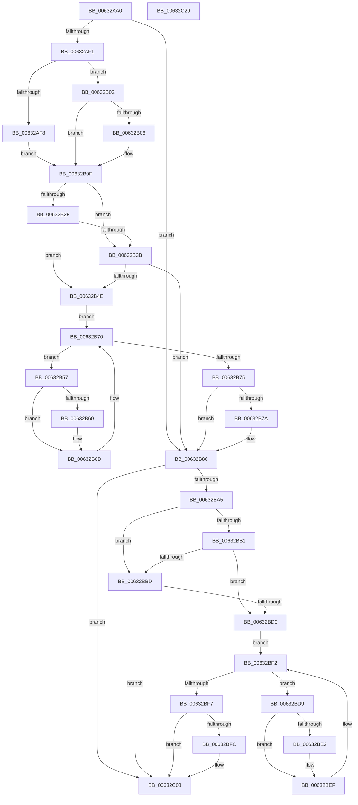

# DifKeSetTimerExWrapper

- RVA: `0x00632AA0`–`0x00632C2A` (길이 `394` bytes)
- VA: `0x0000000140632AA0`
- 실행 섹션: `.text`
- PDB 이름 있음: `예`; PDB Function 태그: `아니요`
- unwind 정보 RVA: `0x000D2BBC`
- 디코드: `113`개 명령, `394/394` bytes 표시
- 미해석 바이트: `0` (있으면 어셈블리에 `.byte`로 보존)

> 이 문서는 커널 이미지의 기계어와 PDB 기호를 분석해 생성했습니다. 4번과 5번은 함수 원형과 자료형을 바이너리 사용 방식에서 추정한 C 해석이며 원본 소스 복구 결과는 아닙니다.

## 1. Dependencies

- 직접 호출 지점: **9**; 고유 호출 대상: **6**
- 직접 호출자로 확인된 함수: **0**
- RIP 상대 이미지 참조: **3**

### Outgoing calls
- `0x00632AE0` → [DifGetAPIThunkContextById](../49/DifGetAPIThunkContextById_function_00495A34.md) (function, `0x00495A34`)
- `0x00632B06` → [DifGetReturnAddressForWrappers](../4D/DifGetReturnAddressForWrappers_function_004D3C08.md) (function, `0x004D3C08`)
- `0x00632B42` → [ExAcquireRundownProtection](../21/ExAcquireRundownProtection_function_00216620.md) (function, `0x00216620`)
- `0x00632B68` → [guard_dispatch_icall](../6B/guard_dispatch_icall_function_006BAAD0.md) (function, `0x006BAAD0`)
- `0x00632B81` → [ExReleaseRundownProtection](../34/ExReleaseRundownProtection_function_00349E80.md) (function, `0x00349E80`)
- `0x00632B98` → [KiSetTimerEx](../23/KiSetTimerEx_function_00232CB0.md) (function, `0x00232CB0`)
- `0x00632BC4` → [ExAcquireRundownProtection](../21/ExAcquireRundownProtection_function_00216620.md) (function, `0x00216620`)
- `0x00632BEA` → [guard_dispatch_icall](../6B/guard_dispatch_icall_function_006BAAD0.md) (function, `0x006BAAD0`)
- `0x00632C03` → [ExReleaseRundownProtection](../34/ExReleaseRundownProtection_function_00349E80.md) (function, `0x00349E80`)

### Direct callers
- 이 함수 시작 RVA로 연결되는 직접 call은 확인되지 않았습니다. 간접 호출은 완전히 역산할 수 없습니다.

### Static image references
- `0x00632B16` → RVA `0x00F048B8` (`.data`; read)
- `0x00632B2F` → RVA `0x00F04980` (`.data`; read)
- `0x00632B3B` → RVA `0x00F03E80` (`.data`; read)

## 2. Other-region calls and transfers

- 다른 실행 섹션으로 향하는 call: **0**
- 별도 외부 분기/꼬리 이동을 확인하지 못했습니다.

## 3. Assembly (complete function range)

```asm
00632AA0  48 8B C4                        mov rax, rsp
00632AA3  48 89 58 10                     mov qword ptr [rax + 0x10], rbx
00632AA7  48 89 70 18                     mov qword ptr [rax + 0x18], rsi
00632AAB  48 89 78 20                     mov qword ptr [rax + 0x20], rdi
00632AAF  48 89 48 08                     mov qword ptr [rax + 8], rcx
00632AB3  55                              push rbp
00632AB4  41 54                           push r12
00632AB6  41 55                           push r13
00632AB8  41 56                           push r14
00632ABA  41 57                           push r15
00632ABC  48 8B EC                        mov rbp, rsp
00632ABF  48 83 EC 60                     sub rsp, 0x60
00632AC3  0F 57 C0                        xorps xmm0, xmm0
00632AC6  B9 F7 00 00 00                  mov ecx, 0xf7
00632ACB  0F 11 45 D0                     movups xmmword ptr [rbp - 0x30], xmm0
00632ACF  4D 8B E1                        mov r12, r9
00632AD2  45 8B E8                        mov r13d, r8d
00632AD5  0F 11 45 E0                     movups xmmword ptr [rbp - 0x20], xmm0
00632AD9  48 8B DA                        mov rbx, rdx
00632ADC  0F 11 45 F0                     movups xmmword ptr [rbp - 0x10], xmm0
00632AE0  E8 4F 2F E6 FF                  call 0x140495a34
00632AE5  4C 8B F0                        mov r14, rax
00632AE8  48 85 C0                        test rax, rax
00632AEB  0F 84 95 00 00 00               je 0x140632b86
00632AF1  8B 40 0C                        mov eax, dword ptr [rax + 0xc]
00632AF4  A8 18                           test al, 0x18
00632AF6  74 0A                           je 0x140632b02
00632AF8  48 8B 4D 28                     mov rcx, qword ptr [rbp + 0x28]
00632AFC  48 89 4D D0                     mov qword ptr [rbp - 0x30], rcx
00632B00  EB 0D                           jmp 0x140632b0f
00632B02  A8 04                           test al, 4
00632B04  74 09                           je 0x140632b0f
00632B06  E8 FD 10 EA FF                  call 0x1404d3c08
00632B0B  48 89 45 D0                     mov qword ptr [rbp - 0x30], rax
00632B0F  48 8B 45 30                     mov rax, qword ptr [rbp + 0x30]
00632B13  45 32 FF                        xor r15b, r15b
00632B16  44 38 3D 9B 1D 8D 00            cmp byte ptr [rip + 0x8d1d9b], r15b
00632B1D  48 89 45 F0                     mov qword ptr [rbp - 0x10], rax
00632B21  48 89 5D E8                     mov qword ptr [rbp - 0x18], rbx
00632B25  44 89 6D E0                     mov dword ptr [rbp - 0x20], r13d
00632B29  4C 89 65 D8                     mov qword ptr [rbp - 0x28], r12
00632B2D  75 0C                           jne 0x140632b3b
00632B2F  F7 05 47 1E 8D 00 00 08 00 00   test dword ptr [rip + 0x8d1e47], 0x800
00632B39  74 13                           je 0x140632b4e
00632B3B  48 8D 0D 3E 13 8D 00            lea rcx, [rip + 0x8d133e]
00632B42  E8 D9 3A BE FF                  call 0x140216620
00632B47  44 8A F8                        mov r15b, al
00632B4A  84 C0                           test al, al
00632B4C  74 38                           je 0x140632b86
00632B4E  49 8D 76 20                     lea rsi, [r14 + 0x20]
00632B52  48 8B 3E                        mov rdi, qword ptr [rsi]
00632B55  EB 19                           jmp 0x140632b70
00632B57  48 8D 47 F0                     lea rax, [rdi - 0x10]
00632B5B  48 85 C0                        test rax, rax
00632B5E  74 0D                           je 0x140632b6d
00632B60  48 8B 40 08                     mov rax, qword ptr [rax + 8]
00632B64  48 8D 4D D0                     lea rcx, [rbp - 0x30]
00632B68  E8 63 7F 08 00                  call 0x1406baad0
00632B6D  48 8B 3F                        mov rdi, qword ptr [rdi]
00632B70  48 3B FE                        cmp rdi, rsi
00632B73  75 E2                           jne 0x140632b57
00632B75  45 84 FF                        test r15b, r15b
00632B78  74 0C                           je 0x140632b86
00632B7A  48 8D 0D FF 12 8D 00            lea rcx, [rip + 0x8d12ff]
00632B81  E8 FA 72 D1 FF                  call 0x140349e80
00632B86  48 8B 4D 30                     mov rcx, qword ptr [rbp + 0x30]
00632B8A  45 33 C9                        xor r9d, r9d
00632B8D  45 8B C5                        mov r8d, r13d
00632B90  4C 89 64 24 20                  mov qword ptr [rsp + 0x20], r12
00632B95  48 8B D3                        mov rdx, rbx
00632B98  E8 13 01 C0 FF                  call 0x140232cb0
00632B9D  88 45 F8                        mov byte ptr [rbp - 8], al
00632BA0  4D 85 F6                        test r14, r14
00632BA3  74 63                           je 0x140632c08
00632BA5  40 32 FF                        xor dil, dil
00632BA8  40 38 3D 09 1D 8D 00            cmp byte ptr [rip + 0x8d1d09], dil
00632BAF  75 0C                           jne 0x140632bbd
00632BB1  F7 05 C5 1D 8D 00 00 08 00 00   test dword ptr [rip + 0x8d1dc5], 0x800
00632BBB  74 13                           je 0x140632bd0
00632BBD  48 8D 0D BC 12 8D 00            lea rcx, [rip + 0x8d12bc]
00632BC4  E8 57 3A BE FF                  call 0x140216620
00632BC9  40 8A F8                        mov dil, al
00632BCC  84 C0                           test al, al
00632BCE  74 38                           je 0x140632c08
00632BD0  49 8D 76 30                     lea rsi, [r14 + 0x30]
00632BD4  48 8B 1E                        mov rbx, qword ptr [rsi]
00632BD7  EB 19                           jmp 0x140632bf2
00632BD9  48 8D 43 F0                     lea rax, [rbx - 0x10]
00632BDD  48 85 C0                        test rax, rax
00632BE0  74 0D                           je 0x140632bef
00632BE2  48 8B 40 08                     mov rax, qword ptr [rax + 8]
00632BE6  48 8D 4D D0                     lea rcx, [rbp - 0x30]
00632BEA  E8 E1 7E 08 00                  call 0x1406baad0
00632BEF  48 8B 1B                        mov rbx, qword ptr [rbx]
00632BF2  48 3B DE                        cmp rbx, rsi
00632BF5  75 E2                           jne 0x140632bd9
00632BF7  40 84 FF                        test dil, dil
00632BFA  74 0C                           je 0x140632c08
00632BFC  48 8D 0D 7D 12 8D 00            lea rcx, [rip + 0x8d127d]
00632C03  E8 78 72 D1 FF                  call 0x140349e80
00632C08  8A 45 F8                        mov al, byte ptr [rbp - 8]
00632C0B  4C 8D 5C 24 60                  lea r11, [rsp + 0x60]
00632C10  49 8B 5B 38                     mov rbx, qword ptr [r11 + 0x38]
00632C14  49 8B 73 40                     mov rsi, qword ptr [r11 + 0x40]
00632C18  49 8B 7B 48                     mov rdi, qword ptr [r11 + 0x48]
00632C1C  49 8B E3                        mov rsp, r11
00632C1F  41 5F                           pop r15
00632C21  41 5E                           pop r14
00632C23  41 5D                           pop r13
00632C25  41 5C                           pop r12
00632C27  5D                              pop rbp
00632C28  C3                              ret
00632C29  CC                              int3
```

## 4. C-style interpretation (structured pseudocode)

```c
__int64 __fastcall DifKeSetTimerExWrapper(__int64 a1, __int64 a2, int a3, __int64 a4)
{
    __int64 result;
    __int64 v_r15;
    __int64 v_rdi;
    __int64 v_rsp;
    unsigned __int64 v_stack_m28;
    unsigned __int8 v_stack_m30;
    unsigned __int64 v_stack_m38;
    unsigned __int64 v_stack_m40;
    unsigned __int64 v_stack_m48;
    unsigned __int64 v_stack_m50;
    unsigned __int64 v_stack_m58;
    unsigned __int64 v_stack_m68;
    unsigned __int64 v_stack_p0;
    unsigned __int64 v_stack_p8;

    *(unsigned __int64 *)(v_rsp + 16) = v_rbx;
    *(unsigned __int64 *)(v_rsp + 24) = v_rsi;
    *(unsigned __int64 *)(v_rsp + 32) = v_rdi;
    *(unsigned __int64 *)(v_rsp + 8) = a1;
    v_rsp = (v_rsp) - (96);
    v_stack_m58 = v_xmm0;
    v_stack_m48 = v_xmm0;
    v_stack_m38 = v_xmm0;
    result = DifGetAPIThunkContextById(247, a2, a3, a4);
    if (result == 0) goto loc_00632B86;
    if ((((unsigned __int8)((unsigned int)(*(unsigned int *)(result + 12)))) & (24)) == 0) goto loc_00632B02;
    v_stack_m58 = v_stack_p0;
    goto loc_00632B0F;
loc_00632B02:
    result = (unsigned int)(*(unsigned int *)(result + 12));
    if ((((unsigned __int8)((unsigned int)(*(unsigned int *)(result + 12)))) & (4)) != 0) {
        result = DifGetReturnAddressForWrappers(v_stack_p0, a2, a3, a4);
        v_stack_m58 = result;
    }
    v_r15 = 0;
    v_stack_m38 = v_stack_p8;
    v_stack_m40 = a2;
    v_stack_m48 = (unsigned int)((unsigned int)(a3));
    v_stack_m50 = a4;
    if ((*(unsigned __int8 *)(v_rip + 9248155)) != 0) goto loc_00632B3B;
    if (((*(unsigned int *)(v_rip + 9248327)) & (0x800ULL)) == 0) goto loc_00632B4E;
loc_00632B3B:
    result = ExAcquireRundownProtection(v_rip + 9245502, a2, a3, a4);
    if ((unsigned __int8)(result) == 0) goto loc_00632B86;
loc_00632B4E:
    goto loc_00632B70;
loc_00632B57:
    result = *(unsigned __int64 *)(result + 32) - 16;
    if (*(unsigned __int64 *)(result + 32) - 16 != 0) {
        result = *(unsigned __int64 *)(*(unsigned __int64 *)(result + 32) - 16 + 8);
        a1 = v_stack_m58;
        result = guard_dispatch_icall(a1, a2, a3, a4);
    }
loc_00632B70:
    if ((*(unsigned __int64 *)(*(unsigned __int64 *)(result + 32))) != (result + 32)) goto loc_00632B57;
    if ((unsigned __int8)((unsigned __int8)(result)) != 0) {
        a1 = v_rip + 9245439;
        result = ExReleaseRundownProtection(a1, a2, a3, a4);
    }
    a4 = 0;
    v_stack_m68 = 0;
    result = KiSetTimerEx(v_stack_p8, a2, (unsigned int)((unsigned int)((unsigned int)(a3))), a4);
    v_stack_m30 = (unsigned __int8)(result);
    if (result == 0) goto loc_00632C08;
    v_rdi = 0;
    if ((*(unsigned __int8 *)(v_rip + 9248009)) != 0) goto loc_00632BBD;
    if (((*(unsigned int *)(v_rip + 9248197)) & (0x800ULL)) == 0) goto loc_00632BD0;
loc_00632BBD:
    result = ExAcquireRundownProtection(v_rip + 9245372, a2, (unsigned int)((unsigned int)((unsigned int)(a3))), a4);
    if ((unsigned __int8)(result) == 0) goto loc_00632C08;
loc_00632BD0:
    goto loc_00632BF2;
loc_00632BD9:
    result = *(unsigned __int64 *)(result + 48) - 16;
    if (*(unsigned __int64 *)(result + 48) - 16 != 0) {
        result = *(unsigned __int64 *)(*(unsigned __int64 *)(result + 48) - 16 + 8);
        a1 = v_stack_m58;
        result = guard_dispatch_icall(a1, a2, (unsigned int)((unsigned int)((unsigned int)(a3))), a4);
    }
loc_00632BF2:
    if ((*(unsigned __int64 *)(*(unsigned __int64 *)(result + 48))) != (result + 48)) goto loc_00632BD9;
    if ((unsigned __int8)((unsigned __int8)(result)) != 0) {
        a1 = v_rip + 9245309;
        result = ExReleaseRundownProtection(a1, a2, (unsigned int)((unsigned int)((unsigned int)(a3))), a4);
    }
    return v_stack_m30;
}
```

## 5. (Beta) C Style

```c
int64_t DifKeSetTimerExWrapper(int64_t Arg1, int64_t Arg2, int32_t Arg3, int64_t Arg4)
{
    int64_t result;
    int64_t local_r15;
    int64_t local_rdi;
    int64_t local_rsp;
    uint64_t v_stack_m28;
    uint8_t v_stack_m30;
    uint64_t v_stack_m38;
    uint64_t v_stack_m40;
    uint64_t v_stack_m48;
    uint64_t v_stack_m50;
    uint64_t v_stack_m58;
    uint64_t v_stack_m68;
    uint64_t v_stack_p0;
    uint64_t v_stack_p8;

    *(uint64_t *)(local_rsp + 0x10) = local_rbx;
    *(uint64_t *)(local_rsp + 0x18) = local_rsi;
    *(uint64_t *)(local_rsp + 0x20) = local_rdi;
    *(uint64_t *)(local_rsp + 0x8) = Arg1;
    local_rsp = (local_rsp) - (96);
    v_stack_m58 = v_xmm0;
    v_stack_m48 = v_xmm0;
    v_stack_m38 = v_xmm0;
    result = DifGetAPIThunkContextById(247, Arg2, Arg3, Arg4);
    if (result == 0) goto loc_00632B86;
    if ((((uint8_t)((uint32_t)(*(uint32_t *)(result + 0xC)))) & (24)) == 0) goto loc_00632B02;
    v_stack_m58 = v_stack_p0;
    goto loc_00632B0F;
loc_00632B02:
    result = (uint32_t)(*(uint32_t *)(result + 0xC));
    if ((((uint8_t)((uint32_t)(*(uint32_t *)(result + 0xC)))) & (4)) != 0) {
        result = DifGetReturnAddressForWrappers(v_stack_p0, Arg2, Arg3, Arg4);
        v_stack_m58 = result;
    }
    local_r15 = 0;
    v_stack_m38 = v_stack_p8;
    v_stack_m40 = Arg2;
    v_stack_m48 = (uint32_t)((uint32_t)(Arg3));
    v_stack_m50 = Arg4;
    if ((*(uint8_t *)(v_rip + 0x8D1D9B)) != 0) goto loc_00632B3B;
    if (((*(uint32_t *)(v_rip + 0x8D1E47)) & (0x800ULL)) == 0) goto loc_00632B4E;
loc_00632B3B:
    result = ExAcquireRundownProtection(v_rip + 9245502, Arg2, Arg3, Arg4);
    if ((uint8_t)(result) == 0) goto loc_00632B86;
loc_00632B4E:
    goto loc_00632B70;
loc_00632B57:
    result = *(uint64_t *)(result + 0x20) - 16;
    if (*(uint64_t *)(result + 0x20) - 16 != 0) {
        result = *(uint64_t *)(*(uint64_t *)(result + 0x20) - 0x10 + 0x8);
        Arg1 = v_stack_m58;
        result = guard_dispatch_icall(Arg1, Arg2, Arg3, Arg4);
    }
loc_00632B70:
    if ((*(uint64_t *)(*(uint64_t *)(result + 0x20))) != (result + 32)) goto loc_00632B57;
    if ((uint8_t)((uint8_t)(result)) != 0) {
        Arg1 = v_rip + 9245439;
        result = ExReleaseRundownProtection(Arg1, Arg2, Arg3, Arg4);
    }
    Arg4 = 0;
    v_stack_m68 = 0;
    result = KiSetTimerEx(v_stack_p8, Arg2, (uint32_t)((uint32_t)((uint32_t)(Arg3))), Arg4);
    v_stack_m30 = (uint8_t)(result);
    if (result == 0) goto loc_00632C08;
    local_rdi = 0;
    if ((*(uint8_t *)(v_rip + 0x8D1D09)) != 0) goto loc_00632BBD;
    if (((*(uint32_t *)(v_rip + 0x8D1DC5)) & (0x800ULL)) == 0) goto loc_00632BD0;
loc_00632BBD:
    result = ExAcquireRundownProtection(v_rip + 9245372, Arg2, (uint32_t)((uint32_t)((uint32_t)(Arg3))), Arg4);
    if ((uint8_t)(result) == 0) goto loc_00632C08;
loc_00632BD0:
    goto loc_00632BF2;
loc_00632BD9:
    result = *(uint64_t *)(result + 0x30) - 16;
    if (*(uint64_t *)(result + 0x30) - 16 != 0) {
        result = *(uint64_t *)(*(uint64_t *)(result + 0x30) - 0x10 + 0x8);
        Arg1 = v_stack_m58;
        result = guard_dispatch_icall(Arg1, Arg2, (uint32_t)((uint32_t)((uint32_t)(Arg3))), Arg4);
    }
loc_00632BF2:
    if ((*(uint64_t *)(*(uint64_t *)(result + 0x30))) != (result + 48)) goto loc_00632BD9;
    if ((uint8_t)((uint8_t)(result)) != 0) {
        Arg1 = v_rip + 9245309;
        result = ExReleaseRundownProtection(Arg1, Arg2, (uint32_t)((uint32_t)((uint32_t)(Arg3))), Arg4);
    }
    return v_stack_m30;
}
```

## 6. Execution-region graph

[열기: 2D/3D 그래프와 함수 탐색 컨트롤 패널](../../../control-panel.html?section=text&rva=0x00632AA0&view=graph)

- 2D 그래프는 위에서 아래로 흐르고, 3D 그래프는 빈 공간을 드래그해 회전합니다. Shift+드래그는 이동, 휠은 확대·축소, 함수 노드 선택은 대상 보고서 이동입니다.

### Static fallback


