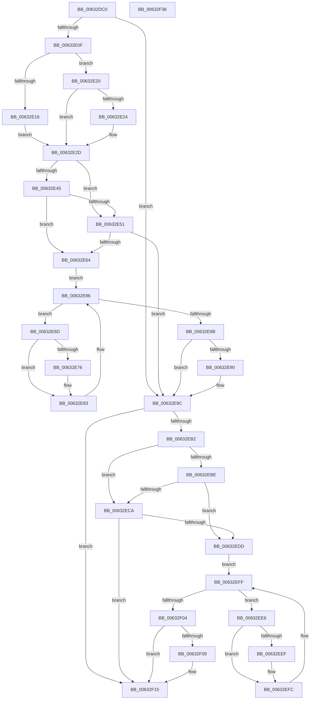

# DifKeSynchronizeExecutionWrapper

- RVA: `0x00632DC0`–`0x00632F37` (길이 `375` bytes)
- VA: `0x0000000140632DC0`
- 실행 섹션: `.text`
- PDB 이름 있음: `예`; PDB Function 태그: `아니요`
- unwind 정보 RVA: `0x000A9A64`
- 디코드: `108`개 명령, `375/375` bytes 표시
- 미해석 바이트: `0` (있으면 어셈블리에 `.byte`로 보존)

> 이 문서는 커널 이미지의 기계어와 PDB 기호를 분석해 생성했습니다. 4번과 5번은 함수 원형과 자료형을 바이너리 사용 방식에서 추정한 C 해석이며 원본 소스 복구 결과는 아닙니다.

## 1. Dependencies

- 직접 호출 지점: **9**; 고유 호출 대상: **6**
- 직접 호출자로 확인된 함수: **0**
- RIP 상대 이미지 참조: **3**

### Outgoing calls
- `0x00632DFE` → [DifGetAPIThunkContextById](../49/DifGetAPIThunkContextById_function_00495A34.md) (function, `0x00495A34`)
- `0x00632E24` → [DifGetReturnAddressForWrappers](../4D/DifGetReturnAddressForWrappers_function_004D3C08.md) (function, `0x004D3C08`)
- `0x00632E58` → [ExAcquireRundownProtection](../21/ExAcquireRundownProtection_function_00216620.md) (function, `0x00216620`)
- `0x00632E7E` → [guard_dispatch_icall](../6B/guard_dispatch_icall_function_006BAAD0.md) (function, `0x006BAAD0`)
- `0x00632E97` → [ExReleaseRundownProtection](../34/ExReleaseRundownProtection_function_00349E80.md) (function, `0x00349E80`)
- `0x00632EA5` → [KeSynchronizeExecution](../20/KeSynchronizeExecution_function_002073D0.md) (function, `0x002073D0`)
- `0x00632ED1` → [ExAcquireRundownProtection](../21/ExAcquireRundownProtection_function_00216620.md) (function, `0x00216620`)
- `0x00632EF7` → [guard_dispatch_icall](../6B/guard_dispatch_icall_function_006BAAD0.md) (function, `0x006BAAD0`)
- `0x00632F10` → [ExReleaseRundownProtection](../34/ExReleaseRundownProtection_function_00349E80.md) (function, `0x00349E80`)

### Direct callers
- 이 함수 시작 RVA로 연결되는 직접 call은 확인되지 않았습니다. 간접 호출은 완전히 역산할 수 없습니다.

### Static image references
- `0x00632E34` → RVA `0x00F048B8` (`.data`; read)
- `0x00632E45` → RVA `0x00F04980` (`.data`; read)
- `0x00632E51` → RVA `0x00F03E80` (`.data`; read)

## 2. Other-region calls and transfers

- 다른 실행 섹션으로 향하는 call: **0**
- 별도 외부 분기/꼬리 이동을 확인하지 못했습니다.

## 3. Assembly (complete function range)

```asm
00632DC0  48 89 5C 24 08                  mov qword ptr [rsp + 8], rbx
00632DC5  48 89 74 24 10                  mov qword ptr [rsp + 0x10], rsi
00632DCA  48 89 7C 24 18                  mov qword ptr [rsp + 0x18], rdi
00632DCF  55                              push rbp
00632DD0  41 54                           push r12
00632DD2  41 55                           push r13
00632DD4  41 56                           push r14
00632DD6  41 57                           push r15
00632DD8  48 8B EC                        mov rbp, rsp
00632DDB  48 83 EC 50                     sub rsp, 0x50
00632DDF  0F 57 C0                        xorps xmm0, xmm0
00632DE2  33 C0                           xor eax, eax
00632DE4  4C 8B E9                        mov r13, rcx
00632DE7  48 89 45 F0                     mov qword ptr [rbp - 0x10], rax
00632DEB  B9 F6 00 00 00                  mov ecx, 0xf6
00632DF0  4D 8B F8                        mov r15, r8
00632DF3  0F 11 45 D0                     movups xmmword ptr [rbp - 0x30], xmm0
00632DF7  4C 8B E2                        mov r12, rdx
00632DFA  0F 11 45 E0                     movups xmmword ptr [rbp - 0x20], xmm0
00632DFE  E8 31 2C E6 FF                  call 0x140495a34
00632E03  48 8B F0                        mov rsi, rax
00632E06  48 85 C0                        test rax, rax
00632E09  0F 84 8D 00 00 00               je 0x140632e9c
00632E0F  8B 40 0C                        mov eax, dword ptr [rax + 0xc]
00632E12  A8 18                           test al, 0x18
00632E14  74 0A                           je 0x140632e20
00632E16  48 8B 4D 28                     mov rcx, qword ptr [rbp + 0x28]
00632E1A  48 89 4D D0                     mov qword ptr [rbp - 0x30], rcx
00632E1E  EB 0D                           jmp 0x140632e2d
00632E20  A8 04                           test al, 4
00632E22  74 09                           je 0x140632e2d
00632E24  E8 DF 0D EA FF                  call 0x1404d3c08
00632E29  48 89 45 D0                     mov qword ptr [rbp - 0x30], rax
00632E2D  45 32 F6                        xor r14b, r14b
00632E30  4C 89 6D E8                     mov qword ptr [rbp - 0x18], r13
00632E34  44 38 35 7D 1A 8D 00            cmp byte ptr [rip + 0x8d1a7d], r14b
00632E3B  4C 89 65 E0                     mov qword ptr [rbp - 0x20], r12
00632E3F  4C 89 7D D8                     mov qword ptr [rbp - 0x28], r15
00632E43  75 0C                           jne 0x140632e51
00632E45  F7 05 31 1B 8D 00 00 08 00 00   test dword ptr [rip + 0x8d1b31], 0x800
00632E4F  74 13                           je 0x140632e64
00632E51  48 8D 0D 28 10 8D 00            lea rcx, [rip + 0x8d1028]
00632E58  E8 C3 37 BE FF                  call 0x140216620
00632E5D  44 8A F0                        mov r14b, al
00632E60  84 C0                           test al, al
00632E62  74 38                           je 0x140632e9c
00632E64  48 8D 7E 20                     lea rdi, [rsi + 0x20]
00632E68  48 8B 1F                        mov rbx, qword ptr [rdi]
00632E6B  EB 19                           jmp 0x140632e86
00632E6D  48 8D 43 F0                     lea rax, [rbx - 0x10]
00632E71  48 85 C0                        test rax, rax
00632E74  74 0D                           je 0x140632e83
00632E76  48 8B 40 08                     mov rax, qword ptr [rax + 8]
00632E7A  48 8D 4D D0                     lea rcx, [rbp - 0x30]
00632E7E  E8 4D 7C 08 00                  call 0x1406baad0
00632E83  48 8B 1B                        mov rbx, qword ptr [rbx]
00632E86  48 3B DF                        cmp rbx, rdi
00632E89  75 E2                           jne 0x140632e6d
00632E8B  45 84 F6                        test r14b, r14b
00632E8E  74 0C                           je 0x140632e9c
00632E90  48 8D 0D E9 0F 8D 00            lea rcx, [rip + 0x8d0fe9]
00632E97  E8 E4 6F D1 FF                  call 0x140349e80
00632E9C  4D 8B C7                        mov r8, r15
00632E9F  49 8B D4                        mov rdx, r12
00632EA2  49 8B CD                        mov rcx, r13
00632EA5  E8 26 45 BD FF                  call 0x1402073d0
00632EAA  88 45 F0                        mov byte ptr [rbp - 0x10], al
00632EAD  48 85 F6                        test rsi, rsi
00632EB0  74 63                           je 0x140632f15
00632EB2  40 32 FF                        xor dil, dil
00632EB5  40 38 3D FC 19 8D 00            cmp byte ptr [rip + 0x8d19fc], dil
00632EBC  75 0C                           jne 0x140632eca
00632EBE  F7 05 B8 1A 8D 00 00 08 00 00   test dword ptr [rip + 0x8d1ab8], 0x800
00632EC8  74 13                           je 0x140632edd
00632ECA  48 8D 0D AF 0F 8D 00            lea rcx, [rip + 0x8d0faf]
00632ED1  E8 4A 37 BE FF                  call 0x140216620
00632ED6  40 8A F8                        mov dil, al
00632ED9  84 C0                           test al, al
00632EDB  74 38                           je 0x140632f15
00632EDD  48 83 C6 30                     add rsi, 0x30
00632EE1  48 8B 1E                        mov rbx, qword ptr [rsi]
00632EE4  EB 19                           jmp 0x140632eff
00632EE6  48 8D 43 F0                     lea rax, [rbx - 0x10]
00632EEA  48 85 C0                        test rax, rax
00632EED  74 0D                           je 0x140632efc
00632EEF  48 8B 40 08                     mov rax, qword ptr [rax + 8]
00632EF3  48 8D 4D D0                     lea rcx, [rbp - 0x30]
00632EF7  E8 D4 7B 08 00                  call 0x1406baad0
00632EFC  48 8B 1B                        mov rbx, qword ptr [rbx]
00632EFF  48 3B DE                        cmp rbx, rsi
00632F02  75 E2                           jne 0x140632ee6
00632F04  40 84 FF                        test dil, dil
00632F07  74 0C                           je 0x140632f15
00632F09  48 8D 0D 70 0F 8D 00            lea rcx, [rip + 0x8d0f70]
00632F10  E8 6B 6F D1 FF                  call 0x140349e80
00632F15  8A 45 F0                        mov al, byte ptr [rbp - 0x10]
00632F18  4C 8D 5C 24 50                  lea r11, [rsp + 0x50]
00632F1D  49 8B 5B 30                     mov rbx, qword ptr [r11 + 0x30]
00632F21  49 8B 73 38                     mov rsi, qword ptr [r11 + 0x38]
00632F25  49 8B 7B 40                     mov rdi, qword ptr [r11 + 0x40]
00632F29  49 8B E3                        mov rsp, r11
00632F2C  41 5F                           pop r15
00632F2E  41 5E                           pop r14
00632F30  41 5D                           pop r13
00632F32  41 5C                           pop r12
00632F34  5D                              pop rbp
00632F35  C3                              ret
00632F36  CC                              int3
```

## 4. C-style interpretation (structured pseudocode)

```c
__int64 __fastcall DifKeSynchronizeExecutionWrapper(__int64 a1, __int64 a2, __int64 a3)
{
    __int64 result;
    __int64 v_r14;
    __int64 v_rdi;
    __int64 v_rsi;
    __int64 v_rsp;
    unsigned __int64 v_stack_m28;
    unsigned __int64 v_stack_m38;
    unsigned __int64 v_stack_m40;
    unsigned __int64 v_stack_m48;
    unsigned __int64 v_stack_m50;
    unsigned __int64 v_stack_m58;
    unsigned __int64 v_stack_p0;
    unsigned __int64 v_stack_p10;
    unsigned __int64 v_stack_p18;
    unsigned __int64 v_stack_p8;

    v_stack_p8 = v_rbx;
    v_stack_p10 = v_rsi;
    v_stack_p18 = v_rdi;
    v_rsp = (v_rsp) - (80);
    result = 0;
    v_stack_m38 = 0;
    v_stack_m58 = v_xmm0;
    v_stack_m48 = v_xmm0;
    result = DifGetAPIThunkContextById(246, a2, a3, a4);
    if (result == 0) goto loc_00632E9C;
    if ((((unsigned __int8)((unsigned int)(*(unsigned int *)(result + 12)))) & (24)) == 0) goto loc_00632E20;
    v_stack_m58 = v_stack_p0;
    goto loc_00632E2D;
loc_00632E20:
    result = (unsigned int)(*(unsigned int *)(result + 12));
    if ((((unsigned __int8)((unsigned int)(*(unsigned int *)(result + 12)))) & (4)) != 0) {
        result = DifGetReturnAddressForWrappers(v_stack_p0, a2, a3, a4);
        v_stack_m58 = result;
    }
    v_r14 = 0;
    v_stack_m40 = a1;
    v_stack_m48 = a2;
    v_stack_m50 = a3;
    if ((*(unsigned __int8 *)(v_rip + 9247357)) != 0) goto loc_00632E51;
    if (((*(unsigned int *)(v_rip + 9247537)) & (0x800ULL)) == 0) goto loc_00632E64;
loc_00632E51:
    result = ExAcquireRundownProtection(v_rip + 9244712, a2, a3, a4);
    if ((unsigned __int8)(result) == 0) goto loc_00632E9C;
loc_00632E64:
    goto loc_00632E86;
loc_00632E6D:
    result = *(unsigned __int64 *)(result + 32) - 16;
    if (*(unsigned __int64 *)(result + 32) - 16 != 0) {
        result = *(unsigned __int64 *)(*(unsigned __int64 *)(result + 32) - 16 + 8);
        a1 = v_stack_m58;
        result = guard_dispatch_icall(a1, a2, a3, a4);
    }
loc_00632E86:
    if ((*(unsigned __int64 *)(*(unsigned __int64 *)(result + 32))) != (result + 32)) goto loc_00632E6D;
    if ((unsigned __int8)((unsigned __int8)(result)) != 0) {
        a1 = v_rip + 9244649;
        result = ExReleaseRundownProtection(a1, a2, a3, a4);
    }
    result = KeSynchronizeExecution(a1, a2, a3, a4);
    v_stack_m38 = (unsigned __int8)(result);
    if (result == 0) goto loc_00632F15;
    v_rdi = 0;
    if ((*(unsigned __int8 *)(v_rip + 9247228)) != 0) goto loc_00632ECA;
    if (((*(unsigned int *)(v_rip + 9247416)) & (0x800ULL)) == 0) goto loc_00632EDD;
loc_00632ECA:
    result = ExAcquireRundownProtection(v_rip + 9244591, a2, a3, a4);
    if ((unsigned __int8)(result) == 0) goto loc_00632F15;
loc_00632EDD:
    v_rsi = (result) + (48);
    goto loc_00632EFF;
loc_00632EE6:
    result = *(unsigned __int64 *)(v_rsi) - 16;
    if (*(unsigned __int64 *)(v_rsi) - 16 != 0) {
        result = *(unsigned __int64 *)(*(unsigned __int64 *)(v_rsi) - 16 + 8);
        a1 = v_stack_m58;
        result = guard_dispatch_icall(a1, a2, a3, a4);
    }
loc_00632EFF:
    if ((*(unsigned __int64 *)(*(unsigned __int64 *)(v_rsi))) != v_rsi) goto loc_00632EE6;
    if ((unsigned __int8)((unsigned __int8)(result)) != 0) {
        a1 = v_rip + 9244528;
        result = ExReleaseRundownProtection(a1, a2, a3, a4);
    }
    return v_stack_m38;
}
```

## 5. (Beta) C Style

```c
int64_t DifKeSynchronizeExecutionWrapper(int64_t Arg1, int64_t Arg2, int64_t Arg3)
{
    int64_t result;
    int64_t local_r14;
    int64_t local_rdi;
    int64_t local_rsi;
    int64_t local_rsp;
    uint64_t v_stack_m28;
    uint64_t v_stack_m38;
    uint64_t v_stack_m40;
    uint64_t v_stack_m48;
    uint64_t v_stack_m50;
    uint64_t v_stack_m58;
    uint64_t v_stack_p0;
    uint64_t v_stack_p10;
    uint64_t v_stack_p18;
    uint64_t v_stack_p8;

    v_stack_p8 = local_rbx;
    v_stack_p10 = local_rsi;
    v_stack_p18 = local_rdi;
    local_rsp = (local_rsp) - (80);
    result = 0;
    v_stack_m38 = 0;
    v_stack_m58 = v_xmm0;
    v_stack_m48 = v_xmm0;
    result = DifGetAPIThunkContextById(246, Arg2, Arg3, a4);
    if (result == 0) goto loc_00632E9C;
    if ((((uint8_t)((uint32_t)(*(uint32_t *)(result + 0xC)))) & (24)) == 0) goto loc_00632E20;
    v_stack_m58 = v_stack_p0;
    goto loc_00632E2D;
loc_00632E20:
    result = (uint32_t)(*(uint32_t *)(result + 0xC));
    if ((((uint8_t)((uint32_t)(*(uint32_t *)(result + 0xC)))) & (4)) != 0) {
        result = DifGetReturnAddressForWrappers(v_stack_p0, Arg2, Arg3, a4);
        v_stack_m58 = result;
    }
    local_r14 = 0;
    v_stack_m40 = Arg1;
    v_stack_m48 = Arg2;
    v_stack_m50 = Arg3;
    if ((*(uint8_t *)(v_rip + 0x8D1A7D)) != 0) goto loc_00632E51;
    if (((*(uint32_t *)(v_rip + 0x8D1B31)) & (0x800ULL)) == 0) goto loc_00632E64;
loc_00632E51:
    result = ExAcquireRundownProtection(v_rip + 9244712, Arg2, Arg3, a4);
    if ((uint8_t)(result) == 0) goto loc_00632E9C;
loc_00632E64:
    goto loc_00632E86;
loc_00632E6D:
    result = *(uint64_t *)(result + 0x20) - 16;
    if (*(uint64_t *)(result + 0x20) - 16 != 0) {
        result = *(uint64_t *)(*(uint64_t *)(result + 0x20) - 0x10 + 0x8);
        Arg1 = v_stack_m58;
        result = guard_dispatch_icall(Arg1, Arg2, Arg3, a4);
    }
loc_00632E86:
    if ((*(uint64_t *)(*(uint64_t *)(result + 0x20))) != (result + 32)) goto loc_00632E6D;
    if ((uint8_t)((uint8_t)(result)) != 0) {
        Arg1 = v_rip + 9244649;
        result = ExReleaseRundownProtection(Arg1, Arg2, Arg3, a4);
    }
    result = KeSynchronizeExecution(Arg1, Arg2, Arg3, a4);
    v_stack_m38 = (uint8_t)(result);
    if (result == 0) goto loc_00632F15;
    local_rdi = 0;
    if ((*(uint8_t *)(v_rip + 0x8D19FC)) != 0) goto loc_00632ECA;
    if (((*(uint32_t *)(v_rip + 0x8D1AB8)) & (0x800ULL)) == 0) goto loc_00632EDD;
loc_00632ECA:
    result = ExAcquireRundownProtection(v_rip + 9244591, Arg2, Arg3, a4);
    if ((uint8_t)(result) == 0) goto loc_00632F15;
loc_00632EDD:
    local_rsi = (result) + (48);
    goto loc_00632EFF;
loc_00632EE6:
    result = *(uint64_t *)(local_rsi) - 16;
    if (*(uint64_t *)(local_rsi) - 16 != 0) {
        result = *(uint64_t *)(*(uint64_t *)(local_rsi) - 0x10 + 0x8);
        Arg1 = v_stack_m58;
        result = guard_dispatch_icall(Arg1, Arg2, Arg3, a4);
    }
loc_00632EFF:
    if ((*(uint64_t *)(*(uint64_t *)(local_rsi))) != local_rsi) goto loc_00632EE6;
    if ((uint8_t)((uint8_t)(result)) != 0) {
        Arg1 = v_rip + 9244528;
        result = ExReleaseRundownProtection(Arg1, Arg2, Arg3, a4);
    }
    return v_stack_m38;
}
```

## 6. Execution-region graph

[열기: 2D/3D 그래프와 함수 탐색 컨트롤 패널](../../../control-panel.html?section=text&rva=0x00632DC0&view=graph)

- 2D 그래프는 위에서 아래로 흐르고, 3D 그래프는 빈 공간을 드래그해 회전합니다. Shift+드래그는 이동, 휠은 확대·축소, 함수 노드 선택은 대상 보고서 이동입니다.

### Static fallback


