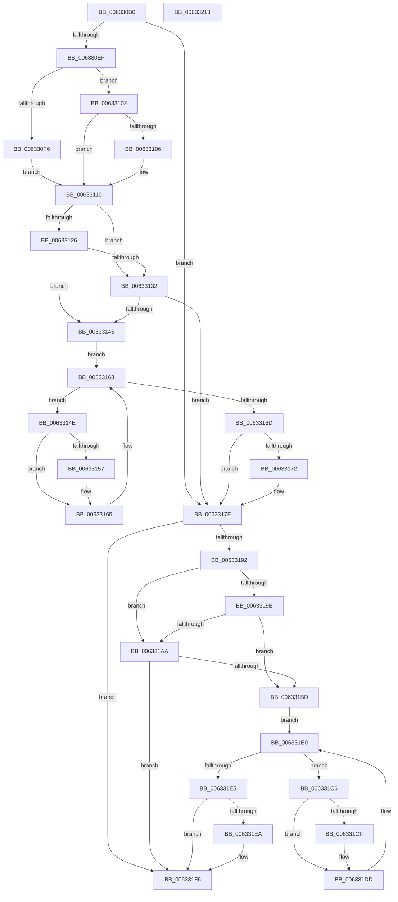

# DifKeTryToAcquireQueuedSpinLockRaiseToSynchWrapper

- RVA: `0x006330B0`–`0x00633214` (길이 `356` bytes)
- VA: `0x00000001406330B0`
- 실행 섹션: `.text`
- PDB 이름 있음: `예`; PDB Function 태그: `아니요`
- unwind 정보 RVA: `0x00093E28`
- 디코드: `98`개 명령, `356/356` bytes 표시
- 미해석 바이트: `0` (있으면 어셈블리에 `.byte`로 보존)

> 이 문서는 커널 이미지의 기계어와 PDB 기호를 분석해 생성했습니다. 4번과 5번은 함수 원형과 자료형을 바이너리 사용 방식에서 추정한 C 해석이며 원본 소스 복구 결과는 아닙니다.

## 1. Dependencies

- 직접 호출 지점: **9**; 고유 호출 대상: **6**
- 직접 호출자로 확인된 함수: **0**
- RIP 상대 이미지 참조: **3**

### Outgoing calls
- `0x006330DE` → [DifGetAPIThunkContextById](../49/DifGetAPIThunkContextById_function_00495A34.md) (function, `0x00495A34`)
- `0x00633106` → [DifGetReturnAddressForWrappers](../4D/DifGetReturnAddressForWrappers_function_004D3C08.md) (function, `0x004D3C08`)
- `0x00633139` → [ExAcquireRundownProtection](../21/ExAcquireRundownProtection_function_00216620.md) (function, `0x00216620`)
- `0x00633160` → [guard_dispatch_icall](../6B/guard_dispatch_icall_function_006BAAD0.md) (function, `0x006BAAD0`)
- `0x00633179` → [ExReleaseRundownProtection](../34/ExReleaseRundownProtection_function_00349E80.md) (function, `0x00349E80`)
- `0x00633184` → [KeTryToAcquireQueuedSpinLockRaiseToSynch](../5B/KeTryToAcquireQueuedSpinLockRaiseToSynch_function_005BD500.md) (function, `0x005BD500`)
- `0x006331B1` → [ExAcquireRundownProtection](../21/ExAcquireRundownProtection_function_00216620.md) (function, `0x00216620`)
- `0x006331D8` → [guard_dispatch_icall](../6B/guard_dispatch_icall_function_006BAAD0.md) (function, `0x006BAAD0`)
- `0x006331F1` → [ExReleaseRundownProtection](../34/ExReleaseRundownProtection_function_00349E80.md) (function, `0x00349E80`)

### Direct callers
- 이 함수 시작 RVA로 연결되는 직접 call은 확인되지 않았습니다. 간접 호출은 완전히 역산할 수 없습니다.

### Static image references
- `0x00633118` → RVA `0x00F048B8` (`.data`; read)
- `0x00633126` → RVA `0x00F04980` (`.data`; read)
- `0x00633132` → RVA `0x00F03E80` (`.data`; read)

## 2. Other-region calls and transfers

- 다른 실행 섹션으로 향하는 call: **0**
- 별도 외부 분기/꼬리 이동을 확인하지 못했습니다.

## 3. Assembly (complete function range)

```asm
006330B0  48 8B C4                        mov rax, rsp
006330B3  48 89 58 08                     mov qword ptr [rax + 8], rbx
006330B7  48 89 68 10                     mov qword ptr [rax + 0x10], rbp
006330BB  48 89 70 18                     mov qword ptr [rax + 0x18], rsi
006330BF  57                              push rdi
006330C0  41 56                           push r14
006330C2  41 57                           push r15
006330C4  48 83 EC 40                     sub rsp, 0x40
006330C8  0F 57 C0                        xorps xmm0, xmm0
006330CB  4C 8B F9                        mov r15, rcx
006330CE  B9 F3 00 00 00                  mov ecx, 0xf3
006330D3  4C 8B F2                        mov r14, rdx
006330D6  0F 11 40 C8                     movups xmmword ptr [rax - 0x38], xmm0
006330DA  0F 11 40 D8                     movups xmmword ptr [rax - 0x28], xmm0
006330DE  E8 51 29 E6 FF                  call 0x140495a34
006330E3  48 8B F0                        mov rsi, rax
006330E6  48 85 C0                        test rax, rax
006330E9  0F 84 8F 00 00 00               je 0x14063317e
006330EF  8B 40 0C                        mov eax, dword ptr [rax + 0xc]
006330F2  A8 18                           test al, 0x18
006330F4  74 0C                           je 0x140633102
006330F6  48 8B 4C 24 58                  mov rcx, qword ptr [rsp + 0x58]
006330FB  48 89 4C 24 20                  mov qword ptr [rsp + 0x20], rcx
00633100  EB 0E                           jmp 0x140633110
00633102  A8 04                           test al, 4
00633104  74 0A                           je 0x140633110
00633106  E8 FD 0A EA FF                  call 0x1404d3c08
0063310B  48 89 44 24 20                  mov qword ptr [rsp + 0x20], rax
00633110  40 32 ED                        xor bpl, bpl
00633113  4C 89 7C 24 30                  mov qword ptr [rsp + 0x30], r15
00633118  40 38 2D 99 17 8D 00            cmp byte ptr [rip + 0x8d1799], bpl
0063311F  4C 89 74 24 28                  mov qword ptr [rsp + 0x28], r14
00633124  75 0C                           jne 0x140633132
00633126  F7 05 50 18 8D 00 00 08 00 00   test dword ptr [rip + 0x8d1850], 0x800
00633130  74 13                           je 0x140633145
00633132  48 8D 0D 47 0D 8D 00            lea rcx, [rip + 0x8d0d47]
00633139  E8 E2 34 BE FF                  call 0x140216620
0063313E  40 8A E8                        mov bpl, al
00633141  84 C0                           test al, al
00633143  74 39                           je 0x14063317e
00633145  48 8D 7E 20                     lea rdi, [rsi + 0x20]
00633149  48 8B 1F                        mov rbx, qword ptr [rdi]
0063314C  EB 1A                           jmp 0x140633168
0063314E  48 8D 43 F0                     lea rax, [rbx - 0x10]
00633152  48 85 C0                        test rax, rax
00633155  74 0E                           je 0x140633165
00633157  48 8B 40 08                     mov rax, qword ptr [rax + 8]
0063315B  48 8D 4C 24 20                  lea rcx, [rsp + 0x20]
00633160  E8 6B 79 08 00                  call 0x1406baad0
00633165  48 8B 1B                        mov rbx, qword ptr [rbx]
00633168  48 3B DF                        cmp rbx, rdi
0063316B  75 E1                           jne 0x14063314e
0063316D  40 84 ED                        test bpl, bpl
00633170  74 0C                           je 0x14063317e
00633172  48 8D 0D 07 0D 8D 00            lea rcx, [rip + 0x8d0d07]
00633179  E8 02 6D D1 FF                  call 0x140349e80
0063317E  49 8B D6                        mov rdx, r14
00633181  49 8B CF                        mov rcx, r15
00633184  E8 77 A3 F8 FF                  call 0x1405bd500
00633189  89 44 24 38                     mov dword ptr [rsp + 0x38], eax
0063318D  48 85 F6                        test rsi, rsi
00633190  74 64                           je 0x1406331f6
00633192  40 32 FF                        xor dil, dil
00633195  40 38 3D 1C 17 8D 00            cmp byte ptr [rip + 0x8d171c], dil
0063319C  75 0C                           jne 0x1406331aa
0063319E  F7 05 D8 17 8D 00 00 08 00 00   test dword ptr [rip + 0x8d17d8], 0x800
006331A8  74 13                           je 0x1406331bd
006331AA  48 8D 0D CF 0C 8D 00            lea rcx, [rip + 0x8d0ccf]
006331B1  E8 6A 34 BE FF                  call 0x140216620
006331B6  40 8A F8                        mov dil, al
006331B9  84 C0                           test al, al
006331BB  74 39                           je 0x1406331f6
006331BD  48 83 C6 30                     add rsi, 0x30
006331C1  48 8B 1E                        mov rbx, qword ptr [rsi]
006331C4  EB 1A                           jmp 0x1406331e0
006331C6  48 8D 43 F0                     lea rax, [rbx - 0x10]
006331CA  48 85 C0                        test rax, rax
006331CD  74 0E                           je 0x1406331dd
006331CF  48 8B 40 08                     mov rax, qword ptr [rax + 8]
006331D3  48 8D 4C 24 20                  lea rcx, [rsp + 0x20]
006331D8  E8 F3 78 08 00                  call 0x1406baad0
006331DD  48 8B 1B                        mov rbx, qword ptr [rbx]
006331E0  48 3B DE                        cmp rbx, rsi
006331E3  75 E1                           jne 0x1406331c6
006331E5  40 84 FF                        test dil, dil
006331E8  74 0C                           je 0x1406331f6
006331EA  48 8D 0D 8F 0C 8D 00            lea rcx, [rip + 0x8d0c8f]
006331F1  E8 8A 6C D1 FF                  call 0x140349e80
006331F6  8B 44 24 38                     mov eax, dword ptr [rsp + 0x38]
006331FA  48 8B 5C 24 60                  mov rbx, qword ptr [rsp + 0x60]
006331FF  48 8B 6C 24 68                  mov rbp, qword ptr [rsp + 0x68]
00633204  48 8B 74 24 70                  mov rsi, qword ptr [rsp + 0x70]
00633209  48 83 C4 40                     add rsp, 0x40
0063320D  41 5F                           pop r15
0063320F  41 5E                           pop r14
00633211  5F                              pop rdi
00633212  C3                              ret
00633213  CC                              int3
```

## 4. C-style interpretation (structured pseudocode)

```c
__int64 __fastcall DifKeTryToAcquireQueuedSpinLockRaiseToSynchWrapper(__int64 a1, __int64 a2)
{
    __int64 result;
    __int64 v_rbp;
    __int64 v_rdi;
    __int64 v_rsi;
    __int64 v_rsp;
    unsigned int v_stack_m20;
    unsigned __int64 v_stack_m28;
    unsigned __int64 v_stack_m30;
    unsigned __int64 v_stack_m38;
    unsigned __int64 v_stack_p0;
    unsigned __int64 v_stack_p10;
    unsigned __int64 v_stack_p18;
    unsigned __int64 v_stack_p8;

    *(unsigned __int64 *)(v_rsp + 8) = v_rbx;
    *(unsigned __int64 *)(v_rsp + 16) = v_rbp;
    *(unsigned __int64 *)(v_rsp + 24) = v_rsi;
    v_rsp = (v_rsp) - (64);
    *(unsigned __int64 *)(v_rsp - 56) = v_xmm0;
    *(unsigned __int64 *)(v_rsp - 40) = v_xmm0;
    result = DifGetAPIThunkContextById(243, a2, a3, a4);
    if (result == 0) goto loc_0063317E;
    if ((((unsigned __int8)((unsigned int)(*(unsigned int *)(result + 12)))) & (24)) == 0) goto loc_00633102;
    v_stack_m38 = v_stack_p0;
    goto loc_00633110;
loc_00633102:
    result = (unsigned int)(*(unsigned int *)(result + 12));
    if ((((unsigned __int8)((unsigned int)(*(unsigned int *)(result + 12)))) & (4)) != 0) {
        result = DifGetReturnAddressForWrappers(v_stack_p0, a2, a3, a4);
        v_stack_m38 = result;
    }
    v_rbp = 0;
    v_stack_m28 = a1;
    v_stack_m30 = a2;
    if ((*(unsigned __int8 *)(v_rip + 9246617)) != 0) goto loc_00633132;
    if (((*(unsigned int *)(v_rip + 9246800)) & (0x800ULL)) == 0) goto loc_00633145;
loc_00633132:
    result = ExAcquireRundownProtection(v_rip + 9243975, a2, a3, a4);
    if ((unsigned __int8)(result) == 0) goto loc_0063317E;
loc_00633145:
    goto loc_00633168;
loc_0063314E:
    result = *(unsigned __int64 *)(result + 32) - 16;
    if (*(unsigned __int64 *)(result + 32) - 16 != 0) {
        result = *(unsigned __int64 *)(*(unsigned __int64 *)(result + 32) - 16 + 8);
        a1 = v_stack_m38;
        result = guard_dispatch_icall(a1, a2, a3, a4);
    }
loc_00633168:
    if ((*(unsigned __int64 *)(*(unsigned __int64 *)(result + 32))) != (result + 32)) goto loc_0063314E;
    if ((unsigned __int8)((unsigned __int8)(result)) != 0) {
        a1 = v_rip + 9243911;
        result = ExReleaseRundownProtection(a1, a2, a3, a4);
    }
    result = KeTryToAcquireQueuedSpinLockRaiseToSynch(a1, a2, a3, a4);
    v_stack_m20 = (unsigned int)(result);
    if (result == 0) goto loc_006331F6;
    v_rdi = 0;
    if ((*(unsigned __int8 *)(v_rip + 9246492)) != 0) goto loc_006331AA;
    if (((*(unsigned int *)(v_rip + 9246680)) & (0x800ULL)) == 0) goto loc_006331BD;
loc_006331AA:
    result = ExAcquireRundownProtection(v_rip + 9243855, a2, a3, a4);
    if ((unsigned __int8)(result) == 0) goto loc_006331F6;
loc_006331BD:
    v_rsi = (result) + (48);
    goto loc_006331E0;
loc_006331C6:
    result = *(unsigned __int64 *)(v_rsi) - 16;
    if (*(unsigned __int64 *)(v_rsi) - 16 != 0) {
        result = *(unsigned __int64 *)(*(unsigned __int64 *)(v_rsi) - 16 + 8);
        a1 = v_stack_m38;
        result = guard_dispatch_icall(a1, a2, a3, a4);
    }
loc_006331E0:
    if ((*(unsigned __int64 *)(*(unsigned __int64 *)(v_rsi))) != v_rsi) goto loc_006331C6;
    if ((unsigned __int8)((unsigned __int8)(result)) != 0) {
        a1 = v_rip + 9243791;
        result = ExReleaseRundownProtection(a1, a2, a3, a4);
    }
    v_rsp = (v_rsp) + (64);
    return (unsigned int)(v_stack_m20);
}
```

## 5. (Beta) C Style

```c
int64_t DifKeTryToAcquireQueuedSpinLockRaiseToSynchWrapper(int64_t Arg1, int64_t Arg2)
{
    int64_t result;
    int64_t local_rbp;
    int64_t local_rdi;
    int64_t local_rsi;
    int64_t local_rsp;
    uint32_t v_stack_m20;
    uint64_t v_stack_m28;
    uint64_t v_stack_m30;
    uint64_t v_stack_m38;
    uint64_t v_stack_p0;
    uint64_t v_stack_p10;
    uint64_t v_stack_p18;
    uint64_t v_stack_p8;

    *(uint64_t *)(local_rsp + 0x8) = local_rbx;
    *(uint64_t *)(local_rsp + 0x10) = local_rbp;
    *(uint64_t *)(local_rsp + 0x18) = local_rsi;
    local_rsp = (local_rsp) - (64);
    *(uint64_t *)(local_rsp - 0x38) = v_xmm0;
    *(uint64_t *)(local_rsp - 0x28) = v_xmm0;
    result = DifGetAPIThunkContextById(243, Arg2, a3, a4);
    if (result == 0) goto loc_0063317E;
    if ((((uint8_t)((uint32_t)(*(uint32_t *)(result + 0xC)))) & (24)) == 0) goto loc_00633102;
    v_stack_m38 = v_stack_p0;
    goto loc_00633110;
loc_00633102:
    result = (uint32_t)(*(uint32_t *)(result + 0xC));
    if ((((uint8_t)((uint32_t)(*(uint32_t *)(result + 0xC)))) & (4)) != 0) {
        result = DifGetReturnAddressForWrappers(v_stack_p0, Arg2, a3, a4);
        v_stack_m38 = result;
    }
    local_rbp = 0;
    v_stack_m28 = Arg1;
    v_stack_m30 = Arg2;
    if ((*(uint8_t *)(v_rip + 0x8D1799)) != 0) goto loc_00633132;
    if (((*(uint32_t *)(v_rip + 0x8D1850)) & (0x800ULL)) == 0) goto loc_00633145;
loc_00633132:
    result = ExAcquireRundownProtection(v_rip + 9243975, Arg2, a3, a4);
    if ((uint8_t)(result) == 0) goto loc_0063317E;
loc_00633145:
    goto loc_00633168;
loc_0063314E:
    result = *(uint64_t *)(result + 0x20) - 16;
    if (*(uint64_t *)(result + 0x20) - 16 != 0) {
        result = *(uint64_t *)(*(uint64_t *)(result + 0x20) - 0x10 + 0x8);
        Arg1 = v_stack_m38;
        result = guard_dispatch_icall(Arg1, Arg2, a3, a4);
    }
loc_00633168:
    if ((*(uint64_t *)(*(uint64_t *)(result + 0x20))) != (result + 32)) goto loc_0063314E;
    if ((uint8_t)((uint8_t)(result)) != 0) {
        Arg1 = v_rip + 9243911;
        result = ExReleaseRundownProtection(Arg1, Arg2, a3, a4);
    }
    result = KeTryToAcquireQueuedSpinLockRaiseToSynch(Arg1, Arg2, a3, a4);
    v_stack_m20 = (uint32_t)(result);
    if (result == 0) goto loc_006331F6;
    local_rdi = 0;
    if ((*(uint8_t *)(v_rip + 0x8D171C)) != 0) goto loc_006331AA;
    if (((*(uint32_t *)(v_rip + 0x8D17D8)) & (0x800ULL)) == 0) goto loc_006331BD;
loc_006331AA:
    result = ExAcquireRundownProtection(v_rip + 9243855, Arg2, a3, a4);
    if ((uint8_t)(result) == 0) goto loc_006331F6;
loc_006331BD:
    local_rsi = (result) + (48);
    goto loc_006331E0;
loc_006331C6:
    result = *(uint64_t *)(local_rsi) - 16;
    if (*(uint64_t *)(local_rsi) - 16 != 0) {
        result = *(uint64_t *)(*(uint64_t *)(local_rsi) - 0x10 + 0x8);
        Arg1 = v_stack_m38;
        result = guard_dispatch_icall(Arg1, Arg2, a3, a4);
    }
loc_006331E0:
    if ((*(uint64_t *)(*(uint64_t *)(local_rsi))) != local_rsi) goto loc_006331C6;
    if ((uint8_t)((uint8_t)(result)) != 0) {
        Arg1 = v_rip + 9243791;
        result = ExReleaseRundownProtection(Arg1, Arg2, a3, a4);
    }
    local_rsp = (local_rsp) + (64);
    return (uint32_t)(v_stack_m20);
}
```

## 6. Execution-region graph

[열기: 2D/3D 그래프와 함수 탐색 컨트롤 패널](../../../control-panel.html?section=text&rva=0x006330B0&view=graph)

- 2D 그래프는 위에서 아래로 흐르고, 3D 그래프는 빈 공간을 드래그해 회전합니다. Shift+드래그는 이동, 휠은 확대·축소, 함수 노드 선택은 대상 보고서 이동입니다.

### Static fallback


