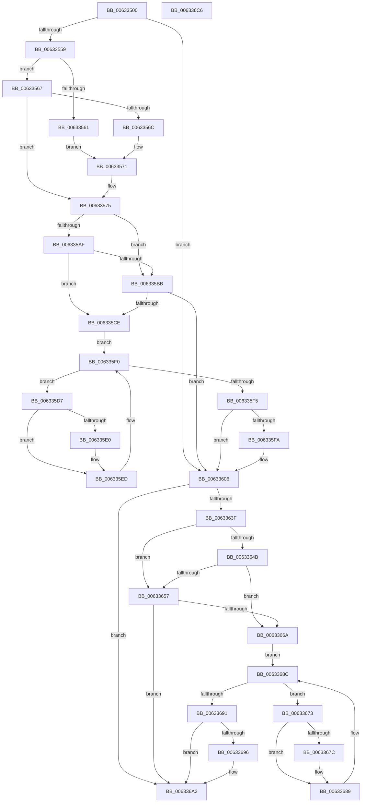

# DifKeWaitForMultipleObjectsWrapper

- RVA: `0x00633500`–`0x006336C7` (길이 `455` bytes)
- VA: `0x0000000140633500`
- 실행 섹션: `.text`
- PDB 이름 있음: `예`; PDB Function 태그: `아니요`
- unwind 정보 RVA: `0x000D2B9C`
- 디코드: `129`개 명령, `455/455` bytes 표시
- 미해석 바이트: `0` (있으면 어셈블리에 `.byte`로 보존)

> 이 문서는 커널 이미지의 기계어와 PDB 기호를 분석해 생성했습니다. 4번과 5번은 함수 원형과 자료형을 바이너리 사용 방식에서 추정한 C 해석이며 원본 소스 복구 결과는 아닙니다.

## 1. Dependencies

- 직접 호출 지점: **9**; 고유 호출 대상: **6**
- 직접 호출자로 확인된 함수: **0**
- RIP 상대 이미지 참조: **3**

### Outgoing calls
- `0x00633548` → [DifGetAPIThunkContextById](../49/DifGetAPIThunkContextById_function_00495A34.md) (function, `0x00495A34`)
- `0x0063356C` → [DifGetReturnAddressForWrappers](../4D/DifGetReturnAddressForWrappers_function_004D3C08.md) (function, `0x004D3C08`)
- `0x006335C2` → [ExAcquireRundownProtection](../21/ExAcquireRundownProtection_function_00216620.md) (function, `0x00216620`)
- `0x006335E8` → [guard_dispatch_icall](../6B/guard_dispatch_icall_function_006BAAD0.md) (function, `0x006BAAD0`)
- `0x00633601` → [ExReleaseRundownProtection](../34/ExReleaseRundownProtection_function_00349E80.md) (function, `0x00349E80`)
- `0x00633632` → [KeWaitForMultipleObjects](../20/KeWaitForMultipleObjects_function_0020D110.md) (function, `0x0020D110`)
- `0x0063365E` → [ExAcquireRundownProtection](../21/ExAcquireRundownProtection_function_00216620.md) (function, `0x00216620`)
- `0x00633684` → [guard_dispatch_icall](../6B/guard_dispatch_icall_function_006BAAD0.md) (function, `0x006BAAD0`)
- `0x0063369D` → [ExReleaseRundownProtection](../34/ExReleaseRundownProtection_function_00349E80.md) (function, `0x00349E80`)

### Direct callers
- 이 함수 시작 RVA로 연결되는 직접 call은 확인되지 않았습니다. 간접 호출은 완전히 역산할 수 없습니다.

### Static image references
- `0x0063357B` → RVA `0x00F048B8` (`.data`; read)
- `0x006335AF` → RVA `0x00F04980` (`.data`; read)
- `0x006335BB` → RVA `0x00F03E80` (`.data`; read)

## 2. Other-region calls and transfers

- 다른 실행 섹션으로 향하는 call: **0**
- 별도 외부 분기/꼬리 이동을 확인하지 못했습니다.

## 3. Assembly (complete function range)

```asm
00633500  48 8B C4                        mov rax, rsp
00633503  48 89 58 10                     mov qword ptr [rax + 0x10], rbx
00633507  48 89 70 18                     mov qword ptr [rax + 0x18], rsi
0063350B  48 89 78 20                     mov qword ptr [rax + 0x20], rdi
0063350F  89 48 08                        mov dword ptr [rax + 8], ecx
00633512  55                              push rbp
00633513  41 54                           push r12
00633515  41 55                           push r13
00633517  41 56                           push r14
00633519  41 57                           push r15
0063351B  48 8B EC                        mov rbp, rsp
0063351E  48 81 EC 80 00 00 00            sub rsp, 0x80
00633525  0F 57 C0                        xorps xmm0, xmm0
00633528  33 C0                           xor eax, eax
0063352A  B9 F1 00 00 00                  mov ecx, 0xf1
0063352F  48 89 45 F0                     mov qword ptr [rbp - 0x10], rax
00633533  0F 11 45 C0                     movups xmmword ptr [rbp - 0x40], xmm0
00633537  45 8B F9                        mov r15d, r9d
0063353A  45 8B E0                        mov r12d, r8d
0063353D  0F 11 45 D0                     movups xmmword ptr [rbp - 0x30], xmm0
00633541  4C 8B EA                        mov r13, rdx
00633544  0F 11 45 E0                     movups xmmword ptr [rbp - 0x20], xmm0
00633548  E8 E7 24 E6 FF                  call 0x140495a34
0063354D  48 8B F0                        mov rsi, rax
00633550  48 85 C0                        test rax, rax
00633553  0F 84 AD 00 00 00               je 0x140633606
00633559  8B 48 0C                        mov ecx, dword ptr [rax + 0xc]
0063355C  F6 C1 18                        test cl, 0x18
0063355F  74 06                           je 0x140633567
00633561  48 8B 45 28                     mov rax, qword ptr [rbp + 0x28]
00633565  EB 0A                           jmp 0x140633571
00633567  F6 C1 04                        test cl, 4
0063356A  74 09                           je 0x140633575
0063356C  E8 97 06 EA FF                  call 0x1404d3c08
00633571  48 89 45 C0                     mov qword ptr [rbp - 0x40], rax
00633575  8B 45 30                        mov eax, dword ptr [rbp + 0x30]
00633578  45 32 F6                        xor r14b, r14b
0063357B  44 38 35 36 13 8D 00            cmp byte ptr [rip + 0x8d1336], r14b
00633582  89 45 F0                        mov dword ptr [rbp - 0x10], eax
00633585  8A 45 50                        mov al, byte ptr [rbp + 0x50]
00633588  88 45 D9                        mov byte ptr [rbp - 0x27], al
0063358B  8A 45 58                        mov al, byte ptr [rbp + 0x58]
0063358E  88 45 D8                        mov byte ptr [rbp - 0x28], al
00633591  48 8B 45 60                     mov rax, qword ptr [rbp + 0x60]
00633595  48 89 45 D0                     mov qword ptr [rbp - 0x30], rax
00633599  48 8B 45 68                     mov rax, qword ptr [rbp + 0x68]
0063359D  48 89 45 C8                     mov qword ptr [rbp - 0x38], rax
006335A1  4C 89 6D E8                     mov qword ptr [rbp - 0x18], r13
006335A5  44 89 65 E0                     mov dword ptr [rbp - 0x20], r12d
006335A9  44 89 7D DC                     mov dword ptr [rbp - 0x24], r15d
006335AD  75 0C                           jne 0x1406335bb
006335AF  F7 05 C7 13 8D 00 00 08 00 00   test dword ptr [rip + 0x8d13c7], 0x800
006335B9  74 13                           je 0x1406335ce
006335BB  48 8D 0D BE 08 8D 00            lea rcx, [rip + 0x8d08be]
006335C2  E8 59 30 BE FF                  call 0x140216620
006335C7  44 8A F0                        mov r14b, al
006335CA  84 C0                           test al, al
006335CC  74 38                           je 0x140633606
006335CE  48 8D 7E 20                     lea rdi, [rsi + 0x20]
006335D2  48 8B 1F                        mov rbx, qword ptr [rdi]
006335D5  EB 19                           jmp 0x1406335f0
006335D7  48 8D 43 F0                     lea rax, [rbx - 0x10]
006335DB  48 85 C0                        test rax, rax
006335DE  74 0D                           je 0x1406335ed
006335E0  48 8B 40 08                     mov rax, qword ptr [rax + 8]
006335E4  48 8D 4D C0                     lea rcx, [rbp - 0x40]
006335E8  E8 E3 74 08 00                  call 0x1406baad0
006335ED  48 8B 1B                        mov rbx, qword ptr [rbx]
006335F0  48 3B DF                        cmp rbx, rdi
006335F3  75 E2                           jne 0x1406335d7
006335F5  45 84 F6                        test r14b, r14b
006335F8  74 0C                           je 0x140633606
006335FA  48 8D 0D 7F 08 8D 00            lea rcx, [rip + 0x8d087f]
00633601  E8 7A 68 D1 FF                  call 0x140349e80
00633606  48 8B 45 68                     mov rax, qword ptr [rbp + 0x68]
0063360A  45 8B CF                        mov r9d, r15d
0063360D  8B 4D 30                        mov ecx, dword ptr [rbp + 0x30]
00633610  45 8B C4                        mov r8d, r12d
00633613  48 89 44 24 38                  mov qword ptr [rsp + 0x38], rax
00633618  49 8B D5                        mov rdx, r13
0063361B  48 8B 45 60                     mov rax, qword ptr [rbp + 0x60]
0063361F  48 89 44 24 30                  mov qword ptr [rsp + 0x30], rax
00633624  8A 45 58                        mov al, byte ptr [rbp + 0x58]
00633627  88 44 24 28                     mov byte ptr [rsp + 0x28], al
0063362B  8A 45 50                        mov al, byte ptr [rbp + 0x50]
0063362E  88 44 24 20                     mov byte ptr [rsp + 0x20], al
00633632  E8 D9 9A BD FF                  call 0x14020d110
00633637  89 45 F4                        mov dword ptr [rbp - 0xc], eax
0063363A  48 85 F6                        test rsi, rsi
0063363D  74 63                           je 0x1406336a2
0063363F  40 32 FF                        xor dil, dil
00633642  40 38 3D 6F 12 8D 00            cmp byte ptr [rip + 0x8d126f], dil
00633649  75 0C                           jne 0x140633657
0063364B  F7 05 2B 13 8D 00 00 08 00 00   test dword ptr [rip + 0x8d132b], 0x800
00633655  74 13                           je 0x14063366a
00633657  48 8D 0D 22 08 8D 00            lea rcx, [rip + 0x8d0822]
0063365E  E8 BD 2F BE FF                  call 0x140216620
00633663  40 8A F8                        mov dil, al
00633666  84 C0                           test al, al
00633668  74 38                           je 0x1406336a2
0063366A  48 83 C6 30                     add rsi, 0x30
0063366E  48 8B 1E                        mov rbx, qword ptr [rsi]
00633671  EB 19                           jmp 0x14063368c
00633673  48 8D 43 F0                     lea rax, [rbx - 0x10]
00633677  48 85 C0                        test rax, rax
0063367A  74 0D                           je 0x140633689
0063367C  48 8B 40 08                     mov rax, qword ptr [rax + 8]
00633680  48 8D 4D C0                     lea rcx, [rbp - 0x40]
00633684  E8 47 74 08 00                  call 0x1406baad0
00633689  48 8B 1B                        mov rbx, qword ptr [rbx]
0063368C  48 3B DE                        cmp rbx, rsi
0063368F  75 E2                           jne 0x140633673
00633691  40 84 FF                        test dil, dil
00633694  74 0C                           je 0x1406336a2
00633696  48 8D 0D E3 07 8D 00            lea rcx, [rip + 0x8d07e3]
0063369D  E8 DE 67 D1 FF                  call 0x140349e80
006336A2  8B 45 F4                        mov eax, dword ptr [rbp - 0xc]
006336A5  4C 8D 9C 24 80 00 00 00         lea r11, [rsp + 0x80]
006336AD  49 8B 5B 38                     mov rbx, qword ptr [r11 + 0x38]
006336B1  49 8B 73 40                     mov rsi, qword ptr [r11 + 0x40]
006336B5  49 8B 7B 48                     mov rdi, qword ptr [r11 + 0x48]
006336B9  49 8B E3                        mov rsp, r11
006336BC  41 5F                           pop r15
006336BE  41 5E                           pop r14
006336C0  41 5D                           pop r13
006336C2  41 5C                           pop r12
006336C4  5D                              pop rbp
006336C5  C3                              ret
006336C6  CC                              int3
```

## 4. C-style interpretation (structured pseudocode)

```c
__int64 __fastcall DifKeWaitForMultipleObjectsWrapper(int a1, __int64 a2, int a3, int a4, unsigned __int8 a5, unsigned __int8 a6, __int64 a7, __int64 a8)
{
    __int64 result;
    __int64 v_r14;
    __int64 v_rdi;
    __int64 v_rsi;
    __int64 v_rsp;
    unsigned __int64 v_stack_m28;
    unsigned int v_stack_m34;
    unsigned __int64 v_stack_m38;
    unsigned __int64 v_stack_m40;
    unsigned __int64 v_stack_m48;
    unsigned int v_stack_m4C;
    unsigned __int8 v_stack_m4F;
    unsigned __int8 v_stack_m50;
    unsigned __int64 v_stack_m58;
    unsigned __int64 v_stack_m60;
    unsigned __int64 v_stack_m68;
    unsigned __int64 v_stack_m70;
    unsigned __int64 v_stack_m78;
    unsigned __int8 v_stack_m80;
    unsigned __int8 v_stack_m88;
    unsigned __int64 v_stack_p0;
    unsigned int v_stack_p8;

    *(unsigned __int64 *)(v_rsp + 16) = v_rbx;
    *(unsigned __int64 *)(v_rsp + 24) = v_rsi;
    *(unsigned __int64 *)(v_rsp + 32) = v_rdi;
    *(unsigned int *)(v_rsp + 8) = a1;
    v_rsp = (v_rsp) - (128);
    result = 0;
    v_stack_m38 = 0;
    v_stack_m68 = v_xmm0;
    v_stack_m58 = v_xmm0;
    v_stack_m48 = v_xmm0;
    result = DifGetAPIThunkContextById(241, a2, a3, a4);
    if (result == 0) goto loc_00633606;
    if ((((unsigned __int8)((unsigned int)(*(unsigned int *)(result + 12)))) & (24)) == 0) goto loc_00633567;
    goto loc_00633571;
loc_00633567:
    if ((((unsigned __int8)((unsigned int)(*(unsigned int *)(result + 12)))) & (4)) == 0) goto loc_00633575;
    result = DifGetReturnAddressForWrappers((unsigned int)(*(unsigned int *)(result + 12)), a2, a3, a4);
loc_00633571:
    v_stack_m68 = result;
loc_00633575:
    v_r14 = 0;
    v_stack_m38 = (unsigned int)((unsigned int)(v_stack_p8));
    v_stack_m4F = a5;
    v_stack_m50 = a6;
    v_stack_m58 = a7;
    v_stack_m60 = a8;
    v_stack_m40 = a2;
    v_stack_m48 = (unsigned int)((unsigned int)(a3));
    v_stack_m4C = (unsigned int)((unsigned int)(a4));
    if ((*(unsigned __int8 *)(v_rip + 9245494)) != 0) goto loc_006335BB;
    if (((*(unsigned int *)(v_rip + 9245639)) & (0x800ULL)) == 0) goto loc_006335CE;
loc_006335BB:
    result = ExAcquireRundownProtection(v_rip + 9242814, a2, a3, a4);
    if ((unsigned __int8)(result) == 0) goto loc_00633606;
loc_006335CE:
    goto loc_006335F0;
loc_006335D7:
    result = *(unsigned __int64 *)(result + 32) - 16;
    if (*(unsigned __int64 *)(result + 32) - 16 != 0) {
        result = *(unsigned __int64 *)(*(unsigned __int64 *)(result + 32) - 16 + 8);
        a1 = v_stack_m68;
        result = guard_dispatch_icall(a1, a2, a3, a4);
    }
loc_006335F0:
    if ((*(unsigned __int64 *)(*(unsigned __int64 *)(result + 32))) != (result + 32)) goto loc_006335D7;
    if ((unsigned __int8)((unsigned __int8)(result)) != 0) {
        a1 = v_rip + 9242751;
        result = ExReleaseRundownProtection(a1, a2, a3, a4);
    }
    v_stack_m70 = a8;
    v_stack_m78 = a7;
    v_stack_m80 = a6;
    v_stack_m88 = a5;
    result = KeWaitForMultipleObjects((unsigned int)(v_stack_p8), a2, (unsigned int)((unsigned int)((unsigned int)(a3))), (unsigned int)((unsigned int)((unsigned int)(a4))));
    v_stack_m34 = (unsigned int)(result);
    if (result == 0) goto loc_006336A2;
    v_rdi = 0;
    if ((*(unsigned __int8 *)(v_rip + 9245295)) != 0) goto loc_00633657;
    if (((*(unsigned int *)(v_rip + 9245483)) & (0x800ULL)) == 0) goto loc_0063366A;
loc_00633657:
    result = ExAcquireRundownProtection(v_rip + 9242658, a2, (unsigned int)((unsigned int)((unsigned int)(a3))), (unsigned int)((unsigned int)((unsigned int)(a4))));
    if ((unsigned __int8)(result) == 0) goto loc_006336A2;
loc_0063366A:
    v_rsi = (result) + (48);
    goto loc_0063368C;
loc_00633673:
    result = *(unsigned __int64 *)(v_rsi) - 16;
    if (*(unsigned __int64 *)(v_rsi) - 16 != 0) {
        result = *(unsigned __int64 *)(*(unsigned __int64 *)(v_rsi) - 16 + 8);
        a1 = v_stack_m68;
        result = guard_dispatch_icall(a1, a2, (unsigned int)((unsigned int)((unsigned int)(a3))), (unsigned int)((unsigned int)((unsigned int)(a4))));
    }
loc_0063368C:
    if ((*(unsigned __int64 *)(*(unsigned __int64 *)(v_rsi))) != v_rsi) goto loc_00633673;
    if ((unsigned __int8)((unsigned __int8)(result)) != 0) {
        a1 = v_rip + 9242595;
        result = ExReleaseRundownProtection(a1, a2, (unsigned int)((unsigned int)((unsigned int)(a3))), (unsigned int)((unsigned int)((unsigned int)(a4))));
    }
    return (unsigned int)(v_stack_m34);
}
```

## 5. (Beta) C Style

```c
int64_t DifKeWaitForMultipleObjectsWrapper(int32_t Arg1, int64_t Arg2, int32_t Arg3, int32_t Arg4, uint8_t Arg5, uint8_t Arg6, int64_t Arg7, int64_t Arg8)
{
    int64_t result;
    int64_t local_r14;
    int64_t local_rdi;
    int64_t local_rsi;
    int64_t local_rsp;
    uint64_t v_stack_m28;
    uint32_t v_stack_m34;
    uint64_t v_stack_m38;
    uint64_t v_stack_m40;
    uint64_t v_stack_m48;
    uint32_t v_stack_m4C;
    uint8_t v_stack_m4F;
    uint8_t v_stack_m50;
    uint64_t v_stack_m58;
    uint64_t v_stack_m60;
    uint64_t v_stack_m68;
    uint64_t v_stack_m70;
    uint64_t v_stack_m78;
    uint8_t v_stack_m80;
    uint8_t v_stack_m88;
    uint64_t v_stack_p0;
    uint32_t v_stack_p8;

    *(uint64_t *)(local_rsp + 0x10) = local_rbx;
    *(uint64_t *)(local_rsp + 0x18) = local_rsi;
    *(uint64_t *)(local_rsp + 0x20) = local_rdi;
    *(uint32_t *)(local_rsp + 0x8) = Arg1;
    local_rsp = (local_rsp) - (128);
    result = 0;
    v_stack_m38 = 0;
    v_stack_m68 = v_xmm0;
    v_stack_m58 = v_xmm0;
    v_stack_m48 = v_xmm0;
    result = DifGetAPIThunkContextById(241, Arg2, Arg3, Arg4);
    if (result == 0) goto loc_00633606;
    if ((((uint8_t)((uint32_t)(*(uint32_t *)(result + 0xC)))) & (24)) == 0) goto loc_00633567;
    goto loc_00633571;
loc_00633567:
    if ((((uint8_t)((uint32_t)(*(uint32_t *)(result + 0xC)))) & (4)) == 0) goto loc_00633575;
    result = DifGetReturnAddressForWrappers((uint32_t)(*(uint32_t *)(result + 0xC)), Arg2, Arg3, Arg4);
loc_00633571:
    v_stack_m68 = result;
loc_00633575:
    local_r14 = 0;
    v_stack_m38 = (uint32_t)((uint32_t)(v_stack_p8));
    v_stack_m4F = Arg5;
    v_stack_m50 = Arg6;
    v_stack_m58 = Arg7;
    v_stack_m60 = Arg8;
    v_stack_m40 = Arg2;
    v_stack_m48 = (uint32_t)((uint32_t)(Arg3));
    v_stack_m4C = (uint32_t)((uint32_t)(Arg4));
    if ((*(uint8_t *)(v_rip + 0x8D1336)) != 0) goto loc_006335BB;
    if (((*(uint32_t *)(v_rip + 0x8D13C7)) & (0x800ULL)) == 0) goto loc_006335CE;
loc_006335BB:
    result = ExAcquireRundownProtection(v_rip + 9242814, Arg2, Arg3, Arg4);
    if ((uint8_t)(result) == 0) goto loc_00633606;
loc_006335CE:
    goto loc_006335F0;
loc_006335D7:
    result = *(uint64_t *)(result + 0x20) - 16;
    if (*(uint64_t *)(result + 0x20) - 16 != 0) {
        result = *(uint64_t *)(*(uint64_t *)(result + 0x20) - 0x10 + 0x8);
        Arg1 = v_stack_m68;
        result = guard_dispatch_icall(Arg1, Arg2, Arg3, Arg4);
    }
loc_006335F0:
    if ((*(uint64_t *)(*(uint64_t *)(result + 0x20))) != (result + 32)) goto loc_006335D7;
    if ((uint8_t)((uint8_t)(result)) != 0) {
        Arg1 = v_rip + 9242751;
        result = ExReleaseRundownProtection(Arg1, Arg2, Arg3, Arg4);
    }
    v_stack_m70 = Arg8;
    v_stack_m78 = Arg7;
    v_stack_m80 = Arg6;
    v_stack_m88 = Arg5;
    result = KeWaitForMultipleObjects((uint32_t)(v_stack_p8), Arg2, (uint32_t)((uint32_t)((uint32_t)(Arg3))), (uint32_t)((uint32_t)((uint32_t)(Arg4))));
    v_stack_m34 = (uint32_t)(result);
    if (result == 0) goto loc_006336A2;
    local_rdi = 0;
    if ((*(uint8_t *)(v_rip + 0x8D126F)) != 0) goto loc_00633657;
    if (((*(uint32_t *)(v_rip + 0x8D132B)) & (0x800ULL)) == 0) goto loc_0063366A;
loc_00633657:
    result = ExAcquireRundownProtection(v_rip + 9242658, Arg2, (uint32_t)((uint32_t)((uint32_t)(Arg3))), (uint32_t)((uint32_t)((uint32_t)(Arg4))));
    if ((uint8_t)(result) == 0) goto loc_006336A2;
loc_0063366A:
    local_rsi = (result) + (48);
    goto loc_0063368C;
loc_00633673:
    result = *(uint64_t *)(local_rsi) - 16;
    if (*(uint64_t *)(local_rsi) - 16 != 0) {
        result = *(uint64_t *)(*(uint64_t *)(local_rsi) - 0x10 + 0x8);
        Arg1 = v_stack_m68;
        result = guard_dispatch_icall(Arg1, Arg2, (uint32_t)((uint32_t)((uint32_t)(Arg3))), (uint32_t)((uint32_t)((uint32_t)(Arg4))));
    }
loc_0063368C:
    if ((*(uint64_t *)(*(uint64_t *)(local_rsi))) != local_rsi) goto loc_00633673;
    if ((uint8_t)((uint8_t)(result)) != 0) {
        Arg1 = v_rip + 9242595;
        result = ExReleaseRundownProtection(Arg1, Arg2, (uint32_t)((uint32_t)((uint32_t)(Arg3))), (uint32_t)((uint32_t)((uint32_t)(Arg4))));
    }
    return (uint32_t)(v_stack_m34);
}
```

## 6. Execution-region graph

[열기: 2D/3D 그래프와 함수 탐색 컨트롤 패널](../../../control-panel.html?section=text&rva=0x00633500&view=graph)

- 2D 그래프는 위에서 아래로 흐르고, 3D 그래프는 빈 공간을 드래그해 회전합니다. Shift+드래그는 이동, 휠은 확대·축소, 함수 노드 선택은 대상 보고서 이동입니다.

### Static fallback


