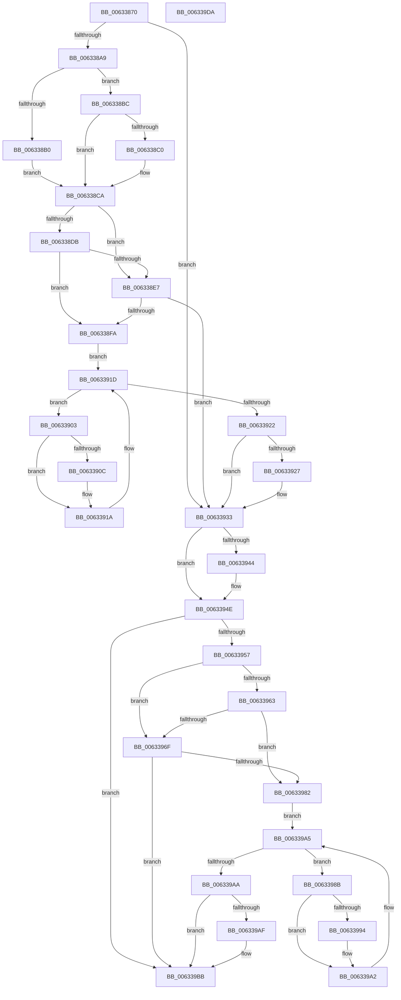

# DifKfRaiseIrqlWrapper

- RVA: `0x00633870`–`0x006339DB` (길이 `363` bytes)
- VA: `0x0000000140633870`
- 실행 섹션: `.text`
- PDB 이름 있음: `예`; PDB Function 태그: `아니요`
- unwind 정보 RVA: `0x0005D7BC`
- 디코드: `97`개 명령, `363/363` bytes 표시
- 미해석 바이트: `0` (있으면 어셈블리에 `.byte`로 보존)

> 이 문서는 커널 이미지의 기계어와 PDB 기호를 분석해 생성했습니다. 4번과 5번은 함수 원형과 자료형을 바이너리 사용 방식에서 추정한 C 해석이며 원본 소스 복구 결과는 아닙니다.

## 1. Dependencies

- 직접 호출 지점: **9**; 고유 호출 대상: **6**
- 직접 호출자로 확인된 함수: **0**
- RIP 상대 이미지 참조: **4**

### Outgoing calls
- `0x00633898` → [DifGetAPIThunkContextById](../49/DifGetAPIThunkContextById_function_00495A34.md) (function, `0x00495A34`)
- `0x006338C0` → [DifGetReturnAddressForWrappers](../4D/DifGetReturnAddressForWrappers_function_004D3C08.md) (function, `0x004D3C08`)
- `0x006338EE` → [ExAcquireRundownProtection](../21/ExAcquireRundownProtection_function_00216620.md) (function, `0x00216620`)
- `0x00633915` → [guard_dispatch_icall](../6B/guard_dispatch_icall_function_006BAAD0.md) (function, `0x006BAAD0`)
- `0x0063392E` → [ExReleaseRundownProtection](../34/ExReleaseRundownProtection_function_00349E80.md) (function, `0x00349E80`)
- `0x00633949` → [KiRaiseIrqlProcessIrqlFlags](../4F/KiRaiseIrqlProcessIrqlFlags_function_004F56FC.md) (function, `0x004F56FC`)
- `0x00633976` → [ExAcquireRundownProtection](../21/ExAcquireRundownProtection_function_00216620.md) (function, `0x00216620`)
- `0x0063399D` → [guard_dispatch_icall](../6B/guard_dispatch_icall_function_006BAAD0.md) (function, `0x006BAAD0`)
- `0x006339B6` → [ExReleaseRundownProtection](../34/ExReleaseRundownProtection_function_00349E80.md) (function, `0x00349E80`)

### Direct callers
- 이 함수 시작 RVA로 연결되는 직접 call은 확인되지 않았습니다. 간접 호출은 완전히 역산할 수 없습니다.

### Static image references
- `0x006338D2` → RVA `0x00F048B8` (`.data`; read)
- `0x006338DB` → RVA `0x00F04980` (`.data`; read)
- `0x006338E7` → RVA `0x00F03E80` (`.data`; read)
- `0x0063393B` → RVA `0x00FC6D20` (`ALMOSTRO`; read)

## 2. Other-region calls and transfers

- 다른 실행 섹션으로 향하는 call: **0**
- 별도 외부 분기/꼬리 이동을 확인하지 못했습니다.

## 3. Assembly (complete function range)

```asm
00633870  48 8B C4                        mov rax, rsp
00633873  48 89 58 08                     mov qword ptr [rax + 8], rbx
00633877  48 89 68 10                     mov qword ptr [rax + 0x10], rbp
0063387B  48 89 70 18                     mov qword ptr [rax + 0x18], rsi
0063387F  48 89 78 20                     mov qword ptr [rax + 0x20], rdi
00633883  41 56                           push r14
00633885  48 83 EC 30                     sub rsp, 0x30
00633889  0F B6 E9                        movzx ebp, cl
0063388C  0F 57 C0                        xorps xmm0, xmm0
0063388F  B9 EF 00 00 00                  mov ecx, 0xef
00633894  0F 11 40 E8                     movups xmmword ptr [rax - 0x18], xmm0
00633898  E8 97 21 E6 FF                  call 0x140495a34
0063389D  48 8B F0                        mov rsi, rax
006338A0  48 85 C0                        test rax, rax
006338A3  0F 84 8A 00 00 00               je 0x140633933
006338A9  8B 40 0C                        mov eax, dword ptr [rax + 0xc]
006338AC  A8 18                           test al, 0x18
006338AE  74 0C                           je 0x1406338bc
006338B0  48 8B 4C 24 38                  mov rcx, qword ptr [rsp + 0x38]
006338B5  48 89 4C 24 20                  mov qword ptr [rsp + 0x20], rcx
006338BA  EB 0E                           jmp 0x1406338ca
006338BC  A8 04                           test al, 4
006338BE  74 0A                           je 0x1406338ca
006338C0  E8 43 03 EA FF                  call 0x1404d3c08
006338C5  48 89 44 24 20                  mov qword ptr [rsp + 0x20], rax
006338CA  40 32 FF                        xor dil, dil
006338CD  40 88 6C 24 28                  mov byte ptr [rsp + 0x28], bpl
006338D2  40 38 3D DF 0F 8D 00            cmp byte ptr [rip + 0x8d0fdf], dil
006338D9  75 0C                           jne 0x1406338e7
006338DB  F7 05 9B 10 8D 00 00 08 00 00   test dword ptr [rip + 0x8d109b], 0x800
006338E5  74 13                           je 0x1406338fa
006338E7  48 8D 0D 92 05 8D 00            lea rcx, [rip + 0x8d0592]
006338EE  E8 2D 2D BE FF                  call 0x140216620
006338F3  40 8A F8                        mov dil, al
006338F6  84 C0                           test al, al
006338F8  74 39                           je 0x140633933
006338FA  4C 8D 76 20                     lea r14, [rsi + 0x20]
006338FE  49 8B 1E                        mov rbx, qword ptr [r14]
00633901  EB 1A                           jmp 0x14063391d
00633903  48 8D 43 F0                     lea rax, [rbx - 0x10]
00633907  48 85 C0                        test rax, rax
0063390A  74 0E                           je 0x14063391a
0063390C  48 8B 40 08                     mov rax, qword ptr [rax + 8]
00633910  48 8D 4C 24 20                  lea rcx, [rsp + 0x20]
00633915  E8 B6 71 08 00                  call 0x1406baad0
0063391A  48 8B 1B                        mov rbx, qword ptr [rbx]
0063391D  49 3B DE                        cmp rbx, r14
00633920  75 E1                           jne 0x140633903
00633922  40 84 FF                        test dil, dil
00633925  74 0C                           je 0x140633933
00633927  48 8D 0D 52 05 8D 00            lea rcx, [rip + 0x8d0552]
0063392E  E8 4D 65 D1 FF                  call 0x140349e80
00633933  44 0F 20 C3                     mov rbx, cr8
00633937  44 0F 22 C5                     mov cr8, rbp
0063393B  83 3D DE 33 99 00 00            cmp dword ptr [rip + 0x9933de], 0
00633942  74 0A                           je 0x14063394e
00633944  40 8A D5                        mov dl, bpl
00633947  8A CB                           mov cl, bl
00633949  E8 AE 1D EC FF                  call 0x1404f56fc
0063394E  88 5C 24 29                     mov byte ptr [rsp + 0x29], bl
00633952  48 85 F6                        test rsi, rsi
00633955  74 64                           je 0x1406339bb
00633957  40 32 FF                        xor dil, dil
0063395A  40 38 3D 57 0F 8D 00            cmp byte ptr [rip + 0x8d0f57], dil
00633961  75 0C                           jne 0x14063396f
00633963  F7 05 13 10 8D 00 00 08 00 00   test dword ptr [rip + 0x8d1013], 0x800
0063396D  74 13                           je 0x140633982
0063396F  48 8D 0D 0A 05 8D 00            lea rcx, [rip + 0x8d050a]
00633976  E8 A5 2C BE FF                  call 0x140216620
0063397B  40 8A F8                        mov dil, al
0063397E  84 C0                           test al, al
00633980  74 39                           je 0x1406339bb
00633982  48 83 C6 30                     add rsi, 0x30
00633986  48 8B 1E                        mov rbx, qword ptr [rsi]
00633989  EB 1A                           jmp 0x1406339a5
0063398B  48 8D 43 F0                     lea rax, [rbx - 0x10]
0063398F  48 85 C0                        test rax, rax
00633992  74 0E                           je 0x1406339a2
00633994  48 8B 40 08                     mov rax, qword ptr [rax + 8]
00633998  48 8D 4C 24 20                  lea rcx, [rsp + 0x20]
0063399D  E8 2E 71 08 00                  call 0x1406baad0
006339A2  48 8B 1B                        mov rbx, qword ptr [rbx]
006339A5  48 3B DE                        cmp rbx, rsi
006339A8  75 E1                           jne 0x14063398b
006339AA  40 84 FF                        test dil, dil
006339AD  74 0C                           je 0x1406339bb
006339AF  48 8D 0D CA 04 8D 00            lea rcx, [rip + 0x8d04ca]
006339B6  E8 C5 64 D1 FF                  call 0x140349e80
006339BB  8A 44 24 29                     mov al, byte ptr [rsp + 0x29]
006339BF  48 8B 5C 24 40                  mov rbx, qword ptr [rsp + 0x40]
006339C4  48 8B 6C 24 48                  mov rbp, qword ptr [rsp + 0x48]
006339C9  48 8B 74 24 50                  mov rsi, qword ptr [rsp + 0x50]
006339CE  48 8B 7C 24 58                  mov rdi, qword ptr [rsp + 0x58]
006339D3  48 83 C4 30                     add rsp, 0x30
006339D7  41 5E                           pop r14
006339D9  C3                              ret
006339DA  CC                              int3
```

## 4. C-style interpretation (structured pseudocode)

```c
__int64 __fastcall DifKfRaiseIrqlWrapper(unsigned __int8 a1)
{
    __int64 result;
    __int64 v_rdi;
    __int64 v_rsi;
    __int64 v_rsp;
    unsigned __int8 v_stack_m10;
    unsigned __int64 v_stack_m18;
    unsigned __int8 v_stack_mF;
    unsigned __int64 v_stack_p0;
    unsigned __int64 v_stack_p10;
    unsigned __int64 v_stack_p18;
    unsigned __int64 v_stack_p20;
    unsigned __int64 v_stack_p8;

    *(unsigned __int64 *)(v_rsp + 8) = v_rbx;
    *(unsigned __int64 *)(v_rsp + 16) = v_rbp;
    *(unsigned __int64 *)(v_rsp + 24) = v_rsi;
    *(unsigned __int64 *)(v_rsp + 32) = v_rdi;
    v_rsp = (v_rsp) - (48);
    *(unsigned __int64 *)(v_rsp - 24) = v_xmm0;
    result = DifGetAPIThunkContextById(239, a2, a3, a4);
    if (result == 0) goto loc_00633933;
    if ((((unsigned __int8)((unsigned int)(*(unsigned int *)(result + 12)))) & (24)) == 0) goto loc_006338BC;
    v_stack_m18 = v_stack_p0;
    goto loc_006338CA;
loc_006338BC:
    result = (unsigned int)(*(unsigned int *)(result + 12));
    if ((((unsigned __int8)((unsigned int)(*(unsigned int *)(result + 12)))) & (4)) != 0) {
        result = DifGetReturnAddressForWrappers(v_stack_p0, a2, a3, a4);
        v_stack_m18 = result;
    }
    v_rdi = 0;
    v_stack_m10 = a1;
    if ((*(unsigned __int8 *)(v_rip + 9244639)) != 0) goto loc_006338E7;
    if (((*(unsigned int *)(v_rip + 9244827)) & (0x800ULL)) == 0) goto loc_006338FA;
loc_006338E7:
    result = ExAcquireRundownProtection(v_rip + 9242002, a2, a3, a4);
    if ((unsigned __int8)(result) == 0) goto loc_00633933;
loc_006338FA:
    goto loc_0063391D;
loc_00633903:
    result = *(unsigned __int64 *)(result + 32) - 16;
    if (*(unsigned __int64 *)(result + 32) - 16 != 0) {
        result = *(unsigned __int64 *)(*(unsigned __int64 *)(result + 32) - 16 + 8);
        a1 = v_stack_m18;
        result = guard_dispatch_icall(a1, a2, a3, a4);
    }
loc_0063391D:
    if ((*(unsigned __int64 *)(*(unsigned __int64 *)(result + 32))) != (result + 32)) goto loc_00633903;
    if ((unsigned __int8)((unsigned __int8)(result)) != 0) {
        a1 = v_rip + 9241938;
        result = ExReleaseRundownProtection(a1, a2, a3, a4);
    }
    if ((*(unsigned int *)(v_rip + 10040286)) != 0) {
        a2 = a1;
        a1 = (unsigned __int8)(v_cr8);
        result = KiRaiseIrqlProcessIrqlFlags(a1, a2, a3, a4);
    }
    v_stack_mF = (unsigned __int8)(v_cr8);
    if (result == 0) goto loc_006339BB;
    v_rdi = 0;
    if ((*(unsigned __int8 *)(v_rip + 9244503)) != 0) goto loc_0063396F;
    if (((*(unsigned int *)(v_rip + 9244691)) & (0x800ULL)) == 0) goto loc_00633982;
loc_0063396F:
    result = ExAcquireRundownProtection(v_rip + 9241866, a2, a3, a4);
    if ((unsigned __int8)(result) == 0) goto loc_006339BB;
loc_00633982:
    v_rsi = (result) + (48);
    goto loc_006339A5;
loc_0063398B:
    result = *(unsigned __int64 *)(v_rsi) - 16;
    if (*(unsigned __int64 *)(v_rsi) - 16 != 0) {
        result = *(unsigned __int64 *)(*(unsigned __int64 *)(v_rsi) - 16 + 8);
        a1 = v_stack_m18;
        result = guard_dispatch_icall(a1, a2, a3, a4);
    }
loc_006339A5:
    if ((*(unsigned __int64 *)(*(unsigned __int64 *)(v_rsi))) != v_rsi) goto loc_0063398B;
    if ((unsigned __int8)((unsigned __int8)(result)) != 0) {
        a1 = v_rip + 9241802;
        result = ExReleaseRundownProtection(a1, a2, a3, a4);
    }
    v_rsp = (v_rsp) + (48);
    return v_stack_mF;
}
```

## 5. (Beta) C Style

```c
int64_t DifKfRaiseIrqlWrapper(uint8_t Arg1)
{
    int64_t result;
    int64_t local_rdi;
    int64_t local_rsi;
    int64_t local_rsp;
    uint8_t v_stack_m10;
    uint64_t v_stack_m18;
    uint8_t v_stack_mF;
    uint64_t v_stack_p0;
    uint64_t v_stack_p10;
    uint64_t v_stack_p18;
    uint64_t v_stack_p20;
    uint64_t v_stack_p8;

    *(uint64_t *)(local_rsp + 0x8) = local_rbx;
    *(uint64_t *)(local_rsp + 0x10) = local_rbp;
    *(uint64_t *)(local_rsp + 0x18) = local_rsi;
    *(uint64_t *)(local_rsp + 0x20) = local_rdi;
    local_rsp = (local_rsp) - (48);
    *(uint64_t *)(local_rsp - 0x18) = v_xmm0;
    result = DifGetAPIThunkContextById(239, a2, a3, a4);
    if (result == 0) goto loc_00633933;
    if ((((uint8_t)((uint32_t)(*(uint32_t *)(result + 0xC)))) & (24)) == 0) goto loc_006338BC;
    v_stack_m18 = v_stack_p0;
    goto loc_006338CA;
loc_006338BC:
    result = (uint32_t)(*(uint32_t *)(result + 0xC));
    if ((((uint8_t)((uint32_t)(*(uint32_t *)(result + 0xC)))) & (4)) != 0) {
        result = DifGetReturnAddressForWrappers(v_stack_p0, a2, a3, a4);
        v_stack_m18 = result;
    }
    local_rdi = 0;
    v_stack_m10 = Arg1;
    if ((*(uint8_t *)(v_rip + 0x8D0FDF)) != 0) goto loc_006338E7;
    if (((*(uint32_t *)(v_rip + 0x8D109B)) & (0x800ULL)) == 0) goto loc_006338FA;
loc_006338E7:
    result = ExAcquireRundownProtection(v_rip + 9242002, a2, a3, a4);
    if ((uint8_t)(result) == 0) goto loc_00633933;
loc_006338FA:
    goto loc_0063391D;
loc_00633903:
    result = *(uint64_t *)(result + 0x20) - 16;
    if (*(uint64_t *)(result + 0x20) - 16 != 0) {
        result = *(uint64_t *)(*(uint64_t *)(result + 0x20) - 0x10 + 0x8);
        Arg1 = v_stack_m18;
        result = guard_dispatch_icall(Arg1, a2, a3, a4);
    }
loc_0063391D:
    if ((*(uint64_t *)(*(uint64_t *)(result + 0x20))) != (result + 32)) goto loc_00633903;
    if ((uint8_t)((uint8_t)(result)) != 0) {
        Arg1 = v_rip + 9241938;
        result = ExReleaseRundownProtection(Arg1, a2, a3, a4);
    }
    if ((*(uint32_t *)(v_rip + 0x9933DE)) != 0) {
        a2 = Arg1;
        Arg1 = (uint8_t)(v_cr8);
        result = KiRaiseIrqlProcessIrqlFlags(Arg1, a2, a3, a4);
    }
    v_stack_mF = (uint8_t)(v_cr8);
    if (result == 0) goto loc_006339BB;
    local_rdi = 0;
    if ((*(uint8_t *)(v_rip + 0x8D0F57)) != 0) goto loc_0063396F;
    if (((*(uint32_t *)(v_rip + 0x8D1013)) & (0x800ULL)) == 0) goto loc_00633982;
loc_0063396F:
    result = ExAcquireRundownProtection(v_rip + 9241866, a2, a3, a4);
    if ((uint8_t)(result) == 0) goto loc_006339BB;
loc_00633982:
    local_rsi = (result) + (48);
    goto loc_006339A5;
loc_0063398B:
    result = *(uint64_t *)(local_rsi) - 16;
    if (*(uint64_t *)(local_rsi) - 16 != 0) {
        result = *(uint64_t *)(*(uint64_t *)(local_rsi) - 0x10 + 0x8);
        Arg1 = v_stack_m18;
        result = guard_dispatch_icall(Arg1, a2, a3, a4);
    }
loc_006339A5:
    if ((*(uint64_t *)(*(uint64_t *)(local_rsi))) != local_rsi) goto loc_0063398B;
    if ((uint8_t)((uint8_t)(result)) != 0) {
        Arg1 = v_rip + 9241802;
        result = ExReleaseRundownProtection(Arg1, a2, a3, a4);
    }
    local_rsp = (local_rsp) + (48);
    return v_stack_mF;
}
```

## 6. Execution-region graph

[열기: 2D/3D 그래프와 함수 탐색 컨트롤 패널](../../../control-panel.html?section=text&rva=0x00633870&view=graph)

- 2D 그래프는 위에서 아래로 흐르고, 3D 그래프는 빈 공간을 드래그해 회전합니다. Shift+드래그는 이동, 휠은 확대·축소, 함수 노드 선택은 대상 보고서 이동입니다.

### Static fallback


