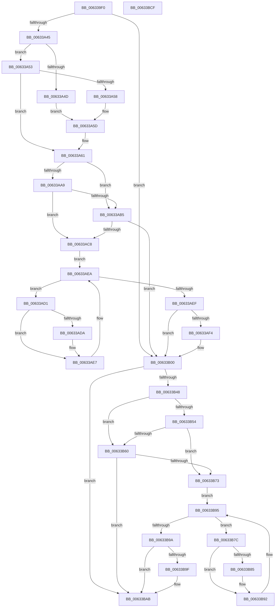

# DifMmAllocateContiguousMemoryExWrapper

- RVA: `0x006339F0`–`0x00633BD0` (길이 `480` bytes)
- VA: `0x00000001406339F0`
- 실행 섹션: `.text`
- PDB 이름 있음: `예`; PDB Function 태그: `아니요`
- unwind 정보 RVA: `0x000D2C98`
- 디코드: `135`개 명령, `480/480` bytes 표시
- 미해석 바이트: `0` (있으면 어셈블리에 `.byte`로 보존)

> 이 문서는 커널 이미지의 기계어와 PDB 기호를 분석해 생성했습니다. 4번과 5번은 함수 원형과 자료형을 바이너리 사용 방식에서 추정한 C 해석이며 원본 소스 복구 결과는 아닙니다.

## 1. Dependencies

- 직접 호출 지점: **10**; 고유 호출 대상: **7**
- 직접 호출자로 확인된 함수: **0**
- RIP 상대 이미지 참조: **3**

### Outgoing calls
- `0x00633A2A` → [memset](../6C/memset_function_006C6C40.md) (function, `0x006C6C40`)
- `0x00633A34` → [DifGetAPIThunkContextById](../49/DifGetAPIThunkContextById_function_00495A34.md) (function, `0x00495A34`)
- `0x00633A58` → [DifGetReturnAddressForWrappers](../4D/DifGetReturnAddressForWrappers_function_004D3C08.md) (function, `0x004D3C08`)
- `0x00633ABC` → [ExAcquireRundownProtection](../21/ExAcquireRundownProtection_function_00216620.md) (function, `0x00216620`)
- `0x00633AE2` → [guard_dispatch_icall](../6B/guard_dispatch_icall_function_006BAAD0.md) (function, `0x006BAAD0`)
- `0x00633AFB` → [ExReleaseRundownProtection](../34/ExReleaseRundownProtection_function_00349E80.md) (function, `0x00349E80`)
- `0x00633B3B` → [MmAllocateContiguousMemoryEx](../3E/MmAllocateContiguousMemoryEx_function_003E9B80.md) (function, `0x003E9B80`)
- `0x00633B67` → [ExAcquireRundownProtection](../21/ExAcquireRundownProtection_function_00216620.md) (function, `0x00216620`)
- `0x00633B8D` → [guard_dispatch_icall](../6B/guard_dispatch_icall_function_006BAAD0.md) (function, `0x006BAAD0`)
- `0x00633BA6` → [ExReleaseRundownProtection](../34/ExReleaseRundownProtection_function_00349E80.md) (function, `0x00349E80`)

### Direct callers
- 이 함수 시작 RVA로 연결되는 직접 call은 확인되지 않았습니다. 간접 호출은 완전히 역산할 수 없습니다.

### Static image references
- `0x00633A68` → RVA `0x00F048B8` (`.data`; read)
- `0x00633AA9` → RVA `0x00F04980` (`.data`; read)
- `0x00633AB5` → RVA `0x00F03E80` (`.data`; read)

## 2. Other-region calls and transfers

- 다른 실행 섹션으로 향하는 call: **0**
- 별도 외부 분기/꼬리 이동을 확인하지 못했습니다.

## 3. Assembly (complete function range)

```asm
006339F0  48 8B C4                        mov rax, rsp
006339F3  48 89 58 10                     mov qword ptr [rax + 0x10], rbx
006339F7  48 89 70 18                     mov qword ptr [rax + 0x18], rsi
006339FB  48 89 78 20                     mov qword ptr [rax + 0x20], rdi
006339FF  48 89 48 08                     mov qword ptr [rax + 8], rcx
00633A03  55                              push rbp
00633A04  41 54                           push r12
00633A06  41 55                           push r13
00633A08  41 56                           push r14
00633A0A  41 57                           push r15
00633A0C  48 8D 68 D1                     lea rbp, [rax - 0x2f]
00633A10  48 81 EC A0 00 00 00            sub rsp, 0xa0
00633A17  48 8B F2                        mov rsi, rdx
00633A1A  48 8D 4D B7                     lea rcx, [rbp - 0x49]
00633A1E  33 D2                           xor edx, edx
00633A20  49 8B F8                        mov rdi, r8
00633A23  49 8B D9                        mov rbx, r9
00633A26  44 8D 42 50                     lea r8d, [rdx + 0x50]
00633A2A  E8 11 32 09 00                  call 0x1406c6c40
00633A2F  B9 ED 00 00 00                  mov ecx, 0xed
00633A34  E8 FB 1F E6 FF                  call 0x140495a34
00633A39  4C 8B E8                        mov r13, rax
00633A3C  48 85 C0                        test rax, rax
00633A3F  0F 84 BB 00 00 00               je 0x140633b00
00633A45  8B 48 0C                        mov ecx, dword ptr [rax + 0xc]
00633A48  F6 C1 18                        test cl, 0x18
00633A4B  74 06                           je 0x140633a53
00633A4D  48 8B 45 2F                     mov rax, qword ptr [rbp + 0x2f]
00633A51  EB 0A                           jmp 0x140633a5d
00633A53  F6 C1 04                        test cl, 4
00633A56  74 09                           je 0x140633a61
00633A58  E8 AB 01 EA FF                  call 0x1404d3c08
00633A5D  48 89 45 B7                     mov qword ptr [rbp - 0x49], rax
00633A61  48 8B 45 37                     mov rax, qword ptr [rbp + 0x37]
00633A65  45 32 E4                        xor r12b, r12b
00633A68  44 38 25 49 0E 8D 00            cmp byte ptr [rip + 0x8d0e49], r12b
00633A6F  48 89 45 F7                     mov qword ptr [rbp - 9], rax
00633A73  8B 45 57                        mov eax, dword ptr [rbp + 0x57]
00633A76  89 45 DB                        mov dword ptr [rbp - 0x25], eax
00633A79  8B 45 5F                        mov eax, dword ptr [rbp + 0x5f]
00633A7C  89 45 D7                        mov dword ptr [rbp - 0x29], eax
00633A7F  48 8B 45 67                     mov rax, qword ptr [rbp + 0x67]
00633A83  48 89 45 CF                     mov qword ptr [rbp - 0x31], rax
00633A87  8B 45 6F                        mov eax, dword ptr [rbp + 0x6f]
00633A8A  89 45 CB                        mov dword ptr [rbp - 0x35], eax
00633A8D  8B 45 77                        mov eax, dword ptr [rbp + 0x77]
00633A90  89 45 C7                        mov dword ptr [rbp - 0x39], eax
00633A93  48 8B 45 7F                     mov rax, qword ptr [rbp + 0x7f]
00633A97  48 89 45 BF                     mov qword ptr [rbp - 0x41], rax
00633A9B  48 89 75 EF                     mov qword ptr [rbp - 0x11], rsi
00633A9F  48 89 7D E7                     mov qword ptr [rbp - 0x19], rdi
00633AA3  48 89 5D DF                     mov qword ptr [rbp - 0x21], rbx
00633AA7  75 0C                           jne 0x140633ab5
00633AA9  F7 05 CD 0E 8D 00 00 08 00 00   test dword ptr [rip + 0x8d0ecd], 0x800
00633AB3  74 13                           je 0x140633ac8
00633AB5  48 8D 0D C4 03 8D 00            lea rcx, [rip + 0x8d03c4]
00633ABC  E8 5F 2B BE FF                  call 0x140216620
00633AC1  44 8A E0                        mov r12b, al
00633AC4  84 C0                           test al, al
00633AC6  74 38                           je 0x140633b00
00633AC8  4D 8D 7D 20                     lea r15, [r13 + 0x20]
00633ACC  4D 8B 37                        mov r14, qword ptr [r15]
00633ACF  EB 19                           jmp 0x140633aea
00633AD1  49 8D 46 F0                     lea rax, [r14 - 0x10]
00633AD5  48 85 C0                        test rax, rax
00633AD8  74 0D                           je 0x140633ae7
00633ADA  48 8B 40 08                     mov rax, qword ptr [rax + 8]
00633ADE  48 8D 4D B7                     lea rcx, [rbp - 0x49]
00633AE2  E8 E9 6F 08 00                  call 0x1406baad0
00633AE7  4D 8B 36                        mov r14, qword ptr [r14]
00633AEA  4D 3B F7                        cmp r14, r15
00633AED  75 E2                           jne 0x140633ad1
00633AEF  45 84 E4                        test r12b, r12b
00633AF2  74 0C                           je 0x140633b00
00633AF4  48 8D 0D 85 03 8D 00            lea rcx, [rip + 0x8d0385]
00633AFB  E8 80 63 D1 FF                  call 0x140349e80
00633B00  48 8B 45 7F                     mov rax, qword ptr [rbp + 0x7f]
00633B04  4C 8B CB                        mov r9, rbx
00633B07  48 8B 4D 37                     mov rcx, qword ptr [rbp + 0x37]
00633B0B  4C 8B C7                        mov r8, rdi
00633B0E  48 89 44 24 48                  mov qword ptr [rsp + 0x48], rax
00633B13  48 8B D6                        mov rdx, rsi
00633B16  8B 45 77                        mov eax, dword ptr [rbp + 0x77]
00633B19  89 44 24 40                     mov dword ptr [rsp + 0x40], eax
00633B1D  8B 45 6F                        mov eax, dword ptr [rbp + 0x6f]
00633B20  89 44 24 38                     mov dword ptr [rsp + 0x38], eax
00633B24  48 8B 45 67                     mov rax, qword ptr [rbp + 0x67]
00633B28  48 89 44 24 30                  mov qword ptr [rsp + 0x30], rax
00633B2D  8B 45 5F                        mov eax, dword ptr [rbp + 0x5f]
00633B30  89 44 24 28                     mov dword ptr [rsp + 0x28], eax
00633B34  8B 45 57                        mov eax, dword ptr [rbp + 0x57]
00633B37  89 44 24 20                     mov dword ptr [rsp + 0x20], eax
00633B3B  E8 40 60 DB FF                  call 0x1403e9b80
00633B40  89 45 FF                        mov dword ptr [rbp - 1], eax
00633B43  4D 85 ED                        test r13, r13
00633B46  74 63                           je 0x140633bab
00633B48  40 32 FF                        xor dil, dil
00633B4B  40 38 3D 66 0D 8D 00            cmp byte ptr [rip + 0x8d0d66], dil
00633B52  75 0C                           jne 0x140633b60
00633B54  F7 05 22 0E 8D 00 00 08 00 00   test dword ptr [rip + 0x8d0e22], 0x800
00633B5E  74 13                           je 0x140633b73
00633B60  48 8D 0D 19 03 8D 00            lea rcx, [rip + 0x8d0319]
00633B67  E8 B4 2A BE FF                  call 0x140216620
00633B6C  40 8A F8                        mov dil, al
00633B6F  84 C0                           test al, al
00633B71  74 38                           je 0x140633bab
00633B73  49 8D 75 30                     lea rsi, [r13 + 0x30]
00633B77  48 8B 1E                        mov rbx, qword ptr [rsi]
00633B7A  EB 19                           jmp 0x140633b95
00633B7C  48 8D 43 F0                     lea rax, [rbx - 0x10]
00633B80  48 85 C0                        test rax, rax
00633B83  74 0D                           je 0x140633b92
00633B85  48 8B 40 08                     mov rax, qword ptr [rax + 8]
00633B89  48 8D 4D B7                     lea rcx, [rbp - 0x49]
00633B8D  E8 3E 6F 08 00                  call 0x1406baad0
00633B92  48 8B 1B                        mov rbx, qword ptr [rbx]
00633B95  48 3B DE                        cmp rbx, rsi
00633B98  75 E2                           jne 0x140633b7c
00633B9A  40 84 FF                        test dil, dil
00633B9D  74 0C                           je 0x140633bab
00633B9F  48 8D 0D DA 02 8D 00            lea rcx, [rip + 0x8d02da]
00633BA6  E8 D5 62 D1 FF                  call 0x140349e80
00633BAB  8B 45 FF                        mov eax, dword ptr [rbp - 1]
00633BAE  4C 8D 9C 24 A0 00 00 00         lea r11, [rsp + 0xa0]
00633BB6  49 8B 5B 38                     mov rbx, qword ptr [r11 + 0x38]
00633BBA  49 8B 73 40                     mov rsi, qword ptr [r11 + 0x40]
00633BBE  49 8B 7B 48                     mov rdi, qword ptr [r11 + 0x48]
00633BC2  49 8B E3                        mov rsp, r11
00633BC5  41 5F                           pop r15
00633BC7  41 5E                           pop r14
00633BC9  41 5D                           pop r13
00633BCB  41 5C                           pop r12
00633BCD  5D                              pop rbp
00633BCE  C3                              ret
00633BCF  CC                              int3
```

## 4. C-style interpretation (structured pseudocode)

```c
__int64 __fastcall DifMmAllocateContiguousMemoryExWrapper(__int64 a1, __int64 a2, __int64 a3, __int64 a4)
{
    __int64 result;
    __int64 v_r12;
    __int64 v_rdi;
    __int64 v_rsp;
    unsigned __int64 v_stack_m28;
    unsigned __int64 v_stack_m80;
    unsigned int v_stack_m88;
    unsigned int v_stack_m90;
    unsigned __int64 v_stack_m98;
    unsigned int v_stack_mA0;
    unsigned int v_stack_mA8;

    *(unsigned __int64 *)(v_rsp + 16) = v_rbx;
    *(unsigned __int64 *)(v_rsp + 24) = v_rsi;
    *(unsigned __int64 *)(v_rsp + 32) = v_rdi;
    *(unsigned __int64 *)(v_rsp + 8) = a1;
    v_rsp = (v_rsp) - (160);
    a2 = 0;
    result = memset(v_rsp - 47 - 73, a2, a2 + 80, a4);
    result = DifGetAPIThunkContextById(237, a2, a2 + 80, a4);
    if (result == 0) goto loc_00633B00;
    if ((((unsigned __int8)((unsigned int)(*(unsigned int *)(result + 12)))) & (24)) == 0) goto loc_00633A53;
    goto loc_00633A5D;
loc_00633A53:
    if ((((unsigned __int8)((unsigned int)(*(unsigned int *)(result + 12)))) & (4)) == 0) goto loc_00633A61;
    result = DifGetReturnAddressForWrappers((unsigned int)(*(unsigned int *)(result + 12)), a2, a2 + 80, a4);
loc_00633A5D:
    *(unsigned __int64 *)(v_rsp - 47 - 73) = result;
loc_00633A61:
    v_r12 = 0;
    *(unsigned __int64 *)(v_rsp - 47 - 9) = *(unsigned __int64 *)(v_rsp - 47 + 55);
    *(unsigned int *)(v_rsp - 47 - 37) = (unsigned int)((unsigned int)(*(unsigned int *)(v_rsp - 47 + 87)));
    *(unsigned int *)(v_rsp - 47 - 41) = (unsigned int)((unsigned int)(*(unsigned int *)(v_rsp - 47 + 95)));
    *(unsigned __int64 *)(v_rsp - 47 - 49) = *(unsigned __int64 *)(v_rsp - 47 + 103);
    *(unsigned int *)(v_rsp - 47 - 53) = (unsigned int)((unsigned int)(*(unsigned int *)(v_rsp - 47 + 111)));
    *(unsigned int *)(v_rsp - 47 - 57) = (unsigned int)((unsigned int)(*(unsigned int *)(v_rsp - 47 + 119)));
    *(unsigned __int64 *)(v_rsp - 47 - 65) = *(unsigned __int64 *)(v_rsp - 47 + 127);
    *(unsigned __int64 *)(v_rsp - 47 - 17) = 0;
    *(unsigned __int64 *)(v_rsp - 47 - 25) = a3;
    *(unsigned __int64 *)(v_rsp - 47 - 33) = a4;
    if ((*(unsigned __int8 *)(v_rip + 9244233)) != 0) goto loc_00633AB5;
    if (((*(unsigned int *)(v_rip + 9244365)) & (0x800ULL)) == 0) goto loc_00633AC8;
loc_00633AB5:
    result = ExAcquireRundownProtection(v_rip + 9241540, a2, a2 + 80, a4);
    if ((unsigned __int8)(result) == 0) goto loc_00633B00;
loc_00633AC8:
    goto loc_00633AEA;
loc_00633AD1:
    result = *(unsigned __int64 *)(result + 32) - 16;
    if (*(unsigned __int64 *)(result + 32) - 16 != 0) {
        result = *(unsigned __int64 *)(*(unsigned __int64 *)(result + 32) - 16 + 8);
        a1 = v_rsp - 47 - 73;
        result = guard_dispatch_icall(a1, a2, a2 + 80, a4);
    }
loc_00633AEA:
    if ((*(unsigned __int64 *)(*(unsigned __int64 *)(result + 32))) != (result + 32)) goto loc_00633AD1;
    if ((unsigned __int8)((unsigned __int8)(result)) != 0) {
        a1 = v_rip + 9241477;
        result = ExReleaseRundownProtection(a1, a2, a2 + 80, a4);
    }
    v_stack_m80 = *(unsigned __int64 *)(v_rsp - 47 + 127);
    v_stack_m88 = (unsigned int)((unsigned int)(*(unsigned int *)(v_rsp - 47 + 119)));
    v_stack_m90 = (unsigned int)((unsigned int)(*(unsigned int *)(v_rsp - 47 + 111)));
    v_stack_m98 = *(unsigned __int64 *)(v_rsp - 47 + 103);
    v_stack_mA0 = (unsigned int)((unsigned int)(*(unsigned int *)(v_rsp - 47 + 95)));
    v_stack_mA8 = (unsigned int)((unsigned int)(*(unsigned int *)(v_rsp - 47 + 87)));
    result = MmAllocateContiguousMemoryEx(*(unsigned __int64 *)(v_rsp - 47 + 55), 0, a3, a4);
    *(unsigned int *)(v_rsp - 47 - 1) = (unsigned int)(result);
    if (result == 0) goto loc_00633BAB;
    v_rdi = 0;
    if ((*(unsigned __int8 *)(v_rip + 9244006)) != 0) goto loc_00633B60;
    if (((*(unsigned int *)(v_rip + 9244194)) & (0x800ULL)) == 0) goto loc_00633B73;
loc_00633B60:
    result = ExAcquireRundownProtection(v_rip + 9241369, 0, a3, a4);
    if ((unsigned __int8)(result) == 0) goto loc_00633BAB;
loc_00633B73:
    goto loc_00633B95;
loc_00633B7C:
    result = *(unsigned __int64 *)(result + 48) - 16;
    if (*(unsigned __int64 *)(result + 48) - 16 != 0) {
        result = *(unsigned __int64 *)(*(unsigned __int64 *)(result + 48) - 16 + 8);
        a1 = v_rsp - 47 - 73;
        result = guard_dispatch_icall(a1, 0, a3, a4);
    }
loc_00633B95:
    if ((*(unsigned __int64 *)(*(unsigned __int64 *)(result + 48))) != (result + 48)) goto loc_00633B7C;
    if ((unsigned __int8)((unsigned __int8)(result)) != 0) {
        a1 = v_rip + 9241306;
        result = ExReleaseRundownProtection(a1, 0, a3, a4);
    }
    return (unsigned int)(*(unsigned int *)(v_rsp - 47 - 1));
}
```

## 5. (Beta) C Style

```c
int64_t DifMmAllocateContiguousMemoryExWrapper(int64_t Arg1, int64_t Arg2, int64_t Arg3, int64_t Arg4)
{
    int64_t result;
    int64_t local_r12;
    int64_t local_rdi;
    int64_t local_rsp;
    uint64_t v_stack_m28;
    uint64_t v_stack_m80;
    uint32_t v_stack_m88;
    uint32_t v_stack_m90;
    uint64_t v_stack_m98;
    uint32_t v_stack_mA0;
    uint32_t v_stack_mA8;

    *(uint64_t *)(local_rsp + 0x10) = local_rbx;
    *(uint64_t *)(local_rsp + 0x18) = local_rsi;
    *(uint64_t *)(local_rsp + 0x20) = local_rdi;
    *(uint64_t *)(local_rsp + 0x8) = Arg1;
    local_rsp = (local_rsp) - (160);
    Arg2 = 0;
    result = memset(local_rsp - 47 - 73, Arg2, Arg2 + 80, Arg4);
    result = DifGetAPIThunkContextById(237, Arg2, Arg2 + 80, Arg4);
    if (result == 0) goto loc_00633B00;
    if ((((uint8_t)((uint32_t)(*(uint32_t *)(result + 0xC)))) & (24)) == 0) goto loc_00633A53;
    goto loc_00633A5D;
loc_00633A53:
    if ((((uint8_t)((uint32_t)(*(uint32_t *)(result + 0xC)))) & (4)) == 0) goto loc_00633A61;
    result = DifGetReturnAddressForWrappers((uint32_t)(*(uint32_t *)(result + 0xC)), Arg2, Arg2 + 80, Arg4);
loc_00633A5D:
    *(uint64_t *)(local_rsp - 0x2F - 0x49) = result;
loc_00633A61:
    local_r12 = 0;
    *(uint64_t *)(local_rsp - 0x2F - 0x9) = *(uint64_t *)(local_rsp - 0x2F + 0x37);
    *(uint32_t *)(local_rsp - 0x2F - 0x25) = (uint32_t)((uint32_t)(*(uint32_t *)(local_rsp - 0x2F + 0x57)));
    *(uint32_t *)(local_rsp - 0x2F - 0x29) = (uint32_t)((uint32_t)(*(uint32_t *)(local_rsp - 0x2F + 0x5F)));
    *(uint64_t *)(local_rsp - 0x2F - 0x31) = *(uint64_t *)(local_rsp - 0x2F + 0x67);
    *(uint32_t *)(local_rsp - 0x2F - 0x35) = (uint32_t)((uint32_t)(*(uint32_t *)(local_rsp - 0x2F + 0x6F)));
    *(uint32_t *)(local_rsp - 0x2F - 0x39) = (uint32_t)((uint32_t)(*(uint32_t *)(local_rsp - 0x2F + 0x77)));
    *(uint64_t *)(local_rsp - 0x2F - 0x41) = *(uint64_t *)(local_rsp - 0x2F + 0x7F);
    *(uint64_t *)(local_rsp - 0x2F - 0x11) = 0;
    *(uint64_t *)(local_rsp - 0x2F - 0x19) = Arg3;
    *(uint64_t *)(local_rsp - 0x2F - 0x21) = Arg4;
    if ((*(uint8_t *)(v_rip + 0x8D0E49)) != 0) goto loc_00633AB5;
    if (((*(uint32_t *)(v_rip + 0x8D0ECD)) & (0x800ULL)) == 0) goto loc_00633AC8;
loc_00633AB5:
    result = ExAcquireRundownProtection(v_rip + 9241540, Arg2, Arg2 + 80, Arg4);
    if ((uint8_t)(result) == 0) goto loc_00633B00;
loc_00633AC8:
    goto loc_00633AEA;
loc_00633AD1:
    result = *(uint64_t *)(result + 0x20) - 16;
    if (*(uint64_t *)(result + 0x20) - 16 != 0) {
        result = *(uint64_t *)(*(uint64_t *)(result + 0x20) - 0x10 + 0x8);
        Arg1 = local_rsp - 47 - 73;
        result = guard_dispatch_icall(Arg1, Arg2, Arg2 + 80, Arg4);
    }
loc_00633AEA:
    if ((*(uint64_t *)(*(uint64_t *)(result + 0x20))) != (result + 32)) goto loc_00633AD1;
    if ((uint8_t)((uint8_t)(result)) != 0) {
        Arg1 = v_rip + 9241477;
        result = ExReleaseRundownProtection(Arg1, Arg2, Arg2 + 80, Arg4);
    }
    v_stack_m80 = *(uint64_t *)(local_rsp - 0x2F + 0x7F);
    v_stack_m88 = (uint32_t)((uint32_t)(*(uint32_t *)(local_rsp - 0x2F + 0x77)));
    v_stack_m90 = (uint32_t)((uint32_t)(*(uint32_t *)(local_rsp - 0x2F + 0x6F)));
    v_stack_m98 = *(uint64_t *)(local_rsp - 0x2F + 0x67);
    v_stack_mA0 = (uint32_t)((uint32_t)(*(uint32_t *)(local_rsp - 0x2F + 0x5F)));
    v_stack_mA8 = (uint32_t)((uint32_t)(*(uint32_t *)(local_rsp - 0x2F + 0x57)));
    result = MmAllocateContiguousMemoryEx(*(uint64_t *)(local_rsp - 0x2F + 0x37), 0, Arg3, Arg4);
    *(uint32_t *)(local_rsp - 0x2F - 0x1) = (uint32_t)(result);
    if (result == 0) goto loc_00633BAB;
    local_rdi = 0;
    if ((*(uint8_t *)(v_rip + 0x8D0D66)) != 0) goto loc_00633B60;
    if (((*(uint32_t *)(v_rip + 0x8D0E22)) & (0x800ULL)) == 0) goto loc_00633B73;
loc_00633B60:
    result = ExAcquireRundownProtection(v_rip + 9241369, 0, Arg3, Arg4);
    if ((uint8_t)(result) == 0) goto loc_00633BAB;
loc_00633B73:
    goto loc_00633B95;
loc_00633B7C:
    result = *(uint64_t *)(result + 0x30) - 16;
    if (*(uint64_t *)(result + 0x30) - 16 != 0) {
        result = *(uint64_t *)(*(uint64_t *)(result + 0x30) - 0x10 + 0x8);
        Arg1 = local_rsp - 47 - 73;
        result = guard_dispatch_icall(Arg1, 0, Arg3, Arg4);
    }
loc_00633B95:
    if ((*(uint64_t *)(*(uint64_t *)(result + 0x30))) != (result + 48)) goto loc_00633B7C;
    if ((uint8_t)((uint8_t)(result)) != 0) {
        Arg1 = v_rip + 9241306;
        result = ExReleaseRundownProtection(Arg1, 0, Arg3, Arg4);
    }
    return (uint32_t)(*(uint32_t *)(local_rsp - 0x2F - 0x1));
}
```

## 6. Execution-region graph

[열기: 2D/3D 그래프와 함수 탐색 컨트롤 패널](../../../control-panel.html?section=text&rva=0x006339F0&view=graph)

- 2D 그래프는 위에서 아래로 흐르고, 3D 그래프는 빈 공간을 드래그해 회전합니다. Shift+드래그는 이동, 휠은 확대·축소, 함수 노드 선택은 대상 보고서 이동입니다.

### Static fallback


