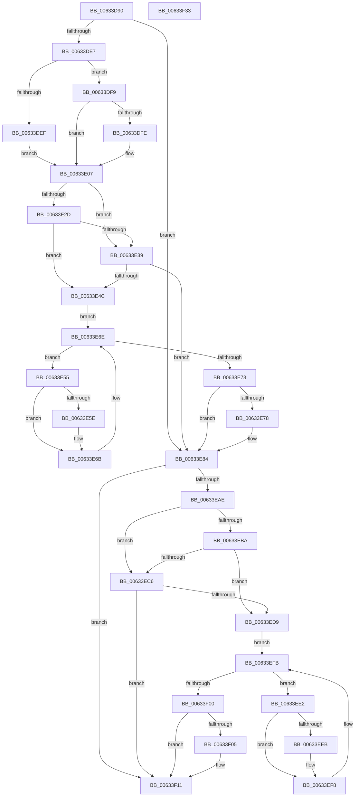

# DifMmAllocateContiguousMemorySpecifyCacheWrapper

- RVA: `0x00633D90`–`0x00633F34` (길이 `420` bytes)
- VA: `0x0000000140633D90`
- 실행 섹션: `.text`
- PDB 이름 있음: `예`; PDB Function 태그: `아니요`
- unwind 정보 RVA: `0x000BD780`
- 디코드: `119`개 명령, `420/420` bytes 표시
- 미해석 바이트: `0` (있으면 어셈블리에 `.byte`로 보존)

> 이 문서는 커널 이미지의 기계어와 PDB 기호를 분석해 생성했습니다. 4번과 5번은 함수 원형과 자료형을 바이너리 사용 방식에서 추정한 C 해석이며 원본 소스 복구 결과는 아닙니다.

## 1. Dependencies

- 직접 호출 지점: **9**; 고유 호출 대상: **6**
- 직접 호출자로 확인된 함수: **0**
- RIP 상대 이미지 참조: **3**

### Outgoing calls
- `0x00633DD6` → [DifGetAPIThunkContextById](../49/DifGetAPIThunkContextById_function_00495A34.md) (function, `0x00495A34`)
- `0x00633DFE` → [DifGetReturnAddressForWrappers](../4D/DifGetReturnAddressForWrappers_function_004D3C08.md) (function, `0x004D3C08`)
- `0x00633E40` → [ExAcquireRundownProtection](../21/ExAcquireRundownProtection_function_00216620.md) (function, `0x00216620`)
- `0x00633E66` → [guard_dispatch_icall](../6B/guard_dispatch_icall_function_006BAAD0.md) (function, `0x006BAAD0`)
- `0x00633E7F` → [ExReleaseRundownProtection](../34/ExReleaseRundownProtection_function_00349E80.md) (function, `0x00349E80`)
- `0x00633EA0` → [MmAllocateContiguousMemorySpecifyCacheNode](../3E/MmAllocateContiguousMemorySpecifyCacheNode_function_003E9D30.md) (function, `0x003E9D30`)
- `0x00633ECD` → [ExAcquireRundownProtection](../21/ExAcquireRundownProtection_function_00216620.md) (function, `0x00216620`)
- `0x00633EF3` → [guard_dispatch_icall](../6B/guard_dispatch_icall_function_006BAAD0.md) (function, `0x006BAAD0`)
- `0x00633F0C` → [ExReleaseRundownProtection](../34/ExReleaseRundownProtection_function_00349E80.md) (function, `0x00349E80`)

### Direct callers
- 이 함수 시작 RVA로 연결되는 직접 call은 확인되지 않았습니다. 간접 호출은 완전히 역산할 수 없습니다.

### Static image references
- `0x00633E0E` → RVA `0x00F048B8` (`.data`; read)
- `0x00633E2D` → RVA `0x00F04980` (`.data`; read)
- `0x00633E39` → RVA `0x00F03E80` (`.data`; read)

## 2. Other-region calls and transfers

- 다른 실행 섹션으로 향하는 call: **0**
- 별도 외부 분기/꼬리 이동을 확인하지 못했습니다.

## 3. Assembly (complete function range)

```asm
00633D90  48 8B C4                        mov rax, rsp
00633D93  48 89 58 10                     mov qword ptr [rax + 0x10], rbx
00633D97  48 89 70 18                     mov qword ptr [rax + 0x18], rsi
00633D9B  48 89 78 20                     mov qword ptr [rax + 0x20], rdi
00633D9F  48 89 48 08                     mov qword ptr [rax + 8], rcx
00633DA3  55                              push rbp
00633DA4  41 54                           push r12
00633DA6  41 55                           push r13
00633DA8  41 56                           push r14
00633DAA  41 57                           push r15
00633DAC  48 8B EC                        mov rbp, rsp
00633DAF  48 83 EC 70                     sub rsp, 0x70
00633DB3  0F 57 C0                        xorps xmm0, xmm0
00633DB6  33 C0                           xor eax, eax
00633DB8  B9 EC 00 00 00                  mov ecx, 0xec
00633DBD  48 89 45 F0                     mov qword ptr [rbp - 0x10], rax
00633DC1  0F 11 45 C0                     movups xmmword ptr [rbp - 0x40], xmm0
00633DC5  49 8B D9                        mov rbx, r9
00633DC8  49 8B F8                        mov rdi, r8
00633DCB  0F 11 45 D0                     movups xmmword ptr [rbp - 0x30], xmm0
00633DCF  48 8B F2                        mov rsi, rdx
00633DD2  0F 11 45 E0                     movups xmmword ptr [rbp - 0x20], xmm0
00633DD6  E8 59 1C E6 FF                  call 0x140495a34
00633DDB  4C 8B E8                        mov r13, rax
00633DDE  48 85 C0                        test rax, rax
00633DE1  0F 84 9D 00 00 00               je 0x140633e84
00633DE7  8B 48 0C                        mov ecx, dword ptr [rax + 0xc]
00633DEA  F6 C1 18                        test cl, 0x18
00633DED  74 0A                           je 0x140633df9
00633DEF  48 8B 4D 28                     mov rcx, qword ptr [rbp + 0x28]
00633DF3  48 89 4D C0                     mov qword ptr [rbp - 0x40], rcx
00633DF7  EB 0E                           jmp 0x140633e07
00633DF9  F6 C1 04                        test cl, 4
00633DFC  74 09                           je 0x140633e07
00633DFE  E8 05 FE E9 FF                  call 0x1404d3c08
00633E03  48 89 45 C0                     mov qword ptr [rbp - 0x40], rax
00633E07  48 8B 45 30                     mov rax, qword ptr [rbp + 0x30]
00633E0B  45 32 E4                        xor r12b, r12b
00633E0E  44 38 25 A3 0A 8D 00            cmp byte ptr [rip + 0x8d0aa3], r12b
00633E15  48 89 45 E8                     mov qword ptr [rbp - 0x18], rax
00633E19  8B 45 50                        mov eax, dword ptr [rbp + 0x50]
00633E1C  89 45 C8                        mov dword ptr [rbp - 0x38], eax
00633E1F  48 89 75 E0                     mov qword ptr [rbp - 0x20], rsi
00633E23  48 89 7D D8                     mov qword ptr [rbp - 0x28], rdi
00633E27  48 89 5D D0                     mov qword ptr [rbp - 0x30], rbx
00633E2B  75 0C                           jne 0x140633e39
00633E2D  F7 05 49 0B 8D 00 00 08 00 00   test dword ptr [rip + 0x8d0b49], 0x800
00633E37  74 13                           je 0x140633e4c
00633E39  48 8D 0D 40 00 8D 00            lea rcx, [rip + 0x8d0040]
00633E40  E8 DB 27 BE FF                  call 0x140216620
00633E45  44 8A E0                        mov r12b, al
00633E48  84 C0                           test al, al
00633E4A  74 38                           je 0x140633e84
00633E4C  4D 8D 7D 20                     lea r15, [r13 + 0x20]
00633E50  4D 8B 37                        mov r14, qword ptr [r15]
00633E53  EB 19                           jmp 0x140633e6e
00633E55  49 8D 46 F0                     lea rax, [r14 - 0x10]
00633E59  48 85 C0                        test rax, rax
00633E5C  74 0D                           je 0x140633e6b
00633E5E  48 8B 40 08                     mov rax, qword ptr [rax + 8]
00633E62  48 8D 4D C0                     lea rcx, [rbp - 0x40]
00633E66  E8 65 6C 08 00                  call 0x1406baad0
00633E6B  4D 8B 36                        mov r14, qword ptr [r14]
00633E6E  4D 3B F7                        cmp r14, r15
00633E71  75 E2                           jne 0x140633e55
00633E73  45 84 E4                        test r12b, r12b
00633E76  74 0C                           je 0x140633e84
00633E78  48 8D 0D 01 00 8D 00            lea rcx, [rip + 0x8d0001]
00633E7F  E8 FC 5F D1 FF                  call 0x140349e80
00633E84  8B 45 50                        mov eax, dword ptr [rbp + 0x50]
00633E87  4C 8B CB                        mov r9, rbx
00633E8A  48 8B 4D 30                     mov rcx, qword ptr [rbp + 0x30]
00633E8E  4C 8B C7                        mov r8, rdi
00633E91  C7 44 24 28 00 00 00 80         mov dword ptr [rsp + 0x28], 0x80000000
00633E99  48 8B D6                        mov rdx, rsi
00633E9C  89 44 24 20                     mov dword ptr [rsp + 0x20], eax
00633EA0  E8 8B 5E DB FF                  call 0x1403e9d30
00633EA5  48 89 45 F0                     mov qword ptr [rbp - 0x10], rax
00633EA9  4D 85 ED                        test r13, r13
00633EAC  74 63                           je 0x140633f11
00633EAE  40 32 FF                        xor dil, dil
00633EB1  40 38 3D 00 0A 8D 00            cmp byte ptr [rip + 0x8d0a00], dil
00633EB8  75 0C                           jne 0x140633ec6
00633EBA  F7 05 BC 0A 8D 00 00 08 00 00   test dword ptr [rip + 0x8d0abc], 0x800
00633EC4  74 13                           je 0x140633ed9
00633EC6  48 8D 0D B3 FF 8C 00            lea rcx, [rip + 0x8cffb3]
00633ECD  E8 4E 27 BE FF                  call 0x140216620
00633ED2  40 8A F8                        mov dil, al
00633ED5  84 C0                           test al, al
00633ED7  74 38                           je 0x140633f11
00633ED9  49 8D 75 30                     lea rsi, [r13 + 0x30]
00633EDD  48 8B 1E                        mov rbx, qword ptr [rsi]
00633EE0  EB 19                           jmp 0x140633efb
00633EE2  48 8D 43 F0                     lea rax, [rbx - 0x10]
00633EE6  48 85 C0                        test rax, rax
00633EE9  74 0D                           je 0x140633ef8
00633EEB  48 8B 40 08                     mov rax, qword ptr [rax + 8]
00633EEF  48 8D 4D C0                     lea rcx, [rbp - 0x40]
00633EF3  E8 D8 6B 08 00                  call 0x1406baad0
00633EF8  48 8B 1B                        mov rbx, qword ptr [rbx]
00633EFB  48 3B DE                        cmp rbx, rsi
00633EFE  75 E2                           jne 0x140633ee2
00633F00  40 84 FF                        test dil, dil
00633F03  74 0C                           je 0x140633f11
00633F05  48 8D 0D 74 FF 8C 00            lea rcx, [rip + 0x8cff74]
00633F0C  E8 6F 5F D1 FF                  call 0x140349e80
00633F11  48 8B 45 F0                     mov rax, qword ptr [rbp - 0x10]
00633F15  4C 8D 5C 24 70                  lea r11, [rsp + 0x70]
00633F1A  49 8B 5B 38                     mov rbx, qword ptr [r11 + 0x38]
00633F1E  49 8B 73 40                     mov rsi, qword ptr [r11 + 0x40]
00633F22  49 8B 7B 48                     mov rdi, qword ptr [r11 + 0x48]
00633F26  49 8B E3                        mov rsp, r11
00633F29  41 5F                           pop r15
00633F2B  41 5E                           pop r14
00633F2D  41 5D                           pop r13
00633F2F  41 5C                           pop r12
00633F31  5D                              pop rbp
00633F32  C3                              ret
00633F33  CC                              int3
```

## 4. C-style interpretation (structured pseudocode)

```c
__int64 __fastcall DifMmAllocateContiguousMemorySpecifyCacheWrapper(__int64 a1, __int64 a2, __int64 a3, __int64 a4, unsigned int a5)
{
    __int64 result;
    __int64 v_r12;
    __int64 v_rdi;
    __int64 v_rsp;
    unsigned __int64 v_stack_m28;
    unsigned __int64 v_stack_m38;
    unsigned __int64 v_stack_m40;
    unsigned __int64 v_stack_m48;
    unsigned __int64 v_stack_m50;
    unsigned __int64 v_stack_m58;
    unsigned int v_stack_m60;
    unsigned __int64 v_stack_m68;
    unsigned int v_stack_m70;
    unsigned int v_stack_m78;
    unsigned __int64 v_stack_p0;
    unsigned __int64 v_stack_p8;

    *(unsigned __int64 *)(v_rsp + 16) = v_rbx;
    *(unsigned __int64 *)(v_rsp + 24) = v_rsi;
    *(unsigned __int64 *)(v_rsp + 32) = v_rdi;
    *(unsigned __int64 *)(v_rsp + 8) = a1;
    v_rsp = (v_rsp) - (112);
    result = 0;
    v_stack_m38 = 0;
    v_stack_m68 = v_xmm0;
    v_stack_m58 = v_xmm0;
    v_stack_m48 = v_xmm0;
    result = DifGetAPIThunkContextById(236, a2, a3, a4);
    if (result == 0) goto loc_00633E84;
    if ((((unsigned __int8)((unsigned int)(*(unsigned int *)(result + 12)))) & (24)) == 0) goto loc_00633DF9;
    v_stack_m68 = v_stack_p0;
    goto loc_00633E07;
loc_00633DF9:
    if ((((unsigned __int8)(v_stack_p0)) & (4)) != 0) {
        result = DifGetReturnAddressForWrappers(v_stack_p0, a2, a3, a4);
        v_stack_m68 = result;
    }
    v_r12 = 0;
    v_stack_m40 = v_stack_p8;
    v_stack_m60 = (unsigned int)((unsigned int)(a5));
    v_stack_m48 = a2;
    v_stack_m50 = a3;
    v_stack_m58 = a4;
    if ((*(unsigned __int8 *)(v_rip + 9243299)) != 0) goto loc_00633E39;
    if (((*(unsigned int *)(v_rip + 9243465)) & (0x800ULL)) == 0) goto loc_00633E4C;
loc_00633E39:
    result = ExAcquireRundownProtection(v_rip + 9240640, a2, a3, a4);
    if ((unsigned __int8)(result) == 0) goto loc_00633E84;
loc_00633E4C:
    goto loc_00633E6E;
loc_00633E55:
    result = *(unsigned __int64 *)(result + 32) - 16;
    if (*(unsigned __int64 *)(result + 32) - 16 != 0) {
        result = *(unsigned __int64 *)(*(unsigned __int64 *)(result + 32) - 16 + 8);
        a1 = v_stack_m68;
        result = guard_dispatch_icall(a1, a2, a3, a4);
    }
loc_00633E6E:
    if ((*(unsigned __int64 *)(*(unsigned __int64 *)(result + 32))) != (result + 32)) goto loc_00633E55;
    if ((unsigned __int8)((unsigned __int8)(result)) != 0) {
        a1 = v_rip + 9240577;
        result = ExReleaseRundownProtection(a1, a2, a3, a4);
    }
    v_stack_m70 = 0x80000000ULL;
    v_stack_m78 = (unsigned int)((unsigned int)(a5));
    result = MmAllocateContiguousMemorySpecifyCacheNode(v_stack_p8, a2, a3, a4);
    v_stack_m38 = result;
    if (result == 0) goto loc_00633F11;
    v_rdi = 0;
    if ((*(unsigned __int8 *)(v_rip + 9243136)) != 0) goto loc_00633EC6;
    if (((*(unsigned int *)(v_rip + 9243324)) & (0x800ULL)) == 0) goto loc_00633ED9;
loc_00633EC6:
    result = ExAcquireRundownProtection(v_rip + 9240499, a2, a3, a4);
    if ((unsigned __int8)(result) == 0) goto loc_00633F11;
loc_00633ED9:
    goto loc_00633EFB;
loc_00633EE2:
    result = *(unsigned __int64 *)(result + 48) - 16;
    if (*(unsigned __int64 *)(result + 48) - 16 != 0) {
        result = *(unsigned __int64 *)(*(unsigned __int64 *)(result + 48) - 16 + 8);
        a1 = v_stack_m68;
        result = guard_dispatch_icall(a1, a2, a3, a4);
    }
loc_00633EFB:
    if ((*(unsigned __int64 *)(*(unsigned __int64 *)(result + 48))) != (result + 48)) goto loc_00633EE2;
    if ((unsigned __int8)((unsigned __int8)(result)) != 0) {
        a1 = v_rip + 9240436;
        result = ExReleaseRundownProtection(a1, a2, a3, a4);
    }
    return v_stack_m38;
}
```

## 5. (Beta) C Style

```c
int64_t DifMmAllocateContiguousMemorySpecifyCacheWrapper(int64_t Arg1, int64_t Arg2, int64_t Arg3, int64_t Arg4, uint32_t Arg5)
{
    int64_t result;
    int64_t local_r12;
    int64_t local_rdi;
    int64_t local_rsp;
    uint64_t v_stack_m28;
    uint64_t v_stack_m38;
    uint64_t v_stack_m40;
    uint64_t v_stack_m48;
    uint64_t v_stack_m50;
    uint64_t v_stack_m58;
    uint32_t v_stack_m60;
    uint64_t v_stack_m68;
    uint32_t v_stack_m70;
    uint32_t v_stack_m78;
    uint64_t v_stack_p0;
    uint64_t v_stack_p8;

    *(uint64_t *)(local_rsp + 0x10) = local_rbx;
    *(uint64_t *)(local_rsp + 0x18) = local_rsi;
    *(uint64_t *)(local_rsp + 0x20) = local_rdi;
    *(uint64_t *)(local_rsp + 0x8) = Arg1;
    local_rsp = (local_rsp) - (112);
    result = 0;
    v_stack_m38 = 0;
    v_stack_m68 = v_xmm0;
    v_stack_m58 = v_xmm0;
    v_stack_m48 = v_xmm0;
    result = DifGetAPIThunkContextById(236, Arg2, Arg3, Arg4);
    if (result == 0) goto loc_00633E84;
    if ((((uint8_t)((uint32_t)(*(uint32_t *)(result + 0xC)))) & (24)) == 0) goto loc_00633DF9;
    v_stack_m68 = v_stack_p0;
    goto loc_00633E07;
loc_00633DF9:
    if ((((uint8_t)(v_stack_p0)) & (4)) != 0) {
        result = DifGetReturnAddressForWrappers(v_stack_p0, Arg2, Arg3, Arg4);
        v_stack_m68 = result;
    }
    local_r12 = 0;
    v_stack_m40 = v_stack_p8;
    v_stack_m60 = (uint32_t)((uint32_t)(Arg5));
    v_stack_m48 = Arg2;
    v_stack_m50 = Arg3;
    v_stack_m58 = Arg4;
    if ((*(uint8_t *)(v_rip + 0x8D0AA3)) != 0) goto loc_00633E39;
    if (((*(uint32_t *)(v_rip + 0x8D0B49)) & (0x800ULL)) == 0) goto loc_00633E4C;
loc_00633E39:
    result = ExAcquireRundownProtection(v_rip + 9240640, Arg2, Arg3, Arg4);
    if ((uint8_t)(result) == 0) goto loc_00633E84;
loc_00633E4C:
    goto loc_00633E6E;
loc_00633E55:
    result = *(uint64_t *)(result + 0x20) - 16;
    if (*(uint64_t *)(result + 0x20) - 16 != 0) {
        result = *(uint64_t *)(*(uint64_t *)(result + 0x20) - 0x10 + 0x8);
        Arg1 = v_stack_m68;
        result = guard_dispatch_icall(Arg1, Arg2, Arg3, Arg4);
    }
loc_00633E6E:
    if ((*(uint64_t *)(*(uint64_t *)(result + 0x20))) != (result + 32)) goto loc_00633E55;
    if ((uint8_t)((uint8_t)(result)) != 0) {
        Arg1 = v_rip + 9240577;
        result = ExReleaseRundownProtection(Arg1, Arg2, Arg3, Arg4);
    }
    v_stack_m70 = 0x80000000ULL;
    v_stack_m78 = (uint32_t)((uint32_t)(Arg5));
    result = MmAllocateContiguousMemorySpecifyCacheNode(v_stack_p8, Arg2, Arg3, Arg4);
    v_stack_m38 = result;
    if (result == 0) goto loc_00633F11;
    local_rdi = 0;
    if ((*(uint8_t *)(v_rip + 0x8D0A00)) != 0) goto loc_00633EC6;
    if (((*(uint32_t *)(v_rip + 0x8D0ABC)) & (0x800ULL)) == 0) goto loc_00633ED9;
loc_00633EC6:
    result = ExAcquireRundownProtection(v_rip + 9240499, Arg2, Arg3, Arg4);
    if ((uint8_t)(result) == 0) goto loc_00633F11;
loc_00633ED9:
    goto loc_00633EFB;
loc_00633EE2:
    result = *(uint64_t *)(result + 0x30) - 16;
    if (*(uint64_t *)(result + 0x30) - 16 != 0) {
        result = *(uint64_t *)(*(uint64_t *)(result + 0x30) - 0x10 + 0x8);
        Arg1 = v_stack_m68;
        result = guard_dispatch_icall(Arg1, Arg2, Arg3, Arg4);
    }
loc_00633EFB:
    if ((*(uint64_t *)(*(uint64_t *)(result + 0x30))) != (result + 48)) goto loc_00633EE2;
    if ((uint8_t)((uint8_t)(result)) != 0) {
        Arg1 = v_rip + 9240436;
        result = ExReleaseRundownProtection(Arg1, Arg2, Arg3, Arg4);
    }
    return v_stack_m38;
}
```

## 6. Execution-region graph

[열기: 2D/3D 그래프와 함수 탐색 컨트롤 패널](../../../control-panel.html?section=text&rva=0x00633D90&view=graph)

- 2D 그래프는 위에서 아래로 흐르고, 3D 그래프는 빈 공간을 드래그해 회전합니다. Shift+드래그는 이동, 휠은 확대·축소, 함수 노드 선택은 대상 보고서 이동입니다.

### Static fallback


