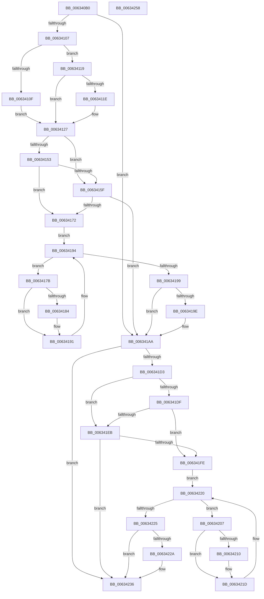

# DifMmAllocateContiguousNodeMemoryWrapper

- RVA: `0x006340B0`–`0x00634259` (길이 `425` bytes)
- VA: `0x00000001406340B0`
- 실행 섹션: `.text`
- PDB 이름 있음: `예`; PDB Function 태그: `아니요`
- unwind 정보 RVA: `0x000BD780`
- 디코드: `122`개 명령, `425/425` bytes 표시
- 미해석 바이트: `0` (있으면 어셈블리에 `.byte`로 보존)

> 이 문서는 커널 이미지의 기계어와 PDB 기호를 분석해 생성했습니다. 4번과 5번은 함수 원형과 자료형을 바이너리 사용 방식에서 추정한 C 해석이며 원본 소스 복구 결과는 아닙니다.

## 1. Dependencies

- 직접 호출 지점: **9**; 고유 호출 대상: **6**
- 직접 호출자로 확인된 함수: **0**
- RIP 상대 이미지 참조: **3**

### Outgoing calls
- `0x006340F6` → [DifGetAPIThunkContextById](../49/DifGetAPIThunkContextById_function_00495A34.md) (function, `0x00495A34`)
- `0x0063411E` → [DifGetReturnAddressForWrappers](../4D/DifGetReturnAddressForWrappers_function_004D3C08.md) (function, `0x004D3C08`)
- `0x00634166` → [ExAcquireRundownProtection](../21/ExAcquireRundownProtection_function_00216620.md) (function, `0x00216620`)
- `0x0063418C` → [guard_dispatch_icall](../6B/guard_dispatch_icall_function_006BAAD0.md) (function, `0x006BAAD0`)
- `0x006341A5` → [ExReleaseRundownProtection](../34/ExReleaseRundownProtection_function_00349E80.md) (function, `0x00349E80`)
- `0x006341C5` → [MmAllocateContiguousNodeMemory](../3E/MmAllocateContiguousNodeMemory_function_003E9E40.md) (function, `0x003E9E40`)
- `0x006341F2` → [ExAcquireRundownProtection](../21/ExAcquireRundownProtection_function_00216620.md) (function, `0x00216620`)
- `0x00634218` → [guard_dispatch_icall](../6B/guard_dispatch_icall_function_006BAAD0.md) (function, `0x006BAAD0`)
- `0x00634231` → [ExReleaseRundownProtection](../34/ExReleaseRundownProtection_function_00349E80.md) (function, `0x00349E80`)

### Direct callers
- 이 함수 시작 RVA로 연결되는 직접 call은 확인되지 않았습니다. 간접 호출은 완전히 역산할 수 없습니다.

### Static image references
- `0x0063412E` → RVA `0x00F048B8` (`.data`; read)
- `0x00634153` → RVA `0x00F04980` (`.data`; read)
- `0x0063415F` → RVA `0x00F03E80` (`.data`; read)

## 2. Other-region calls and transfers

- 다른 실행 섹션으로 향하는 call: **0**
- 별도 외부 분기/꼬리 이동을 확인하지 못했습니다.

## 3. Assembly (complete function range)

```asm
006340B0  48 8B C4                        mov rax, rsp
006340B3  48 89 58 10                     mov qword ptr [rax + 0x10], rbx
006340B7  48 89 70 18                     mov qword ptr [rax + 0x18], rsi
006340BB  48 89 78 20                     mov qword ptr [rax + 0x20], rdi
006340BF  48 89 48 08                     mov qword ptr [rax + 8], rcx
006340C3  55                              push rbp
006340C4  41 54                           push r12
006340C6  41 55                           push r13
006340C8  41 56                           push r14
006340CA  41 57                           push r15
006340CC  48 8B EC                        mov rbp, rsp
006340CF  48 83 EC 70                     sub rsp, 0x70
006340D3  0F 57 C0                        xorps xmm0, xmm0
006340D6  33 C0                           xor eax, eax
006340D8  B9 EA 00 00 00                  mov ecx, 0xea
006340DD  48 89 45 F0                     mov qword ptr [rbp - 0x10], rax
006340E1  0F 11 45 C0                     movups xmmword ptr [rbp - 0x40], xmm0
006340E5  49 8B D9                        mov rbx, r9
006340E8  49 8B F8                        mov rdi, r8
006340EB  0F 11 45 D0                     movups xmmword ptr [rbp - 0x30], xmm0
006340EF  48 8B F2                        mov rsi, rdx
006340F2  0F 11 45 E0                     movups xmmword ptr [rbp - 0x20], xmm0
006340F6  E8 39 19 E6 FF                  call 0x140495a34
006340FB  4C 8B E8                        mov r13, rax
006340FE  48 85 C0                        test rax, rax
00634101  0F 84 A3 00 00 00               je 0x1406341aa
00634107  8B 48 0C                        mov ecx, dword ptr [rax + 0xc]
0063410A  F6 C1 18                        test cl, 0x18
0063410D  74 0A                           je 0x140634119
0063410F  48 8B 4D 28                     mov rcx, qword ptr [rbp + 0x28]
00634113  48 89 4D C0                     mov qword ptr [rbp - 0x40], rcx
00634117  EB 0E                           jmp 0x140634127
00634119  F6 C1 04                        test cl, 4
0063411C  74 09                           je 0x140634127
0063411E  E8 E5 FA E9 FF                  call 0x1404d3c08
00634123  48 89 45 C0                     mov qword ptr [rbp - 0x40], rax
00634127  48 8B 45 30                     mov rax, qword ptr [rbp + 0x30]
0063412B  45 32 E4                        xor r12b, r12b
0063412E  44 38 25 83 07 8D 00            cmp byte ptr [rip + 0x8d0783], r12b
00634135  48 89 45 E8                     mov qword ptr [rbp - 0x18], rax
00634139  8B 45 50                        mov eax, dword ptr [rbp + 0x50]
0063413C  89 45 CC                        mov dword ptr [rbp - 0x34], eax
0063413F  8B 45 58                        mov eax, dword ptr [rbp + 0x58]
00634142  89 45 C8                        mov dword ptr [rbp - 0x38], eax
00634145  48 89 75 E0                     mov qword ptr [rbp - 0x20], rsi
00634149  48 89 7D D8                     mov qword ptr [rbp - 0x28], rdi
0063414D  48 89 5D D0                     mov qword ptr [rbp - 0x30], rbx
00634151  75 0C                           jne 0x14063415f
00634153  F7 05 23 08 8D 00 00 08 00 00   test dword ptr [rip + 0x8d0823], 0x800
0063415D  74 13                           je 0x140634172
0063415F  48 8D 0D 1A FD 8C 00            lea rcx, [rip + 0x8cfd1a]
00634166  E8 B5 24 BE FF                  call 0x140216620
0063416B  44 8A E0                        mov r12b, al
0063416E  84 C0                           test al, al
00634170  74 38                           je 0x1406341aa
00634172  4D 8D 7D 20                     lea r15, [r13 + 0x20]
00634176  4D 8B 37                        mov r14, qword ptr [r15]
00634179  EB 19                           jmp 0x140634194
0063417B  49 8D 46 F0                     lea rax, [r14 - 0x10]
0063417F  48 85 C0                        test rax, rax
00634182  74 0D                           je 0x140634191
00634184  48 8B 40 08                     mov rax, qword ptr [rax + 8]
00634188  48 8D 4D C0                     lea rcx, [rbp - 0x40]
0063418C  E8 3F 69 08 00                  call 0x1406baad0
00634191  4D 8B 36                        mov r14, qword ptr [r14]
00634194  4D 3B F7                        cmp r14, r15
00634197  75 E2                           jne 0x14063417b
00634199  45 84 E4                        test r12b, r12b
0063419C  74 0C                           je 0x1406341aa
0063419E  48 8D 0D DB FC 8C 00            lea rcx, [rip + 0x8cfcdb]
006341A5  E8 D6 5C D1 FF                  call 0x140349e80
006341AA  8B 45 58                        mov eax, dword ptr [rbp + 0x58]
006341AD  4C 8B CB                        mov r9, rbx
006341B0  48 8B 4D 30                     mov rcx, qword ptr [rbp + 0x30]
006341B4  4C 8B C7                        mov r8, rdi
006341B7  89 44 24 28                     mov dword ptr [rsp + 0x28], eax
006341BB  48 8B D6                        mov rdx, rsi
006341BE  8B 45 50                        mov eax, dword ptr [rbp + 0x50]
006341C1  89 44 24 20                     mov dword ptr [rsp + 0x20], eax
006341C5  E8 76 5C DB FF                  call 0x1403e9e40
006341CA  48 89 45 F0                     mov qword ptr [rbp - 0x10], rax
006341CE  4D 85 ED                        test r13, r13
006341D1  74 63                           je 0x140634236
006341D3  40 32 FF                        xor dil, dil
006341D6  40 38 3D DB 06 8D 00            cmp byte ptr [rip + 0x8d06db], dil
006341DD  75 0C                           jne 0x1406341eb
006341DF  F7 05 97 07 8D 00 00 08 00 00   test dword ptr [rip + 0x8d0797], 0x800
006341E9  74 13                           je 0x1406341fe
006341EB  48 8D 0D 8E FC 8C 00            lea rcx, [rip + 0x8cfc8e]
006341F2  E8 29 24 BE FF                  call 0x140216620
006341F7  40 8A F8                        mov dil, al
006341FA  84 C0                           test al, al
006341FC  74 38                           je 0x140634236
006341FE  49 8D 75 30                     lea rsi, [r13 + 0x30]
00634202  48 8B 1E                        mov rbx, qword ptr [rsi]
00634205  EB 19                           jmp 0x140634220
00634207  48 8D 43 F0                     lea rax, [rbx - 0x10]
0063420B  48 85 C0                        test rax, rax
0063420E  74 0D                           je 0x14063421d
00634210  48 8B 40 08                     mov rax, qword ptr [rax + 8]
00634214  48 8D 4D C0                     lea rcx, [rbp - 0x40]
00634218  E8 B3 68 08 00                  call 0x1406baad0
0063421D  48 8B 1B                        mov rbx, qword ptr [rbx]
00634220  48 3B DE                        cmp rbx, rsi
00634223  75 E2                           jne 0x140634207
00634225  40 84 FF                        test dil, dil
00634228  74 0C                           je 0x140634236
0063422A  48 8D 0D 4F FC 8C 00            lea rcx, [rip + 0x8cfc4f]
00634231  E8 4A 5C D1 FF                  call 0x140349e80
00634236  48 8B 45 F0                     mov rax, qword ptr [rbp - 0x10]
0063423A  4C 8D 5C 24 70                  lea r11, [rsp + 0x70]
0063423F  49 8B 5B 38                     mov rbx, qword ptr [r11 + 0x38]
00634243  49 8B 73 40                     mov rsi, qword ptr [r11 + 0x40]
00634247  49 8B 7B 48                     mov rdi, qword ptr [r11 + 0x48]
0063424B  49 8B E3                        mov rsp, r11
0063424E  41 5F                           pop r15
00634250  41 5E                           pop r14
00634252  41 5D                           pop r13
00634254  41 5C                           pop r12
00634256  5D                              pop rbp
00634257  C3                              ret
00634258  CC                              int3
```

## 4. C-style interpretation (structured pseudocode)

```c
__int64 __fastcall DifMmAllocateContiguousNodeMemoryWrapper(__int64 a1, __int64 a2, __int64 a3, __int64 a4, unsigned int a5, unsigned int a6)
{
    __int64 result;
    __int64 v_r12;
    __int64 v_rdi;
    __int64 v_rsp;
    unsigned __int64 v_stack_m28;
    unsigned __int64 v_stack_m38;
    unsigned __int64 v_stack_m40;
    unsigned __int64 v_stack_m48;
    unsigned __int64 v_stack_m50;
    unsigned __int64 v_stack_m58;
    unsigned int v_stack_m5C;
    unsigned int v_stack_m60;
    unsigned __int64 v_stack_m68;
    unsigned int v_stack_m70;
    unsigned int v_stack_m78;
    unsigned __int64 v_stack_p0;
    unsigned __int64 v_stack_p8;

    *(unsigned __int64 *)(v_rsp + 16) = v_rbx;
    *(unsigned __int64 *)(v_rsp + 24) = v_rsi;
    *(unsigned __int64 *)(v_rsp + 32) = v_rdi;
    *(unsigned __int64 *)(v_rsp + 8) = a1;
    v_rsp = (v_rsp) - (112);
    result = 0;
    v_stack_m38 = 0;
    v_stack_m68 = v_xmm0;
    v_stack_m58 = v_xmm0;
    v_stack_m48 = v_xmm0;
    result = DifGetAPIThunkContextById(234, a2, a3, a4);
    if (result == 0) goto loc_006341AA;
    if ((((unsigned __int8)((unsigned int)(*(unsigned int *)(result + 12)))) & (24)) == 0) goto loc_00634119;
    v_stack_m68 = v_stack_p0;
    goto loc_00634127;
loc_00634119:
    if ((((unsigned __int8)(v_stack_p0)) & (4)) != 0) {
        result = DifGetReturnAddressForWrappers(v_stack_p0, a2, a3, a4);
        v_stack_m68 = result;
    }
    v_r12 = 0;
    v_stack_m40 = v_stack_p8;
    v_stack_m5C = (unsigned int)((unsigned int)(a5));
    v_stack_m60 = (unsigned int)((unsigned int)(a6));
    v_stack_m48 = a2;
    v_stack_m50 = a3;
    v_stack_m58 = a4;
    if ((*(unsigned __int8 *)(v_rip + 9242499)) != 0) goto loc_0063415F;
    if (((*(unsigned int *)(v_rip + 9242659)) & (0x800ULL)) == 0) goto loc_00634172;
loc_0063415F:
    result = ExAcquireRundownProtection(v_rip + 9239834, a2, a3, a4);
    if ((unsigned __int8)(result) == 0) goto loc_006341AA;
loc_00634172:
    goto loc_00634194;
loc_0063417B:
    result = *(unsigned __int64 *)(result + 32) - 16;
    if (*(unsigned __int64 *)(result + 32) - 16 != 0) {
        result = *(unsigned __int64 *)(*(unsigned __int64 *)(result + 32) - 16 + 8);
        a1 = v_stack_m68;
        result = guard_dispatch_icall(a1, a2, a3, a4);
    }
loc_00634194:
    if ((*(unsigned __int64 *)(*(unsigned __int64 *)(result + 32))) != (result + 32)) goto loc_0063417B;
    if ((unsigned __int8)((unsigned __int8)(result)) != 0) {
        a1 = v_rip + 9239771;
        result = ExReleaseRundownProtection(a1, a2, a3, a4);
    }
    v_stack_m70 = (unsigned int)((unsigned int)(a6));
    v_stack_m78 = (unsigned int)((unsigned int)(a5));
    result = MmAllocateContiguousNodeMemory(v_stack_p8, a2, a3, a4);
    v_stack_m38 = result;
    if (result == 0) goto loc_00634236;
    v_rdi = 0;
    if ((*(unsigned __int8 *)(v_rip + 9242331)) != 0) goto loc_006341EB;
    if (((*(unsigned int *)(v_rip + 9242519)) & (0x800ULL)) == 0) goto loc_006341FE;
loc_006341EB:
    result = ExAcquireRundownProtection(v_rip + 9239694, a2, a3, a4);
    if ((unsigned __int8)(result) == 0) goto loc_00634236;
loc_006341FE:
    goto loc_00634220;
loc_00634207:
    result = *(unsigned __int64 *)(result + 48) - 16;
    if (*(unsigned __int64 *)(result + 48) - 16 != 0) {
        result = *(unsigned __int64 *)(*(unsigned __int64 *)(result + 48) - 16 + 8);
        a1 = v_stack_m68;
        result = guard_dispatch_icall(a1, a2, a3, a4);
    }
loc_00634220:
    if ((*(unsigned __int64 *)(*(unsigned __int64 *)(result + 48))) != (result + 48)) goto loc_00634207;
    if ((unsigned __int8)((unsigned __int8)(result)) != 0) {
        a1 = v_rip + 9239631;
        result = ExReleaseRundownProtection(a1, a2, a3, a4);
    }
    return v_stack_m38;
}
```

## 5. (Beta) C Style

```c
int64_t DifMmAllocateContiguousNodeMemoryWrapper(int64_t Arg1, int64_t Arg2, int64_t Arg3, int64_t Arg4, uint32_t Arg5, uint32_t Arg6)
{
    int64_t result;
    int64_t local_r12;
    int64_t local_rdi;
    int64_t local_rsp;
    uint64_t v_stack_m28;
    uint64_t v_stack_m38;
    uint64_t v_stack_m40;
    uint64_t v_stack_m48;
    uint64_t v_stack_m50;
    uint64_t v_stack_m58;
    uint32_t v_stack_m5C;
    uint32_t v_stack_m60;
    uint64_t v_stack_m68;
    uint32_t v_stack_m70;
    uint32_t v_stack_m78;
    uint64_t v_stack_p0;
    uint64_t v_stack_p8;

    *(uint64_t *)(local_rsp + 0x10) = local_rbx;
    *(uint64_t *)(local_rsp + 0x18) = local_rsi;
    *(uint64_t *)(local_rsp + 0x20) = local_rdi;
    *(uint64_t *)(local_rsp + 0x8) = Arg1;
    local_rsp = (local_rsp) - (112);
    result = 0;
    v_stack_m38 = 0;
    v_stack_m68 = v_xmm0;
    v_stack_m58 = v_xmm0;
    v_stack_m48 = v_xmm0;
    result = DifGetAPIThunkContextById(234, Arg2, Arg3, Arg4);
    if (result == 0) goto loc_006341AA;
    if ((((uint8_t)((uint32_t)(*(uint32_t *)(result + 0xC)))) & (24)) == 0) goto loc_00634119;
    v_stack_m68 = v_stack_p0;
    goto loc_00634127;
loc_00634119:
    if ((((uint8_t)(v_stack_p0)) & (4)) != 0) {
        result = DifGetReturnAddressForWrappers(v_stack_p0, Arg2, Arg3, Arg4);
        v_stack_m68 = result;
    }
    local_r12 = 0;
    v_stack_m40 = v_stack_p8;
    v_stack_m5C = (uint32_t)((uint32_t)(Arg5));
    v_stack_m60 = (uint32_t)((uint32_t)(Arg6));
    v_stack_m48 = Arg2;
    v_stack_m50 = Arg3;
    v_stack_m58 = Arg4;
    if ((*(uint8_t *)(v_rip + 0x8D0783)) != 0) goto loc_0063415F;
    if (((*(uint32_t *)(v_rip + 0x8D0823)) & (0x800ULL)) == 0) goto loc_00634172;
loc_0063415F:
    result = ExAcquireRundownProtection(v_rip + 9239834, Arg2, Arg3, Arg4);
    if ((uint8_t)(result) == 0) goto loc_006341AA;
loc_00634172:
    goto loc_00634194;
loc_0063417B:
    result = *(uint64_t *)(result + 0x20) - 16;
    if (*(uint64_t *)(result + 0x20) - 16 != 0) {
        result = *(uint64_t *)(*(uint64_t *)(result + 0x20) - 0x10 + 0x8);
        Arg1 = v_stack_m68;
        result = guard_dispatch_icall(Arg1, Arg2, Arg3, Arg4);
    }
loc_00634194:
    if ((*(uint64_t *)(*(uint64_t *)(result + 0x20))) != (result + 32)) goto loc_0063417B;
    if ((uint8_t)((uint8_t)(result)) != 0) {
        Arg1 = v_rip + 9239771;
        result = ExReleaseRundownProtection(Arg1, Arg2, Arg3, Arg4);
    }
    v_stack_m70 = (uint32_t)((uint32_t)(Arg6));
    v_stack_m78 = (uint32_t)((uint32_t)(Arg5));
    result = MmAllocateContiguousNodeMemory(v_stack_p8, Arg2, Arg3, Arg4);
    v_stack_m38 = result;
    if (result == 0) goto loc_00634236;
    local_rdi = 0;
    if ((*(uint8_t *)(v_rip + 0x8D06DB)) != 0) goto loc_006341EB;
    if (((*(uint32_t *)(v_rip + 0x8D0797)) & (0x800ULL)) == 0) goto loc_006341FE;
loc_006341EB:
    result = ExAcquireRundownProtection(v_rip + 9239694, Arg2, Arg3, Arg4);
    if ((uint8_t)(result) == 0) goto loc_00634236;
loc_006341FE:
    goto loc_00634220;
loc_00634207:
    result = *(uint64_t *)(result + 0x30) - 16;
    if (*(uint64_t *)(result + 0x30) - 16 != 0) {
        result = *(uint64_t *)(*(uint64_t *)(result + 0x30) - 0x10 + 0x8);
        Arg1 = v_stack_m68;
        result = guard_dispatch_icall(Arg1, Arg2, Arg3, Arg4);
    }
loc_00634220:
    if ((*(uint64_t *)(*(uint64_t *)(result + 0x30))) != (result + 48)) goto loc_00634207;
    if ((uint8_t)((uint8_t)(result)) != 0) {
        Arg1 = v_rip + 9239631;
        result = ExReleaseRundownProtection(Arg1, Arg2, Arg3, Arg4);
    }
    return v_stack_m38;
}
```

## 6. Execution-region graph

[열기: 2D/3D 그래프와 함수 탐색 컨트롤 패널](../../../control-panel.html?section=text&rva=0x006340B0&view=graph)

- 2D 그래프는 위에서 아래로 흐르고, 3D 그래프는 빈 공간을 드래그해 회전합니다. Shift+드래그는 이동, 휠은 확대·축소, 함수 노드 선택은 대상 보고서 이동입니다.

### Static fallback


