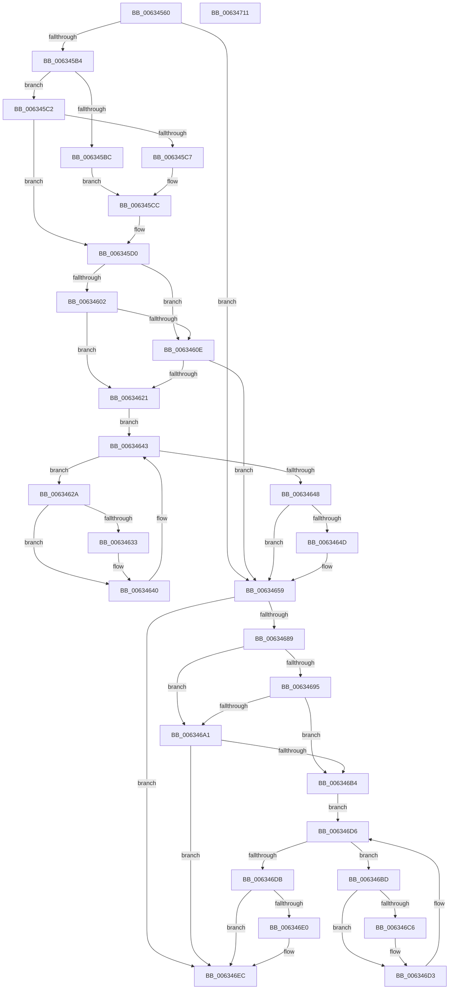

# DifMmAllocateNodePagesForMdlExWrapper

- RVA: `0x00634560`–`0x00634712` (길이 `434` bytes)
- VA: `0x0000000140634560`
- 실행 섹션: `.text`
- PDB 이름 있음: `예`; PDB Function 태그: `아니요`
- unwind 정보 RVA: `0x000C46B0`
- 디코드: `123`개 명령, `434/434` bytes 표시
- 미해석 바이트: `0` (있으면 어셈블리에 `.byte`로 보존)

> 이 문서는 커널 이미지의 기계어와 PDB 기호를 분석해 생성했습니다. 4번과 5번은 함수 원형과 자료형을 바이너리 사용 방식에서 추정한 C 해석이며 원본 소스 복구 결과는 아닙니다.

## 1. Dependencies

- 직접 호출 지점: **10**; 고유 호출 대상: **7**
- 직접 호출자로 확인된 함수: **0**
- RIP 상대 이미지 참조: **3**

### Outgoing calls
- `0x00634599` → [memset](../6C/memset_function_006C6C40.md) (function, `0x006C6C40`)
- `0x006345A3` → [DifGetAPIThunkContextById](../49/DifGetAPIThunkContextById_function_00495A34.md) (function, `0x00495A34`)
- `0x006345C7` → [DifGetReturnAddressForWrappers](../4D/DifGetReturnAddressForWrappers_function_004D3C08.md) (function, `0x004D3C08`)
- `0x00634615` → [ExAcquireRundownProtection](../21/ExAcquireRundownProtection_function_00216620.md) (function, `0x00216620`)
- `0x0063463B` → [guard_dispatch_icall](../6B/guard_dispatch_icall_function_006BAAD0.md) (function, `0x006BAAD0`)
- `0x00634654` → [ExReleaseRundownProtection](../34/ExReleaseRundownProtection_function_00349E80.md) (function, `0x00349E80`)
- `0x0063467B` → [MmAllocateNodePagesForMdlEx](../3E/MmAllocateNodePagesForMdlEx_function_003EA920.md) (function, `0x003EA920`)
- `0x006346A8` → [ExAcquireRundownProtection](../21/ExAcquireRundownProtection_function_00216620.md) (function, `0x00216620`)
- `0x006346CE` → [guard_dispatch_icall](../6B/guard_dispatch_icall_function_006BAAD0.md) (function, `0x006BAAD0`)
- `0x006346E7` → [ExReleaseRundownProtection](../34/ExReleaseRundownProtection_function_00349E80.md) (function, `0x00349E80`)

### Direct callers
- 이 함수 시작 RVA로 연결되는 직접 call은 확인되지 않았습니다. 간접 호출은 완전히 역산할 수 없습니다.

### Static image references
- `0x006345D7` → RVA `0x00F048B8` (`.data`; read)
- `0x00634602` → RVA `0x00F04980` (`.data`; read)
- `0x0063460E` → RVA `0x00F03E80` (`.data`; read)

## 2. Other-region calls and transfers

- 다른 실행 섹션으로 향하는 call: **0**
- 별도 외부 분기/꼬리 이동을 확인하지 못했습니다.

## 3. Assembly (complete function range)

```asm
00634560  48 8B C4                        mov rax, rsp
00634563  48 89 58 08                     mov qword ptr [rax + 8], rbx
00634567  48 89 70 10                     mov qword ptr [rax + 0x10], rsi
0063456B  48 89 78 18                     mov qword ptr [rax + 0x18], rdi
0063456F  4C 89 48 20                     mov qword ptr [rax + 0x20], r9
00634573  55                              push rbp
00634574  41 54                           push r12
00634576  41 55                           push r13
00634578  41 56                           push r14
0063457A  41 57                           push r15
0063457C  48 8B EC                        mov rbp, rsp
0063457F  48 81 EC 80 00 00 00            sub rsp, 0x80
00634586  48 8B FA                        mov rdi, rdx
00634589  49 8B D8                        mov rbx, r8
0063458C  33 D2                           xor edx, edx
0063458E  48 8B F1                        mov rsi, rcx
00634591  48 8D 4D C0                     lea rcx, [rbp - 0x40]
00634595  44 8D 42 40                     lea r8d, [rdx + 0x40]
00634599  E8 A2 26 09 00                  call 0x1406c6c40
0063459E  B9 E8 00 00 00                  mov ecx, 0xe8
006345A3  E8 8C 14 E6 FF                  call 0x140495a34
006345A8  4C 8B E8                        mov r13, rax
006345AB  48 85 C0                        test rax, rax
006345AE  0F 84 A5 00 00 00               je 0x140634659
006345B4  8B 48 0C                        mov ecx, dword ptr [rax + 0xc]
006345B7  F6 C1 18                        test cl, 0x18
006345BA  74 06                           je 0x1406345c2
006345BC  48 8B 45 28                     mov rax, qword ptr [rbp + 0x28]
006345C0  EB 0A                           jmp 0x1406345cc
006345C2  F6 C1 04                        test cl, 4
006345C5  74 09                           je 0x1406345d0
006345C7  E8 3C F6 E9 FF                  call 0x1404d3c08
006345CC  48 89 45 C0                     mov qword ptr [rbp - 0x40], rax
006345D0  48 8B 45 48                     mov rax, qword ptr [rbp + 0x48]
006345D4  45 32 E4                        xor r12b, r12b
006345D7  44 38 25 DA 02 8D 00            cmp byte ptr [rip + 0x8d02da], r12b
006345DE  48 89 45 D8                     mov qword ptr [rbp - 0x28], rax
006345E2  8B 45 50                        mov eax, dword ptr [rbp + 0x50]
006345E5  89 45 D0                        mov dword ptr [rbp - 0x30], eax
006345E8  8B 45 58                        mov eax, dword ptr [rbp + 0x58]
006345EB  89 45 CC                        mov dword ptr [rbp - 0x34], eax
006345EE  8B 45 60                        mov eax, dword ptr [rbp + 0x60]
006345F1  89 45 C8                        mov dword ptr [rbp - 0x38], eax
006345F4  48 89 75 F0                     mov qword ptr [rbp - 0x10], rsi
006345F8  48 89 7D E8                     mov qword ptr [rbp - 0x18], rdi
006345FC  48 89 5D E0                     mov qword ptr [rbp - 0x20], rbx
00634600  75 0C                           jne 0x14063460e
00634602  F7 05 74 03 8D 00 00 08 00 00   test dword ptr [rip + 0x8d0374], 0x800
0063460C  74 13                           je 0x140634621
0063460E  48 8D 0D 6B F8 8C 00            lea rcx, [rip + 0x8cf86b]
00634615  E8 06 20 BE FF                  call 0x140216620
0063461A  44 8A E0                        mov r12b, al
0063461D  84 C0                           test al, al
0063461F  74 38                           je 0x140634659
00634621  4D 8D 7D 20                     lea r15, [r13 + 0x20]
00634625  4D 8B 37                        mov r14, qword ptr [r15]
00634628  EB 19                           jmp 0x140634643
0063462A  49 8D 46 F0                     lea rax, [r14 - 0x10]
0063462E  48 85 C0                        test rax, rax
00634631  74 0D                           je 0x140634640
00634633  48 8B 40 08                     mov rax, qword ptr [rax + 8]
00634637  48 8D 4D C0                     lea rcx, [rbp - 0x40]
0063463B  E8 90 64 08 00                  call 0x1406baad0
00634640  4D 8B 36                        mov r14, qword ptr [r14]
00634643  4D 3B F7                        cmp r14, r15
00634646  75 E2                           jne 0x14063462a
00634648  45 84 E4                        test r12b, r12b
0063464B  74 0C                           je 0x140634659
0063464D  48 8D 0D 2C F8 8C 00            lea rcx, [rip + 0x8cf82c]
00634654  E8 27 58 D1 FF                  call 0x140349e80
00634659  8B 45 60                        mov eax, dword ptr [rbp + 0x60]
0063465C  4C 8B C3                        mov r8, rbx
0063465F  4C 8B 4D 48                     mov r9, qword ptr [rbp + 0x48]
00634663  48 8B D7                        mov rdx, rdi
00634666  89 44 24 30                     mov dword ptr [rsp + 0x30], eax
0063466A  48 8B CE                        mov rcx, rsi
0063466D  8B 45 58                        mov eax, dword ptr [rbp + 0x58]
00634670  89 44 24 28                     mov dword ptr [rsp + 0x28], eax
00634674  8B 45 50                        mov eax, dword ptr [rbp + 0x50]
00634677  89 44 24 20                     mov dword ptr [rsp + 0x20], eax
0063467B  E8 A0 62 DB FF                  call 0x1403ea920
00634680  48 89 45 F8                     mov qword ptr [rbp - 8], rax
00634684  4D 85 ED                        test r13, r13
00634687  74 63                           je 0x1406346ec
00634689  40 32 FF                        xor dil, dil
0063468C  40 38 3D 25 02 8D 00            cmp byte ptr [rip + 0x8d0225], dil
00634693  75 0C                           jne 0x1406346a1
00634695  F7 05 E1 02 8D 00 00 08 00 00   test dword ptr [rip + 0x8d02e1], 0x800
0063469F  74 13                           je 0x1406346b4
006346A1  48 8D 0D D8 F7 8C 00            lea rcx, [rip + 0x8cf7d8]
006346A8  E8 73 1F BE FF                  call 0x140216620
006346AD  40 8A F8                        mov dil, al
006346B0  84 C0                           test al, al
006346B2  74 38                           je 0x1406346ec
006346B4  49 8D 75 30                     lea rsi, [r13 + 0x30]
006346B8  48 8B 1E                        mov rbx, qword ptr [rsi]
006346BB  EB 19                           jmp 0x1406346d6
006346BD  48 8D 43 F0                     lea rax, [rbx - 0x10]
006346C1  48 85 C0                        test rax, rax
006346C4  74 0D                           je 0x1406346d3
006346C6  48 8B 40 08                     mov rax, qword ptr [rax + 8]
006346CA  48 8D 4D C0                     lea rcx, [rbp - 0x40]
006346CE  E8 FD 63 08 00                  call 0x1406baad0
006346D3  48 8B 1B                        mov rbx, qword ptr [rbx]
006346D6  48 3B DE                        cmp rbx, rsi
006346D9  75 E2                           jne 0x1406346bd
006346DB  40 84 FF                        test dil, dil
006346DE  74 0C                           je 0x1406346ec
006346E0  48 8D 0D 99 F7 8C 00            lea rcx, [rip + 0x8cf799]
006346E7  E8 94 57 D1 FF                  call 0x140349e80
006346EC  48 8B 45 F8                     mov rax, qword ptr [rbp - 8]
006346F0  4C 8D 9C 24 80 00 00 00         lea r11, [rsp + 0x80]
006346F8  49 8B 5B 30                     mov rbx, qword ptr [r11 + 0x30]
006346FC  49 8B 73 38                     mov rsi, qword ptr [r11 + 0x38]
00634700  49 8B 7B 40                     mov rdi, qword ptr [r11 + 0x40]
00634704  49 8B E3                        mov rsp, r11
00634707  41 5F                           pop r15
00634709  41 5E                           pop r14
0063470B  41 5D                           pop r13
0063470D  41 5C                           pop r12
0063470F  5D                              pop rbp
00634710  C3                              ret
00634711  CC                              int3
```

## 4. C-style interpretation (structured pseudocode)

```c
__int64 __fastcall DifMmAllocateNodePagesForMdlExWrapper(__int64 a1, __int64 a2, __int64 a3, __int64 a4, unsigned int a5, unsigned int a6, unsigned int a7)
{
    __int64 result;
    __int64 v_r12;
    __int64 v_rdi;
    __int64 v_rsp;
    unsigned __int64 v_stack_m28;
    unsigned __int64 v_stack_m30;
    unsigned __int64 v_stack_m38;
    unsigned __int64 v_stack_m40;
    unsigned __int64 v_stack_m48;
    unsigned __int64 v_stack_m50;
    unsigned int v_stack_m58;
    unsigned int v_stack_m5C;
    unsigned int v_stack_m60;
    unsigned __int64 v_stack_m68;
    unsigned int v_stack_m78;
    unsigned int v_stack_m80;
    unsigned int v_stack_m88;
    unsigned __int64 v_stack_p0;
    unsigned __int64 v_stack_p20;

    *(unsigned __int64 *)(v_rsp + 8) = v_rbx;
    *(unsigned __int64 *)(v_rsp + 16) = v_rsi;
    *(unsigned __int64 *)(v_rsp + 24) = v_rdi;
    *(unsigned __int64 *)(v_rsp + 32) = a4;
    v_rsp = (v_rsp) - (128);
    a2 = 0;
    result = memset(v_stack_m68, a2, a2 + 64, a4);
    result = DifGetAPIThunkContextById(232, a2, a2 + 64, a4);
    if (result == 0) goto loc_00634659;
    if ((((unsigned __int8)((unsigned int)(*(unsigned int *)(result + 12)))) & (24)) == 0) goto loc_006345C2;
    goto loc_006345CC;
loc_006345C2:
    if ((((unsigned __int8)((unsigned int)(*(unsigned int *)(result + 12)))) & (4)) == 0) goto loc_006345D0;
    result = DifGetReturnAddressForWrappers((unsigned int)(*(unsigned int *)(result + 12)), a2, a2 + 64, a4);
loc_006345CC:
    v_stack_m68 = result;
loc_006345D0:
    v_r12 = 0;
    v_stack_m50 = v_stack_p20;
    v_stack_m58 = (unsigned int)((unsigned int)(a5));
    v_stack_m5C = (unsigned int)((unsigned int)(a6));
    v_stack_m60 = (unsigned int)((unsigned int)(a7));
    v_stack_m38 = a1;
    v_stack_m40 = 0;
    v_stack_m48 = a3;
    if ((*(unsigned __int8 *)(v_rip + 9241306)) != 0) goto loc_0063460E;
    if (((*(unsigned int *)(v_rip + 9241460)) & (0x800ULL)) == 0) goto loc_00634621;
loc_0063460E:
    result = ExAcquireRundownProtection(v_rip + 9238635, a2, a2 + 64, a4);
    if ((unsigned __int8)(result) == 0) goto loc_00634659;
loc_00634621:
    goto loc_00634643;
loc_0063462A:
    result = *(unsigned __int64 *)(result + 32) - 16;
    if (*(unsigned __int64 *)(result + 32) - 16 != 0) {
        result = *(unsigned __int64 *)(*(unsigned __int64 *)(result + 32) - 16 + 8);
        a1 = v_stack_m68;
        result = guard_dispatch_icall(a1, a2, a2 + 64, a4);
    }
loc_00634643:
    if ((*(unsigned __int64 *)(*(unsigned __int64 *)(result + 32))) != (result + 32)) goto loc_0063462A;
    if ((unsigned __int8)((unsigned __int8)(result)) != 0) {
        a1 = v_rip + 9238572;
        result = ExReleaseRundownProtection(a1, a2, a2 + 64, a4);
    }
    v_stack_m78 = (unsigned int)((unsigned int)(a7));
    v_stack_m80 = (unsigned int)((unsigned int)(a6));
    v_stack_m88 = (unsigned int)((unsigned int)(a5));
    result = MmAllocateNodePagesForMdlEx(a1, 0, a3, v_stack_p20);
    v_stack_m30 = result;
    if (result == 0) goto loc_006346EC;
    v_rdi = 0;
    if ((*(unsigned __int8 *)(v_rip + 9241125)) != 0) goto loc_006346A1;
    if (((*(unsigned int *)(v_rip + 9241313)) & (0x800ULL)) == 0) goto loc_006346B4;
loc_006346A1:
    result = ExAcquireRundownProtection(v_rip + 9238488, 0, a3, v_stack_p20);
    if ((unsigned __int8)(result) == 0) goto loc_006346EC;
loc_006346B4:
    goto loc_006346D6;
loc_006346BD:
    result = *(unsigned __int64 *)(result + 48) - 16;
    if (*(unsigned __int64 *)(result + 48) - 16 != 0) {
        result = *(unsigned __int64 *)(*(unsigned __int64 *)(result + 48) - 16 + 8);
        a1 = v_stack_m68;
        result = guard_dispatch_icall(a1, 0, a3, v_stack_p20);
    }
loc_006346D6:
    if ((*(unsigned __int64 *)(*(unsigned __int64 *)(result + 48))) != (result + 48)) goto loc_006346BD;
    if ((unsigned __int8)((unsigned __int8)(result)) != 0) {
        a1 = v_rip + 9238425;
        result = ExReleaseRundownProtection(a1, 0, a3, v_stack_p20);
    }
    return v_stack_m30;
}
```

## 5. (Beta) C Style

```c
int64_t DifMmAllocateNodePagesForMdlExWrapper(int64_t Arg1, int64_t Arg2, int64_t Arg3, int64_t Arg4, uint32_t Arg5, uint32_t Arg6, uint32_t Arg7)
{
    int64_t result;
    int64_t local_r12;
    int64_t local_rdi;
    int64_t local_rsp;
    uint64_t v_stack_m28;
    uint64_t v_stack_m30;
    uint64_t v_stack_m38;
    uint64_t v_stack_m40;
    uint64_t v_stack_m48;
    uint64_t v_stack_m50;
    uint32_t v_stack_m58;
    uint32_t v_stack_m5C;
    uint32_t v_stack_m60;
    uint64_t v_stack_m68;
    uint32_t v_stack_m78;
    uint32_t v_stack_m80;
    uint32_t v_stack_m88;
    uint64_t v_stack_p0;
    uint64_t v_stack_p20;

    *(uint64_t *)(local_rsp + 0x8) = local_rbx;
    *(uint64_t *)(local_rsp + 0x10) = local_rsi;
    *(uint64_t *)(local_rsp + 0x18) = local_rdi;
    *(uint64_t *)(local_rsp + 0x20) = Arg4;
    local_rsp = (local_rsp) - (128);
    Arg2 = 0;
    result = memset(v_stack_m68, Arg2, Arg2 + 64, Arg4);
    result = DifGetAPIThunkContextById(232, Arg2, Arg2 + 64, Arg4);
    if (result == 0) goto loc_00634659;
    if ((((uint8_t)((uint32_t)(*(uint32_t *)(result + 0xC)))) & (24)) == 0) goto loc_006345C2;
    goto loc_006345CC;
loc_006345C2:
    if ((((uint8_t)((uint32_t)(*(uint32_t *)(result + 0xC)))) & (4)) == 0) goto loc_006345D0;
    result = DifGetReturnAddressForWrappers((uint32_t)(*(uint32_t *)(result + 0xC)), Arg2, Arg2 + 64, Arg4);
loc_006345CC:
    v_stack_m68 = result;
loc_006345D0:
    local_r12 = 0;
    v_stack_m50 = v_stack_p20;
    v_stack_m58 = (uint32_t)((uint32_t)(Arg5));
    v_stack_m5C = (uint32_t)((uint32_t)(Arg6));
    v_stack_m60 = (uint32_t)((uint32_t)(Arg7));
    v_stack_m38 = Arg1;
    v_stack_m40 = 0;
    v_stack_m48 = Arg3;
    if ((*(uint8_t *)(v_rip + 0x8D02DA)) != 0) goto loc_0063460E;
    if (((*(uint32_t *)(v_rip + 0x8D0374)) & (0x800ULL)) == 0) goto loc_00634621;
loc_0063460E:
    result = ExAcquireRundownProtection(v_rip + 9238635, Arg2, Arg2 + 64, Arg4);
    if ((uint8_t)(result) == 0) goto loc_00634659;
loc_00634621:
    goto loc_00634643;
loc_0063462A:
    result = *(uint64_t *)(result + 0x20) - 16;
    if (*(uint64_t *)(result + 0x20) - 16 != 0) {
        result = *(uint64_t *)(*(uint64_t *)(result + 0x20) - 0x10 + 0x8);
        Arg1 = v_stack_m68;
        result = guard_dispatch_icall(Arg1, Arg2, Arg2 + 64, Arg4);
    }
loc_00634643:
    if ((*(uint64_t *)(*(uint64_t *)(result + 0x20))) != (result + 32)) goto loc_0063462A;
    if ((uint8_t)((uint8_t)(result)) != 0) {
        Arg1 = v_rip + 9238572;
        result = ExReleaseRundownProtection(Arg1, Arg2, Arg2 + 64, Arg4);
    }
    v_stack_m78 = (uint32_t)((uint32_t)(Arg7));
    v_stack_m80 = (uint32_t)((uint32_t)(Arg6));
    v_stack_m88 = (uint32_t)((uint32_t)(Arg5));
    result = MmAllocateNodePagesForMdlEx(Arg1, 0, Arg3, v_stack_p20);
    v_stack_m30 = result;
    if (result == 0) goto loc_006346EC;
    local_rdi = 0;
    if ((*(uint8_t *)(v_rip + 0x8D0225)) != 0) goto loc_006346A1;
    if (((*(uint32_t *)(v_rip + 0x8D02E1)) & (0x800ULL)) == 0) goto loc_006346B4;
loc_006346A1:
    result = ExAcquireRundownProtection(v_rip + 9238488, 0, Arg3, v_stack_p20);
    if ((uint8_t)(result) == 0) goto loc_006346EC;
loc_006346B4:
    goto loc_006346D6;
loc_006346BD:
    result = *(uint64_t *)(result + 0x30) - 16;
    if (*(uint64_t *)(result + 0x30) - 16 != 0) {
        result = *(uint64_t *)(*(uint64_t *)(result + 0x30) - 0x10 + 0x8);
        Arg1 = v_stack_m68;
        result = guard_dispatch_icall(Arg1, 0, Arg3, v_stack_p20);
    }
loc_006346D6:
    if ((*(uint64_t *)(*(uint64_t *)(result + 0x30))) != (result + 48)) goto loc_006346BD;
    if ((uint8_t)((uint8_t)(result)) != 0) {
        Arg1 = v_rip + 9238425;
        result = ExReleaseRundownProtection(Arg1, 0, Arg3, v_stack_p20);
    }
    return v_stack_m30;
}
```

## 6. Execution-region graph

[열기: 2D/3D 그래프와 함수 탐색 컨트롤 패널](../../../control-panel.html?section=text&rva=0x00634560&view=graph)

- 2D 그래프는 위에서 아래로 흐르고, 3D 그래프는 빈 공간을 드래그해 회전합니다. Shift+드래그는 이동, 휠은 확대·축소, 함수 노드 선택은 대상 보고서 이동입니다.

### Static fallback


