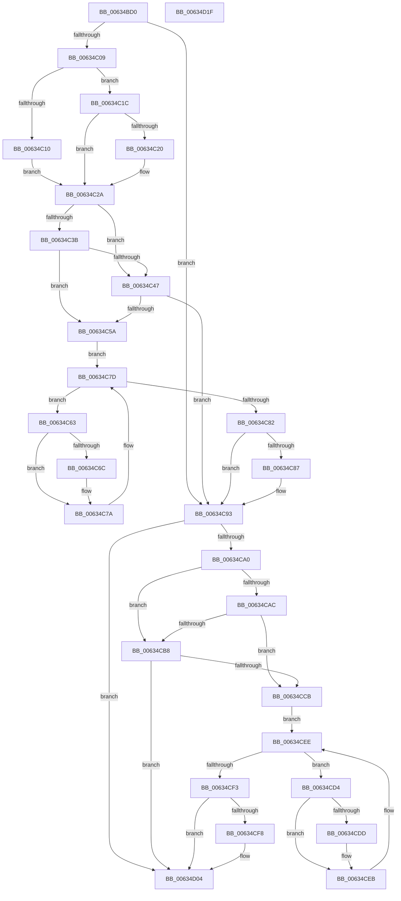

# DifMmBuildMdlForNonPagedPoolWrapper

- RVA: `0x00634BD0`–`0x00634D20` (길이 `336` bytes)
- VA: `0x0000000140634BD0`
- 실행 섹션: `.text`
- PDB 이름 있음: `예`; PDB Function 태그: `아니요`
- unwind 정보 RVA: `0x0005D7BC`
- 디코드: `90`개 명령, `336/336` bytes 표시
- 미해석 바이트: `0` (있으면 어셈블리에 `.byte`로 보존)

> 이 문서는 커널 이미지의 기계어와 PDB 기호를 분석해 생성했습니다. 4번과 5번은 함수 원형과 자료형을 바이너리 사용 방식에서 추정한 C 해석이며 원본 소스 복구 결과는 아닙니다.

## 1. Dependencies

- 직접 호출 지점: **9**; 고유 호출 대상: **6**
- 직접 호출자로 확인된 함수: **0**
- RIP 상대 이미지 참조: **3**

### Outgoing calls
- `0x00634BF8` → [DifGetAPIThunkContextById](../49/DifGetAPIThunkContextById_function_00495A34.md) (function, `0x00495A34`)
- `0x00634C20` → [DifGetReturnAddressForWrappers](../4D/DifGetReturnAddressForWrappers_function_004D3C08.md) (function, `0x004D3C08`)
- `0x00634C4E` → [ExAcquireRundownProtection](../21/ExAcquireRundownProtection_function_00216620.md) (function, `0x00216620`)
- `0x00634C75` → [guard_dispatch_icall](../6B/guard_dispatch_icall_function_006BAAD0.md) (function, `0x006BAAD0`)
- `0x00634C8E` → [ExReleaseRundownProtection](../34/ExReleaseRundownProtection_function_00349E80.md) (function, `0x00349E80`)
- `0x00634C96` → [MmBuildMdlForNonPagedPool](../23/MmBuildMdlForNonPagedPool_function_0023A870.md) (function, `0x0023A870`)
- `0x00634CBF` → [ExAcquireRundownProtection](../21/ExAcquireRundownProtection_function_00216620.md) (function, `0x00216620`)
- `0x00634CE6` → [guard_dispatch_icall](../6B/guard_dispatch_icall_function_006BAAD0.md) (function, `0x006BAAD0`)
- `0x00634CFF` → [ExReleaseRundownProtection](../34/ExReleaseRundownProtection_function_00349E80.md) (function, `0x00349E80`)

### Direct callers
- 이 함수 시작 RVA로 연결되는 직접 call은 확인되지 않았습니다. 간접 호출은 완전히 역산할 수 없습니다.

### Static image references
- `0x00634C32` → RVA `0x00F048B8` (`.data`; read)
- `0x00634C3B` → RVA `0x00F04980` (`.data`; read)
- `0x00634C47` → RVA `0x00F03E80` (`.data`; read)

## 2. Other-region calls and transfers

- 다른 실행 섹션으로 향하는 call: **0**
- 별도 외부 분기/꼬리 이동을 확인하지 못했습니다.

## 3. Assembly (complete function range)

```asm
00634BD0  48 8B C4                        mov rax, rsp
00634BD3  48 89 58 08                     mov qword ptr [rax + 8], rbx
00634BD7  48 89 68 10                     mov qword ptr [rax + 0x10], rbp
00634BDB  48 89 70 18                     mov qword ptr [rax + 0x18], rsi
00634BDF  48 89 78 20                     mov qword ptr [rax + 0x20], rdi
00634BE3  41 56                           push r14
00634BE5  48 83 EC 30                     sub rsp, 0x30
00634BE9  48 8B E9                        mov rbp, rcx
00634BEC  0F 57 C0                        xorps xmm0, xmm0
00634BEF  B9 E4 00 00 00                  mov ecx, 0xe4
00634BF4  0F 11 40 E8                     movups xmmword ptr [rax - 0x18], xmm0
00634BF8  E8 37 0E E6 FF                  call 0x140495a34
00634BFD  48 8B F8                        mov rdi, rax
00634C00  48 85 C0                        test rax, rax
00634C03  0F 84 8A 00 00 00               je 0x140634c93
00634C09  8B 40 0C                        mov eax, dword ptr [rax + 0xc]
00634C0C  A8 18                           test al, 0x18
00634C0E  74 0C                           je 0x140634c1c
00634C10  48 8B 4C 24 38                  mov rcx, qword ptr [rsp + 0x38]
00634C15  48 89 4C 24 20                  mov qword ptr [rsp + 0x20], rcx
00634C1A  EB 0E                           jmp 0x140634c2a
00634C1C  A8 04                           test al, 4
00634C1E  74 0A                           je 0x140634c2a
00634C20  E8 E3 EF E9 FF                  call 0x1404d3c08
00634C25  48 89 44 24 20                  mov qword ptr [rsp + 0x20], rax
00634C2A  40 32 F6                        xor sil, sil
00634C2D  48 89 6C 24 28                  mov qword ptr [rsp + 0x28], rbp
00634C32  40 38 35 7F FC 8C 00            cmp byte ptr [rip + 0x8cfc7f], sil
00634C39  75 0C                           jne 0x140634c47
00634C3B  F7 05 3B FD 8C 00 00 08 00 00   test dword ptr [rip + 0x8cfd3b], 0x800
00634C45  74 13                           je 0x140634c5a
00634C47  48 8D 0D 32 F2 8C 00            lea rcx, [rip + 0x8cf232]
00634C4E  E8 CD 19 BE FF                  call 0x140216620
00634C53  40 8A F0                        mov sil, al
00634C56  84 C0                           test al, al
00634C58  74 39                           je 0x140634c93
00634C5A  4C 8D 77 20                     lea r14, [rdi + 0x20]
00634C5E  49 8B 1E                        mov rbx, qword ptr [r14]
00634C61  EB 1A                           jmp 0x140634c7d
00634C63  48 8D 43 F0                     lea rax, [rbx - 0x10]
00634C67  48 85 C0                        test rax, rax
00634C6A  74 0E                           je 0x140634c7a
00634C6C  48 8B 40 08                     mov rax, qword ptr [rax + 8]
00634C70  48 8D 4C 24 20                  lea rcx, [rsp + 0x20]
00634C75  E8 56 5E 08 00                  call 0x1406baad0
00634C7A  48 8B 1B                        mov rbx, qword ptr [rbx]
00634C7D  49 3B DE                        cmp rbx, r14
00634C80  75 E1                           jne 0x140634c63
00634C82  40 84 F6                        test sil, sil
00634C85  74 0C                           je 0x140634c93
00634C87  48 8D 0D F2 F1 8C 00            lea rcx, [rip + 0x8cf1f2]
00634C8E  E8 ED 51 D1 FF                  call 0x140349e80
00634C93  48 8B CD                        mov rcx, rbp
00634C96  E8 D5 5B C0 FF                  call 0x14023a870
00634C9B  48 85 FF                        test rdi, rdi
00634C9E  74 64                           je 0x140634d04
00634CA0  40 32 F6                        xor sil, sil
00634CA3  40 38 35 0E FC 8C 00            cmp byte ptr [rip + 0x8cfc0e], sil
00634CAA  75 0C                           jne 0x140634cb8
00634CAC  F7 05 CA FC 8C 00 00 08 00 00   test dword ptr [rip + 0x8cfcca], 0x800
00634CB6  74 13                           je 0x140634ccb
00634CB8  48 8D 0D C1 F1 8C 00            lea rcx, [rip + 0x8cf1c1]
00634CBF  E8 5C 19 BE FF                  call 0x140216620
00634CC4  40 8A F0                        mov sil, al
00634CC7  84 C0                           test al, al
00634CC9  74 39                           je 0x140634d04
00634CCB  48 83 C7 30                     add rdi, 0x30
00634CCF  48 8B 1F                        mov rbx, qword ptr [rdi]
00634CD2  EB 1A                           jmp 0x140634cee
00634CD4  48 8D 43 F0                     lea rax, [rbx - 0x10]
00634CD8  48 85 C0                        test rax, rax
00634CDB  74 0E                           je 0x140634ceb
00634CDD  48 8B 40 08                     mov rax, qword ptr [rax + 8]
00634CE1  48 8D 4C 24 20                  lea rcx, [rsp + 0x20]
00634CE6  E8 E5 5D 08 00                  call 0x1406baad0
00634CEB  48 8B 1B                        mov rbx, qword ptr [rbx]
00634CEE  48 3B DF                        cmp rbx, rdi
00634CF1  75 E1                           jne 0x140634cd4
00634CF3  40 84 F6                        test sil, sil
00634CF6  74 0C                           je 0x140634d04
00634CF8  48 8D 0D 81 F1 8C 00            lea rcx, [rip + 0x8cf181]
00634CFF  E8 7C 51 D1 FF                  call 0x140349e80
00634D04  48 8B 5C 24 40                  mov rbx, qword ptr [rsp + 0x40]
00634D09  48 8B 6C 24 48                  mov rbp, qword ptr [rsp + 0x48]
00634D0E  48 8B 74 24 50                  mov rsi, qword ptr [rsp + 0x50]
00634D13  48 8B 7C 24 58                  mov rdi, qword ptr [rsp + 0x58]
00634D18  48 83 C4 30                     add rsp, 0x30
00634D1C  41 5E                           pop r14
00634D1E  C3                              ret
00634D1F  CC                              int3
```

## 4. C-style interpretation (structured pseudocode)

```c
__int64 __fastcall DifMmBuildMdlForNonPagedPoolWrapper(__int64 a1)
{
    __int64 result;
    __int64 v_rdi;
    __int64 v_rsi;
    __int64 v_rsp;
    unsigned __int64 v_stack_m10;
    unsigned __int64 v_stack_m18;
    unsigned __int64 v_stack_p0;
    unsigned __int64 v_stack_p10;
    unsigned __int64 v_stack_p18;
    unsigned __int64 v_stack_p20;
    unsigned __int64 v_stack_p8;

    *(unsigned __int64 *)(v_rsp + 8) = v_rbx;
    *(unsigned __int64 *)(v_rsp + 16) = v_rbp;
    *(unsigned __int64 *)(v_rsp + 24) = v_rsi;
    *(unsigned __int64 *)(v_rsp + 32) = v_rdi;
    v_rsp = (v_rsp) - (48);
    *(unsigned __int64 *)(v_rsp - 24) = v_xmm0;
    result = DifGetAPIThunkContextById(228, a2, a3, a4);
    if (result == 0) goto loc_00634C93;
    if ((((unsigned __int8)((unsigned int)(*(unsigned int *)(result + 12)))) & (24)) == 0) goto loc_00634C1C;
    v_stack_m18 = v_stack_p0;
    goto loc_00634C2A;
loc_00634C1C:
    result = (unsigned int)(*(unsigned int *)(result + 12));
    if ((((unsigned __int8)((unsigned int)(*(unsigned int *)(result + 12)))) & (4)) != 0) {
        result = DifGetReturnAddressForWrappers(v_stack_p0, a2, a3, a4);
        v_stack_m18 = result;
    }
    v_rsi = 0;
    v_stack_m10 = a1;
    if ((*(unsigned __int8 *)(v_rip + 9239679)) != 0) goto loc_00634C47;
    if (((*(unsigned int *)(v_rip + 9239867)) & (0x800ULL)) == 0) goto loc_00634C5A;
loc_00634C47:
    result = ExAcquireRundownProtection(v_rip + 9237042, a2, a3, a4);
    if ((unsigned __int8)(result) == 0) goto loc_00634C93;
loc_00634C5A:
    goto loc_00634C7D;
loc_00634C63:
    result = *(unsigned __int64 *)(result + 32) - 16;
    if (*(unsigned __int64 *)(result + 32) - 16 != 0) {
        result = *(unsigned __int64 *)(*(unsigned __int64 *)(result + 32) - 16 + 8);
        a1 = v_stack_m18;
        result = guard_dispatch_icall(a1, a2, a3, a4);
    }
loc_00634C7D:
    if ((*(unsigned __int64 *)(*(unsigned __int64 *)(result + 32))) != (result + 32)) goto loc_00634C63;
    if ((unsigned __int8)((unsigned __int8)(result)) != 0) {
        a1 = v_rip + 9236978;
        result = ExReleaseRundownProtection(a1, a2, a3, a4);
    }
    result = MmBuildMdlForNonPagedPool(a1, a2, a3, a4);
    if (result == 0) goto loc_00634D04;
    v_rsi = 0;
    if ((*(unsigned __int8 *)(v_rip + 9239566)) != 0) goto loc_00634CB8;
    if (((*(unsigned int *)(v_rip + 9239754)) & (0x800ULL)) == 0) goto loc_00634CCB;
loc_00634CB8:
    result = ExAcquireRundownProtection(v_rip + 9236929, a2, a3, a4);
    if ((unsigned __int8)(result) == 0) goto loc_00634D04;
loc_00634CCB:
    v_rdi = (result) + (48);
    goto loc_00634CEE;
loc_00634CD4:
    result = *(unsigned __int64 *)(v_rdi) - 16;
    if (*(unsigned __int64 *)(v_rdi) - 16 != 0) {
        result = *(unsigned __int64 *)(*(unsigned __int64 *)(v_rdi) - 16 + 8);
        a1 = v_stack_m18;
        result = guard_dispatch_icall(a1, a2, a3, a4);
    }
loc_00634CEE:
    if ((*(unsigned __int64 *)(*(unsigned __int64 *)(v_rdi))) != v_rdi) goto loc_00634CD4;
    if ((unsigned __int8)((unsigned __int8)(result)) != 0) {
        a1 = v_rip + 9236865;
        result = ExReleaseRundownProtection(a1, a2, a3, a4);
    }
    v_rsp = (v_rsp) + (48);
    return result;
}
```

## 5. (Beta) C Style

```c
int64_t DifMmBuildMdlForNonPagedPoolWrapper(int64_t Arg1)
{
    int64_t result;
    int64_t local_rdi;
    int64_t local_rsi;
    int64_t local_rsp;
    uint64_t v_stack_m10;
    uint64_t v_stack_m18;
    uint64_t v_stack_p0;
    uint64_t v_stack_p10;
    uint64_t v_stack_p18;
    uint64_t v_stack_p20;
    uint64_t v_stack_p8;

    *(uint64_t *)(local_rsp + 0x8) = local_rbx;
    *(uint64_t *)(local_rsp + 0x10) = local_rbp;
    *(uint64_t *)(local_rsp + 0x18) = local_rsi;
    *(uint64_t *)(local_rsp + 0x20) = local_rdi;
    local_rsp = (local_rsp) - (48);
    *(uint64_t *)(local_rsp - 0x18) = v_xmm0;
    result = DifGetAPIThunkContextById(228, a2, a3, a4);
    if (result == 0) goto loc_00634C93;
    if ((((uint8_t)((uint32_t)(*(uint32_t *)(result + 0xC)))) & (24)) == 0) goto loc_00634C1C;
    v_stack_m18 = v_stack_p0;
    goto loc_00634C2A;
loc_00634C1C:
    result = (uint32_t)(*(uint32_t *)(result + 0xC));
    if ((((uint8_t)((uint32_t)(*(uint32_t *)(result + 0xC)))) & (4)) != 0) {
        result = DifGetReturnAddressForWrappers(v_stack_p0, a2, a3, a4);
        v_stack_m18 = result;
    }
    local_rsi = 0;
    v_stack_m10 = Arg1;
    if ((*(uint8_t *)(v_rip + 0x8CFC7F)) != 0) goto loc_00634C47;
    if (((*(uint32_t *)(v_rip + 0x8CFD3B)) & (0x800ULL)) == 0) goto loc_00634C5A;
loc_00634C47:
    result = ExAcquireRundownProtection(v_rip + 9237042, a2, a3, a4);
    if ((uint8_t)(result) == 0) goto loc_00634C93;
loc_00634C5A:
    goto loc_00634C7D;
loc_00634C63:
    result = *(uint64_t *)(result + 0x20) - 16;
    if (*(uint64_t *)(result + 0x20) - 16 != 0) {
        result = *(uint64_t *)(*(uint64_t *)(result + 0x20) - 0x10 + 0x8);
        Arg1 = v_stack_m18;
        result = guard_dispatch_icall(Arg1, a2, a3, a4);
    }
loc_00634C7D:
    if ((*(uint64_t *)(*(uint64_t *)(result + 0x20))) != (result + 32)) goto loc_00634C63;
    if ((uint8_t)((uint8_t)(result)) != 0) {
        Arg1 = v_rip + 9236978;
        result = ExReleaseRundownProtection(Arg1, a2, a3, a4);
    }
    result = MmBuildMdlForNonPagedPool(Arg1, a2, a3, a4);
    if (result == 0) goto loc_00634D04;
    local_rsi = 0;
    if ((*(uint8_t *)(v_rip + 0x8CFC0E)) != 0) goto loc_00634CB8;
    if (((*(uint32_t *)(v_rip + 0x8CFCCA)) & (0x800ULL)) == 0) goto loc_00634CCB;
loc_00634CB8:
    result = ExAcquireRundownProtection(v_rip + 9236929, a2, a3, a4);
    if ((uint8_t)(result) == 0) goto loc_00634D04;
loc_00634CCB:
    local_rdi = (result) + (48);
    goto loc_00634CEE;
loc_00634CD4:
    result = *(uint64_t *)(local_rdi) - 16;
    if (*(uint64_t *)(local_rdi) - 16 != 0) {
        result = *(uint64_t *)(*(uint64_t *)(local_rdi) - 0x10 + 0x8);
        Arg1 = v_stack_m18;
        result = guard_dispatch_icall(Arg1, a2, a3, a4);
    }
loc_00634CEE:
    if ((*(uint64_t *)(*(uint64_t *)(local_rdi))) != local_rdi) goto loc_00634CD4;
    if ((uint8_t)((uint8_t)(result)) != 0) {
        Arg1 = v_rip + 9236865;
        result = ExReleaseRundownProtection(Arg1, a2, a3, a4);
    }
    local_rsp = (local_rsp) + (48);
    return result;
}
```

## 6. Execution-region graph

[열기: 2D/3D 그래프와 함수 탐색 컨트롤 패널](../../../control-panel.html?section=text&rva=0x00634BD0&view=graph)

- 2D 그래프는 위에서 아래로 흐르고, 3D 그래프는 빈 공간을 드래그해 회전합니다. Shift+드래그는 이동, 휠은 확대·축소, 함수 노드 선택은 대상 보고서 이동입니다.

### Static fallback


