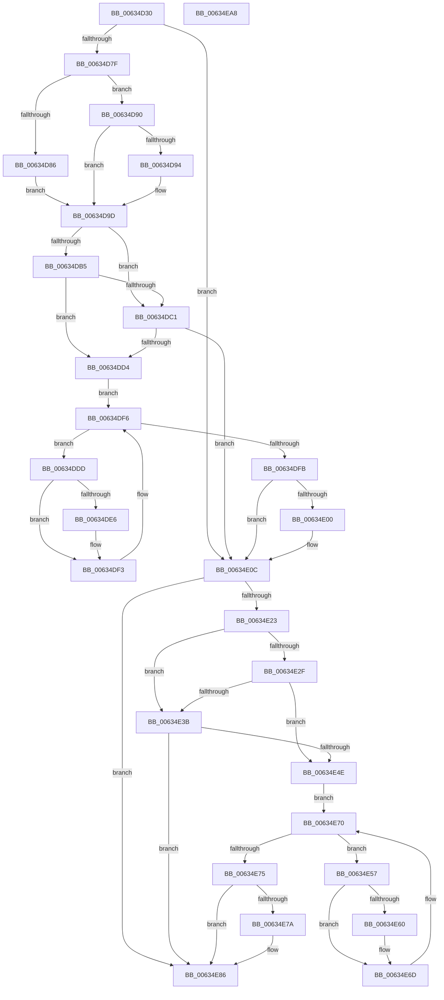

# DifMmCreateMdlWrapper

- RVA: `0x00634D30`–`0x00634EA9` (길이 `377` bytes)
- VA: `0x0000000140634D30`
- 실행 섹션: `.text`
- PDB 이름 있음: `예`; PDB Function 태그: `아니요`
- unwind 정보 RVA: `0x000A9A64`
- 디코드: `108`개 명령, `377/377` bytes 표시
- 미해석 바이트: `0` (있으면 어셈블리에 `.byte`로 보존)

> 이 문서는 커널 이미지의 기계어와 PDB 기호를 분석해 생성했습니다. 4번과 5번은 함수 원형과 자료형을 바이너리 사용 방식에서 추정한 C 해석이며 원본 소스 복구 결과는 아닙니다.

## 1. Dependencies

- 직접 호출 지점: **9**; 고유 호출 대상: **6**
- 직접 호출자로 확인된 함수: **0**
- RIP 상대 이미지 참조: **3**

### Outgoing calls
- `0x00634D6E` → [DifGetAPIThunkContextById](../49/DifGetAPIThunkContextById_function_00495A34.md) (function, `0x00495A34`)
- `0x00634D94` → [DifGetReturnAddressForWrappers](../4D/DifGetReturnAddressForWrappers_function_004D3C08.md) (function, `0x004D3C08`)
- `0x00634DC8` → [ExAcquireRundownProtection](../21/ExAcquireRundownProtection_function_00216620.md) (function, `0x00216620`)
- `0x00634DEE` → [guard_dispatch_icall](../6B/guard_dispatch_icall_function_006BAAD0.md) (function, `0x006BAAD0`)
- `0x00634E07` → [ExReleaseRundownProtection](../34/ExReleaseRundownProtection_function_00349E80.md) (function, `0x00349E80`)
- `0x00634E15` → [MmCreateMdl](../46/MmCreateMdl_function_00463E20.md) (function, `0x00463E20`)
- `0x00634E42` → [ExAcquireRundownProtection](../21/ExAcquireRundownProtection_function_00216620.md) (function, `0x00216620`)
- `0x00634E68` → [guard_dispatch_icall](../6B/guard_dispatch_icall_function_006BAAD0.md) (function, `0x006BAAD0`)
- `0x00634E81` → [ExReleaseRundownProtection](../34/ExReleaseRundownProtection_function_00349E80.md) (function, `0x00349E80`)

### Direct callers
- 이 함수 시작 RVA로 연결되는 직접 call은 확인되지 않았습니다. 간접 호출은 완전히 역산할 수 없습니다.

### Static image references
- `0x00634DA4` → RVA `0x00F048B8` (`.data`; read)
- `0x00634DB5` → RVA `0x00F04980` (`.data`; read)
- `0x00634DC1` → RVA `0x00F03E80` (`.data`; read)

## 2. Other-region calls and transfers

- 다른 실행 섹션으로 향하는 call: **0**
- 별도 외부 분기/꼬리 이동을 확인하지 못했습니다.

## 3. Assembly (complete function range)

```asm
00634D30  48 89 5C 24 08                  mov qword ptr [rsp + 8], rbx
00634D35  48 89 74 24 10                  mov qword ptr [rsp + 0x10], rsi
00634D3A  48 89 7C 24 18                  mov qword ptr [rsp + 0x18], rdi
00634D3F  55                              push rbp
00634D40  41 54                           push r12
00634D42  41 55                           push r13
00634D44  41 56                           push r14
00634D46  41 57                           push r15
00634D48  48 8B EC                        mov rbp, rsp
00634D4B  48 83 EC 50                     sub rsp, 0x50
00634D4F  0F 57 C0                        xorps xmm0, xmm0
00634D52  33 C0                           xor eax, eax
00634D54  4C 8B E9                        mov r13, rcx
00634D57  48 89 45 F0                     mov qword ptr [rbp - 0x10], rax
00634D5B  B9 E3 00 00 00                  mov ecx, 0xe3
00634D60  4D 8B F8                        mov r15, r8
00634D63  0F 11 45 D0                     movups xmmword ptr [rbp - 0x30], xmm0
00634D67  4C 8B E2                        mov r12, rdx
00634D6A  0F 11 45 E0                     movups xmmword ptr [rbp - 0x20], xmm0
00634D6E  E8 C1 0C E6 FF                  call 0x140495a34
00634D73  48 8B F0                        mov rsi, rax
00634D76  48 85 C0                        test rax, rax
00634D79  0F 84 8D 00 00 00               je 0x140634e0c
00634D7F  8B 40 0C                        mov eax, dword ptr [rax + 0xc]
00634D82  A8 18                           test al, 0x18
00634D84  74 0A                           je 0x140634d90
00634D86  48 8B 4D 28                     mov rcx, qword ptr [rbp + 0x28]
00634D8A  48 89 4D D0                     mov qword ptr [rbp - 0x30], rcx
00634D8E  EB 0D                           jmp 0x140634d9d
00634D90  A8 04                           test al, 4
00634D92  74 09                           je 0x140634d9d
00634D94  E8 6F EE E9 FF                  call 0x1404d3c08
00634D99  48 89 45 D0                     mov qword ptr [rbp - 0x30], rax
00634D9D  45 32 F6                        xor r14b, r14b
00634DA0  4C 89 6D E8                     mov qword ptr [rbp - 0x18], r13
00634DA4  44 38 35 0D FB 8C 00            cmp byte ptr [rip + 0x8cfb0d], r14b
00634DAB  4C 89 65 E0                     mov qword ptr [rbp - 0x20], r12
00634DAF  4C 89 7D D8                     mov qword ptr [rbp - 0x28], r15
00634DB3  75 0C                           jne 0x140634dc1
00634DB5  F7 05 C1 FB 8C 00 00 08 00 00   test dword ptr [rip + 0x8cfbc1], 0x800
00634DBF  74 13                           je 0x140634dd4
00634DC1  48 8D 0D B8 F0 8C 00            lea rcx, [rip + 0x8cf0b8]
00634DC8  E8 53 18 BE FF                  call 0x140216620
00634DCD  44 8A F0                        mov r14b, al
00634DD0  84 C0                           test al, al
00634DD2  74 38                           je 0x140634e0c
00634DD4  48 8D 7E 20                     lea rdi, [rsi + 0x20]
00634DD8  48 8B 1F                        mov rbx, qword ptr [rdi]
00634DDB  EB 19                           jmp 0x140634df6
00634DDD  48 8D 43 F0                     lea rax, [rbx - 0x10]
00634DE1  48 85 C0                        test rax, rax
00634DE4  74 0D                           je 0x140634df3
00634DE6  48 8B 40 08                     mov rax, qword ptr [rax + 8]
00634DEA  48 8D 4D D0                     lea rcx, [rbp - 0x30]
00634DEE  E8 DD 5C 08 00                  call 0x1406baad0
00634DF3  48 8B 1B                        mov rbx, qword ptr [rbx]
00634DF6  48 3B DF                        cmp rbx, rdi
00634DF9  75 E2                           jne 0x140634ddd
00634DFB  45 84 F6                        test r14b, r14b
00634DFE  74 0C                           je 0x140634e0c
00634E00  48 8D 0D 79 F0 8C 00            lea rcx, [rip + 0x8cf079]
00634E07  E8 74 50 D1 FF                  call 0x140349e80
00634E0C  4D 8B C7                        mov r8, r15
00634E0F  49 8B D4                        mov rdx, r12
00634E12  49 8B CD                        mov rcx, r13
00634E15  E8 06 F0 E2 FF                  call 0x140463e20
00634E1A  48 89 45 F0                     mov qword ptr [rbp - 0x10], rax
00634E1E  48 85 F6                        test rsi, rsi
00634E21  74 63                           je 0x140634e86
00634E23  40 32 FF                        xor dil, dil
00634E26  40 38 3D 8B FA 8C 00            cmp byte ptr [rip + 0x8cfa8b], dil
00634E2D  75 0C                           jne 0x140634e3b
00634E2F  F7 05 47 FB 8C 00 00 08 00 00   test dword ptr [rip + 0x8cfb47], 0x800
00634E39  74 13                           je 0x140634e4e
00634E3B  48 8D 0D 3E F0 8C 00            lea rcx, [rip + 0x8cf03e]
00634E42  E8 D9 17 BE FF                  call 0x140216620
00634E47  40 8A F8                        mov dil, al
00634E4A  84 C0                           test al, al
00634E4C  74 38                           je 0x140634e86
00634E4E  48 83 C6 30                     add rsi, 0x30
00634E52  48 8B 1E                        mov rbx, qword ptr [rsi]
00634E55  EB 19                           jmp 0x140634e70
00634E57  48 8D 43 F0                     lea rax, [rbx - 0x10]
00634E5B  48 85 C0                        test rax, rax
00634E5E  74 0D                           je 0x140634e6d
00634E60  48 8B 40 08                     mov rax, qword ptr [rax + 8]
00634E64  48 8D 4D D0                     lea rcx, [rbp - 0x30]
00634E68  E8 63 5C 08 00                  call 0x1406baad0
00634E6D  48 8B 1B                        mov rbx, qword ptr [rbx]
00634E70  48 3B DE                        cmp rbx, rsi
00634E73  75 E2                           jne 0x140634e57
00634E75  40 84 FF                        test dil, dil
00634E78  74 0C                           je 0x140634e86
00634E7A  48 8D 0D FF EF 8C 00            lea rcx, [rip + 0x8cefff]
00634E81  E8 FA 4F D1 FF                  call 0x140349e80
00634E86  48 8B 45 F0                     mov rax, qword ptr [rbp - 0x10]
00634E8A  4C 8D 5C 24 50                  lea r11, [rsp + 0x50]
00634E8F  49 8B 5B 30                     mov rbx, qword ptr [r11 + 0x30]
00634E93  49 8B 73 38                     mov rsi, qword ptr [r11 + 0x38]
00634E97  49 8B 7B 40                     mov rdi, qword ptr [r11 + 0x40]
00634E9B  49 8B E3                        mov rsp, r11
00634E9E  41 5F                           pop r15
00634EA0  41 5E                           pop r14
00634EA2  41 5D                           pop r13
00634EA4  41 5C                           pop r12
00634EA6  5D                              pop rbp
00634EA7  C3                              ret
00634EA8  CC                              int3
```

## 4. C-style interpretation (structured pseudocode)

```c
__int64 __fastcall DifMmCreateMdlWrapper(__int64 a1, __int64 a2, __int64 a3)
{
    __int64 result;
    __int64 v_r14;
    __int64 v_rdi;
    __int64 v_rsi;
    __int64 v_rsp;
    unsigned __int64 v_stack_m28;
    unsigned __int64 v_stack_m38;
    unsigned __int64 v_stack_m40;
    unsigned __int64 v_stack_m48;
    unsigned __int64 v_stack_m50;
    unsigned __int64 v_stack_m58;
    unsigned __int64 v_stack_p0;
    unsigned __int64 v_stack_p10;
    unsigned __int64 v_stack_p18;
    unsigned __int64 v_stack_p8;

    v_stack_p8 = v_rbx;
    v_stack_p10 = v_rsi;
    v_stack_p18 = v_rdi;
    v_rsp = (v_rsp) - (80);
    result = 0;
    v_stack_m38 = 0;
    v_stack_m58 = v_xmm0;
    v_stack_m48 = v_xmm0;
    result = DifGetAPIThunkContextById(227, a2, a3, a4);
    if (result == 0) goto loc_00634E0C;
    if ((((unsigned __int8)((unsigned int)(*(unsigned int *)(result + 12)))) & (24)) == 0) goto loc_00634D90;
    v_stack_m58 = v_stack_p0;
    goto loc_00634D9D;
loc_00634D90:
    result = (unsigned int)(*(unsigned int *)(result + 12));
    if ((((unsigned __int8)((unsigned int)(*(unsigned int *)(result + 12)))) & (4)) != 0) {
        result = DifGetReturnAddressForWrappers(v_stack_p0, a2, a3, a4);
        v_stack_m58 = result;
    }
    v_r14 = 0;
    v_stack_m40 = a1;
    v_stack_m48 = a2;
    v_stack_m50 = a3;
    if ((*(unsigned __int8 *)(v_rip + 9239309)) != 0) goto loc_00634DC1;
    if (((*(unsigned int *)(v_rip + 9239489)) & (0x800ULL)) == 0) goto loc_00634DD4;
loc_00634DC1:
    result = ExAcquireRundownProtection(v_rip + 9236664, a2, a3, a4);
    if ((unsigned __int8)(result) == 0) goto loc_00634E0C;
loc_00634DD4:
    goto loc_00634DF6;
loc_00634DDD:
    result = *(unsigned __int64 *)(result + 32) - 16;
    if (*(unsigned __int64 *)(result + 32) - 16 != 0) {
        result = *(unsigned __int64 *)(*(unsigned __int64 *)(result + 32) - 16 + 8);
        a1 = v_stack_m58;
        result = guard_dispatch_icall(a1, a2, a3, a4);
    }
loc_00634DF6:
    if ((*(unsigned __int64 *)(*(unsigned __int64 *)(result + 32))) != (result + 32)) goto loc_00634DDD;
    if ((unsigned __int8)((unsigned __int8)(result)) != 0) {
        a1 = v_rip + 9236601;
        result = ExReleaseRundownProtection(a1, a2, a3, a4);
    }
    result = MmCreateMdl(a1, a2, a3, a4);
    v_stack_m38 = result;
    if (result == 0) goto loc_00634E86;
    v_rdi = 0;
    if ((*(unsigned __int8 *)(v_rip + 9239179)) != 0) goto loc_00634E3B;
    if (((*(unsigned int *)(v_rip + 9239367)) & (0x800ULL)) == 0) goto loc_00634E4E;
loc_00634E3B:
    result = ExAcquireRundownProtection(v_rip + 9236542, a2, a3, a4);
    if ((unsigned __int8)(result) == 0) goto loc_00634E86;
loc_00634E4E:
    v_rsi = (result) + (48);
    goto loc_00634E70;
loc_00634E57:
    result = *(unsigned __int64 *)(v_rsi) - 16;
    if (*(unsigned __int64 *)(v_rsi) - 16 != 0) {
        result = *(unsigned __int64 *)(*(unsigned __int64 *)(v_rsi) - 16 + 8);
        a1 = v_stack_m58;
        result = guard_dispatch_icall(a1, a2, a3, a4);
    }
loc_00634E70:
    if ((*(unsigned __int64 *)(*(unsigned __int64 *)(v_rsi))) != v_rsi) goto loc_00634E57;
    if ((unsigned __int8)((unsigned __int8)(result)) != 0) {
        a1 = v_rip + 9236479;
        result = ExReleaseRundownProtection(a1, a2, a3, a4);
    }
    return v_stack_m38;
}
```

## 5. (Beta) C Style

```c
int64_t DifMmCreateMdlWrapper(int64_t Arg1, int64_t Arg2, int64_t Arg3)
{
    int64_t result;
    int64_t local_r14;
    int64_t local_rdi;
    int64_t local_rsi;
    int64_t local_rsp;
    uint64_t v_stack_m28;
    uint64_t v_stack_m38;
    uint64_t v_stack_m40;
    uint64_t v_stack_m48;
    uint64_t v_stack_m50;
    uint64_t v_stack_m58;
    uint64_t v_stack_p0;
    uint64_t v_stack_p10;
    uint64_t v_stack_p18;
    uint64_t v_stack_p8;

    v_stack_p8 = local_rbx;
    v_stack_p10 = local_rsi;
    v_stack_p18 = local_rdi;
    local_rsp = (local_rsp) - (80);
    result = 0;
    v_stack_m38 = 0;
    v_stack_m58 = v_xmm0;
    v_stack_m48 = v_xmm0;
    result = DifGetAPIThunkContextById(227, Arg2, Arg3, a4);
    if (result == 0) goto loc_00634E0C;
    if ((((uint8_t)((uint32_t)(*(uint32_t *)(result + 0xC)))) & (24)) == 0) goto loc_00634D90;
    v_stack_m58 = v_stack_p0;
    goto loc_00634D9D;
loc_00634D90:
    result = (uint32_t)(*(uint32_t *)(result + 0xC));
    if ((((uint8_t)((uint32_t)(*(uint32_t *)(result + 0xC)))) & (4)) != 0) {
        result = DifGetReturnAddressForWrappers(v_stack_p0, Arg2, Arg3, a4);
        v_stack_m58 = result;
    }
    local_r14 = 0;
    v_stack_m40 = Arg1;
    v_stack_m48 = Arg2;
    v_stack_m50 = Arg3;
    if ((*(uint8_t *)(v_rip + 0x8CFB0D)) != 0) goto loc_00634DC1;
    if (((*(uint32_t *)(v_rip + 0x8CFBC1)) & (0x800ULL)) == 0) goto loc_00634DD4;
loc_00634DC1:
    result = ExAcquireRundownProtection(v_rip + 9236664, Arg2, Arg3, a4);
    if ((uint8_t)(result) == 0) goto loc_00634E0C;
loc_00634DD4:
    goto loc_00634DF6;
loc_00634DDD:
    result = *(uint64_t *)(result + 0x20) - 16;
    if (*(uint64_t *)(result + 0x20) - 16 != 0) {
        result = *(uint64_t *)(*(uint64_t *)(result + 0x20) - 0x10 + 0x8);
        Arg1 = v_stack_m58;
        result = guard_dispatch_icall(Arg1, Arg2, Arg3, a4);
    }
loc_00634DF6:
    if ((*(uint64_t *)(*(uint64_t *)(result + 0x20))) != (result + 32)) goto loc_00634DDD;
    if ((uint8_t)((uint8_t)(result)) != 0) {
        Arg1 = v_rip + 9236601;
        result = ExReleaseRundownProtection(Arg1, Arg2, Arg3, a4);
    }
    result = MmCreateMdl(Arg1, Arg2, Arg3, a4);
    v_stack_m38 = result;
    if (result == 0) goto loc_00634E86;
    local_rdi = 0;
    if ((*(uint8_t *)(v_rip + 0x8CFA8B)) != 0) goto loc_00634E3B;
    if (((*(uint32_t *)(v_rip + 0x8CFB47)) & (0x800ULL)) == 0) goto loc_00634E4E;
loc_00634E3B:
    result = ExAcquireRundownProtection(v_rip + 9236542, Arg2, Arg3, a4);
    if ((uint8_t)(result) == 0) goto loc_00634E86;
loc_00634E4E:
    local_rsi = (result) + (48);
    goto loc_00634E70;
loc_00634E57:
    result = *(uint64_t *)(local_rsi) - 16;
    if (*(uint64_t *)(local_rsi) - 16 != 0) {
        result = *(uint64_t *)(*(uint64_t *)(local_rsi) - 0x10 + 0x8);
        Arg1 = v_stack_m58;
        result = guard_dispatch_icall(Arg1, Arg2, Arg3, a4);
    }
loc_00634E70:
    if ((*(uint64_t *)(*(uint64_t *)(local_rsi))) != local_rsi) goto loc_00634E57;
    if ((uint8_t)((uint8_t)(result)) != 0) {
        Arg1 = v_rip + 9236479;
        result = ExReleaseRundownProtection(Arg1, Arg2, Arg3, a4);
    }
    return v_stack_m38;
}
```

## 6. Execution-region graph

[열기: 2D/3D 그래프와 함수 탐색 컨트롤 패널](../../../control-panel.html?section=text&rva=0x00634D30&view=graph)

- 2D 그래프는 위에서 아래로 흐르고, 3D 그래프는 빈 공간을 드래그해 회전합니다. Shift+드래그는 이동, 휠은 확대·축소, 함수 노드 선택은 대상 보고서 이동입니다.

### Static fallback


