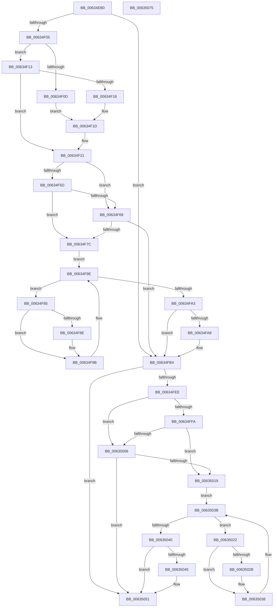

# DifMmCreateSectionWrapper

- RVA: `0x00634EB0`–`0x00635076` (길이 `454` bytes)
- VA: `0x0000000140634EB0`
- 실행 섹션: `.text`
- PDB 이름 있음: `예`; PDB Function 태그: `아니요`
- unwind 정보 RVA: `0x000D2C00`
- 디코드: `127`개 명령, `454/454` bytes 표시
- 미해석 바이트: `0` (있으면 어셈블리에 `.byte`로 보존)

> 이 문서는 커널 이미지의 기계어와 PDB 기호를 분석해 생성했습니다. 4번과 5번은 함수 원형과 자료형을 바이너리 사용 방식에서 추정한 C 해석이며 원본 소스 복구 결과는 아닙니다.

## 1. Dependencies

- 직접 호출 지점: **10**; 고유 호출 대상: **7**
- 직접 호출자로 확인된 함수: **0**
- RIP 상대 이미지 참조: **3**

### Outgoing calls
- `0x00634EEA` → [memset](../6C/memset_function_006C6C40.md) (function, `0x006C6C40`)
- `0x00634EF4` → [DifGetAPIThunkContextById](../49/DifGetAPIThunkContextById_function_00495A34.md) (function, `0x00495A34`)
- `0x00634F18` → [DifGetReturnAddressForWrappers](../4D/DifGetReturnAddressForWrappers_function_004D3C08.md) (function, `0x004D3C08`)
- `0x00634F70` → [ExAcquireRundownProtection](../21/ExAcquireRundownProtection_function_00216620.md) (function, `0x00216620`)
- `0x00634F96` → [guard_dispatch_icall](../6B/guard_dispatch_icall_function_006BAAD0.md) (function, `0x006BAAD0`)
- `0x00634FAF` → [ExReleaseRundownProtection](../34/ExReleaseRundownProtection_function_00349E80.md) (function, `0x00349E80`)
- `0x00634FE1` → [MmCreateSection](../../page/98/MmCreateSection_function_009838B0.md) (function, `0x009838B0`)
- `0x0063500D` → [ExAcquireRundownProtection](../21/ExAcquireRundownProtection_function_00216620.md) (function, `0x00216620`)
- `0x00635033` → [guard_dispatch_icall](../6B/guard_dispatch_icall_function_006BAAD0.md) (function, `0x006BAAD0`)
- `0x0063504C` → [ExReleaseRundownProtection](../34/ExReleaseRundownProtection_function_00349E80.md) (function, `0x00349E80`)

### Direct callers
- 이 함수 시작 RVA로 연결되는 직접 call은 확인되지 않았습니다. 간접 호출은 완전히 역산할 수 없습니다.

### Static image references
- `0x00634F28` → RVA `0x00F048B8` (`.data`; read)
- `0x00634F5D` → RVA `0x00F04980` (`.data`; read)
- `0x00634F69` → RVA `0x00F03E80` (`.data`; read)

## 2. Other-region calls and transfers

- 다른 실행 섹션으로 향하는 call: **1**
  - `0x00634FE1` → [MmCreateSection](../../page/98/MmCreateSection_function_009838B0.md) (`.text` → `PAGE`)
- 별도 외부 분기/꼬리 이동을 확인하지 못했습니다.

## 3. Assembly (complete function range)

```asm
00634EB0  48 8B C4                        mov rax, rsp
00634EB3  48 89 58 10                     mov qword ptr [rax + 0x10], rbx
00634EB7  48 89 70 18                     mov qword ptr [rax + 0x18], rsi
00634EBB  48 89 78 20                     mov qword ptr [rax + 0x20], rdi
00634EBF  48 89 48 08                     mov qword ptr [rax + 8], rcx
00634EC3  55                              push rbp
00634EC4  41 54                           push r12
00634EC6  41 55                           push r13
00634EC8  41 56                           push r14
00634ECA  41 57                           push r15
00634ECC  48 8D 68 C1                     lea rbp, [rax - 0x3f]
00634ED0  48 81 EC 90 00 00 00            sub rsp, 0x90
00634ED7  44 8B EA                        mov r13d, edx
00634EDA  48 8D 4D C7                     lea rcx, [rbp - 0x39]
00634EDE  33 D2                           xor edx, edx
00634EE0  4D 8B E0                        mov r12, r8
00634EE3  4D 8B F9                        mov r15, r9
00634EE6  44 8D 42 48                     lea r8d, [rdx + 0x48]
00634EEA  E8 51 1D 09 00                  call 0x1406c6c40
00634EEF  B9 B6 01 00 00                  mov ecx, 0x1b6
00634EF4  E8 3B 0B E6 FF                  call 0x140495a34
00634EF9  48 8B F0                        mov rsi, rax
00634EFC  48 85 C0                        test rax, rax
00634EFF  0F 84 AF 00 00 00               je 0x140634fb4
00634F05  8B 48 0C                        mov ecx, dword ptr [rax + 0xc]
00634F08  F6 C1 18                        test cl, 0x18
00634F0B  74 06                           je 0x140634f13
00634F0D  48 8B 45 3F                     mov rax, qword ptr [rbp + 0x3f]
00634F11  EB 0A                           jmp 0x140634f1d
00634F13  F6 C1 04                        test cl, 4
00634F16  74 09                           je 0x140634f21
00634F18  E8 EB EC E9 FF                  call 0x1404d3c08
00634F1D  48 89 45 C7                     mov qword ptr [rbp - 0x39], rax
00634F21  48 8B 45 47                     mov rax, qword ptr [rbp + 0x47]
00634F25  45 32 F6                        xor r14b, r14b
00634F28  44 38 35 89 F9 8C 00            cmp byte ptr [rip + 0x8cf989], r14b
00634F2F  48 89 45 FF                     mov qword ptr [rbp - 1], rax
00634F33  8B 45 67                        mov eax, dword ptr [rbp + 0x67]
00634F36  89 45 E3                        mov dword ptr [rbp - 0x1d], eax
00634F39  8B 45 6F                        mov eax, dword ptr [rbp + 0x6f]
00634F3C  89 45 DF                        mov dword ptr [rbp - 0x21], eax
00634F3F  48 8B 45 77                     mov rax, qword ptr [rbp + 0x77]
00634F43  48 89 45 D7                     mov qword ptr [rbp - 0x29], rax
00634F47  48 8B 45 7F                     mov rax, qword ptr [rbp + 0x7f]
00634F4B  48 89 45 CF                     mov qword ptr [rbp - 0x31], rax
00634F4F  44 89 6D F7                     mov dword ptr [rbp - 9], r13d
00634F53  4C 89 65 EF                     mov qword ptr [rbp - 0x11], r12
00634F57  4C 89 7D E7                     mov qword ptr [rbp - 0x19], r15
00634F5B  75 0C                           jne 0x140634f69
00634F5D  F7 05 19 FA 8C 00 00 08 00 00   test dword ptr [rip + 0x8cfa19], 0x800
00634F67  74 13                           je 0x140634f7c
00634F69  48 8D 0D 10 EF 8C 00            lea rcx, [rip + 0x8cef10]
00634F70  E8 AB 16 BE FF                  call 0x140216620
00634F75  44 8A F0                        mov r14b, al
00634F78  84 C0                           test al, al
00634F7A  74 38                           je 0x140634fb4
00634F7C  48 8D 7E 20                     lea rdi, [rsi + 0x20]
00634F80  48 8B 1F                        mov rbx, qword ptr [rdi]
00634F83  EB 19                           jmp 0x140634f9e
00634F85  48 8D 43 F0                     lea rax, [rbx - 0x10]
00634F89  48 85 C0                        test rax, rax
00634F8C  74 0D                           je 0x140634f9b
00634F8E  48 8B 40 08                     mov rax, qword ptr [rax + 8]
00634F92  48 8D 4D C7                     lea rcx, [rbp - 0x39]
00634F96  E8 35 5B 08 00                  call 0x1406baad0
00634F9B  48 8B 1B                        mov rbx, qword ptr [rbx]
00634F9E  48 3B DF                        cmp rbx, rdi
00634FA1  75 E2                           jne 0x140634f85
00634FA3  45 84 F6                        test r14b, r14b
00634FA6  74 0C                           je 0x140634fb4
00634FA8  48 8D 0D D1 EE 8C 00            lea rcx, [rip + 0x8ceed1]
00634FAF  E8 CC 4E D1 FF                  call 0x140349e80
00634FB4  48 8B 45 7F                     mov rax, qword ptr [rbp + 0x7f]
00634FB8  4D 8B CF                        mov r9, r15
00634FBB  48 8B 4D 47                     mov rcx, qword ptr [rbp + 0x47]
00634FBF  4D 8B C4                        mov r8, r12
00634FC2  48 89 44 24 38                  mov qword ptr [rsp + 0x38], rax
00634FC7  41 8B D5                        mov edx, r13d
00634FCA  48 8B 45 77                     mov rax, qword ptr [rbp + 0x77]
00634FCE  48 89 44 24 30                  mov qword ptr [rsp + 0x30], rax
00634FD3  8B 45 6F                        mov eax, dword ptr [rbp + 0x6f]
00634FD6  89 44 24 28                     mov dword ptr [rsp + 0x28], eax
00634FDA  8B 45 67                        mov eax, dword ptr [rbp + 0x67]
00634FDD  89 44 24 20                     mov dword ptr [rsp + 0x20], eax
00634FE1  E8 CA E8 34 00                  call 0x1409838b0
00634FE6  89 45 07                        mov dword ptr [rbp + 7], eax
00634FE9  48 85 F6                        test rsi, rsi
00634FEC  74 63                           je 0x140635051
00634FEE  40 32 FF                        xor dil, dil
00634FF1  40 38 3D C0 F8 8C 00            cmp byte ptr [rip + 0x8cf8c0], dil
00634FF8  75 0C                           jne 0x140635006
00634FFA  F7 05 7C F9 8C 00 00 08 00 00   test dword ptr [rip + 0x8cf97c], 0x800
00635004  74 13                           je 0x140635019
00635006  48 8D 0D 73 EE 8C 00            lea rcx, [rip + 0x8cee73]
0063500D  E8 0E 16 BE FF                  call 0x140216620
00635012  40 8A F8                        mov dil, al
00635015  84 C0                           test al, al
00635017  74 38                           je 0x140635051
00635019  48 83 C6 30                     add rsi, 0x30
0063501D  48 8B 1E                        mov rbx, qword ptr [rsi]
00635020  EB 19                           jmp 0x14063503b
00635022  48 8D 43 F0                     lea rax, [rbx - 0x10]
00635026  48 85 C0                        test rax, rax
00635029  74 0D                           je 0x140635038
0063502B  48 8B 40 08                     mov rax, qword ptr [rax + 8]
0063502F  48 8D 4D C7                     lea rcx, [rbp - 0x39]
00635033  E8 98 5A 08 00                  call 0x1406baad0
00635038  48 8B 1B                        mov rbx, qword ptr [rbx]
0063503B  48 3B DE                        cmp rbx, rsi
0063503E  75 E2                           jne 0x140635022
00635040  40 84 FF                        test dil, dil
00635043  74 0C                           je 0x140635051
00635045  48 8D 0D 34 EE 8C 00            lea rcx, [rip + 0x8cee34]
0063504C  E8 2F 4E D1 FF                  call 0x140349e80
00635051  8B 45 07                        mov eax, dword ptr [rbp + 7]
00635054  4C 8D 9C 24 90 00 00 00         lea r11, [rsp + 0x90]
0063505C  49 8B 5B 38                     mov rbx, qword ptr [r11 + 0x38]
00635060  49 8B 73 40                     mov rsi, qword ptr [r11 + 0x40]
00635064  49 8B 7B 48                     mov rdi, qword ptr [r11 + 0x48]
00635068  49 8B E3                        mov rsp, r11
0063506B  41 5F                           pop r15
0063506D  41 5E                           pop r14
0063506F  41 5D                           pop r13
00635071  41 5C                           pop r12
00635073  5D                              pop rbp
00635074  C3                              ret
00635075  CC                              int3
```

## 4. C-style interpretation (structured pseudocode)

```c
__int64 __fastcall DifMmCreateSectionWrapper(__int64 a1, int a2, __int64 a3, __int64 a4)
{
    __int64 result;
    __int64 v_r14;
    __int64 v_rdi;
    __int64 v_rsi;
    __int64 v_rsp;
    unsigned __int64 v_stack_m28;
    unsigned __int64 v_stack_m80;
    unsigned __int64 v_stack_m88;
    unsigned int v_stack_m90;
    unsigned int v_stack_m98;

    *(unsigned __int64 *)(v_rsp + 16) = v_rbx;
    *(unsigned __int64 *)(v_rsp + 24) = v_rsi;
    *(unsigned __int64 *)(v_rsp + 32) = v_rdi;
    *(unsigned __int64 *)(v_rsp + 8) = a1;
    v_rsp = (v_rsp) - (144);
    a2 = 0;
    result = memset(v_rsp - 63 - 57, a2, a2 + 72, a4);
    result = DifGetAPIThunkContextById(438, a2, a2 + 72, a4);
    if (result == 0) goto loc_00634FB4;
    if ((((unsigned __int8)((unsigned int)(*(unsigned int *)(result + 12)))) & (24)) == 0) goto loc_00634F13;
    goto loc_00634F1D;
loc_00634F13:
    if ((((unsigned __int8)((unsigned int)(*(unsigned int *)(result + 12)))) & (4)) == 0) goto loc_00634F21;
    result = DifGetReturnAddressForWrappers((unsigned int)(*(unsigned int *)(result + 12)), a2, a2 + 72, a4);
loc_00634F1D:
    *(unsigned __int64 *)(v_rsp - 63 - 57) = result;
loc_00634F21:
    v_r14 = 0;
    *(unsigned __int64 *)(v_rsp - 63 - 1) = *(unsigned __int64 *)(v_rsp - 63 + 71);
    *(unsigned int *)(v_rsp - 63 - 29) = (unsigned int)((unsigned int)(*(unsigned int *)(v_rsp - 63 + 103)));
    *(unsigned int *)(v_rsp - 63 - 33) = (unsigned int)((unsigned int)(*(unsigned int *)(v_rsp - 63 + 111)));
    *(unsigned __int64 *)(v_rsp - 63 - 41) = *(unsigned __int64 *)(v_rsp - 63 + 119);
    *(unsigned __int64 *)(v_rsp - 63 - 49) = *(unsigned __int64 *)(v_rsp - 63 + 127);
    *(unsigned int *)(v_rsp - 63 - 9) = (unsigned int)((unsigned int)(a2));
    *(unsigned __int64 *)(v_rsp - 63 - 17) = a3;
    *(unsigned __int64 *)(v_rsp - 63 - 25) = a4;
    if ((*(unsigned __int8 *)(v_rip + 9238921)) != 0) goto loc_00634F69;
    if (((*(unsigned int *)(v_rip + 9239065)) & (0x800ULL)) == 0) goto loc_00634F7C;
loc_00634F69:
    result = ExAcquireRundownProtection(v_rip + 9236240, a2, a2 + 72, a4);
    if ((unsigned __int8)(result) == 0) goto loc_00634FB4;
loc_00634F7C:
    goto loc_00634F9E;
loc_00634F85:
    result = *(unsigned __int64 *)(result + 32) - 16;
    if (*(unsigned __int64 *)(result + 32) - 16 != 0) {
        result = *(unsigned __int64 *)(*(unsigned __int64 *)(result + 32) - 16 + 8);
        a1 = v_rsp - 63 - 57;
        result = guard_dispatch_icall(a1, a2, a2 + 72, a4);
    }
loc_00634F9E:
    if ((*(unsigned __int64 *)(*(unsigned __int64 *)(result + 32))) != (result + 32)) goto loc_00634F85;
    if ((unsigned __int8)((unsigned __int8)(result)) != 0) {
        a1 = v_rip + 9236177;
        result = ExReleaseRundownProtection(a1, a2, a2 + 72, a4);
    }
    v_stack_m80 = *(unsigned __int64 *)(v_rsp - 63 + 127);
    v_stack_m88 = *(unsigned __int64 *)(v_rsp - 63 + 119);
    v_stack_m90 = (unsigned int)((unsigned int)(*(unsigned int *)(v_rsp - 63 + 111)));
    v_stack_m98 = (unsigned int)((unsigned int)(*(unsigned int *)(v_rsp - 63 + 103)));
    result = MmCreateSection(*(unsigned __int64 *)(v_rsp - 63 + 71), (unsigned int)((unsigned int)((unsigned int)(a2))), a3, a4);
    *(unsigned int *)(v_rsp - 63 + 7) = (unsigned int)(result);
    if (result == 0) goto loc_00635051;
    v_rdi = 0;
    if ((*(unsigned __int8 *)(v_rip + 9238720)) != 0) goto loc_00635006;
    if (((*(unsigned int *)(v_rip + 9238908)) & (0x800ULL)) == 0) goto loc_00635019;
loc_00635006:
    result = ExAcquireRundownProtection(v_rip + 9236083, (unsigned int)((unsigned int)((unsigned int)(a2))), a3, a4);
    if ((unsigned __int8)(result) == 0) goto loc_00635051;
loc_00635019:
    v_rsi = (result) + (48);
    goto loc_0063503B;
loc_00635022:
    result = *(unsigned __int64 *)(v_rsi) - 16;
    if (*(unsigned __int64 *)(v_rsi) - 16 != 0) {
        result = *(unsigned __int64 *)(*(unsigned __int64 *)(v_rsi) - 16 + 8);
        a1 = v_rsp - 63 - 57;
        result = guard_dispatch_icall(a1, (unsigned int)((unsigned int)((unsigned int)(a2))), a3, a4);
    }
loc_0063503B:
    if ((*(unsigned __int64 *)(*(unsigned __int64 *)(v_rsi))) != v_rsi) goto loc_00635022;
    if ((unsigned __int8)((unsigned __int8)(result)) != 0) {
        a1 = v_rip + 9236020;
        result = ExReleaseRundownProtection(a1, (unsigned int)((unsigned int)((unsigned int)(a2))), a3, a4);
    }
    return (unsigned int)(*(unsigned int *)(v_rsp - 63 + 7));
}
```

## 5. (Beta) C Style

```c
int64_t DifMmCreateSectionWrapper(int64_t Arg1, int32_t Arg2, int64_t Arg3, int64_t Arg4)
{
    int64_t result;
    int64_t local_r14;
    int64_t local_rdi;
    int64_t local_rsi;
    int64_t local_rsp;
    uint64_t v_stack_m28;
    uint64_t v_stack_m80;
    uint64_t v_stack_m88;
    uint32_t v_stack_m90;
    uint32_t v_stack_m98;

    *(uint64_t *)(local_rsp + 0x10) = local_rbx;
    *(uint64_t *)(local_rsp + 0x18) = local_rsi;
    *(uint64_t *)(local_rsp + 0x20) = local_rdi;
    *(uint64_t *)(local_rsp + 0x8) = Arg1;
    local_rsp = (local_rsp) - (144);
    Arg2 = 0;
    result = memset(local_rsp - 63 - 57, Arg2, Arg2 + 72, Arg4);
    result = DifGetAPIThunkContextById(438, Arg2, Arg2 + 72, Arg4);
    if (result == 0) goto loc_00634FB4;
    if ((((uint8_t)((uint32_t)(*(uint32_t *)(result + 0xC)))) & (24)) == 0) goto loc_00634F13;
    goto loc_00634F1D;
loc_00634F13:
    if ((((uint8_t)((uint32_t)(*(uint32_t *)(result + 0xC)))) & (4)) == 0) goto loc_00634F21;
    result = DifGetReturnAddressForWrappers((uint32_t)(*(uint32_t *)(result + 0xC)), Arg2, Arg2 + 72, Arg4);
loc_00634F1D:
    *(uint64_t *)(local_rsp - 0x3F - 0x39) = result;
loc_00634F21:
    local_r14 = 0;
    *(uint64_t *)(local_rsp - 0x3F - 0x1) = *(uint64_t *)(local_rsp - 0x3F + 0x47);
    *(uint32_t *)(local_rsp - 0x3F - 0x1D) = (uint32_t)((uint32_t)(*(uint32_t *)(local_rsp - 0x3F + 0x67)));
    *(uint32_t *)(local_rsp - 0x3F - 0x21) = (uint32_t)((uint32_t)(*(uint32_t *)(local_rsp - 0x3F + 0x6F)));
    *(uint64_t *)(local_rsp - 0x3F - 0x29) = *(uint64_t *)(local_rsp - 0x3F + 0x77);
    *(uint64_t *)(local_rsp - 0x3F - 0x31) = *(uint64_t *)(local_rsp - 0x3F + 0x7F);
    *(uint32_t *)(local_rsp - 0x3F - 0x9) = (uint32_t)((uint32_t)(Arg2));
    *(uint64_t *)(local_rsp - 0x3F - 0x11) = Arg3;
    *(uint64_t *)(local_rsp - 0x3F - 0x19) = Arg4;
    if ((*(uint8_t *)(v_rip + 0x8CF989)) != 0) goto loc_00634F69;
    if (((*(uint32_t *)(v_rip + 0x8CFA19)) & (0x800ULL)) == 0) goto loc_00634F7C;
loc_00634F69:
    result = ExAcquireRundownProtection(v_rip + 9236240, Arg2, Arg2 + 72, Arg4);
    if ((uint8_t)(result) == 0) goto loc_00634FB4;
loc_00634F7C:
    goto loc_00634F9E;
loc_00634F85:
    result = *(uint64_t *)(result + 0x20) - 16;
    if (*(uint64_t *)(result + 0x20) - 16 != 0) {
        result = *(uint64_t *)(*(uint64_t *)(result + 0x20) - 0x10 + 0x8);
        Arg1 = local_rsp - 63 - 57;
        result = guard_dispatch_icall(Arg1, Arg2, Arg2 + 72, Arg4);
    }
loc_00634F9E:
    if ((*(uint64_t *)(*(uint64_t *)(result + 0x20))) != (result + 32)) goto loc_00634F85;
    if ((uint8_t)((uint8_t)(result)) != 0) {
        Arg1 = v_rip + 9236177;
        result = ExReleaseRundownProtection(Arg1, Arg2, Arg2 + 72, Arg4);
    }
    v_stack_m80 = *(uint64_t *)(local_rsp - 0x3F + 0x7F);
    v_stack_m88 = *(uint64_t *)(local_rsp - 0x3F + 0x77);
    v_stack_m90 = (uint32_t)((uint32_t)(*(uint32_t *)(local_rsp - 0x3F + 0x6F)));
    v_stack_m98 = (uint32_t)((uint32_t)(*(uint32_t *)(local_rsp - 0x3F + 0x67)));
    result = MmCreateSection(*(uint64_t *)(local_rsp - 0x3F + 0x47), (uint32_t)((uint32_t)((uint32_t)(Arg2))), Arg3, Arg4);
    *(uint32_t *)(local_rsp - 0x3F + 0x7) = (uint32_t)(result);
    if (result == 0) goto loc_00635051;
    local_rdi = 0;
    if ((*(uint8_t *)(v_rip + 0x8CF8C0)) != 0) goto loc_00635006;
    if (((*(uint32_t *)(v_rip + 0x8CF97C)) & (0x800ULL)) == 0) goto loc_00635019;
loc_00635006:
    result = ExAcquireRundownProtection(v_rip + 9236083, (uint32_t)((uint32_t)((uint32_t)(Arg2))), Arg3, Arg4);
    if ((uint8_t)(result) == 0) goto loc_00635051;
loc_00635019:
    local_rsi = (result) + (48);
    goto loc_0063503B;
loc_00635022:
    result = *(uint64_t *)(local_rsi) - 16;
    if (*(uint64_t *)(local_rsi) - 16 != 0) {
        result = *(uint64_t *)(*(uint64_t *)(local_rsi) - 0x10 + 0x8);
        Arg1 = local_rsp - 63 - 57;
        result = guard_dispatch_icall(Arg1, (uint32_t)((uint32_t)((uint32_t)(Arg2))), Arg3, Arg4);
    }
loc_0063503B:
    if ((*(uint64_t *)(*(uint64_t *)(local_rsi))) != local_rsi) goto loc_00635022;
    if ((uint8_t)((uint8_t)(result)) != 0) {
        Arg1 = v_rip + 9236020;
        result = ExReleaseRundownProtection(Arg1, (uint32_t)((uint32_t)((uint32_t)(Arg2))), Arg3, Arg4);
    }
    return (uint32_t)(*(uint32_t *)(local_rsp - 0x3F + 0x7));
}
```

## 6. Execution-region graph

[열기: 2D/3D 그래프와 함수 탐색 컨트롤 패널](../../../control-panel.html?section=text&rva=0x00634EB0&view=graph)

- 2D 그래프는 위에서 아래로 흐르고, 3D 그래프는 빈 공간을 드래그해 회전합니다. Shift+드래그는 이동, 휠은 확대·축소, 함수 노드 선택은 대상 보고서 이동입니다.

### Static fallback


