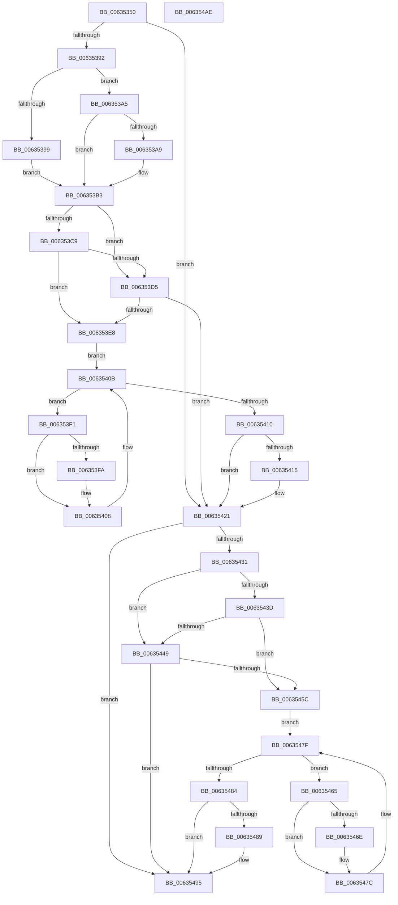

# DifMmFreeMappingAddressWrapper

- RVA: `0x00635350`–`0x006354AF` (길이 `351` bytes)
- VA: `0x0000000140635350`
- 실행 섹션: `.text`
- PDB 이름 있음: `예`; PDB Function 태그: `아니요`
- unwind 정보 RVA: `0x00093E28`
- 디코드: `97`개 명령, `351/351` bytes 표시
- 미해석 바이트: `0` (있으면 어셈블리에 `.byte`로 보존)

> 이 문서는 커널 이미지의 기계어와 PDB 기호를 분석해 생성했습니다. 4번과 5번은 함수 원형과 자료형을 바이너리 사용 방식에서 추정한 C 해석이며 원본 소스 복구 결과는 아닙니다.

## 1. Dependencies

- 직접 호출 지점: **9**; 고유 호출 대상: **6**
- 직접 호출자로 확인된 함수: **0**
- RIP 상대 이미지 참조: **3**

### Outgoing calls
- `0x00635381` → [DifGetAPIThunkContextById](../49/DifGetAPIThunkContextById_function_00495A34.md) (function, `0x00495A34`)
- `0x006353A9` → [DifGetReturnAddressForWrappers](../4D/DifGetReturnAddressForWrappers_function_004D3C08.md) (function, `0x004D3C08`)
- `0x006353DC` → [ExAcquireRundownProtection](../21/ExAcquireRundownProtection_function_00216620.md) (function, `0x00216620`)
- `0x00635403` → [guard_dispatch_icall](../6B/guard_dispatch_icall_function_006BAAD0.md) (function, `0x006BAAD0`)
- `0x0063541C` → [ExReleaseRundownProtection](../34/ExReleaseRundownProtection_function_00349E80.md) (function, `0x00349E80`)
- `0x00635427` → [MmFreeMappingAddress](../../page/A7/MmFreeMappingAddress_function_00A75F20.md) (function, `0x00A75F20`)
- `0x00635450` → [ExAcquireRundownProtection](../21/ExAcquireRundownProtection_function_00216620.md) (function, `0x00216620`)
- `0x00635477` → [guard_dispatch_icall](../6B/guard_dispatch_icall_function_006BAAD0.md) (function, `0x006BAAD0`)
- `0x00635490` → [ExReleaseRundownProtection](../34/ExReleaseRundownProtection_function_00349E80.md) (function, `0x00349E80`)

### Direct callers
- 이 함수 시작 RVA로 연결되는 직접 call은 확인되지 않았습니다. 간접 호출은 완전히 역산할 수 없습니다.

### Static image references
- `0x006353BB` → RVA `0x00F048B8` (`.data`; read)
- `0x006353C9` → RVA `0x00F04980` (`.data`; read)
- `0x006353D5` → RVA `0x00F03E80` (`.data`; read)

## 2. Other-region calls and transfers

- 다른 실행 섹션으로 향하는 call: **1**
  - `0x00635427` → [MmFreeMappingAddress](../../page/A7/MmFreeMappingAddress_function_00A75F20.md) (`.text` → `PAGE`)
- 별도 외부 분기/꼬리 이동을 확인하지 못했습니다.

## 3. Assembly (complete function range)

```asm
00635350  4C 8B DC                        mov r11, rsp
00635353  49 89 5B 08                     mov qword ptr [r11 + 8], rbx
00635357  49 89 6B 10                     mov qword ptr [r11 + 0x10], rbp
0063535B  49 89 73 18                     mov qword ptr [r11 + 0x18], rsi
0063535F  57                              push rdi
00635360  41 56                           push r14
00635362  41 57                           push r15
00635364  48 83 EC 40                     sub rsp, 0x40
00635368  33 C0                           xor eax, eax
0063536A  0F 57 C0                        xorps xmm0, xmm0
0063536D  0F 11 44 24 20                  movups xmmword ptr [rsp + 0x20], xmm0
00635372  4C 8B F9                        mov r15, rcx
00635375  49 89 43 D8                     mov qword ptr [r11 - 0x28], rax
00635379  B9 D2 01 00 00                  mov ecx, 0x1d2
0063537E  44 8B F2                        mov r14d, edx
00635381  E8 AE 06 E6 FF                  call 0x140495a34
00635386  48 8B F0                        mov rsi, rax
00635389  48 85 C0                        test rax, rax
0063538C  0F 84 8F 00 00 00               je 0x140635421
00635392  8B 40 0C                        mov eax, dword ptr [rax + 0xc]
00635395  A8 18                           test al, 0x18
00635397  74 0C                           je 0x1406353a5
00635399  48 8B 4C 24 58                  mov rcx, qword ptr [rsp + 0x58]
0063539E  48 89 4C 24 20                  mov qword ptr [rsp + 0x20], rcx
006353A3  EB 0E                           jmp 0x1406353b3
006353A5  A8 04                           test al, 4
006353A7  74 0A                           je 0x1406353b3
006353A9  E8 5A E8 E9 FF                  call 0x1404d3c08
006353AE  48 89 44 24 20                  mov qword ptr [rsp + 0x20], rax
006353B3  40 32 ED                        xor bpl, bpl
006353B6  4C 89 7C 24 30                  mov qword ptr [rsp + 0x30], r15
006353BB  40 38 2D F6 F4 8C 00            cmp byte ptr [rip + 0x8cf4f6], bpl
006353C2  44 89 74 24 28                  mov dword ptr [rsp + 0x28], r14d
006353C7  75 0C                           jne 0x1406353d5
006353C9  F7 05 AD F5 8C 00 00 08 00 00   test dword ptr [rip + 0x8cf5ad], 0x800
006353D3  74 13                           je 0x1406353e8
006353D5  48 8D 0D A4 EA 8C 00            lea rcx, [rip + 0x8ceaa4]
006353DC  E8 3F 12 BE FF                  call 0x140216620
006353E1  40 8A E8                        mov bpl, al
006353E4  84 C0                           test al, al
006353E6  74 39                           je 0x140635421
006353E8  48 8D 7E 20                     lea rdi, [rsi + 0x20]
006353EC  48 8B 1F                        mov rbx, qword ptr [rdi]
006353EF  EB 1A                           jmp 0x14063540b
006353F1  48 8D 43 F0                     lea rax, [rbx - 0x10]
006353F5  48 85 C0                        test rax, rax
006353F8  74 0E                           je 0x140635408
006353FA  48 8B 40 08                     mov rax, qword ptr [rax + 8]
006353FE  48 8D 4C 24 20                  lea rcx, [rsp + 0x20]
00635403  E8 C8 56 08 00                  call 0x1406baad0
00635408  48 8B 1B                        mov rbx, qword ptr [rbx]
0063540B  48 3B DF                        cmp rbx, rdi
0063540E  75 E1                           jne 0x1406353f1
00635410  40 84 ED                        test bpl, bpl
00635413  74 0C                           je 0x140635421
00635415  48 8D 0D 64 EA 8C 00            lea rcx, [rip + 0x8cea64]
0063541C  E8 5F 4A D1 FF                  call 0x140349e80
00635421  41 8B D6                        mov edx, r14d
00635424  49 8B CF                        mov rcx, r15
00635427  E8 F4 0A 44 00                  call 0x140a75f20
0063542C  48 85 F6                        test rsi, rsi
0063542F  74 64                           je 0x140635495
00635431  40 32 FF                        xor dil, dil
00635434  40 38 3D 7D F4 8C 00            cmp byte ptr [rip + 0x8cf47d], dil
0063543B  75 0C                           jne 0x140635449
0063543D  F7 05 39 F5 8C 00 00 08 00 00   test dword ptr [rip + 0x8cf539], 0x800
00635447  74 13                           je 0x14063545c
00635449  48 8D 0D 30 EA 8C 00            lea rcx, [rip + 0x8cea30]
00635450  E8 CB 11 BE FF                  call 0x140216620
00635455  40 8A F8                        mov dil, al
00635458  84 C0                           test al, al
0063545A  74 39                           je 0x140635495
0063545C  48 83 C6 30                     add rsi, 0x30
00635460  48 8B 1E                        mov rbx, qword ptr [rsi]
00635463  EB 1A                           jmp 0x14063547f
00635465  48 8D 43 F0                     lea rax, [rbx - 0x10]
00635469  48 85 C0                        test rax, rax
0063546C  74 0E                           je 0x14063547c
0063546E  48 8B 40 08                     mov rax, qword ptr [rax + 8]
00635472  48 8D 4C 24 20                  lea rcx, [rsp + 0x20]
00635477  E8 54 56 08 00                  call 0x1406baad0
0063547C  48 8B 1B                        mov rbx, qword ptr [rbx]
0063547F  48 3B DE                        cmp rbx, rsi
00635482  75 E1                           jne 0x140635465
00635484  40 84 FF                        test dil, dil
00635487  74 0C                           je 0x140635495
00635489  48 8D 0D F0 E9 8C 00            lea rcx, [rip + 0x8ce9f0]
00635490  E8 EB 49 D1 FF                  call 0x140349e80
00635495  48 8B 5C 24 60                  mov rbx, qword ptr [rsp + 0x60]
0063549A  48 8B 6C 24 68                  mov rbp, qword ptr [rsp + 0x68]
0063549F  48 8B 74 24 70                  mov rsi, qword ptr [rsp + 0x70]
006354A4  48 83 C4 40                     add rsp, 0x40
006354A8  41 5F                           pop r15
006354AA  41 5E                           pop r14
006354AC  5F                              pop rdi
006354AD  C3                              ret
006354AE  CC                              int3
```

## 4. C-style interpretation (structured pseudocode)

```c
__int64 __fastcall DifMmFreeMappingAddressWrapper(__int64 a1, int a2)
{
    __int64 result;
    __int64 v_rbp;
    __int64 v_rdi;
    __int64 v_rsi;
    __int64 v_rsp;
    unsigned __int64 v_stack_m28;
    unsigned int v_stack_m30;
    unsigned __int64 v_stack_m38;
    unsigned __int64 v_stack_p0;
    unsigned __int64 v_stack_p10;
    unsigned __int64 v_stack_p18;
    unsigned __int64 v_stack_p8;

    *(unsigned __int64 *)(v_rsp + 8) = v_rbx;
    *(unsigned __int64 *)(v_rsp + 16) = v_rbp;
    *(unsigned __int64 *)(v_rsp + 24) = v_rsi;
    v_rsp = (v_rsp) - (64);
    result = 0;
    v_stack_m38 = v_xmm0;
    *(unsigned __int64 *)(v_rsp - 40) = 0;
    result = DifGetAPIThunkContextById(466, a2, a3, a4);
    if (result == 0) goto loc_00635421;
    if ((((unsigned __int8)((unsigned int)(*(unsigned int *)(result + 12)))) & (24)) == 0) goto loc_006353A5;
    v_stack_m38 = v_stack_p0;
    goto loc_006353B3;
loc_006353A5:
    result = (unsigned int)(*(unsigned int *)(result + 12));
    if ((((unsigned __int8)((unsigned int)(*(unsigned int *)(result + 12)))) & (4)) != 0) {
        result = DifGetReturnAddressForWrappers(v_stack_p0, a2, a3, a4);
        v_stack_m38 = result;
    }
    v_rbp = 0;
    v_stack_m28 = a1;
    v_stack_m30 = (unsigned int)((unsigned int)(a2));
    if ((*(unsigned __int8 *)(v_rip + 9237750)) != 0) goto loc_006353D5;
    if (((*(unsigned int *)(v_rip + 9237933)) & (0x800ULL)) == 0) goto loc_006353E8;
loc_006353D5:
    result = ExAcquireRundownProtection(v_rip + 9235108, a2, a3, a4);
    if ((unsigned __int8)(result) == 0) goto loc_00635421;
loc_006353E8:
    goto loc_0063540B;
loc_006353F1:
    result = *(unsigned __int64 *)(result + 32) - 16;
    if (*(unsigned __int64 *)(result + 32) - 16 != 0) {
        result = *(unsigned __int64 *)(*(unsigned __int64 *)(result + 32) - 16 + 8);
        a1 = v_stack_m38;
        result = guard_dispatch_icall(a1, a2, a3, a4);
    }
loc_0063540B:
    if ((*(unsigned __int64 *)(*(unsigned __int64 *)(result + 32))) != (result + 32)) goto loc_006353F1;
    if ((unsigned __int8)((unsigned __int8)(result)) != 0) {
        a1 = v_rip + 9235044;
        result = ExReleaseRundownProtection(a1, a2, a3, a4);
    }
    result = MmFreeMappingAddress(a1, (unsigned int)((unsigned int)((unsigned int)(a2))), a3, a4);
    if (result == 0) goto loc_00635495;
    v_rdi = 0;
    if ((*(unsigned __int8 *)(v_rip + 9237629)) != 0) goto loc_00635449;
    if (((*(unsigned int *)(v_rip + 9237817)) & (0x800ULL)) == 0) goto loc_0063545C;
loc_00635449:
    result = ExAcquireRundownProtection(v_rip + 9234992, (unsigned int)((unsigned int)((unsigned int)(a2))), a3, a4);
    if ((unsigned __int8)(result) == 0) goto loc_00635495;
loc_0063545C:
    v_rsi = (result) + (48);
    goto loc_0063547F;
loc_00635465:
    result = *(unsigned __int64 *)(v_rsi) - 16;
    if (*(unsigned __int64 *)(v_rsi) - 16 != 0) {
        result = *(unsigned __int64 *)(*(unsigned __int64 *)(v_rsi) - 16 + 8);
        a1 = v_stack_m38;
        result = guard_dispatch_icall(a1, (unsigned int)((unsigned int)((unsigned int)(a2))), a3, a4);
    }
loc_0063547F:
    if ((*(unsigned __int64 *)(*(unsigned __int64 *)(v_rsi))) != v_rsi) goto loc_00635465;
    if ((unsigned __int8)((unsigned __int8)(result)) != 0) {
        a1 = v_rip + 9234928;
        result = ExReleaseRundownProtection(a1, (unsigned int)((unsigned int)((unsigned int)(a2))), a3, a4);
    }
    v_rsp = (v_rsp) + (64);
    return result;
}
```

## 5. (Beta) C Style

```c
int64_t DifMmFreeMappingAddressWrapper(int64_t Arg1, int32_t Arg2)
{
    int64_t result;
    int64_t local_rbp;
    int64_t local_rdi;
    int64_t local_rsi;
    int64_t local_rsp;
    uint64_t v_stack_m28;
    uint32_t v_stack_m30;
    uint64_t v_stack_m38;
    uint64_t v_stack_p0;
    uint64_t v_stack_p10;
    uint64_t v_stack_p18;
    uint64_t v_stack_p8;

    *(uint64_t *)(local_rsp + 0x8) = local_rbx;
    *(uint64_t *)(local_rsp + 0x10) = local_rbp;
    *(uint64_t *)(local_rsp + 0x18) = local_rsi;
    local_rsp = (local_rsp) - (64);
    result = 0;
    v_stack_m38 = v_xmm0;
    *(uint64_t *)(local_rsp - 0x28) = 0;
    result = DifGetAPIThunkContextById(466, Arg2, a3, a4);
    if (result == 0) goto loc_00635421;
    if ((((uint8_t)((uint32_t)(*(uint32_t *)(result + 0xC)))) & (24)) == 0) goto loc_006353A5;
    v_stack_m38 = v_stack_p0;
    goto loc_006353B3;
loc_006353A5:
    result = (uint32_t)(*(uint32_t *)(result + 0xC));
    if ((((uint8_t)((uint32_t)(*(uint32_t *)(result + 0xC)))) & (4)) != 0) {
        result = DifGetReturnAddressForWrappers(v_stack_p0, Arg2, a3, a4);
        v_stack_m38 = result;
    }
    local_rbp = 0;
    v_stack_m28 = Arg1;
    v_stack_m30 = (uint32_t)((uint32_t)(Arg2));
    if ((*(uint8_t *)(v_rip + 0x8CF4F6)) != 0) goto loc_006353D5;
    if (((*(uint32_t *)(v_rip + 0x8CF5AD)) & (0x800ULL)) == 0) goto loc_006353E8;
loc_006353D5:
    result = ExAcquireRundownProtection(v_rip + 9235108, Arg2, a3, a4);
    if ((uint8_t)(result) == 0) goto loc_00635421;
loc_006353E8:
    goto loc_0063540B;
loc_006353F1:
    result = *(uint64_t *)(result + 0x20) - 16;
    if (*(uint64_t *)(result + 0x20) - 16 != 0) {
        result = *(uint64_t *)(*(uint64_t *)(result + 0x20) - 0x10 + 0x8);
        Arg1 = v_stack_m38;
        result = guard_dispatch_icall(Arg1, Arg2, a3, a4);
    }
loc_0063540B:
    if ((*(uint64_t *)(*(uint64_t *)(result + 0x20))) != (result + 32)) goto loc_006353F1;
    if ((uint8_t)((uint8_t)(result)) != 0) {
        Arg1 = v_rip + 9235044;
        result = ExReleaseRundownProtection(Arg1, Arg2, a3, a4);
    }
    result = MmFreeMappingAddress(Arg1, (uint32_t)((uint32_t)((uint32_t)(Arg2))), a3, a4);
    if (result == 0) goto loc_00635495;
    local_rdi = 0;
    if ((*(uint8_t *)(v_rip + 0x8CF47D)) != 0) goto loc_00635449;
    if (((*(uint32_t *)(v_rip + 0x8CF539)) & (0x800ULL)) == 0) goto loc_0063545C;
loc_00635449:
    result = ExAcquireRundownProtection(v_rip + 9234992, (uint32_t)((uint32_t)((uint32_t)(Arg2))), a3, a4);
    if ((uint8_t)(result) == 0) goto loc_00635495;
loc_0063545C:
    local_rsi = (result) + (48);
    goto loc_0063547F;
loc_00635465:
    result = *(uint64_t *)(local_rsi) - 16;
    if (*(uint64_t *)(local_rsi) - 16 != 0) {
        result = *(uint64_t *)(*(uint64_t *)(local_rsi) - 0x10 + 0x8);
        Arg1 = v_stack_m38;
        result = guard_dispatch_icall(Arg1, (uint32_t)((uint32_t)((uint32_t)(Arg2))), a3, a4);
    }
loc_0063547F:
    if ((*(uint64_t *)(*(uint64_t *)(local_rsi))) != local_rsi) goto loc_00635465;
    if ((uint8_t)((uint8_t)(result)) != 0) {
        Arg1 = v_rip + 9234928;
        result = ExReleaseRundownProtection(Arg1, (uint32_t)((uint32_t)((uint32_t)(Arg2))), a3, a4);
    }
    local_rsp = (local_rsp) + (64);
    return result;
}
```

## 6. Execution-region graph

[열기: 2D/3D 그래프와 함수 탐색 컨트롤 패널](../../../control-panel.html?section=text&rva=0x00635350&view=graph)

- 2D 그래프는 위에서 아래로 흐르고, 3D 그래프는 빈 공간을 드래그해 회전합니다. Shift+드래그는 이동, 휠은 확대·축소, 함수 노드 선택은 대상 보고서 이동입니다.

### Static fallback


