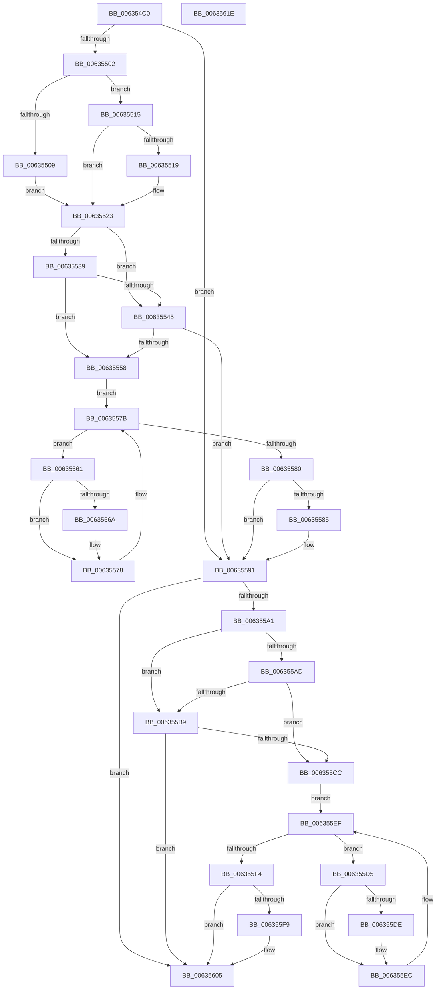

# DifMmFreeNonCachedMemoryWrapper

- RVA: `0x006354C0`–`0x0063561F` (길이 `351` bytes)
- VA: `0x00000001406354C0`
- 실행 섹션: `.text`
- PDB 이름 있음: `예`; PDB Function 태그: `아니요`
- unwind 정보 RVA: `0x00093E28`
- 디코드: `97`개 명령, `351/351` bytes 표시
- 미해석 바이트: `0` (있으면 어셈블리에 `.byte`로 보존)

> 이 문서는 커널 이미지의 기계어와 PDB 기호를 분석해 생성했습니다. 4번과 5번은 함수 원형과 자료형을 바이너리 사용 방식에서 추정한 C 해석이며 원본 소스 복구 결과는 아닙니다.

## 1. Dependencies

- 직접 호출 지점: **9**; 고유 호출 대상: **6**
- 직접 호출자로 확인된 함수: **0**
- RIP 상대 이미지 참조: **3**

### Outgoing calls
- `0x006354F1` → [DifGetAPIThunkContextById](../49/DifGetAPIThunkContextById_function_00495A34.md) (function, `0x00495A34`)
- `0x00635519` → [DifGetReturnAddressForWrappers](../4D/DifGetReturnAddressForWrappers_function_004D3C08.md) (function, `0x004D3C08`)
- `0x0063554C` → [ExAcquireRundownProtection](../21/ExAcquireRundownProtection_function_00216620.md) (function, `0x00216620`)
- `0x00635573` → [guard_dispatch_icall](../6B/guard_dispatch_icall_function_006BAAD0.md) (function, `0x006BAAD0`)
- `0x0063558C` → [ExReleaseRundownProtection](../34/ExReleaseRundownProtection_function_00349E80.md) (function, `0x00349E80`)
- `0x00635597` → [MmFreeNonCachedMemory](../../page/AB/MmFreeNonCachedMemory_function_00AB4640.md) (function, `0x00AB4640`)
- `0x006355C0` → [ExAcquireRundownProtection](../21/ExAcquireRundownProtection_function_00216620.md) (function, `0x00216620`)
- `0x006355E7` → [guard_dispatch_icall](../6B/guard_dispatch_icall_function_006BAAD0.md) (function, `0x006BAAD0`)
- `0x00635600` → [ExReleaseRundownProtection](../34/ExReleaseRundownProtection_function_00349E80.md) (function, `0x00349E80`)

### Direct callers
- 이 함수 시작 RVA로 연결되는 직접 call은 확인되지 않았습니다. 간접 호출은 완전히 역산할 수 없습니다.

### Static image references
- `0x0063552B` → RVA `0x00F048B8` (`.data`; read)
- `0x00635539` → RVA `0x00F04980` (`.data`; read)
- `0x00635545` → RVA `0x00F03E80` (`.data`; read)

## 2. Other-region calls and transfers

- 다른 실행 섹션으로 향하는 call: **1**
  - `0x00635597` → [MmFreeNonCachedMemory](../../page/AB/MmFreeNonCachedMemory_function_00AB4640.md) (`.text` → `PAGE`)
- 별도 외부 분기/꼬리 이동을 확인하지 못했습니다.

## 3. Assembly (complete function range)

```asm
006354C0  4C 8B DC                        mov r11, rsp
006354C3  49 89 5B 08                     mov qword ptr [r11 + 8], rbx
006354C7  49 89 6B 10                     mov qword ptr [r11 + 0x10], rbp
006354CB  49 89 73 18                     mov qword ptr [r11 + 0x18], rsi
006354CF  57                              push rdi
006354D0  41 56                           push r14
006354D2  41 57                           push r15
006354D4  48 83 EC 40                     sub rsp, 0x40
006354D8  33 C0                           xor eax, eax
006354DA  0F 57 C0                        xorps xmm0, xmm0
006354DD  0F 11 44 24 20                  movups xmmword ptr [rsp + 0x20], xmm0
006354E2  4C 8B F9                        mov r15, rcx
006354E5  49 89 43 D8                     mov qword ptr [r11 - 0x28], rax
006354E9  B9 E1 00 00 00                  mov ecx, 0xe1
006354EE  4C 8B F2                        mov r14, rdx
006354F1  E8 3E 05 E6 FF                  call 0x140495a34
006354F6  48 8B F0                        mov rsi, rax
006354F9  48 85 C0                        test rax, rax
006354FC  0F 84 8F 00 00 00               je 0x140635591
00635502  8B 40 0C                        mov eax, dword ptr [rax + 0xc]
00635505  A8 18                           test al, 0x18
00635507  74 0C                           je 0x140635515
00635509  48 8B 4C 24 58                  mov rcx, qword ptr [rsp + 0x58]
0063550E  48 89 4C 24 20                  mov qword ptr [rsp + 0x20], rcx
00635513  EB 0E                           jmp 0x140635523
00635515  A8 04                           test al, 4
00635517  74 0A                           je 0x140635523
00635519  E8 EA E6 E9 FF                  call 0x1404d3c08
0063551E  48 89 44 24 20                  mov qword ptr [rsp + 0x20], rax
00635523  40 32 ED                        xor bpl, bpl
00635526  4C 89 7C 24 30                  mov qword ptr [rsp + 0x30], r15
0063552B  40 38 2D 86 F3 8C 00            cmp byte ptr [rip + 0x8cf386], bpl
00635532  4C 89 74 24 28                  mov qword ptr [rsp + 0x28], r14
00635537  75 0C                           jne 0x140635545
00635539  F7 05 3D F4 8C 00 00 08 00 00   test dword ptr [rip + 0x8cf43d], 0x800
00635543  74 13                           je 0x140635558
00635545  48 8D 0D 34 E9 8C 00            lea rcx, [rip + 0x8ce934]
0063554C  E8 CF 10 BE FF                  call 0x140216620
00635551  40 8A E8                        mov bpl, al
00635554  84 C0                           test al, al
00635556  74 39                           je 0x140635591
00635558  48 8D 7E 20                     lea rdi, [rsi + 0x20]
0063555C  48 8B 1F                        mov rbx, qword ptr [rdi]
0063555F  EB 1A                           jmp 0x14063557b
00635561  48 8D 43 F0                     lea rax, [rbx - 0x10]
00635565  48 85 C0                        test rax, rax
00635568  74 0E                           je 0x140635578
0063556A  48 8B 40 08                     mov rax, qword ptr [rax + 8]
0063556E  48 8D 4C 24 20                  lea rcx, [rsp + 0x20]
00635573  E8 58 55 08 00                  call 0x1406baad0
00635578  48 8B 1B                        mov rbx, qword ptr [rbx]
0063557B  48 3B DF                        cmp rbx, rdi
0063557E  75 E1                           jne 0x140635561
00635580  40 84 ED                        test bpl, bpl
00635583  74 0C                           je 0x140635591
00635585  48 8D 0D F4 E8 8C 00            lea rcx, [rip + 0x8ce8f4]
0063558C  E8 EF 48 D1 FF                  call 0x140349e80
00635591  49 8B D6                        mov rdx, r14
00635594  49 8B CF                        mov rcx, r15
00635597  E8 A4 F0 47 00                  call 0x140ab4640
0063559C  48 85 F6                        test rsi, rsi
0063559F  74 64                           je 0x140635605
006355A1  40 32 FF                        xor dil, dil
006355A4  40 38 3D 0D F3 8C 00            cmp byte ptr [rip + 0x8cf30d], dil
006355AB  75 0C                           jne 0x1406355b9
006355AD  F7 05 C9 F3 8C 00 00 08 00 00   test dword ptr [rip + 0x8cf3c9], 0x800
006355B7  74 13                           je 0x1406355cc
006355B9  48 8D 0D C0 E8 8C 00            lea rcx, [rip + 0x8ce8c0]
006355C0  E8 5B 10 BE FF                  call 0x140216620
006355C5  40 8A F8                        mov dil, al
006355C8  84 C0                           test al, al
006355CA  74 39                           je 0x140635605
006355CC  48 83 C6 30                     add rsi, 0x30
006355D0  48 8B 1E                        mov rbx, qword ptr [rsi]
006355D3  EB 1A                           jmp 0x1406355ef
006355D5  48 8D 43 F0                     lea rax, [rbx - 0x10]
006355D9  48 85 C0                        test rax, rax
006355DC  74 0E                           je 0x1406355ec
006355DE  48 8B 40 08                     mov rax, qword ptr [rax + 8]
006355E2  48 8D 4C 24 20                  lea rcx, [rsp + 0x20]
006355E7  E8 E4 54 08 00                  call 0x1406baad0
006355EC  48 8B 1B                        mov rbx, qword ptr [rbx]
006355EF  48 3B DE                        cmp rbx, rsi
006355F2  75 E1                           jne 0x1406355d5
006355F4  40 84 FF                        test dil, dil
006355F7  74 0C                           je 0x140635605
006355F9  48 8D 0D 80 E8 8C 00            lea rcx, [rip + 0x8ce880]
00635600  E8 7B 48 D1 FF                  call 0x140349e80
00635605  48 8B 5C 24 60                  mov rbx, qword ptr [rsp + 0x60]
0063560A  48 8B 6C 24 68                  mov rbp, qword ptr [rsp + 0x68]
0063560F  48 8B 74 24 70                  mov rsi, qword ptr [rsp + 0x70]
00635614  48 83 C4 40                     add rsp, 0x40
00635618  41 5F                           pop r15
0063561A  41 5E                           pop r14
0063561C  5F                              pop rdi
0063561D  C3                              ret
0063561E  CC                              int3
```

## 4. C-style interpretation (structured pseudocode)

```c
__int64 __fastcall DifMmFreeNonCachedMemoryWrapper(__int64 a1, __int64 a2)
{
    __int64 result;
    __int64 v_rbp;
    __int64 v_rdi;
    __int64 v_rsi;
    __int64 v_rsp;
    unsigned __int64 v_stack_m28;
    unsigned __int64 v_stack_m30;
    unsigned __int64 v_stack_m38;
    unsigned __int64 v_stack_p0;
    unsigned __int64 v_stack_p10;
    unsigned __int64 v_stack_p18;
    unsigned __int64 v_stack_p8;

    *(unsigned __int64 *)(v_rsp + 8) = v_rbx;
    *(unsigned __int64 *)(v_rsp + 16) = v_rbp;
    *(unsigned __int64 *)(v_rsp + 24) = v_rsi;
    v_rsp = (v_rsp) - (64);
    result = 0;
    v_stack_m38 = v_xmm0;
    *(unsigned __int64 *)(v_rsp - 40) = 0;
    result = DifGetAPIThunkContextById(225, a2, a3, a4);
    if (result == 0) goto loc_00635591;
    if ((((unsigned __int8)((unsigned int)(*(unsigned int *)(result + 12)))) & (24)) == 0) goto loc_00635515;
    v_stack_m38 = v_stack_p0;
    goto loc_00635523;
loc_00635515:
    result = (unsigned int)(*(unsigned int *)(result + 12));
    if ((((unsigned __int8)((unsigned int)(*(unsigned int *)(result + 12)))) & (4)) != 0) {
        result = DifGetReturnAddressForWrappers(v_stack_p0, a2, a3, a4);
        v_stack_m38 = result;
    }
    v_rbp = 0;
    v_stack_m28 = a1;
    v_stack_m30 = a2;
    if ((*(unsigned __int8 *)(v_rip + 9237382)) != 0) goto loc_00635545;
    if (((*(unsigned int *)(v_rip + 9237565)) & (0x800ULL)) == 0) goto loc_00635558;
loc_00635545:
    result = ExAcquireRundownProtection(v_rip + 9234740, a2, a3, a4);
    if ((unsigned __int8)(result) == 0) goto loc_00635591;
loc_00635558:
    goto loc_0063557B;
loc_00635561:
    result = *(unsigned __int64 *)(result + 32) - 16;
    if (*(unsigned __int64 *)(result + 32) - 16 != 0) {
        result = *(unsigned __int64 *)(*(unsigned __int64 *)(result + 32) - 16 + 8);
        a1 = v_stack_m38;
        result = guard_dispatch_icall(a1, a2, a3, a4);
    }
loc_0063557B:
    if ((*(unsigned __int64 *)(*(unsigned __int64 *)(result + 32))) != (result + 32)) goto loc_00635561;
    if ((unsigned __int8)((unsigned __int8)(result)) != 0) {
        a1 = v_rip + 9234676;
        result = ExReleaseRundownProtection(a1, a2, a3, a4);
    }
    result = MmFreeNonCachedMemory(a1, a2, a3, a4);
    if (result == 0) goto loc_00635605;
    v_rdi = 0;
    if ((*(unsigned __int8 *)(v_rip + 9237261)) != 0) goto loc_006355B9;
    if (((*(unsigned int *)(v_rip + 9237449)) & (0x800ULL)) == 0) goto loc_006355CC;
loc_006355B9:
    result = ExAcquireRundownProtection(v_rip + 9234624, a2, a3, a4);
    if ((unsigned __int8)(result) == 0) goto loc_00635605;
loc_006355CC:
    v_rsi = (result) + (48);
    goto loc_006355EF;
loc_006355D5:
    result = *(unsigned __int64 *)(v_rsi) - 16;
    if (*(unsigned __int64 *)(v_rsi) - 16 != 0) {
        result = *(unsigned __int64 *)(*(unsigned __int64 *)(v_rsi) - 16 + 8);
        a1 = v_stack_m38;
        result = guard_dispatch_icall(a1, a2, a3, a4);
    }
loc_006355EF:
    if ((*(unsigned __int64 *)(*(unsigned __int64 *)(v_rsi))) != v_rsi) goto loc_006355D5;
    if ((unsigned __int8)((unsigned __int8)(result)) != 0) {
        a1 = v_rip + 9234560;
        result = ExReleaseRundownProtection(a1, a2, a3, a4);
    }
    v_rsp = (v_rsp) + (64);
    return result;
}
```

## 5. (Beta) C Style

```c
int64_t DifMmFreeNonCachedMemoryWrapper(int64_t Arg1, int64_t Arg2)
{
    int64_t result;
    int64_t local_rbp;
    int64_t local_rdi;
    int64_t local_rsi;
    int64_t local_rsp;
    uint64_t v_stack_m28;
    uint64_t v_stack_m30;
    uint64_t v_stack_m38;
    uint64_t v_stack_p0;
    uint64_t v_stack_p10;
    uint64_t v_stack_p18;
    uint64_t v_stack_p8;

    *(uint64_t *)(local_rsp + 0x8) = local_rbx;
    *(uint64_t *)(local_rsp + 0x10) = local_rbp;
    *(uint64_t *)(local_rsp + 0x18) = local_rsi;
    local_rsp = (local_rsp) - (64);
    result = 0;
    v_stack_m38 = v_xmm0;
    *(uint64_t *)(local_rsp - 0x28) = 0;
    result = DifGetAPIThunkContextById(225, Arg2, a3, a4);
    if (result == 0) goto loc_00635591;
    if ((((uint8_t)((uint32_t)(*(uint32_t *)(result + 0xC)))) & (24)) == 0) goto loc_00635515;
    v_stack_m38 = v_stack_p0;
    goto loc_00635523;
loc_00635515:
    result = (uint32_t)(*(uint32_t *)(result + 0xC));
    if ((((uint8_t)((uint32_t)(*(uint32_t *)(result + 0xC)))) & (4)) != 0) {
        result = DifGetReturnAddressForWrappers(v_stack_p0, Arg2, a3, a4);
        v_stack_m38 = result;
    }
    local_rbp = 0;
    v_stack_m28 = Arg1;
    v_stack_m30 = Arg2;
    if ((*(uint8_t *)(v_rip + 0x8CF386)) != 0) goto loc_00635545;
    if (((*(uint32_t *)(v_rip + 0x8CF43D)) & (0x800ULL)) == 0) goto loc_00635558;
loc_00635545:
    result = ExAcquireRundownProtection(v_rip + 9234740, Arg2, a3, a4);
    if ((uint8_t)(result) == 0) goto loc_00635591;
loc_00635558:
    goto loc_0063557B;
loc_00635561:
    result = *(uint64_t *)(result + 0x20) - 16;
    if (*(uint64_t *)(result + 0x20) - 16 != 0) {
        result = *(uint64_t *)(*(uint64_t *)(result + 0x20) - 0x10 + 0x8);
        Arg1 = v_stack_m38;
        result = guard_dispatch_icall(Arg1, Arg2, a3, a4);
    }
loc_0063557B:
    if ((*(uint64_t *)(*(uint64_t *)(result + 0x20))) != (result + 32)) goto loc_00635561;
    if ((uint8_t)((uint8_t)(result)) != 0) {
        Arg1 = v_rip + 9234676;
        result = ExReleaseRundownProtection(Arg1, Arg2, a3, a4);
    }
    result = MmFreeNonCachedMemory(Arg1, Arg2, a3, a4);
    if (result == 0) goto loc_00635605;
    local_rdi = 0;
    if ((*(uint8_t *)(v_rip + 0x8CF30D)) != 0) goto loc_006355B9;
    if (((*(uint32_t *)(v_rip + 0x8CF3C9)) & (0x800ULL)) == 0) goto loc_006355CC;
loc_006355B9:
    result = ExAcquireRundownProtection(v_rip + 9234624, Arg2, a3, a4);
    if ((uint8_t)(result) == 0) goto loc_00635605;
loc_006355CC:
    local_rsi = (result) + (48);
    goto loc_006355EF;
loc_006355D5:
    result = *(uint64_t *)(local_rsi) - 16;
    if (*(uint64_t *)(local_rsi) - 16 != 0) {
        result = *(uint64_t *)(*(uint64_t *)(local_rsi) - 0x10 + 0x8);
        Arg1 = v_stack_m38;
        result = guard_dispatch_icall(Arg1, Arg2, a3, a4);
    }
loc_006355EF:
    if ((*(uint64_t *)(*(uint64_t *)(local_rsi))) != local_rsi) goto loc_006355D5;
    if ((uint8_t)((uint8_t)(result)) != 0) {
        Arg1 = v_rip + 9234560;
        result = ExReleaseRundownProtection(Arg1, Arg2, a3, a4);
    }
    local_rsp = (local_rsp) + (64);
    return result;
}
```

## 6. Execution-region graph

[열기: 2D/3D 그래프와 함수 탐색 컨트롤 패널](../../../control-panel.html?section=text&rva=0x006354C0&view=graph)

- 2D 그래프는 위에서 아래로 흐르고, 3D 그래프는 빈 공간을 드래그해 회전합니다. Shift+드래그는 이동, 휠은 확대·축소, 함수 노드 선택은 대상 보고서 이동입니다.

### Static fallback


