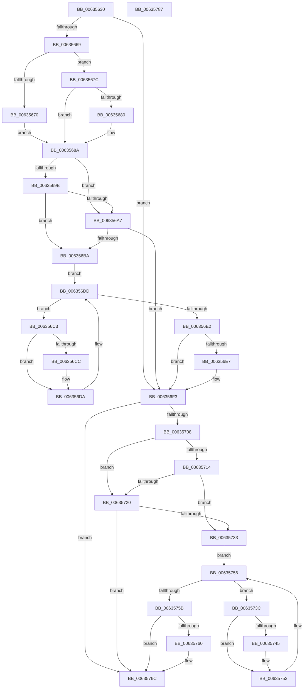

# DifMmFreePagesFromMdlWrapper

- RVA: `0x00635630`–`0x00635788` (길이 `344` bytes)
- VA: `0x0000000140635630`
- 실행 섹션: `.text`
- PDB 이름 있음: `예`; PDB Function 태그: `아니요`
- unwind 정보 RVA: `0x0005D7BC`
- 디코드: `93`개 명령, `344/344` bytes 표시
- 미해석 바이트: `0` (있으면 어셈블리에 `.byte`로 보존)

> 이 문서는 커널 이미지의 기계어와 PDB 기호를 분석해 생성했습니다. 4번과 5번은 함수 원형과 자료형을 바이너리 사용 방식에서 추정한 C 해석이며 원본 소스 복구 결과는 아닙니다.

## 1. Dependencies

- 직접 호출 지점: **9**; 고유 호출 대상: **6**
- 직접 호출자로 확인된 함수: **0**
- RIP 상대 이미지 참조: **3**

### Outgoing calls
- `0x00635658` → [DifGetAPIThunkContextById](../49/DifGetAPIThunkContextById_function_00495A34.md) (function, `0x00495A34`)
- `0x00635680` → [DifGetReturnAddressForWrappers](../4D/DifGetReturnAddressForWrappers_function_004D3C08.md) (function, `0x004D3C08`)
- `0x006356AE` → [ExAcquireRundownProtection](../21/ExAcquireRundownProtection_function_00216620.md) (function, `0x00216620`)
- `0x006356D5` → [guard_dispatch_icall](../6B/guard_dispatch_icall_function_006BAAD0.md) (function, `0x006BAAD0`)
- `0x006356EE` → [ExReleaseRundownProtection](../34/ExReleaseRundownProtection_function_00349E80.md) (function, `0x00349E80`)
- `0x006356FE` → [MiFreePagesFromMdl](../3F/MiFreePagesFromMdl_function_003F8300.md) (function, `0x003F8300`)
- `0x00635727` → [ExAcquireRundownProtection](../21/ExAcquireRundownProtection_function_00216620.md) (function, `0x00216620`)
- `0x0063574E` → [guard_dispatch_icall](../6B/guard_dispatch_icall_function_006BAAD0.md) (function, `0x006BAAD0`)
- `0x00635767` → [ExReleaseRundownProtection](../34/ExReleaseRundownProtection_function_00349E80.md) (function, `0x00349E80`)

### Direct callers
- 이 함수 시작 RVA로 연결되는 직접 call은 확인되지 않았습니다. 간접 호출은 완전히 역산할 수 없습니다.

### Static image references
- `0x00635692` → RVA `0x00F048B8` (`.data`; read)
- `0x0063569B` → RVA `0x00F04980` (`.data`; read)
- `0x006356A7` → RVA `0x00F03E80` (`.data`; read)

## 2. Other-region calls and transfers

- 다른 실행 섹션으로 향하는 call: **0**
- 별도 외부 분기/꼬리 이동을 확인하지 못했습니다.

## 3. Assembly (complete function range)

```asm
00635630  48 8B C4                        mov rax, rsp
00635633  48 89 58 08                     mov qword ptr [rax + 8], rbx
00635637  48 89 68 10                     mov qword ptr [rax + 0x10], rbp
0063563B  48 89 70 18                     mov qword ptr [rax + 0x18], rsi
0063563F  48 89 78 20                     mov qword ptr [rax + 0x20], rdi
00635643  41 56                           push r14
00635645  48 83 EC 30                     sub rsp, 0x30
00635649  48 8B E9                        mov rbp, rcx
0063564C  0F 57 C0                        xorps xmm0, xmm0
0063564F  B9 E0 00 00 00                  mov ecx, 0xe0
00635654  0F 11 40 E8                     movups xmmword ptr [rax - 0x18], xmm0
00635658  E8 D7 03 E6 FF                  call 0x140495a34
0063565D  48 8B F0                        mov rsi, rax
00635660  48 85 C0                        test rax, rax
00635663  0F 84 8A 00 00 00               je 0x1406356f3
00635669  8B 40 0C                        mov eax, dword ptr [rax + 0xc]
0063566C  A8 18                           test al, 0x18
0063566E  74 0C                           je 0x14063567c
00635670  48 8B 4C 24 38                  mov rcx, qword ptr [rsp + 0x38]
00635675  48 89 4C 24 20                  mov qword ptr [rsp + 0x20], rcx
0063567A  EB 0E                           jmp 0x14063568a
0063567C  A8 04                           test al, 4
0063567E  74 0A                           je 0x14063568a
00635680  E8 83 E5 E9 FF                  call 0x1404d3c08
00635685  48 89 44 24 20                  mov qword ptr [rsp + 0x20], rax
0063568A  40 32 FF                        xor dil, dil
0063568D  48 89 6C 24 28                  mov qword ptr [rsp + 0x28], rbp
00635692  40 38 3D 1F F2 8C 00            cmp byte ptr [rip + 0x8cf21f], dil
00635699  75 0C                           jne 0x1406356a7
0063569B  F7 05 DB F2 8C 00 00 08 00 00   test dword ptr [rip + 0x8cf2db], 0x800
006356A5  74 13                           je 0x1406356ba
006356A7  48 8D 0D D2 E7 8C 00            lea rcx, [rip + 0x8ce7d2]
006356AE  E8 6D 0F BE FF                  call 0x140216620
006356B3  40 8A F8                        mov dil, al
006356B6  84 C0                           test al, al
006356B8  74 39                           je 0x1406356f3
006356BA  4C 8D 76 20                     lea r14, [rsi + 0x20]
006356BE  49 8B 1E                        mov rbx, qword ptr [r14]
006356C1  EB 1A                           jmp 0x1406356dd
006356C3  48 8D 43 F0                     lea rax, [rbx - 0x10]
006356C7  48 85 C0                        test rax, rax
006356CA  74 0E                           je 0x1406356da
006356CC  48 8B 40 08                     mov rax, qword ptr [rax + 8]
006356D0  48 8D 4C 24 20                  lea rcx, [rsp + 0x20]
006356D5  E8 F6 53 08 00                  call 0x1406baad0
006356DA  48 8B 1B                        mov rbx, qword ptr [rbx]
006356DD  49 3B DE                        cmp rbx, r14
006356E0  75 E1                           jne 0x1406356c3
006356E2  40 84 FF                        test dil, dil
006356E5  74 0C                           je 0x1406356f3
006356E7  48 8D 0D 92 E7 8C 00            lea rcx, [rip + 0x8ce792]
006356EE  E8 8D 47 D1 FF                  call 0x140349e80
006356F3  45 33 C9                        xor r9d, r9d
006356F6  45 33 C0                        xor r8d, r8d
006356F9  33 D2                           xor edx, edx
006356FB  48 8B CD                        mov rcx, rbp
006356FE  E8 FD 2B DC FF                  call 0x1403f8300
00635703  48 85 F6                        test rsi, rsi
00635706  74 64                           je 0x14063576c
00635708  40 32 FF                        xor dil, dil
0063570B  40 38 3D A6 F1 8C 00            cmp byte ptr [rip + 0x8cf1a6], dil
00635712  75 0C                           jne 0x140635720
00635714  F7 05 62 F2 8C 00 00 08 00 00   test dword ptr [rip + 0x8cf262], 0x800
0063571E  74 13                           je 0x140635733
00635720  48 8D 0D 59 E7 8C 00            lea rcx, [rip + 0x8ce759]
00635727  E8 F4 0E BE FF                  call 0x140216620
0063572C  40 8A F8                        mov dil, al
0063572F  84 C0                           test al, al
00635731  74 39                           je 0x14063576c
00635733  48 83 C6 30                     add rsi, 0x30
00635737  48 8B 1E                        mov rbx, qword ptr [rsi]
0063573A  EB 1A                           jmp 0x140635756
0063573C  48 8D 43 F0                     lea rax, [rbx - 0x10]
00635740  48 85 C0                        test rax, rax
00635743  74 0E                           je 0x140635753
00635745  48 8B 40 08                     mov rax, qword ptr [rax + 8]
00635749  48 8D 4C 24 20                  lea rcx, [rsp + 0x20]
0063574E  E8 7D 53 08 00                  call 0x1406baad0
00635753  48 8B 1B                        mov rbx, qword ptr [rbx]
00635756  48 3B DE                        cmp rbx, rsi
00635759  75 E1                           jne 0x14063573c
0063575B  40 84 FF                        test dil, dil
0063575E  74 0C                           je 0x14063576c
00635760  48 8D 0D 19 E7 8C 00            lea rcx, [rip + 0x8ce719]
00635767  E8 14 47 D1 FF                  call 0x140349e80
0063576C  48 8B 5C 24 40                  mov rbx, qword ptr [rsp + 0x40]
00635771  48 8B 6C 24 48                  mov rbp, qword ptr [rsp + 0x48]
00635776  48 8B 74 24 50                  mov rsi, qword ptr [rsp + 0x50]
0063577B  48 8B 7C 24 58                  mov rdi, qword ptr [rsp + 0x58]
00635780  48 83 C4 30                     add rsp, 0x30
00635784  41 5E                           pop r14
00635786  C3                              ret
00635787  CC                              int3
```

## 4. C-style interpretation (structured pseudocode)

```c
__int64 __fastcall DifMmFreePagesFromMdlWrapper(__int64 a1, int a2, int a3, int a4)
{
    __int64 result;
    __int64 v_rdi;
    __int64 v_rsi;
    __int64 v_rsp;
    unsigned __int64 v_stack_m10;
    unsigned __int64 v_stack_m18;
    unsigned __int64 v_stack_p0;
    unsigned __int64 v_stack_p10;
    unsigned __int64 v_stack_p18;
    unsigned __int64 v_stack_p20;
    unsigned __int64 v_stack_p8;

    *(unsigned __int64 *)(v_rsp + 8) = v_rbx;
    *(unsigned __int64 *)(v_rsp + 16) = v_rbp;
    *(unsigned __int64 *)(v_rsp + 24) = v_rsi;
    *(unsigned __int64 *)(v_rsp + 32) = v_rdi;
    v_rsp = (v_rsp) - (48);
    *(unsigned __int64 *)(v_rsp - 24) = v_xmm0;
    result = DifGetAPIThunkContextById(224, a2, a3, a4);
    if (result == 0) goto loc_006356F3;
    if ((((unsigned __int8)((unsigned int)(*(unsigned int *)(result + 12)))) & (24)) == 0) goto loc_0063567C;
    v_stack_m18 = v_stack_p0;
    goto loc_0063568A;
loc_0063567C:
    result = (unsigned int)(*(unsigned int *)(result + 12));
    if ((((unsigned __int8)((unsigned int)(*(unsigned int *)(result + 12)))) & (4)) != 0) {
        result = DifGetReturnAddressForWrappers(v_stack_p0, a2, a3, a4);
        v_stack_m18 = result;
    }
    v_rdi = 0;
    v_stack_m10 = a1;
    if ((*(unsigned __int8 *)(v_rip + 9237023)) != 0) goto loc_006356A7;
    if (((*(unsigned int *)(v_rip + 9237211)) & (0x800ULL)) == 0) goto loc_006356BA;
loc_006356A7:
    result = ExAcquireRundownProtection(v_rip + 9234386, a2, a3, a4);
    if ((unsigned __int8)(result) == 0) goto loc_006356F3;
loc_006356BA:
    goto loc_006356DD;
loc_006356C3:
    result = *(unsigned __int64 *)(result + 32) - 16;
    if (*(unsigned __int64 *)(result + 32) - 16 != 0) {
        result = *(unsigned __int64 *)(*(unsigned __int64 *)(result + 32) - 16 + 8);
        a1 = v_stack_m18;
        result = guard_dispatch_icall(a1, a2, a3, a4);
    }
loc_006356DD:
    if ((*(unsigned __int64 *)(*(unsigned __int64 *)(result + 32))) != (result + 32)) goto loc_006356C3;
    if ((unsigned __int8)((unsigned __int8)(result)) != 0) {
        a1 = v_rip + 9234322;
        result = ExReleaseRundownProtection(a1, a2, a3, a4);
    }
    a4 = 0;
    a3 = 0;
    a2 = 0;
    result = MiFreePagesFromMdl(a1, a2, a3, a4);
    if (result == 0) goto loc_0063576C;
    v_rdi = 0;
    if ((*(unsigned __int8 *)(v_rip + 9236902)) != 0) goto loc_00635720;
    if (((*(unsigned int *)(v_rip + 9237090)) & (0x800ULL)) == 0) goto loc_00635733;
loc_00635720:
    result = ExAcquireRundownProtection(v_rip + 9234265, a2, a3, a4);
    if ((unsigned __int8)(result) == 0) goto loc_0063576C;
loc_00635733:
    v_rsi = (result) + (48);
    goto loc_00635756;
loc_0063573C:
    result = *(unsigned __int64 *)(v_rsi) - 16;
    if (*(unsigned __int64 *)(v_rsi) - 16 != 0) {
        result = *(unsigned __int64 *)(*(unsigned __int64 *)(v_rsi) - 16 + 8);
        a1 = v_stack_m18;
        result = guard_dispatch_icall(a1, a2, a3, a4);
    }
loc_00635756:
    if ((*(unsigned __int64 *)(*(unsigned __int64 *)(v_rsi))) != v_rsi) goto loc_0063573C;
    if ((unsigned __int8)((unsigned __int8)(result)) != 0) {
        a1 = v_rip + 9234201;
        result = ExReleaseRundownProtection(a1, a2, a3, a4);
    }
    v_rsp = (v_rsp) + (48);
    return result;
}
```

## 5. (Beta) C Style

```c
int64_t DifMmFreePagesFromMdlWrapper(int64_t Arg1, int32_t Arg2, int32_t Arg3, int32_t Arg4)
{
    int64_t result;
    int64_t local_rdi;
    int64_t local_rsi;
    int64_t local_rsp;
    uint64_t v_stack_m10;
    uint64_t v_stack_m18;
    uint64_t v_stack_p0;
    uint64_t v_stack_p10;
    uint64_t v_stack_p18;
    uint64_t v_stack_p20;
    uint64_t v_stack_p8;

    *(uint64_t *)(local_rsp + 0x8) = local_rbx;
    *(uint64_t *)(local_rsp + 0x10) = local_rbp;
    *(uint64_t *)(local_rsp + 0x18) = local_rsi;
    *(uint64_t *)(local_rsp + 0x20) = local_rdi;
    local_rsp = (local_rsp) - (48);
    *(uint64_t *)(local_rsp - 0x18) = v_xmm0;
    result = DifGetAPIThunkContextById(224, Arg2, Arg3, Arg4);
    if (result == 0) goto loc_006356F3;
    if ((((uint8_t)((uint32_t)(*(uint32_t *)(result + 0xC)))) & (24)) == 0) goto loc_0063567C;
    v_stack_m18 = v_stack_p0;
    goto loc_0063568A;
loc_0063567C:
    result = (uint32_t)(*(uint32_t *)(result + 0xC));
    if ((((uint8_t)((uint32_t)(*(uint32_t *)(result + 0xC)))) & (4)) != 0) {
        result = DifGetReturnAddressForWrappers(v_stack_p0, Arg2, Arg3, Arg4);
        v_stack_m18 = result;
    }
    local_rdi = 0;
    v_stack_m10 = Arg1;
    if ((*(uint8_t *)(v_rip + 0x8CF21F)) != 0) goto loc_006356A7;
    if (((*(uint32_t *)(v_rip + 0x8CF2DB)) & (0x800ULL)) == 0) goto loc_006356BA;
loc_006356A7:
    result = ExAcquireRundownProtection(v_rip + 9234386, Arg2, Arg3, Arg4);
    if ((uint8_t)(result) == 0) goto loc_006356F3;
loc_006356BA:
    goto loc_006356DD;
loc_006356C3:
    result = *(uint64_t *)(result + 0x20) - 16;
    if (*(uint64_t *)(result + 0x20) - 16 != 0) {
        result = *(uint64_t *)(*(uint64_t *)(result + 0x20) - 0x10 + 0x8);
        Arg1 = v_stack_m18;
        result = guard_dispatch_icall(Arg1, Arg2, Arg3, Arg4);
    }
loc_006356DD:
    if ((*(uint64_t *)(*(uint64_t *)(result + 0x20))) != (result + 32)) goto loc_006356C3;
    if ((uint8_t)((uint8_t)(result)) != 0) {
        Arg1 = v_rip + 9234322;
        result = ExReleaseRundownProtection(Arg1, Arg2, Arg3, Arg4);
    }
    Arg4 = 0;
    Arg3 = 0;
    Arg2 = 0;
    result = MiFreePagesFromMdl(Arg1, Arg2, Arg3, Arg4);
    if (result == 0) goto loc_0063576C;
    local_rdi = 0;
    if ((*(uint8_t *)(v_rip + 0x8CF1A6)) != 0) goto loc_00635720;
    if (((*(uint32_t *)(v_rip + 0x8CF262)) & (0x800ULL)) == 0) goto loc_00635733;
loc_00635720:
    result = ExAcquireRundownProtection(v_rip + 9234265, Arg2, Arg3, Arg4);
    if ((uint8_t)(result) == 0) goto loc_0063576C;
loc_00635733:
    local_rsi = (result) + (48);
    goto loc_00635756;
loc_0063573C:
    result = *(uint64_t *)(local_rsi) - 16;
    if (*(uint64_t *)(local_rsi) - 16 != 0) {
        result = *(uint64_t *)(*(uint64_t *)(local_rsi) - 0x10 + 0x8);
        Arg1 = v_stack_m18;
        result = guard_dispatch_icall(Arg1, Arg2, Arg3, Arg4);
    }
loc_00635756:
    if ((*(uint64_t *)(*(uint64_t *)(local_rsi))) != local_rsi) goto loc_0063573C;
    if ((uint8_t)((uint8_t)(result)) != 0) {
        Arg1 = v_rip + 9234201;
        result = ExReleaseRundownProtection(Arg1, Arg2, Arg3, Arg4);
    }
    local_rsp = (local_rsp) + (48);
    return result;
}
```

## 6. Execution-region graph

[열기: 2D/3D 그래프와 함수 탐색 컨트롤 패널](../../../control-panel.html?section=text&rva=0x00635630&view=graph)

- 2D 그래프는 위에서 아래로 흐르고, 3D 그래프는 빈 공간을 드래그해 회전합니다. Shift+드래그는 이동, 휠은 확대·축소, 함수 노드 선택은 대상 보고서 이동입니다.

### Static fallback


