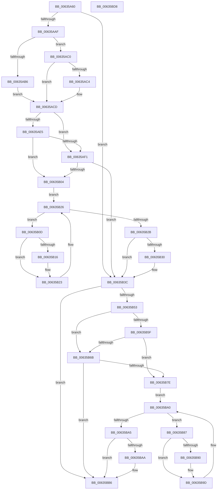

# DifMmMapIoSpaceExWrapper

- RVA: `0x00635A60`–`0x00635BD9` (길이 `377` bytes)
- VA: `0x0000000140635A60`
- 실행 섹션: `.text`
- PDB 이름 있음: `예`; PDB Function 태그: `아니요`
- unwind 정보 RVA: `0x000A9A64`
- 디코드: `108`개 명령, `377/377` bytes 표시
- 미해석 바이트: `0` (있으면 어셈블리에 `.byte`로 보존)

> 이 문서는 커널 이미지의 기계어와 PDB 기호를 분석해 생성했습니다. 4번과 5번은 함수 원형과 자료형을 바이너리 사용 방식에서 추정한 C 해석이며 원본 소스 복구 결과는 아닙니다.

## 1. Dependencies

- 직접 호출 지점: **9**; 고유 호출 대상: **6**
- 직접 호출자로 확인된 함수: **0**
- RIP 상대 이미지 참조: **3**

### Outgoing calls
- `0x00635A9E` → [DifGetAPIThunkContextById](../49/DifGetAPIThunkContextById_function_00495A34.md) (function, `0x00495A34`)
- `0x00635AC4` → [DifGetReturnAddressForWrappers](../4D/DifGetReturnAddressForWrappers_function_004D3C08.md) (function, `0x004D3C08`)
- `0x00635AF8` → [ExAcquireRundownProtection](../21/ExAcquireRundownProtection_function_00216620.md) (function, `0x00216620`)
- `0x00635B1E` → [guard_dispatch_icall](../6B/guard_dispatch_icall_function_006BAAD0.md) (function, `0x006BAAD0`)
- `0x00635B37` → [ExReleaseRundownProtection](../34/ExReleaseRundownProtection_function_00349E80.md) (function, `0x00349E80`)
- `0x00635B45` → [MmMapIoSpaceEx](../32/MmMapIoSpaceEx_function_00327830.md) (function, `0x00327830`)
- `0x00635B72` → [ExAcquireRundownProtection](../21/ExAcquireRundownProtection_function_00216620.md) (function, `0x00216620`)
- `0x00635B98` → [guard_dispatch_icall](../6B/guard_dispatch_icall_function_006BAAD0.md) (function, `0x006BAAD0`)
- `0x00635BB1` → [ExReleaseRundownProtection](../34/ExReleaseRundownProtection_function_00349E80.md) (function, `0x00349E80`)

### Direct callers
- 이 함수 시작 RVA로 연결되는 직접 call은 확인되지 않았습니다. 간접 호출은 완전히 역산할 수 없습니다.

### Static image references
- `0x00635AD4` → RVA `0x00F048B8` (`.data`; read)
- `0x00635AE5` → RVA `0x00F04980` (`.data`; read)
- `0x00635AF1` → RVA `0x00F03E80` (`.data`; read)

## 2. Other-region calls and transfers

- 다른 실행 섹션으로 향하는 call: **0**
- 별도 외부 분기/꼬리 이동을 확인하지 못했습니다.

## 3. Assembly (complete function range)

```asm
00635A60  48 89 5C 24 08                  mov qword ptr [rsp + 8], rbx
00635A65  48 89 74 24 10                  mov qword ptr [rsp + 0x10], rsi
00635A6A  48 89 7C 24 18                  mov qword ptr [rsp + 0x18], rdi
00635A6F  55                              push rbp
00635A70  41 54                           push r12
00635A72  41 55                           push r13
00635A74  41 56                           push r14
00635A76  41 57                           push r15
00635A78  48 8B EC                        mov rbp, rsp
00635A7B  48 83 EC 50                     sub rsp, 0x50
00635A7F  0F 57 C0                        xorps xmm0, xmm0
00635A82  33 C0                           xor eax, eax
00635A84  48 8B D9                        mov rbx, rcx
00635A87  48 89 45 F0                     mov qword ptr [rbp - 0x10], rax
00635A8B  B9 B5 01 00 00                  mov ecx, 0x1b5
00635A90  45 8B E0                        mov r12d, r8d
00635A93  0F 11 45 D0                     movups xmmword ptr [rbp - 0x30], xmm0
00635A97  4C 8B EA                        mov r13, rdx
00635A9A  0F 11 45 E0                     movups xmmword ptr [rbp - 0x20], xmm0
00635A9E  E8 91 FF E5 FF                  call 0x140495a34
00635AA3  48 8B F0                        mov rsi, rax
00635AA6  48 85 C0                        test rax, rax
00635AA9  0F 84 8D 00 00 00               je 0x140635b3c
00635AAF  8B 40 0C                        mov eax, dword ptr [rax + 0xc]
00635AB2  A8 18                           test al, 0x18
00635AB4  74 0A                           je 0x140635ac0
00635AB6  48 8B 4D 28                     mov rcx, qword ptr [rbp + 0x28]
00635ABA  48 89 4D D0                     mov qword ptr [rbp - 0x30], rcx
00635ABE  EB 0D                           jmp 0x140635acd
00635AC0  A8 04                           test al, 4
00635AC2  74 09                           je 0x140635acd
00635AC4  E8 3F E1 E9 FF                  call 0x1404d3c08
00635AC9  48 89 45 D0                     mov qword ptr [rbp - 0x30], rax
00635ACD  45 32 FF                        xor r15b, r15b
00635AD0  48 89 5D E8                     mov qword ptr [rbp - 0x18], rbx
00635AD4  44 38 3D DD ED 8C 00            cmp byte ptr [rip + 0x8ceddd], r15b
00635ADB  4C 89 6D E0                     mov qword ptr [rbp - 0x20], r13
00635ADF  44 89 65 D8                     mov dword ptr [rbp - 0x28], r12d
00635AE3  75 0C                           jne 0x140635af1
00635AE5  F7 05 91 EE 8C 00 00 08 00 00   test dword ptr [rip + 0x8cee91], 0x800
00635AEF  74 13                           je 0x140635b04
00635AF1  48 8D 0D 88 E3 8C 00            lea rcx, [rip + 0x8ce388]
00635AF8  E8 23 0B BE FF                  call 0x140216620
00635AFD  44 8A F8                        mov r15b, al
00635B00  84 C0                           test al, al
00635B02  74 38                           je 0x140635b3c
00635B04  4C 8D 76 20                     lea r14, [rsi + 0x20]
00635B08  49 8B 3E                        mov rdi, qword ptr [r14]
00635B0B  EB 19                           jmp 0x140635b26
00635B0D  48 8D 47 F0                     lea rax, [rdi - 0x10]
00635B11  48 85 C0                        test rax, rax
00635B14  74 0D                           je 0x140635b23
00635B16  48 8B 40 08                     mov rax, qword ptr [rax + 8]
00635B1A  48 8D 4D D0                     lea rcx, [rbp - 0x30]
00635B1E  E8 AD 4F 08 00                  call 0x1406baad0
00635B23  48 8B 3F                        mov rdi, qword ptr [rdi]
00635B26  49 3B FE                        cmp rdi, r14
00635B29  75 E2                           jne 0x140635b0d
00635B2B  45 84 FF                        test r15b, r15b
00635B2E  74 0C                           je 0x140635b3c
00635B30  48 8D 0D 49 E3 8C 00            lea rcx, [rip + 0x8ce349]
00635B37  E8 44 43 D1 FF                  call 0x140349e80
00635B3C  45 8B C4                        mov r8d, r12d
00635B3F  49 8B D5                        mov rdx, r13
00635B42  48 8B CB                        mov rcx, rbx
00635B45  E8 E6 1C CF FF                  call 0x140327830
00635B4A  48 89 45 F0                     mov qword ptr [rbp - 0x10], rax
00635B4E  48 85 F6                        test rsi, rsi
00635B51  74 63                           je 0x140635bb6
00635B53  40 32 FF                        xor dil, dil
00635B56  40 38 3D 5B ED 8C 00            cmp byte ptr [rip + 0x8ced5b], dil
00635B5D  75 0C                           jne 0x140635b6b
00635B5F  F7 05 17 EE 8C 00 00 08 00 00   test dword ptr [rip + 0x8cee17], 0x800
00635B69  74 13                           je 0x140635b7e
00635B6B  48 8D 0D 0E E3 8C 00            lea rcx, [rip + 0x8ce30e]
00635B72  E8 A9 0A BE FF                  call 0x140216620
00635B77  40 8A F8                        mov dil, al
00635B7A  84 C0                           test al, al
00635B7C  74 38                           je 0x140635bb6
00635B7E  48 83 C6 30                     add rsi, 0x30
00635B82  48 8B 1E                        mov rbx, qword ptr [rsi]
00635B85  EB 19                           jmp 0x140635ba0
00635B87  48 8D 43 F0                     lea rax, [rbx - 0x10]
00635B8B  48 85 C0                        test rax, rax
00635B8E  74 0D                           je 0x140635b9d
00635B90  48 8B 40 08                     mov rax, qword ptr [rax + 8]
00635B94  48 8D 4D D0                     lea rcx, [rbp - 0x30]
00635B98  E8 33 4F 08 00                  call 0x1406baad0
00635B9D  48 8B 1B                        mov rbx, qword ptr [rbx]
00635BA0  48 3B DE                        cmp rbx, rsi
00635BA3  75 E2                           jne 0x140635b87
00635BA5  40 84 FF                        test dil, dil
00635BA8  74 0C                           je 0x140635bb6
00635BAA  48 8D 0D CF E2 8C 00            lea rcx, [rip + 0x8ce2cf]
00635BB1  E8 CA 42 D1 FF                  call 0x140349e80
00635BB6  48 8B 45 F0                     mov rax, qword ptr [rbp - 0x10]
00635BBA  4C 8D 5C 24 50                  lea r11, [rsp + 0x50]
00635BBF  49 8B 5B 30                     mov rbx, qword ptr [r11 + 0x30]
00635BC3  49 8B 73 38                     mov rsi, qword ptr [r11 + 0x38]
00635BC7  49 8B 7B 40                     mov rdi, qword ptr [r11 + 0x40]
00635BCB  49 8B E3                        mov rsp, r11
00635BCE  41 5F                           pop r15
00635BD0  41 5E                           pop r14
00635BD2  41 5D                           pop r13
00635BD4  41 5C                           pop r12
00635BD6  5D                              pop rbp
00635BD7  C3                              ret
00635BD8  CC                              int3
```

## 4. C-style interpretation (structured pseudocode)

```c
__int64 __fastcall DifMmMapIoSpaceExWrapper(__int64 a1, __int64 a2, int a3)
{
    __int64 result;
    __int64 v_r15;
    __int64 v_rdi;
    __int64 v_rsi;
    __int64 v_rsp;
    unsigned __int64 v_stack_m28;
    unsigned __int64 v_stack_m38;
    unsigned __int64 v_stack_m40;
    unsigned __int64 v_stack_m48;
    unsigned int v_stack_m50;
    unsigned __int64 v_stack_m58;
    unsigned __int64 v_stack_p0;
    unsigned __int64 v_stack_p10;
    unsigned __int64 v_stack_p18;
    unsigned __int64 v_stack_p8;

    v_stack_p8 = v_rbx;
    v_stack_p10 = v_rsi;
    v_stack_p18 = v_rdi;
    v_rsp = (v_rsp) - (80);
    result = 0;
    v_stack_m38 = 0;
    v_stack_m58 = v_xmm0;
    v_stack_m48 = v_xmm0;
    result = DifGetAPIThunkContextById(437, a2, a3, a4);
    if (result == 0) goto loc_00635B3C;
    if ((((unsigned __int8)((unsigned int)(*(unsigned int *)(result + 12)))) & (24)) == 0) goto loc_00635AC0;
    v_stack_m58 = v_stack_p0;
    goto loc_00635ACD;
loc_00635AC0:
    result = (unsigned int)(*(unsigned int *)(result + 12));
    if ((((unsigned __int8)((unsigned int)(*(unsigned int *)(result + 12)))) & (4)) != 0) {
        result = DifGetReturnAddressForWrappers(v_stack_p0, a2, a3, a4);
        v_stack_m58 = result;
    }
    v_r15 = 0;
    v_stack_m40 = a1;
    v_stack_m48 = a2;
    v_stack_m50 = (unsigned int)((unsigned int)(a3));
    if ((*(unsigned __int8 *)(v_rip + 9235933)) != 0) goto loc_00635AF1;
    if (((*(unsigned int *)(v_rip + 9236113)) & (0x800ULL)) == 0) goto loc_00635B04;
loc_00635AF1:
    result = ExAcquireRundownProtection(v_rip + 9233288, a2, a3, a4);
    if ((unsigned __int8)(result) == 0) goto loc_00635B3C;
loc_00635B04:
    goto loc_00635B26;
loc_00635B0D:
    result = *(unsigned __int64 *)(result + 32) - 16;
    if (*(unsigned __int64 *)(result + 32) - 16 != 0) {
        result = *(unsigned __int64 *)(*(unsigned __int64 *)(result + 32) - 16 + 8);
        a1 = v_stack_m58;
        result = guard_dispatch_icall(a1, a2, a3, a4);
    }
loc_00635B26:
    if ((*(unsigned __int64 *)(*(unsigned __int64 *)(result + 32))) != (result + 32)) goto loc_00635B0D;
    if ((unsigned __int8)((unsigned __int8)(result)) != 0) {
        a1 = v_rip + 9233225;
        result = ExReleaseRundownProtection(a1, a2, a3, a4);
    }
    result = MmMapIoSpaceEx(a1, a2, (unsigned int)((unsigned int)((unsigned int)(a3))), a4);
    v_stack_m38 = result;
    if (result == 0) goto loc_00635BB6;
    v_rdi = 0;
    if ((*(unsigned __int8 *)(v_rip + 9235803)) != 0) goto loc_00635B6B;
    if (((*(unsigned int *)(v_rip + 9235991)) & (0x800ULL)) == 0) goto loc_00635B7E;
loc_00635B6B:
    result = ExAcquireRundownProtection(v_rip + 9233166, a2, (unsigned int)((unsigned int)((unsigned int)(a3))), a4);
    if ((unsigned __int8)(result) == 0) goto loc_00635BB6;
loc_00635B7E:
    v_rsi = (result) + (48);
    goto loc_00635BA0;
loc_00635B87:
    result = *(unsigned __int64 *)(v_rsi) - 16;
    if (*(unsigned __int64 *)(v_rsi) - 16 != 0) {
        result = *(unsigned __int64 *)(*(unsigned __int64 *)(v_rsi) - 16 + 8);
        a1 = v_stack_m58;
        result = guard_dispatch_icall(a1, a2, (unsigned int)((unsigned int)((unsigned int)(a3))), a4);
    }
loc_00635BA0:
    if ((*(unsigned __int64 *)(*(unsigned __int64 *)(v_rsi))) != v_rsi) goto loc_00635B87;
    if ((unsigned __int8)((unsigned __int8)(result)) != 0) {
        a1 = v_rip + 9233103;
        result = ExReleaseRundownProtection(a1, a2, (unsigned int)((unsigned int)((unsigned int)(a3))), a4);
    }
    return v_stack_m38;
}
```

## 5. (Beta) C Style

```c
int64_t DifMmMapIoSpaceExWrapper(int64_t Arg1, int64_t Arg2, int32_t Arg3)
{
    int64_t result;
    int64_t local_r15;
    int64_t local_rdi;
    int64_t local_rsi;
    int64_t local_rsp;
    uint64_t v_stack_m28;
    uint64_t v_stack_m38;
    uint64_t v_stack_m40;
    uint64_t v_stack_m48;
    uint32_t v_stack_m50;
    uint64_t v_stack_m58;
    uint64_t v_stack_p0;
    uint64_t v_stack_p10;
    uint64_t v_stack_p18;
    uint64_t v_stack_p8;

    v_stack_p8 = local_rbx;
    v_stack_p10 = local_rsi;
    v_stack_p18 = local_rdi;
    local_rsp = (local_rsp) - (80);
    result = 0;
    v_stack_m38 = 0;
    v_stack_m58 = v_xmm0;
    v_stack_m48 = v_xmm0;
    result = DifGetAPIThunkContextById(437, Arg2, Arg3, a4);
    if (result == 0) goto loc_00635B3C;
    if ((((uint8_t)((uint32_t)(*(uint32_t *)(result + 0xC)))) & (24)) == 0) goto loc_00635AC0;
    v_stack_m58 = v_stack_p0;
    goto loc_00635ACD;
loc_00635AC0:
    result = (uint32_t)(*(uint32_t *)(result + 0xC));
    if ((((uint8_t)((uint32_t)(*(uint32_t *)(result + 0xC)))) & (4)) != 0) {
        result = DifGetReturnAddressForWrappers(v_stack_p0, Arg2, Arg3, a4);
        v_stack_m58 = result;
    }
    local_r15 = 0;
    v_stack_m40 = Arg1;
    v_stack_m48 = Arg2;
    v_stack_m50 = (uint32_t)((uint32_t)(Arg3));
    if ((*(uint8_t *)(v_rip + 0x8CEDDD)) != 0) goto loc_00635AF1;
    if (((*(uint32_t *)(v_rip + 0x8CEE91)) & (0x800ULL)) == 0) goto loc_00635B04;
loc_00635AF1:
    result = ExAcquireRundownProtection(v_rip + 9233288, Arg2, Arg3, a4);
    if ((uint8_t)(result) == 0) goto loc_00635B3C;
loc_00635B04:
    goto loc_00635B26;
loc_00635B0D:
    result = *(uint64_t *)(result + 0x20) - 16;
    if (*(uint64_t *)(result + 0x20) - 16 != 0) {
        result = *(uint64_t *)(*(uint64_t *)(result + 0x20) - 0x10 + 0x8);
        Arg1 = v_stack_m58;
        result = guard_dispatch_icall(Arg1, Arg2, Arg3, a4);
    }
loc_00635B26:
    if ((*(uint64_t *)(*(uint64_t *)(result + 0x20))) != (result + 32)) goto loc_00635B0D;
    if ((uint8_t)((uint8_t)(result)) != 0) {
        Arg1 = v_rip + 9233225;
        result = ExReleaseRundownProtection(Arg1, Arg2, Arg3, a4);
    }
    result = MmMapIoSpaceEx(Arg1, Arg2, (uint32_t)((uint32_t)((uint32_t)(Arg3))), a4);
    v_stack_m38 = result;
    if (result == 0) goto loc_00635BB6;
    local_rdi = 0;
    if ((*(uint8_t *)(v_rip + 0x8CED5B)) != 0) goto loc_00635B6B;
    if (((*(uint32_t *)(v_rip + 0x8CEE17)) & (0x800ULL)) == 0) goto loc_00635B7E;
loc_00635B6B:
    result = ExAcquireRundownProtection(v_rip + 9233166, Arg2, (uint32_t)((uint32_t)((uint32_t)(Arg3))), a4);
    if ((uint8_t)(result) == 0) goto loc_00635BB6;
loc_00635B7E:
    local_rsi = (result) + (48);
    goto loc_00635BA0;
loc_00635B87:
    result = *(uint64_t *)(local_rsi) - 16;
    if (*(uint64_t *)(local_rsi) - 16 != 0) {
        result = *(uint64_t *)(*(uint64_t *)(local_rsi) - 0x10 + 0x8);
        Arg1 = v_stack_m58;
        result = guard_dispatch_icall(Arg1, Arg2, (uint32_t)((uint32_t)((uint32_t)(Arg3))), a4);
    }
loc_00635BA0:
    if ((*(uint64_t *)(*(uint64_t *)(local_rsi))) != local_rsi) goto loc_00635B87;
    if ((uint8_t)((uint8_t)(result)) != 0) {
        Arg1 = v_rip + 9233103;
        result = ExReleaseRundownProtection(Arg1, Arg2, (uint32_t)((uint32_t)((uint32_t)(Arg3))), a4);
    }
    return v_stack_m38;
}
```

## 6. Execution-region graph

[열기: 2D/3D 그래프와 함수 탐색 컨트롤 패널](../../../control-panel.html?section=text&rva=0x00635A60&view=graph)

- 2D 그래프는 위에서 아래로 흐르고, 3D 그래프는 빈 공간을 드래그해 회전합니다. Shift+드래그는 이동, 휠은 확대·축소, 함수 노드 선택은 대상 보고서 이동입니다.

### Static fallback


