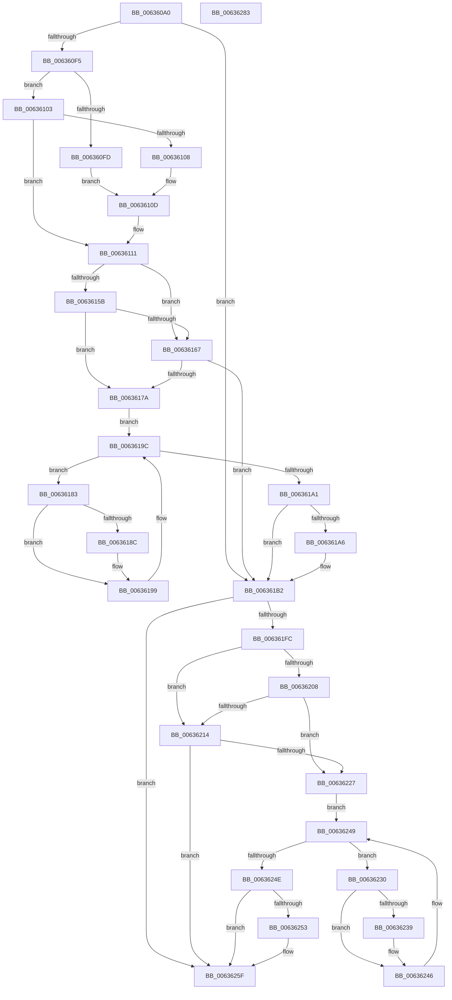

# DifMmMapViewOfSectionWrapper

- RVA: `0x006360A0`–`0x00636284` (길이 `484` bytes)
- VA: `0x00000001406360A0`
- 실행 섹션: `.text`
- PDB 이름 있음: `예`; PDB Function 태그: `아니요`
- unwind 정보 RVA: `0x000D2BDC`
- 디코드: `135`개 명령, `484/484` bytes 표시
- 미해석 바이트: `0` (있으면 어셈블리에 `.byte`로 보존)

> 이 문서는 커널 이미지의 기계어와 PDB 기호를 분석해 생성했습니다. 4번과 5번은 함수 원형과 자료형을 바이너리 사용 방식에서 추정한 C 해석이며 원본 소스 복구 결과는 아닙니다.

## 1. Dependencies

- 직접 호출 지점: **10**; 고유 호출 대상: **7**
- 직접 호출자로 확인된 함수: **0**
- RIP 상대 이미지 참조: **3**

### Outgoing calls
- `0x006360DA` → [memset](../6C/memset_function_006C6C40.md) (function, `0x006C6C40`)
- `0x006360E4` → [DifGetAPIThunkContextById](../49/DifGetAPIThunkContextById_function_00495A34.md) (function, `0x00495A34`)
- `0x00636108` → [DifGetReturnAddressForWrappers](../4D/DifGetReturnAddressForWrappers_function_004D3C08.md) (function, `0x004D3C08`)
- `0x0063616E` → [ExAcquireRundownProtection](../21/ExAcquireRundownProtection_function_00216620.md) (function, `0x00216620`)
- `0x00636194` → [guard_dispatch_icall](../6B/guard_dispatch_icall_function_006BAAD0.md) (function, `0x006BAAD0`)
- `0x006361AD` → [ExReleaseRundownProtection](../34/ExReleaseRundownProtection_function_00349E80.md) (function, `0x00349E80`)
- `0x006361EF` → [MmMapViewOfSection](../../page/98/MmMapViewOfSection_function_00981680.md) (function, `0x00981680`)
- `0x0063621B` → [ExAcquireRundownProtection](../21/ExAcquireRundownProtection_function_00216620.md) (function, `0x00216620`)
- `0x00636241` → [guard_dispatch_icall](../6B/guard_dispatch_icall_function_006BAAD0.md) (function, `0x006BAAD0`)
- `0x0063625A` → [ExReleaseRundownProtection](../34/ExReleaseRundownProtection_function_00349E80.md) (function, `0x00349E80`)

### Direct callers
- 이 함수 시작 RVA로 연결되는 직접 call은 확인되지 않았습니다. 간접 호출은 완전히 역산할 수 없습니다.

### Static image references
- `0x00636118` → RVA `0x00F048B8` (`.data`; read)
- `0x0063615B` → RVA `0x00F04980` (`.data`; read)
- `0x00636167` → RVA `0x00F03E80` (`.data`; read)

## 2. Other-region calls and transfers

- 다른 실행 섹션으로 향하는 call: **1**
  - `0x006361EF` → [MmMapViewOfSection](../../page/98/MmMapViewOfSection_function_00981680.md) (`.text` → `PAGE`)
- 별도 외부 분기/꼬리 이동을 확인하지 못했습니다.

## 3. Assembly (complete function range)

```asm
006360A0  48 8B C4                        mov rax, rsp
006360A3  48 89 58 10                     mov qword ptr [rax + 0x10], rbx
006360A7  48 89 70 18                     mov qword ptr [rax + 0x18], rsi
006360AB  48 89 78 20                     mov qword ptr [rax + 0x20], rdi
006360AF  48 89 48 08                     mov qword ptr [rax + 8], rcx
006360B3  55                              push rbp
006360B4  41 54                           push r12
006360B6  41 55                           push r13
006360B8  41 56                           push r14
006360BA  41 57                           push r15
006360BC  48 8D 68 D1                     lea rbp, [rax - 0x2f]
006360C0  48 81 EC B0 00 00 00            sub rsp, 0xb0
006360C7  4C 8B EA                        mov r13, rdx
006360CA  48 8D 4D A7                     lea rcx, [rbp - 0x59]
006360CE  33 D2                           xor edx, edx
006360D0  4D 8B E0                        mov r12, r8
006360D3  4D 8B F9                        mov r15, r9
006360D6  44 8D 42 58                     lea r8d, [rdx + 0x58]
006360DA  E8 61 0B 09 00                  call 0x1406c6c40
006360DF  B9 B3 01 00 00                  mov ecx, 0x1b3
006360E4  E8 4B F9 E5 FF                  call 0x140495a34
006360E9  48 8B F0                        mov rsi, rax
006360EC  48 85 C0                        test rax, rax
006360EF  0F 84 BD 00 00 00               je 0x1406361b2
006360F5  8B 48 0C                        mov ecx, dword ptr [rax + 0xc]
006360F8  F6 C1 18                        test cl, 0x18
006360FB  74 06                           je 0x140636103
006360FD  48 8B 45 2F                     mov rax, qword ptr [rbp + 0x2f]
00636101  EB 0A                           jmp 0x14063610d
00636103  F6 C1 04                        test cl, 4
00636106  74 09                           je 0x140636111
00636108  E8 FB DA E9 FF                  call 0x1404d3c08
0063610D  48 89 45 A7                     mov qword ptr [rbp - 0x59], rax
00636111  48 8B 45 37                     mov rax, qword ptr [rbp + 0x37]
00636115  45 32 F6                        xor r14b, r14b
00636118  44 38 35 99 E7 8C 00            cmp byte ptr [rip + 0x8ce799], r14b
0063611F  48 89 45 EF                     mov qword ptr [rbp - 0x11], rax
00636123  48 8B 45 57                     mov rax, qword ptr [rbp + 0x57]
00636127  48 89 45 CF                     mov qword ptr [rbp - 0x31], rax
0063612B  48 8B 45 5F                     mov rax, qword ptr [rbp + 0x5f]
0063612F  48 89 45 C7                     mov qword ptr [rbp - 0x39], rax
00636133  48 8B 45 67                     mov rax, qword ptr [rbp + 0x67]
00636137  48 89 45 BF                     mov qword ptr [rbp - 0x41], rax
0063613B  8B 45 6F                        mov eax, dword ptr [rbp + 0x6f]
0063613E  89 45 B7                        mov dword ptr [rbp - 0x49], eax
00636141  8B 45 77                        mov eax, dword ptr [rbp + 0x77]
00636144  89 45 B3                        mov dword ptr [rbp - 0x4d], eax
00636147  8B 45 7F                        mov eax, dword ptr [rbp + 0x7f]
0063614A  89 45 AF                        mov dword ptr [rbp - 0x51], eax
0063614D  4C 89 6D E7                     mov qword ptr [rbp - 0x19], r13
00636151  4C 89 65 DF                     mov qword ptr [rbp - 0x21], r12
00636155  4C 89 7D D7                     mov qword ptr [rbp - 0x29], r15
00636159  75 0C                           jne 0x140636167
0063615B  F7 05 1B E8 8C 00 00 08 00 00   test dword ptr [rip + 0x8ce81b], 0x800
00636165  74 13                           je 0x14063617a
00636167  48 8D 0D 12 DD 8C 00            lea rcx, [rip + 0x8cdd12]
0063616E  E8 AD 04 BE FF                  call 0x140216620
00636173  44 8A F0                        mov r14b, al
00636176  84 C0                           test al, al
00636178  74 38                           je 0x1406361b2
0063617A  48 8D 7E 20                     lea rdi, [rsi + 0x20]
0063617E  48 8B 1F                        mov rbx, qword ptr [rdi]
00636181  EB 19                           jmp 0x14063619c
00636183  48 8D 43 F0                     lea rax, [rbx - 0x10]
00636187  48 85 C0                        test rax, rax
0063618A  74 0D                           je 0x140636199
0063618C  48 8B 40 08                     mov rax, qword ptr [rax + 8]
00636190  48 8D 4D A7                     lea rcx, [rbp - 0x59]
00636194  E8 37 49 08 00                  call 0x1406baad0
00636199  48 8B 1B                        mov rbx, qword ptr [rbx]
0063619C  48 3B DF                        cmp rbx, rdi
0063619F  75 E2                           jne 0x140636183
006361A1  45 84 F6                        test r14b, r14b
006361A4  74 0C                           je 0x1406361b2
006361A6  48 8D 0D D3 DC 8C 00            lea rcx, [rip + 0x8cdcd3]
006361AD  E8 CE 3C D1 FF                  call 0x140349e80
006361B2  8B 45 7F                        mov eax, dword ptr [rbp + 0x7f]
006361B5  4D 8B CF                        mov r9, r15
006361B8  48 8B 4D 37                     mov rcx, qword ptr [rbp + 0x37]
006361BC  4D 8B C4                        mov r8, r12
006361BF  89 44 24 48                     mov dword ptr [rsp + 0x48], eax
006361C3  49 8B D5                        mov rdx, r13
006361C6  8B 45 77                        mov eax, dword ptr [rbp + 0x77]
006361C9  89 44 24 40                     mov dword ptr [rsp + 0x40], eax
006361CD  8B 45 6F                        mov eax, dword ptr [rbp + 0x6f]
006361D0  89 44 24 38                     mov dword ptr [rsp + 0x38], eax
006361D4  48 8B 45 67                     mov rax, qword ptr [rbp + 0x67]
006361D8  48 89 44 24 30                  mov qword ptr [rsp + 0x30], rax
006361DD  48 8B 45 5F                     mov rax, qword ptr [rbp + 0x5f]
006361E1  48 89 44 24 28                  mov qword ptr [rsp + 0x28], rax
006361E6  48 8B 45 57                     mov rax, qword ptr [rbp + 0x57]
006361EA  48 89 44 24 20                  mov qword ptr [rsp + 0x20], rax
006361EF  E8 8C B4 34 00                  call 0x140981680
006361F4  89 45 F7                        mov dword ptr [rbp - 9], eax
006361F7  48 85 F6                        test rsi, rsi
006361FA  74 63                           je 0x14063625f
006361FC  40 32 FF                        xor dil, dil
006361FF  40 38 3D B2 E6 8C 00            cmp byte ptr [rip + 0x8ce6b2], dil
00636206  75 0C                           jne 0x140636214
00636208  F7 05 6E E7 8C 00 00 08 00 00   test dword ptr [rip + 0x8ce76e], 0x800
00636212  74 13                           je 0x140636227
00636214  48 8D 0D 65 DC 8C 00            lea rcx, [rip + 0x8cdc65]
0063621B  E8 00 04 BE FF                  call 0x140216620
00636220  40 8A F8                        mov dil, al
00636223  84 C0                           test al, al
00636225  74 38                           je 0x14063625f
00636227  48 83 C6 30                     add rsi, 0x30
0063622B  48 8B 1E                        mov rbx, qword ptr [rsi]
0063622E  EB 19                           jmp 0x140636249
00636230  48 8D 43 F0                     lea rax, [rbx - 0x10]
00636234  48 85 C0                        test rax, rax
00636237  74 0D                           je 0x140636246
00636239  48 8B 40 08                     mov rax, qword ptr [rax + 8]
0063623D  48 8D 4D A7                     lea rcx, [rbp - 0x59]
00636241  E8 8A 48 08 00                  call 0x1406baad0
00636246  48 8B 1B                        mov rbx, qword ptr [rbx]
00636249  48 3B DE                        cmp rbx, rsi
0063624C  75 E2                           jne 0x140636230
0063624E  40 84 FF                        test dil, dil
00636251  74 0C                           je 0x14063625f
00636253  48 8D 0D 26 DC 8C 00            lea rcx, [rip + 0x8cdc26]
0063625A  E8 21 3C D1 FF                  call 0x140349e80
0063625F  8B 45 F7                        mov eax, dword ptr [rbp - 9]
00636262  4C 8D 9C 24 B0 00 00 00         lea r11, [rsp + 0xb0]
0063626A  49 8B 5B 38                     mov rbx, qword ptr [r11 + 0x38]
0063626E  49 8B 73 40                     mov rsi, qword ptr [r11 + 0x40]
00636272  49 8B 7B 48                     mov rdi, qword ptr [r11 + 0x48]
00636276  49 8B E3                        mov rsp, r11
00636279  41 5F                           pop r15
0063627B  41 5E                           pop r14
0063627D  41 5D                           pop r13
0063627F  41 5C                           pop r12
00636281  5D                              pop rbp
00636282  C3                              ret
00636283  CC                              int3
```

## 4. C-style interpretation (structured pseudocode)

```c
__int64 __fastcall DifMmMapViewOfSectionWrapper(__int64 a1, __int64 a2, __int64 a3, __int64 a4)
{
    __int64 result;
    __int64 v_r14;
    __int64 v_rdi;
    __int64 v_rsi;
    __int64 v_rsp;
    unsigned __int64 v_stack_m28;
    unsigned int v_stack_m90;
    unsigned int v_stack_m98;
    unsigned int v_stack_mA0;
    unsigned __int64 v_stack_mA8;
    unsigned __int64 v_stack_mB0;
    unsigned __int64 v_stack_mB8;

    *(unsigned __int64 *)(v_rsp + 16) = v_rbx;
    *(unsigned __int64 *)(v_rsp + 24) = v_rsi;
    *(unsigned __int64 *)(v_rsp + 32) = v_rdi;
    *(unsigned __int64 *)(v_rsp + 8) = a1;
    v_rsp = (v_rsp) - (176);
    a2 = 0;
    result = memset(v_rsp - 47 - 89, a2, a2 + 88, a4);
    result = DifGetAPIThunkContextById(435, a2, a2 + 88, a4);
    if (result == 0) goto loc_006361B2;
    if ((((unsigned __int8)((unsigned int)(*(unsigned int *)(result + 12)))) & (24)) == 0) goto loc_00636103;
    goto loc_0063610D;
loc_00636103:
    if ((((unsigned __int8)((unsigned int)(*(unsigned int *)(result + 12)))) & (4)) == 0) goto loc_00636111;
    result = DifGetReturnAddressForWrappers((unsigned int)(*(unsigned int *)(result + 12)), a2, a2 + 88, a4);
loc_0063610D:
    *(unsigned __int64 *)(v_rsp - 47 - 89) = result;
loc_00636111:
    v_r14 = 0;
    *(unsigned __int64 *)(v_rsp - 47 - 17) = *(unsigned __int64 *)(v_rsp - 47 + 55);
    *(unsigned __int64 *)(v_rsp - 47 - 49) = *(unsigned __int64 *)(v_rsp - 47 + 87);
    *(unsigned __int64 *)(v_rsp - 47 - 57) = *(unsigned __int64 *)(v_rsp - 47 + 95);
    *(unsigned __int64 *)(v_rsp - 47 - 65) = *(unsigned __int64 *)(v_rsp - 47 + 103);
    *(unsigned int *)(v_rsp - 47 - 73) = (unsigned int)((unsigned int)(*(unsigned int *)(v_rsp - 47 + 111)));
    *(unsigned int *)(v_rsp - 47 - 77) = (unsigned int)((unsigned int)(*(unsigned int *)(v_rsp - 47 + 119)));
    *(unsigned int *)(v_rsp - 47 - 81) = (unsigned int)((unsigned int)(*(unsigned int *)(v_rsp - 47 + 127)));
    *(unsigned __int64 *)(v_rsp - 47 - 25) = 0;
    *(unsigned __int64 *)(v_rsp - 47 - 33) = a3;
    *(unsigned __int64 *)(v_rsp - 47 - 41) = a4;
    if ((*(unsigned __int8 *)(v_rip + 9234329)) != 0) goto loc_00636167;
    if (((*(unsigned int *)(v_rip + 9234459)) & (0x800ULL)) == 0) goto loc_0063617A;
loc_00636167:
    result = ExAcquireRundownProtection(v_rip + 9231634, a2, a2 + 88, a4);
    if ((unsigned __int8)(result) == 0) goto loc_006361B2;
loc_0063617A:
    goto loc_0063619C;
loc_00636183:
    result = *(unsigned __int64 *)(result + 32) - 16;
    if (*(unsigned __int64 *)(result + 32) - 16 != 0) {
        result = *(unsigned __int64 *)(*(unsigned __int64 *)(result + 32) - 16 + 8);
        a1 = v_rsp - 47 - 89;
        result = guard_dispatch_icall(a1, a2, a2 + 88, a4);
    }
loc_0063619C:
    if ((*(unsigned __int64 *)(*(unsigned __int64 *)(result + 32))) != (result + 32)) goto loc_00636183;
    if ((unsigned __int8)((unsigned __int8)(result)) != 0) {
        a1 = v_rip + 9231571;
        result = ExReleaseRundownProtection(a1, a2, a2 + 88, a4);
    }
    v_stack_m90 = (unsigned int)((unsigned int)(*(unsigned int *)(v_rsp - 47 + 127)));
    v_stack_m98 = (unsigned int)((unsigned int)(*(unsigned int *)(v_rsp - 47 + 119)));
    v_stack_mA0 = (unsigned int)((unsigned int)(*(unsigned int *)(v_rsp - 47 + 111)));
    v_stack_mA8 = *(unsigned __int64 *)(v_rsp - 47 + 103);
    v_stack_mB0 = *(unsigned __int64 *)(v_rsp - 47 + 95);
    v_stack_mB8 = *(unsigned __int64 *)(v_rsp - 47 + 87);
    result = MmMapViewOfSection(*(unsigned __int64 *)(v_rsp - 47 + 55), 0, a3, a4);
    *(unsigned int *)(v_rsp - 47 - 9) = (unsigned int)(result);
    if (result == 0) goto loc_0063625F;
    v_rdi = 0;
    if ((*(unsigned __int8 *)(v_rip + 9234098)) != 0) goto loc_00636214;
    if (((*(unsigned int *)(v_rip + 9234286)) & (0x800ULL)) == 0) goto loc_00636227;
loc_00636214:
    result = ExAcquireRundownProtection(v_rip + 9231461, 0, a3, a4);
    if ((unsigned __int8)(result) == 0) goto loc_0063625F;
loc_00636227:
    v_rsi = (result) + (48);
    goto loc_00636249;
loc_00636230:
    result = *(unsigned __int64 *)(v_rsi) - 16;
    if (*(unsigned __int64 *)(v_rsi) - 16 != 0) {
        result = *(unsigned __int64 *)(*(unsigned __int64 *)(v_rsi) - 16 + 8);
        a1 = v_rsp - 47 - 89;
        result = guard_dispatch_icall(a1, 0, a3, a4);
    }
loc_00636249:
    if ((*(unsigned __int64 *)(*(unsigned __int64 *)(v_rsi))) != v_rsi) goto loc_00636230;
    if ((unsigned __int8)((unsigned __int8)(result)) != 0) {
        a1 = v_rip + 9231398;
        result = ExReleaseRundownProtection(a1, 0, a3, a4);
    }
    return (unsigned int)(*(unsigned int *)(v_rsp - 47 - 9));
}
```

## 5. (Beta) C Style

```c
int64_t DifMmMapViewOfSectionWrapper(int64_t Arg1, int64_t Arg2, int64_t Arg3, int64_t Arg4)
{
    int64_t result;
    int64_t local_r14;
    int64_t local_rdi;
    int64_t local_rsi;
    int64_t local_rsp;
    uint64_t v_stack_m28;
    uint32_t v_stack_m90;
    uint32_t v_stack_m98;
    uint32_t v_stack_mA0;
    uint64_t v_stack_mA8;
    uint64_t v_stack_mB0;
    uint64_t v_stack_mB8;

    *(uint64_t *)(local_rsp + 0x10) = local_rbx;
    *(uint64_t *)(local_rsp + 0x18) = local_rsi;
    *(uint64_t *)(local_rsp + 0x20) = local_rdi;
    *(uint64_t *)(local_rsp + 0x8) = Arg1;
    local_rsp = (local_rsp) - (176);
    Arg2 = 0;
    result = memset(local_rsp - 47 - 89, Arg2, Arg2 + 88, Arg4);
    result = DifGetAPIThunkContextById(435, Arg2, Arg2 + 88, Arg4);
    if (result == 0) goto loc_006361B2;
    if ((((uint8_t)((uint32_t)(*(uint32_t *)(result + 0xC)))) & (24)) == 0) goto loc_00636103;
    goto loc_0063610D;
loc_00636103:
    if ((((uint8_t)((uint32_t)(*(uint32_t *)(result + 0xC)))) & (4)) == 0) goto loc_00636111;
    result = DifGetReturnAddressForWrappers((uint32_t)(*(uint32_t *)(result + 0xC)), Arg2, Arg2 + 88, Arg4);
loc_0063610D:
    *(uint64_t *)(local_rsp - 0x2F - 0x59) = result;
loc_00636111:
    local_r14 = 0;
    *(uint64_t *)(local_rsp - 0x2F - 0x11) = *(uint64_t *)(local_rsp - 0x2F + 0x37);
    *(uint64_t *)(local_rsp - 0x2F - 0x31) = *(uint64_t *)(local_rsp - 0x2F + 0x57);
    *(uint64_t *)(local_rsp - 0x2F - 0x39) = *(uint64_t *)(local_rsp - 0x2F + 0x5F);
    *(uint64_t *)(local_rsp - 0x2F - 0x41) = *(uint64_t *)(local_rsp - 0x2F + 0x67);
    *(uint32_t *)(local_rsp - 0x2F - 0x49) = (uint32_t)((uint32_t)(*(uint32_t *)(local_rsp - 0x2F + 0x6F)));
    *(uint32_t *)(local_rsp - 0x2F - 0x4D) = (uint32_t)((uint32_t)(*(uint32_t *)(local_rsp - 0x2F + 0x77)));
    *(uint32_t *)(local_rsp - 0x2F - 0x51) = (uint32_t)((uint32_t)(*(uint32_t *)(local_rsp - 0x2F + 0x7F)));
    *(uint64_t *)(local_rsp - 0x2F - 0x19) = 0;
    *(uint64_t *)(local_rsp - 0x2F - 0x21) = Arg3;
    *(uint64_t *)(local_rsp - 0x2F - 0x29) = Arg4;
    if ((*(uint8_t *)(v_rip + 0x8CE799)) != 0) goto loc_00636167;
    if (((*(uint32_t *)(v_rip + 0x8CE81B)) & (0x800ULL)) == 0) goto loc_0063617A;
loc_00636167:
    result = ExAcquireRundownProtection(v_rip + 9231634, Arg2, Arg2 + 88, Arg4);
    if ((uint8_t)(result) == 0) goto loc_006361B2;
loc_0063617A:
    goto loc_0063619C;
loc_00636183:
    result = *(uint64_t *)(result + 0x20) - 16;
    if (*(uint64_t *)(result + 0x20) - 16 != 0) {
        result = *(uint64_t *)(*(uint64_t *)(result + 0x20) - 0x10 + 0x8);
        Arg1 = local_rsp - 47 - 89;
        result = guard_dispatch_icall(Arg1, Arg2, Arg2 + 88, Arg4);
    }
loc_0063619C:
    if ((*(uint64_t *)(*(uint64_t *)(result + 0x20))) != (result + 32)) goto loc_00636183;
    if ((uint8_t)((uint8_t)(result)) != 0) {
        Arg1 = v_rip + 9231571;
        result = ExReleaseRundownProtection(Arg1, Arg2, Arg2 + 88, Arg4);
    }
    v_stack_m90 = (uint32_t)((uint32_t)(*(uint32_t *)(local_rsp - 0x2F + 0x7F)));
    v_stack_m98 = (uint32_t)((uint32_t)(*(uint32_t *)(local_rsp - 0x2F + 0x77)));
    v_stack_mA0 = (uint32_t)((uint32_t)(*(uint32_t *)(local_rsp - 0x2F + 0x6F)));
    v_stack_mA8 = *(uint64_t *)(local_rsp - 0x2F + 0x67);
    v_stack_mB0 = *(uint64_t *)(local_rsp - 0x2F + 0x5F);
    v_stack_mB8 = *(uint64_t *)(local_rsp - 0x2F + 0x57);
    result = MmMapViewOfSection(*(uint64_t *)(local_rsp - 0x2F + 0x37), 0, Arg3, Arg4);
    *(uint32_t *)(local_rsp - 0x2F - 0x9) = (uint32_t)(result);
    if (result == 0) goto loc_0063625F;
    local_rdi = 0;
    if ((*(uint8_t *)(v_rip + 0x8CE6B2)) != 0) goto loc_00636214;
    if (((*(uint32_t *)(v_rip + 0x8CE76E)) & (0x800ULL)) == 0) goto loc_00636227;
loc_00636214:
    result = ExAcquireRundownProtection(v_rip + 9231461, 0, Arg3, Arg4);
    if ((uint8_t)(result) == 0) goto loc_0063625F;
loc_00636227:
    local_rsi = (result) + (48);
    goto loc_00636249;
loc_00636230:
    result = *(uint64_t *)(local_rsi) - 16;
    if (*(uint64_t *)(local_rsi) - 16 != 0) {
        result = *(uint64_t *)(*(uint64_t *)(local_rsi) - 0x10 + 0x8);
        Arg1 = local_rsp - 47 - 89;
        result = guard_dispatch_icall(Arg1, 0, Arg3, Arg4);
    }
loc_00636249:
    if ((*(uint64_t *)(*(uint64_t *)(local_rsi))) != local_rsi) goto loc_00636230;
    if ((uint8_t)((uint8_t)(result)) != 0) {
        Arg1 = v_rip + 9231398;
        result = ExReleaseRundownProtection(Arg1, 0, Arg3, Arg4);
    }
    return (uint32_t)(*(uint32_t *)(local_rsp - 0x2F - 0x9));
}
```

## 6. Execution-region graph

[열기: 2D/3D 그래프와 함수 탐색 컨트롤 패널](../../../control-panel.html?section=text&rva=0x006360A0&view=graph)

- 2D 그래프는 위에서 아래로 흐르고, 3D 그래프는 빈 공간을 드래그해 회전합니다. Shift+드래그는 이동, 휠은 확대·축소, 함수 노드 선택은 대상 보고서 이동입니다.

### Static fallback


