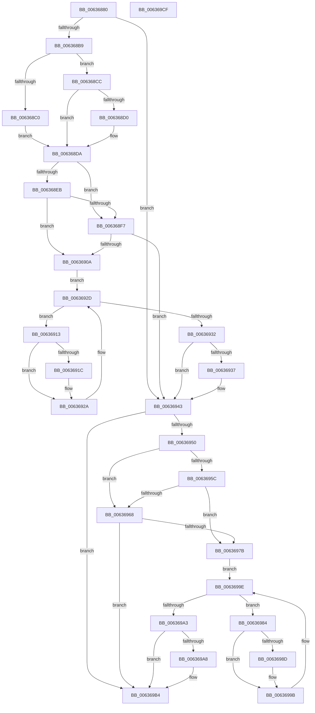

# DifMmResetDriverPagingWrapper

- RVA: `0x00636880`–`0x006369D0` (길이 `336` bytes)
- VA: `0x0000000140636880`
- 실행 섹션: `.text`
- PDB 이름 있음: `예`; PDB Function 태그: `아니요`
- unwind 정보 RVA: `0x0005D7BC`
- 디코드: `90`개 명령, `336/336` bytes 표시
- 미해석 바이트: `0` (있으면 어셈블리에 `.byte`로 보존)

> 이 문서는 커널 이미지의 기계어와 PDB 기호를 분석해 생성했습니다. 4번과 5번은 함수 원형과 자료형을 바이너리 사용 방식에서 추정한 C 해석이며 원본 소스 복구 결과는 아닙니다.

## 1. Dependencies

- 직접 호출 지점: **9**; 고유 호출 대상: **6**
- 직접 호출자로 확인된 함수: **0**
- RIP 상대 이미지 참조: **3**

### Outgoing calls
- `0x006368A8` → [DifGetAPIThunkContextById](../49/DifGetAPIThunkContextById_function_00495A34.md) (function, `0x00495A34`)
- `0x006368D0` → [DifGetReturnAddressForWrappers](../4D/DifGetReturnAddressForWrappers_function_004D3C08.md) (function, `0x004D3C08`)
- `0x006368FE` → [ExAcquireRundownProtection](../21/ExAcquireRundownProtection_function_00216620.md) (function, `0x00216620`)
- `0x00636925` → [guard_dispatch_icall](../6B/guard_dispatch_icall_function_006BAAD0.md) (function, `0x006BAAD0`)
- `0x0063693E` → [ExReleaseRundownProtection](../34/ExReleaseRundownProtection_function_00349E80.md) (function, `0x00349E80`)
- `0x00636946` → [MmResetDriverPaging](../../page/A4/MmResetDriverPaging_function_00A4ADB0.md) (function, `0x00A4ADB0`)
- `0x0063696F` → [ExAcquireRundownProtection](../21/ExAcquireRundownProtection_function_00216620.md) (function, `0x00216620`)
- `0x00636996` → [guard_dispatch_icall](../6B/guard_dispatch_icall_function_006BAAD0.md) (function, `0x006BAAD0`)
- `0x006369AF` → [ExReleaseRundownProtection](../34/ExReleaseRundownProtection_function_00349E80.md) (function, `0x00349E80`)

### Direct callers
- 이 함수 시작 RVA로 연결되는 직접 call은 확인되지 않았습니다. 간접 호출은 완전히 역산할 수 없습니다.

### Static image references
- `0x006368E2` → RVA `0x00F048B8` (`.data`; read)
- `0x006368EB` → RVA `0x00F04980` (`.data`; read)
- `0x006368F7` → RVA `0x00F03E80` (`.data`; read)

## 2. Other-region calls and transfers

- 다른 실행 섹션으로 향하는 call: **1**
  - `0x00636946` → [MmResetDriverPaging](../../page/A4/MmResetDriverPaging_function_00A4ADB0.md) (`.text` → `PAGE`)
- 별도 외부 분기/꼬리 이동을 확인하지 못했습니다.

## 3. Assembly (complete function range)

```asm
00636880  48 8B C4                        mov rax, rsp
00636883  48 89 58 08                     mov qword ptr [rax + 8], rbx
00636887  48 89 68 10                     mov qword ptr [rax + 0x10], rbp
0063688B  48 89 70 18                     mov qword ptr [rax + 0x18], rsi
0063688F  48 89 78 20                     mov qword ptr [rax + 0x20], rdi
00636893  41 56                           push r14
00636895  48 83 EC 30                     sub rsp, 0x30
00636899  48 8B E9                        mov rbp, rcx
0063689C  0F 57 C0                        xorps xmm0, xmm0
0063689F  B9 D7 00 00 00                  mov ecx, 0xd7
006368A4  0F 11 40 E8                     movups xmmword ptr [rax - 0x18], xmm0
006368A8  E8 87 F1 E5 FF                  call 0x140495a34
006368AD  48 8B F8                        mov rdi, rax
006368B0  48 85 C0                        test rax, rax
006368B3  0F 84 8A 00 00 00               je 0x140636943
006368B9  8B 40 0C                        mov eax, dword ptr [rax + 0xc]
006368BC  A8 18                           test al, 0x18
006368BE  74 0C                           je 0x1406368cc
006368C0  48 8B 4C 24 38                  mov rcx, qword ptr [rsp + 0x38]
006368C5  48 89 4C 24 20                  mov qword ptr [rsp + 0x20], rcx
006368CA  EB 0E                           jmp 0x1406368da
006368CC  A8 04                           test al, 4
006368CE  74 0A                           je 0x1406368da
006368D0  E8 33 D3 E9 FF                  call 0x1404d3c08
006368D5  48 89 44 24 20                  mov qword ptr [rsp + 0x20], rax
006368DA  40 32 F6                        xor sil, sil
006368DD  48 89 6C 24 28                  mov qword ptr [rsp + 0x28], rbp
006368E2  40 38 35 CF DF 8C 00            cmp byte ptr [rip + 0x8cdfcf], sil
006368E9  75 0C                           jne 0x1406368f7
006368EB  F7 05 8B E0 8C 00 00 08 00 00   test dword ptr [rip + 0x8ce08b], 0x800
006368F5  74 13                           je 0x14063690a
006368F7  48 8D 0D 82 D5 8C 00            lea rcx, [rip + 0x8cd582]
006368FE  E8 1D FD BD FF                  call 0x140216620
00636903  40 8A F0                        mov sil, al
00636906  84 C0                           test al, al
00636908  74 39                           je 0x140636943
0063690A  4C 8D 77 20                     lea r14, [rdi + 0x20]
0063690E  49 8B 1E                        mov rbx, qword ptr [r14]
00636911  EB 1A                           jmp 0x14063692d
00636913  48 8D 43 F0                     lea rax, [rbx - 0x10]
00636917  48 85 C0                        test rax, rax
0063691A  74 0E                           je 0x14063692a
0063691C  48 8B 40 08                     mov rax, qword ptr [rax + 8]
00636920  48 8D 4C 24 20                  lea rcx, [rsp + 0x20]
00636925  E8 A6 41 08 00                  call 0x1406baad0
0063692A  48 8B 1B                        mov rbx, qword ptr [rbx]
0063692D  49 3B DE                        cmp rbx, r14
00636930  75 E1                           jne 0x140636913
00636932  40 84 F6                        test sil, sil
00636935  74 0C                           je 0x140636943
00636937  48 8D 0D 42 D5 8C 00            lea rcx, [rip + 0x8cd542]
0063693E  E8 3D 35 D1 FF                  call 0x140349e80
00636943  48 8B CD                        mov rcx, rbp
00636946  E8 65 44 41 00                  call 0x140a4adb0
0063694B  48 85 FF                        test rdi, rdi
0063694E  74 64                           je 0x1406369b4
00636950  40 32 F6                        xor sil, sil
00636953  40 38 35 5E DF 8C 00            cmp byte ptr [rip + 0x8cdf5e], sil
0063695A  75 0C                           jne 0x140636968
0063695C  F7 05 1A E0 8C 00 00 08 00 00   test dword ptr [rip + 0x8ce01a], 0x800
00636966  74 13                           je 0x14063697b
00636968  48 8D 0D 11 D5 8C 00            lea rcx, [rip + 0x8cd511]
0063696F  E8 AC FC BD FF                  call 0x140216620
00636974  40 8A F0                        mov sil, al
00636977  84 C0                           test al, al
00636979  74 39                           je 0x1406369b4
0063697B  48 83 C7 30                     add rdi, 0x30
0063697F  48 8B 1F                        mov rbx, qword ptr [rdi]
00636982  EB 1A                           jmp 0x14063699e
00636984  48 8D 43 F0                     lea rax, [rbx - 0x10]
00636988  48 85 C0                        test rax, rax
0063698B  74 0E                           je 0x14063699b
0063698D  48 8B 40 08                     mov rax, qword ptr [rax + 8]
00636991  48 8D 4C 24 20                  lea rcx, [rsp + 0x20]
00636996  E8 35 41 08 00                  call 0x1406baad0
0063699B  48 8B 1B                        mov rbx, qword ptr [rbx]
0063699E  48 3B DF                        cmp rbx, rdi
006369A1  75 E1                           jne 0x140636984
006369A3  40 84 F6                        test sil, sil
006369A6  74 0C                           je 0x1406369b4
006369A8  48 8D 0D D1 D4 8C 00            lea rcx, [rip + 0x8cd4d1]
006369AF  E8 CC 34 D1 FF                  call 0x140349e80
006369B4  48 8B 5C 24 40                  mov rbx, qword ptr [rsp + 0x40]
006369B9  48 8B 6C 24 48                  mov rbp, qword ptr [rsp + 0x48]
006369BE  48 8B 74 24 50                  mov rsi, qword ptr [rsp + 0x50]
006369C3  48 8B 7C 24 58                  mov rdi, qword ptr [rsp + 0x58]
006369C8  48 83 C4 30                     add rsp, 0x30
006369CC  41 5E                           pop r14
006369CE  C3                              ret
006369CF  CC                              int3
```

## 4. C-style interpretation (structured pseudocode)

```c
__int64 __fastcall DifMmResetDriverPagingWrapper(__int64 a1)
{
    __int64 result;
    __int64 v_rdi;
    __int64 v_rsi;
    __int64 v_rsp;
    unsigned __int64 v_stack_m10;
    unsigned __int64 v_stack_m18;
    unsigned __int64 v_stack_p0;
    unsigned __int64 v_stack_p10;
    unsigned __int64 v_stack_p18;
    unsigned __int64 v_stack_p20;
    unsigned __int64 v_stack_p8;

    *(unsigned __int64 *)(v_rsp + 8) = v_rbx;
    *(unsigned __int64 *)(v_rsp + 16) = v_rbp;
    *(unsigned __int64 *)(v_rsp + 24) = v_rsi;
    *(unsigned __int64 *)(v_rsp + 32) = v_rdi;
    v_rsp = (v_rsp) - (48);
    *(unsigned __int64 *)(v_rsp - 24) = v_xmm0;
    result = DifGetAPIThunkContextById(215, a2, a3, a4);
    if (result == 0) goto loc_00636943;
    if ((((unsigned __int8)((unsigned int)(*(unsigned int *)(result + 12)))) & (24)) == 0) goto loc_006368CC;
    v_stack_m18 = v_stack_p0;
    goto loc_006368DA;
loc_006368CC:
    result = (unsigned int)(*(unsigned int *)(result + 12));
    if ((((unsigned __int8)((unsigned int)(*(unsigned int *)(result + 12)))) & (4)) != 0) {
        result = DifGetReturnAddressForWrappers(v_stack_p0, a2, a3, a4);
        v_stack_m18 = result;
    }
    v_rsi = 0;
    v_stack_m10 = a1;
    if ((*(unsigned __int8 *)(v_rip + 9232335)) != 0) goto loc_006368F7;
    if (((*(unsigned int *)(v_rip + 9232523)) & (0x800ULL)) == 0) goto loc_0063690A;
loc_006368F7:
    result = ExAcquireRundownProtection(v_rip + 9229698, a2, a3, a4);
    if ((unsigned __int8)(result) == 0) goto loc_00636943;
loc_0063690A:
    goto loc_0063692D;
loc_00636913:
    result = *(unsigned __int64 *)(result + 32) - 16;
    if (*(unsigned __int64 *)(result + 32) - 16 != 0) {
        result = *(unsigned __int64 *)(*(unsigned __int64 *)(result + 32) - 16 + 8);
        a1 = v_stack_m18;
        result = guard_dispatch_icall(a1, a2, a3, a4);
    }
loc_0063692D:
    if ((*(unsigned __int64 *)(*(unsigned __int64 *)(result + 32))) != (result + 32)) goto loc_00636913;
    if ((unsigned __int8)((unsigned __int8)(result)) != 0) {
        a1 = v_rip + 9229634;
        result = ExReleaseRundownProtection(a1, a2, a3, a4);
    }
    result = MmResetDriverPaging(a1, a2, a3, a4);
    if (result == 0) goto loc_006369B4;
    v_rsi = 0;
    if ((*(unsigned __int8 *)(v_rip + 9232222)) != 0) goto loc_00636968;
    if (((*(unsigned int *)(v_rip + 9232410)) & (0x800ULL)) == 0) goto loc_0063697B;
loc_00636968:
    result = ExAcquireRundownProtection(v_rip + 9229585, a2, a3, a4);
    if ((unsigned __int8)(result) == 0) goto loc_006369B4;
loc_0063697B:
    v_rdi = (result) + (48);
    goto loc_0063699E;
loc_00636984:
    result = *(unsigned __int64 *)(v_rdi) - 16;
    if (*(unsigned __int64 *)(v_rdi) - 16 != 0) {
        result = *(unsigned __int64 *)(*(unsigned __int64 *)(v_rdi) - 16 + 8);
        a1 = v_stack_m18;
        result = guard_dispatch_icall(a1, a2, a3, a4);
    }
loc_0063699E:
    if ((*(unsigned __int64 *)(*(unsigned __int64 *)(v_rdi))) != v_rdi) goto loc_00636984;
    if ((unsigned __int8)((unsigned __int8)(result)) != 0) {
        a1 = v_rip + 9229521;
        result = ExReleaseRundownProtection(a1, a2, a3, a4);
    }
    v_rsp = (v_rsp) + (48);
    return result;
}
```

## 5. (Beta) C Style

```c
int64_t DifMmResetDriverPagingWrapper(int64_t Arg1)
{
    int64_t result;
    int64_t local_rdi;
    int64_t local_rsi;
    int64_t local_rsp;
    uint64_t v_stack_m10;
    uint64_t v_stack_m18;
    uint64_t v_stack_p0;
    uint64_t v_stack_p10;
    uint64_t v_stack_p18;
    uint64_t v_stack_p20;
    uint64_t v_stack_p8;

    *(uint64_t *)(local_rsp + 0x8) = local_rbx;
    *(uint64_t *)(local_rsp + 0x10) = local_rbp;
    *(uint64_t *)(local_rsp + 0x18) = local_rsi;
    *(uint64_t *)(local_rsp + 0x20) = local_rdi;
    local_rsp = (local_rsp) - (48);
    *(uint64_t *)(local_rsp - 0x18) = v_xmm0;
    result = DifGetAPIThunkContextById(215, a2, a3, a4);
    if (result == 0) goto loc_00636943;
    if ((((uint8_t)((uint32_t)(*(uint32_t *)(result + 0xC)))) & (24)) == 0) goto loc_006368CC;
    v_stack_m18 = v_stack_p0;
    goto loc_006368DA;
loc_006368CC:
    result = (uint32_t)(*(uint32_t *)(result + 0xC));
    if ((((uint8_t)((uint32_t)(*(uint32_t *)(result + 0xC)))) & (4)) != 0) {
        result = DifGetReturnAddressForWrappers(v_stack_p0, a2, a3, a4);
        v_stack_m18 = result;
    }
    local_rsi = 0;
    v_stack_m10 = Arg1;
    if ((*(uint8_t *)(v_rip + 0x8CDFCF)) != 0) goto loc_006368F7;
    if (((*(uint32_t *)(v_rip + 0x8CE08B)) & (0x800ULL)) == 0) goto loc_0063690A;
loc_006368F7:
    result = ExAcquireRundownProtection(v_rip + 9229698, a2, a3, a4);
    if ((uint8_t)(result) == 0) goto loc_00636943;
loc_0063690A:
    goto loc_0063692D;
loc_00636913:
    result = *(uint64_t *)(result + 0x20) - 16;
    if (*(uint64_t *)(result + 0x20) - 16 != 0) {
        result = *(uint64_t *)(*(uint64_t *)(result + 0x20) - 0x10 + 0x8);
        Arg1 = v_stack_m18;
        result = guard_dispatch_icall(Arg1, a2, a3, a4);
    }
loc_0063692D:
    if ((*(uint64_t *)(*(uint64_t *)(result + 0x20))) != (result + 32)) goto loc_00636913;
    if ((uint8_t)((uint8_t)(result)) != 0) {
        Arg1 = v_rip + 9229634;
        result = ExReleaseRundownProtection(Arg1, a2, a3, a4);
    }
    result = MmResetDriverPaging(Arg1, a2, a3, a4);
    if (result == 0) goto loc_006369B4;
    local_rsi = 0;
    if ((*(uint8_t *)(v_rip + 0x8CDF5E)) != 0) goto loc_00636968;
    if (((*(uint32_t *)(v_rip + 0x8CE01A)) & (0x800ULL)) == 0) goto loc_0063697B;
loc_00636968:
    result = ExAcquireRundownProtection(v_rip + 9229585, a2, a3, a4);
    if ((uint8_t)(result) == 0) goto loc_006369B4;
loc_0063697B:
    local_rdi = (result) + (48);
    goto loc_0063699E;
loc_00636984:
    result = *(uint64_t *)(local_rdi) - 16;
    if (*(uint64_t *)(local_rdi) - 16 != 0) {
        result = *(uint64_t *)(*(uint64_t *)(local_rdi) - 0x10 + 0x8);
        Arg1 = v_stack_m18;
        result = guard_dispatch_icall(Arg1, a2, a3, a4);
    }
loc_0063699E:
    if ((*(uint64_t *)(*(uint64_t *)(local_rdi))) != local_rdi) goto loc_00636984;
    if ((uint8_t)((uint8_t)(result)) != 0) {
        Arg1 = v_rip + 9229521;
        result = ExReleaseRundownProtection(Arg1, a2, a3, a4);
    }
    local_rsp = (local_rsp) + (48);
    return result;
}
```

## 6. Execution-region graph

[열기: 2D/3D 그래프와 함수 탐색 컨트롤 패널](../../../control-panel.html?section=text&rva=0x00636880&view=graph)

- 2D 그래프는 위에서 아래로 흐르고, 3D 그래프는 빈 공간을 드래그해 회전합니다. Shift+드래그는 이동, 휠은 확대·축소, 함수 노드 선택은 대상 보고서 이동입니다.

### Static fallback


