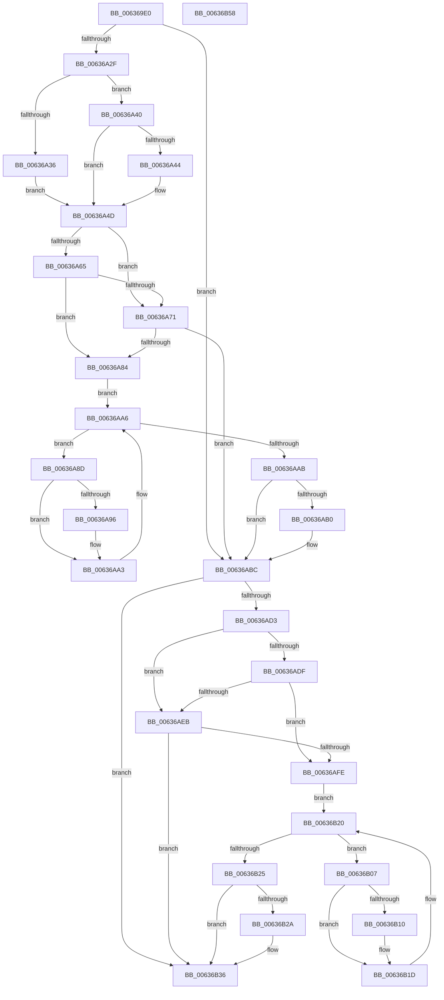

# DifMmSecureVirtualMemoryWrapper

- RVA: `0x006369E0`–`0x00636B59` (길이 `377` bytes)
- VA: `0x00000001406369E0`
- 실행 섹션: `.text`
- PDB 이름 있음: `예`; PDB Function 태그: `아니요`
- unwind 정보 RVA: `0x000A9A64`
- 디코드: `108`개 명령, `377/377` bytes 표시
- 미해석 바이트: `0` (있으면 어셈블리에 `.byte`로 보존)

> 이 문서는 커널 이미지의 기계어와 PDB 기호를 분석해 생성했습니다. 4번과 5번은 함수 원형과 자료형을 바이너리 사용 방식에서 추정한 C 해석이며 원본 소스 복구 결과는 아닙니다.

## 1. Dependencies

- 직접 호출 지점: **9**; 고유 호출 대상: **6**
- 직접 호출자로 확인된 함수: **0**
- RIP 상대 이미지 참조: **3**

### Outgoing calls
- `0x00636A1E` → [DifGetAPIThunkContextById](../49/DifGetAPIThunkContextById_function_00495A34.md) (function, `0x00495A34`)
- `0x00636A44` → [DifGetReturnAddressForWrappers](../4D/DifGetReturnAddressForWrappers_function_004D3C08.md) (function, `0x004D3C08`)
- `0x00636A78` → [ExAcquireRundownProtection](../21/ExAcquireRundownProtection_function_00216620.md) (function, `0x00216620`)
- `0x00636A9E` → [guard_dispatch_icall](../6B/guard_dispatch_icall_function_006BAAD0.md) (function, `0x006BAAD0`)
- `0x00636AB7` → [ExReleaseRundownProtection](../34/ExReleaseRundownProtection_function_00349E80.md) (function, `0x00349E80`)
- `0x00636AC5` → [MmSecureVirtualMemory](../../page/9F/MmSecureVirtualMemory_function_009F55F0.md) (function, `0x009F55F0`)
- `0x00636AF2` → [ExAcquireRundownProtection](../21/ExAcquireRundownProtection_function_00216620.md) (function, `0x00216620`)
- `0x00636B18` → [guard_dispatch_icall](../6B/guard_dispatch_icall_function_006BAAD0.md) (function, `0x006BAAD0`)
- `0x00636B31` → [ExReleaseRundownProtection](../34/ExReleaseRundownProtection_function_00349E80.md) (function, `0x00349E80`)

### Direct callers
- 이 함수 시작 RVA로 연결되는 직접 call은 확인되지 않았습니다. 간접 호출은 완전히 역산할 수 없습니다.

### Static image references
- `0x00636A54` → RVA `0x00F048B8` (`.data`; read)
- `0x00636A65` → RVA `0x00F04980` (`.data`; read)
- `0x00636A71` → RVA `0x00F03E80` (`.data`; read)

## 2. Other-region calls and transfers

- 다른 실행 섹션으로 향하는 call: **1**
  - `0x00636AC5` → [MmSecureVirtualMemory](../../page/9F/MmSecureVirtualMemory_function_009F55F0.md) (`.text` → `PAGE`)
- 별도 외부 분기/꼬리 이동을 확인하지 못했습니다.

## 3. Assembly (complete function range)

```asm
006369E0  48 89 5C 24 08                  mov qword ptr [rsp + 8], rbx
006369E5  48 89 74 24 10                  mov qword ptr [rsp + 0x10], rsi
006369EA  48 89 7C 24 18                  mov qword ptr [rsp + 0x18], rdi
006369EF  55                              push rbp
006369F0  41 54                           push r12
006369F2  41 55                           push r13
006369F4  41 56                           push r14
006369F6  41 57                           push r15
006369F8  48 8B EC                        mov rbp, rsp
006369FB  48 83 EC 50                     sub rsp, 0x50
006369FF  0F 57 C0                        xorps xmm0, xmm0
00636A02  33 C0                           xor eax, eax
00636A04  4C 8B E9                        mov r13, rcx
00636A07  48 89 45 F0                     mov qword ptr [rbp - 0x10], rax
00636A0B  B9 D6 00 00 00                  mov ecx, 0xd6
00636A10  45 8B F8                        mov r15d, r8d
00636A13  0F 11 45 D0                     movups xmmword ptr [rbp - 0x30], xmm0
00636A17  4C 8B E2                        mov r12, rdx
00636A1A  0F 11 45 E0                     movups xmmword ptr [rbp - 0x20], xmm0
00636A1E  E8 11 F0 E5 FF                  call 0x140495a34
00636A23  48 8B F0                        mov rsi, rax
00636A26  48 85 C0                        test rax, rax
00636A29  0F 84 8D 00 00 00               je 0x140636abc
00636A2F  8B 40 0C                        mov eax, dword ptr [rax + 0xc]
00636A32  A8 18                           test al, 0x18
00636A34  74 0A                           je 0x140636a40
00636A36  48 8B 4D 28                     mov rcx, qword ptr [rbp + 0x28]
00636A3A  48 89 4D D0                     mov qword ptr [rbp - 0x30], rcx
00636A3E  EB 0D                           jmp 0x140636a4d
00636A40  A8 04                           test al, 4
00636A42  74 09                           je 0x140636a4d
00636A44  E8 BF D1 E9 FF                  call 0x1404d3c08
00636A49  48 89 45 D0                     mov qword ptr [rbp - 0x30], rax
00636A4D  45 32 F6                        xor r14b, r14b
00636A50  4C 89 6D E8                     mov qword ptr [rbp - 0x18], r13
00636A54  44 38 35 5D DE 8C 00            cmp byte ptr [rip + 0x8cde5d], r14b
00636A5B  4C 89 65 E0                     mov qword ptr [rbp - 0x20], r12
00636A5F  44 89 7D D8                     mov dword ptr [rbp - 0x28], r15d
00636A63  75 0C                           jne 0x140636a71
00636A65  F7 05 11 DF 8C 00 00 08 00 00   test dword ptr [rip + 0x8cdf11], 0x800
00636A6F  74 13                           je 0x140636a84
00636A71  48 8D 0D 08 D4 8C 00            lea rcx, [rip + 0x8cd408]
00636A78  E8 A3 FB BD FF                  call 0x140216620
00636A7D  44 8A F0                        mov r14b, al
00636A80  84 C0                           test al, al
00636A82  74 38                           je 0x140636abc
00636A84  48 8D 7E 20                     lea rdi, [rsi + 0x20]
00636A88  48 8B 1F                        mov rbx, qword ptr [rdi]
00636A8B  EB 19                           jmp 0x140636aa6
00636A8D  48 8D 43 F0                     lea rax, [rbx - 0x10]
00636A91  48 85 C0                        test rax, rax
00636A94  74 0D                           je 0x140636aa3
00636A96  48 8B 40 08                     mov rax, qword ptr [rax + 8]
00636A9A  48 8D 4D D0                     lea rcx, [rbp - 0x30]
00636A9E  E8 2D 40 08 00                  call 0x1406baad0
00636AA3  48 8B 1B                        mov rbx, qword ptr [rbx]
00636AA6  48 3B DF                        cmp rbx, rdi
00636AA9  75 E2                           jne 0x140636a8d
00636AAB  45 84 F6                        test r14b, r14b
00636AAE  74 0C                           je 0x140636abc
00636AB0  48 8D 0D C9 D3 8C 00            lea rcx, [rip + 0x8cd3c9]
00636AB7  E8 C4 33 D1 FF                  call 0x140349e80
00636ABC  45 8B C7                        mov r8d, r15d
00636ABF  49 8B D4                        mov rdx, r12
00636AC2  49 8B CD                        mov rcx, r13
00636AC5  E8 26 EB 3B 00                  call 0x1409f55f0
00636ACA  48 89 45 F0                     mov qword ptr [rbp - 0x10], rax
00636ACE  48 85 F6                        test rsi, rsi
00636AD1  74 63                           je 0x140636b36
00636AD3  40 32 FF                        xor dil, dil
00636AD6  40 38 3D DB DD 8C 00            cmp byte ptr [rip + 0x8cdddb], dil
00636ADD  75 0C                           jne 0x140636aeb
00636ADF  F7 05 97 DE 8C 00 00 08 00 00   test dword ptr [rip + 0x8cde97], 0x800
00636AE9  74 13                           je 0x140636afe
00636AEB  48 8D 0D 8E D3 8C 00            lea rcx, [rip + 0x8cd38e]
00636AF2  E8 29 FB BD FF                  call 0x140216620
00636AF7  40 8A F8                        mov dil, al
00636AFA  84 C0                           test al, al
00636AFC  74 38                           je 0x140636b36
00636AFE  48 83 C6 30                     add rsi, 0x30
00636B02  48 8B 1E                        mov rbx, qword ptr [rsi]
00636B05  EB 19                           jmp 0x140636b20
00636B07  48 8D 43 F0                     lea rax, [rbx - 0x10]
00636B0B  48 85 C0                        test rax, rax
00636B0E  74 0D                           je 0x140636b1d
00636B10  48 8B 40 08                     mov rax, qword ptr [rax + 8]
00636B14  48 8D 4D D0                     lea rcx, [rbp - 0x30]
00636B18  E8 B3 3F 08 00                  call 0x1406baad0
00636B1D  48 8B 1B                        mov rbx, qword ptr [rbx]
00636B20  48 3B DE                        cmp rbx, rsi
00636B23  75 E2                           jne 0x140636b07
00636B25  40 84 FF                        test dil, dil
00636B28  74 0C                           je 0x140636b36
00636B2A  48 8D 0D 4F D3 8C 00            lea rcx, [rip + 0x8cd34f]
00636B31  E8 4A 33 D1 FF                  call 0x140349e80
00636B36  48 8B 45 F0                     mov rax, qword ptr [rbp - 0x10]
00636B3A  4C 8D 5C 24 50                  lea r11, [rsp + 0x50]
00636B3F  49 8B 5B 30                     mov rbx, qword ptr [r11 + 0x30]
00636B43  49 8B 73 38                     mov rsi, qword ptr [r11 + 0x38]
00636B47  49 8B 7B 40                     mov rdi, qword ptr [r11 + 0x40]
00636B4B  49 8B E3                        mov rsp, r11
00636B4E  41 5F                           pop r15
00636B50  41 5E                           pop r14
00636B52  41 5D                           pop r13
00636B54  41 5C                           pop r12
00636B56  5D                              pop rbp
00636B57  C3                              ret
00636B58  CC                              int3
```

## 4. C-style interpretation (structured pseudocode)

```c
__int64 __fastcall DifMmSecureVirtualMemoryWrapper(__int64 a1, __int64 a2, int a3)
{
    __int64 result;
    __int64 v_r14;
    __int64 v_rdi;
    __int64 v_rsi;
    __int64 v_rsp;
    unsigned __int64 v_stack_m28;
    unsigned __int64 v_stack_m38;
    unsigned __int64 v_stack_m40;
    unsigned __int64 v_stack_m48;
    unsigned int v_stack_m50;
    unsigned __int64 v_stack_m58;
    unsigned __int64 v_stack_p0;
    unsigned __int64 v_stack_p10;
    unsigned __int64 v_stack_p18;
    unsigned __int64 v_stack_p8;

    v_stack_p8 = v_rbx;
    v_stack_p10 = v_rsi;
    v_stack_p18 = v_rdi;
    v_rsp = (v_rsp) - (80);
    result = 0;
    v_stack_m38 = 0;
    v_stack_m58 = v_xmm0;
    v_stack_m48 = v_xmm0;
    result = DifGetAPIThunkContextById(214, a2, a3, a4);
    if (result == 0) goto loc_00636ABC;
    if ((((unsigned __int8)((unsigned int)(*(unsigned int *)(result + 12)))) & (24)) == 0) goto loc_00636A40;
    v_stack_m58 = v_stack_p0;
    goto loc_00636A4D;
loc_00636A40:
    result = (unsigned int)(*(unsigned int *)(result + 12));
    if ((((unsigned __int8)((unsigned int)(*(unsigned int *)(result + 12)))) & (4)) != 0) {
        result = DifGetReturnAddressForWrappers(v_stack_p0, a2, a3, a4);
        v_stack_m58 = result;
    }
    v_r14 = 0;
    v_stack_m40 = a1;
    v_stack_m48 = a2;
    v_stack_m50 = (unsigned int)((unsigned int)(a3));
    if ((*(unsigned __int8 *)(v_rip + 9231965)) != 0) goto loc_00636A71;
    if (((*(unsigned int *)(v_rip + 9232145)) & (0x800ULL)) == 0) goto loc_00636A84;
loc_00636A71:
    result = ExAcquireRundownProtection(v_rip + 9229320, a2, a3, a4);
    if ((unsigned __int8)(result) == 0) goto loc_00636ABC;
loc_00636A84:
    goto loc_00636AA6;
loc_00636A8D:
    result = *(unsigned __int64 *)(result + 32) - 16;
    if (*(unsigned __int64 *)(result + 32) - 16 != 0) {
        result = *(unsigned __int64 *)(*(unsigned __int64 *)(result + 32) - 16 + 8);
        a1 = v_stack_m58;
        result = guard_dispatch_icall(a1, a2, a3, a4);
    }
loc_00636AA6:
    if ((*(unsigned __int64 *)(*(unsigned __int64 *)(result + 32))) != (result + 32)) goto loc_00636A8D;
    if ((unsigned __int8)((unsigned __int8)(result)) != 0) {
        a1 = v_rip + 9229257;
        result = ExReleaseRundownProtection(a1, a2, a3, a4);
    }
    result = MmSecureVirtualMemory(a1, a2, (unsigned int)((unsigned int)((unsigned int)(a3))), a4);
    v_stack_m38 = result;
    if (result == 0) goto loc_00636B36;
    v_rdi = 0;
    if ((*(unsigned __int8 *)(v_rip + 9231835)) != 0) goto loc_00636AEB;
    if (((*(unsigned int *)(v_rip + 9232023)) & (0x800ULL)) == 0) goto loc_00636AFE;
loc_00636AEB:
    result = ExAcquireRundownProtection(v_rip + 9229198, a2, (unsigned int)((unsigned int)((unsigned int)(a3))), a4);
    if ((unsigned __int8)(result) == 0) goto loc_00636B36;
loc_00636AFE:
    v_rsi = (result) + (48);
    goto loc_00636B20;
loc_00636B07:
    result = *(unsigned __int64 *)(v_rsi) - 16;
    if (*(unsigned __int64 *)(v_rsi) - 16 != 0) {
        result = *(unsigned __int64 *)(*(unsigned __int64 *)(v_rsi) - 16 + 8);
        a1 = v_stack_m58;
        result = guard_dispatch_icall(a1, a2, (unsigned int)((unsigned int)((unsigned int)(a3))), a4);
    }
loc_00636B20:
    if ((*(unsigned __int64 *)(*(unsigned __int64 *)(v_rsi))) != v_rsi) goto loc_00636B07;
    if ((unsigned __int8)((unsigned __int8)(result)) != 0) {
        a1 = v_rip + 9229135;
        result = ExReleaseRundownProtection(a1, a2, (unsigned int)((unsigned int)((unsigned int)(a3))), a4);
    }
    return v_stack_m38;
}
```

## 5. (Beta) C Style

```c
int64_t DifMmSecureVirtualMemoryWrapper(int64_t Arg1, int64_t Arg2, int32_t Arg3)
{
    int64_t result;
    int64_t local_r14;
    int64_t local_rdi;
    int64_t local_rsi;
    int64_t local_rsp;
    uint64_t v_stack_m28;
    uint64_t v_stack_m38;
    uint64_t v_stack_m40;
    uint64_t v_stack_m48;
    uint32_t v_stack_m50;
    uint64_t v_stack_m58;
    uint64_t v_stack_p0;
    uint64_t v_stack_p10;
    uint64_t v_stack_p18;
    uint64_t v_stack_p8;

    v_stack_p8 = local_rbx;
    v_stack_p10 = local_rsi;
    v_stack_p18 = local_rdi;
    local_rsp = (local_rsp) - (80);
    result = 0;
    v_stack_m38 = 0;
    v_stack_m58 = v_xmm0;
    v_stack_m48 = v_xmm0;
    result = DifGetAPIThunkContextById(214, Arg2, Arg3, a4);
    if (result == 0) goto loc_00636ABC;
    if ((((uint8_t)((uint32_t)(*(uint32_t *)(result + 0xC)))) & (24)) == 0) goto loc_00636A40;
    v_stack_m58 = v_stack_p0;
    goto loc_00636A4D;
loc_00636A40:
    result = (uint32_t)(*(uint32_t *)(result + 0xC));
    if ((((uint8_t)((uint32_t)(*(uint32_t *)(result + 0xC)))) & (4)) != 0) {
        result = DifGetReturnAddressForWrappers(v_stack_p0, Arg2, Arg3, a4);
        v_stack_m58 = result;
    }
    local_r14 = 0;
    v_stack_m40 = Arg1;
    v_stack_m48 = Arg2;
    v_stack_m50 = (uint32_t)((uint32_t)(Arg3));
    if ((*(uint8_t *)(v_rip + 0x8CDE5D)) != 0) goto loc_00636A71;
    if (((*(uint32_t *)(v_rip + 0x8CDF11)) & (0x800ULL)) == 0) goto loc_00636A84;
loc_00636A71:
    result = ExAcquireRundownProtection(v_rip + 9229320, Arg2, Arg3, a4);
    if ((uint8_t)(result) == 0) goto loc_00636ABC;
loc_00636A84:
    goto loc_00636AA6;
loc_00636A8D:
    result = *(uint64_t *)(result + 0x20) - 16;
    if (*(uint64_t *)(result + 0x20) - 16 != 0) {
        result = *(uint64_t *)(*(uint64_t *)(result + 0x20) - 0x10 + 0x8);
        Arg1 = v_stack_m58;
        result = guard_dispatch_icall(Arg1, Arg2, Arg3, a4);
    }
loc_00636AA6:
    if ((*(uint64_t *)(*(uint64_t *)(result + 0x20))) != (result + 32)) goto loc_00636A8D;
    if ((uint8_t)((uint8_t)(result)) != 0) {
        Arg1 = v_rip + 9229257;
        result = ExReleaseRundownProtection(Arg1, Arg2, Arg3, a4);
    }
    result = MmSecureVirtualMemory(Arg1, Arg2, (uint32_t)((uint32_t)((uint32_t)(Arg3))), a4);
    v_stack_m38 = result;
    if (result == 0) goto loc_00636B36;
    local_rdi = 0;
    if ((*(uint8_t *)(v_rip + 0x8CDDDB)) != 0) goto loc_00636AEB;
    if (((*(uint32_t *)(v_rip + 0x8CDE97)) & (0x800ULL)) == 0) goto loc_00636AFE;
loc_00636AEB:
    result = ExAcquireRundownProtection(v_rip + 9229198, Arg2, (uint32_t)((uint32_t)((uint32_t)(Arg3))), a4);
    if ((uint8_t)(result) == 0) goto loc_00636B36;
loc_00636AFE:
    local_rsi = (result) + (48);
    goto loc_00636B20;
loc_00636B07:
    result = *(uint64_t *)(local_rsi) - 16;
    if (*(uint64_t *)(local_rsi) - 16 != 0) {
        result = *(uint64_t *)(*(uint64_t *)(local_rsi) - 0x10 + 0x8);
        Arg1 = v_stack_m58;
        result = guard_dispatch_icall(Arg1, Arg2, (uint32_t)((uint32_t)((uint32_t)(Arg3))), a4);
    }
loc_00636B20:
    if ((*(uint64_t *)(*(uint64_t *)(local_rsi))) != local_rsi) goto loc_00636B07;
    if ((uint8_t)((uint8_t)(result)) != 0) {
        Arg1 = v_rip + 9229135;
        result = ExReleaseRundownProtection(Arg1, Arg2, (uint32_t)((uint32_t)((uint32_t)(Arg3))), a4);
    }
    return v_stack_m38;
}
```

## 6. Execution-region graph

[열기: 2D/3D 그래프와 함수 탐색 컨트롤 패널](../../../control-panel.html?section=text&rva=0x006369E0&view=graph)

- 2D 그래프는 위에서 아래로 흐르고, 3D 그래프는 빈 공간을 드래그해 회전합니다. Shift+드래그는 이동, 휠은 확대·축소, 함수 노드 선택은 대상 보고서 이동입니다.

### Static fallback


