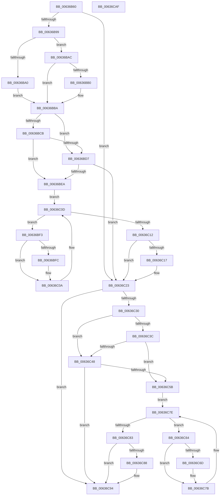

# DifMmUnlockPagableImageSectionWrapper

- RVA: `0x00636B60`–`0x00636CB0` (길이 `336` bytes)
- VA: `0x0000000140636B60`
- 실행 섹션: `.text`
- PDB 이름 있음: `예`; PDB Function 태그: `아니요`
- unwind 정보 RVA: `0x0005D7BC`
- 디코드: `90`개 명령, `336/336` bytes 표시
- 미해석 바이트: `0` (있으면 어셈블리에 `.byte`로 보존)

> 이 문서는 커널 이미지의 기계어와 PDB 기호를 분석해 생성했습니다. 4번과 5번은 함수 원형과 자료형을 바이너리 사용 방식에서 추정한 C 해석이며 원본 소스 복구 결과는 아닙니다.

## 1. Dependencies

- 직접 호출 지점: **9**; 고유 호출 대상: **6**
- 직접 호출자로 확인된 함수: **0**
- RIP 상대 이미지 참조: **3**

### Outgoing calls
- `0x00636B88` → [DifGetAPIThunkContextById](../49/DifGetAPIThunkContextById_function_00495A34.md) (function, `0x00495A34`)
- `0x00636BB0` → [DifGetReturnAddressForWrappers](../4D/DifGetReturnAddressForWrappers_function_004D3C08.md) (function, `0x004D3C08`)
- `0x00636BDE` → [ExAcquireRundownProtection](../21/ExAcquireRundownProtection_function_00216620.md) (function, `0x00216620`)
- `0x00636C05` → [guard_dispatch_icall](../6B/guard_dispatch_icall_function_006BAAD0.md) (function, `0x006BAAD0`)
- `0x00636C1E` → [ExReleaseRundownProtection](../34/ExReleaseRundownProtection_function_00349E80.md) (function, `0x00349E80`)
- `0x00636C26` → [MmUnlockPagableImageSection](../2A/MmUnlockPagableImageSection_function_002A39F0.md) (function, `0x002A39F0`)
- `0x00636C4F` → [ExAcquireRundownProtection](../21/ExAcquireRundownProtection_function_00216620.md) (function, `0x00216620`)
- `0x00636C76` → [guard_dispatch_icall](../6B/guard_dispatch_icall_function_006BAAD0.md) (function, `0x006BAAD0`)
- `0x00636C8F` → [ExReleaseRundownProtection](../34/ExReleaseRundownProtection_function_00349E80.md) (function, `0x00349E80`)

### Direct callers
- 이 함수 시작 RVA로 연결되는 직접 call은 확인되지 않았습니다. 간접 호출은 완전히 역산할 수 없습니다.

### Static image references
- `0x00636BC2` → RVA `0x00F048B8` (`.data`; read)
- `0x00636BCB` → RVA `0x00F04980` (`.data`; read)
- `0x00636BD7` → RVA `0x00F03E80` (`.data`; read)

## 2. Other-region calls and transfers

- 다른 실행 섹션으로 향하는 call: **0**
- 별도 외부 분기/꼬리 이동을 확인하지 못했습니다.

## 3. Assembly (complete function range)

```asm
00636B60  48 8B C4                        mov rax, rsp
00636B63  48 89 58 08                     mov qword ptr [rax + 8], rbx
00636B67  48 89 68 10                     mov qword ptr [rax + 0x10], rbp
00636B6B  48 89 70 18                     mov qword ptr [rax + 0x18], rsi
00636B6F  48 89 78 20                     mov qword ptr [rax + 0x20], rdi
00636B73  41 56                           push r14
00636B75  48 83 EC 30                     sub rsp, 0x30
00636B79  48 8B E9                        mov rbp, rcx
00636B7C  0F 57 C0                        xorps xmm0, xmm0
00636B7F  B9 D5 00 00 00                  mov ecx, 0xd5
00636B84  0F 11 40 E8                     movups xmmword ptr [rax - 0x18], xmm0
00636B88  E8 A7 EE E5 FF                  call 0x140495a34
00636B8D  48 8B F8                        mov rdi, rax
00636B90  48 85 C0                        test rax, rax
00636B93  0F 84 8A 00 00 00               je 0x140636c23
00636B99  8B 40 0C                        mov eax, dword ptr [rax + 0xc]
00636B9C  A8 18                           test al, 0x18
00636B9E  74 0C                           je 0x140636bac
00636BA0  48 8B 4C 24 38                  mov rcx, qword ptr [rsp + 0x38]
00636BA5  48 89 4C 24 20                  mov qword ptr [rsp + 0x20], rcx
00636BAA  EB 0E                           jmp 0x140636bba
00636BAC  A8 04                           test al, 4
00636BAE  74 0A                           je 0x140636bba
00636BB0  E8 53 D0 E9 FF                  call 0x1404d3c08
00636BB5  48 89 44 24 20                  mov qword ptr [rsp + 0x20], rax
00636BBA  40 32 F6                        xor sil, sil
00636BBD  48 89 6C 24 28                  mov qword ptr [rsp + 0x28], rbp
00636BC2  40 38 35 EF DC 8C 00            cmp byte ptr [rip + 0x8cdcef], sil
00636BC9  75 0C                           jne 0x140636bd7
00636BCB  F7 05 AB DD 8C 00 00 08 00 00   test dword ptr [rip + 0x8cddab], 0x800
00636BD5  74 13                           je 0x140636bea
00636BD7  48 8D 0D A2 D2 8C 00            lea rcx, [rip + 0x8cd2a2]
00636BDE  E8 3D FA BD FF                  call 0x140216620
00636BE3  40 8A F0                        mov sil, al
00636BE6  84 C0                           test al, al
00636BE8  74 39                           je 0x140636c23
00636BEA  4C 8D 77 20                     lea r14, [rdi + 0x20]
00636BEE  49 8B 1E                        mov rbx, qword ptr [r14]
00636BF1  EB 1A                           jmp 0x140636c0d
00636BF3  48 8D 43 F0                     lea rax, [rbx - 0x10]
00636BF7  48 85 C0                        test rax, rax
00636BFA  74 0E                           je 0x140636c0a
00636BFC  48 8B 40 08                     mov rax, qword ptr [rax + 8]
00636C00  48 8D 4C 24 20                  lea rcx, [rsp + 0x20]
00636C05  E8 C6 3E 08 00                  call 0x1406baad0
00636C0A  48 8B 1B                        mov rbx, qword ptr [rbx]
00636C0D  49 3B DE                        cmp rbx, r14
00636C10  75 E1                           jne 0x140636bf3
00636C12  40 84 F6                        test sil, sil
00636C15  74 0C                           je 0x140636c23
00636C17  48 8D 0D 62 D2 8C 00            lea rcx, [rip + 0x8cd262]
00636C1E  E8 5D 32 D1 FF                  call 0x140349e80
00636C23  48 8B CD                        mov rcx, rbp
00636C26  E8 C5 CD C6 FF                  call 0x1402a39f0
00636C2B  48 85 FF                        test rdi, rdi
00636C2E  74 64                           je 0x140636c94
00636C30  40 32 F6                        xor sil, sil
00636C33  40 38 35 7E DC 8C 00            cmp byte ptr [rip + 0x8cdc7e], sil
00636C3A  75 0C                           jne 0x140636c48
00636C3C  F7 05 3A DD 8C 00 00 08 00 00   test dword ptr [rip + 0x8cdd3a], 0x800
00636C46  74 13                           je 0x140636c5b
00636C48  48 8D 0D 31 D2 8C 00            lea rcx, [rip + 0x8cd231]
00636C4F  E8 CC F9 BD FF                  call 0x140216620
00636C54  40 8A F0                        mov sil, al
00636C57  84 C0                           test al, al
00636C59  74 39                           je 0x140636c94
00636C5B  48 83 C7 30                     add rdi, 0x30
00636C5F  48 8B 1F                        mov rbx, qword ptr [rdi]
00636C62  EB 1A                           jmp 0x140636c7e
00636C64  48 8D 43 F0                     lea rax, [rbx - 0x10]
00636C68  48 85 C0                        test rax, rax
00636C6B  74 0E                           je 0x140636c7b
00636C6D  48 8B 40 08                     mov rax, qword ptr [rax + 8]
00636C71  48 8D 4C 24 20                  lea rcx, [rsp + 0x20]
00636C76  E8 55 3E 08 00                  call 0x1406baad0
00636C7B  48 8B 1B                        mov rbx, qword ptr [rbx]
00636C7E  48 3B DF                        cmp rbx, rdi
00636C81  75 E1                           jne 0x140636c64
00636C83  40 84 F6                        test sil, sil
00636C86  74 0C                           je 0x140636c94
00636C88  48 8D 0D F1 D1 8C 00            lea rcx, [rip + 0x8cd1f1]
00636C8F  E8 EC 31 D1 FF                  call 0x140349e80
00636C94  48 8B 5C 24 40                  mov rbx, qword ptr [rsp + 0x40]
00636C99  48 8B 6C 24 48                  mov rbp, qword ptr [rsp + 0x48]
00636C9E  48 8B 74 24 50                  mov rsi, qword ptr [rsp + 0x50]
00636CA3  48 8B 7C 24 58                  mov rdi, qword ptr [rsp + 0x58]
00636CA8  48 83 C4 30                     add rsp, 0x30
00636CAC  41 5E                           pop r14
00636CAE  C3                              ret
00636CAF  CC                              int3
```

## 4. C-style interpretation (structured pseudocode)

```c
__int64 __fastcall DifMmUnlockPagableImageSectionWrapper(__int64 a1)
{
    __int64 result;
    __int64 v_rdi;
    __int64 v_rsi;
    __int64 v_rsp;
    unsigned __int64 v_stack_m10;
    unsigned __int64 v_stack_m18;
    unsigned __int64 v_stack_p0;
    unsigned __int64 v_stack_p10;
    unsigned __int64 v_stack_p18;
    unsigned __int64 v_stack_p20;
    unsigned __int64 v_stack_p8;

    *(unsigned __int64 *)(v_rsp + 8) = v_rbx;
    *(unsigned __int64 *)(v_rsp + 16) = v_rbp;
    *(unsigned __int64 *)(v_rsp + 24) = v_rsi;
    *(unsigned __int64 *)(v_rsp + 32) = v_rdi;
    v_rsp = (v_rsp) - (48);
    *(unsigned __int64 *)(v_rsp - 24) = v_xmm0;
    result = DifGetAPIThunkContextById(213, a2, a3, a4);
    if (result == 0) goto loc_00636C23;
    if ((((unsigned __int8)((unsigned int)(*(unsigned int *)(result + 12)))) & (24)) == 0) goto loc_00636BAC;
    v_stack_m18 = v_stack_p0;
    goto loc_00636BBA;
loc_00636BAC:
    result = (unsigned int)(*(unsigned int *)(result + 12));
    if ((((unsigned __int8)((unsigned int)(*(unsigned int *)(result + 12)))) & (4)) != 0) {
        result = DifGetReturnAddressForWrappers(v_stack_p0, a2, a3, a4);
        v_stack_m18 = result;
    }
    v_rsi = 0;
    v_stack_m10 = a1;
    if ((*(unsigned __int8 *)(v_rip + 9231599)) != 0) goto loc_00636BD7;
    if (((*(unsigned int *)(v_rip + 9231787)) & (0x800ULL)) == 0) goto loc_00636BEA;
loc_00636BD7:
    result = ExAcquireRundownProtection(v_rip + 9228962, a2, a3, a4);
    if ((unsigned __int8)(result) == 0) goto loc_00636C23;
loc_00636BEA:
    goto loc_00636C0D;
loc_00636BF3:
    result = *(unsigned __int64 *)(result + 32) - 16;
    if (*(unsigned __int64 *)(result + 32) - 16 != 0) {
        result = *(unsigned __int64 *)(*(unsigned __int64 *)(result + 32) - 16 + 8);
        a1 = v_stack_m18;
        result = guard_dispatch_icall(a1, a2, a3, a4);
    }
loc_00636C0D:
    if ((*(unsigned __int64 *)(*(unsigned __int64 *)(result + 32))) != (result + 32)) goto loc_00636BF3;
    if ((unsigned __int8)((unsigned __int8)(result)) != 0) {
        a1 = v_rip + 9228898;
        result = ExReleaseRundownProtection(a1, a2, a3, a4);
    }
    result = MmUnlockPagableImageSection(a1, a2, a3, a4);
    if (result == 0) goto loc_00636C94;
    v_rsi = 0;
    if ((*(unsigned __int8 *)(v_rip + 9231486)) != 0) goto loc_00636C48;
    if (((*(unsigned int *)(v_rip + 9231674)) & (0x800ULL)) == 0) goto loc_00636C5B;
loc_00636C48:
    result = ExAcquireRundownProtection(v_rip + 9228849, a2, a3, a4);
    if ((unsigned __int8)(result) == 0) goto loc_00636C94;
loc_00636C5B:
    v_rdi = (result) + (48);
    goto loc_00636C7E;
loc_00636C64:
    result = *(unsigned __int64 *)(v_rdi) - 16;
    if (*(unsigned __int64 *)(v_rdi) - 16 != 0) {
        result = *(unsigned __int64 *)(*(unsigned __int64 *)(v_rdi) - 16 + 8);
        a1 = v_stack_m18;
        result = guard_dispatch_icall(a1, a2, a3, a4);
    }
loc_00636C7E:
    if ((*(unsigned __int64 *)(*(unsigned __int64 *)(v_rdi))) != v_rdi) goto loc_00636C64;
    if ((unsigned __int8)((unsigned __int8)(result)) != 0) {
        a1 = v_rip + 9228785;
        result = ExReleaseRundownProtection(a1, a2, a3, a4);
    }
    v_rsp = (v_rsp) + (48);
    return result;
}
```

## 5. (Beta) C Style

```c
int64_t DifMmUnlockPagableImageSectionWrapper(int64_t Arg1)
{
    int64_t result;
    int64_t local_rdi;
    int64_t local_rsi;
    int64_t local_rsp;
    uint64_t v_stack_m10;
    uint64_t v_stack_m18;
    uint64_t v_stack_p0;
    uint64_t v_stack_p10;
    uint64_t v_stack_p18;
    uint64_t v_stack_p20;
    uint64_t v_stack_p8;

    *(uint64_t *)(local_rsp + 0x8) = local_rbx;
    *(uint64_t *)(local_rsp + 0x10) = local_rbp;
    *(uint64_t *)(local_rsp + 0x18) = local_rsi;
    *(uint64_t *)(local_rsp + 0x20) = local_rdi;
    local_rsp = (local_rsp) - (48);
    *(uint64_t *)(local_rsp - 0x18) = v_xmm0;
    result = DifGetAPIThunkContextById(213, a2, a3, a4);
    if (result == 0) goto loc_00636C23;
    if ((((uint8_t)((uint32_t)(*(uint32_t *)(result + 0xC)))) & (24)) == 0) goto loc_00636BAC;
    v_stack_m18 = v_stack_p0;
    goto loc_00636BBA;
loc_00636BAC:
    result = (uint32_t)(*(uint32_t *)(result + 0xC));
    if ((((uint8_t)((uint32_t)(*(uint32_t *)(result + 0xC)))) & (4)) != 0) {
        result = DifGetReturnAddressForWrappers(v_stack_p0, a2, a3, a4);
        v_stack_m18 = result;
    }
    local_rsi = 0;
    v_stack_m10 = Arg1;
    if ((*(uint8_t *)(v_rip + 0x8CDCEF)) != 0) goto loc_00636BD7;
    if (((*(uint32_t *)(v_rip + 0x8CDDAB)) & (0x800ULL)) == 0) goto loc_00636BEA;
loc_00636BD7:
    result = ExAcquireRundownProtection(v_rip + 9228962, a2, a3, a4);
    if ((uint8_t)(result) == 0) goto loc_00636C23;
loc_00636BEA:
    goto loc_00636C0D;
loc_00636BF3:
    result = *(uint64_t *)(result + 0x20) - 16;
    if (*(uint64_t *)(result + 0x20) - 16 != 0) {
        result = *(uint64_t *)(*(uint64_t *)(result + 0x20) - 0x10 + 0x8);
        Arg1 = v_stack_m18;
        result = guard_dispatch_icall(Arg1, a2, a3, a4);
    }
loc_00636C0D:
    if ((*(uint64_t *)(*(uint64_t *)(result + 0x20))) != (result + 32)) goto loc_00636BF3;
    if ((uint8_t)((uint8_t)(result)) != 0) {
        Arg1 = v_rip + 9228898;
        result = ExReleaseRundownProtection(Arg1, a2, a3, a4);
    }
    result = MmUnlockPagableImageSection(Arg1, a2, a3, a4);
    if (result == 0) goto loc_00636C94;
    local_rsi = 0;
    if ((*(uint8_t *)(v_rip + 0x8CDC7E)) != 0) goto loc_00636C48;
    if (((*(uint32_t *)(v_rip + 0x8CDD3A)) & (0x800ULL)) == 0) goto loc_00636C5B;
loc_00636C48:
    result = ExAcquireRundownProtection(v_rip + 9228849, a2, a3, a4);
    if ((uint8_t)(result) == 0) goto loc_00636C94;
loc_00636C5B:
    local_rdi = (result) + (48);
    goto loc_00636C7E;
loc_00636C64:
    result = *(uint64_t *)(local_rdi) - 16;
    if (*(uint64_t *)(local_rdi) - 16 != 0) {
        result = *(uint64_t *)(*(uint64_t *)(local_rdi) - 0x10 + 0x8);
        Arg1 = v_stack_m18;
        result = guard_dispatch_icall(Arg1, a2, a3, a4);
    }
loc_00636C7E:
    if ((*(uint64_t *)(*(uint64_t *)(local_rdi))) != local_rdi) goto loc_00636C64;
    if ((uint8_t)((uint8_t)(result)) != 0) {
        Arg1 = v_rip + 9228785;
        result = ExReleaseRundownProtection(Arg1, a2, a3, a4);
    }
    local_rsp = (local_rsp) + (48);
    return result;
}
```

## 6. Execution-region graph

[열기: 2D/3D 그래프와 함수 탐색 컨트롤 패널](../../../control-panel.html?section=text&rva=0x00636B60&view=graph)

- 2D 그래프는 위에서 아래로 흐르고, 3D 그래프는 빈 공간을 드래그해 회전합니다. Shift+드래그는 이동, 휠은 확대·축소, 함수 노드 선택은 대상 보고서 이동입니다.

### Static fallback


