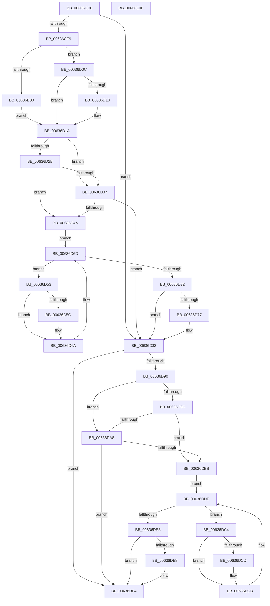

# DifMmUnlockPagesWrapper

- RVA: `0x00636CC0`–`0x00636E10` (길이 `336` bytes)
- VA: `0x0000000140636CC0`
- 실행 섹션: `.text`
- PDB 이름 있음: `예`; PDB Function 태그: `아니요`
- unwind 정보 RVA: `0x0005D7BC`
- 디코드: `90`개 명령, `336/336` bytes 표시
- 미해석 바이트: `0` (있으면 어셈블리에 `.byte`로 보존)

> 이 문서는 커널 이미지의 기계어와 PDB 기호를 분석해 생성했습니다. 4번과 5번은 함수 원형과 자료형을 바이너리 사용 방식에서 추정한 C 해석이며 원본 소스 복구 결과는 아닙니다.

## 1. Dependencies

- 직접 호출 지점: **9**; 고유 호출 대상: **6**
- 직접 호출자로 확인된 함수: **0**
- RIP 상대 이미지 참조: **3**

### Outgoing calls
- `0x00636CE8` → [DifGetAPIThunkContextById](../49/DifGetAPIThunkContextById_function_00495A34.md) (function, `0x00495A34`)
- `0x00636D10` → [DifGetReturnAddressForWrappers](../4D/DifGetReturnAddressForWrappers_function_004D3C08.md) (function, `0x004D3C08`)
- `0x00636D3E` → [ExAcquireRundownProtection](../21/ExAcquireRundownProtection_function_00216620.md) (function, `0x00216620`)
- `0x00636D65` → [guard_dispatch_icall](../6B/guard_dispatch_icall_function_006BAAD0.md) (function, `0x006BAAD0`)
- `0x00636D7E` → [ExReleaseRundownProtection](../34/ExReleaseRundownProtection_function_00349E80.md) (function, `0x00349E80`)
- `0x00636D86` → [MmUnlockPages](../29/MmUnlockPages_function_0029EEE0.md) (function, `0x0029EEE0`)
- `0x00636DAF` → [ExAcquireRundownProtection](../21/ExAcquireRundownProtection_function_00216620.md) (function, `0x00216620`)
- `0x00636DD6` → [guard_dispatch_icall](../6B/guard_dispatch_icall_function_006BAAD0.md) (function, `0x006BAAD0`)
- `0x00636DEF` → [ExReleaseRundownProtection](../34/ExReleaseRundownProtection_function_00349E80.md) (function, `0x00349E80`)

### Direct callers
- 이 함수 시작 RVA로 연결되는 직접 call은 확인되지 않았습니다. 간접 호출은 완전히 역산할 수 없습니다.

### Static image references
- `0x00636D22` → RVA `0x00F048B8` (`.data`; read)
- `0x00636D2B` → RVA `0x00F04980` (`.data`; read)
- `0x00636D37` → RVA `0x00F03E80` (`.data`; read)

## 2. Other-region calls and transfers

- 다른 실행 섹션으로 향하는 call: **0**
- 별도 외부 분기/꼬리 이동을 확인하지 못했습니다.

## 3. Assembly (complete function range)

```asm
00636CC0  48 8B C4                        mov rax, rsp
00636CC3  48 89 58 08                     mov qword ptr [rax + 8], rbx
00636CC7  48 89 68 10                     mov qword ptr [rax + 0x10], rbp
00636CCB  48 89 70 18                     mov qword ptr [rax + 0x18], rsi
00636CCF  48 89 78 20                     mov qword ptr [rax + 0x20], rdi
00636CD3  41 56                           push r14
00636CD5  48 83 EC 30                     sub rsp, 0x30
00636CD9  48 8B E9                        mov rbp, rcx
00636CDC  0F 57 C0                        xorps xmm0, xmm0
00636CDF  B9 D4 00 00 00                  mov ecx, 0xd4
00636CE4  0F 11 40 E8                     movups xmmword ptr [rax - 0x18], xmm0
00636CE8  E8 47 ED E5 FF                  call 0x140495a34
00636CED  48 8B F8                        mov rdi, rax
00636CF0  48 85 C0                        test rax, rax
00636CF3  0F 84 8A 00 00 00               je 0x140636d83
00636CF9  8B 40 0C                        mov eax, dword ptr [rax + 0xc]
00636CFC  A8 18                           test al, 0x18
00636CFE  74 0C                           je 0x140636d0c
00636D00  48 8B 4C 24 38                  mov rcx, qword ptr [rsp + 0x38]
00636D05  48 89 4C 24 20                  mov qword ptr [rsp + 0x20], rcx
00636D0A  EB 0E                           jmp 0x140636d1a
00636D0C  A8 04                           test al, 4
00636D0E  74 0A                           je 0x140636d1a
00636D10  E8 F3 CE E9 FF                  call 0x1404d3c08
00636D15  48 89 44 24 20                  mov qword ptr [rsp + 0x20], rax
00636D1A  40 32 F6                        xor sil, sil
00636D1D  48 89 6C 24 28                  mov qword ptr [rsp + 0x28], rbp
00636D22  40 38 35 8F DB 8C 00            cmp byte ptr [rip + 0x8cdb8f], sil
00636D29  75 0C                           jne 0x140636d37
00636D2B  F7 05 4B DC 8C 00 00 08 00 00   test dword ptr [rip + 0x8cdc4b], 0x800
00636D35  74 13                           je 0x140636d4a
00636D37  48 8D 0D 42 D1 8C 00            lea rcx, [rip + 0x8cd142]
00636D3E  E8 DD F8 BD FF                  call 0x140216620
00636D43  40 8A F0                        mov sil, al
00636D46  84 C0                           test al, al
00636D48  74 39                           je 0x140636d83
00636D4A  4C 8D 77 20                     lea r14, [rdi + 0x20]
00636D4E  49 8B 1E                        mov rbx, qword ptr [r14]
00636D51  EB 1A                           jmp 0x140636d6d
00636D53  48 8D 43 F0                     lea rax, [rbx - 0x10]
00636D57  48 85 C0                        test rax, rax
00636D5A  74 0E                           je 0x140636d6a
00636D5C  48 8B 40 08                     mov rax, qword ptr [rax + 8]
00636D60  48 8D 4C 24 20                  lea rcx, [rsp + 0x20]
00636D65  E8 66 3D 08 00                  call 0x1406baad0
00636D6A  48 8B 1B                        mov rbx, qword ptr [rbx]
00636D6D  49 3B DE                        cmp rbx, r14
00636D70  75 E1                           jne 0x140636d53
00636D72  40 84 F6                        test sil, sil
00636D75  74 0C                           je 0x140636d83
00636D77  48 8D 0D 02 D1 8C 00            lea rcx, [rip + 0x8cd102]
00636D7E  E8 FD 30 D1 FF                  call 0x140349e80
00636D83  48 8B CD                        mov rcx, rbp
00636D86  E8 55 81 C6 FF                  call 0x14029eee0
00636D8B  48 85 FF                        test rdi, rdi
00636D8E  74 64                           je 0x140636df4
00636D90  40 32 F6                        xor sil, sil
00636D93  40 38 35 1E DB 8C 00            cmp byte ptr [rip + 0x8cdb1e], sil
00636D9A  75 0C                           jne 0x140636da8
00636D9C  F7 05 DA DB 8C 00 00 08 00 00   test dword ptr [rip + 0x8cdbda], 0x800
00636DA6  74 13                           je 0x140636dbb
00636DA8  48 8D 0D D1 D0 8C 00            lea rcx, [rip + 0x8cd0d1]
00636DAF  E8 6C F8 BD FF                  call 0x140216620
00636DB4  40 8A F0                        mov sil, al
00636DB7  84 C0                           test al, al
00636DB9  74 39                           je 0x140636df4
00636DBB  48 83 C7 30                     add rdi, 0x30
00636DBF  48 8B 1F                        mov rbx, qword ptr [rdi]
00636DC2  EB 1A                           jmp 0x140636dde
00636DC4  48 8D 43 F0                     lea rax, [rbx - 0x10]
00636DC8  48 85 C0                        test rax, rax
00636DCB  74 0E                           je 0x140636ddb
00636DCD  48 8B 40 08                     mov rax, qword ptr [rax + 8]
00636DD1  48 8D 4C 24 20                  lea rcx, [rsp + 0x20]
00636DD6  E8 F5 3C 08 00                  call 0x1406baad0
00636DDB  48 8B 1B                        mov rbx, qword ptr [rbx]
00636DDE  48 3B DF                        cmp rbx, rdi
00636DE1  75 E1                           jne 0x140636dc4
00636DE3  40 84 F6                        test sil, sil
00636DE6  74 0C                           je 0x140636df4
00636DE8  48 8D 0D 91 D0 8C 00            lea rcx, [rip + 0x8cd091]
00636DEF  E8 8C 30 D1 FF                  call 0x140349e80
00636DF4  48 8B 5C 24 40                  mov rbx, qword ptr [rsp + 0x40]
00636DF9  48 8B 6C 24 48                  mov rbp, qword ptr [rsp + 0x48]
00636DFE  48 8B 74 24 50                  mov rsi, qword ptr [rsp + 0x50]
00636E03  48 8B 7C 24 58                  mov rdi, qword ptr [rsp + 0x58]
00636E08  48 83 C4 30                     add rsp, 0x30
00636E0C  41 5E                           pop r14
00636E0E  C3                              ret
00636E0F  CC                              int3
```

## 4. C-style interpretation (structured pseudocode)

```c
__int64 __fastcall DifMmUnlockPagesWrapper(__int64 a1)
{
    __int64 result;
    __int64 v_rdi;
    __int64 v_rsi;
    __int64 v_rsp;
    unsigned __int64 v_stack_m10;
    unsigned __int64 v_stack_m18;
    unsigned __int64 v_stack_p0;
    unsigned __int64 v_stack_p10;
    unsigned __int64 v_stack_p18;
    unsigned __int64 v_stack_p20;
    unsigned __int64 v_stack_p8;

    *(unsigned __int64 *)(v_rsp + 8) = v_rbx;
    *(unsigned __int64 *)(v_rsp + 16) = v_rbp;
    *(unsigned __int64 *)(v_rsp + 24) = v_rsi;
    *(unsigned __int64 *)(v_rsp + 32) = v_rdi;
    v_rsp = (v_rsp) - (48);
    *(unsigned __int64 *)(v_rsp - 24) = v_xmm0;
    result = DifGetAPIThunkContextById(212, a2, a3, a4);
    if (result == 0) goto loc_00636D83;
    if ((((unsigned __int8)((unsigned int)(*(unsigned int *)(result + 12)))) & (24)) == 0) goto loc_00636D0C;
    v_stack_m18 = v_stack_p0;
    goto loc_00636D1A;
loc_00636D0C:
    result = (unsigned int)(*(unsigned int *)(result + 12));
    if ((((unsigned __int8)((unsigned int)(*(unsigned int *)(result + 12)))) & (4)) != 0) {
        result = DifGetReturnAddressForWrappers(v_stack_p0, a2, a3, a4);
        v_stack_m18 = result;
    }
    v_rsi = 0;
    v_stack_m10 = a1;
    if ((*(unsigned __int8 *)(v_rip + 9231247)) != 0) goto loc_00636D37;
    if (((*(unsigned int *)(v_rip + 9231435)) & (0x800ULL)) == 0) goto loc_00636D4A;
loc_00636D37:
    result = ExAcquireRundownProtection(v_rip + 9228610, a2, a3, a4);
    if ((unsigned __int8)(result) == 0) goto loc_00636D83;
loc_00636D4A:
    goto loc_00636D6D;
loc_00636D53:
    result = *(unsigned __int64 *)(result + 32) - 16;
    if (*(unsigned __int64 *)(result + 32) - 16 != 0) {
        result = *(unsigned __int64 *)(*(unsigned __int64 *)(result + 32) - 16 + 8);
        a1 = v_stack_m18;
        result = guard_dispatch_icall(a1, a2, a3, a4);
    }
loc_00636D6D:
    if ((*(unsigned __int64 *)(*(unsigned __int64 *)(result + 32))) != (result + 32)) goto loc_00636D53;
    if ((unsigned __int8)((unsigned __int8)(result)) != 0) {
        a1 = v_rip + 9228546;
        result = ExReleaseRundownProtection(a1, a2, a3, a4);
    }
    result = MmUnlockPages(a1, a2, a3, a4);
    if (result == 0) goto loc_00636DF4;
    v_rsi = 0;
    if ((*(unsigned __int8 *)(v_rip + 9231134)) != 0) goto loc_00636DA8;
    if (((*(unsigned int *)(v_rip + 9231322)) & (0x800ULL)) == 0) goto loc_00636DBB;
loc_00636DA8:
    result = ExAcquireRundownProtection(v_rip + 9228497, a2, a3, a4);
    if ((unsigned __int8)(result) == 0) goto loc_00636DF4;
loc_00636DBB:
    v_rdi = (result) + (48);
    goto loc_00636DDE;
loc_00636DC4:
    result = *(unsigned __int64 *)(v_rdi) - 16;
    if (*(unsigned __int64 *)(v_rdi) - 16 != 0) {
        result = *(unsigned __int64 *)(*(unsigned __int64 *)(v_rdi) - 16 + 8);
        a1 = v_stack_m18;
        result = guard_dispatch_icall(a1, a2, a3, a4);
    }
loc_00636DDE:
    if ((*(unsigned __int64 *)(*(unsigned __int64 *)(v_rdi))) != v_rdi) goto loc_00636DC4;
    if ((unsigned __int8)((unsigned __int8)(result)) != 0) {
        a1 = v_rip + 9228433;
        result = ExReleaseRundownProtection(a1, a2, a3, a4);
    }
    v_rsp = (v_rsp) + (48);
    return result;
}
```

## 5. (Beta) C Style

```c
int64_t DifMmUnlockPagesWrapper(int64_t Arg1)
{
    int64_t result;
    int64_t local_rdi;
    int64_t local_rsi;
    int64_t local_rsp;
    uint64_t v_stack_m10;
    uint64_t v_stack_m18;
    uint64_t v_stack_p0;
    uint64_t v_stack_p10;
    uint64_t v_stack_p18;
    uint64_t v_stack_p20;
    uint64_t v_stack_p8;

    *(uint64_t *)(local_rsp + 0x8) = local_rbx;
    *(uint64_t *)(local_rsp + 0x10) = local_rbp;
    *(uint64_t *)(local_rsp + 0x18) = local_rsi;
    *(uint64_t *)(local_rsp + 0x20) = local_rdi;
    local_rsp = (local_rsp) - (48);
    *(uint64_t *)(local_rsp - 0x18) = v_xmm0;
    result = DifGetAPIThunkContextById(212, a2, a3, a4);
    if (result == 0) goto loc_00636D83;
    if ((((uint8_t)((uint32_t)(*(uint32_t *)(result + 0xC)))) & (24)) == 0) goto loc_00636D0C;
    v_stack_m18 = v_stack_p0;
    goto loc_00636D1A;
loc_00636D0C:
    result = (uint32_t)(*(uint32_t *)(result + 0xC));
    if ((((uint8_t)((uint32_t)(*(uint32_t *)(result + 0xC)))) & (4)) != 0) {
        result = DifGetReturnAddressForWrappers(v_stack_p0, a2, a3, a4);
        v_stack_m18 = result;
    }
    local_rsi = 0;
    v_stack_m10 = Arg1;
    if ((*(uint8_t *)(v_rip + 0x8CDB8F)) != 0) goto loc_00636D37;
    if (((*(uint32_t *)(v_rip + 0x8CDC4B)) & (0x800ULL)) == 0) goto loc_00636D4A;
loc_00636D37:
    result = ExAcquireRundownProtection(v_rip + 9228610, a2, a3, a4);
    if ((uint8_t)(result) == 0) goto loc_00636D83;
loc_00636D4A:
    goto loc_00636D6D;
loc_00636D53:
    result = *(uint64_t *)(result + 0x20) - 16;
    if (*(uint64_t *)(result + 0x20) - 16 != 0) {
        result = *(uint64_t *)(*(uint64_t *)(result + 0x20) - 0x10 + 0x8);
        Arg1 = v_stack_m18;
        result = guard_dispatch_icall(Arg1, a2, a3, a4);
    }
loc_00636D6D:
    if ((*(uint64_t *)(*(uint64_t *)(result + 0x20))) != (result + 32)) goto loc_00636D53;
    if ((uint8_t)((uint8_t)(result)) != 0) {
        Arg1 = v_rip + 9228546;
        result = ExReleaseRundownProtection(Arg1, a2, a3, a4);
    }
    result = MmUnlockPages(Arg1, a2, a3, a4);
    if (result == 0) goto loc_00636DF4;
    local_rsi = 0;
    if ((*(uint8_t *)(v_rip + 0x8CDB1E)) != 0) goto loc_00636DA8;
    if (((*(uint32_t *)(v_rip + 0x8CDBDA)) & (0x800ULL)) == 0) goto loc_00636DBB;
loc_00636DA8:
    result = ExAcquireRundownProtection(v_rip + 9228497, a2, a3, a4);
    if ((uint8_t)(result) == 0) goto loc_00636DF4;
loc_00636DBB:
    local_rdi = (result) + (48);
    goto loc_00636DDE;
loc_00636DC4:
    result = *(uint64_t *)(local_rdi) - 16;
    if (*(uint64_t *)(local_rdi) - 16 != 0) {
        result = *(uint64_t *)(*(uint64_t *)(local_rdi) - 0x10 + 0x8);
        Arg1 = v_stack_m18;
        result = guard_dispatch_icall(Arg1, a2, a3, a4);
    }
loc_00636DDE:
    if ((*(uint64_t *)(*(uint64_t *)(local_rdi))) != local_rdi) goto loc_00636DC4;
    if ((uint8_t)((uint8_t)(result)) != 0) {
        Arg1 = v_rip + 9228433;
        result = ExReleaseRundownProtection(Arg1, a2, a3, a4);
    }
    local_rsp = (local_rsp) + (48);
    return result;
}
```

## 6. Execution-region graph

[열기: 2D/3D 그래프와 함수 탐색 컨트롤 패널](../../../control-panel.html?section=text&rva=0x00636CC0&view=graph)

- 2D 그래프는 위에서 아래로 흐르고, 3D 그래프는 빈 공간을 드래그해 회전합니다. Shift+드래그는 이동, 휠은 확대·축소, 함수 노드 선택은 대상 보고서 이동입니다.

### Static fallback


