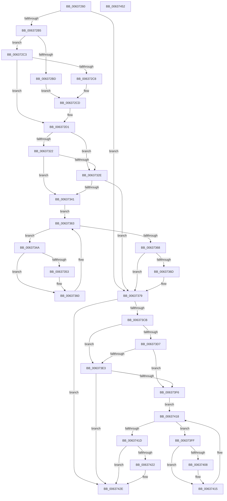

# DifNtCreateFileWrapper

- RVA: `0x00637260`–`0x00637453` (길이 `499` bytes)
- VA: `0x0000000140637260`
- 실행 섹션: `.text`
- PDB 이름 있음: `예`; PDB Function 태그: `아니요`
- unwind 정보 RVA: `0x000D2D24`
- 디코드: `139`개 명령, `499/499` bytes 표시
- 미해석 바이트: `0` (있으면 어셈블리에 `.byte`로 보존)

> 이 문서는 커널 이미지의 기계어와 PDB 기호를 분석해 생성했습니다. 4번과 5번은 함수 원형과 자료형을 바이너리 사용 방식에서 추정한 C 해석이며 원본 소스 복구 결과는 아닙니다.

## 1. Dependencies

- 직접 호출 지점: **10**; 고유 호출 대상: **7**
- 직접 호출자로 확인된 함수: **0**
- RIP 상대 이미지 참조: **3**

### Outgoing calls
- `0x0063729A` → [memset](../6C/memset_function_006C6C40.md) (function, `0x006C6C40`)
- `0x006372A4` → [DifGetAPIThunkContextById](../49/DifGetAPIThunkContextById_function_00495A34.md) (function, `0x00495A34`)
- `0x006372C8` → [DifGetReturnAddressForWrappers](../4D/DifGetReturnAddressForWrappers_function_004D3C08.md) (function, `0x004D3C08`)
- `0x00637335` → [ExAcquireRundownProtection](../21/ExAcquireRundownProtection_function_00216620.md) (function, `0x00216620`)
- `0x0063735B` → [guard_dispatch_icall](../6B/guard_dispatch_icall_function_006BAAD0.md) (function, `0x006BAAD0`)
- `0x00637374` → [ExReleaseRundownProtection](../34/ExReleaseRundownProtection_function_00349E80.md) (function, `0x00349E80`)
- `0x006373BE` → [NtCreateFile](../../page/8A/NtCreateFile_function_008AB210.md) (function, `0x008AB210`)
- `0x006373EA` → [ExAcquireRundownProtection](../21/ExAcquireRundownProtection_function_00216620.md) (function, `0x00216620`)
- `0x00637410` → [guard_dispatch_icall](../6B/guard_dispatch_icall_function_006BAAD0.md) (function, `0x006BAAD0`)
- `0x00637429` → [ExReleaseRundownProtection](../34/ExReleaseRundownProtection_function_00349E80.md) (function, `0x00349E80`)

### Direct callers
- 이 함수 시작 RVA로 연결되는 직접 call은 확인되지 않았습니다. 간접 호출은 완전히 역산할 수 없습니다.

### Static image references
- `0x006372D8` → RVA `0x00F048B8` (`.data`; read)
- `0x00637322` → RVA `0x00F04980` (`.data`; read)
- `0x0063732E` → RVA `0x00F03E80` (`.data`; read)

## 2. Other-region calls and transfers

- 다른 실행 섹션으로 향하는 call: **1**
  - `0x006373BE` → [NtCreateFile](../../page/8A/NtCreateFile_function_008AB210.md) (`.text` → `PAGE`)
- 별도 외부 분기/꼬리 이동을 확인하지 못했습니다.

## 3. Assembly (complete function range)

```asm
00637260  48 8B C4                        mov rax, rsp
00637263  48 89 58 10                     mov qword ptr [rax + 0x10], rbx
00637267  48 89 70 18                     mov qword ptr [rax + 0x18], rsi
0063726B  48 89 78 20                     mov qword ptr [rax + 0x20], rdi
0063726F  48 89 48 08                     mov qword ptr [rax + 8], rcx
00637273  55                              push rbp
00637274  41 54                           push r12
00637276  41 55                           push r13
00637278  41 56                           push r14
0063727A  41 57                           push r15
0063727C  48 8D 68 D1                     lea rbp, [rax - 0x2f]
00637280  48 81 EC C0 00 00 00            sub rsp, 0xc0
00637287  44 8B EA                        mov r13d, edx
0063728A  48 8D 4D A7                     lea rcx, [rbp - 0x59]
0063728E  33 D2                           xor edx, edx
00637290  4D 8B E0                        mov r12, r8
00637293  4D 8B F9                        mov r15, r9
00637296  44 8D 42 58                     lea r8d, [rdx + 0x58]
0063729A  E8 A1 F9 08 00                  call 0x1406c6c40
0063729F  B9 D0 00 00 00                  mov ecx, 0xd0
006372A4  E8 8B E7 E5 FF                  call 0x140495a34
006372A9  48 8B F0                        mov rsi, rax
006372AC  48 85 C0                        test rax, rax
006372AF  0F 84 C4 00 00 00               je 0x140637379
006372B5  8B 48 0C                        mov ecx, dword ptr [rax + 0xc]
006372B8  F6 C1 18                        test cl, 0x18
006372BB  74 06                           je 0x1406372c3
006372BD  48 8B 45 2F                     mov rax, qword ptr [rbp + 0x2f]
006372C1  EB 0A                           jmp 0x1406372cd
006372C3  F6 C1 04                        test cl, 4
006372C6  74 09                           je 0x1406372d1
006372C8  E8 3B C9 E9 FF                  call 0x1404d3c08
006372CD  48 89 45 A7                     mov qword ptr [rbp - 0x59], rax
006372D1  48 8B 45 37                     mov rax, qword ptr [rbp + 0x37]
006372D5  45 32 F6                        xor r14b, r14b
006372D8  44 38 35 D9 D5 8C 00            cmp byte ptr [rip + 0x8cd5d9], r14b
006372DF  48 89 45 EF                     mov qword ptr [rbp - 0x11], rax
006372E3  48 8B 45 57                     mov rax, qword ptr [rbp + 0x57]
006372E7  48 89 45 CF                     mov qword ptr [rbp - 0x31], rax
006372EB  8B 45 5F                        mov eax, dword ptr [rbp + 0x5f]
006372EE  89 45 CB                        mov dword ptr [rbp - 0x35], eax
006372F1  8B 45 67                        mov eax, dword ptr [rbp + 0x67]
006372F4  89 45 C7                        mov dword ptr [rbp - 0x39], eax
006372F7  8B 45 6F                        mov eax, dword ptr [rbp + 0x6f]
006372FA  89 45 C3                        mov dword ptr [rbp - 0x3d], eax
006372FD  8B 45 77                        mov eax, dword ptr [rbp + 0x77]
00637300  89 45 BF                        mov dword ptr [rbp - 0x41], eax
00637303  48 8B 45 7F                     mov rax, qword ptr [rbp + 0x7f]
00637307  48 89 45 B7                     mov qword ptr [rbp - 0x49], rax
0063730B  8B 85 87 00 00 00               mov eax, dword ptr [rbp + 0x87]
00637311  89 45 AF                        mov dword ptr [rbp - 0x51], eax
00637314  44 89 6D E7                     mov dword ptr [rbp - 0x19], r13d
00637318  4C 89 65 DF                     mov qword ptr [rbp - 0x21], r12
0063731C  4C 89 7D D7                     mov qword ptr [rbp - 0x29], r15
00637320  75 0C                           jne 0x14063732e
00637322  F7 05 54 D6 8C 00 00 08 00 00   test dword ptr [rip + 0x8cd654], 0x800
0063732C  74 13                           je 0x140637341
0063732E  48 8D 0D 4B CB 8C 00            lea rcx, [rip + 0x8ccb4b]
00637335  E8 E6 F2 BD FF                  call 0x140216620
0063733A  44 8A F0                        mov r14b, al
0063733D  84 C0                           test al, al
0063733F  74 38                           je 0x140637379
00637341  48 8D 7E 20                     lea rdi, [rsi + 0x20]
00637345  48 8B 1F                        mov rbx, qword ptr [rdi]
00637348  EB 19                           jmp 0x140637363
0063734A  48 8D 43 F0                     lea rax, [rbx - 0x10]
0063734E  48 85 C0                        test rax, rax
00637351  74 0D                           je 0x140637360
00637353  48 8B 40 08                     mov rax, qword ptr [rax + 8]
00637357  48 8D 4D A7                     lea rcx, [rbp - 0x59]
0063735B  E8 70 37 08 00                  call 0x1406baad0
00637360  48 8B 1B                        mov rbx, qword ptr [rbx]
00637363  48 3B DF                        cmp rbx, rdi
00637366  75 E2                           jne 0x14063734a
00637368  45 84 F6                        test r14b, r14b
0063736B  74 0C                           je 0x140637379
0063736D  48 8D 0D 0C CB 8C 00            lea rcx, [rip + 0x8ccb0c]
00637374  E8 07 2B D1 FF                  call 0x140349e80
00637379  8B 85 87 00 00 00               mov eax, dword ptr [rbp + 0x87]
0063737F  4D 8B CF                        mov r9, r15
00637382  48 8B 4D 37                     mov rcx, qword ptr [rbp + 0x37]
00637386  4D 8B C4                        mov r8, r12
00637389  89 44 24 50                     mov dword ptr [rsp + 0x50], eax
0063738D  41 8B D5                        mov edx, r13d
00637390  48 8B 45 7F                     mov rax, qword ptr [rbp + 0x7f]
00637394  48 89 44 24 48                  mov qword ptr [rsp + 0x48], rax
00637399  8B 45 77                        mov eax, dword ptr [rbp + 0x77]
0063739C  89 44 24 40                     mov dword ptr [rsp + 0x40], eax
006373A0  8B 45 6F                        mov eax, dword ptr [rbp + 0x6f]
006373A3  89 44 24 38                     mov dword ptr [rsp + 0x38], eax
006373A7  8B 45 67                        mov eax, dword ptr [rbp + 0x67]
006373AA  89 44 24 30                     mov dword ptr [rsp + 0x30], eax
006373AE  8B 45 5F                        mov eax, dword ptr [rbp + 0x5f]
006373B1  89 44 24 28                     mov dword ptr [rsp + 0x28], eax
006373B5  48 8B 45 57                     mov rax, qword ptr [rbp + 0x57]
006373B9  48 89 44 24 20                  mov qword ptr [rsp + 0x20], rax
006373BE  E8 4D 3E 27 00                  call 0x1408ab210
006373C3  89 45 F7                        mov dword ptr [rbp - 9], eax
006373C6  48 85 F6                        test rsi, rsi
006373C9  74 63                           je 0x14063742e
006373CB  40 32 FF                        xor dil, dil
006373CE  40 38 3D E3 D4 8C 00            cmp byte ptr [rip + 0x8cd4e3], dil
006373D5  75 0C                           jne 0x1406373e3
006373D7  F7 05 9F D5 8C 00 00 08 00 00   test dword ptr [rip + 0x8cd59f], 0x800
006373E1  74 13                           je 0x1406373f6
006373E3  48 8D 0D 96 CA 8C 00            lea rcx, [rip + 0x8cca96]
006373EA  E8 31 F2 BD FF                  call 0x140216620
006373EF  40 8A F8                        mov dil, al
006373F2  84 C0                           test al, al
006373F4  74 38                           je 0x14063742e
006373F6  48 83 C6 30                     add rsi, 0x30
006373FA  48 8B 1E                        mov rbx, qword ptr [rsi]
006373FD  EB 19                           jmp 0x140637418
006373FF  48 8D 43 F0                     lea rax, [rbx - 0x10]
00637403  48 85 C0                        test rax, rax
00637406  74 0D                           je 0x140637415
00637408  48 8B 40 08                     mov rax, qword ptr [rax + 8]
0063740C  48 8D 4D A7                     lea rcx, [rbp - 0x59]
00637410  E8 BB 36 08 00                  call 0x1406baad0
00637415  48 8B 1B                        mov rbx, qword ptr [rbx]
00637418  48 3B DE                        cmp rbx, rsi
0063741B  75 E2                           jne 0x1406373ff
0063741D  40 84 FF                        test dil, dil
00637420  74 0C                           je 0x14063742e
00637422  48 8D 0D 57 CA 8C 00            lea rcx, [rip + 0x8cca57]
00637429  E8 52 2A D1 FF                  call 0x140349e80
0063742E  8B 45 F7                        mov eax, dword ptr [rbp - 9]
00637431  4C 8D 9C 24 C0 00 00 00         lea r11, [rsp + 0xc0]
00637439  49 8B 5B 38                     mov rbx, qword ptr [r11 + 0x38]
0063743D  49 8B 73 40                     mov rsi, qword ptr [r11 + 0x40]
00637441  49 8B 7B 48                     mov rdi, qword ptr [r11 + 0x48]
00637445  49 8B E3                        mov rsp, r11
00637448  41 5F                           pop r15
0063744A  41 5E                           pop r14
0063744C  41 5D                           pop r13
0063744E  41 5C                           pop r12
00637450  5D                              pop rbp
00637451  C3                              ret
00637452  CC                              int3
```

## 4. C-style interpretation (structured pseudocode)

```c
__int64 __fastcall DifNtCreateFileWrapper(__int64 a1, int a2, __int64 a3, __int64 a4)
{
    __int64 result;
    __int64 v_r14;
    __int64 v_rdi;
    __int64 v_rsi;
    __int64 v_rsp;
    unsigned __int64 v_stack_m28;
    unsigned int v_stack_m98;
    unsigned __int64 v_stack_mA0;
    unsigned int v_stack_mA8;
    unsigned int v_stack_mB0;
    unsigned int v_stack_mB8;
    unsigned int v_stack_mC0;
    unsigned __int64 v_stack_mC8;

    *(unsigned __int64 *)(v_rsp + 16) = v_rbx;
    *(unsigned __int64 *)(v_rsp + 24) = v_rsi;
    *(unsigned __int64 *)(v_rsp + 32) = v_rdi;
    *(unsigned __int64 *)(v_rsp + 8) = a1;
    v_rsp = (v_rsp) - (192);
    a2 = 0;
    result = memset(v_rsp - 47 - 89, a2, a2 + 88, a4);
    result = DifGetAPIThunkContextById(208, a2, a2 + 88, a4);
    if (result == 0) goto loc_00637379;
    if ((((unsigned __int8)((unsigned int)(*(unsigned int *)(result + 12)))) & (24)) == 0) goto loc_006372C3;
    goto loc_006372CD;
loc_006372C3:
    if ((((unsigned __int8)((unsigned int)(*(unsigned int *)(result + 12)))) & (4)) == 0) goto loc_006372D1;
    result = DifGetReturnAddressForWrappers((unsigned int)(*(unsigned int *)(result + 12)), a2, a2 + 88, a4);
loc_006372CD:
    *(unsigned __int64 *)(v_rsp - 47 - 89) = result;
loc_006372D1:
    v_r14 = 0;
    *(unsigned __int64 *)(v_rsp - 47 - 17) = *(unsigned __int64 *)(v_rsp - 47 + 55);
    *(unsigned __int64 *)(v_rsp - 47 - 49) = *(unsigned __int64 *)(v_rsp - 47 + 87);
    *(unsigned int *)(v_rsp - 47 - 53) = (unsigned int)((unsigned int)(*(unsigned int *)(v_rsp - 47 + 95)));
    *(unsigned int *)(v_rsp - 47 - 57) = (unsigned int)((unsigned int)(*(unsigned int *)(v_rsp - 47 + 103)));
    *(unsigned int *)(v_rsp - 47 - 61) = (unsigned int)((unsigned int)(*(unsigned int *)(v_rsp - 47 + 111)));
    *(unsigned int *)(v_rsp - 47 - 65) = (unsigned int)((unsigned int)(*(unsigned int *)(v_rsp - 47 + 119)));
    *(unsigned __int64 *)(v_rsp - 47 - 73) = *(unsigned __int64 *)(v_rsp - 47 + 127);
    *(unsigned int *)(v_rsp - 47 - 81) = (unsigned int)((unsigned int)(*(unsigned int *)(v_rsp - 47 + 135)));
    *(unsigned int *)(v_rsp - 47 - 25) = (unsigned int)((unsigned int)(a2));
    *(unsigned __int64 *)(v_rsp - 47 - 33) = a3;
    *(unsigned __int64 *)(v_rsp - 47 - 41) = a4;
    if ((*(unsigned __int8 *)(v_rip + 9229785)) != 0) goto loc_0063732E;
    if (((*(unsigned int *)(v_rip + 9229908)) & (0x800ULL)) == 0) goto loc_00637341;
loc_0063732E:
    result = ExAcquireRundownProtection(v_rip + 9227083, a2, a2 + 88, a4);
    if ((unsigned __int8)(result) == 0) goto loc_00637379;
loc_00637341:
    goto loc_00637363;
loc_0063734A:
    result = *(unsigned __int64 *)(result + 32) - 16;
    if (*(unsigned __int64 *)(result + 32) - 16 != 0) {
        result = *(unsigned __int64 *)(*(unsigned __int64 *)(result + 32) - 16 + 8);
        a1 = v_rsp - 47 - 89;
        result = guard_dispatch_icall(a1, a2, a2 + 88, a4);
    }
loc_00637363:
    if ((*(unsigned __int64 *)(*(unsigned __int64 *)(result + 32))) != (result + 32)) goto loc_0063734A;
    if ((unsigned __int8)((unsigned __int8)(result)) != 0) {
        a1 = v_rip + 9227020;
        result = ExReleaseRundownProtection(a1, a2, a2 + 88, a4);
    }
    v_stack_m98 = (unsigned int)((unsigned int)(*(unsigned int *)(v_rsp - 47 + 135)));
    v_stack_mA0 = *(unsigned __int64 *)(v_rsp - 47 + 127);
    v_stack_mA8 = (unsigned int)((unsigned int)(*(unsigned int *)(v_rsp - 47 + 119)));
    v_stack_mB0 = (unsigned int)((unsigned int)(*(unsigned int *)(v_rsp - 47 + 111)));
    v_stack_mB8 = (unsigned int)((unsigned int)(*(unsigned int *)(v_rsp - 47 + 103)));
    v_stack_mC0 = (unsigned int)((unsigned int)(*(unsigned int *)(v_rsp - 47 + 95)));
    v_stack_mC8 = *(unsigned __int64 *)(v_rsp - 47 + 87);
    result = NtCreateFile(*(unsigned __int64 *)(v_rsp - 47 + 55), (unsigned int)((unsigned int)((unsigned int)(a2))), a3, a4);
    *(unsigned int *)(v_rsp - 47 - 9) = (unsigned int)(result);
    if (result == 0) goto loc_0063742E;
    v_rdi = 0;
    if ((*(unsigned __int8 *)(v_rip + 9229539)) != 0) goto loc_006373E3;
    if (((*(unsigned int *)(v_rip + 9229727)) & (0x800ULL)) == 0) goto loc_006373F6;
loc_006373E3:
    result = ExAcquireRundownProtection(v_rip + 9226902, (unsigned int)((unsigned int)((unsigned int)(a2))), a3, a4);
    if ((unsigned __int8)(result) == 0) goto loc_0063742E;
loc_006373F6:
    v_rsi = (result) + (48);
    goto loc_00637418;
loc_006373FF:
    result = *(unsigned __int64 *)(v_rsi) - 16;
    if (*(unsigned __int64 *)(v_rsi) - 16 != 0) {
        result = *(unsigned __int64 *)(*(unsigned __int64 *)(v_rsi) - 16 + 8);
        a1 = v_rsp - 47 - 89;
        result = guard_dispatch_icall(a1, (unsigned int)((unsigned int)((unsigned int)(a2))), a3, a4);
    }
loc_00637418:
    if ((*(unsigned __int64 *)(*(unsigned __int64 *)(v_rsi))) != v_rsi) goto loc_006373FF;
    if ((unsigned __int8)((unsigned __int8)(result)) != 0) {
        a1 = v_rip + 9226839;
        result = ExReleaseRundownProtection(a1, (unsigned int)((unsigned int)((unsigned int)(a2))), a3, a4);
    }
    return (unsigned int)(*(unsigned int *)(v_rsp - 47 - 9));
}
```

## 5. (Beta) C Style

```c
int64_t DifNtCreateFileWrapper(int64_t Arg1, int32_t Arg2, int64_t Arg3, int64_t Arg4)
{
    int64_t result;
    int64_t local_r14;
    int64_t local_rdi;
    int64_t local_rsi;
    int64_t local_rsp;
    uint64_t v_stack_m28;
    uint32_t v_stack_m98;
    uint64_t v_stack_mA0;
    uint32_t v_stack_mA8;
    uint32_t v_stack_mB0;
    uint32_t v_stack_mB8;
    uint32_t v_stack_mC0;
    uint64_t v_stack_mC8;

    *(uint64_t *)(local_rsp + 0x10) = local_rbx;
    *(uint64_t *)(local_rsp + 0x18) = local_rsi;
    *(uint64_t *)(local_rsp + 0x20) = local_rdi;
    *(uint64_t *)(local_rsp + 0x8) = Arg1;
    local_rsp = (local_rsp) - (192);
    Arg2 = 0;
    result = memset(local_rsp - 47 - 89, Arg2, Arg2 + 88, Arg4);
    result = DifGetAPIThunkContextById(208, Arg2, Arg2 + 88, Arg4);
    if (result == 0) goto loc_00637379;
    if ((((uint8_t)((uint32_t)(*(uint32_t *)(result + 0xC)))) & (24)) == 0) goto loc_006372C3;
    goto loc_006372CD;
loc_006372C3:
    if ((((uint8_t)((uint32_t)(*(uint32_t *)(result + 0xC)))) & (4)) == 0) goto loc_006372D1;
    result = DifGetReturnAddressForWrappers((uint32_t)(*(uint32_t *)(result + 0xC)), Arg2, Arg2 + 88, Arg4);
loc_006372CD:
    *(uint64_t *)(local_rsp - 0x2F - 0x59) = result;
loc_006372D1:
    local_r14 = 0;
    *(uint64_t *)(local_rsp - 0x2F - 0x11) = *(uint64_t *)(local_rsp - 0x2F + 0x37);
    *(uint64_t *)(local_rsp - 0x2F - 0x31) = *(uint64_t *)(local_rsp - 0x2F + 0x57);
    *(uint32_t *)(local_rsp - 0x2F - 0x35) = (uint32_t)((uint32_t)(*(uint32_t *)(local_rsp - 0x2F + 0x5F)));
    *(uint32_t *)(local_rsp - 0x2F - 0x39) = (uint32_t)((uint32_t)(*(uint32_t *)(local_rsp - 0x2F + 0x67)));
    *(uint32_t *)(local_rsp - 0x2F - 0x3D) = (uint32_t)((uint32_t)(*(uint32_t *)(local_rsp - 0x2F + 0x6F)));
    *(uint32_t *)(local_rsp - 0x2F - 0x41) = (uint32_t)((uint32_t)(*(uint32_t *)(local_rsp - 0x2F + 0x77)));
    *(uint64_t *)(local_rsp - 0x2F - 0x49) = *(uint64_t *)(local_rsp - 0x2F + 0x7F);
    *(uint32_t *)(local_rsp - 0x2F - 0x51) = (uint32_t)((uint32_t)(*(uint32_t *)(local_rsp - 0x2F + 0x87)));
    *(uint32_t *)(local_rsp - 0x2F - 0x19) = (uint32_t)((uint32_t)(Arg2));
    *(uint64_t *)(local_rsp - 0x2F - 0x21) = Arg3;
    *(uint64_t *)(local_rsp - 0x2F - 0x29) = Arg4;
    if ((*(uint8_t *)(v_rip + 0x8CD5D9)) != 0) goto loc_0063732E;
    if (((*(uint32_t *)(v_rip + 0x8CD654)) & (0x800ULL)) == 0) goto loc_00637341;
loc_0063732E:
    result = ExAcquireRundownProtection(v_rip + 9227083, Arg2, Arg2 + 88, Arg4);
    if ((uint8_t)(result) == 0) goto loc_00637379;
loc_00637341:
    goto loc_00637363;
loc_0063734A:
    result = *(uint64_t *)(result + 0x20) - 16;
    if (*(uint64_t *)(result + 0x20) - 16 != 0) {
        result = *(uint64_t *)(*(uint64_t *)(result + 0x20) - 0x10 + 0x8);
        Arg1 = local_rsp - 47 - 89;
        result = guard_dispatch_icall(Arg1, Arg2, Arg2 + 88, Arg4);
    }
loc_00637363:
    if ((*(uint64_t *)(*(uint64_t *)(result + 0x20))) != (result + 32)) goto loc_0063734A;
    if ((uint8_t)((uint8_t)(result)) != 0) {
        Arg1 = v_rip + 9227020;
        result = ExReleaseRundownProtection(Arg1, Arg2, Arg2 + 88, Arg4);
    }
    v_stack_m98 = (uint32_t)((uint32_t)(*(uint32_t *)(local_rsp - 0x2F + 0x87)));
    v_stack_mA0 = *(uint64_t *)(local_rsp - 0x2F + 0x7F);
    v_stack_mA8 = (uint32_t)((uint32_t)(*(uint32_t *)(local_rsp - 0x2F + 0x77)));
    v_stack_mB0 = (uint32_t)((uint32_t)(*(uint32_t *)(local_rsp - 0x2F + 0x6F)));
    v_stack_mB8 = (uint32_t)((uint32_t)(*(uint32_t *)(local_rsp - 0x2F + 0x67)));
    v_stack_mC0 = (uint32_t)((uint32_t)(*(uint32_t *)(local_rsp - 0x2F + 0x5F)));
    v_stack_mC8 = *(uint64_t *)(local_rsp - 0x2F + 0x57);
    result = NtCreateFile(*(uint64_t *)(local_rsp - 0x2F + 0x37), (uint32_t)((uint32_t)((uint32_t)(Arg2))), Arg3, Arg4);
    *(uint32_t *)(local_rsp - 0x2F - 0x9) = (uint32_t)(result);
    if (result == 0) goto loc_0063742E;
    local_rdi = 0;
    if ((*(uint8_t *)(v_rip + 0x8CD4E3)) != 0) goto loc_006373E3;
    if (((*(uint32_t *)(v_rip + 0x8CD59F)) & (0x800ULL)) == 0) goto loc_006373F6;
loc_006373E3:
    result = ExAcquireRundownProtection(v_rip + 9226902, (uint32_t)((uint32_t)((uint32_t)(Arg2))), Arg3, Arg4);
    if ((uint8_t)(result) == 0) goto loc_0063742E;
loc_006373F6:
    local_rsi = (result) + (48);
    goto loc_00637418;
loc_006373FF:
    result = *(uint64_t *)(local_rsi) - 16;
    if (*(uint64_t *)(local_rsi) - 16 != 0) {
        result = *(uint64_t *)(*(uint64_t *)(local_rsi) - 0x10 + 0x8);
        Arg1 = local_rsp - 47 - 89;
        result = guard_dispatch_icall(Arg1, (uint32_t)((uint32_t)((uint32_t)(Arg2))), Arg3, Arg4);
    }
loc_00637418:
    if ((*(uint64_t *)(*(uint64_t *)(local_rsi))) != local_rsi) goto loc_006373FF;
    if ((uint8_t)((uint8_t)(result)) != 0) {
        Arg1 = v_rip + 9226839;
        result = ExReleaseRundownProtection(Arg1, (uint32_t)((uint32_t)((uint32_t)(Arg2))), Arg3, Arg4);
    }
    return (uint32_t)(*(uint32_t *)(local_rsp - 0x2F - 0x9));
}
```

## 6. Execution-region graph

[열기: 2D/3D 그래프와 함수 탐색 컨트롤 패널](../../../control-panel.html?section=text&rva=0x00637260&view=graph)

- 2D 그래프는 위에서 아래로 흐르고, 3D 그래프는 빈 공간을 드래그해 회전합니다. Shift+드래그는 이동, 휠은 확대·축소, 함수 노드 선택은 대상 보고서 이동입니다.

### Static fallback


