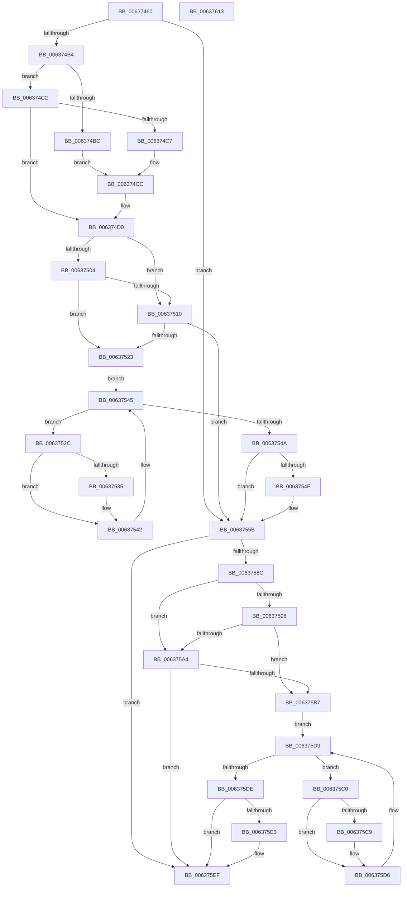

# DifNtCreateSectionWrapper

- RVA: `0x00637460`–`0x00637614` (길이 `436` bytes)
- VA: `0x0000000140637460`
- 실행 섹션: `.text`
- PDB 이름 있음: `예`; PDB Function 태그: `아니요`
- unwind 정보 RVA: `0x000BC530`
- 디코드: `123`개 명령, `436/436` bytes 표시
- 미해석 바이트: `0` (있으면 어셈블리에 `.byte`로 보존)

> 이 문서는 커널 이미지의 기계어와 PDB 기호를 분석해 생성했습니다. 4번과 5번은 함수 원형과 자료형을 바이너리 사용 방식에서 추정한 C 해석이며 원본 소스 복구 결과는 아닙니다.

## 1. Dependencies

- 직접 호출 지점: **10**; 고유 호출 대상: **7**
- 직접 호출자로 확인된 함수: **0**
- RIP 상대 이미지 참조: **3**

### Outgoing calls
- `0x00637499` → [memset](../6C/memset_function_006C6C40.md) (function, `0x006C6C40`)
- `0x006374A3` → [DifGetAPIThunkContextById](../49/DifGetAPIThunkContextById_function_00495A34.md) (function, `0x00495A34`)
- `0x006374C7` → [DifGetReturnAddressForWrappers](../4D/DifGetReturnAddressForWrappers_function_004D3C08.md) (function, `0x004D3C08`)
- `0x00637517` → [ExAcquireRundownProtection](../21/ExAcquireRundownProtection_function_00216620.md) (function, `0x00216620`)
- `0x0063753D` → [guard_dispatch_icall](../6B/guard_dispatch_icall_function_006BAAD0.md) (function, `0x006BAAD0`)
- `0x00637556` → [ExReleaseRundownProtection](../34/ExReleaseRundownProtection_function_00349E80.md) (function, `0x00349E80`)
- `0x0063757F` → [NtCreateSection](../../page/8A/NtCreateSection_function_008AA3D0.md) (function, `0x008AA3D0`)
- `0x006375AB` → [ExAcquireRundownProtection](../21/ExAcquireRundownProtection_function_00216620.md) (function, `0x00216620`)
- `0x006375D1` → [guard_dispatch_icall](../6B/guard_dispatch_icall_function_006BAAD0.md) (function, `0x006BAAD0`)
- `0x006375EA` → [ExReleaseRundownProtection](../34/ExReleaseRundownProtection_function_00349E80.md) (function, `0x00349E80`)

### Direct callers
- 이 함수 시작 RVA로 연결되는 직접 call은 확인되지 않았습니다. 간접 호출은 완전히 역산할 수 없습니다.

### Static image references
- `0x006374D7` → RVA `0x00F048B8` (`.data`; read)
- `0x00637504` → RVA `0x00F04980` (`.data`; read)
- `0x00637510` → RVA `0x00F03E80` (`.data`; read)

## 2. Other-region calls and transfers

- 다른 실행 섹션으로 향하는 call: **1**
  - `0x0063757F` → [NtCreateSection](../../page/8A/NtCreateSection_function_008AA3D0.md) (`.text` → `PAGE`)
- 별도 외부 분기/꼬리 이동을 확인하지 못했습니다.

## 3. Assembly (complete function range)

```asm
00637460  48 8B C4                        mov rax, rsp
00637463  48 89 58 10                     mov qword ptr [rax + 0x10], rbx
00637467  48 89 70 18                     mov qword ptr [rax + 0x18], rsi
0063746B  48 89 78 20                     mov qword ptr [rax + 0x20], rdi
0063746F  48 89 48 08                     mov qword ptr [rax + 8], rcx
00637473  55                              push rbp
00637474  41 54                           push r12
00637476  41 55                           push r13
00637478  41 56                           push r14
0063747A  41 57                           push r15
0063747C  48 8B EC                        mov rbp, rsp
0063747F  48 81 EC 80 00 00 00            sub rsp, 0x80
00637486  44 8B EA                        mov r13d, edx
00637489  48 8D 4D C0                     lea rcx, [rbp - 0x40]
0063748D  33 D2                           xor edx, edx
0063748F  4D 8B E0                        mov r12, r8
00637492  4D 8B F9                        mov r15, r9
00637495  44 8D 42 40                     lea r8d, [rdx + 0x40]
00637499  E8 A2 F7 08 00                  call 0x1406c6c40
0063749E  B9 B7 01 00 00                  mov ecx, 0x1b7
006374A3  E8 8C E5 E5 FF                  call 0x140495a34
006374A8  4C 8B F0                        mov r14, rax
006374AB  48 85 C0                        test rax, rax
006374AE  0F 84 A7 00 00 00               je 0x14063755b
006374B4  8B 48 0C                        mov ecx, dword ptr [rax + 0xc]
006374B7  F6 C1 18                        test cl, 0x18
006374BA  74 06                           je 0x1406374c2
006374BC  48 8B 45 28                     mov rax, qword ptr [rbp + 0x28]
006374C0  EB 0A                           jmp 0x1406374cc
006374C2  F6 C1 04                        test cl, 4
006374C5  74 09                           je 0x1406374d0
006374C7  E8 3C C7 E9 FF                  call 0x1404d3c08
006374CC  48 89 45 C0                     mov qword ptr [rbp - 0x40], rax
006374D0  48 8B 45 30                     mov rax, qword ptr [rbp + 0x30]
006374D4  40 32 F6                        xor sil, sil
006374D7  40 38 35 DA D3 8C 00            cmp byte ptr [rip + 0x8cd3da], sil
006374DE  48 89 45 F0                     mov qword ptr [rbp - 0x10], rax
006374E2  8B 45 50                        mov eax, dword ptr [rbp + 0x50]
006374E5  89 45 D4                        mov dword ptr [rbp - 0x2c], eax
006374E8  8B 45 58                        mov eax, dword ptr [rbp + 0x58]
006374EB  89 45 D0                        mov dword ptr [rbp - 0x30], eax
006374EE  48 8B 45 60                     mov rax, qword ptr [rbp + 0x60]
006374F2  48 89 45 C8                     mov qword ptr [rbp - 0x38], rax
006374F6  44 89 6D E8                     mov dword ptr [rbp - 0x18], r13d
006374FA  4C 89 65 E0                     mov qword ptr [rbp - 0x20], r12
006374FE  4C 89 7D D8                     mov qword ptr [rbp - 0x28], r15
00637502  75 0C                           jne 0x140637510
00637504  F7 05 72 D4 8C 00 00 08 00 00   test dword ptr [rip + 0x8cd472], 0x800
0063750E  74 13                           je 0x140637523
00637510  48 8D 0D 69 C9 8C 00            lea rcx, [rip + 0x8cc969]
00637517  E8 04 F1 BD FF                  call 0x140216620
0063751C  40 8A F0                        mov sil, al
0063751F  84 C0                           test al, al
00637521  74 38                           je 0x14063755b
00637523  49 8D 7E 20                     lea rdi, [r14 + 0x20]
00637527  48 8B 1F                        mov rbx, qword ptr [rdi]
0063752A  EB 19                           jmp 0x140637545
0063752C  48 8D 43 F0                     lea rax, [rbx - 0x10]
00637530  48 85 C0                        test rax, rax
00637533  74 0D                           je 0x140637542
00637535  48 8B 40 08                     mov rax, qword ptr [rax + 8]
00637539  48 8D 4D C0                     lea rcx, [rbp - 0x40]
0063753D  E8 8E 35 08 00                  call 0x1406baad0
00637542  48 8B 1B                        mov rbx, qword ptr [rbx]
00637545  48 3B DF                        cmp rbx, rdi
00637548  75 E2                           jne 0x14063752c
0063754A  40 84 F6                        test sil, sil
0063754D  74 0C                           je 0x14063755b
0063754F  48 8D 0D 2A C9 8C 00            lea rcx, [rip + 0x8cc92a]
00637556  E8 25 29 D1 FF                  call 0x140349e80
0063755B  48 8B 45 60                     mov rax, qword ptr [rbp + 0x60]
0063755F  4D 8B CF                        mov r9, r15
00637562  48 8B 4D 30                     mov rcx, qword ptr [rbp + 0x30]
00637566  4D 8B C4                        mov r8, r12
00637569  48 89 44 24 30                  mov qword ptr [rsp + 0x30], rax
0063756E  41 8B D5                        mov edx, r13d
00637571  8B 45 58                        mov eax, dword ptr [rbp + 0x58]
00637574  89 44 24 28                     mov dword ptr [rsp + 0x28], eax
00637578  8B 45 50                        mov eax, dword ptr [rbp + 0x50]
0063757B  89 44 24 20                     mov dword ptr [rsp + 0x20], eax
0063757F  E8 4C 2E 27 00                  call 0x1408aa3d0
00637584  89 45 F8                        mov dword ptr [rbp - 8], eax
00637587  4D 85 F6                        test r14, r14
0063758A  74 63                           je 0x1406375ef
0063758C  40 32 FF                        xor dil, dil
0063758F  40 38 3D 22 D3 8C 00            cmp byte ptr [rip + 0x8cd322], dil
00637596  75 0C                           jne 0x1406375a4
00637598  F7 05 DE D3 8C 00 00 08 00 00   test dword ptr [rip + 0x8cd3de], 0x800
006375A2  74 13                           je 0x1406375b7
006375A4  48 8D 0D D5 C8 8C 00            lea rcx, [rip + 0x8cc8d5]
006375AB  E8 70 F0 BD FF                  call 0x140216620
006375B0  40 8A F8                        mov dil, al
006375B3  84 C0                           test al, al
006375B5  74 38                           je 0x1406375ef
006375B7  49 8D 76 30                     lea rsi, [r14 + 0x30]
006375BB  48 8B 1E                        mov rbx, qword ptr [rsi]
006375BE  EB 19                           jmp 0x1406375d9
006375C0  48 8D 43 F0                     lea rax, [rbx - 0x10]
006375C4  48 85 C0                        test rax, rax
006375C7  74 0D                           je 0x1406375d6
006375C9  48 8B 40 08                     mov rax, qword ptr [rax + 8]
006375CD  48 8D 4D C0                     lea rcx, [rbp - 0x40]
006375D1  E8 FA 34 08 00                  call 0x1406baad0
006375D6  48 8B 1B                        mov rbx, qword ptr [rbx]
006375D9  48 3B DE                        cmp rbx, rsi
006375DC  75 E2                           jne 0x1406375c0
006375DE  40 84 FF                        test dil, dil
006375E1  74 0C                           je 0x1406375ef
006375E3  48 8D 0D 96 C8 8C 00            lea rcx, [rip + 0x8cc896]
006375EA  E8 91 28 D1 FF                  call 0x140349e80
006375EF  8B 45 F8                        mov eax, dword ptr [rbp - 8]
006375F2  4C 8D 9C 24 80 00 00 00         lea r11, [rsp + 0x80]
006375FA  49 8B 5B 38                     mov rbx, qword ptr [r11 + 0x38]
006375FE  49 8B 73 40                     mov rsi, qword ptr [r11 + 0x40]
00637602  49 8B 7B 48                     mov rdi, qword ptr [r11 + 0x48]
00637606  49 8B E3                        mov rsp, r11
00637609  41 5F                           pop r15
0063760B  41 5E                           pop r14
0063760D  41 5D                           pop r13
0063760F  41 5C                           pop r12
00637611  5D                              pop rbp
00637612  C3                              ret
00637613  CC                              int3
```

## 4. C-style interpretation (structured pseudocode)

```c
__int64 __fastcall DifNtCreateSectionWrapper(__int64 a1, int a2, __int64 a3, __int64 a4, unsigned int a5, unsigned int a6, __int64 a7)
{
    __int64 result;
    __int64 v_rdi;
    __int64 v_rsi;
    __int64 v_rsp;
    unsigned __int64 v_stack_m28;
    unsigned int v_stack_m30;
    unsigned __int64 v_stack_m38;
    unsigned int v_stack_m40;
    unsigned __int64 v_stack_m48;
    unsigned __int64 v_stack_m50;
    unsigned int v_stack_m54;
    unsigned int v_stack_m58;
    unsigned __int64 v_stack_m60;
    unsigned __int64 v_stack_m68;
    unsigned __int64 v_stack_m78;
    unsigned int v_stack_m80;
    unsigned int v_stack_m88;
    unsigned __int64 v_stack_p0;
    unsigned __int64 v_stack_p8;

    *(unsigned __int64 *)(v_rsp + 16) = v_rbx;
    *(unsigned __int64 *)(v_rsp + 24) = v_rsi;
    *(unsigned __int64 *)(v_rsp + 32) = v_rdi;
    *(unsigned __int64 *)(v_rsp + 8) = a1;
    v_rsp = (v_rsp) - (128);
    a2 = 0;
    result = memset(v_stack_m68, a2, a2 + 64, a4);
    result = DifGetAPIThunkContextById(439, a2, a2 + 64, a4);
    if (result == 0) goto loc_0063755B;
    if ((((unsigned __int8)((unsigned int)(*(unsigned int *)(result + 12)))) & (24)) == 0) goto loc_006374C2;
    goto loc_006374CC;
loc_006374C2:
    if ((((unsigned __int8)((unsigned int)(*(unsigned int *)(result + 12)))) & (4)) == 0) goto loc_006374D0;
    result = DifGetReturnAddressForWrappers((unsigned int)(*(unsigned int *)(result + 12)), a2, a2 + 64, a4);
loc_006374CC:
    v_stack_m68 = result;
loc_006374D0:
    v_rsi = 0;
    v_stack_m38 = v_stack_p8;
    v_stack_m54 = (unsigned int)((unsigned int)(a5));
    v_stack_m58 = (unsigned int)((unsigned int)(a6));
    v_stack_m60 = a7;
    v_stack_m40 = (unsigned int)((unsigned int)(a2));
    v_stack_m48 = a3;
    v_stack_m50 = a4;
    if ((*(unsigned __int8 *)(v_rip + 9229274)) != 0) goto loc_00637510;
    if (((*(unsigned int *)(v_rip + 9229426)) & (0x800ULL)) == 0) goto loc_00637523;
loc_00637510:
    result = ExAcquireRundownProtection(v_rip + 9226601, a2, a2 + 64, a4);
    if ((unsigned __int8)(result) == 0) goto loc_0063755B;
loc_00637523:
    goto loc_00637545;
loc_0063752C:
    result = *(unsigned __int64 *)(result + 32) - 16;
    if (*(unsigned __int64 *)(result + 32) - 16 != 0) {
        result = *(unsigned __int64 *)(*(unsigned __int64 *)(result + 32) - 16 + 8);
        a1 = v_stack_m68;
        result = guard_dispatch_icall(a1, a2, a2 + 64, a4);
    }
loc_00637545:
    if ((*(unsigned __int64 *)(*(unsigned __int64 *)(result + 32))) != (result + 32)) goto loc_0063752C;
    if ((unsigned __int8)((unsigned __int8)(result)) != 0) {
        a1 = v_rip + 9226538;
        result = ExReleaseRundownProtection(a1, a2, a2 + 64, a4);
    }
    v_stack_m78 = a7;
    v_stack_m80 = (unsigned int)((unsigned int)(a6));
    v_stack_m88 = (unsigned int)((unsigned int)(a5));
    result = NtCreateSection(v_stack_p8, (unsigned int)((unsigned int)((unsigned int)(a2))), a3, a4);
    v_stack_m30 = (unsigned int)(result);
    if (result == 0) goto loc_006375EF;
    v_rdi = 0;
    if ((*(unsigned __int8 *)(v_rip + 9229090)) != 0) goto loc_006375A4;
    if (((*(unsigned int *)(v_rip + 9229278)) & (0x800ULL)) == 0) goto loc_006375B7;
loc_006375A4:
    result = ExAcquireRundownProtection(v_rip + 9226453, (unsigned int)((unsigned int)((unsigned int)(a2))), a3, a4);
    if ((unsigned __int8)(result) == 0) goto loc_006375EF;
loc_006375B7:
    goto loc_006375D9;
loc_006375C0:
    result = *(unsigned __int64 *)(result + 48) - 16;
    if (*(unsigned __int64 *)(result + 48) - 16 != 0) {
        result = *(unsigned __int64 *)(*(unsigned __int64 *)(result + 48) - 16 + 8);
        a1 = v_stack_m68;
        result = guard_dispatch_icall(a1, (unsigned int)((unsigned int)((unsigned int)(a2))), a3, a4);
    }
loc_006375D9:
    if ((*(unsigned __int64 *)(*(unsigned __int64 *)(result + 48))) != (result + 48)) goto loc_006375C0;
    if ((unsigned __int8)((unsigned __int8)(result)) != 0) {
        a1 = v_rip + 9226390;
        result = ExReleaseRundownProtection(a1, (unsigned int)((unsigned int)((unsigned int)(a2))), a3, a4);
    }
    return (unsigned int)(v_stack_m30);
}
```

## 5. (Beta) C Style

```c
int64_t DifNtCreateSectionWrapper(int64_t Arg1, int32_t Arg2, int64_t Arg3, int64_t Arg4, uint32_t Arg5, uint32_t Arg6, int64_t Arg7)
{
    int64_t result;
    int64_t local_rdi;
    int64_t local_rsi;
    int64_t local_rsp;
    uint64_t v_stack_m28;
    uint32_t v_stack_m30;
    uint64_t v_stack_m38;
    uint32_t v_stack_m40;
    uint64_t v_stack_m48;
    uint64_t v_stack_m50;
    uint32_t v_stack_m54;
    uint32_t v_stack_m58;
    uint64_t v_stack_m60;
    uint64_t v_stack_m68;
    uint64_t v_stack_m78;
    uint32_t v_stack_m80;
    uint32_t v_stack_m88;
    uint64_t v_stack_p0;
    uint64_t v_stack_p8;

    *(uint64_t *)(local_rsp + 0x10) = local_rbx;
    *(uint64_t *)(local_rsp + 0x18) = local_rsi;
    *(uint64_t *)(local_rsp + 0x20) = local_rdi;
    *(uint64_t *)(local_rsp + 0x8) = Arg1;
    local_rsp = (local_rsp) - (128);
    Arg2 = 0;
    result = memset(v_stack_m68, Arg2, Arg2 + 64, Arg4);
    result = DifGetAPIThunkContextById(439, Arg2, Arg2 + 64, Arg4);
    if (result == 0) goto loc_0063755B;
    if ((((uint8_t)((uint32_t)(*(uint32_t *)(result + 0xC)))) & (24)) == 0) goto loc_006374C2;
    goto loc_006374CC;
loc_006374C2:
    if ((((uint8_t)((uint32_t)(*(uint32_t *)(result + 0xC)))) & (4)) == 0) goto loc_006374D0;
    result = DifGetReturnAddressForWrappers((uint32_t)(*(uint32_t *)(result + 0xC)), Arg2, Arg2 + 64, Arg4);
loc_006374CC:
    v_stack_m68 = result;
loc_006374D0:
    local_rsi = 0;
    v_stack_m38 = v_stack_p8;
    v_stack_m54 = (uint32_t)((uint32_t)(Arg5));
    v_stack_m58 = (uint32_t)((uint32_t)(Arg6));
    v_stack_m60 = Arg7;
    v_stack_m40 = (uint32_t)((uint32_t)(Arg2));
    v_stack_m48 = Arg3;
    v_stack_m50 = Arg4;
    if ((*(uint8_t *)(v_rip + 0x8CD3DA)) != 0) goto loc_00637510;
    if (((*(uint32_t *)(v_rip + 0x8CD472)) & (0x800ULL)) == 0) goto loc_00637523;
loc_00637510:
    result = ExAcquireRundownProtection(v_rip + 9226601, Arg2, Arg2 + 64, Arg4);
    if ((uint8_t)(result) == 0) goto loc_0063755B;
loc_00637523:
    goto loc_00637545;
loc_0063752C:
    result = *(uint64_t *)(result + 0x20) - 16;
    if (*(uint64_t *)(result + 0x20) - 16 != 0) {
        result = *(uint64_t *)(*(uint64_t *)(result + 0x20) - 0x10 + 0x8);
        Arg1 = v_stack_m68;
        result = guard_dispatch_icall(Arg1, Arg2, Arg2 + 64, Arg4);
    }
loc_00637545:
    if ((*(uint64_t *)(*(uint64_t *)(result + 0x20))) != (result + 32)) goto loc_0063752C;
    if ((uint8_t)((uint8_t)(result)) != 0) {
        Arg1 = v_rip + 9226538;
        result = ExReleaseRundownProtection(Arg1, Arg2, Arg2 + 64, Arg4);
    }
    v_stack_m78 = Arg7;
    v_stack_m80 = (uint32_t)((uint32_t)(Arg6));
    v_stack_m88 = (uint32_t)((uint32_t)(Arg5));
    result = NtCreateSection(v_stack_p8, (uint32_t)((uint32_t)((uint32_t)(Arg2))), Arg3, Arg4);
    v_stack_m30 = (uint32_t)(result);
    if (result == 0) goto loc_006375EF;
    local_rdi = 0;
    if ((*(uint8_t *)(v_rip + 0x8CD322)) != 0) goto loc_006375A4;
    if (((*(uint32_t *)(v_rip + 0x8CD3DE)) & (0x800ULL)) == 0) goto loc_006375B7;
loc_006375A4:
    result = ExAcquireRundownProtection(v_rip + 9226453, (uint32_t)((uint32_t)((uint32_t)(Arg2))), Arg3, Arg4);
    if ((uint8_t)(result) == 0) goto loc_006375EF;
loc_006375B7:
    goto loc_006375D9;
loc_006375C0:
    result = *(uint64_t *)(result + 0x30) - 16;
    if (*(uint64_t *)(result + 0x30) - 16 != 0) {
        result = *(uint64_t *)(*(uint64_t *)(result + 0x30) - 0x10 + 0x8);
        Arg1 = v_stack_m68;
        result = guard_dispatch_icall(Arg1, (uint32_t)((uint32_t)((uint32_t)(Arg2))), Arg3, Arg4);
    }
loc_006375D9:
    if ((*(uint64_t *)(*(uint64_t *)(result + 0x30))) != (result + 48)) goto loc_006375C0;
    if ((uint8_t)((uint8_t)(result)) != 0) {
        Arg1 = v_rip + 9226390;
        result = ExReleaseRundownProtection(Arg1, (uint32_t)((uint32_t)((uint32_t)(Arg2))), Arg3, Arg4);
    }
    return (uint32_t)(v_stack_m30);
}
```

## 6. Execution-region graph

[열기: 2D/3D 그래프와 함수 탐색 컨트롤 패널](../../../control-panel.html?section=text&rva=0x00637460&view=graph)

- 2D 그래프는 위에서 아래로 흐르고, 3D 그래프는 빈 공간을 드래그해 회전합니다. Shift+드래그는 이동, 휠은 확대·축소, 함수 노드 선택은 대상 보고서 이동입니다.

### Static fallback


