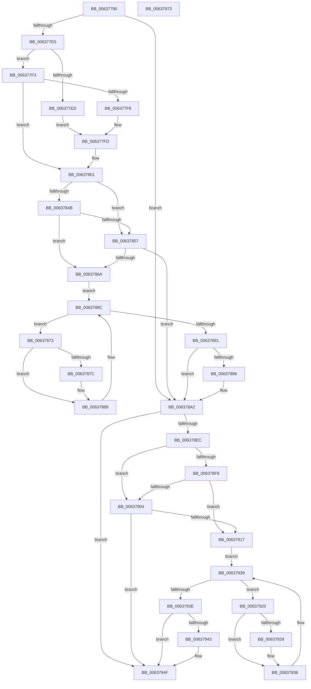

# DifNtMapViewOfSectionWrapper

- RVA: `0x00637790`–`0x00637974` (길이 `484` bytes)
- VA: `0x0000000140637790`
- 실행 섹션: `.text`
- PDB 이름 있음: `예`; PDB Function 태그: `아니요`
- unwind 정보 RVA: `0x000D2BDC`
- 디코드: `135`개 명령, `484/484` bytes 표시
- 미해석 바이트: `0` (있으면 어셈블리에 `.byte`로 보존)

> 이 문서는 커널 이미지의 기계어와 PDB 기호를 분석해 생성했습니다. 4번과 5번은 함수 원형과 자료형을 바이너리 사용 방식에서 추정한 C 해석이며 원본 소스 복구 결과는 아닙니다.

## 1. Dependencies

- 직접 호출 지점: **10**; 고유 호출 대상: **7**
- 직접 호출자로 확인된 함수: **0**
- RIP 상대 이미지 참조: **3**

### Outgoing calls
- `0x006377CA` → [memset](../6C/memset_function_006C6C40.md) (function, `0x006C6C40`)
- `0x006377D4` → [DifGetAPIThunkContextById](../49/DifGetAPIThunkContextById_function_00495A34.md) (function, `0x00495A34`)
- `0x006377F8` → [DifGetReturnAddressForWrappers](../4D/DifGetReturnAddressForWrappers_function_004D3C08.md) (function, `0x004D3C08`)
- `0x0063785E` → [ExAcquireRundownProtection](../21/ExAcquireRundownProtection_function_00216620.md) (function, `0x00216620`)
- `0x00637884` → [guard_dispatch_icall](../6B/guard_dispatch_icall_function_006BAAD0.md) (function, `0x006BAAD0`)
- `0x0063789D` → [ExReleaseRundownProtection](../34/ExReleaseRundownProtection_function_00349E80.md) (function, `0x00349E80`)
- `0x006378DF` → [NtMapViewOfSection](../../page/89/NtMapViewOfSection_function_008986E0.md) (function, `0x008986E0`)
- `0x0063790B` → [ExAcquireRundownProtection](../21/ExAcquireRundownProtection_function_00216620.md) (function, `0x00216620`)
- `0x00637931` → [guard_dispatch_icall](../6B/guard_dispatch_icall_function_006BAAD0.md) (function, `0x006BAAD0`)
- `0x0063794A` → [ExReleaseRundownProtection](../34/ExReleaseRundownProtection_function_00349E80.md) (function, `0x00349E80`)

### Direct callers
- 이 함수 시작 RVA로 연결되는 직접 call은 확인되지 않았습니다. 간접 호출은 완전히 역산할 수 없습니다.

### Static image references
- `0x00637808` → RVA `0x00F048B8` (`.data`; read)
- `0x0063784B` → RVA `0x00F04980` (`.data`; read)
- `0x00637857` → RVA `0x00F03E80` (`.data`; read)

## 2. Other-region calls and transfers

- 다른 실행 섹션으로 향하는 call: **1**
  - `0x006378DF` → [NtMapViewOfSection](../../page/89/NtMapViewOfSection_function_008986E0.md) (`.text` → `PAGE`)
- 별도 외부 분기/꼬리 이동을 확인하지 못했습니다.

## 3. Assembly (complete function range)

```asm
00637790  48 8B C4                        mov rax, rsp
00637793  48 89 58 10                     mov qword ptr [rax + 0x10], rbx
00637797  48 89 70 18                     mov qword ptr [rax + 0x18], rsi
0063779B  48 89 78 20                     mov qword ptr [rax + 0x20], rdi
0063779F  48 89 48 08                     mov qword ptr [rax + 8], rcx
006377A3  55                              push rbp
006377A4  41 54                           push r12
006377A6  41 55                           push r13
006377A8  41 56                           push r14
006377AA  41 57                           push r15
006377AC  48 8D 68 D1                     lea rbp, [rax - 0x2f]
006377B0  48 81 EC B0 00 00 00            sub rsp, 0xb0
006377B7  4C 8B EA                        mov r13, rdx
006377BA  48 8D 4D A7                     lea rcx, [rbp - 0x59]
006377BE  33 D2                           xor edx, edx
006377C0  4D 8B E0                        mov r12, r8
006377C3  4D 8B F9                        mov r15, r9
006377C6  44 8D 42 58                     lea r8d, [rdx + 0x58]
006377CA  E8 71 F4 08 00                  call 0x1406c6c40
006377CF  B9 B4 01 00 00                  mov ecx, 0x1b4
006377D4  E8 5B E2 E5 FF                  call 0x140495a34
006377D9  48 8B F0                        mov rsi, rax
006377DC  48 85 C0                        test rax, rax
006377DF  0F 84 BD 00 00 00               je 0x1406378a2
006377E5  8B 48 0C                        mov ecx, dword ptr [rax + 0xc]
006377E8  F6 C1 18                        test cl, 0x18
006377EB  74 06                           je 0x1406377f3
006377ED  48 8B 45 2F                     mov rax, qword ptr [rbp + 0x2f]
006377F1  EB 0A                           jmp 0x1406377fd
006377F3  F6 C1 04                        test cl, 4
006377F6  74 09                           je 0x140637801
006377F8  E8 0B C4 E9 FF                  call 0x1404d3c08
006377FD  48 89 45 A7                     mov qword ptr [rbp - 0x59], rax
00637801  48 8B 45 37                     mov rax, qword ptr [rbp + 0x37]
00637805  45 32 F6                        xor r14b, r14b
00637808  44 38 35 A9 D0 8C 00            cmp byte ptr [rip + 0x8cd0a9], r14b
0063780F  48 89 45 EF                     mov qword ptr [rbp - 0x11], rax
00637813  48 8B 45 57                     mov rax, qword ptr [rbp + 0x57]
00637817  48 89 45 CF                     mov qword ptr [rbp - 0x31], rax
0063781B  48 8B 45 5F                     mov rax, qword ptr [rbp + 0x5f]
0063781F  48 89 45 C7                     mov qword ptr [rbp - 0x39], rax
00637823  48 8B 45 67                     mov rax, qword ptr [rbp + 0x67]
00637827  48 89 45 BF                     mov qword ptr [rbp - 0x41], rax
0063782B  8B 45 6F                        mov eax, dword ptr [rbp + 0x6f]
0063782E  89 45 B7                        mov dword ptr [rbp - 0x49], eax
00637831  8B 45 77                        mov eax, dword ptr [rbp + 0x77]
00637834  89 45 B3                        mov dword ptr [rbp - 0x4d], eax
00637837  8B 45 7F                        mov eax, dword ptr [rbp + 0x7f]
0063783A  89 45 AF                        mov dword ptr [rbp - 0x51], eax
0063783D  4C 89 6D E7                     mov qword ptr [rbp - 0x19], r13
00637841  4C 89 65 DF                     mov qword ptr [rbp - 0x21], r12
00637845  4C 89 7D D7                     mov qword ptr [rbp - 0x29], r15
00637849  75 0C                           jne 0x140637857
0063784B  F7 05 2B D1 8C 00 00 08 00 00   test dword ptr [rip + 0x8cd12b], 0x800
00637855  74 13                           je 0x14063786a
00637857  48 8D 0D 22 C6 8C 00            lea rcx, [rip + 0x8cc622]
0063785E  E8 BD ED BD FF                  call 0x140216620
00637863  44 8A F0                        mov r14b, al
00637866  84 C0                           test al, al
00637868  74 38                           je 0x1406378a2
0063786A  48 8D 7E 20                     lea rdi, [rsi + 0x20]
0063786E  48 8B 1F                        mov rbx, qword ptr [rdi]
00637871  EB 19                           jmp 0x14063788c
00637873  48 8D 43 F0                     lea rax, [rbx - 0x10]
00637877  48 85 C0                        test rax, rax
0063787A  74 0D                           je 0x140637889
0063787C  48 8B 40 08                     mov rax, qword ptr [rax + 8]
00637880  48 8D 4D A7                     lea rcx, [rbp - 0x59]
00637884  E8 47 32 08 00                  call 0x1406baad0
00637889  48 8B 1B                        mov rbx, qword ptr [rbx]
0063788C  48 3B DF                        cmp rbx, rdi
0063788F  75 E2                           jne 0x140637873
00637891  45 84 F6                        test r14b, r14b
00637894  74 0C                           je 0x1406378a2
00637896  48 8D 0D E3 C5 8C 00            lea rcx, [rip + 0x8cc5e3]
0063789D  E8 DE 25 D1 FF                  call 0x140349e80
006378A2  8B 45 7F                        mov eax, dword ptr [rbp + 0x7f]
006378A5  4D 8B CF                        mov r9, r15
006378A8  48 8B 4D 37                     mov rcx, qword ptr [rbp + 0x37]
006378AC  4D 8B C4                        mov r8, r12
006378AF  89 44 24 48                     mov dword ptr [rsp + 0x48], eax
006378B3  49 8B D5                        mov rdx, r13
006378B6  8B 45 77                        mov eax, dword ptr [rbp + 0x77]
006378B9  89 44 24 40                     mov dword ptr [rsp + 0x40], eax
006378BD  8B 45 6F                        mov eax, dword ptr [rbp + 0x6f]
006378C0  89 44 24 38                     mov dword ptr [rsp + 0x38], eax
006378C4  48 8B 45 67                     mov rax, qword ptr [rbp + 0x67]
006378C8  48 89 44 24 30                  mov qword ptr [rsp + 0x30], rax
006378CD  48 8B 45 5F                     mov rax, qword ptr [rbp + 0x5f]
006378D1  48 89 44 24 28                  mov qword ptr [rsp + 0x28], rax
006378D6  48 8B 45 57                     mov rax, qword ptr [rbp + 0x57]
006378DA  48 89 44 24 20                  mov qword ptr [rsp + 0x20], rax
006378DF  E8 FC 0D 26 00                  call 0x1408986e0
006378E4  89 45 F7                        mov dword ptr [rbp - 9], eax
006378E7  48 85 F6                        test rsi, rsi
006378EA  74 63                           je 0x14063794f
006378EC  40 32 FF                        xor dil, dil
006378EF  40 38 3D C2 CF 8C 00            cmp byte ptr [rip + 0x8ccfc2], dil
006378F6  75 0C                           jne 0x140637904
006378F8  F7 05 7E D0 8C 00 00 08 00 00   test dword ptr [rip + 0x8cd07e], 0x800
00637902  74 13                           je 0x140637917
00637904  48 8D 0D 75 C5 8C 00            lea rcx, [rip + 0x8cc575]
0063790B  E8 10 ED BD FF                  call 0x140216620
00637910  40 8A F8                        mov dil, al
00637913  84 C0                           test al, al
00637915  74 38                           je 0x14063794f
00637917  48 83 C6 30                     add rsi, 0x30
0063791B  48 8B 1E                        mov rbx, qword ptr [rsi]
0063791E  EB 19                           jmp 0x140637939
00637920  48 8D 43 F0                     lea rax, [rbx - 0x10]
00637924  48 85 C0                        test rax, rax
00637927  74 0D                           je 0x140637936
00637929  48 8B 40 08                     mov rax, qword ptr [rax + 8]
0063792D  48 8D 4D A7                     lea rcx, [rbp - 0x59]
00637931  E8 9A 31 08 00                  call 0x1406baad0
00637936  48 8B 1B                        mov rbx, qword ptr [rbx]
00637939  48 3B DE                        cmp rbx, rsi
0063793C  75 E2                           jne 0x140637920
0063793E  40 84 FF                        test dil, dil
00637941  74 0C                           je 0x14063794f
00637943  48 8D 0D 36 C5 8C 00            lea rcx, [rip + 0x8cc536]
0063794A  E8 31 25 D1 FF                  call 0x140349e80
0063794F  8B 45 F7                        mov eax, dword ptr [rbp - 9]
00637952  4C 8D 9C 24 B0 00 00 00         lea r11, [rsp + 0xb0]
0063795A  49 8B 5B 38                     mov rbx, qword ptr [r11 + 0x38]
0063795E  49 8B 73 40                     mov rsi, qword ptr [r11 + 0x40]
00637962  49 8B 7B 48                     mov rdi, qword ptr [r11 + 0x48]
00637966  49 8B E3                        mov rsp, r11
00637969  41 5F                           pop r15
0063796B  41 5E                           pop r14
0063796D  41 5D                           pop r13
0063796F  41 5C                           pop r12
00637971  5D                              pop rbp
00637972  C3                              ret
00637973  CC                              int3
```

## 4. C-style interpretation (structured pseudocode)

```c
__int64 __fastcall DifNtMapViewOfSectionWrapper(__int64 a1, __int64 a2, __int64 a3, __int64 a4)
{
    __int64 result;
    __int64 v_r14;
    __int64 v_rdi;
    __int64 v_rsi;
    __int64 v_rsp;
    unsigned __int64 v_stack_m28;
    unsigned int v_stack_m90;
    unsigned int v_stack_m98;
    unsigned int v_stack_mA0;
    unsigned __int64 v_stack_mA8;
    unsigned __int64 v_stack_mB0;
    unsigned __int64 v_stack_mB8;

    *(unsigned __int64 *)(v_rsp + 16) = v_rbx;
    *(unsigned __int64 *)(v_rsp + 24) = v_rsi;
    *(unsigned __int64 *)(v_rsp + 32) = v_rdi;
    *(unsigned __int64 *)(v_rsp + 8) = a1;
    v_rsp = (v_rsp) - (176);
    a2 = 0;
    result = memset(v_rsp - 47 - 89, a2, a2 + 88, a4);
    result = DifGetAPIThunkContextById(436, a2, a2 + 88, a4);
    if (result == 0) goto loc_006378A2;
    if ((((unsigned __int8)((unsigned int)(*(unsigned int *)(result + 12)))) & (24)) == 0) goto loc_006377F3;
    goto loc_006377FD;
loc_006377F3:
    if ((((unsigned __int8)((unsigned int)(*(unsigned int *)(result + 12)))) & (4)) == 0) goto loc_00637801;
    result = DifGetReturnAddressForWrappers((unsigned int)(*(unsigned int *)(result + 12)), a2, a2 + 88, a4);
loc_006377FD:
    *(unsigned __int64 *)(v_rsp - 47 - 89) = result;
loc_00637801:
    v_r14 = 0;
    *(unsigned __int64 *)(v_rsp - 47 - 17) = *(unsigned __int64 *)(v_rsp - 47 + 55);
    *(unsigned __int64 *)(v_rsp - 47 - 49) = *(unsigned __int64 *)(v_rsp - 47 + 87);
    *(unsigned __int64 *)(v_rsp - 47 - 57) = *(unsigned __int64 *)(v_rsp - 47 + 95);
    *(unsigned __int64 *)(v_rsp - 47 - 65) = *(unsigned __int64 *)(v_rsp - 47 + 103);
    *(unsigned int *)(v_rsp - 47 - 73) = (unsigned int)((unsigned int)(*(unsigned int *)(v_rsp - 47 + 111)));
    *(unsigned int *)(v_rsp - 47 - 77) = (unsigned int)((unsigned int)(*(unsigned int *)(v_rsp - 47 + 119)));
    *(unsigned int *)(v_rsp - 47 - 81) = (unsigned int)((unsigned int)(*(unsigned int *)(v_rsp - 47 + 127)));
    *(unsigned __int64 *)(v_rsp - 47 - 25) = 0;
    *(unsigned __int64 *)(v_rsp - 47 - 33) = a3;
    *(unsigned __int64 *)(v_rsp - 47 - 41) = a4;
    if ((*(unsigned __int8 *)(v_rip + 9228457)) != 0) goto loc_00637857;
    if (((*(unsigned int *)(v_rip + 9228587)) & (0x800ULL)) == 0) goto loc_0063786A;
loc_00637857:
    result = ExAcquireRundownProtection(v_rip + 9225762, a2, a2 + 88, a4);
    if ((unsigned __int8)(result) == 0) goto loc_006378A2;
loc_0063786A:
    goto loc_0063788C;
loc_00637873:
    result = *(unsigned __int64 *)(result + 32) - 16;
    if (*(unsigned __int64 *)(result + 32) - 16 != 0) {
        result = *(unsigned __int64 *)(*(unsigned __int64 *)(result + 32) - 16 + 8);
        a1 = v_rsp - 47 - 89;
        result = guard_dispatch_icall(a1, a2, a2 + 88, a4);
    }
loc_0063788C:
    if ((*(unsigned __int64 *)(*(unsigned __int64 *)(result + 32))) != (result + 32)) goto loc_00637873;
    if ((unsigned __int8)((unsigned __int8)(result)) != 0) {
        a1 = v_rip + 9225699;
        result = ExReleaseRundownProtection(a1, a2, a2 + 88, a4);
    }
    v_stack_m90 = (unsigned int)((unsigned int)(*(unsigned int *)(v_rsp - 47 + 127)));
    v_stack_m98 = (unsigned int)((unsigned int)(*(unsigned int *)(v_rsp - 47 + 119)));
    v_stack_mA0 = (unsigned int)((unsigned int)(*(unsigned int *)(v_rsp - 47 + 111)));
    v_stack_mA8 = *(unsigned __int64 *)(v_rsp - 47 + 103);
    v_stack_mB0 = *(unsigned __int64 *)(v_rsp - 47 + 95);
    v_stack_mB8 = *(unsigned __int64 *)(v_rsp - 47 + 87);
    result = NtMapViewOfSection(*(unsigned __int64 *)(v_rsp - 47 + 55), 0, a3, a4);
    *(unsigned int *)(v_rsp - 47 - 9) = (unsigned int)(result);
    if (result == 0) goto loc_0063794F;
    v_rdi = 0;
    if ((*(unsigned __int8 *)(v_rip + 9228226)) != 0) goto loc_00637904;
    if (((*(unsigned int *)(v_rip + 9228414)) & (0x800ULL)) == 0) goto loc_00637917;
loc_00637904:
    result = ExAcquireRundownProtection(v_rip + 9225589, 0, a3, a4);
    if ((unsigned __int8)(result) == 0) goto loc_0063794F;
loc_00637917:
    v_rsi = (result) + (48);
    goto loc_00637939;
loc_00637920:
    result = *(unsigned __int64 *)(v_rsi) - 16;
    if (*(unsigned __int64 *)(v_rsi) - 16 != 0) {
        result = *(unsigned __int64 *)(*(unsigned __int64 *)(v_rsi) - 16 + 8);
        a1 = v_rsp - 47 - 89;
        result = guard_dispatch_icall(a1, 0, a3, a4);
    }
loc_00637939:
    if ((*(unsigned __int64 *)(*(unsigned __int64 *)(v_rsi))) != v_rsi) goto loc_00637920;
    if ((unsigned __int8)((unsigned __int8)(result)) != 0) {
        a1 = v_rip + 9225526;
        result = ExReleaseRundownProtection(a1, 0, a3, a4);
    }
    return (unsigned int)(*(unsigned int *)(v_rsp - 47 - 9));
}
```

## 5. (Beta) C Style

```c
int64_t DifNtMapViewOfSectionWrapper(int64_t Arg1, int64_t Arg2, int64_t Arg3, int64_t Arg4)
{
    int64_t result;
    int64_t local_r14;
    int64_t local_rdi;
    int64_t local_rsi;
    int64_t local_rsp;
    uint64_t v_stack_m28;
    uint32_t v_stack_m90;
    uint32_t v_stack_m98;
    uint32_t v_stack_mA0;
    uint64_t v_stack_mA8;
    uint64_t v_stack_mB0;
    uint64_t v_stack_mB8;

    *(uint64_t *)(local_rsp + 0x10) = local_rbx;
    *(uint64_t *)(local_rsp + 0x18) = local_rsi;
    *(uint64_t *)(local_rsp + 0x20) = local_rdi;
    *(uint64_t *)(local_rsp + 0x8) = Arg1;
    local_rsp = (local_rsp) - (176);
    Arg2 = 0;
    result = memset(local_rsp - 47 - 89, Arg2, Arg2 + 88, Arg4);
    result = DifGetAPIThunkContextById(436, Arg2, Arg2 + 88, Arg4);
    if (result == 0) goto loc_006378A2;
    if ((((uint8_t)((uint32_t)(*(uint32_t *)(result + 0xC)))) & (24)) == 0) goto loc_006377F3;
    goto loc_006377FD;
loc_006377F3:
    if ((((uint8_t)((uint32_t)(*(uint32_t *)(result + 0xC)))) & (4)) == 0) goto loc_00637801;
    result = DifGetReturnAddressForWrappers((uint32_t)(*(uint32_t *)(result + 0xC)), Arg2, Arg2 + 88, Arg4);
loc_006377FD:
    *(uint64_t *)(local_rsp - 0x2F - 0x59) = result;
loc_00637801:
    local_r14 = 0;
    *(uint64_t *)(local_rsp - 0x2F - 0x11) = *(uint64_t *)(local_rsp - 0x2F + 0x37);
    *(uint64_t *)(local_rsp - 0x2F - 0x31) = *(uint64_t *)(local_rsp - 0x2F + 0x57);
    *(uint64_t *)(local_rsp - 0x2F - 0x39) = *(uint64_t *)(local_rsp - 0x2F + 0x5F);
    *(uint64_t *)(local_rsp - 0x2F - 0x41) = *(uint64_t *)(local_rsp - 0x2F + 0x67);
    *(uint32_t *)(local_rsp - 0x2F - 0x49) = (uint32_t)((uint32_t)(*(uint32_t *)(local_rsp - 0x2F + 0x6F)));
    *(uint32_t *)(local_rsp - 0x2F - 0x4D) = (uint32_t)((uint32_t)(*(uint32_t *)(local_rsp - 0x2F + 0x77)));
    *(uint32_t *)(local_rsp - 0x2F - 0x51) = (uint32_t)((uint32_t)(*(uint32_t *)(local_rsp - 0x2F + 0x7F)));
    *(uint64_t *)(local_rsp - 0x2F - 0x19) = 0;
    *(uint64_t *)(local_rsp - 0x2F - 0x21) = Arg3;
    *(uint64_t *)(local_rsp - 0x2F - 0x29) = Arg4;
    if ((*(uint8_t *)(v_rip + 0x8CD0A9)) != 0) goto loc_00637857;
    if (((*(uint32_t *)(v_rip + 0x8CD12B)) & (0x800ULL)) == 0) goto loc_0063786A;
loc_00637857:
    result = ExAcquireRundownProtection(v_rip + 9225762, Arg2, Arg2 + 88, Arg4);
    if ((uint8_t)(result) == 0) goto loc_006378A2;
loc_0063786A:
    goto loc_0063788C;
loc_00637873:
    result = *(uint64_t *)(result + 0x20) - 16;
    if (*(uint64_t *)(result + 0x20) - 16 != 0) {
        result = *(uint64_t *)(*(uint64_t *)(result + 0x20) - 0x10 + 0x8);
        Arg1 = local_rsp - 47 - 89;
        result = guard_dispatch_icall(Arg1, Arg2, Arg2 + 88, Arg4);
    }
loc_0063788C:
    if ((*(uint64_t *)(*(uint64_t *)(result + 0x20))) != (result + 32)) goto loc_00637873;
    if ((uint8_t)((uint8_t)(result)) != 0) {
        Arg1 = v_rip + 9225699;
        result = ExReleaseRundownProtection(Arg1, Arg2, Arg2 + 88, Arg4);
    }
    v_stack_m90 = (uint32_t)((uint32_t)(*(uint32_t *)(local_rsp - 0x2F + 0x7F)));
    v_stack_m98 = (uint32_t)((uint32_t)(*(uint32_t *)(local_rsp - 0x2F + 0x77)));
    v_stack_mA0 = (uint32_t)((uint32_t)(*(uint32_t *)(local_rsp - 0x2F + 0x6F)));
    v_stack_mA8 = *(uint64_t *)(local_rsp - 0x2F + 0x67);
    v_stack_mB0 = *(uint64_t *)(local_rsp - 0x2F + 0x5F);
    v_stack_mB8 = *(uint64_t *)(local_rsp - 0x2F + 0x57);
    result = NtMapViewOfSection(*(uint64_t *)(local_rsp - 0x2F + 0x37), 0, Arg3, Arg4);
    *(uint32_t *)(local_rsp - 0x2F - 0x9) = (uint32_t)(result);
    if (result == 0) goto loc_0063794F;
    local_rdi = 0;
    if ((*(uint8_t *)(v_rip + 0x8CCFC2)) != 0) goto loc_00637904;
    if (((*(uint32_t *)(v_rip + 0x8CD07E)) & (0x800ULL)) == 0) goto loc_00637917;
loc_00637904:
    result = ExAcquireRundownProtection(v_rip + 9225589, 0, Arg3, Arg4);
    if ((uint8_t)(result) == 0) goto loc_0063794F;
loc_00637917:
    local_rsi = (result) + (48);
    goto loc_00637939;
loc_00637920:
    result = *(uint64_t *)(local_rsi) - 16;
    if (*(uint64_t *)(local_rsi) - 16 != 0) {
        result = *(uint64_t *)(*(uint64_t *)(local_rsi) - 0x10 + 0x8);
        Arg1 = local_rsp - 47 - 89;
        result = guard_dispatch_icall(Arg1, 0, Arg3, Arg4);
    }
loc_00637939:
    if ((*(uint64_t *)(*(uint64_t *)(local_rsi))) != local_rsi) goto loc_00637920;
    if ((uint8_t)((uint8_t)(result)) != 0) {
        Arg1 = v_rip + 9225526;
        result = ExReleaseRundownProtection(Arg1, 0, Arg3, Arg4);
    }
    return (uint32_t)(*(uint32_t *)(local_rsp - 0x2F - 0x9));
}
```

## 6. Execution-region graph

[열기: 2D/3D 그래프와 함수 탐색 컨트롤 패널](../../../control-panel.html?section=text&rva=0x00637790&view=graph)

- 2D 그래프는 위에서 아래로 흐르고, 3D 그래프는 빈 공간을 드래그해 회전합니다. Shift+드래그는 이동, 휠은 확대·축소, 함수 노드 선택은 대상 보고서 이동입니다.

### Static fallback


