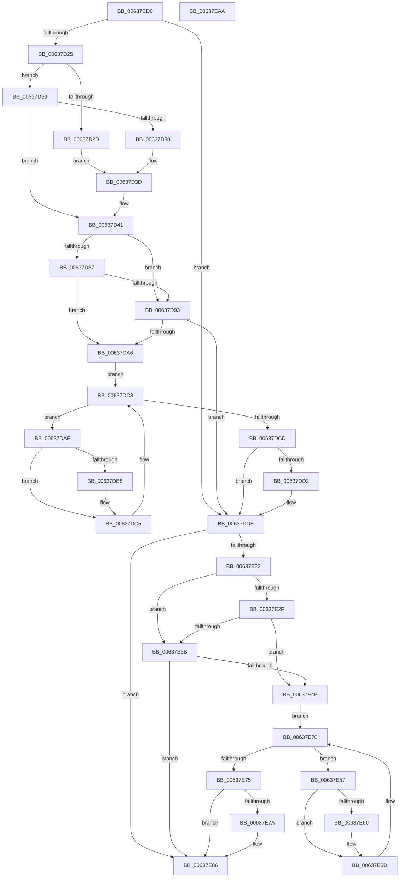

# DifNtWriteFileWrapper

- RVA: `0x00637CD0`–`0x00637EAB` (길이 `475` bytes)
- VA: `0x0000000140637CD0`
- 실행 섹션: `.text`
- PDB 이름 있음: `예`; PDB Function 태그: `아니요`
- unwind 정보 RVA: `0x000D2BDC`
- 디코드: `131`개 명령, `475/475` bytes 표시
- 미해석 바이트: `0` (있으면 어셈블리에 `.byte`로 보존)

> 이 문서는 커널 이미지의 기계어와 PDB 기호를 분석해 생성했습니다. 4번과 5번은 함수 원형과 자료형을 바이너리 사용 방식에서 추정한 C 해석이며 원본 소스 복구 결과는 아닙니다.

## 1. Dependencies

- 직접 호출 지점: **10**; 고유 호출 대상: **7**
- 직접 호출자로 확인된 함수: **0**
- RIP 상대 이미지 참조: **3**

### Outgoing calls
- `0x00637D0A` → [memset](../6C/memset_function_006C6C40.md) (function, `0x006C6C40`)
- `0x00637D14` → [DifGetAPIThunkContextById](../49/DifGetAPIThunkContextById_function_00495A34.md) (function, `0x00495A34`)
- `0x00637D38` → [DifGetReturnAddressForWrappers](../4D/DifGetReturnAddressForWrappers_function_004D3C08.md) (function, `0x004D3C08`)
- `0x00637D9A` → [ExAcquireRundownProtection](../21/ExAcquireRundownProtection_function_00216620.md) (function, `0x00216620`)
- `0x00637DC0` → [guard_dispatch_icall](../6B/guard_dispatch_icall_function_006BAAD0.md) (function, `0x006BAAD0`)
- `0x00637DD9` → [ExReleaseRundownProtection](../34/ExReleaseRundownProtection_function_00349E80.md) (function, `0x00349E80`)
- `0x00637E16` → [NtWriteFile](../../page/8E/NtWriteFile_function_008E92D0.md) (function, `0x008E92D0`)
- `0x00637E42` → [ExAcquireRundownProtection](../21/ExAcquireRundownProtection_function_00216620.md) (function, `0x00216620`)
- `0x00637E68` → [guard_dispatch_icall](../6B/guard_dispatch_icall_function_006BAAD0.md) (function, `0x006BAAD0`)
- `0x00637E81` → [ExReleaseRundownProtection](../34/ExReleaseRundownProtection_function_00349E80.md) (function, `0x00349E80`)

### Direct callers
- 이 함수 시작 RVA로 연결되는 직접 call은 확인되지 않았습니다. 간접 호출은 완전히 역산할 수 없습니다.

### Static image references
- `0x00637D48` → RVA `0x00F048B8` (`.data`; read)
- `0x00637D87` → RVA `0x00F04980` (`.data`; read)
- `0x00637D93` → RVA `0x00F03E80` (`.data`; read)

## 2. Other-region calls and transfers

- 다른 실행 섹션으로 향하는 call: **1**
  - `0x00637E16` → [NtWriteFile](../../page/8E/NtWriteFile_function_008E92D0.md) (`.text` → `PAGE`)
- 별도 외부 분기/꼬리 이동을 확인하지 못했습니다.

## 3. Assembly (complete function range)

```asm
00637CD0  48 8B C4                        mov rax, rsp
00637CD3  48 89 58 10                     mov qword ptr [rax + 0x10], rbx
00637CD7  48 89 70 18                     mov qword ptr [rax + 0x18], rsi
00637CDB  48 89 78 20                     mov qword ptr [rax + 0x20], rdi
00637CDF  48 89 48 08                     mov qword ptr [rax + 8], rcx
00637CE3  55                              push rbp
00637CE4  41 54                           push r12
00637CE6  41 55                           push r13
00637CE8  41 56                           push r14
00637CEA  41 57                           push r15
00637CEC  48 8D 68 C9                     lea rbp, [rax - 0x37]
00637CF0  48 81 EC B0 00 00 00            sub rsp, 0xb0
00637CF7  4C 8B EA                        mov r13, rdx
00637CFA  48 8D 4D AF                     lea rcx, [rbp - 0x51]
00637CFE  33 D2                           xor edx, edx
00637D00  4D 8B E0                        mov r12, r8
00637D03  4D 8B F9                        mov r15, r9
00637D06  44 8D 42 58                     lea r8d, [rdx + 0x58]
00637D0A  E8 31 EF 08 00                  call 0x1406c6c40
00637D0F  B9 CC 00 00 00                  mov ecx, 0xcc
00637D14  E8 1B DD E5 FF                  call 0x140495a34
00637D19  48 8B F0                        mov rsi, rax
00637D1C  48 85 C0                        test rax, rax
00637D1F  0F 84 B9 00 00 00               je 0x140637dde
00637D25  8B 48 0C                        mov ecx, dword ptr [rax + 0xc]
00637D28  F6 C1 18                        test cl, 0x18
00637D2B  74 06                           je 0x140637d33
00637D2D  48 8B 45 37                     mov rax, qword ptr [rbp + 0x37]
00637D31  EB 0A                           jmp 0x140637d3d
00637D33  F6 C1 04                        test cl, 4
00637D36  74 09                           je 0x140637d41
00637D38  E8 CB BE E9 FF                  call 0x1404d3c08
00637D3D  48 89 45 AF                     mov qword ptr [rbp - 0x51], rax
00637D41  48 8B 45 3F                     mov rax, qword ptr [rbp + 0x3f]
00637D45  45 32 F6                        xor r14b, r14b
00637D48  44 38 35 69 CB 8C 00            cmp byte ptr [rip + 0x8ccb69], r14b
00637D4F  48 89 45 F7                     mov qword ptr [rbp - 9], rax
00637D53  48 8B 45 5F                     mov rax, qword ptr [rbp + 0x5f]
00637D57  48 89 45 D7                     mov qword ptr [rbp - 0x29], rax
00637D5B  48 8B 45 67                     mov rax, qword ptr [rbp + 0x67]
00637D5F  48 89 45 CF                     mov qword ptr [rbp - 0x31], rax
00637D63  8B 45 6F                        mov eax, dword ptr [rbp + 0x6f]
00637D66  89 45 C7                        mov dword ptr [rbp - 0x39], eax
00637D69  48 8B 45 77                     mov rax, qword ptr [rbp + 0x77]
00637D6D  48 89 45 BF                     mov qword ptr [rbp - 0x41], rax
00637D71  48 8B 45 7F                     mov rax, qword ptr [rbp + 0x7f]
00637D75  48 89 45 B7                     mov qword ptr [rbp - 0x49], rax
00637D79  4C 89 6D EF                     mov qword ptr [rbp - 0x11], r13
00637D7D  4C 89 65 E7                     mov qword ptr [rbp - 0x19], r12
00637D81  4C 89 7D DF                     mov qword ptr [rbp - 0x21], r15
00637D85  75 0C                           jne 0x140637d93
00637D87  F7 05 EF CB 8C 00 00 08 00 00   test dword ptr [rip + 0x8ccbef], 0x800
00637D91  74 13                           je 0x140637da6
00637D93  48 8D 0D E6 C0 8C 00            lea rcx, [rip + 0x8cc0e6]
00637D9A  E8 81 E8 BD FF                  call 0x140216620
00637D9F  44 8A F0                        mov r14b, al
00637DA2  84 C0                           test al, al
00637DA4  74 38                           je 0x140637dde
00637DA6  48 8D 7E 20                     lea rdi, [rsi + 0x20]
00637DAA  48 8B 1F                        mov rbx, qword ptr [rdi]
00637DAD  EB 19                           jmp 0x140637dc8
00637DAF  48 8D 43 F0                     lea rax, [rbx - 0x10]
00637DB3  48 85 C0                        test rax, rax
00637DB6  74 0D                           je 0x140637dc5
00637DB8  48 8B 40 08                     mov rax, qword ptr [rax + 8]
00637DBC  48 8D 4D AF                     lea rcx, [rbp - 0x51]
00637DC0  E8 0B 2D 08 00                  call 0x1406baad0
00637DC5  48 8B 1B                        mov rbx, qword ptr [rbx]
00637DC8  48 3B DF                        cmp rbx, rdi
00637DCB  75 E2                           jne 0x140637daf
00637DCD  45 84 F6                        test r14b, r14b
00637DD0  74 0C                           je 0x140637dde
00637DD2  48 8D 0D A7 C0 8C 00            lea rcx, [rip + 0x8cc0a7]
00637DD9  E8 A2 20 D1 FF                  call 0x140349e80
00637DDE  48 8B 45 7F                     mov rax, qword ptr [rbp + 0x7f]
00637DE2  4D 8B CF                        mov r9, r15
00637DE5  48 8B 4D 3F                     mov rcx, qword ptr [rbp + 0x3f]
00637DE9  4D 8B C4                        mov r8, r12
00637DEC  48 89 44 24 40                  mov qword ptr [rsp + 0x40], rax
00637DF1  49 8B D5                        mov rdx, r13
00637DF4  48 8B 45 77                     mov rax, qword ptr [rbp + 0x77]
00637DF8  48 89 44 24 38                  mov qword ptr [rsp + 0x38], rax
00637DFD  8B 45 6F                        mov eax, dword ptr [rbp + 0x6f]
00637E00  89 44 24 30                     mov dword ptr [rsp + 0x30], eax
00637E04  48 8B 45 67                     mov rax, qword ptr [rbp + 0x67]
00637E08  48 89 44 24 28                  mov qword ptr [rsp + 0x28], rax
00637E0D  48 8B 45 5F                     mov rax, qword ptr [rbp + 0x5f]
00637E11  48 89 44 24 20                  mov qword ptr [rsp + 0x20], rax
00637E16  E8 B5 14 2B 00                  call 0x1408e92d0
00637E1B  89 45 FF                        mov dword ptr [rbp - 1], eax
00637E1E  48 85 F6                        test rsi, rsi
00637E21  74 63                           je 0x140637e86
00637E23  40 32 FF                        xor dil, dil
00637E26  40 38 3D 8B CA 8C 00            cmp byte ptr [rip + 0x8cca8b], dil
00637E2D  75 0C                           jne 0x140637e3b
00637E2F  F7 05 47 CB 8C 00 00 08 00 00   test dword ptr [rip + 0x8ccb47], 0x800
00637E39  74 13                           je 0x140637e4e
00637E3B  48 8D 0D 3E C0 8C 00            lea rcx, [rip + 0x8cc03e]
00637E42  E8 D9 E7 BD FF                  call 0x140216620
00637E47  40 8A F8                        mov dil, al
00637E4A  84 C0                           test al, al
00637E4C  74 38                           je 0x140637e86
00637E4E  48 83 C6 30                     add rsi, 0x30
00637E52  48 8B 1E                        mov rbx, qword ptr [rsi]
00637E55  EB 19                           jmp 0x140637e70
00637E57  48 8D 43 F0                     lea rax, [rbx - 0x10]
00637E5B  48 85 C0                        test rax, rax
00637E5E  74 0D                           je 0x140637e6d
00637E60  48 8B 40 08                     mov rax, qword ptr [rax + 8]
00637E64  48 8D 4D AF                     lea rcx, [rbp - 0x51]
00637E68  E8 63 2C 08 00                  call 0x1406baad0
00637E6D  48 8B 1B                        mov rbx, qword ptr [rbx]
00637E70  48 3B DE                        cmp rbx, rsi
00637E73  75 E2                           jne 0x140637e57
00637E75  40 84 FF                        test dil, dil
00637E78  74 0C                           je 0x140637e86
00637E7A  48 8D 0D FF BF 8C 00            lea rcx, [rip + 0x8cbfff]
00637E81  E8 FA 1F D1 FF                  call 0x140349e80
00637E86  8B 45 FF                        mov eax, dword ptr [rbp - 1]
00637E89  4C 8D 9C 24 B0 00 00 00         lea r11, [rsp + 0xb0]
00637E91  49 8B 5B 38                     mov rbx, qword ptr [r11 + 0x38]
00637E95  49 8B 73 40                     mov rsi, qword ptr [r11 + 0x40]
00637E99  49 8B 7B 48                     mov rdi, qword ptr [r11 + 0x48]
00637E9D  49 8B E3                        mov rsp, r11
00637EA0  41 5F                           pop r15
00637EA2  41 5E                           pop r14
00637EA4  41 5D                           pop r13
00637EA6  41 5C                           pop r12
00637EA8  5D                              pop rbp
00637EA9  C3                              ret
00637EAA  CC                              int3
```

## 4. C-style interpretation (structured pseudocode)

```c
__int64 __fastcall DifNtWriteFileWrapper(__int64 a1, __int64 a2, __int64 a3, __int64 a4)
{
    __int64 result;
    __int64 v_r14;
    __int64 v_rdi;
    __int64 v_rsi;
    __int64 v_rsp;
    unsigned __int64 v_stack_m28;
    unsigned __int64 v_stack_m98;
    unsigned __int64 v_stack_mA0;
    unsigned int v_stack_mA8;
    unsigned __int64 v_stack_mB0;
    unsigned __int64 v_stack_mB8;

    *(unsigned __int64 *)(v_rsp + 16) = v_rbx;
    *(unsigned __int64 *)(v_rsp + 24) = v_rsi;
    *(unsigned __int64 *)(v_rsp + 32) = v_rdi;
    *(unsigned __int64 *)(v_rsp + 8) = a1;
    v_rsp = (v_rsp) - (176);
    a2 = 0;
    result = memset(v_rsp - 55 - 81, a2, a2 + 88, a4);
    result = DifGetAPIThunkContextById(204, a2, a2 + 88, a4);
    if (result == 0) goto loc_00637DDE;
    if ((((unsigned __int8)((unsigned int)(*(unsigned int *)(result + 12)))) & (24)) == 0) goto loc_00637D33;
    goto loc_00637D3D;
loc_00637D33:
    if ((((unsigned __int8)((unsigned int)(*(unsigned int *)(result + 12)))) & (4)) == 0) goto loc_00637D41;
    result = DifGetReturnAddressForWrappers((unsigned int)(*(unsigned int *)(result + 12)), a2, a2 + 88, a4);
loc_00637D3D:
    *(unsigned __int64 *)(v_rsp - 55 - 81) = result;
loc_00637D41:
    v_r14 = 0;
    *(unsigned __int64 *)(v_rsp - 55 - 9) = *(unsigned __int64 *)(v_rsp - 55 + 63);
    *(unsigned __int64 *)(v_rsp - 55 - 41) = *(unsigned __int64 *)(v_rsp - 55 + 95);
    *(unsigned __int64 *)(v_rsp - 55 - 49) = *(unsigned __int64 *)(v_rsp - 55 + 103);
    *(unsigned int *)(v_rsp - 55 - 57) = (unsigned int)((unsigned int)(*(unsigned int *)(v_rsp - 55 + 111)));
    *(unsigned __int64 *)(v_rsp - 55 - 65) = *(unsigned __int64 *)(v_rsp - 55 + 119);
    *(unsigned __int64 *)(v_rsp - 55 - 73) = *(unsigned __int64 *)(v_rsp - 55 + 127);
    *(unsigned __int64 *)(v_rsp - 55 - 17) = 0;
    *(unsigned __int64 *)(v_rsp - 55 - 25) = a3;
    *(unsigned __int64 *)(v_rsp - 55 - 33) = a4;
    if ((*(unsigned __int8 *)(v_rip + 9227113)) != 0) goto loc_00637D93;
    if (((*(unsigned int *)(v_rip + 9227247)) & (0x800ULL)) == 0) goto loc_00637DA6;
loc_00637D93:
    result = ExAcquireRundownProtection(v_rip + 9224422, a2, a2 + 88, a4);
    if ((unsigned __int8)(result) == 0) goto loc_00637DDE;
loc_00637DA6:
    goto loc_00637DC8;
loc_00637DAF:
    result = *(unsigned __int64 *)(result + 32) - 16;
    if (*(unsigned __int64 *)(result + 32) - 16 != 0) {
        result = *(unsigned __int64 *)(*(unsigned __int64 *)(result + 32) - 16 + 8);
        a1 = v_rsp - 55 - 81;
        result = guard_dispatch_icall(a1, a2, a2 + 88, a4);
    }
loc_00637DC8:
    if ((*(unsigned __int64 *)(*(unsigned __int64 *)(result + 32))) != (result + 32)) goto loc_00637DAF;
    if ((unsigned __int8)((unsigned __int8)(result)) != 0) {
        a1 = v_rip + 9224359;
        result = ExReleaseRundownProtection(a1, a2, a2 + 88, a4);
    }
    v_stack_m98 = *(unsigned __int64 *)(v_rsp - 55 + 127);
    v_stack_mA0 = *(unsigned __int64 *)(v_rsp - 55 + 119);
    v_stack_mA8 = (unsigned int)((unsigned int)(*(unsigned int *)(v_rsp - 55 + 111)));
    v_stack_mB0 = *(unsigned __int64 *)(v_rsp - 55 + 103);
    v_stack_mB8 = *(unsigned __int64 *)(v_rsp - 55 + 95);
    result = NtWriteFile(*(unsigned __int64 *)(v_rsp - 55 + 63), 0, a3, a4);
    *(unsigned int *)(v_rsp - 55 - 1) = (unsigned int)(result);
    if (result == 0) goto loc_00637E86;
    v_rdi = 0;
    if ((*(unsigned __int8 *)(v_rip + 9226891)) != 0) goto loc_00637E3B;
    if (((*(unsigned int *)(v_rip + 9227079)) & (0x800ULL)) == 0) goto loc_00637E4E;
loc_00637E3B:
    result = ExAcquireRundownProtection(v_rip + 9224254, 0, a3, a4);
    if ((unsigned __int8)(result) == 0) goto loc_00637E86;
loc_00637E4E:
    v_rsi = (result) + (48);
    goto loc_00637E70;
loc_00637E57:
    result = *(unsigned __int64 *)(v_rsi) - 16;
    if (*(unsigned __int64 *)(v_rsi) - 16 != 0) {
        result = *(unsigned __int64 *)(*(unsigned __int64 *)(v_rsi) - 16 + 8);
        a1 = v_rsp - 55 - 81;
        result = guard_dispatch_icall(a1, 0, a3, a4);
    }
loc_00637E70:
    if ((*(unsigned __int64 *)(*(unsigned __int64 *)(v_rsi))) != v_rsi) goto loc_00637E57;
    if ((unsigned __int8)((unsigned __int8)(result)) != 0) {
        a1 = v_rip + 9224191;
        result = ExReleaseRundownProtection(a1, 0, a3, a4);
    }
    return (unsigned int)(*(unsigned int *)(v_rsp - 55 - 1));
}
```

## 5. (Beta) C Style

```c
int64_t DifNtWriteFileWrapper(int64_t Arg1, int64_t Arg2, int64_t Arg3, int64_t Arg4)
{
    int64_t result;
    int64_t local_r14;
    int64_t local_rdi;
    int64_t local_rsi;
    int64_t local_rsp;
    uint64_t v_stack_m28;
    uint64_t v_stack_m98;
    uint64_t v_stack_mA0;
    uint32_t v_stack_mA8;
    uint64_t v_stack_mB0;
    uint64_t v_stack_mB8;

    *(uint64_t *)(local_rsp + 0x10) = local_rbx;
    *(uint64_t *)(local_rsp + 0x18) = local_rsi;
    *(uint64_t *)(local_rsp + 0x20) = local_rdi;
    *(uint64_t *)(local_rsp + 0x8) = Arg1;
    local_rsp = (local_rsp) - (176);
    Arg2 = 0;
    result = memset(local_rsp - 55 - 81, Arg2, Arg2 + 88, Arg4);
    result = DifGetAPIThunkContextById(204, Arg2, Arg2 + 88, Arg4);
    if (result == 0) goto loc_00637DDE;
    if ((((uint8_t)((uint32_t)(*(uint32_t *)(result + 0xC)))) & (24)) == 0) goto loc_00637D33;
    goto loc_00637D3D;
loc_00637D33:
    if ((((uint8_t)((uint32_t)(*(uint32_t *)(result + 0xC)))) & (4)) == 0) goto loc_00637D41;
    result = DifGetReturnAddressForWrappers((uint32_t)(*(uint32_t *)(result + 0xC)), Arg2, Arg2 + 88, Arg4);
loc_00637D3D:
    *(uint64_t *)(local_rsp - 0x37 - 0x51) = result;
loc_00637D41:
    local_r14 = 0;
    *(uint64_t *)(local_rsp - 0x37 - 0x9) = *(uint64_t *)(local_rsp - 0x37 + 0x3F);
    *(uint64_t *)(local_rsp - 0x37 - 0x29) = *(uint64_t *)(local_rsp - 0x37 + 0x5F);
    *(uint64_t *)(local_rsp - 0x37 - 0x31) = *(uint64_t *)(local_rsp - 0x37 + 0x67);
    *(uint32_t *)(local_rsp - 0x37 - 0x39) = (uint32_t)((uint32_t)(*(uint32_t *)(local_rsp - 0x37 + 0x6F)));
    *(uint64_t *)(local_rsp - 0x37 - 0x41) = *(uint64_t *)(local_rsp - 0x37 + 0x77);
    *(uint64_t *)(local_rsp - 0x37 - 0x49) = *(uint64_t *)(local_rsp - 0x37 + 0x7F);
    *(uint64_t *)(local_rsp - 0x37 - 0x11) = 0;
    *(uint64_t *)(local_rsp - 0x37 - 0x19) = Arg3;
    *(uint64_t *)(local_rsp - 0x37 - 0x21) = Arg4;
    if ((*(uint8_t *)(v_rip + 0x8CCB69)) != 0) goto loc_00637D93;
    if (((*(uint32_t *)(v_rip + 0x8CCBEF)) & (0x800ULL)) == 0) goto loc_00637DA6;
loc_00637D93:
    result = ExAcquireRundownProtection(v_rip + 9224422, Arg2, Arg2 + 88, Arg4);
    if ((uint8_t)(result) == 0) goto loc_00637DDE;
loc_00637DA6:
    goto loc_00637DC8;
loc_00637DAF:
    result = *(uint64_t *)(result + 0x20) - 16;
    if (*(uint64_t *)(result + 0x20) - 16 != 0) {
        result = *(uint64_t *)(*(uint64_t *)(result + 0x20) - 0x10 + 0x8);
        Arg1 = local_rsp - 55 - 81;
        result = guard_dispatch_icall(Arg1, Arg2, Arg2 + 88, Arg4);
    }
loc_00637DC8:
    if ((*(uint64_t *)(*(uint64_t *)(result + 0x20))) != (result + 32)) goto loc_00637DAF;
    if ((uint8_t)((uint8_t)(result)) != 0) {
        Arg1 = v_rip + 9224359;
        result = ExReleaseRundownProtection(Arg1, Arg2, Arg2 + 88, Arg4);
    }
    v_stack_m98 = *(uint64_t *)(local_rsp - 0x37 + 0x7F);
    v_stack_mA0 = *(uint64_t *)(local_rsp - 0x37 + 0x77);
    v_stack_mA8 = (uint32_t)((uint32_t)(*(uint32_t *)(local_rsp - 0x37 + 0x6F)));
    v_stack_mB0 = *(uint64_t *)(local_rsp - 0x37 + 0x67);
    v_stack_mB8 = *(uint64_t *)(local_rsp - 0x37 + 0x5F);
    result = NtWriteFile(*(uint64_t *)(local_rsp - 0x37 + 0x3F), 0, Arg3, Arg4);
    *(uint32_t *)(local_rsp - 0x37 - 0x1) = (uint32_t)(result);
    if (result == 0) goto loc_00637E86;
    local_rdi = 0;
    if ((*(uint8_t *)(v_rip + 0x8CCA8B)) != 0) goto loc_00637E3B;
    if (((*(uint32_t *)(v_rip + 0x8CCB47)) & (0x800ULL)) == 0) goto loc_00637E4E;
loc_00637E3B:
    result = ExAcquireRundownProtection(v_rip + 9224254, 0, Arg3, Arg4);
    if ((uint8_t)(result) == 0) goto loc_00637E86;
loc_00637E4E:
    local_rsi = (result) + (48);
    goto loc_00637E70;
loc_00637E57:
    result = *(uint64_t *)(local_rsi) - 16;
    if (*(uint64_t *)(local_rsi) - 16 != 0) {
        result = *(uint64_t *)(*(uint64_t *)(local_rsi) - 0x10 + 0x8);
        Arg1 = local_rsp - 55 - 81;
        result = guard_dispatch_icall(Arg1, 0, Arg3, Arg4);
    }
loc_00637E70:
    if ((*(uint64_t *)(*(uint64_t *)(local_rsi))) != local_rsi) goto loc_00637E57;
    if ((uint8_t)((uint8_t)(result)) != 0) {
        Arg1 = v_rip + 9224191;
        result = ExReleaseRundownProtection(Arg1, 0, Arg3, Arg4);
    }
    return (uint32_t)(*(uint32_t *)(local_rsp - 0x37 - 0x1));
}
```

## 6. Execution-region graph

[열기: 2D/3D 그래프와 함수 탐색 컨트롤 패널](../../../control-panel.html?section=text&rva=0x00637CD0&view=graph)

- 2D 그래프는 위에서 아래로 흐르고, 3D 그래프는 빈 공간을 드래그해 회전합니다. Shift+드래그는 이동, 휠은 확대·축소, 함수 노드 선택은 대상 보고서 이동입니다.

### Static fallback


