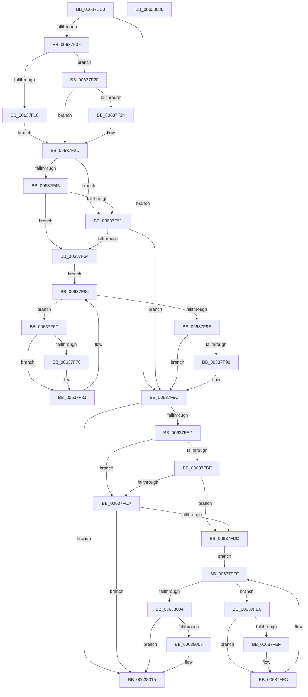

# DifObGetObjectSecurityWrapper

- RVA: `0x00637EC0`–`0x00638037` (길이 `375` bytes)
- VA: `0x0000000140637EC0`
- 실행 섹션: `.text`
- PDB 이름 있음: `예`; PDB Function 태그: `아니요`
- unwind 정보 RVA: `0x000A9A64`
- 디코드: `108`개 명령, `375/375` bytes 표시
- 미해석 바이트: `0` (있으면 어셈블리에 `.byte`로 보존)

> 이 문서는 커널 이미지의 기계어와 PDB 기호를 분석해 생성했습니다. 4번과 5번은 함수 원형과 자료형을 바이너리 사용 방식에서 추정한 C 해석이며 원본 소스 복구 결과는 아닙니다.

## 1. Dependencies

- 직접 호출 지점: **9**; 고유 호출 대상: **6**
- 직접 호출자로 확인된 함수: **0**
- RIP 상대 이미지 참조: **3**

### Outgoing calls
- `0x00637EFE` → [DifGetAPIThunkContextById](../49/DifGetAPIThunkContextById_function_00495A34.md) (function, `0x00495A34`)
- `0x00637F24` → [DifGetReturnAddressForWrappers](../4D/DifGetReturnAddressForWrappers_function_004D3C08.md) (function, `0x004D3C08`)
- `0x00637F58` → [ExAcquireRundownProtection](../21/ExAcquireRundownProtection_function_00216620.md) (function, `0x00216620`)
- `0x00637F7E` → [guard_dispatch_icall](../6B/guard_dispatch_icall_function_006BAAD0.md) (function, `0x006BAAD0`)
- `0x00637F97` → [ExReleaseRundownProtection](../34/ExReleaseRundownProtection_function_00349E80.md) (function, `0x00349E80`)
- `0x00637FA5` → [ObGetObjectSecurity](../../page/9D/ObGetObjectSecurity_function_009D45F0.md) (function, `0x009D45F0`)
- `0x00637FD1` → [ExAcquireRundownProtection](../21/ExAcquireRundownProtection_function_00216620.md) (function, `0x00216620`)
- `0x00637FF7` → [guard_dispatch_icall](../6B/guard_dispatch_icall_function_006BAAD0.md) (function, `0x006BAAD0`)
- `0x00638010` → [ExReleaseRundownProtection](../34/ExReleaseRundownProtection_function_00349E80.md) (function, `0x00349E80`)

### Direct callers
- 이 함수 시작 RVA로 연결되는 직접 call은 확인되지 않았습니다. 간접 호출은 완전히 역산할 수 없습니다.

### Static image references
- `0x00637F34` → RVA `0x00F048B8` (`.data`; read)
- `0x00637F45` → RVA `0x00F04980` (`.data`; read)
- `0x00637F51` → RVA `0x00F03E80` (`.data`; read)

## 2. Other-region calls and transfers

- 다른 실행 섹션으로 향하는 call: **1**
  - `0x00637FA5` → [ObGetObjectSecurity](../../page/9D/ObGetObjectSecurity_function_009D45F0.md) (`.text` → `PAGE`)
- 별도 외부 분기/꼬리 이동을 확인하지 못했습니다.

## 3. Assembly (complete function range)

```asm
00637EC0  48 89 5C 24 08                  mov qword ptr [rsp + 8], rbx
00637EC5  48 89 74 24 10                  mov qword ptr [rsp + 0x10], rsi
00637ECA  48 89 7C 24 18                  mov qword ptr [rsp + 0x18], rdi
00637ECF  55                              push rbp
00637ED0  41 54                           push r12
00637ED2  41 55                           push r13
00637ED4  41 56                           push r14
00637ED6  41 57                           push r15
00637ED8  48 8B EC                        mov rbp, rsp
00637EDB  48 83 EC 50                     sub rsp, 0x50
00637EDF  0F 57 C0                        xorps xmm0, xmm0
00637EE2  33 C0                           xor eax, eax
00637EE4  4C 8B E9                        mov r13, rcx
00637EE7  48 89 45 F0                     mov qword ptr [rbp - 0x10], rax
00637EEB  B9 CB 00 00 00                  mov ecx, 0xcb
00637EF0  4D 8B F8                        mov r15, r8
00637EF3  0F 11 45 D0                     movups xmmword ptr [rbp - 0x30], xmm0
00637EF7  4C 8B E2                        mov r12, rdx
00637EFA  0F 11 45 E0                     movups xmmword ptr [rbp - 0x20], xmm0
00637EFE  E8 31 DB E5 FF                  call 0x140495a34
00637F03  48 8B F0                        mov rsi, rax
00637F06  48 85 C0                        test rax, rax
00637F09  0F 84 8D 00 00 00               je 0x140637f9c
00637F0F  8B 40 0C                        mov eax, dword ptr [rax + 0xc]
00637F12  A8 18                           test al, 0x18
00637F14  74 0A                           je 0x140637f20
00637F16  48 8B 4D 28                     mov rcx, qword ptr [rbp + 0x28]
00637F1A  48 89 4D D0                     mov qword ptr [rbp - 0x30], rcx
00637F1E  EB 0D                           jmp 0x140637f2d
00637F20  A8 04                           test al, 4
00637F22  74 09                           je 0x140637f2d
00637F24  E8 DF BC E9 FF                  call 0x1404d3c08
00637F29  48 89 45 D0                     mov qword ptr [rbp - 0x30], rax
00637F2D  45 32 F6                        xor r14b, r14b
00637F30  4C 89 6D E8                     mov qword ptr [rbp - 0x18], r13
00637F34  44 38 35 7D C9 8C 00            cmp byte ptr [rip + 0x8cc97d], r14b
00637F3B  4C 89 65 E0                     mov qword ptr [rbp - 0x20], r12
00637F3F  4C 89 7D D8                     mov qword ptr [rbp - 0x28], r15
00637F43  75 0C                           jne 0x140637f51
00637F45  F7 05 31 CA 8C 00 00 08 00 00   test dword ptr [rip + 0x8cca31], 0x800
00637F4F  74 13                           je 0x140637f64
00637F51  48 8D 0D 28 BF 8C 00            lea rcx, [rip + 0x8cbf28]
00637F58  E8 C3 E6 BD FF                  call 0x140216620
00637F5D  44 8A F0                        mov r14b, al
00637F60  84 C0                           test al, al
00637F62  74 38                           je 0x140637f9c
00637F64  48 8D 7E 20                     lea rdi, [rsi + 0x20]
00637F68  48 8B 1F                        mov rbx, qword ptr [rdi]
00637F6B  EB 19                           jmp 0x140637f86
00637F6D  48 8D 43 F0                     lea rax, [rbx - 0x10]
00637F71  48 85 C0                        test rax, rax
00637F74  74 0D                           je 0x140637f83
00637F76  48 8B 40 08                     mov rax, qword ptr [rax + 8]
00637F7A  48 8D 4D D0                     lea rcx, [rbp - 0x30]
00637F7E  E8 4D 2B 08 00                  call 0x1406baad0
00637F83  48 8B 1B                        mov rbx, qword ptr [rbx]
00637F86  48 3B DF                        cmp rbx, rdi
00637F89  75 E2                           jne 0x140637f6d
00637F8B  45 84 F6                        test r14b, r14b
00637F8E  74 0C                           je 0x140637f9c
00637F90  48 8D 0D E9 BE 8C 00            lea rcx, [rip + 0x8cbee9]
00637F97  E8 E4 1E D1 FF                  call 0x140349e80
00637F9C  4D 8B C7                        mov r8, r15
00637F9F  49 8B D4                        mov rdx, r12
00637FA2  49 8B CD                        mov rcx, r13
00637FA5  E8 46 C6 39 00                  call 0x1409d45f0
00637FAA  89 45 F0                        mov dword ptr [rbp - 0x10], eax
00637FAD  48 85 F6                        test rsi, rsi
00637FB0  74 63                           je 0x140638015
00637FB2  40 32 FF                        xor dil, dil
00637FB5  40 38 3D FC C8 8C 00            cmp byte ptr [rip + 0x8cc8fc], dil
00637FBC  75 0C                           jne 0x140637fca
00637FBE  F7 05 B8 C9 8C 00 00 08 00 00   test dword ptr [rip + 0x8cc9b8], 0x800
00637FC8  74 13                           je 0x140637fdd
00637FCA  48 8D 0D AF BE 8C 00            lea rcx, [rip + 0x8cbeaf]
00637FD1  E8 4A E6 BD FF                  call 0x140216620
00637FD6  40 8A F8                        mov dil, al
00637FD9  84 C0                           test al, al
00637FDB  74 38                           je 0x140638015
00637FDD  48 83 C6 30                     add rsi, 0x30
00637FE1  48 8B 1E                        mov rbx, qword ptr [rsi]
00637FE4  EB 19                           jmp 0x140637fff
00637FE6  48 8D 43 F0                     lea rax, [rbx - 0x10]
00637FEA  48 85 C0                        test rax, rax
00637FED  74 0D                           je 0x140637ffc
00637FEF  48 8B 40 08                     mov rax, qword ptr [rax + 8]
00637FF3  48 8D 4D D0                     lea rcx, [rbp - 0x30]
00637FF7  E8 D4 2A 08 00                  call 0x1406baad0
00637FFC  48 8B 1B                        mov rbx, qword ptr [rbx]
00637FFF  48 3B DE                        cmp rbx, rsi
00638002  75 E2                           jne 0x140637fe6
00638004  40 84 FF                        test dil, dil
00638007  74 0C                           je 0x140638015
00638009  48 8D 0D 70 BE 8C 00            lea rcx, [rip + 0x8cbe70]
00638010  E8 6B 1E D1 FF                  call 0x140349e80
00638015  8B 45 F0                        mov eax, dword ptr [rbp - 0x10]
00638018  4C 8D 5C 24 50                  lea r11, [rsp + 0x50]
0063801D  49 8B 5B 30                     mov rbx, qword ptr [r11 + 0x30]
00638021  49 8B 73 38                     mov rsi, qword ptr [r11 + 0x38]
00638025  49 8B 7B 40                     mov rdi, qword ptr [r11 + 0x40]
00638029  49 8B E3                        mov rsp, r11
0063802C  41 5F                           pop r15
0063802E  41 5E                           pop r14
00638030  41 5D                           pop r13
00638032  41 5C                           pop r12
00638034  5D                              pop rbp
00638035  C3                              ret
00638036  CC                              int3
```

## 4. C-style interpretation (structured pseudocode)

```c
__int64 __fastcall DifObGetObjectSecurityWrapper(__int64 a1, __int64 a2, __int64 a3)
{
    __int64 result;
    __int64 v_r14;
    __int64 v_rdi;
    __int64 v_rsi;
    __int64 v_rsp;
    unsigned __int64 v_stack_m28;
    unsigned __int64 v_stack_m38;
    unsigned __int64 v_stack_m40;
    unsigned __int64 v_stack_m48;
    unsigned __int64 v_stack_m50;
    unsigned __int64 v_stack_m58;
    unsigned __int64 v_stack_p0;
    unsigned __int64 v_stack_p10;
    unsigned __int64 v_stack_p18;
    unsigned __int64 v_stack_p8;

    v_stack_p8 = v_rbx;
    v_stack_p10 = v_rsi;
    v_stack_p18 = v_rdi;
    v_rsp = (v_rsp) - (80);
    result = 0;
    v_stack_m38 = 0;
    v_stack_m58 = v_xmm0;
    v_stack_m48 = v_xmm0;
    result = DifGetAPIThunkContextById(203, a2, a3, a4);
    if (result == 0) goto loc_00637F9C;
    if ((((unsigned __int8)((unsigned int)(*(unsigned int *)(result + 12)))) & (24)) == 0) goto loc_00637F20;
    v_stack_m58 = v_stack_p0;
    goto loc_00637F2D;
loc_00637F20:
    result = (unsigned int)(*(unsigned int *)(result + 12));
    if ((((unsigned __int8)((unsigned int)(*(unsigned int *)(result + 12)))) & (4)) != 0) {
        result = DifGetReturnAddressForWrappers(v_stack_p0, a2, a3, a4);
        v_stack_m58 = result;
    }
    v_r14 = 0;
    v_stack_m40 = a1;
    v_stack_m48 = a2;
    v_stack_m50 = a3;
    if ((*(unsigned __int8 *)(v_rip + 9226621)) != 0) goto loc_00637F51;
    if (((*(unsigned int *)(v_rip + 9226801)) & (0x800ULL)) == 0) goto loc_00637F64;
loc_00637F51:
    result = ExAcquireRundownProtection(v_rip + 9223976, a2, a3, a4);
    if ((unsigned __int8)(result) == 0) goto loc_00637F9C;
loc_00637F64:
    goto loc_00637F86;
loc_00637F6D:
    result = *(unsigned __int64 *)(result + 32) - 16;
    if (*(unsigned __int64 *)(result + 32) - 16 != 0) {
        result = *(unsigned __int64 *)(*(unsigned __int64 *)(result + 32) - 16 + 8);
        a1 = v_stack_m58;
        result = guard_dispatch_icall(a1, a2, a3, a4);
    }
loc_00637F86:
    if ((*(unsigned __int64 *)(*(unsigned __int64 *)(result + 32))) != (result + 32)) goto loc_00637F6D;
    if ((unsigned __int8)((unsigned __int8)(result)) != 0) {
        a1 = v_rip + 9223913;
        result = ExReleaseRundownProtection(a1, a2, a3, a4);
    }
    result = ObGetObjectSecurity(a1, a2, a3, a4);
    v_stack_m38 = (unsigned int)(result);
    if (result == 0) goto loc_00638015;
    v_rdi = 0;
    if ((*(unsigned __int8 *)(v_rip + 9226492)) != 0) goto loc_00637FCA;
    if (((*(unsigned int *)(v_rip + 9226680)) & (0x800ULL)) == 0) goto loc_00637FDD;
loc_00637FCA:
    result = ExAcquireRundownProtection(v_rip + 9223855, a2, a3, a4);
    if ((unsigned __int8)(result) == 0) goto loc_00638015;
loc_00637FDD:
    v_rsi = (result) + (48);
    goto loc_00637FFF;
loc_00637FE6:
    result = *(unsigned __int64 *)(v_rsi) - 16;
    if (*(unsigned __int64 *)(v_rsi) - 16 != 0) {
        result = *(unsigned __int64 *)(*(unsigned __int64 *)(v_rsi) - 16 + 8);
        a1 = v_stack_m58;
        result = guard_dispatch_icall(a1, a2, a3, a4);
    }
loc_00637FFF:
    if ((*(unsigned __int64 *)(*(unsigned __int64 *)(v_rsi))) != v_rsi) goto loc_00637FE6;
    if ((unsigned __int8)((unsigned __int8)(result)) != 0) {
        a1 = v_rip + 9223792;
        result = ExReleaseRundownProtection(a1, a2, a3, a4);
    }
    return (unsigned int)(v_stack_m38);
}
```

## 5. (Beta) C Style

```c
int64_t DifObGetObjectSecurityWrapper(int64_t Arg1, int64_t Arg2, int64_t Arg3)
{
    int64_t result;
    int64_t local_r14;
    int64_t local_rdi;
    int64_t local_rsi;
    int64_t local_rsp;
    uint64_t v_stack_m28;
    uint64_t v_stack_m38;
    uint64_t v_stack_m40;
    uint64_t v_stack_m48;
    uint64_t v_stack_m50;
    uint64_t v_stack_m58;
    uint64_t v_stack_p0;
    uint64_t v_stack_p10;
    uint64_t v_stack_p18;
    uint64_t v_stack_p8;

    v_stack_p8 = local_rbx;
    v_stack_p10 = local_rsi;
    v_stack_p18 = local_rdi;
    local_rsp = (local_rsp) - (80);
    result = 0;
    v_stack_m38 = 0;
    v_stack_m58 = v_xmm0;
    v_stack_m48 = v_xmm0;
    result = DifGetAPIThunkContextById(203, Arg2, Arg3, a4);
    if (result == 0) goto loc_00637F9C;
    if ((((uint8_t)((uint32_t)(*(uint32_t *)(result + 0xC)))) & (24)) == 0) goto loc_00637F20;
    v_stack_m58 = v_stack_p0;
    goto loc_00637F2D;
loc_00637F20:
    result = (uint32_t)(*(uint32_t *)(result + 0xC));
    if ((((uint8_t)((uint32_t)(*(uint32_t *)(result + 0xC)))) & (4)) != 0) {
        result = DifGetReturnAddressForWrappers(v_stack_p0, Arg2, Arg3, a4);
        v_stack_m58 = result;
    }
    local_r14 = 0;
    v_stack_m40 = Arg1;
    v_stack_m48 = Arg2;
    v_stack_m50 = Arg3;
    if ((*(uint8_t *)(v_rip + 0x8CC97D)) != 0) goto loc_00637F51;
    if (((*(uint32_t *)(v_rip + 0x8CCA31)) & (0x800ULL)) == 0) goto loc_00637F64;
loc_00637F51:
    result = ExAcquireRundownProtection(v_rip + 9223976, Arg2, Arg3, a4);
    if ((uint8_t)(result) == 0) goto loc_00637F9C;
loc_00637F64:
    goto loc_00637F86;
loc_00637F6D:
    result = *(uint64_t *)(result + 0x20) - 16;
    if (*(uint64_t *)(result + 0x20) - 16 != 0) {
        result = *(uint64_t *)(*(uint64_t *)(result + 0x20) - 0x10 + 0x8);
        Arg1 = v_stack_m58;
        result = guard_dispatch_icall(Arg1, Arg2, Arg3, a4);
    }
loc_00637F86:
    if ((*(uint64_t *)(*(uint64_t *)(result + 0x20))) != (result + 32)) goto loc_00637F6D;
    if ((uint8_t)((uint8_t)(result)) != 0) {
        Arg1 = v_rip + 9223913;
        result = ExReleaseRundownProtection(Arg1, Arg2, Arg3, a4);
    }
    result = ObGetObjectSecurity(Arg1, Arg2, Arg3, a4);
    v_stack_m38 = (uint32_t)(result);
    if (result == 0) goto loc_00638015;
    local_rdi = 0;
    if ((*(uint8_t *)(v_rip + 0x8CC8FC)) != 0) goto loc_00637FCA;
    if (((*(uint32_t *)(v_rip + 0x8CC9B8)) & (0x800ULL)) == 0) goto loc_00637FDD;
loc_00637FCA:
    result = ExAcquireRundownProtection(v_rip + 9223855, Arg2, Arg3, a4);
    if ((uint8_t)(result) == 0) goto loc_00638015;
loc_00637FDD:
    local_rsi = (result) + (48);
    goto loc_00637FFF;
loc_00637FE6:
    result = *(uint64_t *)(local_rsi) - 16;
    if (*(uint64_t *)(local_rsi) - 16 != 0) {
        result = *(uint64_t *)(*(uint64_t *)(local_rsi) - 0x10 + 0x8);
        Arg1 = v_stack_m58;
        result = guard_dispatch_icall(Arg1, Arg2, Arg3, a4);
    }
loc_00637FFF:
    if ((*(uint64_t *)(*(uint64_t *)(local_rsi))) != local_rsi) goto loc_00637FE6;
    if ((uint8_t)((uint8_t)(result)) != 0) {
        Arg1 = v_rip + 9223792;
        result = ExReleaseRundownProtection(Arg1, Arg2, Arg3, a4);
    }
    return (uint32_t)(v_stack_m38);
}
```

## 6. Execution-region graph

[열기: 2D/3D 그래프와 함수 탐색 컨트롤 패널](../../../control-panel.html?section=text&rva=0x00637EC0&view=graph)

- 2D 그래프는 위에서 아래로 흐르고, 3D 그래프는 빈 공간을 드래그해 회전합니다. Shift+드래그는 이동, 휠은 확대·축소, 함수 노드 선택은 대상 보고서 이동입니다.

### Static fallback


